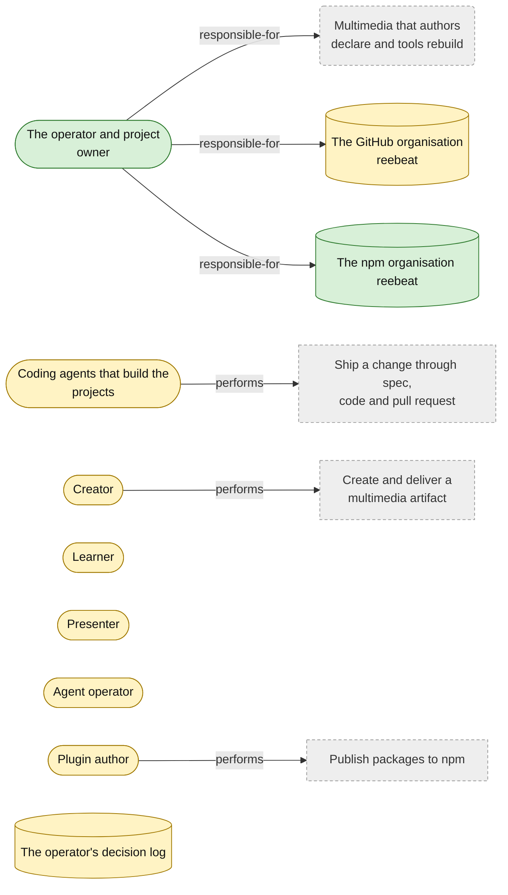

<!-- Generated by tools/intent from model/. Do not edit by hand: change the model and run `bun run generate`. -->

# Actors and Resources Model

The Actors and Resources Model says who does the work and what they use. Personas are the roles the products serve; each has its jobs to be done in the Goals Model.

Method: 4EM (Sandkuhl, Stirna, Persson and Wißotzki, *Enterprise Modeling: Tackling Business Challenges with the 4EM Method*, Springer 2014). Every element cites its source; `decided` means a source shows that the operator decided it.

## The organisation

10 elements: 2 decided, 8 proposed, 0 open.

| Element | Statement | Status | Links | Sources |
| --- | --- | --- | --- | --- |
| <code>actor-operator</code> Actor | **The operator and project owner.** The person who owns the reebeat projects, decides their direction and holds the copyright. His sole proprietorship is not a separate legal person. Type: individual. | decided | responsible-for: [Multimedia that authors declare and tools rebuild](goals.md#goal-org-vision), [The GitHub organisation reebeat](actors-and-resources.md#resource-github-org), [The npm organisation reebeat](actors-and-resources.md#resource-npm-org) | [log L44][1], [record reebeat:docs/design/open-core-boundary.md:64][2] |
| <code>resource-npm-org</code> Resource | **The npm organisation reebeat.** The npm organisation under which `@reebeat/*` pre-releases are published. It exists. Type: service. | decided |  | [log L49][3] |
| <code>actor-contributor-agent</code> Actor | **Coding agents that build the projects.** Agents write specs, code and reviews under the lifecycle rules. A pass that the author of the head records about its own pull request is refused. Type: role. *Why proposed:* The repositories use agents as contributors in practice, but no decision line names them as a stakeholder. | proposed | performs: [Ship a change through spec, code and pull request](business-processes.md#process-org-ship-change) | [reebeat:AGENTS.md:15-17][4], [studio:AGENTS.md:17][5] |
| <code>actor-creator</code> Actor | **Creator.** A person or agent who declares a story: its scenes, states, transitions and effects. They want to focus on the narrative, not on how it is built. Type: role. Persona. *Why proposed:* The operator names "you focus on creating" (log line 7) but no persona list. The assignment of 2026-10-29 lists creator, learner, presenter, agent operator and plugin author; the operator should confirm or change them. | proposed | performs: [Create and deliver a multimedia artifact](business-processes.md#process-org-create-and-deliver) | [log L7][6], [log L11][7] |
| <code>actor-learner</code> Actor | **Learner.** A person who learns from the artifact. They may be hearing-impaired, visually impaired or sensitive to motion, and may need a language variant. They may interact with a website artifact. Type: role. Persona. *Why proposed:* Inferred from the audiences the operator names (log line 32) and the interactive learning material (log line 36). The persona label is not the operator's. | proposed |  | [log L32][8], [log L36][9] |
| <code>actor-presenter</code> Actor | **Presenter.** A person who presents a deck with narration in speaker notes, and records narration against the beats of a story. Type: role. Persona. *Why proposed:* Inferred from the deck artifact and the studio deck view (log line 45). The operator should confirm that presenting is a separate persona from creating. | proposed |  | [log L45][10] |
| <code>actor-agent-operator</code> Actor | **Agent operator.** A person who brings their own AI agent and gives it the editing tools, so it can read, edit and check a story. Type: role. Persona. *Why proposed:* Inferred from "users can bring their own agents" (log line 43) and agents as interaction surfaces (log line 38). | proposed |  | [log L38][11], [log L43][12] |
| <code>actor-plugin-author</code> Actor | **Plugin author.** A developer who writes an adapter, a render engine or an extension against the open contracts of the compiler. Type: role. Persona. *Why proposed:* Inferred from plugins and extensions (log line 43) and the render-engine SDK (log line 28). | proposed | performs: [Publish packages to npm](business-processes.md#process-org-publish-packages) | [log L28][13], [log L43][12] |
| <code>resource-github-org</code> Resource | **The GitHub organisation reebeat.** The organisation that holds the repositories of the compiler, the editor and the graph library, and this model. Type: service. *Why proposed:* The organisation exists and the README says it is reserved. That is a fact the operator can see, not a line of the decision log, so it is not marked decided. | proposed |  | [reebeat:README.md:42][14] |
| <code>resource-decision-log</code> Resource | **The operator's decision log.** The operator's own decisions and wording, compiled by the lead agent from the working sessions of 2026-10-28 and 2026-10-29. Its header says that where a repository document disagrees, the log and its date win. Type: document. *Why proposed:* The header is the lead's statement of the log's precedence, not a line the operator decided. The operator should confirm that the log outranks repository documents. | proposed |  | [log L3][15] |

## reebeat (the compiler)

21 elements: 0 decided, 21 proposed, 0 open.

```mermaid
flowchart LR
    classDef decided fill:#d8f0d8,stroke:#2d7a2d,color:#111
    classDef proposed fill:#fff3c4,stroke:#a07800,color:#111
    classDef open fill:#f8d7d7,stroke:#a02020,color:#111
    classDef outside fill:#eee,stroke:#999,color:#333,stroke-dasharray:4 3
    actor_reebeat_story_author(["Story author"]):::proposed
    actor_reebeat_presenter(["Presenter"]):::proposed
    actor_reebeat_agent_operator(["Agent operator"]):::proposed
    actor_reebeat_plugin_author(["Plugin author"]):::proposed
    actor_reebeat_cli(["The reebeat command"]):::proposed
    actor_reebeat_build_program(["The build program"]):::proposed
    actor_reebeat_local_adapters(["The local adapters"]):::proposed
    actor_reebeat_verifier(["The verifier"]):::proposed
    actor_reebeat_reviewers(["Independent reviewers and<br/>the fixer"]):::proposed
    actor_reebeat_maintainer(["Maintainer"]):::proposed
    resource_reebeat_chromium[("Chromium")]:::proposed
    resource_reebeat_ffmpeg[("ffmpeg and ffprobe")]:::proposed
    resource_reebeat_whisper_cpp[("whisper.cpp")]:::proposed
    resource_reebeat_kokoro_model[("Kokoro speech model")]:::proposed
    resource_reebeat_whisper_model[("Whisper base English model")]:::proposed
    resource_reebeat_reveal_js[("reveal.js")]:::proposed
    resource_reebeat_fountain_format[("The Fountain screenplay<br/>format")]:::proposed
    resource_reebeat_licence_inventory[("The licence inventory")]:::proposed
    resource_reebeat_devenv[("devenv shell")]:::proposed
    resource_reebeat_same_id_story[("The story same-id")]:::proposed
    resource_reebeat_speech_cache[("The speech cache")]:::proposed
    actor_creator(["Creator"]):::outside
    process_reebeat_author_story["Author a story"]:::outside
    process_reebeat_review_plan["Review the Plan"]:::outside
    actor_presenter(["Presenter"]):::outside
    concept_reebeat_deck["Deck"]:::outside
    actor_agent_operator(["Agent operator"]):::outside
    actor_plugin_author(["Plugin author"]):::outside
    process_reebeat_add_adapter["Add an adapter"]:::outside
    process_reebeat_select_adapters["Select the adapters"]:::outside
    process_reebeat_run_journey["Run the whole journey on one<br/>story"]:::outside
    rule_reebeat_only_cli_composes>"Only the cli composes<br/>adapters"]:::outside
    comp_reebeat_cli["cli, the reebeat command"]:::outside
    process_reebeat_parse_story["Parse the screenplay"]:::outside
    process_reebeat_build_plan["Build the Plan"]:::outside
    process_reebeat_speech_stage["Make or reuse the narration<br/>audio"]:::outside
    process_reebeat_schedule["Schedule the Timeline"]:::outside
    process_reebeat_render_deck["Render the Deck"]:::outside
    process_reebeat_write_manifest["Write the manifest and<br/>commit the build"]:::outside
    comp_reebeat_pipeline["pipeline, the build program"]:::outside
    process_reebeat_capture_frames["Capture the frames"]:::outside
    process_reebeat_encode_video["Encode and mux the Video"]:::outside
    process_reebeat_verify_build["Verify the written build"]:::outside
    comp_reebeat_verify["verify, the output-side<br/>checks"]:::outside
    actor_contributor_agent(["Coding agents that build the<br/>projects"]):::outside
    process_reebeat_review_round["Hold a recorded review round"]:::outside
    actor_operator(["The operator and project<br/>owner"]):::outside
    process_reebeat_release_publish["Publish pre-releases to npm"]:::outside
    goal_reebeat_npm_publication("Publish @reebeat packages to<br/>npm"):::outside
    actor_reebeat_story_author -->|part-of| actor_creator
    actor_reebeat_story_author -->|performs| process_reebeat_author_story
    actor_reebeat_story_author -->|performs| process_reebeat_review_plan
    actor_reebeat_presenter -->|part-of| actor_presenter
    actor_reebeat_presenter -->|uses| concept_reebeat_deck
    actor_reebeat_agent_operator -->|part-of| actor_agent_operator
    actor_reebeat_agent_operator -->|performs| process_reebeat_author_story
    actor_reebeat_plugin_author -->|part-of| actor_plugin_author
    actor_reebeat_plugin_author -->|performs| process_reebeat_add_adapter
    actor_reebeat_cli -->|performs| process_reebeat_select_adapters
    actor_reebeat_cli -->|performs| process_reebeat_run_journey
    actor_reebeat_cli -->|responsible-for| rule_reebeat_only_cli_composes
    actor_reebeat_cli -->|uses| comp_reebeat_cli
    actor_reebeat_build_program -->|performs| process_reebeat_parse_story
    actor_reebeat_build_program -->|performs| process_reebeat_build_plan
    actor_reebeat_build_program -->|performs| process_reebeat_speech_stage
    actor_reebeat_build_program -->|performs| process_reebeat_schedule
    actor_reebeat_build_program -->|performs| process_reebeat_render_deck
    actor_reebeat_build_program -->|performs| process_reebeat_write_manifest
    actor_reebeat_build_program -->|uses| comp_reebeat_pipeline
    actor_reebeat_local_adapters -->|performs| process_reebeat_capture_frames
    actor_reebeat_local_adapters -->|performs| process_reebeat_encode_video
    actor_reebeat_local_adapters -->|uses| resource_reebeat_chromium
    actor_reebeat_local_adapters -->|uses| resource_reebeat_ffmpeg
    actor_reebeat_local_adapters -->|uses| resource_reebeat_whisper_cpp
    actor_reebeat_verifier -->|performs| process_reebeat_verify_build
    actor_reebeat_verifier -->|uses| comp_reebeat_verify
    actor_reebeat_reviewers -->|part-of| actor_contributor_agent
    actor_reebeat_reviewers -->|performs| process_reebeat_review_round
    actor_reebeat_maintainer -->|part-of| actor_operator
    actor_reebeat_maintainer -->|performs| process_reebeat_release_publish
    actor_reebeat_maintainer -->|responsible-for| goal_reebeat_npm_publication
```

| Element | Statement | Status | Links | Sources |
| --- | --- | --- | --- | --- |
| <code>actor-reebeat-story-author</code> Actor | **Story author.** A creator who writes one Fountain screenplay and runs `plan`, `build` and `check`. They declare the story and leave the building to reebeat. Type: role. Persona. *Why proposed:* The README addresses a person who writes a screenplay (README.md:3). Mapping that person to the organisation's Creator persona is the model author's reading. | proposed | part-of: [Creator](actors-and-resources.md#actor-creator); performs: [Author a story](business-processes.md#process-reebeat-author-story), [Review the Plan](business-processes.md#process-reebeat-review-plan); serves: [Declare the story, reebeat builds the artifacts](goals.md#goal-reebeat-vision) | [reebeat:README.md:3][16], [reebeat:README.md:14-19][17], [log L7][6] |
| <code>actor-reebeat-presenter</code> Actor | **Presenter.** A speaker who steps through the Deck with the arrow keys and reads the narration as speaker notes. Type: role. Persona. *Why proposed:* README.md:21 tells the reader to step through the Deck and open speaker notes. Treating this reader as the organisation's Presenter persona is the model author's reading. | proposed | part-of: [Presenter](actors-and-resources.md#actor-presenter); uses: [Deck](concepts.md#concept-reebeat-deck); serves: [A Deck and a Video from one source](goals.md#goal-reebeat-deck-and-video) | [reebeat:README.md:21][18], [reebeat:GLOSSARY.md:78-80][19] |
| <code>actor-reebeat-agent-operator</code> Actor | **Agent operator.** A person whose own agent writes and repairs stories with the compiler's text source and its line-numbered messages. Type: role. Persona. *Why proposed:* The operator decided that users can bring their own agents (log:43). That an agent works through `plan`, `lint` and `check` is the model author's reading of spec 0002. | proposed | part-of: [Agent operator](actors-and-resources.md#actor-agent-operator); performs: [Author a story](business-processes.md#process-reebeat-author-story); serves: [An explicit source nobody can misread](goals.md#goal-reebeat-explicit-source) | [log L43][12], [reebeat:docs/specs/0002-explicit-anchors-and-syntax.md:11][20] |
| <code>actor-reebeat-plugin-author</code> Actor | **Plugin author.** A developer who writes an adapter for one service and proves it with the service's contract suite. Type: role. Persona. *Why proposed:* Observed in the repository: open-core-boundary.md and AGENTS.md describe this role. The operator decided that plugins are supported, but the adapter-and-contract shape is marked proposed there, so confirm it. | proposed | part-of: [Plugin author](actors-and-resources.md#actor-plugin-author); performs: [Add an adapter](business-processes.md#process-reebeat-add-adapter); serves: [Plugins and a render-engine SDK](goals.md#goal-reebeat-plugin-sdk) | [log L43][12], [reebeat:docs/design/open-core-boundary.md:24][21], [reebeat:AGENTS.md:65][22] |
| <code>actor-reebeat-cli</code> Actor | **The reebeat command.** The `reebeat` command with `plan`, `lint`, `build`, `check` and `journey`. It is the one composition root that reads the selection and fills each service with an adapter. Type: system. *Why proposed:* Observed in the repository: the command source lists these subcommands. The operator decided explicit selection at a composition root, not the command list, so confirm it. | proposed | performs: [Select the adapters](business-processes.md#process-reebeat-select-adapters), [Run the whole journey on one story](business-processes.md#process-reebeat-run-journey); responsible-for: [Only the cli composes adapters](business-rules.md#rule-reebeat-only-cli-composes); uses: [cli, the reebeat command](technical-components.md#comp-reebeat-cli) | [reebeat:packages/cli/src/cli.ts:70][23], [reebeat:packages/cli/src/cli.ts:321][24], [reebeat:AGENTS.md:62][25] |
| <code>actor-reebeat-build-program</code> Actor | **The build program.** One Effect program over the seven services. It runs every stage from the story to a finished build directory and knows no model, browser or binary. Type: system. *Why proposed:* Observed in the repository: the pipeline source describes the seven-service program. The operator has not decided its exact shape, so confirm it. | proposed | performs: [Parse the screenplay](business-processes.md#process-reebeat-parse-story), [Build the Plan](business-processes.md#process-reebeat-build-plan), [Make or reuse the narration audio](business-processes.md#process-reebeat-speech-stage), [Schedule the Timeline](business-processes.md#process-reebeat-schedule), [Render the Deck](business-processes.md#process-reebeat-render-deck), [Write the manifest and commit the build](business-processes.md#process-reebeat-write-manifest); uses: [pipeline, the build program](technical-components.md#comp-reebeat-pipeline) | [reebeat:packages/pipeline/src/buildProgram.ts:1-3][26] |
| <code>actor-reebeat-local-adapters</code> Actor | **The local adapters.** The adapters for Kokoro, whisper.cpp, synthesised sounds, reveal.js, Chromium, ffmpeg and the file cache. Each runs on the user's machine and sends nothing out. Type: system. *Why proposed:* Observed in the repository: the README and spec 0001 describe the local adapters and their egress. The operator has not decided this inventory, so confirm it. | proposed | performs: [Capture the frames](business-processes.md#process-reebeat-capture-frames), [Encode and mux the Video](business-processes.md#process-reebeat-encode-video); uses: [Chromium](actors-and-resources.md#resource-reebeat-chromium), [ffmpeg and ffprobe](actors-and-resources.md#resource-reebeat-ffmpeg), [whisper.cpp](actors-and-resources.md#resource-reebeat-whisper-cpp) | [reebeat:README.md:21][18], [reebeat:docs/specs/0001-release-1-screenplay-to-deck-and-video.md:260][27] |
| <code>actor-reebeat-verifier</code> Actor | **The verifier.** The `verify` tool reads a written build and the source, and prints one verdict per falsifier. It never reads the pipeline's memory. Type: system. *Why proposed:* Spec plan: spec 0001 describes the output-side verifier. The operator has not decided this actor, so confirm it. | proposed | performs: [Verify the written build](business-processes.md#process-reebeat-verify-build); uses: [verify, the output-side checks](technical-components.md#comp-reebeat-verify) | [reebeat:packages/verify/src/index.ts:1-2][28] |
| <code>actor-reebeat-reviewers</code> Actor | **Independent reviewers and the fixer.** A verification reviewer and a conformance reviewer judge the plan, the code and their agreement. A fixer addresses the findings. Reviewers are read-only on product code. Type: role. *Why proposed:* Spec plan: spec 0000 describes the reviewer and fixer roles. The operator has not decided each responsibility, so confirm it. | proposed | part-of: [Coding agents that build the projects](actors-and-resources.md#actor-contributor-agent); performs: [Hold a recorded review round](business-processes.md#process-reebeat-review-round); serves: [A compiler whose structure prevents bad states](goals.md#goal-reebeat-correct-by-construction) | [reebeat:docs/specs/0000-development-lifecycle.md:75][29], [reebeat:docs/specs/0000-development-lifecycle.md:79][30] |
| <code>actor-reebeat-maintainer</code> Actor | **Maintainer.** The person who owns the repository. They answer operator-owned forks, merge a pull request that has a passing recorded round, and provision the npm and GitHub environment for a release. Type: role. *Why proposed:* Observed in the repository: spec 0000 and AGENTS.md describe these duties. The npm provisioning duty comes from PR #18. The operator has not decided this role, so confirm it. | proposed | part-of: [The operator and project owner](actors-and-resources.md#actor-operator); performs: [Publish pre-releases to npm](business-processes.md#process-reebeat-release-publish); responsible-for: [Publish @reebeat packages to npm](goals.md#goal-reebeat-npm-publication) | [reebeat:docs/specs/0000-development-lifecycle.md:23][31], [reebeat:AGENTS.md:77-85][32] |
| <code>resource-reebeat-chromium</code> Resource | **Chromium.** The browser that renders the Deck page for frame capture, driven by Playwright under a virtual clock. It runs as a separate process. Type: external-tool. *Why proposed:* Spec plan: spec 0001 and the third-party audit describe Chromium, Playwright and the process boundary. The operator has not decided this arrangement, so confirm it. | proposed | serves: [A Deck and a Video from one source](goals.md#goal-reebeat-deck-and-video) | [reebeat:docs/specs/0001-release-1-screenplay-to-deck-and-video.md:86][33], [reebeat:docs/design/third-party.md:56][34], [reebeat:AGENTS.md:91][35] |
| <code>resource-reebeat-ffmpeg</code> Resource | **ffmpeg and ffprobe.** The tools that encode lossless audio, mix, mux the Video and measure written files. The configured build is GPL-3.0-or-later because it includes libx264. Type: external-tool. *Why proposed:* Observed in the repository: the third-party audit reads the configured build as GPL-3.0-or-later. The operator noted the GPL concern for later (log:50) but has not decided this inventory, so confirm it. | proposed | serves: [A Deck and a Video from one source](goals.md#goal-reebeat-deck-and-video) | [reebeat:docs/design/third-party.md:57][36], [reebeat:AGENTS.md:92][37], [log L50][38] |
| <code>resource-reebeat-whisper-cpp</code> Resource | **whisper.cpp.** The `whisper-cli` program that gives word timestamps for the aligned narration. It is MIT licensed and runs as a separate process. Type: external-tool. *Why proposed:* Spec plan: spec 0001 and the third-party audit describe whisper-cli, its MIT licence and the process boundary. The operator has not decided this arrangement, so confirm it. | proposed | serves: [Effects connect to produced events](goals.md#goal-reebeat-event-timing) | [reebeat:docs/specs/0001-release-1-screenplay-to-deck-and-video.md:78][39], [reebeat:docs/design/third-party.md:59][40] |
| <code>resource-reebeat-kokoro-model</code> Resource | **Kokoro speech model.** The Kokoro-82M model, with its voices, run locally through `kokoro-js`. It is Apache-2.0, is downloaded on first use, and is never stored in the repository. Type: model-asset. *Why proposed:* Spec plan: spec 0001 and the third-party audit describe the Kokoro model, its licence and its download. The operator has not decided this arrangement, so confirm it. | proposed | serves: [A Deck and a Video from one source](goals.md#goal-reebeat-deck-and-video) | [reebeat:docs/specs/0001-release-1-screenplay-to-deck-and-video.md:78][39], [reebeat:docs/design/third-party.md:71][41] |
| <code>resource-reebeat-whisper-model</code> Resource | **Whisper base English model.** The `ggml-base.en` model file that whisper.cpp reads. It is MIT licensed. It is not in the repository or in devenv, so the user downloads it. Type: model-asset. *Why proposed:* Observed in the repository: the third-party audit and AGENTS.md describe the whisper model file. The operator has not decided this arrangement, so confirm it. | proposed | serves: [Effects connect to produced events](goals.md#goal-reebeat-event-timing) | [reebeat:docs/design/third-party.md:72][42], [reebeat:AGENTS.md:93][43] |
| <code>resource-reebeat-reveal-js</code> Resource | **reveal.js.** The presentation framework that renders the Deck. Its Auto-Animate matches Elements by id and is the animator and the identity diff in release 1. It is MIT licensed. Type: software. *Why proposed:* Observed in the repository: the third-party audit gives the MIT licence. The operator decided reveal.js Auto-Animate as the release-1 animator (spec 0001 line 212), not the licence detail, so confirm it. | proposed | serves: [A Deck and a Video from one source](goals.md#goal-reebeat-deck-and-video) | [reebeat:docs/specs/0001-release-1-screenplay-to-deck-and-video.md:213][44], [reebeat:docs/design/third-party.md:44][45] |
| <code>resource-reebeat-fountain-format</code> Resource | **The Fountain screenplay format.** The plain-text screenplay syntax, version 1.1. reebeat reads it through an existing parser and defines a small fixed vocabulary on top; that is the importer. reebeat is also to write Fountain as an artifact, which is not built at the pinned commit. Type: document. *Why proposed:* Spec plan: the operator decided that the source is one Fountain file (spec 0001 line 213). The version, the parser and the fixed vocabulary come from the spec plan, so confirm them. The operator also said Fountain is both an importer and an artifact renderer (log:67-69); confirm that the renderer shares this vocabulary. | proposed | serves: [One screenplay, every rendering](goals.md#goal-reebeat-screenplay-first) | [reebeat:docs/specs/0001-release-1-screenplay-to-deck-and-video.md:213][44], [reebeat:docs/specs/0001-release-1-screenplay-to-deck-and-video.md:32][46], [log L67-69][47] |
| <code>resource-reebeat-licence-inventory</code> Resource | **The licence inventory.** One file lists every locked npm package with its licence, taken from the package's own manifest. A test ties it to the lockfile, so nothing else lists packages. Type: data. *Why proposed:* Spec plan: spec 0008 describes the inventory file and its test. The operator has not decided each detail, so confirm it. | proposed | serves: [License the compiler and its formats under Apache-2.0](goals.md#goal-reebeat-apache-licence) | [reebeat:docs/design/third-party.md:33][48], [reebeat:docs/specs/0008-apache-2-licence.md:61][49] |
| <code>resource-reebeat-devenv</code> Resource | **devenv shell.** The pinned toolchain that provides Bun, Node, gitleaks, Chromium, ffmpeg and whisper.cpp for builds, hooks and CI. It runs on Linux, and elsewhere the user sets the Chromium path. Type: external-tool. *Why proposed:* Observed in the repository: devenv.nix lists the tools. The operator has not decided this inventory, so confirm it. | proposed | serves: [Reproducible builds](goals.md#goal-reebeat-reproducible-builds) | [reebeat:devenv.nix:16-23][50], [reebeat:README.md:12][51] |
| <code>resource-reebeat-same-id-story</code> Resource | **The story same-id.** The one original, public story that builds end to end. It holds the screenplay and a committed speech cache, and it is the subject of every journey check. Type: document. *Why proposed:* Observed in the repository: the README and spec 0001 name this story and its cache. Spec 0001 leaves the committed cache as an open question for the operator, so this is the current default only. | proposed | serves: [Check the written files, not the pipeline's memory](goals.md#goal-reebeat-verified-output) | [reebeat:README.md:8][52], [reebeat:docs/specs/0001-release-1-screenplay-to-deck-and-video.md:14][53] |
| <code>resource-reebeat-speech-cache</code> Resource | **The speech cache.** Content-addressed FLAC audio and word timings, keyed by the narration text and the adapter settings. It is the only generated asset kept in git, so a build needs no model. Type: data. *Why proposed:* Observed in the repository: the speech cache is committed. Spec 0001 asks the operator whether that is acceptable and the question stays open, so this is the current default only. | proposed | serves: [Reproducible builds](goals.md#goal-reebeat-reproducible-builds) | [reebeat:docs/specs/0001-release-1-screenplay-to-deck-and-video.md:78][39], [reebeat:README.md:21][18] |

## reebeat studio

26 elements: 9 decided, 17 proposed, 0 open.

```mermaid
flowchart LR
    classDef decided fill:#d8f0d8,stroke:#2d7a2d,color:#111
    classDef proposed fill:#fff3c4,stroke:#a07800,color:#111
    classDef open fill:#f8d7d7,stroke:#a02020,color:#111
    classDef outside fill:#eee,stroke:#999,color:#333,stroke-dasharray:4 3
    actor_studio_story_author(["Story author in studio"]):::proposed
    actor_studio_narrator(["Narrator in the deck view"]):::proposed
    actor_studio_agent_owner(["Person who brings their own<br/>agent"]):::proposed
    actor_studio_collaborator(["Collaborator on a shared<br/>story"]):::proposed
    actor_studio_product_owner(["The operator as owner of<br/>studio"]):::decided
    actor_studio_pr_author(["Contributor who writes a<br/>spec and its pull request"]):::proposed
    actor_studio_reviewer(["Independent reviewer"]):::proposed
    actor_studio_own_agent(["An agent that runs on the<br/>user's side"]):::decided
    actor_studio_hosted_agent(["A hosted agent run by the<br/>project"]):::decided
    actor_studio_sync_server(["The sync server"]):::decided
    resource_studio_repo[("The public repository<br/>reebeat/studio")]:::decided
    resource_studio_reebeat_compiler[("The reebeat compiler and its<br/>IR")]:::proposed
    resource_studio_foldkit[("Foldkit, the UI framework")]:::proposed
    resource_studio_effect[("Effect 4.1.0")]:::proposed
    resource_studio_loro[("Loro, the CRDT library")]:::decided
    resource_studio_loro_release[("loro-crdt 1.17.1 under the<br/>MIT licence")]:::proposed
    resource_studio_cloudflare[("Cloudflare Workers and<br/>Durable Objects")]:::proposed
    resource_studio_alchemy[("Alchemy v2")]:::proposed
    resource_studio_bun[("Bun, the runtime and<br/>compiler")]:::decided
    resource_studio_story_file[("A story IR file")]:::decided
    resource_studio_speech_cache[("Narration speech cache")]:::proposed
    resource_studio_specs[("Specs and the lenses design<br/>note")]:::proposed
    resource_studio_spike_code[("The collaboration spike code")]:::proposed
    resource_studio_ci[("GitHub Actions checks")]:::proposed
    resource_studio_host_chromium[("The host Chromium for<br/>browser runs")]:::proposed
    resource_studio_hosting_cost[("Cost of servers and<br/>inference")]:::decided
    actor_creator(["Creator"]):::outside
    process_studio_open_story["Open a story"]:::outside
    process_studio_inspect_story["See the graph and the<br/>timeline"]:::outside
    process_studio_scrub_preview["Scrub the preview"]:::outside
    process_studio_edit_property["Edit one Element property"]:::outside
    process_studio_undo_edit["Undo an edit"]:::outside
    process_studio_review_suggestion["Review a suggestion"]:::outside
    process_studio_deliver["Deliver a Video, a Deck or a<br/>receipt"]:::outside
    actor_presenter(["Presenter"]):::outside
    process_studio_record_narration["Record narration against the<br/>Deck"]:::outside
    process_studio_cut_narration["Cut narration and tie it to<br/>beat events"]:::outside
    actor_agent_operator(["Agent operator"]):::outside
    process_studio_collaborate_merge["Collaborate and merge edits"]:::outside
    actor_operator(["The operator and project<br/>owner"]):::outside
    goal_studio_vision("A collaborative editor for<br/>reebeat stories"):::outside
    comp_studio_product["reebeat studio"]:::outside
    process_studio_deploy_web["Deploy the web editor"]:::outside
    actor_contributor_agent(["Coding agents that build the<br/>projects"]):::outside
    process_studio_pr_review_loop["Spec, code, pull request,<br/>review, merge"]:::outside
    process_studio_verify_journey["Verify behaviour in a real<br/>browser"]:::outside
    rule_studio_verify_skill_maintenance>"A user-visible change<br/>updates the verify skill"]:::outside
    comp_studio_tool_protocol["The agent tool protocol"]:::outside
    comp_studio_sync_server["The sync server (planned)"]:::outside
    comp_studio_validation_gate["The validation gate"]:::outside
    concept_studio_keyed_document["Keyed document"]:::outside
    actor_studio_story_author -->|part-of| actor_creator
    actor_studio_story_author -->|performs| process_studio_open_story
    actor_studio_story_author -->|performs| process_studio_inspect_story
    actor_studio_story_author -->|performs| process_studio_scrub_preview
    actor_studio_story_author -->|performs| process_studio_edit_property
    actor_studio_story_author -->|performs| process_studio_undo_edit
    actor_studio_story_author -->|performs| process_studio_review_suggestion
    actor_studio_story_author -->|performs| process_studio_deliver
    actor_studio_narrator -->|part-of| actor_presenter
    actor_studio_narrator -->|performs| process_studio_record_narration
    actor_studio_narrator -->|performs| process_studio_cut_narration
    actor_studio_agent_owner -->|part-of| actor_agent_operator
    actor_studio_agent_owner -->|performs| process_studio_collaborate_merge
    actor_studio_collaborator -->|performs| process_studio_collaborate_merge
    actor_studio_product_owner -->|part-of| actor_operator
    actor_studio_product_owner -->|responsible-for| goal_studio_vision
    actor_studio_product_owner -->|responsible-for| comp_studio_product
    actor_studio_product_owner -->|performs| process_studio_deploy_web
    actor_studio_pr_author -->|part-of| actor_contributor_agent
    actor_studio_pr_author -->|performs| process_studio_pr_review_loop
    actor_studio_reviewer -->|part-of| actor_contributor_agent
    actor_studio_reviewer -->|performs| process_studio_pr_review_loop
    actor_studio_reviewer -->|performs| process_studio_verify_journey
    actor_studio_reviewer -->|responsible-for| rule_studio_verify_skill_maintenance
    actor_studio_own_agent -->|uses| comp_studio_tool_protocol
    actor_studio_hosted_agent -->|uses| comp_studio_tool_protocol
    actor_studio_hosted_agent -->|uses| comp_studio_sync_server
    actor_studio_sync_server -->|uses| comp_studio_validation_gate
    actor_studio_sync_server -->|uses| concept_studio_keyed_document
```

| Element | Statement | Status | Links | Sources |
| --- | --- | --- | --- | --- |
| <code>actor-studio-product-owner</code> Actor | **The operator as owner of studio.** The operator made the studio repository public and decided that studio is proprietary, all rights reserved. Type: role. | decided | part-of: [The operator and project owner](actors-and-resources.md#actor-operator); responsible-for: [A collaborative editor for reebeat stories](goals.md#goal-studio-vision), [reebeat studio](technical-components.md#comp-studio-product); performs: [Deploy the web editor](business-processes.md#process-studio-deploy-web) | [log L45][10], [log L95][54] |
| <code>actor-studio-own-agent</code> Actor | **An agent that runs on the user's side.** An agent that the user brings. The user gives it access to the editing tools. Type: system. | decided | serves: [People and agents edit stories together](goals.md#goal-studio-people-and-agents); uses: [The agent tool protocol](technical-components.md#comp-studio-tool-protocol) | [log L43][12], [log L45][10] |
| <code>actor-studio-hosted-agent</code> Actor | **A hosted agent run by the project.** A heavily integrated AI agent that the project offers is a premium feature behind the paywall. Type: system. | decided | serves: [Free tier for basic features, paid premium features](goals.md#goal-studio-free-paid-split); uses: [The agent tool protocol](technical-components.md#comp-studio-tool-protocol), [The sync server (planned)](technical-components.md#comp-studio-sync-server) | [log L43][12] |
| <code>actor-studio-sync-server</code> Actor | **The sync server.** The sync server holds the validation gate on the merge-based keyed document. Type: system. | decided | serves: [Many people and agents edit one story](goals.md#goal-studio-collaboration); uses: [The validation gate](technical-components.md#comp-studio-validation-gate), [Keyed document](concepts.md#concept-studio-keyed-document) | [log L47][55], [record studio:docs/specs/0002-collaboration-spike.md:198][56] |
| <code>resource-studio-repo</code> Resource | **The public repository reebeat/studio.** The studio repository is public. The operator made it public. Type: service. | decided | serves: [A collaborative editor for reebeat stories](goals.md#goal-studio-vision) | [log L45][10] |
| <code>resource-studio-loro</code> Resource | **Loro, the CRDT library.** Loro is the merge library, behind a ten-method document port. Type: external-tool. | decided | serves: [Many people and agents edit one story](goals.md#goal-studio-collaboration) | [log L47][55], [record studio:docs/specs/0002-collaboration-spike.md:198][56] |
| <code>resource-studio-bun</code> Resource | **Bun, the runtime and compiler.** The single binary is built with Bun. Type: external-tool. | decided | serves: [Ship web first and a single binary](goals.md#goal-studio-web-and-binary) | [log L46][57] |
| <code>resource-studio-story-file</code> Resource | **A story IR file.** A story is an IR JSON file. In the free tier the working copy lives in the browser's private storage (OPFS), with import and export of IR JSON. The editor also reads and writes local files natively where the File System Access API exists. A story stays in browser storage until it is exported. Type: data. | decided | serves: [The free journey needs no server or account](goals.md#goal-studio-offline-free-journey) | [studio:docs/specs/0001-first-felt-journey.md:16][58], [log L96][59] |
| <code>resource-studio-hosting-cost</code> Resource | **Cost of servers and inference.** Running multiplayer collaboration and heavily integrated AI agents costs money. They are the premium features behind the paywall. Type: financial. | decided | serves: [Free tier for basic features, paid premium features](goals.md#goal-studio-free-paid-split) | [log L43][12] |
| <code>actor-studio-story-author</code> Actor | **Story author in studio.** A person who opens a story in the editor, looks at its graph and timeline, and edits it. This is the creator persona at work in studio. Type: role. *Why proposed:* The README says people edit stories in studio. The org model names the creator persona, and the link to this role is an inference. The operator must confirm the persona. | proposed | part-of: [Creator](actors-and-resources.md#actor-creator); performs: [Open a story](business-processes.md#process-studio-open-story), [See the graph and the timeline](business-processes.md#process-studio-inspect-story), [Scrub the preview](business-processes.md#process-studio-scrub-preview), [Edit one Element property](business-processes.md#process-studio-edit-property), [Undo an edit](business-processes.md#process-studio-undo-edit), [Review a suggestion](business-processes.md#process-studio-review-suggestion), [Deliver a Video, a Deck or a receipt](business-processes.md#process-studio-deliver); serves: [Edit one thing and see it at once](goals.md#goal-studio-first-felt-journey) | [studio:README.md:3][60], [studio:docs/specs/0001-first-felt-journey.md:11-13][61] |
| <code>actor-studio-narrator</code> Actor | **Narrator in the deck view.** A person who records the voice of a story, picks the best take and ties the cut pieces to beat events. This is the presenter persona at work in studio. Type: role. *Why proposed:* The operator named recording narration in a deck view (log line 45). Linking it to the presenter persona is an inference. The operator must confirm the persona. | proposed | part-of: [Presenter](actors-and-resources.md#actor-presenter); performs: [Record narration against the Deck](business-processes.md#process-studio-record-narration), [Cut narration and tie it to beat events](business-processes.md#process-studio-cut-narration); serves: [Record narration in a deck view](goals.md#goal-studio-deck-view-narration) | [log L45][10], [studio:docs/design/lenses.md:36-41][62] |
| <code>actor-studio-agent-owner</code> Actor | **Person who brings their own agent.** A person who connects an agent of their choice to studio's editing tools and sets what the agent may do. This is the agent operator persona at work in studio. Type: role. *Why proposed:* The operator wants users to bring their own agents (log line 43). The scopes they set are the lenses note's design. The persona link is an inference. The operator should confirm the role mapping and the scope model. | proposed | part-of: [Agent operator](actors-and-resources.md#actor-agent-operator); performs: [Collaborate and merge edits](business-processes.md#process-studio-collaborate-merge); serves: [People and agents edit stories together](goals.md#goal-studio-people-and-agents) | [log L43][12], [studio:docs/design/lenses.md:91-99][63] |
| <code>actor-studio-collaborator</code> Actor | **Collaborator on a shared story.** A person who edits the same story as others through the sync server. Their suggested edits wait for a person's decision. Type: role. *Why proposed:* The operator wants human and human collaboration (log line 45). The role name and its suggestion flow come from the lenses note. The operator should confirm the role and the suggestion flow. | proposed | performs: [Collaborate and merge edits](business-processes.md#process-studio-collaborate-merge); serves: [Many people and agents edit one story](goals.md#goal-studio-collaboration) | [log L45][10], [studio:docs/design/lenses.md:67-69][64] |
| <code>actor-studio-pr-author</code> Actor | **Contributor who writes a spec and its pull request.** A human or an agent who writes a spec, builds it on its own branch and opens one pull request. Type: role. *Why proposed:* Observed in the repository: spec 0000 and AGENTS.md describe the contributor's steps. The spec header says the operator assigned the lifecycle as a whole. The operator must confirm the role. | proposed | part-of: [Coding agents that build the projects](actors-and-resources.md#actor-contributor-agent); performs: [Spec, code, pull request, review, merge](business-processes.md#process-studio-pr-review-loop); serves: [Every change passes the same gates](goals.md#goal-studio-checked-change) | [studio:docs/specs/0000-development-lifecycle.md:14][65], [studio:AGENTS.md:13][66] |
| <code>actor-studio-reviewer</code> Actor | **Independent reviewer.** A reviewer judges the plan, the code and their agreement, and runs the verify skill for the changed behaviour. A reviewer is never the author of the head. Type: role. *Why proposed:* Observed in the repository: spec 0003 and AGENTS.md describe the reviewer's work. The spec header says the operator assigned the review procedures as a whole, which does not decide this role. The operator must confirm it. | proposed | part-of: [Coding agents that build the projects](actors-and-resources.md#actor-contributor-agent); performs: [Spec, code, pull request, review, merge](business-processes.md#process-studio-pr-review-loop), [Verify behaviour in a real browser](business-processes.md#process-studio-verify-journey); responsible-for: [A user-visible change updates the verify skill](business-rules.md#rule-studio-verify-skill-maintenance); serves: [Every change passes the same gates](goals.md#goal-studio-checked-change) | [studio:AGENTS.md:17][5], [studio:docs/specs/0003-review-and-verify-skills.md:22-24][67] |
| <code>resource-studio-reebeat-compiler</code> Resource | **The reebeat compiler and its IR.** Reebeat owns the story IR, the vocabulary and the Deck and Video renderers. Studio consumes them and builds none of them. Type: software. *Why proposed:* Observed in the repository: the README and AGENTS.md state this boundary. The operator log decides that the compiler and its formats are open (log:43), not the exact boundary. The operator must confirm it. | proposed | serves: [A collaborative editor for reebeat stories](goals.md#goal-studio-vision) | [studio:AGENTS.md:3][68], [studio:README.md:3][60], [log L43][12] |
| <code>resource-studio-foldkit</code> Resource | **Foldkit, the UI framework.** At the pinned commit, Foldkit 0.169.0 is the UI framework, under the MIT licence. The editor is a Foldkit app. It installs from npm and is not vendored. Foldkit 0.170.0, released on 2026-10-29, is a newer release that studio has not adopted. Type: external-tool. *Why proposed:* Observed in the repository: AGENTS.md and PROVENANCE.md state the version, licence and installation. The operator log names Foldkit only for foldkit-flow (log:48). Checked on npm on 2026-10-29: Foldkit 0.170.0 peers effect ~4.1.0, where 0.169.0 peers effect 4.0.0. The operator must confirm Foldkit as studio's framework. | proposed | serves: [A collaborative editor for reebeat stories](goals.md#goal-studio-vision) | [studio:AGENTS.md:54][69], [studio:PROVENANCE.md:42][70], [log L48][71] |
| <code>resource-studio-effect</code> Resource | **Effect 4.1.0.** Studio is written in native Effect, pinned at 4.1.0. Type: software. *Why proposed:* Observed in the repository: AGENTS.md and package.json pin the version. The operator's Effect policy (log:55) caps ranges below the next minor but does not set this version. The operator must confirm it. | proposed | serves: [Stay on supported Effect APIs and fix problems upstream](goals.md#goal-org-stay-on-supported-stack) | [studio:AGENTS.md:54][69], [studio:package.json:57][72], [log L55][73] |
| <code>resource-studio-loro-release</code> Resource | **loro-crdt 1.17.1 under the MIT licence.** The spike used loro-crdt 1.17.1, which is under the MIT licence. It is the release the studio spec plans to use. Type: software. *Why proposed:* Observed in the repository: spec 0002 pins the release and its licence. The operator chose Loro (log:47) but not a release. The operator must confirm the pin. | proposed | serves: [Many people and agents edit one story](goals.md#goal-studio-collaboration) | [studio:docs/specs/0002-collaboration-spike.md:23][74], [studio:docs/specs/0002-collaboration-spike.md:43][75] |
| <code>resource-studio-cloudflare</code> Resource | **Cloudflare Workers and Durable Objects.** The planned sync server and the web editor run on Cloudflare. Alchemy declares the resources. Type: service. *Why proposed:* Spec plan: the operator's record names the sync server as the Durable Object (spec 0002 line 198). The web editor deploy is PR 6's design and the one-object-per-story layout is the spike's recommendation. The operator must confirm them. | proposed | serves: [Many people and agents edit one story](goals.md#goal-studio-collaboration) | [studio:docs/specs/0002-collaboration-spike.md:28][76], [studio:docs/specs/0002-collaboration-spike.md:66][77], [pr studio#6][78] |
| <code>resource-studio-alchemy</code> Resource | **Alchemy v2.** Alchemy declares the Cloudflare resources. At the pinned commit studio does not use it yet, and the web deploy needs a newer release. Type: external-tool. *Why proposed:* Spec 0000 says Alchemy v2 is not used yet and PR 6 prepares its use. The operator's stack default names Alchemy, but studio's use is not decided. The operator should confirm Alchemy for the deploy. | proposed | serves: [Ship web first and a single binary](goals.md#goal-studio-web-and-binary) | [studio:docs/specs/0000-development-lifecycle.md:34][79], [pr studio#6][78] |
| <code>resource-studio-speech-cache</code> Resource | **Narration speech cache.** The preview uses reebeat's committed speech cache or a silent stand-in narrator. Making speech needs tools that do not run in a browser. Type: data. *Why proposed:* Spec 0001 states this as a stand-in for the first journey. Hosted speech is out of scope until demand shows (log:104). The operator should confirm the stand-in. | proposed | serves: [Record narration in a deck view](goals.md#goal-studio-deck-view-narration) | [studio:docs/specs/0001-first-felt-journey.md:26][80], [studio:docs/specs/0001-first-felt-journey.md:56][81] |
| <code>resource-studio-specs</code> Resource | **Specs and the lenses design note.** The specs 0000 to 0003 and the lenses note record the plan, the evidence and the revisions. STATE.md says which spec is active. Type: document. *Why proposed:* Observed in the repository: the README and STATE.md name these documents. The spec header says the operator assigned the lifecycle as a whole, which does not decide the inventory. The operator must confirm it. | proposed | serves: [Every change passes the same gates](goals.md#goal-studio-checked-change) | [studio:README.md:19-21][82], [studio:STATE.md:7][83] |
| <code>resource-studio-spike-code</code> Resource | **The collaboration spike code.** The throwaway measurement code and raw outputs live on the branch spike/collaboration-code. They back every number in spec 0002. Type: document. *Why proposed:* The branch and its commit are named in spec 0002. No line records the operator accepting it as a kept resource. The operator should confirm whether the spike code stays as a resource. | proposed | serves: [Many people and agents edit one story](goals.md#goal-studio-collaboration) | [studio:docs/specs/0002-collaboration-spike.md:32][84] |
| <code>resource-studio-ci</code> Resource | **GitHub Actions checks.** A workflow runs each gate as its own step on every pull request and push to main. The check named checks must pass. Type: service. *Why proposed:* Observed in the repository: spec 0000 builds the workflow and AGENTS.md names the check. The spec header names branch protection like reebeat's among the operator's assignment, which does not decide the workflow. The operator must confirm it. | proposed | serves: [Every change passes the same gates](goals.md#goal-studio-checked-change) | [studio:.github/workflows/checks.yml:16-18][85], [studio:AGENTS.md:20][86] |
| <code>resource-studio-host-chromium</code> Resource | **The host Chromium for browser runs.** devenv has no browser. The verify skill and browser smoke runs use the Chromium on the host machine. Type: external-tool. *Why proposed:* The choice follows from devenv having no Chromium (itself a proposal). The verify skill says a host Chromium must be on the path. The operator should confirm that the host Chromium is the intended verification dependency. | proposed | serves: [Every change passes the same gates](goals.md#goal-studio-checked-change) | [studio:docs/specs/0000-development-lifecycle.md:120][87], [studio:.agents/skills/verify-studio/features/README.md:25][88] |

## foldkit-flow

17 elements: 9 decided, 8 proposed, 0 open.

```mermaid
flowchart LR
    classDef decided fill:#d8f0d8,stroke:#2d7a2d,color:#111
    classDef proposed fill:#fff3c4,stroke:#a07800,color:#111
    classDef open fill:#f8d7d7,stroke:#a02020,color:#111
    classDef outside fill:#eee,stroke:#999,color:#333,stroke-dasharray:4 3
    actor_flow_app_developer(["Foldkit app developer"]):::decided
    actor_flow_studio(["reebeat studio (consuming<br/>product)"]):::decided
    actor_flow_end_user(["End user of a graph canvas"]):::proposed
    actor_flow_keyboard_user(["Keyboard-only user"]):::decided
    actor_flow_contributor(["Contributor (human or agent)"]):::proposed
    actor_flow_xyflow(["The xyflow project"]):::decided
    actor_flow_foldkit_project(["The Foldkit project"]):::decided
    resource_flow_xyflow_system[("@xyflow/system")]:::decided
    resource_flow_foldkit[("Foldkit")]:::decided
    resource_flow_foldkit_pin[("Foldkit 0.169.0 and its peer<br/>range")]:::proposed
    resource_flow_effect[("Effect 4.1.0")]:::proposed
    resource_flow_repo[("The project's own repository")]:::decided
    resource_flow_toolchain[("Devenv, Bun, Vite+ and<br/>Oxlint toolchain")]:::proposed
    resource_flow_specs[("Specs in docs/specs")]:::proposed
    resource_flow_state_file[("STATE.md")]:::proposed
    resource_flow_notice[("LICENSE and NOTICE")]:::decided
    resource_flow_chromium[("Chromium for the journey<br/>gate")]:::proposed
    process_flow_adopt_library["A Foldkit app adopts the<br/>library"]:::outside
    process_flow_apply_outcome["The application applies an<br/>outcome"]:::outside
    comp_flow_library["packages/flow (the library)"]:::outside
    process_flow_use_canvas["A person works on the graph<br/>canvas"]:::outside
    process_flow_pan_zoom["Pan and zoom the canvas"]:::outside
    process_flow_drag_node["Drag a node"]:::outside
    process_flow_connect_handles["Connect two handles"]:::outside
    process_flow_reconnect_edge["Reconnect an edge end"]:::outside
    process_flow_box_select["Select with a box"]:::outside
    process_flow_keyboard_navigate["Work the graph by keyboard"]:::outside
    process_flow_delete_selection["Delete the selection"]:::outside
    process_flow_ship_spec["Ship a spec as a PR"]:::outside
    process_flow_run_journey_gate["Run the browser journey gate"]:::outside
    actor_flow_app_developer -->|performs| process_flow_adopt_library
    actor_flow_app_developer -->|performs| process_flow_apply_outcome
    actor_flow_app_developer -->|uses| comp_flow_library
    actor_flow_studio -->|uses| comp_flow_library
    actor_flow_end_user -->|performs| process_flow_use_canvas
    actor_flow_end_user -->|performs| process_flow_pan_zoom
    actor_flow_end_user -->|performs| process_flow_drag_node
    actor_flow_end_user -->|performs| process_flow_connect_handles
    actor_flow_end_user -->|performs| process_flow_reconnect_edge
    actor_flow_end_user -->|performs| process_flow_box_select
    actor_flow_keyboard_user -->|performs| process_flow_keyboard_navigate
    actor_flow_keyboard_user -->|performs| process_flow_delete_selection
    actor_flow_contributor -->|performs| process_flow_ship_spec
    actor_flow_contributor -->|performs| process_flow_run_journey_gate
```

| Element | Statement | Status | Links | Sources |
| --- | --- | --- | --- | --- |
| <code>actor-flow-app-developer</code> Actor | **Foldkit app developer.** A person who builds a Foldkit application and wants a graph canvas in it. They are the library's audience. They add the library and own the application's graph data, layout and node views, and they apply the outcomes the library reports. Type: role. Persona. | decided | performs: [A Foldkit app adopts the library](business-processes.md#process-flow-adopt-library), [The application applies an outcome](business-processes.md#process-flow-apply-outcome); uses: [packages/flow (the library)](technical-components.md#comp-flow-library); serves: [A graph canvas for Foldkit applications](goals.md#goal-flow-vision) | [log L48][71], [log L108][89], [log L109][90], [foldkit-flow:README.md:3][91] |
| <code>actor-flow-studio</code> Actor | **reebeat studio (consuming product).** reebeat studio is an intended consumer of the library for its story graph, not a committed one. It has no dependency on the library until a studio spec adopts it. It is a consumer, not part of the library. Type: system. | decided | uses: [packages/flow (the library)](technical-components.md#comp-flow-library); serves: [Carry reebeat studio's story graph](goals.md#goal-flow-studio-story-graph) | [log L45][10], [log L48][71], [log L108][89], [studio:docs/design/lenses.md:50-52][92] |
| <code>actor-flow-keyboard-user</code> Actor | **Keyboard-only user.** A person who uses only the keyboard, and may use a screen reader. In the 0.x releases they can reach, select, move and delete nodes without a pointer. Connecting nodes by keyboard is a documented gap, and 1.0 waits for it. Type: role. Persona. | decided | performs: [Work the graph by keyboard](business-processes.md#process-flow-keyboard-navigate), [Delete the selection](business-processes.md#process-flow-delete-selection); serves: [Keyboard-accessible graph editing](goals.md#goal-flow-keyboard-access) | [log L110][93], [foldkit-flow:README.md:74-78][94], [foldkit-flow:docs/specs/0001-first-felt-journey.md:87][95] |
| <code>actor-flow-xyflow</code> Actor | **The xyflow project.** xyflow (webkid GmbH) makes React Flow, Svelte Flow and `@xyflow/system`. It asks its users to keep its attribution or to support the project. The library shows the credit by default and lets an application hide it. Type: org-unit. | decided |  | [log L106][96], [foldkit-flow:NOTICE:4-17][97], [foldkit-flow:README.md:86][98] |
| <code>actor-flow-foldkit-project</code> Actor | **The Foldkit project.** Foldkit makes the framework the library is built for. It owns the plugin the example cannot use yet. If it adopts the library, the project publishes `@foldkit/flow` and deprecates `@reebeat/flow`. Type: org-unit. | decided |  | [log L105][99], [log L56][100], [foldkit-flow:AGENTS.md:64][101], [foldkit-flow:STATE.md:13-14][102] |
| <code>resource-flow-xyflow-system</code> Resource | **@xyflow/system.** The MIT-licensed, framework-free core of React Flow and Svelte Flow. It supplies the pan and zoom, drag, handle, edge-path and minimap controllers. The library pins it at exactly 0.0.83 and bumps it on purpose. Type: external-tool. | decided | serves: [One felt journey works end to end](goals.md#goal-flow-first-journey) | [log L107][103], [foldkit-flow:README.md:86][98], [foldkit-flow:AGENTS.md:25][104], [foldkit-flow:NOTICE:4-7][105], [foldkit-flow:packages/flow/package.json:18][106], [foldkit-flow:packages/flow/src/xyflow.ts:1][107] |
| <code>resource-flow-foldkit</code> Resource | **Foldkit.** The web framework the library is built for. Type: software. | decided | serves: [A graph canvas for Foldkit applications](goals.md#goal-flow-vision) | [log L48][71] |
| <code>resource-flow-repo</code> Resource | **The project's own repository.** The project's own repository. Type: service. | decided | serves: [Every change travels spec, code, PR](goals.md#goal-flow-lifecycle) | [log L48][71] |
| <code>resource-flow-notice</code> Resource | **LICENSE and NOTICE.** The MIT licence text and the notice that credits xyflow and points to PROVENANCE.md for other third-party code. The credit link in the canvas is visible by default, and an application may hide it. Type: document. | decided | serves: [Credit and respect xyflow](goals.md#goal-flow-respect-xyflow) | [log L48][71], [log L106][96], [foldkit-flow:LICENSE:1-3][108], [foldkit-flow:NOTICE:1-20][109] |
| <code>actor-flow-end-user</code> Actor | **End user of a graph canvas.** A person who uses an application built with the library. They pan, zoom, drag, connect and select with a pointer. Type: role. Persona. *Why proposed:* README lines 3 and 20 describe this person: they pan, zoom, drag, connect and select on the canvas of the example. The operator must confirm the persona. | proposed | performs: [A person works on the graph canvas](business-processes.md#process-flow-use-canvas), [Pan and zoom the canvas](business-processes.md#process-flow-pan-zoom), [Drag a node](business-processes.md#process-flow-drag-node), [Connect two handles](business-processes.md#process-flow-connect-handles), [Reconnect an edge end](business-processes.md#process-flow-reconnect-edge), [Select with a box](business-processes.md#process-flow-box-select); serves: [One felt journey works end to end](goals.md#goal-flow-first-journey) | [foldkit-flow:README.md:3][91], [foldkit-flow:README.md:20][110] |
| <code>actor-flow-contributor</code> Actor | **Contributor (human or agent).** A person or an agent who writes specs and code, opens PRs and takes part in review rounds. Type: role. *Why proposed:* Observed in the repository: spec 0000 names the contributor as a human or an agent. No operator line decides the role. The operator must confirm. | proposed | performs: [Ship a spec as a PR](business-processes.md#process-flow-ship-spec), [Run the browser journey gate](business-processes.md#process-flow-run-journey-gate); serves: [Every change travels spec, code, PR](goals.md#goal-flow-lifecycle) | [foldkit-flow:docs/specs/0000-development-lifecycle.md:14][111] |
| <code>resource-flow-foldkit-pin</code> Resource | **Foldkit 0.169.0 and its peer range.** The repository uses Foldkit 0.169.0, and the library declares a peer of `~0.169.0`. Type: software. *Why proposed:* Observed in the repository: the version and the peer range are in package.json. The log chooses Foldkit, not a version. The operator must confirm. | proposed | serves: [A graph canvas for Foldkit applications](goals.md#goal-flow-vision) | [foldkit-flow:package.json:65][112], [foldkit-flow:packages/flow/package.json:32][113] |
| <code>resource-flow-effect</code> Resource | **Effect 4.1.0.** The Effect runtime and libraries the repository pins at 4.1.0. The library declares a peer of `~4.1.0`. Type: software. *Why proposed:* Observed in the repository: the pin and peer range are in package.json. The operator's rule at AGENTS.md line 65 sets how a package declares its range (see constraint-flow-effect-range), not the exact version. The operator must confirm. | proposed | serves: [Stay on supported Effect APIs and fix problems upstream](goals.md#goal-org-stay-on-supported-stack) | [foldkit-flow:AGENTS.md:65][114], [foldkit-flow:package.json:59][115], [foldkit-flow:packages/flow/package.json:31][116] |
| <code>resource-flow-toolchain</code> Resource | **Devenv, Bun, Vite+ and Oxlint toolchain.** The tools the gates run on: devenv (Bun, Node, gitleaks), Bun, Vite+, Oxfmt, Oxlint, `@effect/tsgo`, knip, jscpd and commitlint. Type: external-tool. *Why proposed:* Observed in the repository: spec 0000 and AGENTS.md list these tools. The log does not decide the list. The operator must confirm. | proposed | serves: [Every change travels spec, code, PR](goals.md#goal-flow-lifecycle) | [foldkit-flow:docs/specs/0000-development-lifecycle.md:33][117], [foldkit-flow:AGENTS.md:37-51][118] |
| <code>resource-flow-specs</code> Resource | **Specs in docs/specs.** One spec per felt journey, with its falsifiers and dated revisions. STATE.md says which is active. Type: document. *Why proposed:* Observed in the repository: README and spec 0000 describe the specs. The operator's assignment of spec 0000 accepted the plan as a whole. The operator must confirm. | proposed | serves: [Every change travels spec, code, PR](goals.md#goal-flow-lifecycle) | [foldkit-flow:docs/specs/0000-development-lifecycle.md:3][119], [foldkit-flow:README.md:91][120] |
| <code>resource-flow-state-file</code> Resource | **STATE.md.** The mission-state file: lifecycle stage, what is happening now, what is next and what is blocked. Type: document. *Why proposed:* The file exists and has this shape. See problem-flow-state-blocked-nothing for a gap in it. The operator must confirm it as the single place for state. | proposed | serves: [Every change travels spec, code, PR](goals.md#goal-flow-lifecycle) | [foldkit-flow:STATE.md:1-18][121] |
| <code>resource-flow-chromium</code> Resource | **Chromium for the journey gate.** A Chromium browser on the path or named by `FLOW_CHROMIUM`. The journey needs it. CI has none. Type: external-tool. *Why proposed:* README line 17 says the journey needs a Chromium on the path or in `FLOW_CHROMIUM`, and AGENTS.md line 48 says CI has none. Only PR #4 reports a run, on Chromium 155. The operator must decide which browser CI should provide. | proposed | serves: [Prove interaction in a real browser](goals.md#goal-flow-browser-proof) | [pr foldkit-flow#4][122], [foldkit-flow:README.md:17][123], [foldkit-flow:AGENTS.md:48][124], [foldkit-flow:docs/specs/0000-development-lifecycle.md:92][125] |

## Jobs to be done

Each persona and the job they hire the products for (jobs-to-be-done form).

| Persona | When | I want | So that | Status |
| --- | --- | --- | --- | --- |
| actor-agent-operator | I run my own agent next to a story I am editing | to give the agent access to the editing tools | it can edit the story with me | decided |
| actor-presenter | I record the voice for a deck | to cut my narration into pieces and tie each piece to a beat lifecycle event | the pieces follow the story's beats | decided |
| actor-creator | I want to change one Element of a story | to see the result at once, without a rebuild | I judge the change by looking at it, not by opening files | proposed |
| actor-flow-app-developer | I build a Foldkit application that shows a graph | a ready canvas with pan, zoom, drag, connect and selection | I do not write that interaction code myself | proposed |
| actor-flow-keyboard-user | I cannot or do not use a pointer | to select, move and delete nodes with keys | I can edit the same graph as a pointer user | decided |

[1]: ../sources/operator-decisions-2026-10.md#L44
[2]: https://github.com/reebeat/reebeat/blob/82ee66f8806558460917b33ad9ad8d21c47a9a5b/docs/design/open-core-boundary.md#L64
[3]: ../sources/operator-decisions-2026-10.md#L49
[4]: https://github.com/reebeat/reebeat/blob/82ee66f8806558460917b33ad9ad8d21c47a9a5b/AGENTS.md#L15-L17
[5]: https://github.com/reebeat/studio/blob/d4fd75eaca83b9e8a98f073d5b1d957da5d6b8b8/AGENTS.md#L17
[6]: ../sources/operator-decisions-2026-10.md#L7
[7]: ../sources/operator-decisions-2026-10.md#L11
[8]: ../sources/operator-decisions-2026-10.md#L32
[9]: ../sources/operator-decisions-2026-10.md#L36
[10]: ../sources/operator-decisions-2026-10.md#L45
[11]: ../sources/operator-decisions-2026-10.md#L38
[12]: ../sources/operator-decisions-2026-10.md#L43
[13]: ../sources/operator-decisions-2026-10.md#L28
[14]: https://github.com/reebeat/reebeat/blob/82ee66f8806558460917b33ad9ad8d21c47a9a5b/README.md#L42
[15]: ../sources/operator-decisions-2026-10.md#L3
[16]: https://github.com/reebeat/reebeat/blob/82ee66f8806558460917b33ad9ad8d21c47a9a5b/README.md#L3
[17]: https://github.com/reebeat/reebeat/blob/82ee66f8806558460917b33ad9ad8d21c47a9a5b/README.md#L14-L19
[18]: https://github.com/reebeat/reebeat/blob/82ee66f8806558460917b33ad9ad8d21c47a9a5b/README.md#L21
[19]: https://github.com/reebeat/reebeat/blob/82ee66f8806558460917b33ad9ad8d21c47a9a5b/GLOSSARY.md#L78-L80
[20]: https://github.com/reebeat/reebeat/blob/82ee66f8806558460917b33ad9ad8d21c47a9a5b/docs/specs/0002-explicit-anchors-and-syntax.md#L11
[21]: https://github.com/reebeat/reebeat/blob/82ee66f8806558460917b33ad9ad8d21c47a9a5b/docs/design/open-core-boundary.md#L24
[22]: https://github.com/reebeat/reebeat/blob/82ee66f8806558460917b33ad9ad8d21c47a9a5b/AGENTS.md#L65
[23]: https://github.com/reebeat/reebeat/blob/82ee66f8806558460917b33ad9ad8d21c47a9a5b/packages/cli/src/cli.ts#L70
[24]: https://github.com/reebeat/reebeat/blob/82ee66f8806558460917b33ad9ad8d21c47a9a5b/packages/cli/src/cli.ts#L321
[25]: https://github.com/reebeat/reebeat/blob/82ee66f8806558460917b33ad9ad8d21c47a9a5b/AGENTS.md#L62
[26]: https://github.com/reebeat/reebeat/blob/82ee66f8806558460917b33ad9ad8d21c47a9a5b/packages/pipeline/src/buildProgram.ts#L1-L3
[27]: https://github.com/reebeat/reebeat/blob/82ee66f8806558460917b33ad9ad8d21c47a9a5b/docs/specs/0001-release-1-screenplay-to-deck-and-video.md#L260
[28]: https://github.com/reebeat/reebeat/blob/82ee66f8806558460917b33ad9ad8d21c47a9a5b/packages/verify/src/index.ts#L1-L2
[29]: https://github.com/reebeat/reebeat/blob/82ee66f8806558460917b33ad9ad8d21c47a9a5b/docs/specs/0000-development-lifecycle.md#L75
[30]: https://github.com/reebeat/reebeat/blob/82ee66f8806558460917b33ad9ad8d21c47a9a5b/docs/specs/0000-development-lifecycle.md#L79
[31]: https://github.com/reebeat/reebeat/blob/82ee66f8806558460917b33ad9ad8d21c47a9a5b/docs/specs/0000-development-lifecycle.md#L23
[32]: https://github.com/reebeat/reebeat/blob/82ee66f8806558460917b33ad9ad8d21c47a9a5b/AGENTS.md#L77-L85
[33]: https://github.com/reebeat/reebeat/blob/82ee66f8806558460917b33ad9ad8d21c47a9a5b/docs/specs/0001-release-1-screenplay-to-deck-and-video.md#L86
[34]: https://github.com/reebeat/reebeat/blob/82ee66f8806558460917b33ad9ad8d21c47a9a5b/docs/design/third-party.md#L56
[35]: https://github.com/reebeat/reebeat/blob/82ee66f8806558460917b33ad9ad8d21c47a9a5b/AGENTS.md#L91
[36]: https://github.com/reebeat/reebeat/blob/82ee66f8806558460917b33ad9ad8d21c47a9a5b/docs/design/third-party.md#L57
[37]: https://github.com/reebeat/reebeat/blob/82ee66f8806558460917b33ad9ad8d21c47a9a5b/AGENTS.md#L92
[38]: ../sources/operator-decisions-2026-10.md#L50
[39]: https://github.com/reebeat/reebeat/blob/82ee66f8806558460917b33ad9ad8d21c47a9a5b/docs/specs/0001-release-1-screenplay-to-deck-and-video.md#L78
[40]: https://github.com/reebeat/reebeat/blob/82ee66f8806558460917b33ad9ad8d21c47a9a5b/docs/design/third-party.md#L59
[41]: https://github.com/reebeat/reebeat/blob/82ee66f8806558460917b33ad9ad8d21c47a9a5b/docs/design/third-party.md#L71
[42]: https://github.com/reebeat/reebeat/blob/82ee66f8806558460917b33ad9ad8d21c47a9a5b/docs/design/third-party.md#L72
[43]: https://github.com/reebeat/reebeat/blob/82ee66f8806558460917b33ad9ad8d21c47a9a5b/AGENTS.md#L93
[44]: https://github.com/reebeat/reebeat/blob/82ee66f8806558460917b33ad9ad8d21c47a9a5b/docs/specs/0001-release-1-screenplay-to-deck-and-video.md#L213
[45]: https://github.com/reebeat/reebeat/blob/82ee66f8806558460917b33ad9ad8d21c47a9a5b/docs/design/third-party.md#L44
[46]: https://github.com/reebeat/reebeat/blob/82ee66f8806558460917b33ad9ad8d21c47a9a5b/docs/specs/0001-release-1-screenplay-to-deck-and-video.md#L32
[47]: ../sources/operator-decisions-2026-10.md#L67
[48]: https://github.com/reebeat/reebeat/blob/82ee66f8806558460917b33ad9ad8d21c47a9a5b/docs/design/third-party.md#L33
[49]: https://github.com/reebeat/reebeat/blob/82ee66f8806558460917b33ad9ad8d21c47a9a5b/docs/specs/0008-apache-2-licence.md#L61
[50]: https://github.com/reebeat/reebeat/blob/82ee66f8806558460917b33ad9ad8d21c47a9a5b/devenv.nix#L16-L23
[51]: https://github.com/reebeat/reebeat/blob/82ee66f8806558460917b33ad9ad8d21c47a9a5b/README.md#L12
[52]: https://github.com/reebeat/reebeat/blob/82ee66f8806558460917b33ad9ad8d21c47a9a5b/README.md#L8
[53]: https://github.com/reebeat/reebeat/blob/82ee66f8806558460917b33ad9ad8d21c47a9a5b/docs/specs/0001-release-1-screenplay-to-deck-and-video.md#L14
[54]: ../sources/operator-decisions-2026-10.md#L95
[55]: ../sources/operator-decisions-2026-10.md#L47
[56]: https://github.com/reebeat/studio/blob/d4fd75eaca83b9e8a98f073d5b1d957da5d6b8b8/docs/specs/0002-collaboration-spike.md#L198
[57]: ../sources/operator-decisions-2026-10.md#L46
[58]: https://github.com/reebeat/studio/blob/d4fd75eaca83b9e8a98f073d5b1d957da5d6b8b8/docs/specs/0001-first-felt-journey.md#L16
[59]: ../sources/operator-decisions-2026-10.md#L96
[60]: https://github.com/reebeat/studio/blob/d4fd75eaca83b9e8a98f073d5b1d957da5d6b8b8/README.md#L3
[61]: https://github.com/reebeat/studio/blob/d4fd75eaca83b9e8a98f073d5b1d957da5d6b8b8/docs/specs/0001-first-felt-journey.md#L11-L13
[62]: https://github.com/reebeat/studio/blob/d4fd75eaca83b9e8a98f073d5b1d957da5d6b8b8/docs/design/lenses.md#L36-L41
[63]: https://github.com/reebeat/studio/blob/d4fd75eaca83b9e8a98f073d5b1d957da5d6b8b8/docs/design/lenses.md#L91-L99
[64]: https://github.com/reebeat/studio/blob/d4fd75eaca83b9e8a98f073d5b1d957da5d6b8b8/docs/design/lenses.md#L67-L69
[65]: https://github.com/reebeat/studio/blob/d4fd75eaca83b9e8a98f073d5b1d957da5d6b8b8/docs/specs/0000-development-lifecycle.md#L14
[66]: https://github.com/reebeat/studio/blob/d4fd75eaca83b9e8a98f073d5b1d957da5d6b8b8/AGENTS.md#L13
[67]: https://github.com/reebeat/studio/blob/d4fd75eaca83b9e8a98f073d5b1d957da5d6b8b8/docs/specs/0003-review-and-verify-skills.md#L22-L24
[68]: https://github.com/reebeat/studio/blob/d4fd75eaca83b9e8a98f073d5b1d957da5d6b8b8/AGENTS.md#L3
[69]: https://github.com/reebeat/studio/blob/d4fd75eaca83b9e8a98f073d5b1d957da5d6b8b8/AGENTS.md#L54
[70]: https://github.com/reebeat/studio/blob/d4fd75eaca83b9e8a98f073d5b1d957da5d6b8b8/PROVENANCE.md#L42
[71]: ../sources/operator-decisions-2026-10.md#L48
[72]: https://github.com/reebeat/studio/blob/d4fd75eaca83b9e8a98f073d5b1d957da5d6b8b8/package.json#L57
[73]: ../sources/operator-decisions-2026-10.md#L55
[74]: https://github.com/reebeat/studio/blob/d4fd75eaca83b9e8a98f073d5b1d957da5d6b8b8/docs/specs/0002-collaboration-spike.md#L23
[75]: https://github.com/reebeat/studio/blob/d4fd75eaca83b9e8a98f073d5b1d957da5d6b8b8/docs/specs/0002-collaboration-spike.md#L43
[76]: https://github.com/reebeat/studio/blob/d4fd75eaca83b9e8a98f073d5b1d957da5d6b8b8/docs/specs/0002-collaboration-spike.md#L28
[77]: https://github.com/reebeat/studio/blob/d4fd75eaca83b9e8a98f073d5b1d957da5d6b8b8/docs/specs/0002-collaboration-spike.md#L66
[78]: https://github.com/reebeat/studio/pull/6
[79]: https://github.com/reebeat/studio/blob/d4fd75eaca83b9e8a98f073d5b1d957da5d6b8b8/docs/specs/0000-development-lifecycle.md#L34
[80]: https://github.com/reebeat/studio/blob/d4fd75eaca83b9e8a98f073d5b1d957da5d6b8b8/docs/specs/0001-first-felt-journey.md#L26
[81]: https://github.com/reebeat/studio/blob/d4fd75eaca83b9e8a98f073d5b1d957da5d6b8b8/docs/specs/0001-first-felt-journey.md#L56
[82]: https://github.com/reebeat/studio/blob/d4fd75eaca83b9e8a98f073d5b1d957da5d6b8b8/README.md#L19-L21
[83]: https://github.com/reebeat/studio/blob/d4fd75eaca83b9e8a98f073d5b1d957da5d6b8b8/STATE.md#L7
[84]: https://github.com/reebeat/studio/blob/d4fd75eaca83b9e8a98f073d5b1d957da5d6b8b8/docs/specs/0002-collaboration-spike.md#L32
[85]: https://github.com/reebeat/studio/blob/d4fd75eaca83b9e8a98f073d5b1d957da5d6b8b8/.github/workflows/checks.yml#L16-L18
[86]: https://github.com/reebeat/studio/blob/d4fd75eaca83b9e8a98f073d5b1d957da5d6b8b8/AGENTS.md#L20
[87]: https://github.com/reebeat/studio/blob/d4fd75eaca83b9e8a98f073d5b1d957da5d6b8b8/docs/specs/0000-development-lifecycle.md#L120
[88]: https://github.com/reebeat/studio/blob/d4fd75eaca83b9e8a98f073d5b1d957da5d6b8b8/.agents/skills/verify-studio/features/README.md#L25
[89]: ../sources/operator-decisions-2026-10.md#L108
[90]: ../sources/operator-decisions-2026-10.md#L109
[91]: https://github.com/reebeat/foldkit-flow/blob/8124d5b08fe5e87c75c85b067c3079e2ce46a5a6/README.md#L3
[92]: https://github.com/reebeat/studio/blob/d4fd75eaca83b9e8a98f073d5b1d957da5d6b8b8/docs/design/lenses.md#L50-L52
[93]: ../sources/operator-decisions-2026-10.md#L110
[94]: https://github.com/reebeat/foldkit-flow/blob/8124d5b08fe5e87c75c85b067c3079e2ce46a5a6/README.md#L74-L78
[95]: https://github.com/reebeat/foldkit-flow/blob/8124d5b08fe5e87c75c85b067c3079e2ce46a5a6/docs/specs/0001-first-felt-journey.md#L87
[96]: ../sources/operator-decisions-2026-10.md#L106
[97]: https://github.com/reebeat/foldkit-flow/blob/8124d5b08fe5e87c75c85b067c3079e2ce46a5a6/NOTICE#L4-L17
[98]: https://github.com/reebeat/foldkit-flow/blob/8124d5b08fe5e87c75c85b067c3079e2ce46a5a6/README.md#L86
[99]: ../sources/operator-decisions-2026-10.md#L105
[100]: ../sources/operator-decisions-2026-10.md#L56
[101]: https://github.com/reebeat/foldkit-flow/blob/8124d5b08fe5e87c75c85b067c3079e2ce46a5a6/AGENTS.md#L64
[102]: https://github.com/reebeat/foldkit-flow/blob/8124d5b08fe5e87c75c85b067c3079e2ce46a5a6/STATE.md#L13-L14
[103]: ../sources/operator-decisions-2026-10.md#L107
[104]: https://github.com/reebeat/foldkit-flow/blob/8124d5b08fe5e87c75c85b067c3079e2ce46a5a6/AGENTS.md#L25
[105]: https://github.com/reebeat/foldkit-flow/blob/8124d5b08fe5e87c75c85b067c3079e2ce46a5a6/NOTICE#L4-L7
[106]: https://github.com/reebeat/foldkit-flow/blob/8124d5b08fe5e87c75c85b067c3079e2ce46a5a6/packages/flow/package.json#L18
[107]: https://github.com/reebeat/foldkit-flow/blob/8124d5b08fe5e87c75c85b067c3079e2ce46a5a6/packages/flow/src/xyflow.ts#L1
[108]: https://github.com/reebeat/foldkit-flow/blob/8124d5b08fe5e87c75c85b067c3079e2ce46a5a6/LICENSE#L1-L3
[109]: https://github.com/reebeat/foldkit-flow/blob/8124d5b08fe5e87c75c85b067c3079e2ce46a5a6/NOTICE#L1-L20
[110]: https://github.com/reebeat/foldkit-flow/blob/8124d5b08fe5e87c75c85b067c3079e2ce46a5a6/README.md#L20
[111]: https://github.com/reebeat/foldkit-flow/blob/8124d5b08fe5e87c75c85b067c3079e2ce46a5a6/docs/specs/0000-development-lifecycle.md#L14
[112]: https://github.com/reebeat/foldkit-flow/blob/8124d5b08fe5e87c75c85b067c3079e2ce46a5a6/package.json#L65
[113]: https://github.com/reebeat/foldkit-flow/blob/8124d5b08fe5e87c75c85b067c3079e2ce46a5a6/packages/flow/package.json#L32
[114]: https://github.com/reebeat/foldkit-flow/blob/8124d5b08fe5e87c75c85b067c3079e2ce46a5a6/AGENTS.md#L65
[115]: https://github.com/reebeat/foldkit-flow/blob/8124d5b08fe5e87c75c85b067c3079e2ce46a5a6/package.json#L59
[116]: https://github.com/reebeat/foldkit-flow/blob/8124d5b08fe5e87c75c85b067c3079e2ce46a5a6/packages/flow/package.json#L31
[117]: https://github.com/reebeat/foldkit-flow/blob/8124d5b08fe5e87c75c85b067c3079e2ce46a5a6/docs/specs/0000-development-lifecycle.md#L33
[118]: https://github.com/reebeat/foldkit-flow/blob/8124d5b08fe5e87c75c85b067c3079e2ce46a5a6/AGENTS.md#L37-L51
[119]: https://github.com/reebeat/foldkit-flow/blob/8124d5b08fe5e87c75c85b067c3079e2ce46a5a6/docs/specs/0000-development-lifecycle.md#L3
[120]: https://github.com/reebeat/foldkit-flow/blob/8124d5b08fe5e87c75c85b067c3079e2ce46a5a6/README.md#L91
[121]: https://github.com/reebeat/foldkit-flow/blob/8124d5b08fe5e87c75c85b067c3079e2ce46a5a6/STATE.md#L1-L18
[122]: https://github.com/reebeat/foldkit-flow/pull/4
[123]: https://github.com/reebeat/foldkit-flow/blob/8124d5b08fe5e87c75c85b067c3079e2ce46a5a6/README.md#L17
[124]: https://github.com/reebeat/foldkit-flow/blob/8124d5b08fe5e87c75c85b067c3079e2ce46a5a6/AGENTS.md#L48
[125]: https://github.com/reebeat/foldkit-flow/blob/8124d5b08fe5e87c75c85b067c3079e2ce46a5a6/docs/specs/0000-development-lifecycle.md#L92
