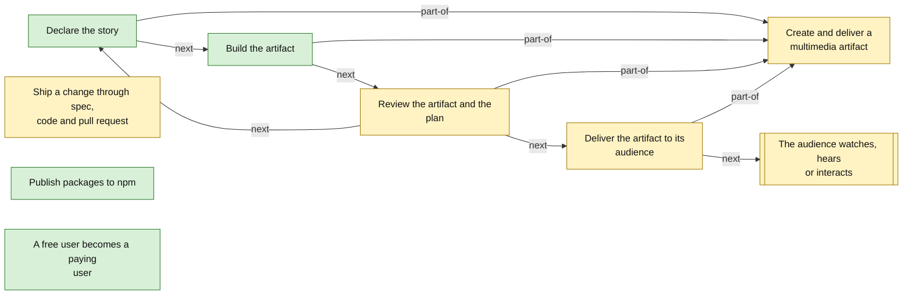
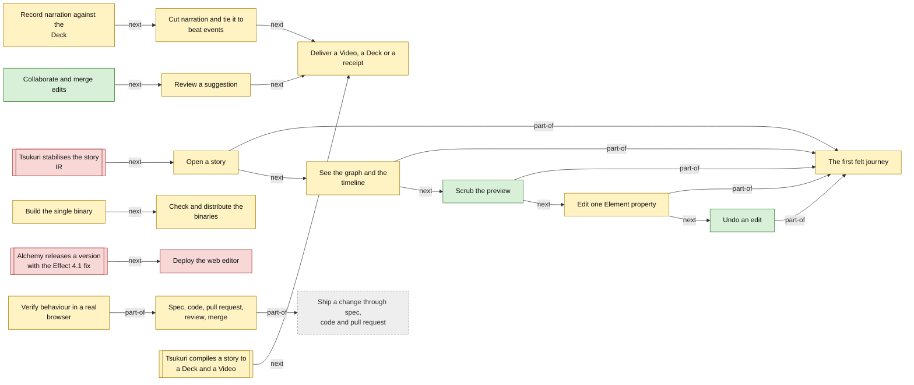
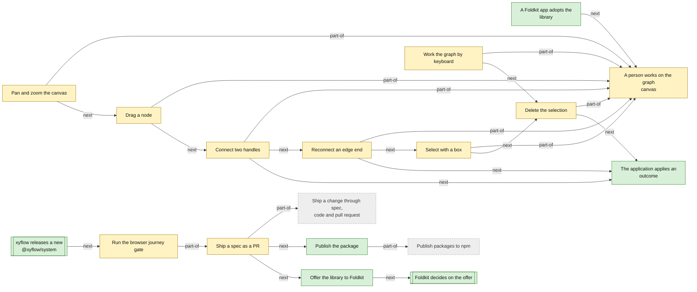

<!-- Generated by tools/intent from model/. Do not edit by hand: change the model and run `bun run generate`. -->

# Business Process Model

The Business Process Model says what is done and in which order. `next` arrows follow the flow; a process inside a larger process is `part-of` it. Stadium boxes are processes outside the project.

Method: 4EM (Sandkuhl, Stirna, Persson and Wißotzki, *Enterprise Modeling: Tackling Business Challenges with the 4EM Method*, Springer 2014). Every element cites its source; `decided` means a source shows that the operator decided it.

## The organisation

9 elements: 4 decided, 5 proposed, 0 open.

| Element | Statement | Status | Links | Sources |
| --- | --- | --- | --- | --- |
| <code>process-org-declare-story</code> Process | **Declare the story.** The creator declares scenes, states, transitions and effects tied to events, by hand, with a studio editor or through an agent. Category: primary. | decided | part-of: [Create and deliver a multimedia artifact](business-processes.md#process-org-create-and-deliver); serves: [Declare scenes and transitions, not build steps](goals.md#goal-org-declarative-creation); next: [Build the artifact](business-processes.md#process-org-build-artifact); uses: [Persistent IR](concepts.md#concept-org-ir) | [log L11][1], [log L14][2], [log L20][3], [log L45][4] |
| <code>process-org-build-artifact</code> Process | **Build the artifact.** The compiler turns the declared story into the artifact. An edit rebuilds only what it changes, and the build is reproducible. Category: primary. | decided | part-of: [Create and deliver a multimedia artifact](business-processes.md#process-org-create-and-deliver); serves: [Reproducible builds](goals.md#goal-org-reproducible-builds), [Fast, incremental, reactive builds](goals.md#goal-org-incremental-builds); next: [Review the artifact and the plan](business-processes.md#process-org-review-artifact); produces: [Artifact](concepts.md#concept-org-artifact) | [log L7][5], [log L10][6] |
| <code>process-org-publish-packages</code> Process | **Publish packages to npm.** The compiler's libraries and services are to be published to npm as `@tsukuri/*` pre-releases, so products and plugin authors can depend on them. On 2026-10-30 the operator decided to publish without waiting for the Norwegian IP advisor (log lines 118 and 119). Category: supporting. | decided | serves: [An open compiler and open formats](goals.md#goal-org-open-compiler), [Modular and extensible by users](goals.md#goal-org-modular-extensible); uses: [The npm organisation tsukuri](actors-and-resources.md#resource-npm-org) | [log L49][7], [log L113][8], [log L118][9], [log L119][10] |
| <code>process-org-upgrade-to-paid</code> Process | **A free user becomes a paying user.** A free user becomes a paying user only after demand is validated: the project publishes the roadmap, collects a waitlist for the sync server and hosted agents, interviews prospective creators and sets a threshold. Tiers are designed after that, and no pricing or billing code is written before the threshold is met. Category: supporting. | decided |  | [log L79][11], [log L43][12], [tsukuri:docs/design/open-core-boundary.md:69][13] |
| <code>process-org-create-and-deliver</code> Process | **Create and deliver a multimedia artifact.** The value stream of the product family: an author declares a story, tsukuri builds the artifact, the author reviews it, and the audience receives it. Category: primary. *Why proposed:* The operator describes declaring and building (log lines 7 and 11). The review and audience steps that complete the stream are inferred; the operator should confirm them. | proposed | serves: [Multimedia that authors declare and tools rebuild](goals.md#goal-org-vision) | [log L7][5], [log L11][1] |
| <code>process-org-review-artifact</code> Process | **Review the artifact and the plan.** The author reviews the plan and the artifact, and checks them against the source. They edit the story and build again, or approve the result. Category: primary. *Why proposed:* The tsukuri README describes a reviewable Plan and a check command, but the decision log does not describe an author's review step; the operator should confirm it as a step of the value stream. | proposed | part-of: [Create and deliver a multimedia artifact](business-processes.md#process-org-create-and-deliver); next: [Deliver the artifact to its audience](business-processes.md#process-org-deliver-artifact), [Declare the story](business-processes.md#process-org-declare-story); serves: [Reproducible builds](goals.md#goal-org-reproducible-builds) | [tsukuri:README.md:3][14], [tsukuri:README.md:12-18][15] |
| <code>process-org-deliver-artifact</code> Process | **Deliver the artifact to its audience.** The artifact reaches its audience as a video, a presentation deck or a website, in a variant that fits the audience, for example with captions, reduced motion or another language. Category: primary. *Why proposed:* The operator names the audiences and the artifact types (log lines 32, 36 and 37) but does not describe a delivery step; the step and the examples of variants are inferred. | proposed | part-of: [Create and deliver a multimedia artifact](business-processes.md#process-org-create-and-deliver); serves: [Accessible artifacts for every audience](goals.md#goal-org-accessible-artifacts), [Interactive multimedia for learning](goals.md#goal-org-interactive-multimedia); next: [The audience watches, hears or interacts](business-processes.md#extproc-org-audience-consumes) | [log L32][16], [log L36][17], [log L37][18] |
| <code>extproc-org-audience-consumes</code> External process | **The audience watches, hears or interacts.** Learners and viewers consume the artifact. In a dynamic artifact they step through it and raise events by interacting. *Why proposed:* The audience is outside the project; the step is inferred from the interactive artifact decisions. | proposed |  | [log L36][17], [log L37][18] |
| <code>process-org-ship-change</code> Process | **Ship a change through spec, code and pull request.** Every change follows spec, then code, then pull request, one to one. It passes CI and a recorded independent review round before the guarded script merges it. Category: governance. *Why proposed:* Spec 0000 of tsukuri and studio, whose headers say the operator decided them, set this road. The operator's decision log does not repeat the sequence, so the operator should confirm it as the road for every repository. | proposed | serves: [Correctness by construction](goals.md#goal-org-correctness-by-construction); uses: [The GitHub organisation tsukuri-labs](actors-and-resources.md#resource-github-org) | [tsukuri:AGENTS.md:9-17][19], [studio:AGENTS.md:17][20] |

## tsukuri (the compiler)

22 elements: 1 decided, 21 proposed, 0 open.

```mermaid
flowchart LR
    classDef decided fill:#d8f0d8,stroke:#2d7a2d,color:#111
    classDef proposed fill:#fff3c4,stroke:#a07800,color:#111
    classDef open fill:#f8d7d7,stroke:#a02020,color:#111
    classDef outside fill:#eee,stroke:#999,color:#333,stroke-dasharray:4 3
    process_tsukuri_author_story["Author a story"]:::proposed
    process_tsukuri_select_adapters["Select the adapters"]:::decided
    process_tsukuri_parse_story["Parse the screenplay"]:::proposed
    process_tsukuri_build_plan["Build the Plan"]:::proposed
    process_tsukuri_review_plan["Review the Plan"]:::proposed
    process_tsukuri_speech_stage["Make or reuse the narration<br/>audio"]:::proposed
    process_tsukuri_schedule["Schedule the Timeline"]:::proposed
    process_tsukuri_render_deck["Render the Deck"]:::proposed
    process_tsukuri_capture_frames["Capture the frames"]:::proposed
    process_tsukuri_encode_video["Encode and mux the Video"]:::proposed
    process_tsukuri_write_manifest["Write the manifest and<br/>commit the build"]:::proposed
    process_tsukuri_verify_build["Verify the written build"]:::proposed
    process_tsukuri_run_journey["Run the whole journey on one<br/>story"]:::proposed
    process_tsukuri_add_adapter["Add an adapter"]:::proposed
    process_tsukuri_spec_lifecycle["Take a spec to an open pull<br/>request"]:::proposed
    process_tsukuri_review_round["Hold a recorded review round"]:::proposed
    process_tsukuri_guarded_merge["Merge only a head with a<br/>passing record"]:::proposed
    process_tsukuri_release_publish["Publish pre-releases to npm"]:::proposed
    extproc_tsukuri_github_ci[["GitHub Actions runs the<br/>gates"]]:::proposed
    extproc_tsukuri_npm_trusted_publishing[["npm accepts a<br/>trusted-publisher release"]]:::proposed
    extproc_tsukuri_model_download[["Hugging Face serves the<br/>speech models"]]:::proposed
    extproc_tsukuri_branch_protection[["GitHub enforces branch<br/>protection on main"]]:::proposed
    process_org_ship_change["Ship a change through spec,<br/>code and pull request"]:::outside
    process_org_publish_packages["Publish packages to npm"]:::outside
    process_tsukuri_author_story -->|next| process_tsukuri_parse_story
    process_tsukuri_select_adapters -->|next| process_tsukuri_parse_story
    process_tsukuri_parse_story -->|next| process_tsukuri_build_plan
    process_tsukuri_build_plan -->|next| process_tsukuri_review_plan
    process_tsukuri_build_plan -->|next| process_tsukuri_speech_stage
    process_tsukuri_speech_stage -->|next| process_tsukuri_schedule
    process_tsukuri_schedule -->|next| process_tsukuri_render_deck
    process_tsukuri_render_deck -->|next| process_tsukuri_capture_frames
    process_tsukuri_capture_frames -->|next| process_tsukuri_encode_video
    process_tsukuri_encode_video -->|next| process_tsukuri_write_manifest
    process_tsukuri_write_manifest -->|next| process_tsukuri_verify_build
    process_tsukuri_spec_lifecycle -->|part-of| process_org_ship_change
    process_tsukuri_spec_lifecycle -->|next| extproc_tsukuri_github_ci
    process_tsukuri_review_round -->|part-of| process_org_ship_change
    process_tsukuri_review_round -->|next| process_tsukuri_guarded_merge
    process_tsukuri_guarded_merge -->|part-of| process_org_ship_change
    process_tsukuri_release_publish -->|part-of| process_org_publish_packages
    process_tsukuri_release_publish -->|next| extproc_tsukuri_npm_trusted_publishing
    extproc_tsukuri_github_ci -->|next| process_tsukuri_review_round
    extproc_tsukuri_model_download -->|next| process_tsukuri_speech_stage
```

| Element | Statement | Status | Links | Sources |
| --- | --- | --- | --- | --- |
| <code>process-tsukuri-select-adapters</code> Process | **Select the adapters.** Adapter selection is explicit configuration read at the composition root. It never falls back silently. Category: supporting. | decided | serves: [A compiler whose structure prevents bad states](goals.md#goal-tsukuri-correct-by-construction), [Every build says what leaves the machine](goals.md#goal-tsukuri-visible-egress); uses: [Selection](concepts.md#concept-tsukuri-selection); next: [Parse the screenplay](business-processes.md#process-tsukuri-parse-story) | [record tsukuri:docs/specs/0001-release-1-screenplay-to-deck-and-video.md:235][21], [tsukuri:README.md:23][22], [tsukuri:AGENTS.md:63][23], [tsukuri:packages/services/src/selection.ts:1-4][24] |
| <code>process-tsukuri-author-story</code> Process | **Author a story.** A creator or an agent writes one Fountain screenplay: Scenes with explicit ids, Elements, an effects block and narration dialogue. Category: primary. *Why proposed:* Spec plan: spec 0001 and the screenplay-first revision describe this step. The operator decided that the source is one Fountain file, not the effects-block syntax or the explicit-id rules, so confirm the detail. | proposed | serves: [One screenplay, every rendering](goals.md#goal-tsukuri-screenplay-first); produces: [Screenplay](concepts.md#concept-tsukuri-screenplay); uses: [The Fountain screenplay format](actors-and-resources.md#resource-tsukuri-fountain-format); next: [Parse the screenplay](business-processes.md#process-tsukuri-parse-story) | [tsukuri:docs/specs/0001-release-1-screenplay-to-deck-and-video.md:213][25], [tsukuri:README.md:3][14], [tsukuri:docs/specs/0002-explicit-anchors-and-syntax.md:61-80][26] |
| <code>process-tsukuri-parse-story</code> Process | **Parse the screenplay.** A thin adapter turns the Fountain tokens into a decoded Story. Anything the vocabulary does not define fails with its line number. Category: primary. *Why proposed:* Spec plan: spec 0001 sets out the parser adapter and the closed vocabulary. The operator has not decided each error and line-number rule, so confirm the detail. | proposed | serves: [An explicit source nobody can misread](goals.md#goal-tsukuri-explicit-source); uses: [Screenplay](concepts.md#concept-tsukuri-screenplay); produces: [Story](concepts.md#concept-tsukuri-story); next: [Build the Plan](business-processes.md#process-tsukuri-build-plan) | [tsukuri:docs/specs/0001-release-1-screenplay-to-deck-and-video.md:32][27], [tsukuri:docs/specs/0001-release-1-screenplay-to-deck-and-video.md:64-66][28] |
| <code>process-tsukuri-build-plan</code> Process | **Build the Plan.** The compiler runs the identity diff and the reference checks over the Story and writes the Plan. `tsukuri plan` prints it and needs no audio and no browser. Category: primary. *Why proposed:* Spec plan: the design names the Plan as a stage and `tsukuri plan` as its output. The operator has not decided the exact compilation steps, so confirm them. | proposed | serves: [A Deck and a Video from one source](goals.md#goal-tsukuri-deck-and-video), [Declare the implicit state machine explicitly](goals.md#goal-tsukuri-statechart-model); uses: [Identity diff](concepts.md#concept-tsukuri-identity-diff); produces: [Plan](concepts.md#concept-tsukuri-plan); next: [Review the Plan](business-processes.md#process-tsukuri-review-plan), [Make or reuse the narration audio](business-processes.md#process-tsukuri-speech-stage) | [tsukuri:docs/design/keyframe-engine.md:1112][29], [tsukuri:docs/specs/0001-release-1-screenplay-to-deck-and-video.md:28][30], [tsukuri:docs/specs/0001-release-1-screenplay-to-deck-and-video.md:66][31] |
| <code>process-tsukuri-review-plan</code> Process | **Review the Plan.** A person or an agent reads the Plan before any media is built. It shows every Element, effect and identity decision, with the author's intent and the resolved frame. Category: supporting. *Why proposed:* Spec plan: the design and spec 0002 describe a reviewer reading the Plan before media is built. The operator has not decided this review step or the fields it lists, so confirm it. | proposed | serves: [A Deck and a Video from one source](goals.md#goal-tsukuri-deck-and-video), [Check the written files, not the pipeline's memory](goals.md#goal-tsukuri-verified-output); uses: [Plan](concepts.md#concept-tsukuri-plan) | [tsukuri:docs/design/keyframe-engine.md:1112][29], [tsukuri:docs/specs/0002-explicit-anchors-and-syntax.md:123][32] |
| <code>process-tsukuri-speech-stage</code> Process | **Make or reuse the narration audio.** For each Line the build looks in the content-addressed cache. On a hit no model loads. On a miss it synthesises speech and aligns the words only when refreshing, or always for the silent stand-in narrator, and it stops if the match is below 0.9. Without refreshing, a real narrator's miss fails. Category: primary. *Why proposed:* Spec plan and observed in the repository: spec 0001 sets out the cache lookup, the miss rule and the 0.9 threshold. packages/cli/src/build.ts:26-31 at the pinned commit refills a miss when refreshing, or always for the `silent` stand-in. The operator has not decided those details, so confirm them and the stand-in exception. | proposed | serves: [Reproducible builds](goals.md#goal-tsukuri-reproducible-builds), [Fast, incremental and reactive builds](goals.md#goal-tsukuri-incremental-builds); uses: [Kokoro speech model](actors-and-resources.md#resource-tsukuri-kokoro-model), [whisper.cpp](actors-and-resources.md#resource-tsukuri-whisper-cpp); produces: [The speech cache](actors-and-resources.md#resource-tsukuri-speech-cache); next: [Schedule the Timeline](business-processes.md#process-tsukuri-schedule) | [tsukuri:docs/specs/0001-release-1-screenplay-to-deck-and-video.md:78][33], [tsukuri:docs/specs/0001-release-1-screenplay-to-deck-and-video.md:261][34], [tsukuri:packages/cli/src/build.ts:26-31][35] |
| <code>process-tsukuri-schedule</code> Process | **Schedule the Timeline.** The schedule places every Line, effect, step and slide change at an integer frame, from the aligned words and the renderer's declared lifecycle. Category: primary. *Why proposed:* Spec plan: spec 0002 describes the schedule stage. The operator picked the effects syntax, not the integer-frame scheduling, so confirm the detail. | proposed | serves: [Effects connect to produced events](goals.md#goal-tsukuri-event-timing); uses: [Anchor](concepts.md#concept-tsukuri-anchor); produces: [Timeline](concepts.md#concept-tsukuri-timeline); next: [Render the Deck](business-processes.md#process-tsukuri-render-deck) | [tsukuri:docs/specs/0002-explicit-anchors-and-syntax.md:34][36], [tsukuri:packages/core/src/schedule.ts:1-8][37] |
| <code>process-tsukuri-render-deck</code> Process | **Render the Deck.** The renderer turns the scheduled Plan into a reveal.js page: narration as speaker notes, show and focus effects as fragments in time order, and sounds that ride with a step or a slide. Category: primary. *Why proposed:* Spec plan: the operator decided only that sounds ride along in the Deck (spec 0002 line 161). The rest of the Deck rendering comes from the README and spec 0001, so confirm it. | proposed | serves: [A Deck and a Video from one source](goals.md#goal-tsukuri-deck-and-video); uses: [reveal.js](actors-and-resources.md#resource-tsukuri-reveal-js); produces: [Deck](concepts.md#concept-tsukuri-deck); next: [Capture the frames](business-processes.md#process-tsukuri-capture-frames) | [tsukuri:docs/specs/0002-explicit-anchors-and-syntax.md:162][38], [tsukuri:README.md:5][39], [tsukuri:packages/pipeline/src/buildProgram.ts:5-7][40] |
| <code>process-tsukuri-capture-frames</code> Process | **Capture the frames.** Chromium opens the Deck under a virtual clock, steps it to the scheduled frames and takes one screenshot per frame. Category: primary. *Why proposed:* Spec plan: spec 0001 and the README describe capture in Chromium on a virtual clock. The operator has not decided the one-screenshot-per-frame mechanism, so confirm it. | proposed | serves: [Reproducible builds](goals.md#goal-tsukuri-reproducible-builds), [A Deck and a Video from one source](goals.md#goal-tsukuri-deck-and-video); uses: [Chromium](actors-and-resources.md#resource-tsukuri-chromium); next: [Encode and mux the Video](business-processes.md#process-tsukuri-encode-video) | [tsukuri:README.md:6][41], [tsukuri:docs/specs/0001-release-1-screenplay-to-deck-and-video.md:86][42] |
| <code>process-tsukuri-encode-video</code> Process | **Encode and mux the Video.** The encoder mixes narration at each Line's start and each sound at its fire frame, then writes the MP4 with WebVTT subtitles, chapters, a title and the source hash. Category: primary. *Why proposed:* Spec plan: spec 0001 and the README describe the mix, subtitles, chapters, title and source hash. The operator has not decided these details, so confirm them. | proposed | serves: [A Deck and a Video from one source](goals.md#goal-tsukuri-deck-and-video), [Accessible artifacts for different audiences](goals.md#goal-tsukuri-accessible-artifacts); uses: [ffmpeg and ffprobe](actors-and-resources.md#resource-tsukuri-ffmpeg); produces: [Video](concepts.md#concept-tsukuri-video); next: [Write the manifest and commit the build](business-processes.md#process-tsukuri-write-manifest) | [tsukuri:README.md:6][41], [tsukuri:packages/pipeline/src/buildProgram.ts:5-7][40] |
| <code>process-tsukuri-write-manifest</code> Process | **Write the manifest and commit the build.** The build writes `build.json` last, with each adapter, its egress, its settings and the provenance of every cached asset, and then renames the partial directory in one step. Category: primary. *Why proposed:* Spec plan: spec 0001 describes the manifest and the final rename. The operator decided that the output manifest records provenance, not the write order, so confirm the detail. | proposed | serves: [Every build says what leaves the machine](goals.md#goal-tsukuri-visible-egress), [Check the written files, not the pipeline's memory](goals.md#goal-tsukuri-verified-output); next: [Verify the written build](business-processes.md#process-tsukuri-verify-build) | [tsukuri:docs/specs/0001-release-1-screenplay-to-deck-and-video.md:263][43], [tsukuri:packages/pipeline/src/buildProgram.ts:9-11][44] |
| <code>process-tsukuri-verify-build</code> Process | **Verify the written build.** `tsukuri check` reads the written files and the source and gives one verdict per falsifier: effect timing, subtitles, notes, fragments, source hash, transitions, narration, chapters and provenance. Category: supporting. *Why proposed:* Spec plan: spec 0001 lists the falsifiers that `tsukuri check` reports. The operator has not decided the complete list, so confirm it. | proposed | serves: [Check the written files, not the pipeline's memory](goals.md#goal-tsukuri-verified-output) | [tsukuri:README.md:18][45], [tsukuri:docs/specs/0001-release-1-screenplay-to-deck-and-video.md:142][46] |
| <code>process-tsukuri-run-journey</code> Process | **Run the whole journey on one story.** `tsukuri journey` builds a story, checks the build, builds it again and compares the two for determinism. The first failure stops it. Category: supporting. *Why proposed:* Observed in the repository: the `journey` command and AGENTS.md describe this sequence. The operator has not decided the command, so confirm it. | proposed | serves: [Reproducible builds](goals.md#goal-tsukuri-reproducible-builds), [Check the written files, not the pipeline's memory](goals.md#goal-tsukuri-verified-output); requires: [Verify the written build](business-processes.md#process-tsukuri-verify-build) | [tsukuri:packages/cli/src/journey.ts:1-3][47], [tsukuri:AGENTS.md:42][48] |
| <code>process-tsukuri-add-adapter</code> Process | **Add an adapter.** A plugin author adds the package to its tier row, implements the service's Layer with its info and its unavailable error, runs the contract suite, wires the name into the selection tables, and adds the package to the lint and dead-code configs. Category: supporting. *Why proposed:* Observed in the repository: AGENTS.md lists these five steps. The operator decided that every adapter passes a contract suite, not the checklist, so confirm it. | proposed | serves: [Plugins and a render-engine SDK](goals.md#goal-tsukuri-plugin-sdk); uses: [Contract suite](concepts.md#concept-tsukuri-contract-suite), [Adapter](concepts.md#concept-tsukuri-adapter) | [tsukuri:AGENTS.md:65][49], [tsukuri:docs/design/keyframe-engine.md:1225][50] |
| <code>process-tsukuri-spec-lifecycle</code> Process | **Take a spec to an open pull request.** A contributor writes or picks a spec, branches as `feat/NNNN-slug`, commits under the hooks, pushes, and opens one pull request with the report. CI runs the same gates as `bun run ready`. Category: governance. *Why proposed:* Spec plan: spec 0000 lists this road. Its header shows the operator accepted the spec as a whole, but not each step, so confirm the detail. | proposed | part-of: [Ship a change through spec, code and pull request](business-processes.md#process-org-ship-change); serves: [A compiler whose structure prevents bad states](goals.md#goal-tsukuri-correct-by-construction); next: [GitHub Actions runs the gates](business-processes.md#extproc-tsukuri-github-ci) | [tsukuri:docs/specs/0000-development-lifecycle.md:13-21][51], [tsukuri:AGENTS.md:13-16][52] |
| <code>process-tsukuri-review-round</code> Process | **Hold a recorded review round.** Independent reviewers judge the plan, the code and their agreement. A fixer addresses findings. The lead records each round on the pull request with its verdict. A pass means no open finding of medium or above and green CI. Category: governance. *Why proposed:* Spec plan: spec 0000 describes the reviewer roles and the pass rule. The operator has not decided each detail, so confirm it. | proposed | part-of: [Ship a change through spec, code and pull request](business-processes.md#process-org-ship-change); serves: [A compiler whose structure prevents bad states](goals.md#goal-tsukuri-correct-by-construction); next: [Merge only a head with a passing record](business-processes.md#process-tsukuri-guarded-merge) | [tsukuri:docs/specs/0000-development-lifecycle.md:75][53], [tsukuri:docs/specs/0000-development-lifecycle.md:79][54] |
| <code>process-tsukuri-guarded-merge</code> Process | **Merge only a head with a passing record.** The merge script refuses without a passing recorded round on the current head and a green CI run. Branch protection requires a pull request and the `checks` status, with no force push. Category: governance. *Why proposed:* Spec plan: spec 0000 describes the merge script and branch protection. The operator has not decided each condition, so confirm it. | proposed | part-of: [Ship a change through spec, code and pull request](business-processes.md#process-org-ship-change); serves: [A compiler whose structure prevents bad states](goals.md#goal-tsukuri-correct-by-construction) | [tsukuri:docs/specs/0000-development-lifecycle.md:23][55], [tsukuri:docs/specs/0000-development-lifecycle.md:100-101][56], [tsukuri:AGENTS.md:20][57] |
| <code>process-tsukuri-release-publish</code> Process | **Publish pre-releases to npm.** A release stages the built JavaScript, types, docs and licence of seven packages: core, subtitles, lint, services, pipeline, sounds-synth and render-reveal. It checks every tarball and publishes with trusted publishing and a provenance attestation. The CLI and the other runtime adapters are left out. Category: supporting. *Why proposed:* Read from the body of PR #18. It was not part of the pinned commit and has since merged, as the tracker shows. The model does not observe a real publish, the trusted-publisher match or a first live release, and the operator must provision the npm and GitHub environment. | proposed | part-of: [Publish packages to npm](business-processes.md#process-org-publish-packages); serves: [Publish @tsukuri packages to npm](goals.md#goal-tsukuri-npm-publication); uses: [The npm organisation tsukuri](actors-and-resources.md#resource-npm-org); next: [npm accepts a trusted-publisher release](business-processes.md#extproc-tsukuri-npm-trusted-publishing) | [pr tsukuri#18][58], [log L49][7] |
| <code>extproc-tsukuri-github-ci</code> External process | **GitHub Actions runs the gates.** On every pull request and every push to main, the workflow installs the pinned devenv and the locked dependencies, and then runs each gate as its own step. *Why proposed:* Observed in the repository: the workflow file sets these triggers and steps. The operator has not decided the exact workflow, so confirm it. | proposed | next: [Hold a recorded review round](business-processes.md#process-tsukuri-review-round) | [tsukuri:.github/workflows/checks.yml:6-9][59], [tsukuri:.github/workflows/checks.yml:15][60] |
| <code>extproc-tsukuri-npm-trusted-publishing</code> External process | **npm accepts a trusted-publisher release.** GitHub issues an OIDC identity to the release workflow, and npm matches it to the trusted publisher and records a provenance attestation for each package. *Why proposed:* Described in PR #18. The OIDC exchange, the trusted-publisher match and the first live release are not yet observed, and the operator must provision the npm and GitHub environment. | proposed |  | [pr tsukuri#18][58] |
| <code>extproc-tsukuri-model-download</code> External process | **Hugging Face serves the speech models.** The Kokoro model is downloaded by `kokoro-js` on first use. The whisper model file is downloaded by the user. Neither is stored in the repository. *Why proposed:* Observed in the repository: the third-party audit describes the model downloads. The operator has not decided this arrangement, so confirm it. | proposed | next: [Make or reuse the narration audio](business-processes.md#process-tsukuri-speech-stage) | [tsukuri:docs/design/third-party.md:71-72][61] |
| <code>extproc-tsukuri-branch-protection</code> External process | **GitHub enforces branch protection on main.** GitHub rejects a direct push to main, requires a pull request and the `checks` status, and forbids force push and deletion. Administrators are included. *Why proposed:* Observed in the repository: spec 0000 and AGENTS.md describe these settings. The operator has not decided each setting, and the live state is not read here, so confirm it. | proposed |  | [tsukuri:docs/specs/0000-development-lifecycle.md:53][62], [tsukuri:AGENTS.md:20][57] |

## tsukuri studio

19 elements: 3 decided, 13 proposed, 3 open.

| Element | Statement | Status | Links | Sources |
| --- | --- | --- | --- | --- |
| <code>process-studio-scrub-preview</code> Process | **Scrub the preview.** The person drags the playhead, and the Deck in the preview iframe seeks to that frame and shows its narration word. Category: primary. | decided | serves: [The preview shows what the Video will show](goals.md#goal-studio-preview-fidelity); part-of: [The first felt journey](business-processes.md#process-studio-first-journey); uses: [In-browser Deck preview](technical-components.md#comp-studio-preview), [Playhead and preview](concepts.md#concept-studio-playhead); next: [Edit one Element property](business-processes.md#process-studio-edit-property) | [studio:docs/specs/0001-first-felt-journey.md:18][63], [studio:docs/specs/0001-first-felt-journey.md:39][64], [log L97][65] |
| <code>process-studio-undo-edit</code> Process | **Undo an edit.** Undo reverts the person's own last change per peer, through Loro's UndoManager. It gives back the exact story when nobody else edited meanwhile. Category: primary. | decided | serves: [Edit one thing and see it at once](goals.md#goal-studio-first-felt-journey); part-of: [The first felt journey](business-processes.md#process-studio-first-journey); uses: [The validated edit path](technical-components.md#comp-studio-edit-path) | [studio:docs/specs/0001-first-felt-journey.md:20-21][66], [studio:docs/specs/0001-first-felt-journey.md:93][67], [studio:docs/specs/0001-first-felt-journey.md:136][68], [log L102][69] |
| <code>process-studio-collaborate-merge</code> Process | **Collaborate and merge edits.** Several people and agents edit one story through the sync server, which holds a validation gate on the merge-based keyed document. This is a paid feature. Category: primary. | decided | serves: [Many people and agents edit one story](goals.md#goal-studio-collaboration); uses: [The sync server (planned)](technical-components.md#comp-studio-sync-server), [Keyed document](concepts.md#concept-studio-keyed-document); next: [Review a suggestion](business-processes.md#process-studio-review-suggestion) | [log L43][12], [log L45][4], [log L47][70] |
| <code>process-studio-first-journey</code> Process | **The first felt journey.** A person or an agent opens a story, sees it as a graph and a timeline, scrubs a preview, edits one Element property and undoes the edit. No server is needed. Category: primary. *Why proposed:* Spec 0001 plans the journey as a design. At the pinned commit it is blocked on tsukuri. The operator should confirm the journey. | proposed | serves: [Edit one thing and see it at once](goals.md#goal-studio-first-felt-journey); requires: [No editing feature before the tsukuri IR is stable](goals.md#constraint-studio-ir-stability) | [studio:docs/specs/0001-first-felt-journey.md:11-22][71] |
| <code>process-studio-open-story</code> Process | **Open a story.** The editor opens a story from the browser's private storage, after an import of an IR JSON file, or from a local file where the browser has the File System Access API. It checks the story against the story schema. Category: primary. *Why proposed:* Step 1 of the journey in spec 0001. It depends on tsukuri spec 0006. The operator should confirm this open-and-validate workflow. | proposed | serves: [Edit one thing and see it at once](goals.md#goal-studio-first-felt-journey); part-of: [The first felt journey](business-processes.md#process-studio-first-journey); uses: [A story IR file](actors-and-resources.md#resource-studio-story-file); next: [See the graph and the timeline](business-processes.md#process-studio-inspect-story) | [studio:docs/specs/0001-first-felt-journey.md:16][72], [studio:docs/specs/0001-first-felt-journey.md:36][73] |
| <code>process-studio-inspect-story</code> Process | **See the graph and the timeline.** The editor draws States as nodes grouped by Scene, Beats as edges, and lanes in time with their effects. Category: primary. *Why proposed:* Step 2 of the journey in spec 0001. Falsifier F1 says the graph must equal the engine's graph. The operator should confirm the graph and timeline presentation. | proposed | serves: [Edit one thing and see it at once](goals.md#goal-studio-first-felt-journey); part-of: [The first felt journey](business-processes.md#process-studio-first-journey); uses: [Story graph lens](technical-components.md#comp-studio-lens-story-graph), [Timeline lens](technical-components.md#comp-studio-lens-timeline); next: [Scrub the preview](business-processes.md#process-studio-scrub-preview) | [studio:docs/specs/0001-first-felt-journey.md:17][74], [studio:docs/specs/0001-first-felt-journey.md:131][75] |
| <code>process-studio-edit-property</code> Process | **Edit one Element property.** The person selects an Element and changes one property in the inspector. The change is one edit, and the story stays valid or the edit is refused with the reason. Category: primary. *Why proposed:* Steps 4 and 5 of the journey in spec 0001, with falsifiers F3 and F4. The operator should confirm the edit and validation behaviour. | proposed | serves: [Edit one thing and see it at once](goals.md#goal-studio-first-felt-journey); part-of: [The first felt journey](business-processes.md#process-studio-first-journey); uses: [The validated edit path](technical-components.md#comp-studio-edit-path); next: [Undo an edit](business-processes.md#process-studio-undo-edit) | [studio:docs/specs/0001-first-felt-journey.md:19-21][76], [studio:docs/specs/0001-first-felt-journey.md:133-134][77] |
| <code>process-studio-record-narration</code> Process | **Record narration against the Deck.** The presenter records a take with a teleprompter. A Line can have several takes, and the author picks the best. Category: primary. *Why proposed:* The lenses note designs the Deck and Record lens. The operator named the deck view for recording narration (log line 45), not these steps. The operator should confirm these steps. | proposed | serves: [Record narration in a deck view](goals.md#goal-studio-deck-view-narration); uses: [Deck and Record lens](technical-components.md#comp-studio-lens-record), [Narration speech cache](actors-and-resources.md#resource-studio-speech-cache); produces: [Take](concepts.md#concept-studio-take); next: [Cut narration and tie it to beat events](business-processes.md#process-studio-cut-narration) | [log L45][4], [studio:docs/design/lenses.md:36-39][78] |
| <code>process-studio-cut-narration</code> Process | **Cut narration and tie it to beat events.** The take is aligned to its words and cut into pieces. Each piece is tied to a beat lifecycle event, or the whole take starts where its Line starts. Category: primary. *Why proposed:* The operator named cut narration pieces tied to beat lifecycle events (log line 45). The two ways to attach a take come from the lenses note. The operator should confirm both ways to attach a take. | proposed | serves: [Record narration in a deck view](goals.md#goal-studio-deck-view-narration); uses: [Deck and Record lens](technical-components.md#comp-studio-lens-record); produces: [Narration piece](concepts.md#concept-studio-narration-piece); next: [Deliver a Video, a Deck or a receipt](business-processes.md#process-studio-deliver) | [log L45][4], [studio:docs/design/lenses.md:40-41][79], [studio:docs/design/lenses.md:43-48][80] |
| <code>process-studio-review-suggestion</code> Process | **Review a suggestion.** A person sees a suggestion with its author and accepts or rejects it. An accepted suggestion applies as the patch it was, and the record keeps who proposed and who accepted. Category: primary. *Why proposed:* The lenses note designs the Review lens. It is design only. The operator should confirm this suggestion-review workflow. | proposed | serves: [People decide on what agents and others suggest](goals.md#goal-studio-human-control); uses: [Review lens](technical-components.md#comp-studio-lens-review), [Suggestion](concepts.md#concept-studio-suggestion); next: [Deliver a Video, a Deck or a receipt](business-processes.md#process-studio-deliver) | [studio:docs/design/lenses.md:66-69][81] |
| <code>process-studio-deliver</code> Process | **Deliver a Video, a Deck or a receipt.** The author renders a Video with aspect variants, shows the Deck in present mode, and keeps build receipts with the hashes of the story, its inputs and the output. Category: primary. *Why proposed:* The operator named a render view supporting video and decks (log line 45). The three outputs and the free and paid split of local and cloud renders come from the lenses note. The operator should confirm the delivery outputs and the tier split. | proposed | serves: [Deliver lens, render and present](goals.md#goal-studio-lens-deliver); uses: [Deliver lens](technical-components.md#comp-studio-lens-deliver) | [log L45][4], [studio:docs/design/lenses.md:79-87][82] |
| <code>process-studio-build-binary</code> Process | **Build the single binary.** The build embeds the editor into one JSON file and compiles it with Bun for five targets. The binary serves the editor on a loopback address. Category: supporting. *Why proposed:* PR 6 reported the binary built and tested, and it was a draft at the pinned commit. The operator decided the single binary (log line 46) but not these steps. The operator should confirm them. | proposed | serves: [Ship web first and a single binary](goals.md#goal-studio-web-and-binary); uses: [The single-binary launcher](technical-components.md#comp-studio-launcher); next: [Check and distribute the binaries](business-processes.md#process-studio-distribute-binary) | [log L46][83], [pr studio#6][84] |
| <code>process-studio-distribute-binary</code> Process | **Check and distribute the binaries.** CI starts each binary on its own platform, checks its file type and checksum, and a version tag creates a draft release. Nothing is published without the operator. Category: supporting. *Why proposed:* PR 6 describes the workflow, and it was a draft at the pinned commit. The operator should confirm the workflow. | proposed | serves: [Ship web first and a single binary](goals.md#goal-studio-web-and-binary); uses: [The single-binary launcher](technical-components.md#comp-studio-launcher) | [pr studio#6][84] |
| <code>process-studio-pr-review-loop</code> Process | **Spec, code, pull request, review, merge.** A contributor writes a spec, builds it on a branch and opens one pull request when the journey works. Independent reviewers judge the plan, the code and their agreement, and a recorded pass allows the merge. Category: governance. *Why proposed:* Observed in the repository: spec 0000 and AGENTS.md describe this road. The spec header says the operator assigned the lifecycle as a whole, which does not decide each step. The operator must confirm the steps. | proposed | serves: [Every change passes the same gates](goals.md#goal-studio-checked-change); part-of: [Ship a change through spec, code and pull request](business-processes.md#process-org-ship-change); uses: [Review and PR creation skills](technical-components.md#comp-studio-review-skills), [CI checks workflow](technical-components.md#comp-studio-ci) | [studio:docs/specs/0000-development-lifecycle.md:13-24][85], [studio:AGENTS.md:13-20][86] |
| <code>process-studio-verify-journey</code> Process | **Verify behaviour in a real browser.** A reviewer launches a disposable instance, drives each changed feature as a user would, keeps the evidence outside the worktree and cleans up. Category: governance. *Why proposed:* Observed in the repository: spec 0003 plans the skill and its steps. The operator assigned a verification skill for each repository, not these steps. The operator must confirm them. | proposed | serves: [Every change passes the same gates](goals.md#goal-studio-checked-change); part-of: [Spec, code, pull request, review, merge](business-processes.md#process-studio-pr-review-loop); uses: [The verify-studio skill and feature map](technical-components.md#comp-studio-verify-skill), [Feature map](concepts.md#concept-studio-feature-map) | [studio:docs/specs/0003-review-and-verify-skills.md:52-58][87] |
| <code>extproc-studio-tsukuri-compile</code> External process | **Tsukuri compiles a story to a Deck and a Video.** The open compiler takes a story and produces a reveal.js Deck and a Video. Studio reads its IR and uses its renderers. *Why proposed:* Observed in the repository: the README and AGENTS.md say tsukuri owns the IR and the renderers. The log decides that the compiler and its formats are open (log:43), not this boundary. The operator must confirm it. | proposed | next: [Deliver a Video, a Deck or a receipt](business-processes.md#process-studio-deliver) | [log L43][12], [studio:README.md:3][88], [studio:AGENTS.md:3][89] |
| <code>process-studio-deploy-web</code> Process | **Deploy the web editor.** Alchemy deploys the editor as a Cloudflare Worker, with one stage for each pull request and one for main. The path was written but inert at the pinned commit. Category: supporting. *Why open:* At the pinned commit the deploy had not run. It waits for an Alchemy release that fixes the Effect 4.1 import, and it needs credentials that only the operator can create. The operator should confirm the per-pull-request Worker stages (an open question in PR 6). | open | serves: [Ship web first and a single binary](goals.md#goal-studio-web-and-binary); uses: [The web deploy (inert)](technical-components.md#comp-studio-web-deploy) | [pr studio#6][84], [log L46][83] |
| <code>extproc-studio-tsukuri-ir-stable</code> External process | **Tsukuri stabilises the story IR.** Tsukuri merges specs 0004 and 0006 and does spec 0005, so the IR is closed, versioned, story-wide in identity and the committed source. Studio's first journey starts after this. *Why open:* The work is tsukuri's. STATE.md lists the first journey as blocked until it ends. The operator should confirm which tsukuri specs count as enough and in what order. | open | next: [Open a story](business-processes.md#process-studio-open-story) | [studio:STATE.md:12][90], [studio:STATE.md:18][91], [studio:docs/specs/0001-first-felt-journey.md:30-36][92] |
| <code>extproc-studio-alchemy-release</code> External process | **Alchemy releases a version with the Effect 4.1 fix.** Alchemy publishes a release after 2.0.0-beta.84 that contains alchemy-run/alchemy#2754. Studio then bumps it and runs the deploy checks. *Why open:* The fix is merged upstream but had no release at the pinned commit. The release date is not under studio's control. The operator should confirm the bump once the release exists. | open | next: [Deploy the web editor](business-processes.md#process-studio-deploy-web) | [pr studio#6][84] |

## foldkit-flow

16 elements: 6 decided, 10 proposed, 0 open.

| Element | Statement | Status | Links | Sources |
| --- | --- | --- | --- | --- |
| <code>process-flow-adopt-library</code> Process | **A Foldkit app adopts the library.** A Foldkit developer adds a Flow to the application's Model, declares nodes, edges and handles, supplies the node views and a connection check, and applies the outcomes the Flow reports. The library reports outcomes, and the application applies the graph changes. Category: primary. | decided | serves: [A graph canvas for Foldkit applications](goals.md#goal-flow-vision); next: [A person works on the graph canvas](business-processes.md#process-flow-use-canvas); uses: [Flow](concepts.md#concept-flow-flow), [Node](concepts.md#concept-flow-node), [packages/flow (the library)](technical-components.md#comp-flow-library) | [log L109][93], [foldkit-flow:README.md:3][94], [foldkit-flow:README.md:24-64][95], [foldkit-flow:packages/flow/src/flow.ts:14-24][96] |
| <code>process-flow-apply-outcome</code> Process | **The application applies an outcome.** The application receives an outcome message and applies the graph change itself: it adds an edge on Connected, moves one on Reconnected and records a Deleted set. The library reports the outcome, and the application may veto a change. Category: primary. | decided | serves: [A generic library with no product logic](goals.md#goal-flow-generic-library); uses: [Out-message (outcome)](concepts.md#concept-flow-out-message) | [log L109][93], [foldkit-flow:README.md:51-54][97], [foldkit-flow:packages/flow/src/update.ts:563-604][98] |
| <code>process-flow-publish-package</code> Process | **Publish the package.** The project publishes pre-releases of the library to npm as `@tsukuri/flow`, under the tsukuri org and through the org's publish process; on 2026-10-30 the operator decided not to wait for the Norwegian IP advisor (log line 118). If Foldkit adopts the library, the project publishes `@foldkit/flow` and deprecates `@tsukuri/flow`. Category: supporting. | decided | serves: [Publish the package for others to use](goals.md#goal-flow-publish); part-of: [Publish packages to npm](business-processes.md#process-org-publish-packages); uses: [The npm organisation tsukuri](actors-and-resources.md#resource-npm-org) | [log L49][7], [log L105][99], [log L113][8], [log L118][9], [foldkit-flow:README.md:5][100] |
| <code>process-flow-offer-upstream</code> Process | **Offer the library to Foldkit.** Once its API has settled, the library is offered to Foldkit as `@foldkit/flow`. Category: governance. | decided | serves: [Offer the library to Foldkit](goals.md#goal-flow-upstream-offer); next: [Foldkit decides on the offer](business-processes.md#extproc-flow-foldkit-decision) | [record foldkit-flow:STATE.md:14][101], [foldkit-flow:docs/specs/0000-development-lifecycle.md:111][102] |
| <code>extproc-flow-foldkit-decision</code> External process | **Foldkit decides on the offer.** The Foldkit project decides whether to adopt the library, and under which licence header. If it adopts the library, `@foldkit/flow` is published and `@tsukuri/flow` is deprecated. | decided |  | [log L105][99], [foldkit-flow:STATE.md:14][101], [foldkit-flow:docs/specs/0000-development-lifecycle.md:111][102] |
| <code>extproc-flow-xyflow-release</code> External process | **xyflow releases a new @xyflow/system.** The xyflow project publishes new versions of `@xyflow/system`. Versions 0.0.x may break the library, so it stays on its exact pin until the project bumps it on purpose, and each bump needs the journey to run again. | decided | next: [Run the browser journey gate](business-processes.md#process-flow-run-journey-gate) | [log L107][103], [foldkit-flow:packages/flow/package.json:18][104], [foldkit-flow:docs/specs/0001-first-felt-journey.md:111][105], [foldkit-flow:NOTICE:4-17][106] |
| <code>process-flow-use-canvas</code> Process | **A person works on the graph canvas.** A person pans and zooms, drags nodes, connects handles, reconnects edges, selects, and edits by keyboard on the canvas of an application that uses the library. Category: primary. *Why proposed:* README line 20 lists the gestures of the example: pan and zoom, drag, connect, reconnect and box select. Lines 66 and 74 to 77 add the minimap, the zoom controls and keyboard control. The operator must confirm the journey. | proposed | serves: [One felt journey works end to end](goals.md#goal-flow-first-journey); uses: [Flow](concepts.md#concept-flow-flow) | [foldkit-flow:README.md:20][107], [foldkit-flow:README.md:66][108], [foldkit-flow:README.md:74-77][109] |
| <code>process-flow-pan-zoom</code> Process | **Pan and zoom the canvas.** A person scrolls the wheel or drags the empty canvas. The viewport changes and no node is re-rendered. Category: primary. *Why proposed:* The pane Mount creates the xyflow pan and zoom controller (mounts.ts lines 157 to 208). README line 82 says pan and zoom change only the viewport element's transform and render no node, and spec 0001 sets this as falsifier J1 (line 83). The operator must confirm the behaviour. | proposed | part-of: [A person works on the graph canvas](business-processes.md#process-flow-use-canvas); serves: [One felt journey works end to end](goals.md#goal-flow-first-journey); next: [Drag a node](business-processes.md#process-flow-drag-node); uses: [Viewport](concepts.md#concept-flow-viewport) | [foldkit-flow:packages/flow/src/mounts.ts:157-208][110], [foldkit-flow:README.md:82][111], [foldkit-flow:docs/specs/0001-first-felt-journey.md:83][112] |
| <code>process-flow-drag-node</code> Process | **Drag a node.** A person drags a node. Its position changes in the Model and its edges follow. A clamped child stays inside its parent. Category: primary. *Why proposed:* The node Mount creates the xyflow drag controller (mounts.ts lines 384 to 470), and `DraggedNodes` changes the position in the Model (update.ts lines 183 to 186). A clamped child stays inside its parent (geometry.ts line 88). Spec 0001 sets falsifiers J2 and J7 (lines 84 and 89). The operator must confirm the behaviour. | proposed | part-of: [A person works on the graph canvas](business-processes.md#process-flow-use-canvas); serves: [One felt journey works end to end](goals.md#goal-flow-first-journey); next: [Connect two handles](business-processes.md#process-flow-connect-handles); uses: [Node](concepts.md#concept-flow-node), [Compound (parent) node](concepts.md#concept-flow-parent-node) | [foldkit-flow:packages/flow/src/mounts.ts:384-470][113], [foldkit-flow:packages/flow/src/update.ts:183-186][114], [foldkit-flow:packages/flow/src/geometry.ts:88][115], [foldkit-flow:docs/specs/0001-first-felt-journey.md:84][116] |
| <code>process-flow-connect-handles</code> Process | **Connect two handles.** A person drags from a source handle to a target handle. The application's check accepts or refuses it, and the library reports an accepted one as Connected. Category: primary. *Why proposed:* The handle Mount starts the xyflow connection gesture with the application's `isValidConnection` (mounts.ts lines 601 to 625). `update` reports an accepted drop as `Connected` and an invalid one as nothing (update.ts lines 266 to 281). Spec 0001 sets falsifier J3 (line 85). The operator must confirm the behaviour. | proposed | part-of: [A person works on the graph canvas](business-processes.md#process-flow-use-canvas); serves: [One felt journey works end to end](goals.md#goal-flow-first-journey); next: [Reconnect an edge end](business-processes.md#process-flow-reconnect-edge), [The application applies an outcome](business-processes.md#process-flow-apply-outcome); uses: [Handle](concepts.md#concept-flow-handle), [Connection](concepts.md#concept-flow-connection); produces: [Out-message (outcome)](concepts.md#concept-flow-out-message) | [foldkit-flow:packages/flow/src/mounts.ts:601-625][117], [foldkit-flow:packages/flow/src/update.ts:266-281][118], [foldkit-flow:docs/specs/0001-first-felt-journey.md:85][119] |
| <code>process-flow-reconnect-edge</code> Process | **Reconnect an edge end.** A person selects an edge and drags one end to another handle. The library reports it as Reconnected, and the opposite end stays where it was. Category: primary. *Why proposed:* A selected edge shows an anchor on each end (view.ts lines 270 to 281). Dragging one starts a connection from the opposite end (mounts.ts lines 723 to 755), and `update` reports `Reconnected` (update.ts lines 522 to 529). Spec 0001 sets falsifier J3 (line 85) and line 130 says the first build used the wrong end and was fixed. The operator must confirm the reconnection behaviour, including that the opposite end stays fixed. | proposed | part-of: [A person works on the graph canvas](business-processes.md#process-flow-use-canvas); serves: [One felt journey works end to end](goals.md#goal-flow-first-journey); next: [Select with a box](business-processes.md#process-flow-box-select), [The application applies an outcome](business-processes.md#process-flow-apply-outcome); uses: [Edge](concepts.md#concept-flow-edge); produces: [Out-message (outcome)](concepts.md#concept-flow-out-message) | [foldkit-flow:packages/flow/src/view.ts:270-281][120], [foldkit-flow:packages/flow/src/mounts.ts:723-755][121], [foldkit-flow:docs/specs/0001-first-felt-journey.md:130][122] |
| <code>process-flow-box-select</code> Process | **Select with a box.** A person holds Shift and drags on the empty canvas. The nodes inside the box become the selection, and no others. Category: primary. *Why proposed:* The pane Mount starts a box on a Shift and left-button press on the empty pane (mounts.ts lines 235 to 252). `update` selects the nodes inside the box while it moves and reports the final selection when it ends (update.ts lines 125 to 152). Spec 0001 sets falsifier J4 (line 86). The operator must confirm the behaviour. | proposed | part-of: [A person works on the graph canvas](business-processes.md#process-flow-use-canvas); serves: [One felt journey works end to end](goals.md#goal-flow-first-journey); next: [Delete the selection](business-processes.md#process-flow-delete-selection); uses: [Selection](concepts.md#concept-flow-selection) | [foldkit-flow:packages/flow/src/mounts.ts:235-252][123], [foldkit-flow:packages/flow/src/update.ts:125-152][124], [foldkit-flow:docs/specs/0001-first-felt-journey.md:86][125] |
| <code>process-flow-keyboard-navigate</code> Process | **Work the graph by keyboard.** A person presses Tab to reach a node, Enter or Space to select it, arrow keys to move it and Escape to clear. A live region announces each result. Category: primary. *Why proposed:* README lines 74 to 77 describe the keyboard contract, and update.ts lines 413 to 435 implement the node keys (spec 0001 falsifier J5, line 87). Creating a connection by keyboard is not part of it (see problem-flow-keyboard-connect-missing). The operator must confirm the keyboard contract (keys and announcements). | proposed | part-of: [A person works on the graph canvas](business-processes.md#process-flow-use-canvas); serves: [Keyboard-accessible graph editing](goals.md#goal-flow-keyboard-access); next: [Delete the selection](business-processes.md#process-flow-delete-selection); uses: [Selection](concepts.md#concept-flow-selection), [Live region](concepts.md#concept-flow-live-region) | [foldkit-flow:README.md:74-77][109], [foldkit-flow:packages/flow/src/update.ts:413-435][126], [foldkit-flow:docs/specs/0001-first-felt-journey.md:87][127] |
| <code>process-flow-delete-selection</code> Process | **Delete the selection.** A person presses Delete or Backspace. The selected nodes go, with their descendants and every attached edge, and the library reports all of it. Category: primary. *Why proposed:* README line 75 says Delete or Backspace removes the selection with every node below a deleted parent and every edge that ends on a removed node. update.ts lines 289 to 343 compute that closure and report it. Spec 0001 sets falsifier J5 (line 87), and its round-1 entry (line 135) records the fix for parent deletion. The operator must confirm that deletion removes descendants and all attached edges and reports them. | proposed | part-of: [A person works on the graph canvas](business-processes.md#process-flow-use-canvas); serves: [Keyboard-accessible graph editing](goals.md#goal-flow-keyboard-access); next: [The application applies an outcome](business-processes.md#process-flow-apply-outcome); uses: [Selection](concepts.md#concept-flow-selection); produces: [Out-message (outcome)](concepts.md#concept-flow-out-message) | [foldkit-flow:README.md:75][128], [foldkit-flow:packages/flow/src/update.ts:289-343][129], [foldkit-flow:docs/specs/0001-first-felt-journey.md:135][130] |
| <code>process-flow-run-journey-gate</code> Process | **Run the browser journey gate.** A contributor builds the example, then runs the journey in headless Chromium with real pointer and keyboard input. The run also measures performance. Category: supporting. *Why proposed:* The gate is built: `bun run journey` runs tools/journey (package.json line 18, README line 17, AGENTS.md line 48). It runs locally only, not in `ready` or CI (see problem-flow-journey-not-in-ci). It exits 0 when the checks hold, 1 when a check fails and 75 when the performance check could not be timed on a busy host, which is not a pass. The operator must confirm it as a standing gate. | proposed | part-of: [Ship a spec as a PR](business-processes.md#process-flow-ship-spec); serves: [Prove interaction in a real browser](goals.md#goal-flow-browser-proof); uses: [Chromium for the journey gate](actors-and-resources.md#resource-flow-chromium), [tools/journey (browser gate)](technical-components.md#comp-flow-journey-tool) | [foldkit-flow:package.json:18][131], [foldkit-flow:README.md:17][132], [foldkit-flow:AGENTS.md:48][133], [foldkit-flow:docs/specs/0000-development-lifecycle.md:92][134] |
| <code>process-flow-ship-spec</code> Process | **Ship a spec as a PR.** A contributor writes a spec, branches, commits through the hooks, pushes, opens the PR, passes CI and a recorded review round, and merges. Category: governance. *Why proposed:* Observed in the repository: spec 0000 and AGENTS.md describe these steps. The operator's assignment of spec 0000 accepted the plan as a whole, not each step. The operator must confirm. | proposed | part-of: [Ship a change through spec, code and pull request](business-processes.md#process-org-ship-change); serves: [Every change travels spec, code, PR](goals.md#goal-flow-lifecycle); next: [Publish the package](business-processes.md#process-flow-publish-package), [Offer the library to Foldkit](business-processes.md#process-flow-offer-upstream); uses: [Specs in docs/specs](actors-and-resources.md#resource-flow-specs), [The project's own repository](actors-and-resources.md#resource-flow-repo), [CI workflow (checks)](technical-components.md#comp-flow-ci) | [foldkit-flow:docs/specs/0000-development-lifecycle.md:13-24][135], [foldkit-flow:AGENTS.md:13-19][136] |

[1]: ../sources/operator-decisions-2026-10.md#L11
[2]: ../sources/operator-decisions-2026-10.md#L14
[3]: ../sources/operator-decisions-2026-10.md#L20
[4]: ../sources/operator-decisions-2026-10.md#L45
[5]: ../sources/operator-decisions-2026-10.md#L7
[6]: ../sources/operator-decisions-2026-10.md#L10
[7]: ../sources/operator-decisions-2026-10.md#L49
[8]: ../sources/operator-decisions-2026-10.md#L113
[9]: ../sources/operator-decisions-2026-10.md#L118
[10]: ../sources/operator-decisions-2026-10.md#L119
[11]: ../sources/operator-decisions-2026-10.md#L79
[12]: ../sources/operator-decisions-2026-10.md#L43
[13]: https://github.com/tsukuri-labs/tsukuri/blob/82ee66f8806558460917b33ad9ad8d21c47a9a5b/docs/design/open-core-boundary.md#L69
[14]: https://github.com/tsukuri-labs/tsukuri/blob/82ee66f8806558460917b33ad9ad8d21c47a9a5b/README.md#L3
[15]: https://github.com/tsukuri-labs/tsukuri/blob/82ee66f8806558460917b33ad9ad8d21c47a9a5b/README.md#L12-L18
[16]: ../sources/operator-decisions-2026-10.md#L32
[17]: ../sources/operator-decisions-2026-10.md#L36
[18]: ../sources/operator-decisions-2026-10.md#L37
[19]: https://github.com/tsukuri-labs/tsukuri/blob/82ee66f8806558460917b33ad9ad8d21c47a9a5b/AGENTS.md#L9-L17
[20]: https://github.com/tsukuri-labs/studio/blob/d4fd75eaca83b9e8a98f073d5b1d957da5d6b8b8/AGENTS.md#L17
[21]: https://github.com/tsukuri-labs/tsukuri/blob/82ee66f8806558460917b33ad9ad8d21c47a9a5b/docs/specs/0001-release-1-screenplay-to-deck-and-video.md#L235
[22]: https://github.com/tsukuri-labs/tsukuri/blob/82ee66f8806558460917b33ad9ad8d21c47a9a5b/README.md#L23
[23]: https://github.com/tsukuri-labs/tsukuri/blob/82ee66f8806558460917b33ad9ad8d21c47a9a5b/AGENTS.md#L63
[24]: https://github.com/tsukuri-labs/tsukuri/blob/82ee66f8806558460917b33ad9ad8d21c47a9a5b/packages/services/src/selection.ts#L1-L4
[25]: https://github.com/tsukuri-labs/tsukuri/blob/82ee66f8806558460917b33ad9ad8d21c47a9a5b/docs/specs/0001-release-1-screenplay-to-deck-and-video.md#L213
[26]: https://github.com/tsukuri-labs/tsukuri/blob/82ee66f8806558460917b33ad9ad8d21c47a9a5b/docs/specs/0002-explicit-anchors-and-syntax.md#L61-L80
[27]: https://github.com/tsukuri-labs/tsukuri/blob/82ee66f8806558460917b33ad9ad8d21c47a9a5b/docs/specs/0001-release-1-screenplay-to-deck-and-video.md#L32
[28]: https://github.com/tsukuri-labs/tsukuri/blob/82ee66f8806558460917b33ad9ad8d21c47a9a5b/docs/specs/0001-release-1-screenplay-to-deck-and-video.md#L64-L66
[29]: https://github.com/tsukuri-labs/tsukuri/blob/82ee66f8806558460917b33ad9ad8d21c47a9a5b/docs/design/keyframe-engine.md#L1112
[30]: https://github.com/tsukuri-labs/tsukuri/blob/82ee66f8806558460917b33ad9ad8d21c47a9a5b/docs/specs/0001-release-1-screenplay-to-deck-and-video.md#L28
[31]: https://github.com/tsukuri-labs/tsukuri/blob/82ee66f8806558460917b33ad9ad8d21c47a9a5b/docs/specs/0001-release-1-screenplay-to-deck-and-video.md#L66
[32]: https://github.com/tsukuri-labs/tsukuri/blob/82ee66f8806558460917b33ad9ad8d21c47a9a5b/docs/specs/0002-explicit-anchors-and-syntax.md#L123
[33]: https://github.com/tsukuri-labs/tsukuri/blob/82ee66f8806558460917b33ad9ad8d21c47a9a5b/docs/specs/0001-release-1-screenplay-to-deck-and-video.md#L78
[34]: https://github.com/tsukuri-labs/tsukuri/blob/82ee66f8806558460917b33ad9ad8d21c47a9a5b/docs/specs/0001-release-1-screenplay-to-deck-and-video.md#L261
[35]: https://github.com/tsukuri-labs/tsukuri/blob/82ee66f8806558460917b33ad9ad8d21c47a9a5b/packages/cli/src/build.ts#L26-L31
[36]: https://github.com/tsukuri-labs/tsukuri/blob/82ee66f8806558460917b33ad9ad8d21c47a9a5b/docs/specs/0002-explicit-anchors-and-syntax.md#L34
[37]: https://github.com/tsukuri-labs/tsukuri/blob/82ee66f8806558460917b33ad9ad8d21c47a9a5b/packages/core/src/schedule.ts#L1-L8
[38]: https://github.com/tsukuri-labs/tsukuri/blob/82ee66f8806558460917b33ad9ad8d21c47a9a5b/docs/specs/0002-explicit-anchors-and-syntax.md#L162
[39]: https://github.com/tsukuri-labs/tsukuri/blob/82ee66f8806558460917b33ad9ad8d21c47a9a5b/README.md#L5
[40]: https://github.com/tsukuri-labs/tsukuri/blob/82ee66f8806558460917b33ad9ad8d21c47a9a5b/packages/pipeline/src/buildProgram.ts#L5-L7
[41]: https://github.com/tsukuri-labs/tsukuri/blob/82ee66f8806558460917b33ad9ad8d21c47a9a5b/README.md#L6
[42]: https://github.com/tsukuri-labs/tsukuri/blob/82ee66f8806558460917b33ad9ad8d21c47a9a5b/docs/specs/0001-release-1-screenplay-to-deck-and-video.md#L86
[43]: https://github.com/tsukuri-labs/tsukuri/blob/82ee66f8806558460917b33ad9ad8d21c47a9a5b/docs/specs/0001-release-1-screenplay-to-deck-and-video.md#L263
[44]: https://github.com/tsukuri-labs/tsukuri/blob/82ee66f8806558460917b33ad9ad8d21c47a9a5b/packages/pipeline/src/buildProgram.ts#L9-L11
[45]: https://github.com/tsukuri-labs/tsukuri/blob/82ee66f8806558460917b33ad9ad8d21c47a9a5b/README.md#L18
[46]: https://github.com/tsukuri-labs/tsukuri/blob/82ee66f8806558460917b33ad9ad8d21c47a9a5b/docs/specs/0001-release-1-screenplay-to-deck-and-video.md#L142
[47]: https://github.com/tsukuri-labs/tsukuri/blob/82ee66f8806558460917b33ad9ad8d21c47a9a5b/packages/cli/src/journey.ts#L1-L3
[48]: https://github.com/tsukuri-labs/tsukuri/blob/82ee66f8806558460917b33ad9ad8d21c47a9a5b/AGENTS.md#L42
[49]: https://github.com/tsukuri-labs/tsukuri/blob/82ee66f8806558460917b33ad9ad8d21c47a9a5b/AGENTS.md#L65
[50]: https://github.com/tsukuri-labs/tsukuri/blob/82ee66f8806558460917b33ad9ad8d21c47a9a5b/docs/design/keyframe-engine.md#L1225
[51]: https://github.com/tsukuri-labs/tsukuri/blob/82ee66f8806558460917b33ad9ad8d21c47a9a5b/docs/specs/0000-development-lifecycle.md#L13-L21
[52]: https://github.com/tsukuri-labs/tsukuri/blob/82ee66f8806558460917b33ad9ad8d21c47a9a5b/AGENTS.md#L13-L16
[53]: https://github.com/tsukuri-labs/tsukuri/blob/82ee66f8806558460917b33ad9ad8d21c47a9a5b/docs/specs/0000-development-lifecycle.md#L75
[54]: https://github.com/tsukuri-labs/tsukuri/blob/82ee66f8806558460917b33ad9ad8d21c47a9a5b/docs/specs/0000-development-lifecycle.md#L79
[55]: https://github.com/tsukuri-labs/tsukuri/blob/82ee66f8806558460917b33ad9ad8d21c47a9a5b/docs/specs/0000-development-lifecycle.md#L23
[56]: https://github.com/tsukuri-labs/tsukuri/blob/82ee66f8806558460917b33ad9ad8d21c47a9a5b/docs/specs/0000-development-lifecycle.md#L100-L101
[57]: https://github.com/tsukuri-labs/tsukuri/blob/82ee66f8806558460917b33ad9ad8d21c47a9a5b/AGENTS.md#L20
[58]: https://github.com/tsukuri-labs/tsukuri/pull/18
[59]: https://github.com/tsukuri-labs/tsukuri/blob/82ee66f8806558460917b33ad9ad8d21c47a9a5b/.github/workflows/checks.yml#L6-L9
[60]: https://github.com/tsukuri-labs/tsukuri/blob/82ee66f8806558460917b33ad9ad8d21c47a9a5b/.github/workflows/checks.yml#L15
[61]: https://github.com/tsukuri-labs/tsukuri/blob/82ee66f8806558460917b33ad9ad8d21c47a9a5b/docs/design/third-party.md#L71-L72
[62]: https://github.com/tsukuri-labs/tsukuri/blob/82ee66f8806558460917b33ad9ad8d21c47a9a5b/docs/specs/0000-development-lifecycle.md#L53
[63]: https://github.com/tsukuri-labs/studio/blob/d4fd75eaca83b9e8a98f073d5b1d957da5d6b8b8/docs/specs/0001-first-felt-journey.md#L18
[64]: https://github.com/tsukuri-labs/studio/blob/d4fd75eaca83b9e8a98f073d5b1d957da5d6b8b8/docs/specs/0001-first-felt-journey.md#L39
[65]: ../sources/operator-decisions-2026-10.md#L97
[66]: https://github.com/tsukuri-labs/studio/blob/d4fd75eaca83b9e8a98f073d5b1d957da5d6b8b8/docs/specs/0001-first-felt-journey.md#L20-L21
[67]: https://github.com/tsukuri-labs/studio/blob/d4fd75eaca83b9e8a98f073d5b1d957da5d6b8b8/docs/specs/0001-first-felt-journey.md#L93
[68]: https://github.com/tsukuri-labs/studio/blob/d4fd75eaca83b9e8a98f073d5b1d957da5d6b8b8/docs/specs/0001-first-felt-journey.md#L136
[69]: ../sources/operator-decisions-2026-10.md#L102
[70]: ../sources/operator-decisions-2026-10.md#L47
[71]: https://github.com/tsukuri-labs/studio/blob/d4fd75eaca83b9e8a98f073d5b1d957da5d6b8b8/docs/specs/0001-first-felt-journey.md#L11-L22
[72]: https://github.com/tsukuri-labs/studio/blob/d4fd75eaca83b9e8a98f073d5b1d957da5d6b8b8/docs/specs/0001-first-felt-journey.md#L16
[73]: https://github.com/tsukuri-labs/studio/blob/d4fd75eaca83b9e8a98f073d5b1d957da5d6b8b8/docs/specs/0001-first-felt-journey.md#L36
[74]: https://github.com/tsukuri-labs/studio/blob/d4fd75eaca83b9e8a98f073d5b1d957da5d6b8b8/docs/specs/0001-first-felt-journey.md#L17
[75]: https://github.com/tsukuri-labs/studio/blob/d4fd75eaca83b9e8a98f073d5b1d957da5d6b8b8/docs/specs/0001-first-felt-journey.md#L131
[76]: https://github.com/tsukuri-labs/studio/blob/d4fd75eaca83b9e8a98f073d5b1d957da5d6b8b8/docs/specs/0001-first-felt-journey.md#L19-L21
[77]: https://github.com/tsukuri-labs/studio/blob/d4fd75eaca83b9e8a98f073d5b1d957da5d6b8b8/docs/specs/0001-first-felt-journey.md#L133-L134
[78]: https://github.com/tsukuri-labs/studio/blob/d4fd75eaca83b9e8a98f073d5b1d957da5d6b8b8/docs/design/lenses.md#L36-L39
[79]: https://github.com/tsukuri-labs/studio/blob/d4fd75eaca83b9e8a98f073d5b1d957da5d6b8b8/docs/design/lenses.md#L40-L41
[80]: https://github.com/tsukuri-labs/studio/blob/d4fd75eaca83b9e8a98f073d5b1d957da5d6b8b8/docs/design/lenses.md#L43-L48
[81]: https://github.com/tsukuri-labs/studio/blob/d4fd75eaca83b9e8a98f073d5b1d957da5d6b8b8/docs/design/lenses.md#L66-L69
[82]: https://github.com/tsukuri-labs/studio/blob/d4fd75eaca83b9e8a98f073d5b1d957da5d6b8b8/docs/design/lenses.md#L79-L87
[83]: ../sources/operator-decisions-2026-10.md#L46
[84]: https://github.com/tsukuri-labs/studio/pull/6
[85]: https://github.com/tsukuri-labs/studio/blob/d4fd75eaca83b9e8a98f073d5b1d957da5d6b8b8/docs/specs/0000-development-lifecycle.md#L13-L24
[86]: https://github.com/tsukuri-labs/studio/blob/d4fd75eaca83b9e8a98f073d5b1d957da5d6b8b8/AGENTS.md#L13-L20
[87]: https://github.com/tsukuri-labs/studio/blob/d4fd75eaca83b9e8a98f073d5b1d957da5d6b8b8/docs/specs/0003-review-and-verify-skills.md#L52-L58
[88]: https://github.com/tsukuri-labs/studio/blob/d4fd75eaca83b9e8a98f073d5b1d957da5d6b8b8/README.md#L3
[89]: https://github.com/tsukuri-labs/studio/blob/d4fd75eaca83b9e8a98f073d5b1d957da5d6b8b8/AGENTS.md#L3
[90]: https://github.com/tsukuri-labs/studio/blob/d4fd75eaca83b9e8a98f073d5b1d957da5d6b8b8/STATE.md#L12
[91]: https://github.com/tsukuri-labs/studio/blob/d4fd75eaca83b9e8a98f073d5b1d957da5d6b8b8/STATE.md#L18
[92]: https://github.com/tsukuri-labs/studio/blob/d4fd75eaca83b9e8a98f073d5b1d957da5d6b8b8/docs/specs/0001-first-felt-journey.md#L30-L36
[93]: ../sources/operator-decisions-2026-10.md#L109
[94]: https://github.com/tsukuri-labs/foldkit-flow/blob/8124d5b08fe5e87c75c85b067c3079e2ce46a5a6/README.md#L3
[95]: https://github.com/tsukuri-labs/foldkit-flow/blob/8124d5b08fe5e87c75c85b067c3079e2ce46a5a6/README.md#L24-L64
[96]: https://github.com/tsukuri-labs/foldkit-flow/blob/8124d5b08fe5e87c75c85b067c3079e2ce46a5a6/packages/flow/src/flow.ts#L14-L24
[97]: https://github.com/tsukuri-labs/foldkit-flow/blob/8124d5b08fe5e87c75c85b067c3079e2ce46a5a6/README.md#L51-L54
[98]: https://github.com/tsukuri-labs/foldkit-flow/blob/8124d5b08fe5e87c75c85b067c3079e2ce46a5a6/packages/flow/src/update.ts#L563-L604
[99]: ../sources/operator-decisions-2026-10.md#L105
[100]: https://github.com/tsukuri-labs/foldkit-flow/blob/8124d5b08fe5e87c75c85b067c3079e2ce46a5a6/README.md#L5
[101]: https://github.com/tsukuri-labs/foldkit-flow/blob/8124d5b08fe5e87c75c85b067c3079e2ce46a5a6/STATE.md#L14
[102]: https://github.com/tsukuri-labs/foldkit-flow/blob/8124d5b08fe5e87c75c85b067c3079e2ce46a5a6/docs/specs/0000-development-lifecycle.md#L111
[103]: ../sources/operator-decisions-2026-10.md#L107
[104]: https://github.com/tsukuri-labs/foldkit-flow/blob/8124d5b08fe5e87c75c85b067c3079e2ce46a5a6/packages/flow/package.json#L18
[105]: https://github.com/tsukuri-labs/foldkit-flow/blob/8124d5b08fe5e87c75c85b067c3079e2ce46a5a6/docs/specs/0001-first-felt-journey.md#L111
[106]: https://github.com/tsukuri-labs/foldkit-flow/blob/8124d5b08fe5e87c75c85b067c3079e2ce46a5a6/NOTICE#L4-L17
[107]: https://github.com/tsukuri-labs/foldkit-flow/blob/8124d5b08fe5e87c75c85b067c3079e2ce46a5a6/README.md#L20
[108]: https://github.com/tsukuri-labs/foldkit-flow/blob/8124d5b08fe5e87c75c85b067c3079e2ce46a5a6/README.md#L66
[109]: https://github.com/tsukuri-labs/foldkit-flow/blob/8124d5b08fe5e87c75c85b067c3079e2ce46a5a6/README.md#L74-L77
[110]: https://github.com/tsukuri-labs/foldkit-flow/blob/8124d5b08fe5e87c75c85b067c3079e2ce46a5a6/packages/flow/src/mounts.ts#L157-L208
[111]: https://github.com/tsukuri-labs/foldkit-flow/blob/8124d5b08fe5e87c75c85b067c3079e2ce46a5a6/README.md#L82
[112]: https://github.com/tsukuri-labs/foldkit-flow/blob/8124d5b08fe5e87c75c85b067c3079e2ce46a5a6/docs/specs/0001-first-felt-journey.md#L83
[113]: https://github.com/tsukuri-labs/foldkit-flow/blob/8124d5b08fe5e87c75c85b067c3079e2ce46a5a6/packages/flow/src/mounts.ts#L384-L470
[114]: https://github.com/tsukuri-labs/foldkit-flow/blob/8124d5b08fe5e87c75c85b067c3079e2ce46a5a6/packages/flow/src/update.ts#L183-L186
[115]: https://github.com/tsukuri-labs/foldkit-flow/blob/8124d5b08fe5e87c75c85b067c3079e2ce46a5a6/packages/flow/src/geometry.ts#L88
[116]: https://github.com/tsukuri-labs/foldkit-flow/blob/8124d5b08fe5e87c75c85b067c3079e2ce46a5a6/docs/specs/0001-first-felt-journey.md#L84
[117]: https://github.com/tsukuri-labs/foldkit-flow/blob/8124d5b08fe5e87c75c85b067c3079e2ce46a5a6/packages/flow/src/mounts.ts#L601-L625
[118]: https://github.com/tsukuri-labs/foldkit-flow/blob/8124d5b08fe5e87c75c85b067c3079e2ce46a5a6/packages/flow/src/update.ts#L266-L281
[119]: https://github.com/tsukuri-labs/foldkit-flow/blob/8124d5b08fe5e87c75c85b067c3079e2ce46a5a6/docs/specs/0001-first-felt-journey.md#L85
[120]: https://github.com/tsukuri-labs/foldkit-flow/blob/8124d5b08fe5e87c75c85b067c3079e2ce46a5a6/packages/flow/src/view.ts#L270-L281
[121]: https://github.com/tsukuri-labs/foldkit-flow/blob/8124d5b08fe5e87c75c85b067c3079e2ce46a5a6/packages/flow/src/mounts.ts#L723-L755
[122]: https://github.com/tsukuri-labs/foldkit-flow/blob/8124d5b08fe5e87c75c85b067c3079e2ce46a5a6/docs/specs/0001-first-felt-journey.md#L130
[123]: https://github.com/tsukuri-labs/foldkit-flow/blob/8124d5b08fe5e87c75c85b067c3079e2ce46a5a6/packages/flow/src/mounts.ts#L235-L252
[124]: https://github.com/tsukuri-labs/foldkit-flow/blob/8124d5b08fe5e87c75c85b067c3079e2ce46a5a6/packages/flow/src/update.ts#L125-L152
[125]: https://github.com/tsukuri-labs/foldkit-flow/blob/8124d5b08fe5e87c75c85b067c3079e2ce46a5a6/docs/specs/0001-first-felt-journey.md#L86
[126]: https://github.com/tsukuri-labs/foldkit-flow/blob/8124d5b08fe5e87c75c85b067c3079e2ce46a5a6/packages/flow/src/update.ts#L413-L435
[127]: https://github.com/tsukuri-labs/foldkit-flow/blob/8124d5b08fe5e87c75c85b067c3079e2ce46a5a6/docs/specs/0001-first-felt-journey.md#L87
[128]: https://github.com/tsukuri-labs/foldkit-flow/blob/8124d5b08fe5e87c75c85b067c3079e2ce46a5a6/README.md#L75
[129]: https://github.com/tsukuri-labs/foldkit-flow/blob/8124d5b08fe5e87c75c85b067c3079e2ce46a5a6/packages/flow/src/update.ts#L289-L343
[130]: https://github.com/tsukuri-labs/foldkit-flow/blob/8124d5b08fe5e87c75c85b067c3079e2ce46a5a6/docs/specs/0001-first-felt-journey.md#L135
[131]: https://github.com/tsukuri-labs/foldkit-flow/blob/8124d5b08fe5e87c75c85b067c3079e2ce46a5a6/package.json#L18
[132]: https://github.com/tsukuri-labs/foldkit-flow/blob/8124d5b08fe5e87c75c85b067c3079e2ce46a5a6/README.md#L17
[133]: https://github.com/tsukuri-labs/foldkit-flow/blob/8124d5b08fe5e87c75c85b067c3079e2ce46a5a6/AGENTS.md#L48
[134]: https://github.com/tsukuri-labs/foldkit-flow/blob/8124d5b08fe5e87c75c85b067c3079e2ce46a5a6/docs/specs/0000-development-lifecycle.md#L92
[135]: https://github.com/tsukuri-labs/foldkit-flow/blob/8124d5b08fe5e87c75c85b067c3079e2ce46a5a6/docs/specs/0000-development-lifecycle.md#L13-L24
[136]: https://github.com/tsukuri-labs/foldkit-flow/blob/8124d5b08fe5e87c75c85b067c3079e2ce46a5a6/AGENTS.md#L13-L19
