<!-- Generated by tools/intent from model/. Do not edit by hand: change the model and run `bun run generate`. -->

# Business Rules Model

The Business Rules Model says which policies and invariants govern the work. Each rule cites the goal it serves (`serves`) and may trigger a process.

Method: 4EM (Sandkuhl, Stirna, Persson and Wißotzki, *Enterprise Modeling: Tackling Business Challenges with the 4EM Method*, Springer 2014). Every element cites its source; `decided` means a source shows that the operator decided it.

## The organisation

13 elements: 13 decided, 0 proposed, 0 open.

```mermaid
flowchart LR
    classDef decided fill:#d8f0d8,stroke:#2d7a2d,color:#111
    classDef proposed fill:#fff3c4,stroke:#a07800,color:#111
    classDef open fill:#f8d7d7,stroke:#a02020,color:#111
    classDef outside fill:#eee,stroke:#999,color:#333,stroke-dasharray:4 3
    rule_org_paid_when_costly>"A feature is paid when it<br/>costs the project money to<br/>run"]:::decided
    rule_org_open_core_split>"Open compiler, closed<br/>products"]:::decided
    rule_org_open_core_needs_no_server>"The open core never needs a<br/>project server"]:::decided
    rule_org_byo_agents>"Users can bring their own<br/>agents"]:::decided
    rule_org_single_source>"One authoritative home for<br/>every fact"]:::decided
    rule_org_generate_over_test>"Generate a derivation before<br/>you test it, and test it<br/>before you sync it by hand"]:::decided
    rule_org_unrepresentable_bad_states>"Make bad states<br/>unrepresentable"]:::decided
    rule_org_cap_unstable_effect>"Cap the range of packages<br/>that use unstable Effect<br/>APIs"]:::decided
    rule_org_fix_upstream>"Fix problems through<br/>Effect's own services"]:::decided
    rule_org_spec_code_pr>"One spec, one branch, one<br/>pull request"]:::decided
    rule_org_public_repos_hold_no_private_material>"Public repositories hold no<br/>secret, personal data or<br/>private course material"]:::decided
    rule_org_experimental_deps_pinned>"Experimental dependencies<br/>are pinned and stay out of<br/>public types"]:::decided
    rule_org_decided_needs_operator>"Only an operator decision<br/>makes an element decided"]:::decided
    goal_org_sustainable_funding("Fund the work with paid<br/>features that cost money to<br/>run"):::outside
    goal_org_open_compiler("An open compiler and open<br/>formats"):::outside
    goal_org_product_family("A family of products on the<br/>open core"):::outside
    goal_org_modular_extensible("Modular and extensible by<br/>users"):::outside
    goal_org_correctness_by_construction("Correctness by construction"):::outside
    goal_org_written_intent("Intent written down, sourced<br/>and testable"):::outside
    goal_org_stay_on_supported_stack("Stay on supported Effect<br/>APIs and fix problems<br/>upstream"):::outside
    process_org_ship_change["Ship a change through spec,<br/>code and pull request"]:::outside
    rule_org_paid_when_costly -->|serves| goal_org_sustainable_funding
    rule_org_open_core_split -->|serves| goal_org_open_compiler
    rule_org_open_core_split -->|serves| goal_org_product_family
    rule_org_open_core_needs_no_server -->|serves| goal_org_open_compiler
    rule_org_byo_agents -->|serves| goal_org_modular_extensible
    rule_org_byo_agents -->|serves| goal_org_sustainable_funding
    rule_org_single_source -->|serves| goal_org_correctness_by_construction
    rule_org_generate_over_test -->|serves| goal_org_correctness_by_construction
    rule_org_generate_over_test -->|serves| goal_org_written_intent
    rule_org_unrepresentable_bad_states -->|serves| goal_org_correctness_by_construction
    rule_org_cap_unstable_effect -->|serves| goal_org_stay_on_supported_stack
    rule_org_fix_upstream -->|serves| goal_org_stay_on_supported_stack
    rule_org_spec_code_pr -->|serves| goal_org_correctness_by_construction
    rule_org_spec_code_pr -.->|triggers| process_org_ship_change
    rule_org_public_repos_hold_no_private_material -->|serves| goal_org_correctness_by_construction
    rule_org_experimental_deps_pinned -->|serves| goal_org_stay_on_supported_stack
    rule_org_experimental_deps_pinned -->|serves| goal_org_modular_extensible
    rule_org_decided_needs_operator -->|serves| goal_org_written_intent
```

| Element | Statement | Status | Links | Sources |
| --- | --- | --- | --- | --- |
| <code>rule-org-paid-when-costly</code> Business rule | **A feature is paid when it costs the project money to run.** A feature that runs on the user's machine or in their browser is free. A feature that needs the project's servers or bills is paid. **When** A feature is assigned to the free or the paid tier. **If** The feature needs the project's servers, inference or storage to run. **Then** It is paid; otherwise it is free. | decided | serves: [Fund the work with paid features that cost money to run](goals.md#goal-org-sustainable-funding) | [record tsukuri:docs/design/open-core-boundary.md:39-44][1], [log L43][2] |
| <code>rule-org-open-core-split</code> Business rule | **Open compiler, closed products.** The compiler and its formats are open source. Products built on top are closed source and live in separate repositories that depend on the published packages. | decided | serves: [An open compiler and open formats](goals.md#goal-org-open-compiler), [A family of products on the open core](goals.md#goal-org-product-family) | [log L43][2], [record tsukuri:docs/design/open-core-boundary.md:32][3] |
| <code>rule-org-open-core-needs-no-server</code> Business rule | **The open core never needs a project server.** Anyone may run or host the open compiler under Apache-2.0, including as a hosted service of their own. The open part never needs a server of the project; the project's moat is the closed products, the name and their quality. | decided | serves: [An open compiler and open formats](goals.md#goal-org-open-compiler) | [log L76][4], [tsukuri:docs/design/open-core-boundary.md:46][5] |
| <code>rule-org-byo-agents</code> Business rule | **Users can bring their own agents.** Users can bring their own agents and give them access to the editing tools. Heavily integrated hosted AI agents, like multiplayer collaboration, are paid. | decided | serves: [Modular and extensible by users](goals.md#goal-org-modular-extensible), [Fund the work with paid features that cost money to run](goals.md#goal-org-sustainable-funding) | [log L43][2], [record tsukuri:docs/design/open-core-boundary.md:25][6] |
| <code>rule-org-single-source</code> Business rule | **One authoritative home for every fact.** Every fact has one authoritative home. Everything else links to it or is generated from it, with an explicit edge back to its core. | decided | serves: [Correctness by construction](goals.md#goal-org-correctness-by-construction) | [log L54][7] |
| <code>rule-org-generate-over-test</code> Business rule | **Generate a derivation before you test it, and test it before you sync it by hand.** A derivation that is a pure function of its core is generated. If it cannot be generated, a test fails when it differs from the core. Keeping the two in step by hand is the last resort. | decided | serves: [Correctness by construction](goals.md#goal-org-correctness-by-construction), [Intent written down, sourced and testable](goals.md#goal-org-written-intent) | [log L54][7], [log L118][8] |
| <code>rule-org-unrepresentable-bad-states</code> Business rule | **Make bad states unrepresentable.** Build for correctness by construction: where types or structure can make a bad state unrepresentable, they do. | decided | serves: [Correctness by construction](goals.md#goal-org-correctness-by-construction) | [log L54][7] |
| <code>rule-org-cap-unstable-effect</code> Business rule | **Cap the range of packages that use unstable Effect APIs.** A package that depends on an unstable or experimental Effect API caps its version range below the next minor. | decided | serves: [Stay on supported Effect APIs and fix problems upstream](goals.md#goal-org-stay-on-supported-stack) | [log L55][9] |
| <code>rule-org-fix-upstream</code> Business rule | **Fix problems through Effect's own services.** When a library has a gap, prefer an upstream fix through Effect's own services over a workaround around them. The operator rejected a `node:crypto` workaround in Foldkit. | decided | serves: [Stay on supported Effect APIs and fix problems upstream](goals.md#goal-org-stay-on-supported-stack) | [log L56][10] |
| <code>rule-org-spec-code-pr</code> Business rule | **One spec, one branch, one pull request.** Every change travels spec, then code, then pull request, one to one. The plan is revised while building, in dated Revisions entries, and freezes when the pull request opens. Review judges the plan, the code and their agreement. | decided | serves: [Correctness by construction](goals.md#goal-org-correctness-by-construction); triggers: [Ship a change through spec, code and pull request](business-processes.md#process-org-ship-change) | [tsukuri:AGENTS.md:9-17][11], [log L118][8] |
| <code>rule-org-public-repos-hold-no-private-material</code> Business rule | **Public repositories hold no secret, personal data or private course material.** The tsukuri repositories are public. They never hold a secret, personal data or course-private material. Hooks and CI scan for secrets. | decided | serves: [Correctness by construction](goals.md#goal-org-correctness-by-construction) | [tsukuri:AGENTS.md:3][12], [log L118][8] |
| <code>rule-org-experimental-deps-pinned</code> Business rule | **Experimental dependencies are pinned and stay out of public types.** An alpha or experimental dependency is pinned exactly. Its types never appear in the signature, error, schema or codec of anything a plugin author or a product imports. | decided | serves: [Stay on supported Effect APIs and fix problems upstream](goals.md#goal-org-stay-on-supported-stack), [Modular and extensible by users](goals.md#goal-org-modular-extensible) | [log L26][13], [record tsukuri:docs/design/open-core-boundary.md:54-55][14] |
| <code>rule-org-decided-needs-operator</code> Business rule | **Only an operator decision makes an element decided.** In this model, an element is decided only when a source shows the operator decided it. Anything inferred is proposed, with its reasoning. | decided | serves: [Intent written down, sourced and testable](goals.md#goal-org-written-intent) | [log L3][15], [log L118][8] |

## tsukuri (the compiler)

33 elements: 33 decided, 0 proposed, 0 open.

```mermaid
flowchart LR
    classDef decided fill:#d8f0d8,stroke:#2d7a2d,color:#111
    classDef proposed fill:#fff3c4,stroke:#a07800,color:#111
    classDef open fill:#f8d7d7,stroke:#a02020,color:#111
    classDef outside fill:#eee,stroke:#999,color:#333,stroke-dasharray:4 3
    rule_tsukuri_grammar_generated>"The grammar document is<br/>generated from the schema"]:::decided
    rule_tsukuri_tier_direction>"Packages depend in one<br/>direction only"]:::decided
    rule_tsukuri_tier_gate>"The tier gate reads<br/>manifests and imports"]:::decided
    rule_tsukuri_only_cli_composes>"Only the cli composes<br/>adapters"]:::decided
    rule_tsukuri_missing_adapter_fails>"A failed adapter never falls<br/>back silently"]:::decided
    rule_tsukuri_unknown_selection_fails>"An unknown selection fails<br/>and names the choices"]:::decided
    rule_tsukuri_contract_suite>"Every adapter passes its<br/>service's contract suite"]:::decided
    rule_tsukuri_standin_for_model_adapters>"Every integration has an<br/>offline stand-in"]:::decided
    rule_tsukuri_egress_declared>"Every adapter declares what<br/>it sends out"]:::decided
    rule_tsukuri_no_secrets_in_outputs>"Credentials stay in the<br/>environment"]:::decided
    rule_tsukuri_narration_text_equal>"Narration, subtitles and<br/>notes are one string"]:::decided
    rule_tsukuri_unsupported_fails_with_line>"Unsupported constructs fail<br/>with a line number"]:::decided
    rule_tsukuri_every_reference_explicit>"Every reference is written<br/>down"]:::decided
    rule_tsukuri_absolute_time_needs_reason>"An absolute time needs a<br/>written reason"]:::decided
    rule_tsukuri_intent_resolved_in_schedule>"The Plan keeps intent, the<br/>schedule resolves frames"]:::decided
    rule_tsukuri_lifecycle_observed>"A renderer's declared timing<br/>must match the output"]:::decided
    rule_tsukuri_check_reads_output>"A check reads written files<br/>only"]:::decided
    rule_tsukuri_failed_build_leaves_nothing>"A failed build leaves no<br/>accepted output"]:::decided
    rule_tsukuri_no_randomness_in_build>"The build reads no wall<br/>clock or randomness"]:::decided
    rule_tsukuri_attributes_are_data>"Attributes are serializable<br/>data"]:::decided
    rule_tsukuri_explicit_element_ids>"Element ids are explicit,<br/>never by content"]:::decided
    rule_tsukuri_ir_owned_json>"The persistent IR is<br/>tsukuri's own JSON"]:::decided
    rule_tsukuri_xstate_behind_service>"XState lives behind a<br/>tsukuri-owned service"]:::decided
    rule_tsukuri_suppression_registry>"Every suppression has a<br/>registry entry"]:::decided
    rule_tsukuri_one_script_per_gate>"CI calls the same scripts as<br/>local gates"]:::decided
    rule_tsukuri_dependency_licence_recorded>"A new dependency records its<br/>licence"]:::decided
    rule_tsukuri_effect_one_version>"Effect packages share one<br/>version"]:::decided
    rule_tsukuri_silent_narrator_na>"Narration check is N/A only<br/>for stand-ins"]:::decided
    rule_tsukuri_cache_identical_to_cold>"A cached build equals a cold<br/>build"]:::decided
    rule_tsukuri_capability_fail_planning>"Planning fails if a renderer<br/>cannot comply"]:::decided
    rule_tsukuri_lead_follow_timing>"Timed items lead or follow"]:::decided
    rule_tsukuri_localised_absolute_times>"Word anchors retime per<br/>language"]:::decided
    rule_tsukuri_standin_scope>"Renderer, capturer and<br/>encoder have no stand-in"]:::decided
    goal_tsukuri_explicit_source("An explicit source nobody<br/>can misread"):::outside
    goal_tsukuri_correct_by_construction("A compiler whose structure<br/>prevents bad states"):::outside
    goal_tsukuri_plugin_sdk("Plugins and a render-engine<br/>SDK"):::outside
    goal_tsukuri_visible_egress("Every build says what leaves<br/>the machine"):::outside
    process_tsukuri_select_adapters["Select the adapters"]:::outside
    process_tsukuri_add_adapter["Add an adapter"]:::outside
    goal_tsukuri_reproducible_builds("Reproducible builds"):::outside
    goal_tsukuri_screenplay_first("One screenplay, every<br/>rendering"):::outside
    goal_tsukuri_accessible_artifacts("Accessible artifacts for<br/>different audiences"):::outside
    process_tsukuri_parse_story["Parse the screenplay"]:::outside
    goal_tsukuri_event_timing("Effects connect to produced<br/>events"):::outside
    goal_tsukuri_verified_output("Check the written files, not<br/>the pipeline's memory"):::outside
    process_tsukuri_write_manifest["Write the manifest and<br/>commit the build"]:::outside
    goal_tsukuri_statechart_model("Declare the implicit state<br/>machine explicitly"):::outside
    goal_org_stay_on_supported_stack("Stay on supported Effect<br/>APIs and fix problems<br/>upstream"):::outside
    goal_tsukuri_apache_licence("License the compiler and its<br/>formats under Apache-2.0"):::outside
    goal_tsukuri_incremental_builds("Fast, incremental and<br/>reactive builds"):::outside
    goal_tsukuri_multi_renderer("Several render engines in<br/>one story"):::outside
    goal_tsukuri_interactive_website("An interactive website as an<br/>artifact type"):::outside
    goal_tsukuri_localisation("One story, several narration<br/>languages"):::outside
    rule_tsukuri_grammar_generated -->|serves| goal_tsukuri_explicit_source
    rule_tsukuri_grammar_generated -->|serves| goal_tsukuri_correct_by_construction
    rule_tsukuri_tier_direction -->|serves| goal_tsukuri_correct_by_construction
    rule_tsukuri_tier_direction -->|serves| goal_tsukuri_plugin_sdk
    rule_tsukuri_tier_gate -->|serves| goal_tsukuri_correct_by_construction
    rule_tsukuri_only_cli_composes -->|serves| goal_tsukuri_plugin_sdk
    rule_tsukuri_only_cli_composes -->|serves| goal_tsukuri_correct_by_construction
    rule_tsukuri_missing_adapter_fails -->|serves| goal_tsukuri_correct_by_construction
    rule_tsukuri_missing_adapter_fails -->|serves| goal_tsukuri_visible_egress
    rule_tsukuri_missing_adapter_fails -.->|triggers| process_tsukuri_select_adapters
    rule_tsukuri_unknown_selection_fails -->|serves| goal_tsukuri_correct_by_construction
    rule_tsukuri_unknown_selection_fails -.->|triggers| process_tsukuri_select_adapters
    rule_tsukuri_contract_suite -->|serves| goal_tsukuri_plugin_sdk
    rule_tsukuri_contract_suite -.->|triggers| process_tsukuri_add_adapter
    rule_tsukuri_standin_for_model_adapters -->|serves| goal_tsukuri_reproducible_builds
    rule_tsukuri_standin_for_model_adapters -->|serves| goal_tsukuri_plugin_sdk
    rule_tsukuri_egress_declared -->|serves| goal_tsukuri_visible_egress
    rule_tsukuri_no_secrets_in_outputs -->|serves| goal_tsukuri_visible_egress
    rule_tsukuri_narration_text_equal -->|serves| goal_tsukuri_screenplay_first
    rule_tsukuri_narration_text_equal -->|serves| goal_tsukuri_accessible_artifacts
    rule_tsukuri_unsupported_fails_with_line -->|serves| goal_tsukuri_explicit_source
    rule_tsukuri_unsupported_fails_with_line -.->|triggers| process_tsukuri_parse_story
    rule_tsukuri_every_reference_explicit -->|serves| goal_tsukuri_explicit_source
    rule_tsukuri_absolute_time_needs_reason -->|serves| goal_tsukuri_event_timing
    rule_tsukuri_absolute_time_needs_reason -->|serves| goal_tsukuri_explicit_source
    rule_tsukuri_intent_resolved_in_schedule -->|serves| goal_tsukuri_event_timing
    rule_tsukuri_lifecycle_observed -->|serves| goal_tsukuri_event_timing
    rule_tsukuri_lifecycle_observed -->|serves| goal_tsukuri_verified_output
    rule_tsukuri_check_reads_output -->|serves| goal_tsukuri_verified_output
    rule_tsukuri_failed_build_leaves_nothing -->|serves| goal_tsukuri_correct_by_construction
    rule_tsukuri_failed_build_leaves_nothing -->|serves| goal_tsukuri_verified_output
    rule_tsukuri_failed_build_leaves_nothing -.->|triggers| process_tsukuri_write_manifest
    rule_tsukuri_no_randomness_in_build -->|serves| goal_tsukuri_reproducible_builds
    rule_tsukuri_attributes_are_data -->|serves| goal_tsukuri_statechart_model
    rule_tsukuri_attributes_are_data -->|serves| goal_tsukuri_reproducible_builds
    rule_tsukuri_explicit_element_ids -->|serves| goal_tsukuri_statechart_model
    rule_tsukuri_explicit_element_ids -->|serves| goal_tsukuri_explicit_source
    rule_tsukuri_ir_owned_json -->|serves| goal_tsukuri_statechart_model
    rule_tsukuri_ir_owned_json -->|serves| goal_tsukuri_plugin_sdk
    rule_tsukuri_xstate_behind_service -->|serves| goal_tsukuri_plugin_sdk
    rule_tsukuri_xstate_behind_service -->|serves| goal_org_stay_on_supported_stack
    rule_tsukuri_suppression_registry -->|serves| goal_tsukuri_correct_by_construction
    rule_tsukuri_one_script_per_gate -->|serves| goal_tsukuri_correct_by_construction
    rule_tsukuri_dependency_licence_recorded -->|serves| goal_tsukuri_apache_licence
    rule_tsukuri_effect_one_version -->|serves| goal_org_stay_on_supported_stack
    rule_tsukuri_effect_one_version -->|serves| goal_tsukuri_correct_by_construction
    rule_tsukuri_silent_narrator_na -->|serves| goal_tsukuri_verified_output
    rule_tsukuri_cache_identical_to_cold -->|serves| goal_tsukuri_incremental_builds
    rule_tsukuri_cache_identical_to_cold -->|serves| goal_tsukuri_reproducible_builds
    rule_tsukuri_capability_fail_planning -->|serves| goal_tsukuri_multi_renderer
    rule_tsukuri_capability_fail_planning -->|serves| goal_tsukuri_interactive_website
    rule_tsukuri_lead_follow_timing -->|serves| goal_tsukuri_accessible_artifacts
    rule_tsukuri_lead_follow_timing -->|serves| goal_tsukuri_localisation
    rule_tsukuri_localised_absolute_times -->|serves| goal_tsukuri_localisation
    rule_tsukuri_standin_scope -->|serves| goal_tsukuri_reproducible_builds
```

| Element | Statement | Status | Links | Sources |
| --- | --- | --- | --- | --- |
| <code>rule-tsukuri-grammar-generated</code> Business rule | **The grammar document is generated from the schema.** The parser and the linter use one schema. The grammar document is generated from it, and a test parses every example in the document, so the document cannot disagree with the parser. **When** The grammar schema changes. **Then** The generated document changes with it, and a test fails until it is regenerated. | decided | serves: [An explicit source nobody can misread](goals.md#goal-tsukuri-explicit-source), [A compiler whose structure prevents bad states](goals.md#goal-tsukuri-correct-by-construction); constrains: [The generated effects grammar document](technical-components.md#comp-tsukuri-grammar-doc) | [tsukuri:docs/specs/0002-explicit-anchors-and-syntax.md:17][16], [tsukuri:docs/grammar/effects.md:3][17], [log L118][8] |
| <code>rule-tsukuri-tier-direction</code> Business rule | **Packages depend in one direction only.** Packages depend in one direction: library, then service, then integration. The direction never runs back. | decided | serves: [A compiler whose structure prevents bad states](goals.md#goal-tsukuri-correct-by-construction), [Plugins and a render-engine SDK](goals.md#goal-tsukuri-plugin-sdk); constrains: [core, from screenplay to Plan and Timeline](technical-components.md#comp-tsukuri-core), [services, the seven contracts](technical-components.md#comp-tsukuri-services), [pipeline, the build program](technical-components.md#comp-tsukuri-pipeline) | [record tsukuri:docs/specs/0001-release-1-screenplay-to-deck-and-video.md:235][18], [tsukuri:docs/design/keyframe-engine.md:1220][19], [tsukuri:tools/quality/tiers.ts:41-48][20], [tsukuri:AGENTS.md:61-63][21], [log L118][8] |
| <code>rule-tsukuri-tier-gate</code> Business rule | **The tier gate reads manifests and imports.** The tier gate fails when a package depends, in its manifest or in an import, on a tier it may not use. It also fails for a package directory in no tier, a symbolic link under a package's sources, and a directory it cannot read. **When** A package is added, or a manifest or import changes. **Then** The `check:tiers` step passes only if every edge is allowed. | decided | serves: [A compiler whose structure prevents bad states](goals.md#goal-tsukuri-correct-by-construction); constrains: [quality gates, the repository checks](technical-components.md#comp-tsukuri-quality-gates) | [tsukuri:docs/design/keyframe-engine.md:1243][22], [tsukuri:AGENTS.md:35][23], [tsukuri:tools/quality/tiers.ts:1-4][24], [log L118][8] |
| <code>rule-tsukuri-only-cli-composes</code> Business rule | **Only the cli composes adapters.** The `tsukuri` command is the one composition root. No other package imports an adapter, and the choice of adapters is never part of the screenplay. | decided | serves: [Plugins and a render-engine SDK](goals.md#goal-tsukuri-plugin-sdk), [A compiler whose structure prevents bad states](goals.md#goal-tsukuri-correct-by-construction); constrains: [cli, the tsukuri command](technical-components.md#comp-tsukuri-cli) | [tsukuri:docs/design/keyframe-engine.md:1240][25], [tsukuri:GLOSSARY.md:157-159][26], [tsukuri:packages/cli/src/adapters.ts:1-5][27], [log L118][8] |
| <code>rule-tsukuri-missing-adapter-fails</code> Business rule | **A failed adapter never falls back silently.** Selection never falls back silently. When a selected adapter cannot run, no other adapter silently takes its place. **When** A selected adapter is used and its requirement is missing. **Then** The build does not fall back silently to another adapter. | decided | serves: [A compiler whose structure prevents bad states](goals.md#goal-tsukuri-correct-by-construction), [Every build says what leaves the machine](goals.md#goal-tsukuri-visible-egress); triggers: [Select the adapters](business-processes.md#process-tsukuri-select-adapters) | [record tsukuri:docs/specs/0001-release-1-screenplay-to-deck-and-video.md:235][18], [tsukuri:docs/design/keyframe-engine.md:1240][25], [tsukuri:GLOSSARY.md:161-162][28], [tsukuri:docs/specs/0001-release-1-screenplay-to-deck-and-video.md:262][29], [log L118][8] |
| <code>rule-tsukuri-unknown-selection-fails</code> Business rule | **An unknown selection fails and names the choices.** An unknown selection key or value fails and names the key, the value and the valid choices. Defaults are the local adapters. **When** A config file or a flag names an adapter that does not exist. **Then** The command fails with `UnknownSelection` before any build work starts. | decided | serves: [A compiler whose structure prevents bad states](goals.md#goal-tsukuri-correct-by-construction); triggers: [Select the adapters](business-processes.md#process-tsukuri-select-adapters) | [tsukuri:packages/services/src/selection.ts:1-4][30], [tsukuri:GLOSSARY.md:161-162][28], [log L118][8] |
| <code>rule-tsukuri-contract-suite</code> Business rule | **Every adapter passes its service's contract suite.** Each service has at least one adapter and one contract suite that every adapter of it must pass. | decided | serves: [Plugins and a render-engine SDK](goals.md#goal-tsukuri-plugin-sdk); constrains: [services, the seven contracts](technical-components.md#comp-tsukuri-services); triggers: [Add an adapter](business-processes.md#process-tsukuri-add-adapter) | [record tsukuri:docs/specs/0001-release-1-screenplay-to-deck-and-video.md:235][18], [tsukuri:docs/design/keyframe-engine.md:1225][31], [tsukuri:AGENTS.md:66][32], [log L118][8] |
| <code>rule-tsukuri-standin-for-model-adapters</code> Business rule | **Every integration has an offline stand-in.** Every integration has a stand-in for offline tests. | decided | serves: [Reproducible builds](goals.md#goal-tsukuri-reproducible-builds), [Plugins and a render-engine SDK](goals.md#goal-tsukuri-plugin-sdk); constrains: [services, the seven contracts](technical-components.md#comp-tsukuri-services) | [record tsukuri:docs/specs/0001-release-1-screenplay-to-deck-and-video.md:235][18], [tsukuri:docs/design/keyframe-engine.md:1241][33], [tsukuri:docs/specs/0001-release-1-screenplay-to-deck-and-video.md:272][34], [tsukuri:AGENTS.md:65][35], [log L118][8] |
| <code>rule-tsukuri-egress-declared</code> Business rule | **Every adapter declares what it sends out.** Every integration declares what it sends out. The output manifest records provenance. | decided | serves: [Every build says what leaves the machine](goals.md#goal-tsukuri-visible-egress); constrains: [pipeline, the build program](technical-components.md#comp-tsukuri-pipeline) | [record tsukuri:docs/specs/0001-release-1-screenplay-to-deck-and-video.md:235][18], [tsukuri:docs/design/keyframe-engine.md:1241][33], [tsukuri:GLOSSARY.md:168-169][36], [tsukuri:README.md:22][37], [log L118][8] |
| <code>rule-tsukuri-no-secrets-in-outputs</code> Business rule | **Credentials stay in the environment.** Credentials come from the environment or the secret store. They never appear in a config file or the repository, are never printed, and are never part of a cache key or the manifest. | decided | serves: [Every build says what leaves the machine](goals.md#goal-tsukuri-visible-egress); constrains: [services, the seven contracts](technical-components.md#comp-tsukuri-services) | [tsukuri:docs/design/keyframe-engine.md:1242][38], [tsukuri:GLOSSARY.md:169][39], [tsukuri:docs/specs/0001-release-1-screenplay-to-deck-and-video.md:277][40], [log L118][8] |
| <code>rule-tsukuri-narration-text-equal</code> Business rule | **Narration, subtitles and notes are one string.** The narration text of a Line is its dialogue. Narration, subtitles and speaker notes stay one string, and the dialogue holds no annotations. SDH captions and the transcript are separate generated tracks that may add sound descriptions. | decided | serves: [One screenplay, every rendering](goals.md#goal-tsukuri-screenplay-first), [Accessible artifacts for different audiences](goals.md#goal-tsukuri-accessible-artifacts); constrains: [subtitles, WebVTT and SubRip writers](technical-components.md#comp-tsukuri-subtitles), [render-reveal, the Deck renderer](technical-components.md#comp-tsukuri-render-reveal) | [tsukuri:docs/specs/0002-explicit-anchors-and-syntax.md:82][41], [tsukuri:docs/specs/0001-release-1-screenplay-to-deck-and-video.md:48][42], [tsukuri:GLOSSARY.md:41-43][43], [log L94][44] |
| <code>rule-tsukuri-unsupported-fails-with-line</code> Business rule | **Unsupported constructs fail with a line number.** Anything outside the closed screenplay vocabulary is an error with its line number. It is never dropped silently. **When** The parser finds a Fountain element that the vocabulary does not define. **Then** The plan stops with an error that names the line. | decided | serves: [An explicit source nobody can misread](goals.md#goal-tsukuri-explicit-source); triggers: [Parse the screenplay](business-processes.md#process-tsukuri-parse-story) | [tsukuri:docs/specs/0001-release-1-screenplay-to-deck-and-video.md:32][45], [tsukuri:GLOSSARY.md:133][46], [log L118][8] |
| <code>rule-tsukuri-every-reference-explicit</code> Business rule | **Every reference is written down.** Elements, Scenes, effects and anchors carry explicit ids. An effect must name its anchor. The release-1 forms that meant "the next one" are rejected with the replacement in the message. | decided | serves: [An explicit source nobody can misread](goals.md#goal-tsukuri-explicit-source); constrains: [core, from screenplay to Plan and Timeline](technical-components.md#comp-tsukuri-core) | [tsukuri:docs/specs/0002-explicit-anchors-and-syntax.md:16][47], [tsukuri:docs/specs/0002-explicit-anchors-and-syntax.md:191][48], [log L118][8] |
| <code>rule-tsukuri-absolute-time-needs-reason</code> Business rule | **An absolute time needs a written reason.** An absolute time is allowed with a reason, written as `at 12.5s because "<reason>"`. Lint and the Plan list every one. | decided | serves: [Effects connect to produced events](goals.md#goal-tsukuri-event-timing), [An explicit source nobody can misread](goals.md#goal-tsukuri-explicit-source); constrains: [lint, pure rules over a Plan](technical-components.md#comp-tsukuri-lint) | [record tsukuri:docs/specs/0002-explicit-anchors-and-syntax.md:162][49], [tsukuri:docs/design/keyframe-engine.md:1113][50], [tsukuri:docs/specs/0002-explicit-anchors-and-syntax.md:19][51], [tsukuri:packages/lint/src/absoluteTimes.ts:1-5][52], [log L118][8] |
| <code>rule-tsukuri-intent-resolved-in-schedule</code> Business rule | **The Plan keeps intent, the schedule resolves frames.** The Plan keeps what the author wrote. The schedule stage turns each anchor (a source of events) into an integer frame from the aligned words and the renderer's declared lifecycle. The Timeline holds the result. | decided | serves: [Effects connect to produced events](goals.md#goal-tsukuri-event-timing); constrains: [core, from screenplay to Plan and Timeline](technical-components.md#comp-tsukuri-core) | [tsukuri:docs/specs/0002-explicit-anchors-and-syntax.md:34][53], [tsukuri:GLOSSARY.md:46][54], [tsukuri:packages/core/src/schedule.ts:1-8][55], [log L118][8] |
| <code>rule-tsukuri-lifecycle-observed</code> Business rule | **A renderer's declared timing must match the output.** A renderer declares when an Element's motion starts and ends. The check observes the written media, so a wrong declaration makes the check fail. | decided | serves: [Effects connect to produced events](goals.md#goal-tsukuri-event-timing), [Check the written files, not the pipeline's memory](goals.md#goal-tsukuri-verified-output); constrains: [verify, the output-side checks](technical-components.md#comp-tsukuri-verify) | [tsukuri:docs/design/keyframe-engine.md:1259][56], [tsukuri:docs/specs/0002-explicit-anchors-and-syntax.md:129][57], [log L118][8] |
| <code>rule-tsukuri-check-reads-output</code> Business rule | **A check reads written files only.** A check reads the files a build wrote and the source. It never reads the pipeline's memory. Each falsifier has a negative control that fails at the stated place. | decided | serves: [Check the written files, not the pipeline's memory](goals.md#goal-tsukuri-verified-output); constrains: [verify, the output-side checks](technical-components.md#comp-tsukuri-verify) | [tsukuri:docs/specs/0001-release-1-screenplay-to-deck-and-video.md:28][58], [tsukuri:docs/specs/0001-release-1-screenplay-to-deck-and-video.md:142][59], [tsukuri:docs/specs/0000-development-lifecycle.md:89][60], [log L118][8] |
| <code>rule-tsukuri-failed-build-leaves-nothing</code> Business rule | **A failed build leaves no accepted output.** A build writes into a partial directory, writes the manifest last and renames the directory in one step. Any failure or interrupt removes the partial directory. **When** A build fails or is interrupted. **Then** No directory exists that `tsukuri check` could accept. | decided | serves: [A compiler whose structure prevents bad states](goals.md#goal-tsukuri-correct-by-construction), [Check the written files, not the pipeline's memory](goals.md#goal-tsukuri-verified-output); triggers: [Write the manifest and commit the build](business-processes.md#process-tsukuri-write-manifest) | [tsukuri:docs/specs/0001-release-1-screenplay-to-deck-and-video.md:157][61], [tsukuri:packages/pipeline/src/buildProgram.ts:9-11][62], [log L118][8] |
| <code>rule-tsukuri-no-randomness-in-build</code> Business rule | **The build reads no wall clock or randomness.** The capture runs on a virtual clock and the build draws no random input. A frame depends only on the Plan and the frame number. | decided | serves: [Reproducible builds](goals.md#goal-tsukuri-reproducible-builds); constrains: [capture-chromium, frame capture](technical-components.md#comp-tsukuri-capture-chromium) | [tsukuri:docs/specs/0001-release-1-screenplay-to-deck-and-video.md:86][63], [tsukuri:docs/specs/0003-effect-4-1-upgrade.md:46][64], [tsukuri:AGENTS.md:55][65], [log L118][8] |
| <code>rule-tsukuri-attributes-are-data</code> Business rule | **Attributes are serializable data.** An attribute may be constant or a mathematical function of time. A function becomes data at build time, so the persistent format never holds a computation. | decided | serves: [Declare the implicit state machine explicitly](goals.md#goal-tsukuri-statechart-model), [Reproducible builds](goals.md#goal-tsukuri-reproducible-builds) | [log L21][66], [log L20][67] |
| <code>rule-tsukuri-explicit-element-ids</code> Business rule | **Element ids are explicit, never by content.** Every Element has an id written down, never matched by content. Element ids are story-global: one id is one entity in the whole story, enforced by a lint. The same id carries identity between Keyframes. Until spec 0005, motion is derived only between adjacent Scenes. | decided | serves: [Declare the implicit state machine explicitly](goals.md#goal-tsukuri-statechart-model), [An explicit source nobody can misread](goals.md#goal-tsukuri-explicit-source); constrains: [core, from screenplay to Plan and Timeline](technical-components.md#comp-tsukuri-core) | [tsukuri:docs/specs/0001-release-1-screenplay-to-deck-and-video.md:60][68], [log L23][69], [log L83][70] |
| <code>rule-tsukuri-ir-owned-json</code> Business rule | **The persistent IR is tsukuri's own JSON.** The persistent IR is JSON defined by tsukuri's own Effect Schema. SCXML is not persistent. IR formats and artifact formats are different. | decided | serves: [Declare the implicit state machine explicitly](goals.md#goal-tsukuri-statechart-model), [Plugins and a render-engine SDK](goals.md#goal-tsukuri-plugin-sdk); constrains: [core, from screenplay to Plan and Timeline](technical-components.md#comp-tsukuri-core) | [log L25][71], [record tsukuri:docs/specs/0007-scxml-persistent-ir-spike.md:616-618][72], [tsukuri:docs/specs/0007-scxml-persistent-ir-spike.md:23][73] |
| <code>rule-tsukuri-xstate-behind-service</code> Business rule | **XState lives behind a tsukuri-owned service.** XState, through its pure system API, sits in an integration package behind a StatechartInterpreter service. Alpha types never appear in tsukuri's public API. | decided | serves: [Plugins and a render-engine SDK](goals.md#goal-tsukuri-plugin-sdk), [Stay on supported Effect APIs and fix problems upstream](goals.md#goal-org-stay-on-supported-stack); constrains: [statechart-xstate, the build-time interpreter](technical-components.md#comp-tsukuri-statechart-xstate) | [log L26][13], [record tsukuri:docs/specs/0007-scxml-persistent-ir-spike.md:616-620][74] |
| <code>rule-tsukuri-suppression-registry</code> Business rule | **Every suppression has a registry entry.** A suppression directive needs an entry with scope, reason, alternatives, owner, versions and a retirement trigger. An entry without a live suppression fails too. | decided | serves: [A compiler whose structure prevents bad states](goals.md#goal-tsukuri-correct-by-construction); constrains: [quality gates, the repository checks](technical-components.md#comp-tsukuri-quality-gates) | [tsukuri:docs/specs/0000-development-lifecycle.md:44][75], [tsukuri:AGENTS.md:47][76], [log L118][8] |
| <code>rule-tsukuri-one-script-per-gate</code> Business rule | **CI calls the same scripts as local gates.** Each gate is one root script. `bun run ready` runs them in order and CI runs each script as its own step, so no command is written twice. | decided | serves: [A compiler whose structure prevents bad states](goals.md#goal-tsukuri-correct-by-construction); constrains: [The CI workflow](technical-components.md#comp-tsukuri-ci-workflow) | [tsukuri:docs/specs/0000-development-lifecycle.md:31][77], [tsukuri:AGENTS.md:24][78], [log L118][8] |
| <code>rule-tsukuri-dependency-licence-recorded</code> Business rule | **A new dependency records its licence.** A new dependency needs its licence in the licence inventory. The gate rejects GPL, AGPL, SSPL and unknown licences, and fails when a locked package has no recorded licence. | decided | serves: [License the compiler and its formats under Apache-2.0](goals.md#goal-tsukuri-apache-licence); constrains: [quality gates, the repository checks](technical-components.md#comp-tsukuri-quality-gates) | [tsukuri:docs/specs/0008-apache-2-licence.md:42][79], [tsukuri:docs/design/third-party.md:86-91][80], [tsukuri:AGENTS.md:76][81], [log L118][8] |
| <code>rule-tsukuri-effect-one-version</code> Business rule | **Effect packages share one version.** `effect` and every `@effect/*` runtime package are locked at one version. A registered exception records the locked versions, so a bump fails until the exception is re-examined. | decided | serves: [Stay on supported Effect APIs and fix problems upstream](goals.md#goal-org-stay-on-supported-stack), [A compiler whose structure prevents bad states](goals.md#goal-tsukuri-correct-by-construction); constrains: [quality gates, the repository checks](technical-components.md#comp-tsukuri-quality-gates) | [tsukuri:docs/specs/0000-development-lifecycle.md:99][82], [tsukuri:AGENTS.md:57][83], [log L118][8] |
| <code>rule-tsukuri-silent-narrator-na</code> Business rule | **Narration check is N/A only for stand-ins.** The narration-onset check reports `N/A (silent stand-in)` only when the manifest lists a synthesiser whose id ends in `-standin`. The sound checks stay active, because the sounds are real. | decided | serves: [Check the written files, not the pipeline's memory](goals.md#goal-tsukuri-verified-output); constrains: [verify, the output-side checks](technical-components.md#comp-tsukuri-verify) | [tsukuri:README.md:31][84], [tsukuri:docs/specs/0001-release-1-screenplay-to-deck-and-video.md:264][85], [log L118][8] |
| <code>rule-tsukuri-cache-identical-to-cold</code> Business rule | **A cached build equals a cold build.** A cached build equals a cold build. The build engine runs a cold build through the same tasks as a cached one, so the output is the same to the standard of the reproducibility promise. Cached output is never an approximation. | decided | serves: [Fast, incremental and reactive builds](goals.md#goal-tsukuri-incremental-builds), [Reproducible builds](goals.md#goal-tsukuri-reproducible-builds) | [issue tsukuri#9][86], [log L81][87], [log L88][88] |
| <code>rule-tsukuri-capability-fail-planning</code> Business rule | **Planning fails if a renderer cannot comply.** Each artifact declares which interaction kinds it realises. Planning fails for that output when a required one is unsupported, unless the author wrote an explicit fallback. A flag may bypass the failure for a specific output, so the drift is silent but explicit (a declared opt-out, never a default). **When** A Plan needs an interaction that the chosen renderer does not declare. **Then** Planning fails for that output and names the interaction and the renderer. | decided | serves: [Several render engines in one story](goals.md#goal-tsukuri-multi-renderer), [An interactive website as an artifact type](goals.md#goal-tsukuri-interactive-website) | [issue tsukuri#19][89], [log L86][90], [log L87][91] |
| <code>rule-tsukuri-lead-follow-timing</code> Business rule | **Timed items lead or follow.** A timed item either leads, which extends the State hold, or follows, which is placed by an event and does not extend it. The hold is the latest end among leaders. Narration leads by default and effects follow. | decided | serves: [Accessible artifacts for different audiences](goals.md#goal-tsukuri-accessible-artifacts), [One story, several narration languages](goals.md#goal-tsukuri-localisation) | [issue tsukuri#12][92], [log L118][8] |
| <code>rule-tsukuri-localised-absolute-times</code> Business rule | **Word anchors retime per language.** Anchors tied to words, states or beats retime when the narration changes. Absolute times do not, so lint lists them for each language. | decided | serves: [One story, several narration languages](goals.md#goal-tsukuri-localisation) | [issue tsukuri#10][93], [log L118][8] |
| <code>rule-tsukuri-standin-scope</code> Business rule | **Renderer, capturer and encoder have no stand-in.** Renderer, FrameCapturer and Encoder have no stand-in, because they are local tools with no credential and no egress. An offline build still needs Chromium and ffmpeg. | decided | serves: [Reproducible builds](goals.md#goal-tsukuri-reproducible-builds); constrains: [services, the seven contracts](technical-components.md#comp-tsukuri-services) | [tsukuri:docs/specs/0001-release-1-screenplay-to-deck-and-video.md:272][34], [tsukuri:AGENTS.md:65][35], [log L118][8] |

## tsukuri studio

24 elements: 23 decided, 1 proposed, 0 open.

```mermaid
flowchart LR
    classDef decided fill:#d8f0d8,stroke:#2d7a2d,color:#111
    classDef proposed fill:#fff3c4,stroke:#a07800,color:#111
    classDef open fill:#f8d7d7,stroke:#a02020,color:#111
    classDef outside fill:#eee,stroke:#999,color:#333,stroke-dasharray:4 3
    rule_studio_free_costs_nothing>"Free means it costs the<br/>project nothing to run"]:::decided
    rule_studio_single_edit_path>"Every edit goes through one<br/>validated path"]:::decided
    rule_studio_edit_by_element_id>"Edit by Element id, not by<br/>array index"]:::decided
    rule_studio_keyed_by_uid>"Objects with an id are keyed<br/>by an immutable uid"]:::decided
    rule_studio_replicate_updates_not_patches>"Peers exchange Loro updates,<br/>not JSON Patches"]:::decided
    rule_studio_gate_refuses_invalid_merge>"The gate refuses a merge<br/>that is not a valid story"]:::decided
    rule_studio_repair_is_proposal>"A repair is a proposal,<br/>never applied silently"]:::decided
    rule_studio_hash_projected_ir>"Hash the projected IR text,<br/>not CRDT bytes"]:::decided
    rule_studio_suggestions_need_human_accept>"A suggestion needs a human<br/>to accept it"]:::proposed
    rule_studio_agent_scope>"An agent's permissions are<br/>action sets on resources"]:::decided
    rule_studio_narration_drives_or_follows>"Studio states no narration<br/>timing rule"]:::decided
    rule_studio_no_narration_cycles>"The Wiring lens shows<br/>tsukuri's cycle diagnostics"]:::decided
    rule_studio_retime_by_offset>"Retiming changes the offset<br/>from the anchor"]:::decided
    rule_studio_lens_switch_never_mutates>"Switching lens never changes<br/>the story"]:::decided
    rule_studio_stale_result_dropped>"A late compile never<br/>replaces a newer one"]:::decided
    rule_studio_pure_update>"update and view stay pure"]:::decided
    rule_studio_effect_one_version>"Effect packages stay on one<br/>pinned version"]:::decided
    rule_studio_one_spec_one_pr>"One spec, one branch, one<br/>pull request"]:::decided
    rule_studio_main_protected>"Main needs a pull request<br/>and a passing check"]:::decided
    rule_studio_exceptions_registered>"Every suppression has a<br/>registry entry"]:::decided
    rule_studio_reviewer_not_author>"A reviewer is never the<br/>author of the head"]:::decided
    rule_studio_verify_skill_maintenance>"A user-visible change<br/>updates the verify skill"]:::decided
    rule_studio_heavy_job_headroom>"A heavy job needs machine<br/>headroom first"]:::decided
    rule_studio_no_licence_file>"Studio is proprietary, all<br/>rights reserved"]:::decided
    goal_studio_free_paid_split("Free tier for basic<br/>features, paid premium<br/>features"):::outside
    goal_studio_first_felt_journey("Edit one thing and see it at<br/>once"):::outside
    process_studio_edit_property["Edit one Element property"]:::outside
    goal_studio_valid_shared_story("Check merged changes with a<br/>validation gate"):::outside
    goal_studio_collaboration("Many people and agents edit<br/>one story"):::outside
    process_studio_collaborate_merge["Collaborate and merge edits"]:::outside
    goal_studio_human_control("People decide on what agents<br/>and others suggest"):::outside
    process_studio_review_suggestion["Review a suggestion"]:::outside
    goal_studio_lens_agent_panel("Agent panel in every lens"):::outside
    goal_studio_deck_view_narration("Record narration in a deck<br/>view"):::outside
    goal_studio_lens_wiring("Wiring lens, explain why<br/>something happens when it<br/>does"):::outside
    goal_studio_lens_timeline("Timeline lens, time the<br/>story"):::outside
    goal_studio_lenses("Organise the editor by<br/>lenses"):::outside
    goal_studio_checked_change("Every change passes the same<br/>gates"):::outside
    goal_org_stay_on_supported_stack("Stay on supported Effect<br/>APIs and fix problems<br/>upstream"):::outside
    process_studio_pr_review_loop["Spec, code, pull request,<br/>review, merge"]:::outside
    process_studio_verify_journey["Verify behaviour in a real<br/>browser"]:::outside
    goal_studio_vision("A collaborative editor for<br/>tsukuri stories"):::outside
    rule_studio_free_costs_nothing -->|serves| goal_studio_free_paid_split
    rule_studio_single_edit_path -->|serves| goal_studio_first_felt_journey
    rule_studio_single_edit_path -.->|triggers| process_studio_edit_property
    rule_studio_edit_by_element_id -->|serves| goal_studio_valid_shared_story
    rule_studio_keyed_by_uid -->|serves| goal_studio_valid_shared_story
    rule_studio_replicate_updates_not_patches -->|serves| goal_studio_collaboration
    rule_studio_gate_refuses_invalid_merge -->|serves| goal_studio_valid_shared_story
    rule_studio_gate_refuses_invalid_merge -.->|triggers| process_studio_collaborate_merge
    rule_studio_repair_is_proposal -->|serves| goal_studio_human_control
    rule_studio_hash_projected_ir -->|serves| goal_studio_valid_shared_story
    rule_studio_suggestions_need_human_accept -->|serves| goal_studio_human_control
    rule_studio_suggestions_need_human_accept -.->|triggers| process_studio_review_suggestion
    rule_studio_agent_scope -->|serves| goal_studio_lens_agent_panel
    rule_studio_narration_drives_or_follows -->|serves| goal_studio_deck_view_narration
    rule_studio_narration_drives_or_follows -->|serves| goal_studio_lens_wiring
    rule_studio_no_narration_cycles -->|serves| goal_studio_lens_wiring
    rule_studio_retime_by_offset -->|serves| goal_studio_lens_timeline
    rule_studio_lens_switch_never_mutates -->|serves| goal_studio_lenses
    rule_studio_stale_result_dropped -->|serves| goal_studio_first_felt_journey
    rule_studio_pure_update -->|serves| goal_studio_checked_change
    rule_studio_effect_one_version -->|serves| goal_org_stay_on_supported_stack
    rule_studio_one_spec_one_pr -->|serves| goal_studio_checked_change
    rule_studio_one_spec_one_pr -.->|triggers| process_studio_pr_review_loop
    rule_studio_main_protected -->|serves| goal_studio_checked_change
    rule_studio_exceptions_registered -->|serves| goal_studio_checked_change
    rule_studio_reviewer_not_author -->|serves| goal_studio_checked_change
    rule_studio_verify_skill_maintenance -->|serves| goal_studio_checked_change
    rule_studio_verify_skill_maintenance -.->|triggers| process_studio_verify_journey
    rule_studio_heavy_job_headroom -->|serves| goal_studio_checked_change
    rule_studio_heavy_job_headroom -.->|triggers| process_studio_verify_journey
    rule_studio_no_licence_file -->|serves| goal_studio_vision
```

| Element | Statement | Status | Links | Sources |
| --- | --- | --- | --- | --- |
| <code>rule-studio-free-costs-nothing</code> Business rule | **Free means it costs the project nothing to run.** A feature is free when it runs in the user's browser or on their machine and costs the project nothing. It is paid when the project runs something for the user, such as an always-on server, model inference or render minutes. **When** A studio feature is placed in a tier **If** Its running cost falls on the project (a server, inference or render minutes) **Then** The feature is paid; otherwise it is free | decided | serves: [Free tier for basic features, paid premium features](goals.md#goal-studio-free-paid-split) | [log L43][2], [studio:docs/design/lenses.md:13-15][94], [studio:docs/specs/0001-first-felt-journey.md:112][95], [log L118][8] |
| <code>rule-studio-single-edit-path</code> Business rule | **Every edit goes through one validated path.** A UI action, an agent tool call and a lens all change the story through one edit path. The path checks the result and keeps the old story when the result is invalid. **When** A person, an agent or a lens changes the story **Then** The change is checked against the story schema and refused with a reason if the result is invalid | decided | serves: [Edit one thing and see it at once](goals.md#goal-studio-first-felt-journey); constrains: [The validated edit path](technical-components.md#comp-studio-edit-path); triggers: [Edit one Element property](business-processes.md#process-studio-edit-property) | [studio:docs/specs/0001-first-felt-journey.md:19-21][96], [studio:docs/specs/0001-first-felt-journey.md:76][97], [studio:docs/specs/0001-first-felt-journey.md:172][98], [log L118][8] |
| <code>rule-studio-edit-by-element-id</code> Business rule | **Edit by Element id, not by array index.** Agents and the UI address an Element by its id. A raw JSON Patch is for callers that build their own pointers. **When** An agent or the UI edits an Element **Then** The tool resolves the Element id, never an array position | decided | serves: [Check merged changes with a validation gate](goals.md#goal-studio-valid-shared-story); constrains: [The agent tool protocol](technical-components.md#comp-studio-tool-protocol) | [studio:docs/specs/0001-first-felt-journey.md:89][99], [studio:docs/specs/0002-collaboration-spike.md:27][100], [studio:docs/specs/0002-collaboration-spike.md:188][101], [log L118][8] |
| <code>rule-studio-keyed-by-uid</code> Business rule | **Objects with an id are keyed by an immutable uid.** Each object that has an id becomes a map keyed by an immutable uid, with an explicit position. References use the uid, and repeated data is derived, not stored twice. Composite values, a position and a curve point, are declared atomic in the schema and merge as whole values. The other properties merge property-wise. | decided | serves: [Check merged changes with a validation gate](goals.md#goal-studio-valid-shared-story) | [log L47][102], [log L100][103], [studio:docs/specs/0002-collaboration-spike.md:24][104], [studio:docs/specs/0002-collaboration-spike.md:188][101] |
| <code>rule-studio-replicate-updates-not-patches</code> Business rule | **Peers exchange Loro updates, not JSON Patches.** The replicated unit is the Loro update. A JSON Patch only describes an edit, for tool calls, review, proposals and undo. | decided | serves: [Many people and agents edit one story](goals.md#goal-studio-collaboration) | [record studio:docs/specs/0001-first-felt-journey.md:172][98], [log L47][102], [studio:docs/specs/0002-collaboration-spike.md:27][100], [studio:docs/specs/0002-collaboration-spike.md:194][105] |
| <code>rule-studio-gate-refuses-invalid-merge</code> Business rule | **The gate refuses a merge that is not a valid story.** The sync server decodes every merged change. It refuses a change whose result is not a valid IR and gives the reason, so the author can rebase. **When** A change set reaches the sync server **If** The merged document does not decode as a valid story IR **Then** The server refuses the change and returns the reason | decided | serves: [Check merged changes with a validation gate](goals.md#goal-studio-valid-shared-story); triggers: [Collaborate and merge edits](business-processes.md#process-studio-collaborate-merge) | [log L47][102], [studio:docs/specs/0002-collaboration-spike.md:25][106], [studio:docs/specs/0002-collaboration-spike.md:190][107], [log L118][8] |
| <code>rule-studio-repair-is-proposal</code> Business rule | **A repair is a proposal, never applied silently.** A repair for an invalid merge is offered as a proposal and is never applied without a person. | decided | serves: [People decide on what agents and others suggest](goals.md#goal-studio-human-control) | [record studio:docs/specs/0002-collaboration-spike.md:198][108], [log L118][8] |
| <code>rule-studio-hash-projected-ir</code> Business rule | **Hash the projected IR text, not CRDT bytes.** A document revision is the hash of the story text projected from the document. Studio never uses a library's saved bytes as a revision. | decided | serves: [Check merged changes with a validation gate](goals.md#goal-studio-valid-shared-story) | [studio:docs/specs/0002-collaboration-spike.md:26][109], [studio:docs/specs/0002-collaboration-spike.md:126-129][110], [studio:docs/specs/0002-collaboration-spike.md:194][105], [log L118][8] |
| <code>rule-studio-agent-scope</code> Business rule | **An agent's permissions are action sets on resources.** An agent's permissions are action sets on resources (scenes, elements, effects, timing, narration), declared in code. Read, suggest and apply are named presets: read lets the agent read, suggest lets it propose edits that wait for a person, and apply lets it edit directly. Each lens has a default preset in the UI. | decided | serves: [Agent panel in every lens](goals.md#goal-studio-lens-agent-panel); constrains: [Agent panel](technical-components.md#comp-studio-lens-agent-panel) | [studio:docs/design/lenses.md:91-99][111], [log L99][112] |
| <code>rule-studio-narration-drives-or-follows</code> Business rule | **Studio states no narration timing rule.** Studio states no rule for how a narration piece drives timing or follows an event. Tsukuri writes that rule once, in its spec 0004 or 0005, and studio shows tsukuri's diagnostics in the Wiring lens. | decided | serves: [Record narration in a deck view](goals.md#goal-studio-deck-view-narration), [Wiring lens, explain why something happens when it does](goals.md#goal-studio-lens-wiring) | [log L103][113], [log L27][114] |
| <code>rule-studio-no-narration-cycles</code> Business rule | **The Wiring lens shows tsukuri's cycle diagnostics.** Studio states no rule on narration cycles. When tsukuri's lint reports a cycle, where a piece follows an event that waits for the same piece, the Wiring lens shows the loop. **When** Tsukuri's lint reports a narration cycle **Then** The Wiring lens shows the loop with the line it comes from | decided | serves: [Wiring lens, explain why something happens when it does](goals.md#goal-studio-lens-wiring) | [log L103][113], [studio:docs/design/lenses.md:60][115] |
| <code>rule-studio-retime-by-offset</code> Business rule | **Retiming changes the offset from the anchor.** Dragging an effect on the timeline writes a new offset from its anchor, not an absolute time. The story stays correct when narration changes length. **When** An author retimes an effect on the timeline **Then** Studio changes the offset and keeps the anchor | decided | serves: [Timeline lens, time the story](goals.md#goal-studio-lens-timeline) | [studio:docs/design/lenses.md:56][116], [log L118][8] |
| <code>rule-studio-lens-switch-never-mutates</code> Business rule | **Switching lens never changes the story.** Switching a lens never changes the story. All lenses read and write one story, and the preview, the playhead and the agent panel stay present in every lens. | decided | serves: [Organise the editor by lenses](goals.md#goal-studio-lenses) | [studio:docs/design/lenses.md:7][117], [studio:docs/design/lenses.md:9][118], [log L118][8] |
| <code>rule-studio-stale-result-dropped</code> Business rule | **A late compile never replaces a newer one.** A compile is keyed by the story revision. A newer edit interrupts an older compile, and update drops a late result for an old revision. | decided | serves: [Edit one thing and see it at once](goals.md#goal-studio-first-felt-journey) | [studio:docs/specs/0001-first-felt-journey.md:72][119], [studio:docs/specs/0001-first-felt-journey.md:139][120], [log L118][8] |
| <code>rule-studio-pure-update</code> Business rule | **update and view stay pure.** Foldkit update and view are total functions. Work leaves update only as a Command, a Subscription or a ManagedResource. | decided | serves: [Every change passes the same gates](goals.md#goal-studio-checked-change); constrains: [The editor app (apps/editor)](technical-components.md#comp-studio-editor) | [studio:AGENTS.md:53][121], [studio:docs/specs/0000-development-lifecycle.md:81-82][122], [log L118][8] |
| <code>rule-studio-effect-one-version</code> Business rule | **Effect packages stay on one pinned version.** The effect package and every @effect runtime package use one version, and an upgrade of Effect or Foldkit is its own spec. A check on the lock file enforces it. | decided | serves: [Stay on supported Effect APIs and fix problems upstream](goals.md#goal-org-stay-on-supported-stack); constrains: [The editor app (apps/editor)](technical-components.md#comp-studio-editor) | [studio:AGENTS.md:34][123], [studio:AGENTS.md:54][124], [studio:docs/specs/0000-development-lifecycle.md:77][125], [log L118][8] |
| <code>rule-studio-one-spec-one-pr</code> Business rule | **One spec, one branch, one pull request.** Each change has one spec, one branch and one pull request. The plan evolves with the build, and review checks the plan, the code and their agreement. | decided | serves: [Every change passes the same gates](goals.md#goal-studio-checked-change); triggers: [Spec, code, pull request, review, merge](business-processes.md#process-studio-pr-review-loop) | [studio:docs/specs/0000-development-lifecycle.md:3][126], [studio:AGENTS.md:13-17][127], [log L118][8] |
| <code>rule-studio-main-protected</code> Business rule | **Main needs a pull request and a passing check.** Main requires a pull request, even for administrators. The status check named checks must pass, and force push and deletion are blocked. | decided | serves: [Every change passes the same gates](goals.md#goal-studio-checked-change) | [studio:docs/specs/0000-development-lifecycle.md:55][128], [studio:AGENTS.md:20][129], [log L118][8] |
| <code>rule-studio-exceptions-registered</code> Business rule | **Every suppression has a registry entry.** A lint or type suppression needs an entry in the exception registry with a reason and a retirement trigger. The check fails on a suppression without an entry and on an entry without a suppression. It does not yet see effect-diagnostics comments (issue 7). | decided | serves: [Every change passes the same gates](goals.md#goal-studio-checked-change); constrains: [Quality tools (tools/quality)](technical-components.md#comp-studio-quality-tools) | [studio:AGENTS.md:33][130], [studio:AGENTS.md:45][131], [issue studio#7][132], [log L118][8] |
| <code>rule-studio-reviewer-not-author</code> Business rule | **A reviewer is never the author of the head.** The record script refuses a pass whose author is among its reviewers. It stops the honest mistake, not forgery, because names are self-declared. | decided | serves: [Every change passes the same gates](goals.md#goal-studio-checked-change); constrains: [Review and PR creation skills](technical-components.md#comp-studio-review-skills) | [studio:AGENTS.md:17][133], [studio:docs/specs/0003-review-and-verify-skills.md:46][134], [log L118][8] |
| <code>rule-studio-verify-skill-maintenance</code> Business rule | **A user-visible change updates the verify skill.** A pull request that adds or changes user-visible behaviour updates the feature map of the verify skill in the same pull request. A reviewer runs the skill, and a stale map is a medium finding. **When** A pull request adds or changes user-visible behaviour **Then** The same pull request updates the feature map, and a test checks that each spec has an entry or a reason | decided | serves: [Every change passes the same gates](goals.md#goal-studio-checked-change); constrains: [The verify-studio skill and feature map](technical-components.md#comp-studio-verify-skill); triggers: [Verify behaviour in a real browser](business-processes.md#process-studio-verify-journey) | [studio:AGENTS.md:18][135], [studio:docs/specs/0003-review-and-verify-skills.md:3][136], [studio:docs/specs/0003-review-and-verify-skills.md:62-68][137], [log L118][8] |
| <code>rule-studio-heavy-job-headroom</code> Business rule | **A heavy job needs machine headroom first.** A heavy job, such as a build, a browser run or the full gate, runs only within the operator's four limits for memory, swap-in, memory pressure and load. | decided | serves: [Every change passes the same gates](goals.md#goal-studio-checked-change); triggers: [Verify behaviour in a real browser](business-processes.md#process-studio-verify-journey) | [record studio:docs/specs/0003-review-and-verify-skills.md:113][138], [log L118][8] |
| <code>rule-studio-no-licence-file</code> Business rule | **Studio is proprietary, all rights reserved.** Studio is proprietary, all rights reserved. A LICENSE file and third-party notices are to state this (neither exists yet), and third-party code keeps its own licence. **When** Studio code or a binary is shared **Then** The LICENSE file states proprietary, all rights reserved, and the third-party notices list bundled code | decided | serves: [A collaborative editor for tsukuri stories](goals.md#goal-studio-vision); constrains: [tsukuri studio](technical-components.md#comp-studio-product) | [log L95][139], [log L43][2] |
| <code>rule-studio-suggestions-need-human-accept</code> Business rule | **A suggestion needs a human to accept it.** An edit proposed by an agent or a collaborator is not applied. It appears with the name of its author, and a person accepts or rejects it. An accepted suggestion applies as the same patch. **When** An agent or a collaborator proposes an edit **Then** The edit waits as a named proposal until a person accepts or rejects it *Why proposed:* The lenses note designs suggestion mode. The operator decided the same for repairs only (spec 0002 line 198), so the general rule needs confirmation. The operator should confirm the general rule for suggestions. | proposed | serves: [People decide on what agents and others suggest](goals.md#goal-studio-human-control); triggers: [Review a suggestion](business-processes.md#process-studio-review-suggestion) | [studio:docs/design/lenses.md:66-67][140], [record studio:docs/specs/0002-collaboration-spike.md:198][108] |

## foldkit-flow

17 elements: 16 decided, 1 proposed, 0 open.

```mermaid
flowchart LR
    classDef decided fill:#d8f0d8,stroke:#2d7a2d,color:#111
    classDef proposed fill:#fff3c4,stroke:#a07800,color:#111
    classDef open fill:#f8d7d7,stroke:#a02020,color:#111
    classDef outside fill:#eee,stroke:#999,color:#333,stroke-dasharray:4 3
    rule_flow_outcomes_not_mutations>"The library reports<br/>outcomes; the app changes<br/>the graph"]:::decided
    rule_flow_controllers_in_mounts>"Controllers attach in Mounts<br/>and die on unmount"]:::decided
    rule_flow_pure_update>"Model, update and view stay<br/>pure"]:::decided
    rule_flow_dependency_direction>"Tools, packages and apps<br/>depend one way"]:::decided
    rule_flow_no_product_logic>"No product logic in the<br/>library"]:::decided
    rule_flow_layout_by_app>"The application owns node<br/>layout"]:::decided
    rule_flow_attribution_default>"Credit xyflow by default"]:::decided
    rule_flow_spec_code_pr>"One spec, one branch, one PR"]:::decided
    rule_flow_pr_after_ready>"Open the PR only after the<br/>journey is built"]:::decided
    rule_flow_main_protected>"Main takes PRs that pass<br/>checks"]:::decided
    rule_flow_exceptions_registered>"Every lint suppression has a<br/>registry entry"]:::decided
    rule_flow_effect_range_by_stability>"A package accepts only the<br/>Effect versions it can trust"]:::decided
    rule_flow_delete_closure>"Deleting a parent deletes<br/>its descendants and their<br/>edges"]:::decided
    rule_flow_invalid_connection_refused>"A connection the app refuses<br/>makes no edge"]:::proposed
    rule_flow_child_clamp>"A clamped child stays inside<br/>its parent"]:::decided
    rule_flow_keyboard_actions>"Keys select, move, delete<br/>and clear"]:::decided
    rule_flow_memoised_views>"Pointer moves re-render only<br/>what changed"]:::decided
    goal_flow_generic_library("A generic library with no<br/>product logic"):::outside
    process_flow_apply_outcome["The application applies an<br/>outcome"]:::outside
    goal_flow_first_journey("One felt journey works end<br/>to end"):::outside
    goal_flow_respect_xyflow("Credit and respect xyflow"):::outside
    goal_flow_lifecycle("Every change travels spec,<br/>code, PR"):::outside
    process_flow_ship_spec["Ship a spec as a PR"]:::outside
    goal_org_stay_on_supported_stack("Stay on supported Effect<br/>APIs and fix problems<br/>upstream"):::outside
    goal_flow_studio_story_graph("Carry tsukuri studio's story<br/>graph"):::outside
    process_flow_delete_selection["Delete the selection"]:::outside
    process_flow_connect_handles["Connect two handles"]:::outside
    process_flow_drag_node["Drag a node"]:::outside
    goal_flow_keyboard_access("Keyboard-accessible graph<br/>editing"):::outside
    process_flow_keyboard_navigate["Work the graph by keyboard"]:::outside
    goal_flow_performance("Stay smooth at 500 nodes and<br/>700 edges"):::outside
    rule_flow_outcomes_not_mutations -->|serves| goal_flow_generic_library
    rule_flow_outcomes_not_mutations -.->|triggers| process_flow_apply_outcome
    rule_flow_controllers_in_mounts -->|serves| goal_flow_first_journey
    rule_flow_pure_update -->|serves| goal_flow_generic_library
    rule_flow_dependency_direction -->|serves| goal_flow_generic_library
    rule_flow_no_product_logic -->|serves| goal_flow_generic_library
    rule_flow_layout_by_app -->|serves| goal_flow_generic_library
    rule_flow_attribution_default -->|serves| goal_flow_respect_xyflow
    rule_flow_spec_code_pr -->|serves| goal_flow_lifecycle
    rule_flow_spec_code_pr -.->|triggers| process_flow_ship_spec
    rule_flow_pr_after_ready -->|serves| goal_flow_lifecycle
    rule_flow_main_protected -->|serves| goal_flow_lifecycle
    rule_flow_exceptions_registered -->|serves| goal_flow_lifecycle
    rule_flow_effect_range_by_stability -->|serves| goal_org_stay_on_supported_stack
    rule_flow_delete_closure -->|serves| goal_flow_studio_story_graph
    rule_flow_delete_closure -.->|triggers| process_flow_delete_selection
    rule_flow_invalid_connection_refused -->|serves| goal_flow_first_journey
    rule_flow_invalid_connection_refused -.->|triggers| process_flow_connect_handles
    rule_flow_child_clamp -->|serves| goal_flow_studio_story_graph
    rule_flow_child_clamp -.->|triggers| process_flow_drag_node
    rule_flow_keyboard_actions -->|serves| goal_flow_keyboard_access
    rule_flow_keyboard_actions -.->|triggers| process_flow_keyboard_navigate
    rule_flow_memoised_views -->|serves| goal_flow_performance
```

| Element | Statement | Status | Links | Sources |
| --- | --- | --- | --- | --- |
| <code>rule-flow-outcomes-not-mutations</code> Business rule | **The library reports outcomes; the app changes the graph.** When a gesture ends in a new connection, a reconnection, a deletion, a move or a selection change, the library reports an outcome message. The application applies graph-level changes such as adding or reconnecting an edge, and may veto a change. **When** A connect, reconnect, delete, move or select gesture finishes. **Then** The library emits Connected, Reconnected, Deleted, Moved or a selection message. The application adds or moves the edge. | decided | serves: [A generic library with no product logic](goals.md#goal-flow-generic-library); triggers: [The application applies an outcome](business-processes.md#process-flow-apply-outcome) | [log L109][141], [foldkit-flow:README.md:51-54][142], [foldkit-flow:packages/flow/src/message.ts:67-70][143], [foldkit-flow:packages/flow/src/update.ts:563-604][144] |
| <code>rule-flow-controllers-in-mounts</code> Business rule | **Controllers attach in Mounts and die on unmount.** The library attaches every xyflow controller in a Foldkit Mount and destroys it when the Mount is released. **If** A controller is created for pan and zoom, drag, handles or the minimap. **Then** Create it in a Mount that owns its lifetime, and destroy it on unmount. | decided | serves: [One felt journey works end to end](goals.md#goal-flow-first-journey); constrains: [Mounts that own the xyflow controllers](technical-components.md#comp-flow-mounts) | [foldkit-flow:AGENTS.md:63][145], [foldkit-flow:packages/flow/src/mounts.ts:34-39][146], [foldkit-flow:packages/flow/src/controllers.test.ts:42-67][147], [log L118][8] |
| <code>rule-flow-pure-update</code> Business rule | **Model, update and view stay pure.** Model functions, update and view are total and pure. Work leaves update only as a Command, a Subscription, a Mount or a managed resource. | decided | serves: [A generic library with no product logic](goals.md#goal-flow-generic-library); constrains: [Flow Submodel (Model, update, view)](technical-components.md#comp-flow-flow-submodel) | [foldkit-flow:AGENTS.md:63][145], [foldkit-flow:docs/specs/0000-development-lifecycle.md:69][148], [log L118][8] |
| <code>rule-flow-dependency-direction</code> Business rule | **Tools, packages and apps depend one way.** Tools depend on neither apps nor packages. The app depends on the library, never the reverse. | decided | serves: [A generic library with no product logic](goals.md#goal-flow-generic-library); constrains: [packages/flow (the library)](technical-components.md#comp-flow-library), [apps/example (the example app)](technical-components.md#comp-flow-example-app), [tools/quality (repository checks)](technical-components.md#comp-flow-quality-tools) | [foldkit-flow:AGENTS.md:31][149], [foldkit-flow:AGENTS.md:21-29][150], [log L118][8] |
| <code>rule-flow-no-product-logic</code> Business rule | **No product logic in the library.** The library holds no tsukuri product logic. Anything specific to one product lives in that product. **If** A change adds code that only one product needs. **Then** Put it in the product, not in packages/flow. | decided | serves: [A generic library with no product logic](goals.md#goal-flow-generic-library); constrains: [packages/flow (the library)](technical-components.md#comp-flow-library) | [foldkit-flow:docs/specs/0000-development-lifecycle.md:35][151], [foldkit-flow:README.md:7][152], [log L118][8] |
| <code>rule-flow-layout-by-app</code> Business rule | **The application owns node layout.** Node positions come from the application, which owns the graph. The library imports no layout engine. | decided | serves: [A generic library with no product logic](goals.md#goal-flow-generic-library); constrains: [packages/flow (the library)](technical-components.md#comp-flow-library) | [log L109][141], [log L111][153], [foldkit-flow:README.md:7][152], [foldkit-flow:AGENTS.md:31][149], [foldkit-flow:packages/flow/src/types.ts:42-59][154], [foldkit-flow:apps/example/src/graphs.ts:4-5][155] |
| <code>rule-flow-attribution-default</code> Business rule | **Credit xyflow by default.** The "Built with xyflow" link is visible by default. It hides only when the application sets Attribution to Hidden. **If** The application does not set the attribution option. **Then** Show the link in the corner of the canvas. | decided | serves: [Credit and respect xyflow](goals.md#goal-flow-respect-xyflow); constrains: [Attribution option and view](technical-components.md#comp-flow-attribution) | [log L106][156], [foldkit-flow:README.md:86][157], [foldkit-flow:docs/specs/0000-development-lifecycle.md:53][158], [foldkit-flow:docs/specs/0000-development-lifecycle.md:69][148] |
| <code>rule-flow-spec-code-pr</code> Business rule | **One spec, one branch, one PR.** Each change has one spec in docs/specs, one branch named feat/NNNN-slug and one PR. A spec that needs two PRs was two specs. | decided | serves: [Every change travels spec, code, PR](goals.md#goal-flow-lifecycle); triggers: [Ship a spec as a PR](business-processes.md#process-flow-ship-spec) | [foldkit-flow:AGENTS.md:13-15][159], [log L118][8] |
| <code>rule-flow-pr-after-ready</code> Business rule | **Open the PR only after the journey is built.** A PR opens only when the whole journey is built and `bun run ready` passed on the head. The PR freezes the spec. | decided | serves: [Every change travels spec, code, PR](goals.md#goal-flow-lifecycle) | [foldkit-flow:AGENTS.md:15][160], [log L118][8] |
| <code>rule-flow-main-protected</code> Business rule | **Main takes PRs that pass checks.** Main requires a pull request, even from administrators, and a passing `checks` status. No force push and no branch deletion. | decided | serves: [Every change travels spec, code, PR](goals.md#goal-flow-lifecycle); constrains: [The project's own repository](actors-and-resources.md#resource-flow-repo) | [foldkit-flow:AGENTS.md:19][161], [foldkit-flow:docs/specs/0000-development-lifecycle.md:56][162], [log L118][8] |
| <code>rule-flow-exceptions-registered</code> Business rule | **Every lint suppression has a registry entry.** A suppression directive needs an entry in the exception registry, and an entry needs a live suppression. The check fails otherwise. **If** A file contains a suppression directive such as oxlint-disable. **Then** Require a registry entry with a reason and a retirement trigger. | decided | serves: [Every change travels spec, code, PR](goals.md#goal-flow-lifecycle); constrains: [tools/quality (repository checks)](technical-components.md#comp-flow-quality-tools) | [foldkit-flow:AGENTS.md:44][163], [foldkit-flow:docs/specs/0000-development-lifecycle.md:45][164], [log L118][8] |
| <code>rule-flow-effect-range-by-stability</code> Business rule | **A package accepts only the Effect versions it can trust.** A package that uses an unstable or experimental Effect API accepts nothing above the next minor. **If** A package under packages/ uses an unstable or experimental Effect API. **Then** Cap its Effect range at the next minor, for example `~4.1.0`. | decided | serves: [Stay on supported Effect APIs and fix problems upstream](goals.md#goal-org-stay-on-supported-stack); constrains: [packages/flow (the library)](technical-components.md#comp-flow-library) | [log L55][9], [record foldkit-flow:AGENTS.md:65][165], [foldkit-flow:docs/specs/0000-development-lifecycle.md:63][166] |
| <code>rule-flow-delete-closure</code> Business rule | **Deleting a parent deletes its descendants and their edges.** When a parent node is deleted, every descendant is deleted with it, and so is every edge that ends on any of them. The library reports the full set to the application and the live region. **When** A selection that includes a parent node is deleted. **Then** Remove the parent, all descendants and every edge attached to them, and report all of it. | decided | serves: [Carry tsukuri studio's story graph](goals.md#goal-flow-studio-story-graph); triggers: [Delete the selection](business-processes.md#process-flow-delete-selection) | [foldkit-flow:packages/flow/src/update.ts:289-343][167], [foldkit-flow:README.md:75][168], [foldkit-flow:docs/specs/0001-first-felt-journey.md:135][169], [log L118][8] |
| <code>rule-flow-child-clamp</code> Business rule | **A clamped child stays inside its parent.** A child node positions relative to its parent. If it is clamped to the parent, a drag or key move cannot take it outside. **If** A child node is clamped to its parent. **Then** Limit its position to the parent's bounds. | decided | serves: [Carry tsukuri studio's story graph](goals.md#goal-flow-studio-story-graph); triggers: [Drag a node](business-processes.md#process-flow-drag-node) | [foldkit-flow:packages/flow/src/geometry.ts:88][170], [foldkit-flow:packages/flow/src/geometry.ts:451-474][171], [foldkit-flow:packages/flow/src/update.ts:369-385][172], [foldkit-flow:docs/specs/0001-first-felt-journey.md:89][173], [log L118][8] |
| <code>rule-flow-keyboard-actions</code> Business rule | **Keys select, move, delete and clear.** On a focused node, Enter or Space selects, arrow keys move it by a set step (Shift makes it four times larger), Delete or Backspace removes the selection and Escape clears it. A live region announces the result. **When** A key is pressed on a focused node. **Then** Select, move, delete or clear, and announce the result. | decided | serves: [Keyboard-accessible graph editing](goals.md#goal-flow-keyboard-access); triggers: [Work the graph by keyboard](business-processes.md#process-flow-keyboard-navigate) | [foldkit-flow:README.md:75-77][174], [foldkit-flow:packages/flow/src/update.ts:413-435][175], [log L118][8] |
| <code>rule-flow-memoised-views</code> Business rule | **Pointer moves re-render only what changed.** Node and edge views are keyed and memoised with simple arguments. Pan and zoom change only the viewport transform, and a drag re-renders the dragged node and its edges. | decided | serves: [Stay smooth at 500 nodes and 700 edges](goals.md#goal-flow-performance); constrains: [Flow Submodel (Model, update, view)](technical-components.md#comp-flow-flow-submodel) | [foldkit-flow:README.md:68][176], [foldkit-flow:README.md:82][177], [foldkit-flow:packages/flow/src/view.ts:40-43][178], [foldkit-flow:docs/specs/0001-first-felt-journey.md:130][179], [log L118][8] |
| <code>rule-flow-invalid-connection-refused</code> Business rule | **A connection the app refuses makes no edge.** The application supplies a validation function. When a connection fails it, no Connected message is sent and no edge is added. **When** A person drops a connection on a target. **If** The application's validation function rejects the connection. **Then** Emit nothing and add no edge. *Why proposed:* The application's `isValidConnection` gates the connect gesture: the handle Mount passes it to xyflow (mounts.ts lines 601 to 625), the snapshot carries it (snapshot.ts line 33), and `update` reports `Connected` only when it accepts the connection (update.ts lines 266 to 281). Spec 0001 sets falsifier J3 (line 85). The operator must confirm the rule. | proposed | serves: [One felt journey works end to end](goals.md#goal-flow-first-journey); triggers: [Connect two handles](business-processes.md#process-flow-connect-handles) | [foldkit-flow:packages/flow/src/mounts.ts:601-625][180], [foldkit-flow:packages/flow/src/snapshot.ts:33][181], [foldkit-flow:packages/flow/src/update.ts:266-281][182], [foldkit-flow:docs/specs/0001-first-felt-journey.md:85][183] |

[1]: https://github.com/tsukuri-labs/tsukuri/blob/215868c28f58ed9bbb6ad62dfa20870247e650ff/docs/design/open-core-boundary.md#L39-L44
[2]: ../sources/operator-decisions-2026-10.md#L43
[3]: https://github.com/tsukuri-labs/tsukuri/blob/215868c28f58ed9bbb6ad62dfa20870247e650ff/docs/design/open-core-boundary.md#L32
[4]: ../sources/operator-decisions-2026-10.md#L76
[5]: https://github.com/tsukuri-labs/tsukuri/blob/215868c28f58ed9bbb6ad62dfa20870247e650ff/docs/design/open-core-boundary.md#L46
[6]: https://github.com/tsukuri-labs/tsukuri/blob/215868c28f58ed9bbb6ad62dfa20870247e650ff/docs/design/open-core-boundary.md#L25
[7]: ../sources/operator-decisions-2026-10.md#L54
[8]: ../sources/operator-decisions-2026-10.md#L118
[9]: ../sources/operator-decisions-2026-10.md#L55
[10]: ../sources/operator-decisions-2026-10.md#L56
[11]: https://github.com/tsukuri-labs/tsukuri/blob/215868c28f58ed9bbb6ad62dfa20870247e650ff/AGENTS.md#L9-L17
[12]: https://github.com/tsukuri-labs/tsukuri/blob/215868c28f58ed9bbb6ad62dfa20870247e650ff/AGENTS.md#L3
[13]: ../sources/operator-decisions-2026-10.md#L26
[14]: https://github.com/tsukuri-labs/tsukuri/blob/215868c28f58ed9bbb6ad62dfa20870247e650ff/docs/design/open-core-boundary.md#L54-L55
[15]: ../sources/operator-decisions-2026-10.md#L3
[16]: https://github.com/tsukuri-labs/tsukuri/blob/215868c28f58ed9bbb6ad62dfa20870247e650ff/docs/specs/0002-explicit-anchors-and-syntax.md#L17
[17]: https://github.com/tsukuri-labs/tsukuri/blob/215868c28f58ed9bbb6ad62dfa20870247e650ff/docs/grammar/effects.md#L3
[18]: https://github.com/tsukuri-labs/tsukuri/blob/215868c28f58ed9bbb6ad62dfa20870247e650ff/docs/specs/0001-release-1-screenplay-to-deck-and-video.md#L235
[19]: https://github.com/tsukuri-labs/tsukuri/blob/215868c28f58ed9bbb6ad62dfa20870247e650ff/docs/design/keyframe-engine.md#L1220
[20]: https://github.com/tsukuri-labs/tsukuri/blob/215868c28f58ed9bbb6ad62dfa20870247e650ff/tools/quality/tiers.ts#L41-L48
[21]: https://github.com/tsukuri-labs/tsukuri/blob/215868c28f58ed9bbb6ad62dfa20870247e650ff/AGENTS.md#L61-L63
[22]: https://github.com/tsukuri-labs/tsukuri/blob/215868c28f58ed9bbb6ad62dfa20870247e650ff/docs/design/keyframe-engine.md#L1243
[23]: https://github.com/tsukuri-labs/tsukuri/blob/215868c28f58ed9bbb6ad62dfa20870247e650ff/AGENTS.md#L35
[24]: https://github.com/tsukuri-labs/tsukuri/blob/215868c28f58ed9bbb6ad62dfa20870247e650ff/tools/quality/tiers.ts#L1-L4
[25]: https://github.com/tsukuri-labs/tsukuri/blob/215868c28f58ed9bbb6ad62dfa20870247e650ff/docs/design/keyframe-engine.md#L1240
[26]: https://github.com/tsukuri-labs/tsukuri/blob/215868c28f58ed9bbb6ad62dfa20870247e650ff/GLOSSARY.md#L157-L159
[27]: https://github.com/tsukuri-labs/tsukuri/blob/215868c28f58ed9bbb6ad62dfa20870247e650ff/packages/cli/src/adapters.ts#L1-L5
[28]: https://github.com/tsukuri-labs/tsukuri/blob/215868c28f58ed9bbb6ad62dfa20870247e650ff/GLOSSARY.md#L161-L162
[29]: https://github.com/tsukuri-labs/tsukuri/blob/215868c28f58ed9bbb6ad62dfa20870247e650ff/docs/specs/0001-release-1-screenplay-to-deck-and-video.md#L262
[30]: https://github.com/tsukuri-labs/tsukuri/blob/215868c28f58ed9bbb6ad62dfa20870247e650ff/packages/services/src/selection.ts#L1-L4
[31]: https://github.com/tsukuri-labs/tsukuri/blob/215868c28f58ed9bbb6ad62dfa20870247e650ff/docs/design/keyframe-engine.md#L1225
[32]: https://github.com/tsukuri-labs/tsukuri/blob/215868c28f58ed9bbb6ad62dfa20870247e650ff/AGENTS.md#L66
[33]: https://github.com/tsukuri-labs/tsukuri/blob/215868c28f58ed9bbb6ad62dfa20870247e650ff/docs/design/keyframe-engine.md#L1241
[34]: https://github.com/tsukuri-labs/tsukuri/blob/215868c28f58ed9bbb6ad62dfa20870247e650ff/docs/specs/0001-release-1-screenplay-to-deck-and-video.md#L272
[35]: https://github.com/tsukuri-labs/tsukuri/blob/215868c28f58ed9bbb6ad62dfa20870247e650ff/AGENTS.md#L65
[36]: https://github.com/tsukuri-labs/tsukuri/blob/215868c28f58ed9bbb6ad62dfa20870247e650ff/GLOSSARY.md#L168-L169
[37]: https://github.com/tsukuri-labs/tsukuri/blob/215868c28f58ed9bbb6ad62dfa20870247e650ff/README.md#L22
[38]: https://github.com/tsukuri-labs/tsukuri/blob/215868c28f58ed9bbb6ad62dfa20870247e650ff/docs/design/keyframe-engine.md#L1242
[39]: https://github.com/tsukuri-labs/tsukuri/blob/215868c28f58ed9bbb6ad62dfa20870247e650ff/GLOSSARY.md#L169
[40]: https://github.com/tsukuri-labs/tsukuri/blob/215868c28f58ed9bbb6ad62dfa20870247e650ff/docs/specs/0001-release-1-screenplay-to-deck-and-video.md#L277
[41]: https://github.com/tsukuri-labs/tsukuri/blob/215868c28f58ed9bbb6ad62dfa20870247e650ff/docs/specs/0002-explicit-anchors-and-syntax.md#L82
[42]: https://github.com/tsukuri-labs/tsukuri/blob/215868c28f58ed9bbb6ad62dfa20870247e650ff/docs/specs/0001-release-1-screenplay-to-deck-and-video.md#L48
[43]: https://github.com/tsukuri-labs/tsukuri/blob/215868c28f58ed9bbb6ad62dfa20870247e650ff/GLOSSARY.md#L41-L43
[44]: ../sources/operator-decisions-2026-10.md#L94
[45]: https://github.com/tsukuri-labs/tsukuri/blob/215868c28f58ed9bbb6ad62dfa20870247e650ff/docs/specs/0001-release-1-screenplay-to-deck-and-video.md#L32
[46]: https://github.com/tsukuri-labs/tsukuri/blob/215868c28f58ed9bbb6ad62dfa20870247e650ff/GLOSSARY.md#L133
[47]: https://github.com/tsukuri-labs/tsukuri/blob/215868c28f58ed9bbb6ad62dfa20870247e650ff/docs/specs/0002-explicit-anchors-and-syntax.md#L16
[48]: https://github.com/tsukuri-labs/tsukuri/blob/215868c28f58ed9bbb6ad62dfa20870247e650ff/docs/specs/0002-explicit-anchors-and-syntax.md#L191
[49]: https://github.com/tsukuri-labs/tsukuri/blob/215868c28f58ed9bbb6ad62dfa20870247e650ff/docs/specs/0002-explicit-anchors-and-syntax.md#L162
[50]: https://github.com/tsukuri-labs/tsukuri/blob/215868c28f58ed9bbb6ad62dfa20870247e650ff/docs/design/keyframe-engine.md#L1113
[51]: https://github.com/tsukuri-labs/tsukuri/blob/215868c28f58ed9bbb6ad62dfa20870247e650ff/docs/specs/0002-explicit-anchors-and-syntax.md#L19
[52]: https://github.com/tsukuri-labs/tsukuri/blob/215868c28f58ed9bbb6ad62dfa20870247e650ff/packages/lint/src/absoluteTimes.ts#L1-L5
[53]: https://github.com/tsukuri-labs/tsukuri/blob/215868c28f58ed9bbb6ad62dfa20870247e650ff/docs/specs/0002-explicit-anchors-and-syntax.md#L34
[54]: https://github.com/tsukuri-labs/tsukuri/blob/215868c28f58ed9bbb6ad62dfa20870247e650ff/GLOSSARY.md#L46
[55]: https://github.com/tsukuri-labs/tsukuri/blob/215868c28f58ed9bbb6ad62dfa20870247e650ff/packages/core/src/schedule.ts#L1-L8
[56]: https://github.com/tsukuri-labs/tsukuri/blob/215868c28f58ed9bbb6ad62dfa20870247e650ff/docs/design/keyframe-engine.md#L1259
[57]: https://github.com/tsukuri-labs/tsukuri/blob/215868c28f58ed9bbb6ad62dfa20870247e650ff/docs/specs/0002-explicit-anchors-and-syntax.md#L129
[58]: https://github.com/tsukuri-labs/tsukuri/blob/215868c28f58ed9bbb6ad62dfa20870247e650ff/docs/specs/0001-release-1-screenplay-to-deck-and-video.md#L28
[59]: https://github.com/tsukuri-labs/tsukuri/blob/215868c28f58ed9bbb6ad62dfa20870247e650ff/docs/specs/0001-release-1-screenplay-to-deck-and-video.md#L142
[60]: https://github.com/tsukuri-labs/tsukuri/blob/215868c28f58ed9bbb6ad62dfa20870247e650ff/docs/specs/0000-development-lifecycle.md#L89
[61]: https://github.com/tsukuri-labs/tsukuri/blob/215868c28f58ed9bbb6ad62dfa20870247e650ff/docs/specs/0001-release-1-screenplay-to-deck-and-video.md#L157
[62]: https://github.com/tsukuri-labs/tsukuri/blob/215868c28f58ed9bbb6ad62dfa20870247e650ff/packages/pipeline/src/buildProgram.ts#L9-L11
[63]: https://github.com/tsukuri-labs/tsukuri/blob/215868c28f58ed9bbb6ad62dfa20870247e650ff/docs/specs/0001-release-1-screenplay-to-deck-and-video.md#L86
[64]: https://github.com/tsukuri-labs/tsukuri/blob/215868c28f58ed9bbb6ad62dfa20870247e650ff/docs/specs/0003-effect-4-1-upgrade.md#L46
[65]: https://github.com/tsukuri-labs/tsukuri/blob/215868c28f58ed9bbb6ad62dfa20870247e650ff/AGENTS.md#L55
[66]: ../sources/operator-decisions-2026-10.md#L21
[67]: ../sources/operator-decisions-2026-10.md#L20
[68]: https://github.com/tsukuri-labs/tsukuri/blob/215868c28f58ed9bbb6ad62dfa20870247e650ff/docs/specs/0001-release-1-screenplay-to-deck-and-video.md#L60
[69]: ../sources/operator-decisions-2026-10.md#L23
[70]: ../sources/operator-decisions-2026-10.md#L83
[71]: ../sources/operator-decisions-2026-10.md#L25
[72]: https://github.com/tsukuri-labs/tsukuri/blob/215868c28f58ed9bbb6ad62dfa20870247e650ff/docs/specs/0007-scxml-persistent-ir-spike.md#L616-L618
[73]: https://github.com/tsukuri-labs/tsukuri/blob/215868c28f58ed9bbb6ad62dfa20870247e650ff/docs/specs/0007-scxml-persistent-ir-spike.md#L23
[74]: https://github.com/tsukuri-labs/tsukuri/blob/215868c28f58ed9bbb6ad62dfa20870247e650ff/docs/specs/0007-scxml-persistent-ir-spike.md#L616-L620
[75]: https://github.com/tsukuri-labs/tsukuri/blob/215868c28f58ed9bbb6ad62dfa20870247e650ff/docs/specs/0000-development-lifecycle.md#L44
[76]: https://github.com/tsukuri-labs/tsukuri/blob/215868c28f58ed9bbb6ad62dfa20870247e650ff/AGENTS.md#L47
[77]: https://github.com/tsukuri-labs/tsukuri/blob/215868c28f58ed9bbb6ad62dfa20870247e650ff/docs/specs/0000-development-lifecycle.md#L31
[78]: https://github.com/tsukuri-labs/tsukuri/blob/215868c28f58ed9bbb6ad62dfa20870247e650ff/AGENTS.md#L24
[79]: https://github.com/tsukuri-labs/tsukuri/blob/215868c28f58ed9bbb6ad62dfa20870247e650ff/docs/specs/0008-apache-2-licence.md#L42
[80]: https://github.com/tsukuri-labs/tsukuri/blob/215868c28f58ed9bbb6ad62dfa20870247e650ff/docs/design/third-party.md#L86-L91
[81]: https://github.com/tsukuri-labs/tsukuri/blob/215868c28f58ed9bbb6ad62dfa20870247e650ff/AGENTS.md#L76
[82]: https://github.com/tsukuri-labs/tsukuri/blob/215868c28f58ed9bbb6ad62dfa20870247e650ff/docs/specs/0000-development-lifecycle.md#L99
[83]: https://github.com/tsukuri-labs/tsukuri/blob/215868c28f58ed9bbb6ad62dfa20870247e650ff/AGENTS.md#L57
[84]: https://github.com/tsukuri-labs/tsukuri/blob/215868c28f58ed9bbb6ad62dfa20870247e650ff/README.md#L31
[85]: https://github.com/tsukuri-labs/tsukuri/blob/215868c28f58ed9bbb6ad62dfa20870247e650ff/docs/specs/0001-release-1-screenplay-to-deck-and-video.md#L264
[86]: https://github.com/tsukuri-labs/tsukuri/issues/9
[87]: ../sources/operator-decisions-2026-10.md#L81
[88]: ../sources/operator-decisions-2026-10.md#L88
[89]: https://github.com/tsukuri-labs/tsukuri/issues/19#issuecomment-6503203735
[90]: ../sources/operator-decisions-2026-10.md#L86
[91]: ../sources/operator-decisions-2026-10.md#L87
[92]: https://github.com/tsukuri-labs/tsukuri/issues/12
[93]: https://github.com/tsukuri-labs/tsukuri/issues/10
[94]: https://github.com/tsukuri-labs/studio/blob/14df3cdacb15b1883da33abbf21ff8bed08f1e14/docs/design/lenses.md#L13-L15
[95]: https://github.com/tsukuri-labs/studio/blob/14df3cdacb15b1883da33abbf21ff8bed08f1e14/docs/specs/0001-first-felt-journey.md#L112
[96]: https://github.com/tsukuri-labs/studio/blob/14df3cdacb15b1883da33abbf21ff8bed08f1e14/docs/specs/0001-first-felt-journey.md#L19-L21
[97]: https://github.com/tsukuri-labs/studio/blob/14df3cdacb15b1883da33abbf21ff8bed08f1e14/docs/specs/0001-first-felt-journey.md#L76
[98]: https://github.com/tsukuri-labs/studio/blob/14df3cdacb15b1883da33abbf21ff8bed08f1e14/docs/specs/0001-first-felt-journey.md#L172
[99]: https://github.com/tsukuri-labs/studio/blob/14df3cdacb15b1883da33abbf21ff8bed08f1e14/docs/specs/0001-first-felt-journey.md#L89
[100]: https://github.com/tsukuri-labs/studio/blob/14df3cdacb15b1883da33abbf21ff8bed08f1e14/docs/specs/0002-collaboration-spike.md#L27
[101]: https://github.com/tsukuri-labs/studio/blob/14df3cdacb15b1883da33abbf21ff8bed08f1e14/docs/specs/0002-collaboration-spike.md#L188
[102]: ../sources/operator-decisions-2026-10.md#L47
[103]: ../sources/operator-decisions-2026-10.md#L100
[104]: https://github.com/tsukuri-labs/studio/blob/14df3cdacb15b1883da33abbf21ff8bed08f1e14/docs/specs/0002-collaboration-spike.md#L24
[105]: https://github.com/tsukuri-labs/studio/blob/14df3cdacb15b1883da33abbf21ff8bed08f1e14/docs/specs/0002-collaboration-spike.md#L194
[106]: https://github.com/tsukuri-labs/studio/blob/14df3cdacb15b1883da33abbf21ff8bed08f1e14/docs/specs/0002-collaboration-spike.md#L25
[107]: https://github.com/tsukuri-labs/studio/blob/14df3cdacb15b1883da33abbf21ff8bed08f1e14/docs/specs/0002-collaboration-spike.md#L190
[108]: https://github.com/tsukuri-labs/studio/blob/14df3cdacb15b1883da33abbf21ff8bed08f1e14/docs/specs/0002-collaboration-spike.md#L198
[109]: https://github.com/tsukuri-labs/studio/blob/14df3cdacb15b1883da33abbf21ff8bed08f1e14/docs/specs/0002-collaboration-spike.md#L26
[110]: https://github.com/tsukuri-labs/studio/blob/14df3cdacb15b1883da33abbf21ff8bed08f1e14/docs/specs/0002-collaboration-spike.md#L126-L129
[111]: https://github.com/tsukuri-labs/studio/blob/14df3cdacb15b1883da33abbf21ff8bed08f1e14/docs/design/lenses.md#L91-L99
[112]: ../sources/operator-decisions-2026-10.md#L99
[113]: ../sources/operator-decisions-2026-10.md#L103
[114]: ../sources/operator-decisions-2026-10.md#L27
[115]: https://github.com/tsukuri-labs/studio/blob/14df3cdacb15b1883da33abbf21ff8bed08f1e14/docs/design/lenses.md#L60
[116]: https://github.com/tsukuri-labs/studio/blob/14df3cdacb15b1883da33abbf21ff8bed08f1e14/docs/design/lenses.md#L56
[117]: https://github.com/tsukuri-labs/studio/blob/14df3cdacb15b1883da33abbf21ff8bed08f1e14/docs/design/lenses.md#L7
[118]: https://github.com/tsukuri-labs/studio/blob/14df3cdacb15b1883da33abbf21ff8bed08f1e14/docs/design/lenses.md#L9
[119]: https://github.com/tsukuri-labs/studio/blob/14df3cdacb15b1883da33abbf21ff8bed08f1e14/docs/specs/0001-first-felt-journey.md#L72
[120]: https://github.com/tsukuri-labs/studio/blob/14df3cdacb15b1883da33abbf21ff8bed08f1e14/docs/specs/0001-first-felt-journey.md#L139
[121]: https://github.com/tsukuri-labs/studio/blob/14df3cdacb15b1883da33abbf21ff8bed08f1e14/AGENTS.md#L53
[122]: https://github.com/tsukuri-labs/studio/blob/14df3cdacb15b1883da33abbf21ff8bed08f1e14/docs/specs/0000-development-lifecycle.md#L81-L82
[123]: https://github.com/tsukuri-labs/studio/blob/14df3cdacb15b1883da33abbf21ff8bed08f1e14/AGENTS.md#L34
[124]: https://github.com/tsukuri-labs/studio/blob/14df3cdacb15b1883da33abbf21ff8bed08f1e14/AGENTS.md#L54
[125]: https://github.com/tsukuri-labs/studio/blob/14df3cdacb15b1883da33abbf21ff8bed08f1e14/docs/specs/0000-development-lifecycle.md#L77
[126]: https://github.com/tsukuri-labs/studio/blob/14df3cdacb15b1883da33abbf21ff8bed08f1e14/docs/specs/0000-development-lifecycle.md#L3
[127]: https://github.com/tsukuri-labs/studio/blob/14df3cdacb15b1883da33abbf21ff8bed08f1e14/AGENTS.md#L13-L17
[128]: https://github.com/tsukuri-labs/studio/blob/14df3cdacb15b1883da33abbf21ff8bed08f1e14/docs/specs/0000-development-lifecycle.md#L55
[129]: https://github.com/tsukuri-labs/studio/blob/14df3cdacb15b1883da33abbf21ff8bed08f1e14/AGENTS.md#L20
[130]: https://github.com/tsukuri-labs/studio/blob/14df3cdacb15b1883da33abbf21ff8bed08f1e14/AGENTS.md#L33
[131]: https://github.com/tsukuri-labs/studio/blob/14df3cdacb15b1883da33abbf21ff8bed08f1e14/AGENTS.md#L45
[132]: https://github.com/tsukuri-labs/studio/issues/7
[133]: https://github.com/tsukuri-labs/studio/blob/14df3cdacb15b1883da33abbf21ff8bed08f1e14/AGENTS.md#L17
[134]: https://github.com/tsukuri-labs/studio/blob/14df3cdacb15b1883da33abbf21ff8bed08f1e14/docs/specs/0003-review-and-verify-skills.md#L46
[135]: https://github.com/tsukuri-labs/studio/blob/14df3cdacb15b1883da33abbf21ff8bed08f1e14/AGENTS.md#L18
[136]: https://github.com/tsukuri-labs/studio/blob/14df3cdacb15b1883da33abbf21ff8bed08f1e14/docs/specs/0003-review-and-verify-skills.md#L3
[137]: https://github.com/tsukuri-labs/studio/blob/14df3cdacb15b1883da33abbf21ff8bed08f1e14/docs/specs/0003-review-and-verify-skills.md#L62-L68
[138]: https://github.com/tsukuri-labs/studio/blob/14df3cdacb15b1883da33abbf21ff8bed08f1e14/docs/specs/0003-review-and-verify-skills.md#L113
[139]: ../sources/operator-decisions-2026-10.md#L95
[140]: https://github.com/tsukuri-labs/studio/blob/14df3cdacb15b1883da33abbf21ff8bed08f1e14/docs/design/lenses.md#L66-L67
[141]: ../sources/operator-decisions-2026-10.md#L109
[142]: https://github.com/tsukuri-labs/foldkit-flow/blob/a31331a24360bcfc64fd8e3a1ef36914f41b047b/README.md#L51-L54
[143]: https://github.com/tsukuri-labs/foldkit-flow/blob/a31331a24360bcfc64fd8e3a1ef36914f41b047b/packages/flow/src/message.ts#L67-L70
[144]: https://github.com/tsukuri-labs/foldkit-flow/blob/a31331a24360bcfc64fd8e3a1ef36914f41b047b/packages/flow/src/update.ts#L563-L604
[145]: https://github.com/tsukuri-labs/foldkit-flow/blob/a31331a24360bcfc64fd8e3a1ef36914f41b047b/AGENTS.md#L63
[146]: https://github.com/tsukuri-labs/foldkit-flow/blob/a31331a24360bcfc64fd8e3a1ef36914f41b047b/packages/flow/src/mounts.ts#L34-L39
[147]: https://github.com/tsukuri-labs/foldkit-flow/blob/a31331a24360bcfc64fd8e3a1ef36914f41b047b/packages/flow/src/controllers.test.ts#L42-L67
[148]: https://github.com/tsukuri-labs/foldkit-flow/blob/a31331a24360bcfc64fd8e3a1ef36914f41b047b/docs/specs/0000-development-lifecycle.md#L69
[149]: https://github.com/tsukuri-labs/foldkit-flow/blob/a31331a24360bcfc64fd8e3a1ef36914f41b047b/AGENTS.md#L31
[150]: https://github.com/tsukuri-labs/foldkit-flow/blob/a31331a24360bcfc64fd8e3a1ef36914f41b047b/AGENTS.md#L21-L29
[151]: https://github.com/tsukuri-labs/foldkit-flow/blob/a31331a24360bcfc64fd8e3a1ef36914f41b047b/docs/specs/0000-development-lifecycle.md#L35
[152]: https://github.com/tsukuri-labs/foldkit-flow/blob/a31331a24360bcfc64fd8e3a1ef36914f41b047b/README.md#L7
[153]: ../sources/operator-decisions-2026-10.md#L111
[154]: https://github.com/tsukuri-labs/foldkit-flow/blob/a31331a24360bcfc64fd8e3a1ef36914f41b047b/packages/flow/src/types.ts#L42-L59
[155]: https://github.com/tsukuri-labs/foldkit-flow/blob/a31331a24360bcfc64fd8e3a1ef36914f41b047b/apps/example/src/graphs.ts#L4-L5
[156]: ../sources/operator-decisions-2026-10.md#L106
[157]: https://github.com/tsukuri-labs/foldkit-flow/blob/a31331a24360bcfc64fd8e3a1ef36914f41b047b/README.md#L86
[158]: https://github.com/tsukuri-labs/foldkit-flow/blob/a31331a24360bcfc64fd8e3a1ef36914f41b047b/docs/specs/0000-development-lifecycle.md#L53
[159]: https://github.com/tsukuri-labs/foldkit-flow/blob/a31331a24360bcfc64fd8e3a1ef36914f41b047b/AGENTS.md#L13-L15
[160]: https://github.com/tsukuri-labs/foldkit-flow/blob/a31331a24360bcfc64fd8e3a1ef36914f41b047b/AGENTS.md#L15
[161]: https://github.com/tsukuri-labs/foldkit-flow/blob/a31331a24360bcfc64fd8e3a1ef36914f41b047b/AGENTS.md#L19
[162]: https://github.com/tsukuri-labs/foldkit-flow/blob/a31331a24360bcfc64fd8e3a1ef36914f41b047b/docs/specs/0000-development-lifecycle.md#L56
[163]: https://github.com/tsukuri-labs/foldkit-flow/blob/a31331a24360bcfc64fd8e3a1ef36914f41b047b/AGENTS.md#L44
[164]: https://github.com/tsukuri-labs/foldkit-flow/blob/a31331a24360bcfc64fd8e3a1ef36914f41b047b/docs/specs/0000-development-lifecycle.md#L45
[165]: https://github.com/tsukuri-labs/foldkit-flow/blob/a31331a24360bcfc64fd8e3a1ef36914f41b047b/AGENTS.md#L65
[166]: https://github.com/tsukuri-labs/foldkit-flow/blob/a31331a24360bcfc64fd8e3a1ef36914f41b047b/docs/specs/0000-development-lifecycle.md#L63
[167]: https://github.com/tsukuri-labs/foldkit-flow/blob/a31331a24360bcfc64fd8e3a1ef36914f41b047b/packages/flow/src/update.ts#L289-L343
[168]: https://github.com/tsukuri-labs/foldkit-flow/blob/a31331a24360bcfc64fd8e3a1ef36914f41b047b/README.md#L75
[169]: https://github.com/tsukuri-labs/foldkit-flow/blob/a31331a24360bcfc64fd8e3a1ef36914f41b047b/docs/specs/0001-first-felt-journey.md#L135
[170]: https://github.com/tsukuri-labs/foldkit-flow/blob/a31331a24360bcfc64fd8e3a1ef36914f41b047b/packages/flow/src/geometry.ts#L88
[171]: https://github.com/tsukuri-labs/foldkit-flow/blob/a31331a24360bcfc64fd8e3a1ef36914f41b047b/packages/flow/src/geometry.ts#L451-L474
[172]: https://github.com/tsukuri-labs/foldkit-flow/blob/a31331a24360bcfc64fd8e3a1ef36914f41b047b/packages/flow/src/update.ts#L369-L385
[173]: https://github.com/tsukuri-labs/foldkit-flow/blob/a31331a24360bcfc64fd8e3a1ef36914f41b047b/docs/specs/0001-first-felt-journey.md#L89
[174]: https://github.com/tsukuri-labs/foldkit-flow/blob/a31331a24360bcfc64fd8e3a1ef36914f41b047b/README.md#L75-L77
[175]: https://github.com/tsukuri-labs/foldkit-flow/blob/a31331a24360bcfc64fd8e3a1ef36914f41b047b/packages/flow/src/update.ts#L413-L435
[176]: https://github.com/tsukuri-labs/foldkit-flow/blob/a31331a24360bcfc64fd8e3a1ef36914f41b047b/README.md#L68
[177]: https://github.com/tsukuri-labs/foldkit-flow/blob/a31331a24360bcfc64fd8e3a1ef36914f41b047b/README.md#L82
[178]: https://github.com/tsukuri-labs/foldkit-flow/blob/a31331a24360bcfc64fd8e3a1ef36914f41b047b/packages/flow/src/view.ts#L40-L43
[179]: https://github.com/tsukuri-labs/foldkit-flow/blob/a31331a24360bcfc64fd8e3a1ef36914f41b047b/docs/specs/0001-first-felt-journey.md#L130
[180]: https://github.com/tsukuri-labs/foldkit-flow/blob/a31331a24360bcfc64fd8e3a1ef36914f41b047b/packages/flow/src/mounts.ts#L601-L625
[181]: https://github.com/tsukuri-labs/foldkit-flow/blob/a31331a24360bcfc64fd8e3a1ef36914f41b047b/packages/flow/src/snapshot.ts#L33
[182]: https://github.com/tsukuri-labs/foldkit-flow/blob/a31331a24360bcfc64fd8e3a1ef36914f41b047b/packages/flow/src/update.ts#L266-L281
[183]: https://github.com/tsukuri-labs/foldkit-flow/blob/a31331a24360bcfc64fd8e3a1ef36914f41b047b/docs/specs/0001-first-felt-journey.md#L85
