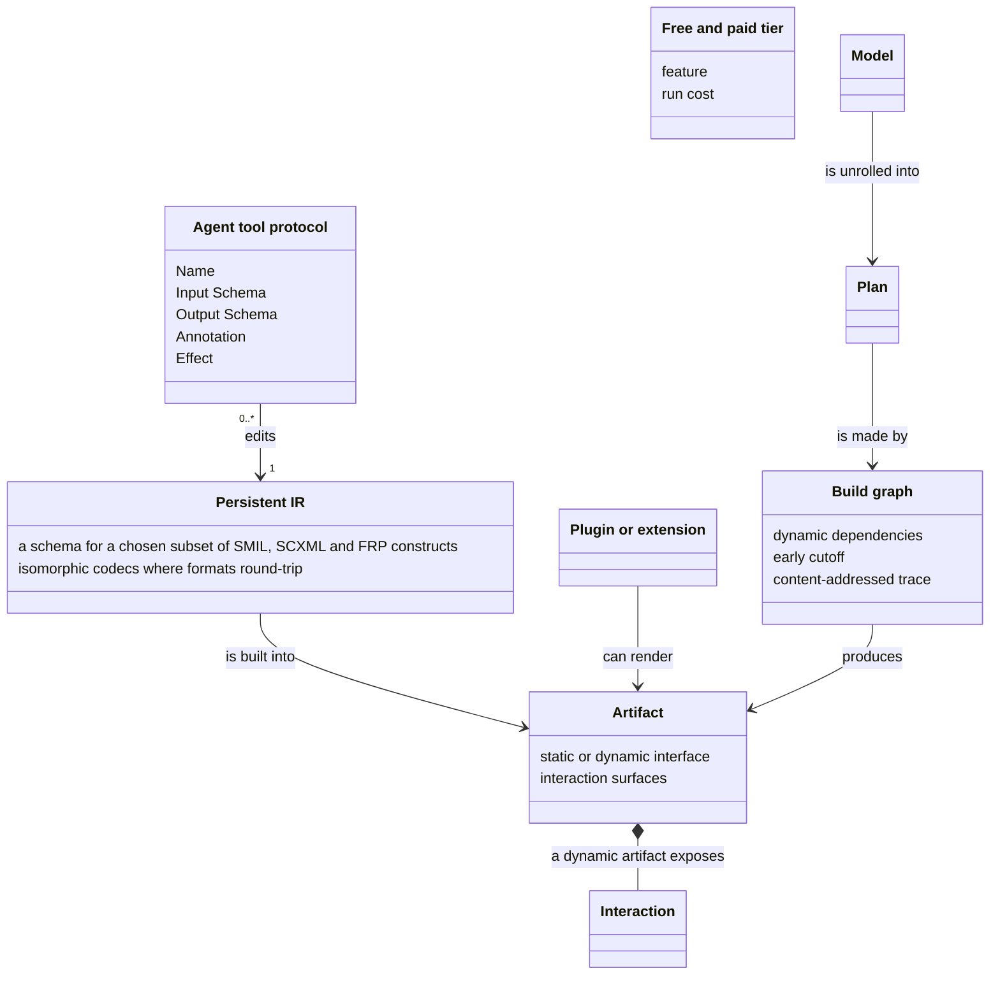
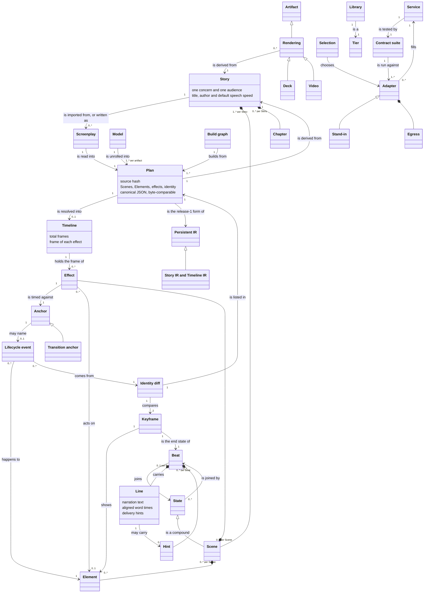
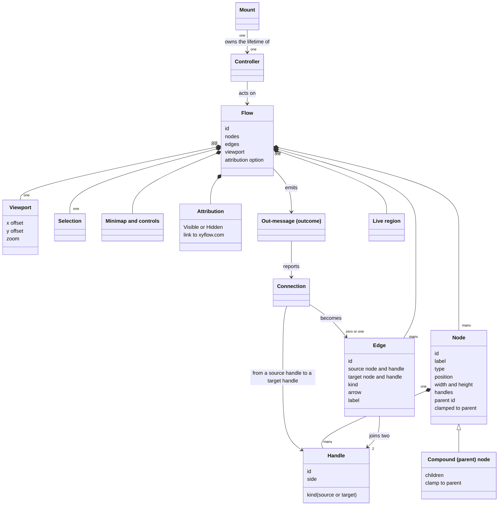

<!-- Generated by tools/intent from model/. Do not edit by hand: change the model and run `bun run generate`. -->

# Concepts Model

The Concepts Model fixes the vocabulary: concepts, their attributes and their relations (`isa`, part-of, and plain relations with a label and a multiplicity).

Method: 4EM (Sandkuhl, Stirna, Persson and Wißotzki, *Enterprise Modeling: Tackling Business Challenges with the 4EM Method*, Springer 2014). Every element cites its source; `decided` means a source shows that the operator decided it.

## The organisation

9 elements: 9 decided, 0 proposed, 0 open.

| Element | Statement | Status | Links | Sources |
| --- | --- | --- | --- | --- |
| <code>concept-org-ir</code> Concept | **Persistent IR.** The intermediate representation of a story: JSON owned by reebeat, with a schema for a chosen subset of SMIL, SCXML and FRP constructs. It is a format authors and tools edit, not an artifact. Attributes: a schema for a chosen subset of SMIL, SCXML and FRP constructs; isomorphic codecs where formats round-trip. | decided |  | [log L25][1] |
| <code>concept-org-artifact</code> Concept | **Artifact.** A produced file or site that people consume: a video, a presentation deck, or an interactive website. Artifact formats are not IR formats. Fountain is both an importer (a screenplay becomes a story) and an artifact renderer (a story becomes a screenplay); it is not the persistent IR, which stays JSON. Attributes: static or dynamic interface; interaction surfaces. | decided |  | [log L25][1], [log L37][2], [log L67-69][3] |
| <code>concept-org-interaction</code> Concept | **Interaction.** An interaction is an element that can trigger events. It is surfaced to people and agents as a function, a tool call or a web control, and in a video as a scheduled event with a visible cursor. | decided |  | [log L37][2], [log L38][4], [log L39][5] |
| <code>concept-org-tier</code> Concept | **Free and paid tier.** A free tier holds the basic features that cost nothing to run. Costly premium features, such as multiplayer collaboration and heavily integrated hosted AI agents, sit behind a paywall. Attributes: feature; run cost. | decided |  | [log L43][6] |
| <code>concept-org-plugin</code> Concept | **Plugin or extension.** A piece written by a user that extends the compiler or a product, such as a plugin, an extension or a render engine built with the SDK. It builds on the modular contracts and building blocks of the compiler. | decided |  | [log L28][7], [log L43][6] |
| <code>concept-org-agent-tool-protocol</code> Concept | **Agent tool protocol.** Each tool through which an agent reads a story, applies an edit and runs the checks is declared once, in a protocol-neutral way. MCP is the first adapter, and its schema is generated from the declaration. A user's own agent gets the same tools as a hosted one, through MCP. Attributes: Name; Input Schema; Output Schema; Annotation; Effect. | decided |  | [log L77][8], [log L43][6], [reebeat:docs/design/open-core-boundary.md:25][9] |
| <code>concept-org-model</code> Concept | **Model.** The statechart-plus-time form of a story. It may contain cycles, such as interactive loops and repeats. | decided |  | [log L62][10] |
| <code>concept-org-plan</code> Concept | **Plan.** The unrolling of the Model for one artifact: a timeline for video, steps for a deck, a navigable graph for a website. | decided |  | [log L62][10] |
| <code>concept-org-build-graph</code> Concept | **Build graph.** The incremental DAG of build tasks with dynamic dependencies, early cutoff and content-addressed persistent traces. Only this graph is a DAG. Attributes: dynamic dependencies; early cutoff; content-addressed trace. | decided |  | [log L62][10] |

## reebeat (the compiler)

31 elements: 23 decided, 8 proposed, 0 open.

| Element | Statement | Status | Links | Sources |
| --- | --- | --- | --- | --- |
| <code>concept-reebeat-screenplay</code> Concept | **Screenplay.** A Fountain file with reebeat's fixed vocabulary. It is an input of the importer, which reads it into a Story, and an artifact that a renderer writes from a Story. In release 1 the importer is the only way to declare a Story. A Screenplay is not the persistent IR: JSON stays the IR. | decided |  | [record reebeat:docs/specs/0001-release-1-screenplay-to-deck-and-video.md:213][11], [reebeat:GLOSSARY.md:15-17][12], [log L25][1], [log L67-69][3] |
| <code>concept-reebeat-scene</code> Concept | **Scene.** A Scene is a compound State: it groups States in the story's statechart. | decided |  | [log L19][13] |
| <code>concept-reebeat-state</code> Concept | **State.** A node of the story's statechart. Scenes and States are nodes, and Beats are the edges between them. | decided |  | [log L19][13] |
| <code>concept-reebeat-beat</code> Concept | **Beat.** A Beat is a transition, an edge between States. | decided |  | [log L19][13] |
| <code>concept-reebeat-effect</code> Concept | **Effect.** An effect is declared in a Scene's effects block and is timed against an anchor. | decided |  | [record reebeat:docs/specs/0002-explicit-anchors-and-syntax.md:162][14], [record reebeat:docs/specs/0002-explicit-anchors-and-syntax.md:163][15], [reebeat:GLOSSARY.md:35-37][16] |
| <code>concept-reebeat-anchor</code> Concept | **Anchor.** A named moment an effect is timed against: a word, `scene.start`, `scene.end`, the transition into the Scene (its start, its end or a percent of the way), or an Element's lifecycle. | decided |  | [record reebeat:docs/specs/0002-explicit-anchors-and-syntax.md:163][15], [reebeat:docs/specs/0002-explicit-anchors-and-syntax.md:15][17], [reebeat:GLOSSARY.md:39-41][18] |
| <code>concept-reebeat-transition-anchor</code> Concept | **Transition anchor.** The Scene's incoming slide transition as an anchor: its start, its end or a percent of the way. A sound that belongs to the slide change is anchored here, so it follows the motion and not the voice. | decided |  | [record reebeat:docs/specs/0002-explicit-anchors-and-syntax.md:163][15], [reebeat:GLOSSARY.md:47-49][19] |
| <code>concept-reebeat-element</code> Concept | **Element.** A visible thing with an id. Elements declare styles and transitions, and the same id is the same entity across Scenes. | decided |  | [log L20][20], [log L23][21] |
| <code>concept-reebeat-identity-diff</code> Concept | **Identity diff.** The comparison of two Keyframes by Element id that derives motion. Ids are story-global, so one id is one entity. An id only in the second enters, an id only in the first exits, and an id in both updates. Until spec 0005 the comparison runs between adjacent Scenes. | decided |  | [reebeat:docs/specs/0001-release-1-screenplay-to-deck-and-video.md:213][11], [log L23][21], [log L83][22], [reebeat:GLOSSARY.md:65-67][23] |
| <code>concept-reebeat-model</code> Concept | **Model.** The first of three layers: a statechart plus functional reactive and SMIL time. It may contain cycles, such as interactive loops and repeats. | decided |  | [log L62][10] |
| <code>concept-reebeat-build-graph</code> Concept | **Build graph.** The third layer: an incremental graph with dynamic dependencies, early cutoff and content-addressed persistent traces. "DAG" applies to this graph only. | decided |  | [log L62][10] |
| <code>concept-reebeat-ir</code> Concept | **Story IR and Timeline IR.** reebeat's own JSON format, defined by an Effect Schema, for the story and for the timeline. The story IR is public and versioned. The timeline IR is an unstable build artifact, tagged unstable until the website Plan and the engine protocol exist. Exact time is stored in flicks. The JSON Schema is generated from the Effect Schema. | decided |  | [log L25][1], [log L85][24], [reebeat:docs/specs/0007-scxml-persistent-ir-spike.md:23][25], [pr reebeat#17][26] |
| <code>concept-reebeat-rendering</code> Concept | **Rendering.** An output derived from a Story. It is an artifact, and artifact formats are different from IR formats. | decided |  | [log L25][1] |
| <code>concept-reebeat-deck</code> Concept | **Deck.** A rendering that is a reveal.js presentation. | decided |  | [record reebeat:docs/specs/0001-release-1-screenplay-to-deck-and-video.md:213][11], [reebeat:README.md:5][27], [reebeat:GLOSSARY.md:78-80][28] |
| <code>concept-reebeat-video</code> Concept | **Video.** A rendering captured from the Deck's page on a controlled clock. | decided |  | [record reebeat:docs/specs/0001-release-1-screenplay-to-deck-and-video.md:213][11], [reebeat:README.md:6][29], [reebeat:GLOSSARY.md:75-76][30] |
| <code>concept-reebeat-library</code> Concept | **Library.** Pure code with no runtime and no service. | decided |  | [record reebeat:docs/specs/0001-release-1-screenplay-to-deck-and-video.md:235][31], [reebeat:GLOSSARY.md:101-102][32] |
| <code>concept-reebeat-service</code> Concept | **Service.** An Effect interface plus a contract that every implementation passes. | decided |  | [record reebeat:docs/specs/0001-release-1-screenplay-to-deck-and-video.md:235][31], [reebeat:docs/design/keyframe-engine.md:1225][33], [reebeat:GLOSSARY.md:104-106][34] |
| <code>concept-reebeat-adapter</code> Concept | **Adapter.** A Layer that implements a service on an outside runtime. It is an integration. | decided |  | [record reebeat:docs/specs/0001-release-1-screenplay-to-deck-and-video.md:235][31], [reebeat:GLOSSARY.md:108-110][35] |
| <code>concept-reebeat-selection</code> Concept | **Selection.** Which adapter fills each service. Selection is explicit configuration at the composition root, and it never falls back silently. | decided |  | [record reebeat:docs/specs/0001-release-1-screenplay-to-deck-and-video.md:235][31], [reebeat:GLOSSARY.md:112-113][36], [reebeat:packages/services/src/selection.ts:18-26][37] |
| <code>concept-reebeat-stand-in</code> Concept | **Stand-in.** An offline stand-in for an integration, used in tests. | decided |  | [record reebeat:docs/specs/0001-release-1-screenplay-to-deck-and-video.md:235][31], [reebeat:GLOSSARY.md:115-117][38] |
| <code>concept-reebeat-egress</code> Concept | **Egress.** What an integration sends out of the machine, declared by the integration. | decided |  | [record reebeat:docs/specs/0001-release-1-screenplay-to-deck-and-video.md:235][31], [reebeat:GLOSSARY.md:119-120][39] |
| <code>concept-reebeat-contract-suite</code> Concept | **Contract suite.** The suite that every adapter of one service must pass. | decided |  | [record reebeat:docs/specs/0001-release-1-screenplay-to-deck-and-video.md:235][31], [reebeat:docs/design/keyframe-engine.md:1225][33], [reebeat:docs/specs/0001-release-1-screenplay-to-deck-and-video.md:259][40] |
| <code>concept-reebeat-tier</code> Concept | **Tier.** One of three categories, library, service or integration, with one dependency direction. | decided |  | [record reebeat:docs/specs/0001-release-1-screenplay-to-deck-and-video.md:235][31] |
| <code>concept-reebeat-story</code> Concept | **Story.** The largest unit with one concern and one audience. It contains Scenes. Its declaration is the story IR, and in release 1 a Story is imported from one Screenplay. A Video is a rendering of a Story, not the Story. Attributes: one concern and one audience; title, author and default speech speed. *Why proposed:* Observed in the repository: the glossary, which an agent wrote, defines Story and says its source is one Screenplay. The operator later said that JSON stays the persistent IR and that a Screenplay is both an importer input and an artifact (log:25, log:67-69). The glossary does not yet say so. The decision log defines Scene, State and Beat but does not define Story, so confirm it. | proposed |  | [reebeat:GLOSSARY.md:11-13][41], [log L25][1], [log L67-69][3] |
| <code>concept-reebeat-keyframe</code> Concept | **Keyframe.** The visual state a Beat ends in: every visible Element with its properties. *Why proposed:* Observed in the repository: the glossary defines the Keyframe as the state a Beat ends in. The log decides that an id carries identity across Scenes (log:23) but does not define Keyframe, so confirm the exact definition. | proposed |  | [reebeat:GLOSSARY.md:27-29][42] |
| <code>concept-reebeat-line</code> Concept | **Line.** The narration that carries a Beat: the dialogue of the NARRATOR, aligned to words. Its narration text is the dialogue itself. Subtitles and speaker notes carry exactly that text. Attributes: narration text; aligned word times; delivery hints. *Why proposed:* Observed in the repository: the glossary defines Line, and the log describes narration (log:27) without defining it. The operator should confirm the definition. | proposed |  | [log L27][43], [reebeat:GLOSSARY.md:31-33][44] |
| <code>concept-reebeat-lifecycle-event</code> Concept | **Lifecycle event.** What happens to an Element in a Scene, from the identity diff: enter, exit, move or update. Enter, exit, move and update each have a start and an end, except an instant such as an exit, which has no window and no percent. Move and update follow the renderer's declared easing. The others are linear in time. *Why proposed:* Spec plan: spec 0002 and the glossary define enter, exit, move and update. The operator decided that lifecycles are anchors (spec 0002 line 162), not each event, so confirm them. | proposed |  | [reebeat:GLOSSARY.md:43-45][45] |
| <code>concept-reebeat-hint</code> Concept | **Hint.** An optional instruction that the content alone does not carry: a delivery parenthetical before a Line, or a transition between Scenes. *Why proposed:* Observed in the repository: the glossary defines Hint. The operator's log does not name Hints, so confirm it. | proposed |  | [reebeat:GLOSSARY.md:51-53][46] |
| <code>concept-reebeat-plan</code> Concept | **Plan.** The named compiler stage between the Story and the schedule. It lists every Element, effect and identity decision, keeps the author's intent, and is plain data for review and golden tests. `reebeat plan` prints it. Attributes: source hash; Scenes, Elements, effects, identity; canonical JSON, byte-comparable. *Why proposed:* Spec plan: the design names the Plan as a stage and spec 0001 sets out its contents. The operator has not decided those contents, so confirm them. | proposed |  | [reebeat:docs/design/keyframe-engine.md:1112][47], [reebeat:docs/specs/0001-release-1-screenplay-to-deck-and-video.md:90][48] |
| <code>concept-reebeat-timeline</code> Concept | **Timeline.** The Plan with every Line, effect, step and slide change placed at an integer frame. The schedule stage builds it from the aligned words and the renderer's lifecycle. Attributes: total frames; frame of each effect. *Why proposed:* Spec plan: the design names the Timeline as a stage and spec 0001 sets out the integer-frame schedule. The operator has not decided those details, so confirm them. | proposed |  | [reebeat:docs/design/keyframe-engine.md:1112][47], [reebeat:docs/specs/0001-release-1-screenplay-to-deck-and-video.md:68][49] |
| <code>concept-reebeat-chapter</code> Concept | **Chapter.** A named run of consecutive Scenes, introduced by a Section heading. A Video's chapter marks and a Deck's slide groups come from it. *Why proposed:* Observed in the repository: the glossary lists Chapter among reserved groupings, yet its mapping table and the Plan use chapters. The operator should say whether it is modelled. | proposed |  | [reebeat:GLOSSARY.md:124-125][50], [reebeat:GLOSSARY.md:89][51] |

## reebeat studio

19 elements: 13 decided, 6 proposed, 0 open.

| Element | Statement | Status | Links | Sources |
| --- | --- | --- | --- | --- |
| <code>concept-studio-lens</code> Concept | **Lens.** A lens is a phase-based page of the editor, inspired by DaVinci Resolve's pages. Each lens fits one phase of work. Attributes: phase of work. | decided |  | [log L45][52], [record studio:docs/specs/0001-first-felt-journey.md:171][53] |
| <code>concept-studio-keyed-document</code> Concept | **Keyed document.** The shared story is held in a merge-based keyed document, with a validation gate in the sync server. | decided |  | [log L47][54], [record studio:docs/specs/0002-collaboration-spike.md:198][55] |
| <code>concept-studio-loro-update</code> Concept | **Loro update.** The replicated unit of collaboration is the Loro update. | decided |  | [record studio:docs/specs/0001-first-felt-journey.md:172][56], [log L47][54] |
| <code>concept-studio-json-patch</code> Concept | **JSON Patch.** A JSON Patch describes an edit, for agents' tool calls, review and proposals. It is not what peers exchange. | decided |  | [record studio:docs/specs/0001-first-felt-journey.md:172][56] |
| <code>concept-studio-document-port</code> Concept | **Document port.** Loro sits behind a ten-method document port. | decided |  | [record studio:docs/specs/0002-collaboration-spike.md:198][55] |
| <code>concept-studio-validation-gate</code> Concept | **Validation gate.** The validation gate is in the sync server, which is a Durable Object. | decided |  | [log L47][54], [record studio:docs/specs/0002-collaboration-spike.md:198][55] |
| <code>concept-studio-repair-proposal</code> Concept | **Repair proposal.** A repair for an invalid merge is offered as a proposal and is never applied without a person. | decided |  | [record studio:docs/specs/0002-collaboration-spike.md:198][55] |
| <code>concept-studio-suggestion</code> Concept | **Suggestion.** A suggestion is an edit proposed under the suggest preset by an agent or a collaborator that is not yet applied. It carries who proposed it. Attributes: author (agent or person); patch that describes the edit; accepted or rejected, and by whom. | decided |  | [studio:docs/design/lenses.md:67][57], [log L99][58] |
| <code>concept-studio-sync-room</code> Concept | **Sync room.** The sync room is planned as one Cloudflare Durable Object for each story. It uses WebSocket hibernation, keeps an update log in SQLite and compacts it to a snapshot, and a small measured spike on the real edge comes before it is built. Attributes: one object per story; update log compacted to a snapshot; snapshots over 2 MB are chunked. | decided |  | [studio:docs/specs/0002-collaboration-spike.md:28][59], [studio:docs/specs/0002-collaboration-spike.md:192][60], [log L101][61] |
| <code>concept-studio-peer</code> Concept | **Peer.** A peer is a person, an agent or a system that edits through its own replica of the document. The server issues the peer's identity and binds it to an authenticated user when the peer connects. The free local mode uses one local principal. Attributes: peer id (issued by the server); authenticated user it is bound to (a person, an agent or a system). | decided |  | [studio:docs/specs/0002-collaboration-spike.md:27][62], [studio:docs/specs/0002-collaboration-spike.md:138][63], [log L98][64] |
| <code>concept-studio-deck-view</code> Concept | **Deck view.** The deck view is where narration is recorded and cut narration pieces are tied to beat lifecycle events. | decided |  | [log L45][52] |
| <code>concept-studio-narration-piece</code> Concept | **Narration piece.** A narration piece is a cut part of narration that is tied to a beat lifecycle event. | decided |  | [log L45][52] |
| <code>concept-studio-agent-scope</code> Concept | **Agent panel scope.** A scope is an action set on resources (scenes, elements, effects, timing, narration), declared in code, that says what an agent may do. Read, suggest and apply are named presets: read may read the story, suggest may propose edits that wait for a person, and apply may edit directly. Per-lens defaults are UI presets. Attributes: action set on resources; presets read, suggest and apply; set per agent; default preset per lens. | decided |  | [studio:docs/design/lenses.md:91-99][65], [log L99][58] |
| <code>concept-studio-playhead</code> Concept | **Playhead and preview.** The preview shows the story at the playhead. The preview, the playhead and the agent panel are present in every lens. Attributes: playhead position (media time); preview frame at that time. *Why proposed:* Spec plan: the lenses note states it as design. Whether the playhead is shared between collaborators is open. The operator should confirm that the preview, playhead and agent panel are always present, and whether the playhead is shared. | proposed |  | [studio:docs/design/lenses.md:9][66], [studio:docs/design/lenses.md:108][67] |
| <code>concept-studio-tier</code> Concept | **Free tier and paid tier.** A free feature costs the project nothing to run. A paid feature costs the project money to run. The tier follows the cost driver, not what the screen shows. Attributes: cost driver (browser, always-on server, inference, render minutes); tier (free or paid). *Why proposed:* Spec plan: the lenses note and spec 0001 state this rule in general. The operator decided a free tier for basic features and paid premium features such as multiplayer collaboration and integrated AI agents (log:43). The operator must confirm the general rule. | proposed |  | [log L43][6], [studio:docs/design/lenses.md:15][68], [studio:docs/specs/0001-first-felt-journey.md:125][69] |
| <code>concept-studio-revision</code> Concept | **Revision.** A revision is the SHA-256 of the canonical story text projected from the document. It does not come from the CRDT's saved bytes. Attributes: SHA-256 of the projected IR text. *Why proposed:* Spec plan: spec 0001 defines baseRevision this way and spec 0002 keeps it for merge. The operator has not decided it. The operator should confirm the revision rule. | proposed |  | [studio:docs/specs/0001-first-felt-journey.md:88][70], [studio:docs/specs/0002-collaboration-spike.md:129][71] |
| <code>concept-studio-take</code> Concept | **Take.** A take is one recording of a Line. A Line can have several takes, and the author picks the best one. *Why proposed:* Spec plan: the lenses note describes takes, a teleprompter and word alignment. The operator log names cut narration pieces, not takes. The operator should confirm the take model. | proposed |  | [studio:docs/design/lenses.md:38][72], [log L45][52] |
| <code>concept-studio-anchor-offset</code> Concept | **Anchor and offset.** An effect is timed against an anchor, a named moment such as a word of the narration, a scene start or end, or another effect. An offset moves the effect from its anchor by a signed time or a share of a window. Retiming in studio changes the offset and keeps the anchor. *Why proposed:* Reebeat's GLOSSARY.md defines the anchor and the offset (lines 39-40; the syntax came with spec 0002, merged in reebeat PR 4 on 2026-10-29). The lenses note applies them to retiming in the Timeline lens (line 56). The operator should confirm that studio uses the terms as the reebeat glossary defines them. | proposed |  | [studio:docs/design/lenses.md:56][73], [reebeat:GLOSSARY.md:39-40][74] |
| <code>concept-studio-feature-map</code> Concept | **Feature map.** The feature map lists each user-visible feature with how to observe it and what counts as broken. The verify skill drives it in a real browser. Attributes: entry id and spec; how to observe; broken when. *Why proposed:* Observed in the repository: spec 0003 defines it. The operator assigned a verification skill but did not define the map. The operator should confirm the feature map as the way to keep the verify skill true. | proposed |  | [studio:docs/specs/0003-review-and-verify-skills.md:14][75], [studio:.agents/skills/verify-studio/features/README.md:3-5][76] |

## foldkit-flow

14 elements: 2 decided, 12 proposed, 0 open.

| Element | Statement | Status | Links | Sources |
| --- | --- | --- | --- | --- |
| <code>concept-flow-attribution</code> Concept | **Attribution.** Attribution is the "Built with xyflow" link in the corner of the canvas. It is either Visible or Hidden. Visible is the default, and an application may set it to Hidden. Attributes: Visible or Hidden; link to xyflow.com. | decided |  | [log L106][77], [foldkit-flow:README.md:86][78], [foldkit-flow:docs/specs/0000-development-lifecycle.md:53][79], [foldkit-flow:packages/flow/src/attribution.ts:15-22][80] |
| <code>concept-flow-out-message</code> Concept | **Out-message (outcome).** An out-message tells the application what a gesture produced: Connected, Reconnected, Deleted, Moved or a selection change. The library only reports it, and the application decides what to do with it and applies the graph change. | decided |  | [log L109][81], [foldkit-flow:README.md:52][82], [foldkit-flow:packages/flow/src/message.ts:67-83][83] |
| <code>concept-flow-flow</code> Concept | **Flow.** A Flow is one node-based graph canvas inside a Foldkit application. It holds the nodes, edges, viewport and selection, and it lives in the application's Model. Attributes: id; nodes; edges; viewport; attribution option. *Why proposed:* The log decides only a node-based graph UI for Foldkit (line 48). README line 24 says the Flow is a Foldkit Submodel whose graph lives in the application's Model, and model.ts lines 14 to 29 define its fields: nodes, edges, viewport and attribution. Selection is a flag on each node and edge. The operator must confirm the concept. | proposed |  | [log L48][84], [foldkit-flow:README.md:3][85], [foldkit-flow:README.md:24][86], [foldkit-flow:packages/flow/src/model.ts:14-29][87] |
| <code>concept-flow-node</code> Concept | **Node.** A node is one box on the canvas. It declares its position, size and handles, and the application draws its content. Attributes: id; label; type; position; width and height; handles; parent id; clamped to parent. *Why proposed:* README lines 35 to 47 show the node fields in use, and types.ts lines 42 to 59 define them. A node declares its size and handles, so edges are placed without measuring the DOM. The operator must confirm the vocabulary. | proposed |  | [foldkit-flow:README.md:3][85], [foldkit-flow:README.md:35-47][88], [foldkit-flow:packages/flow/src/types.ts:42-59][89] |
| <code>concept-flow-edge</code> Concept | **Edge.** An edge is a line between a source handle and a target handle. It can be a bezier, smooth-step or straight line, with an optional arrow. Attributes: id; source node and handle; target node and handle; kind; arrow; label. *Why proposed:* README line 47 shows an edge, and line 66 says there are three edge types with an optional arrow. types.ts lines 63 to 77 define the kinds (Bezier, SmoothStep, Straight) and the fields, including a label. The operator must confirm the vocabulary. | proposed |  | [foldkit-flow:README.md:47][90], [foldkit-flow:README.md:66][91], [foldkit-flow:packages/flow/src/types.ts:63-77][92] |
| <code>concept-flow-handle</code> Concept | **Handle.** A handle is a connection point on a node. A person drags from one handle to another to make a connection. Attributes: id; kind (source or target); side. *Why proposed:* The README names handles (line 3) and shows one declared on a node (line 43). types.ts lines 33 to 38 define a handle by id, kind (source or target) and side. The operator must confirm the vocabulary. | proposed |  | [foldkit-flow:README.md:3][85], [foldkit-flow:README.md:43][93], [foldkit-flow:packages/flow/src/types.ts:33-38][94] |
| <code>concept-flow-connection</code> Concept | **Connection.** A connection is a pair of handles that a person joins with a gesture. The application's check accepts or refuses it, and the application turns an accepted one into an edge. *Why proposed:* types.ts lines 81 to 89 define a connection as the two ends of an edge that is about to exist. README lines 53 and 54 say the application adds the edge when it receives `Connected`. So a connection (a gesture result) differs from an edge (graph data). The operator must confirm. | proposed |  | [foldkit-flow:README.md:53-54][95], [foldkit-flow:packages/flow/src/types.ts:81-89][96] |
| <code>concept-flow-parent-node</code> Concept | **Compound (parent) node.** A parent node contains child nodes. A child positions relative to its parent and may be clamped inside it. A Scene holding States is one example. Attributes: children; clamp to parent. *Why proposed:* The log says a Scene is a compound state that groups States (line 19). The library builds parent nodes for that shape: a node with `parentId` is a child whose position is relative to its parent (README line 45), and `isClampedToParent` keeps it inside (README line 66; types.ts line 52). No line names the node kind as a flow concept. The operator must confirm. | proposed |  | [log L19][13], [foldkit-flow:README.md:45][97], [foldkit-flow:README.md:66][91], [foldkit-flow:packages/flow/src/types.ts:52-54][98] |
| <code>concept-flow-viewport</code> Concept | **Viewport.** The viewport is the visible part of the canvas, given by an offset and a zoom. Pan and zoom change it and touch no node. Attributes: x offset; y offset; zoom. *Why proposed:* The README names pan and zoom (line 3) and says they change only the viewport element's transform (line 82). types.ts lines 10 to 14 define the viewport as x, y and zoom, and model.ts line 28 holds it in the Model. The operator must confirm. | proposed |  | [foldkit-flow:README.md:3][85], [foldkit-flow:README.md:82][99], [foldkit-flow:packages/flow/src/types.ts:10-14][100] |
| <code>concept-flow-selection</code> Concept | **Selection.** The selection is the set of nodes and edges the person has picked by click, box or key. Delete, move and clear act on it. *Why proposed:* The README names selecting with a box (line 3) and lists click, Shift-click and box selection (line 66). Selection is a `selected` flag on each node and edge (selection.ts lines 5 to 7), and `UpdatedSelection` reports it (message.ts line 79). The operator must confirm. | proposed |  | [foldkit-flow:README.md:3][85], [foldkit-flow:README.md:66][91], [foldkit-flow:packages/flow/src/selection.ts:5-7][101] |
| <code>concept-flow-minimap</code> Concept | **Minimap and controls.** The minimap is a small overview of the graph that a person can drag to pan. The controls are buttons to zoom in, zoom out and fit the view. *Why proposed:* README line 66 lists a minimap, zoom controls and fit view as built. view.ts draws the controls (lines 464 to 478) and the minimap (lines 499 to 523), and the minimap Mount lets a person drag it to pan (mounts.ts lines 757 to 779). The operator must confirm them as part of the first release. | proposed |  | [foldkit-flow:README.md:66][91], [foldkit-flow:packages/flow/src/view.ts:464-478][102], [foldkit-flow:packages/flow/src/view.ts:499-523][103] |
| <code>concept-flow-mount</code> Concept | **Mount.** A Mount is a Foldkit construct that runs work when an element appears and cleans up when it goes. The library uses Mounts to own its controllers. *Why proposed:* Mount is a Foldkit term, used here as AGENTS.md uses it. mounts.ts lines 34 to 39 say each xyflow controller is created and destroyed by a Mount. The operator must confirm that it belongs in the model. | proposed |  | [foldkit-flow:AGENTS.md:63][104], [foldkit-flow:packages/flow/src/mounts.ts:34-39][105] |
| <code>concept-flow-controller</code> Concept | **Controller.** A controller is an xyflow object that handles one kind of interaction: pan and zoom, node drag, handle connection or the minimap. *Why proposed:* The README lists xyflow's controllers (line 86). xyflow.ts lines 7 to 20 name the four the library calls: XYPanZoom, XYDrag, XYMinimap and the handle gesture XYHandle.onPointerDown. The operator must confirm. | proposed |  | [foldkit-flow:README.md:86][78], [foldkit-flow:AGENTS.md:63][104], [foldkit-flow:packages/flow/src/xyflow.ts:7-20][106] |
| <code>concept-flow-live-region</code> Concept | **Live region.** The live region is a polite status area that announces selection, moves, connections and deletions to screen readers. *Why proposed:* README line 76 says a polite live region (`role="status"`) announces selection, moves, connections and deletions, and view.ts lines 665 to 673 render it. The operator must confirm the live region as part of the keyboard contract. | proposed |  | [foldkit-flow:README.md:76][107], [foldkit-flow:packages/flow/src/view.ts:665-673][108] |

[1]: ../sources/operator-decisions-2026-10.md#L25
[2]: ../sources/operator-decisions-2026-10.md#L37
[3]: ../sources/operator-decisions-2026-10.md#L67
[4]: ../sources/operator-decisions-2026-10.md#L38
[5]: ../sources/operator-decisions-2026-10.md#L39
[6]: ../sources/operator-decisions-2026-10.md#L43
[7]: ../sources/operator-decisions-2026-10.md#L28
[8]: ../sources/operator-decisions-2026-10.md#L77
[9]: https://github.com/reebeat/reebeat/blob/82ee66f8806558460917b33ad9ad8d21c47a9a5b/docs/design/open-core-boundary.md#L25
[10]: ../sources/operator-decisions-2026-10.md#L62
[11]: https://github.com/reebeat/reebeat/blob/82ee66f8806558460917b33ad9ad8d21c47a9a5b/docs/specs/0001-release-1-screenplay-to-deck-and-video.md#L213
[12]: https://github.com/reebeat/reebeat/blob/82ee66f8806558460917b33ad9ad8d21c47a9a5b/GLOSSARY.md#L15-L17
[13]: ../sources/operator-decisions-2026-10.md#L19
[14]: https://github.com/reebeat/reebeat/blob/82ee66f8806558460917b33ad9ad8d21c47a9a5b/docs/specs/0002-explicit-anchors-and-syntax.md#L162
[15]: https://github.com/reebeat/reebeat/blob/82ee66f8806558460917b33ad9ad8d21c47a9a5b/docs/specs/0002-explicit-anchors-and-syntax.md#L163
[16]: https://github.com/reebeat/reebeat/blob/82ee66f8806558460917b33ad9ad8d21c47a9a5b/GLOSSARY.md#L35-L37
[17]: https://github.com/reebeat/reebeat/blob/82ee66f8806558460917b33ad9ad8d21c47a9a5b/docs/specs/0002-explicit-anchors-and-syntax.md#L15
[18]: https://github.com/reebeat/reebeat/blob/82ee66f8806558460917b33ad9ad8d21c47a9a5b/GLOSSARY.md#L39-L41
[19]: https://github.com/reebeat/reebeat/blob/82ee66f8806558460917b33ad9ad8d21c47a9a5b/GLOSSARY.md#L47-L49
[20]: ../sources/operator-decisions-2026-10.md#L20
[21]: ../sources/operator-decisions-2026-10.md#L23
[22]: ../sources/operator-decisions-2026-10.md#L83
[23]: https://github.com/reebeat/reebeat/blob/82ee66f8806558460917b33ad9ad8d21c47a9a5b/GLOSSARY.md#L65-L67
[24]: ../sources/operator-decisions-2026-10.md#L85
[25]: https://github.com/reebeat/reebeat/blob/82ee66f8806558460917b33ad9ad8d21c47a9a5b/docs/specs/0007-scxml-persistent-ir-spike.md#L23
[26]: https://github.com/reebeat/reebeat/pull/17
[27]: https://github.com/reebeat/reebeat/blob/82ee66f8806558460917b33ad9ad8d21c47a9a5b/README.md#L5
[28]: https://github.com/reebeat/reebeat/blob/82ee66f8806558460917b33ad9ad8d21c47a9a5b/GLOSSARY.md#L78-L80
[29]: https://github.com/reebeat/reebeat/blob/82ee66f8806558460917b33ad9ad8d21c47a9a5b/README.md#L6
[30]: https://github.com/reebeat/reebeat/blob/82ee66f8806558460917b33ad9ad8d21c47a9a5b/GLOSSARY.md#L75-L76
[31]: https://github.com/reebeat/reebeat/blob/82ee66f8806558460917b33ad9ad8d21c47a9a5b/docs/specs/0001-release-1-screenplay-to-deck-and-video.md#L235
[32]: https://github.com/reebeat/reebeat/blob/82ee66f8806558460917b33ad9ad8d21c47a9a5b/GLOSSARY.md#L101-L102
[33]: https://github.com/reebeat/reebeat/blob/82ee66f8806558460917b33ad9ad8d21c47a9a5b/docs/design/keyframe-engine.md#L1225
[34]: https://github.com/reebeat/reebeat/blob/82ee66f8806558460917b33ad9ad8d21c47a9a5b/GLOSSARY.md#L104-L106
[35]: https://github.com/reebeat/reebeat/blob/82ee66f8806558460917b33ad9ad8d21c47a9a5b/GLOSSARY.md#L108-L110
[36]: https://github.com/reebeat/reebeat/blob/82ee66f8806558460917b33ad9ad8d21c47a9a5b/GLOSSARY.md#L112-L113
[37]: https://github.com/reebeat/reebeat/blob/82ee66f8806558460917b33ad9ad8d21c47a9a5b/packages/services/src/selection.ts#L18-L26
[38]: https://github.com/reebeat/reebeat/blob/82ee66f8806558460917b33ad9ad8d21c47a9a5b/GLOSSARY.md#L115-L117
[39]: https://github.com/reebeat/reebeat/blob/82ee66f8806558460917b33ad9ad8d21c47a9a5b/GLOSSARY.md#L119-L120
[40]: https://github.com/reebeat/reebeat/blob/82ee66f8806558460917b33ad9ad8d21c47a9a5b/docs/specs/0001-release-1-screenplay-to-deck-and-video.md#L259
[41]: https://github.com/reebeat/reebeat/blob/82ee66f8806558460917b33ad9ad8d21c47a9a5b/GLOSSARY.md#L11-L13
[42]: https://github.com/reebeat/reebeat/blob/82ee66f8806558460917b33ad9ad8d21c47a9a5b/GLOSSARY.md#L27-L29
[43]: ../sources/operator-decisions-2026-10.md#L27
[44]: https://github.com/reebeat/reebeat/blob/82ee66f8806558460917b33ad9ad8d21c47a9a5b/GLOSSARY.md#L31-L33
[45]: https://github.com/reebeat/reebeat/blob/82ee66f8806558460917b33ad9ad8d21c47a9a5b/GLOSSARY.md#L43-L45
[46]: https://github.com/reebeat/reebeat/blob/82ee66f8806558460917b33ad9ad8d21c47a9a5b/GLOSSARY.md#L51-L53
[47]: https://github.com/reebeat/reebeat/blob/82ee66f8806558460917b33ad9ad8d21c47a9a5b/docs/design/keyframe-engine.md#L1112
[48]: https://github.com/reebeat/reebeat/blob/82ee66f8806558460917b33ad9ad8d21c47a9a5b/docs/specs/0001-release-1-screenplay-to-deck-and-video.md#L90
[49]: https://github.com/reebeat/reebeat/blob/82ee66f8806558460917b33ad9ad8d21c47a9a5b/docs/specs/0001-release-1-screenplay-to-deck-and-video.md#L68
[50]: https://github.com/reebeat/reebeat/blob/82ee66f8806558460917b33ad9ad8d21c47a9a5b/GLOSSARY.md#L124-L125
[51]: https://github.com/reebeat/reebeat/blob/82ee66f8806558460917b33ad9ad8d21c47a9a5b/GLOSSARY.md#L89
[52]: ../sources/operator-decisions-2026-10.md#L45
[53]: https://github.com/reebeat/studio/blob/d4fd75eaca83b9e8a98f073d5b1d957da5d6b8b8/docs/specs/0001-first-felt-journey.md#L171
[54]: ../sources/operator-decisions-2026-10.md#L47
[55]: https://github.com/reebeat/studio/blob/d4fd75eaca83b9e8a98f073d5b1d957da5d6b8b8/docs/specs/0002-collaboration-spike.md#L198
[56]: https://github.com/reebeat/studio/blob/d4fd75eaca83b9e8a98f073d5b1d957da5d6b8b8/docs/specs/0001-first-felt-journey.md#L172
[57]: https://github.com/reebeat/studio/blob/d4fd75eaca83b9e8a98f073d5b1d957da5d6b8b8/docs/design/lenses.md#L67
[58]: ../sources/operator-decisions-2026-10.md#L99
[59]: https://github.com/reebeat/studio/blob/d4fd75eaca83b9e8a98f073d5b1d957da5d6b8b8/docs/specs/0002-collaboration-spike.md#L28
[60]: https://github.com/reebeat/studio/blob/d4fd75eaca83b9e8a98f073d5b1d957da5d6b8b8/docs/specs/0002-collaboration-spike.md#L192
[61]: ../sources/operator-decisions-2026-10.md#L101
[62]: https://github.com/reebeat/studio/blob/d4fd75eaca83b9e8a98f073d5b1d957da5d6b8b8/docs/specs/0002-collaboration-spike.md#L27
[63]: https://github.com/reebeat/studio/blob/d4fd75eaca83b9e8a98f073d5b1d957da5d6b8b8/docs/specs/0002-collaboration-spike.md#L138
[64]: ../sources/operator-decisions-2026-10.md#L98
[65]: https://github.com/reebeat/studio/blob/d4fd75eaca83b9e8a98f073d5b1d957da5d6b8b8/docs/design/lenses.md#L91-L99
[66]: https://github.com/reebeat/studio/blob/d4fd75eaca83b9e8a98f073d5b1d957da5d6b8b8/docs/design/lenses.md#L9
[67]: https://github.com/reebeat/studio/blob/d4fd75eaca83b9e8a98f073d5b1d957da5d6b8b8/docs/design/lenses.md#L108
[68]: https://github.com/reebeat/studio/blob/d4fd75eaca83b9e8a98f073d5b1d957da5d6b8b8/docs/design/lenses.md#L15
[69]: https://github.com/reebeat/studio/blob/d4fd75eaca83b9e8a98f073d5b1d957da5d6b8b8/docs/specs/0001-first-felt-journey.md#L125
[70]: https://github.com/reebeat/studio/blob/d4fd75eaca83b9e8a98f073d5b1d957da5d6b8b8/docs/specs/0001-first-felt-journey.md#L88
[71]: https://github.com/reebeat/studio/blob/d4fd75eaca83b9e8a98f073d5b1d957da5d6b8b8/docs/specs/0002-collaboration-spike.md#L129
[72]: https://github.com/reebeat/studio/blob/d4fd75eaca83b9e8a98f073d5b1d957da5d6b8b8/docs/design/lenses.md#L38
[73]: https://github.com/reebeat/studio/blob/d4fd75eaca83b9e8a98f073d5b1d957da5d6b8b8/docs/design/lenses.md#L56
[74]: https://github.com/reebeat/reebeat/blob/82ee66f8806558460917b33ad9ad8d21c47a9a5b/GLOSSARY.md#L39-L40
[75]: https://github.com/reebeat/studio/blob/d4fd75eaca83b9e8a98f073d5b1d957da5d6b8b8/docs/specs/0003-review-and-verify-skills.md#L14
[76]: https://github.com/reebeat/studio/blob/d4fd75eaca83b9e8a98f073d5b1d957da5d6b8b8/.agents/skills/verify-studio/features/README.md#L3-L5
[77]: ../sources/operator-decisions-2026-10.md#L106
[78]: https://github.com/reebeat/foldkit-flow/blob/8124d5b08fe5e87c75c85b067c3079e2ce46a5a6/README.md#L86
[79]: https://github.com/reebeat/foldkit-flow/blob/8124d5b08fe5e87c75c85b067c3079e2ce46a5a6/docs/specs/0000-development-lifecycle.md#L53
[80]: https://github.com/reebeat/foldkit-flow/blob/8124d5b08fe5e87c75c85b067c3079e2ce46a5a6/packages/flow/src/attribution.ts#L15-L22
[81]: ../sources/operator-decisions-2026-10.md#L109
[82]: https://github.com/reebeat/foldkit-flow/blob/8124d5b08fe5e87c75c85b067c3079e2ce46a5a6/README.md#L52
[83]: https://github.com/reebeat/foldkit-flow/blob/8124d5b08fe5e87c75c85b067c3079e2ce46a5a6/packages/flow/src/message.ts#L67-L83
[84]: ../sources/operator-decisions-2026-10.md#L48
[85]: https://github.com/reebeat/foldkit-flow/blob/8124d5b08fe5e87c75c85b067c3079e2ce46a5a6/README.md#L3
[86]: https://github.com/reebeat/foldkit-flow/blob/8124d5b08fe5e87c75c85b067c3079e2ce46a5a6/README.md#L24
[87]: https://github.com/reebeat/foldkit-flow/blob/8124d5b08fe5e87c75c85b067c3079e2ce46a5a6/packages/flow/src/model.ts#L14-L29
[88]: https://github.com/reebeat/foldkit-flow/blob/8124d5b08fe5e87c75c85b067c3079e2ce46a5a6/README.md#L35-L47
[89]: https://github.com/reebeat/foldkit-flow/blob/8124d5b08fe5e87c75c85b067c3079e2ce46a5a6/packages/flow/src/types.ts#L42-L59
[90]: https://github.com/reebeat/foldkit-flow/blob/8124d5b08fe5e87c75c85b067c3079e2ce46a5a6/README.md#L47
[91]: https://github.com/reebeat/foldkit-flow/blob/8124d5b08fe5e87c75c85b067c3079e2ce46a5a6/README.md#L66
[92]: https://github.com/reebeat/foldkit-flow/blob/8124d5b08fe5e87c75c85b067c3079e2ce46a5a6/packages/flow/src/types.ts#L63-L77
[93]: https://github.com/reebeat/foldkit-flow/blob/8124d5b08fe5e87c75c85b067c3079e2ce46a5a6/README.md#L43
[94]: https://github.com/reebeat/foldkit-flow/blob/8124d5b08fe5e87c75c85b067c3079e2ce46a5a6/packages/flow/src/types.ts#L33-L38
[95]: https://github.com/reebeat/foldkit-flow/blob/8124d5b08fe5e87c75c85b067c3079e2ce46a5a6/README.md#L53-L54
[96]: https://github.com/reebeat/foldkit-flow/blob/8124d5b08fe5e87c75c85b067c3079e2ce46a5a6/packages/flow/src/types.ts#L81-L89
[97]: https://github.com/reebeat/foldkit-flow/blob/8124d5b08fe5e87c75c85b067c3079e2ce46a5a6/README.md#L45
[98]: https://github.com/reebeat/foldkit-flow/blob/8124d5b08fe5e87c75c85b067c3079e2ce46a5a6/packages/flow/src/types.ts#L52-L54
[99]: https://github.com/reebeat/foldkit-flow/blob/8124d5b08fe5e87c75c85b067c3079e2ce46a5a6/README.md#L82
[100]: https://github.com/reebeat/foldkit-flow/blob/8124d5b08fe5e87c75c85b067c3079e2ce46a5a6/packages/flow/src/types.ts#L10-L14
[101]: https://github.com/reebeat/foldkit-flow/blob/8124d5b08fe5e87c75c85b067c3079e2ce46a5a6/packages/flow/src/selection.ts#L5-L7
[102]: https://github.com/reebeat/foldkit-flow/blob/8124d5b08fe5e87c75c85b067c3079e2ce46a5a6/packages/flow/src/view.ts#L464-L478
[103]: https://github.com/reebeat/foldkit-flow/blob/8124d5b08fe5e87c75c85b067c3079e2ce46a5a6/packages/flow/src/view.ts#L499-L523
[104]: https://github.com/reebeat/foldkit-flow/blob/8124d5b08fe5e87c75c85b067c3079e2ce46a5a6/AGENTS.md#L63
[105]: https://github.com/reebeat/foldkit-flow/blob/8124d5b08fe5e87c75c85b067c3079e2ce46a5a6/packages/flow/src/mounts.ts#L34-L39
[106]: https://github.com/reebeat/foldkit-flow/blob/8124d5b08fe5e87c75c85b067c3079e2ce46a5a6/packages/flow/src/xyflow.ts#L7-L20
[107]: https://github.com/reebeat/foldkit-flow/blob/8124d5b08fe5e87c75c85b067c3079e2ce46a5a6/README.md#L76
[108]: https://github.com/reebeat/foldkit-flow/blob/8124d5b08fe5e87c75c85b067c3079e2ce46a5a6/packages/flow/src/view.ts#L665-L673
