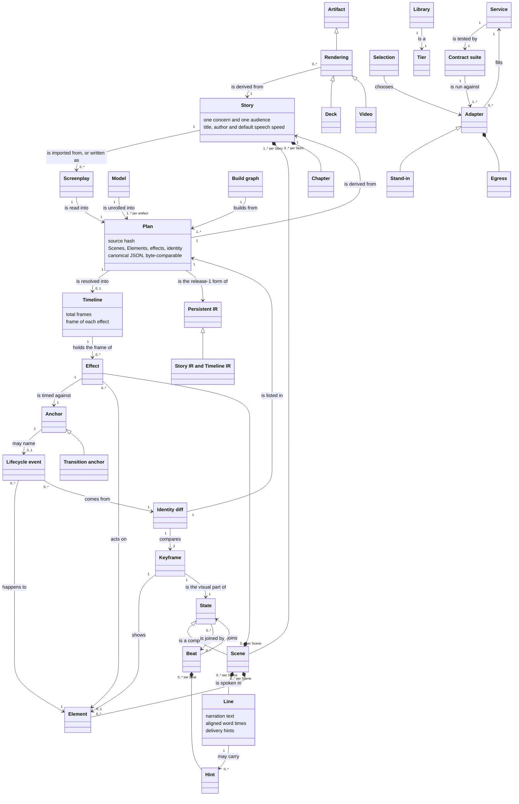
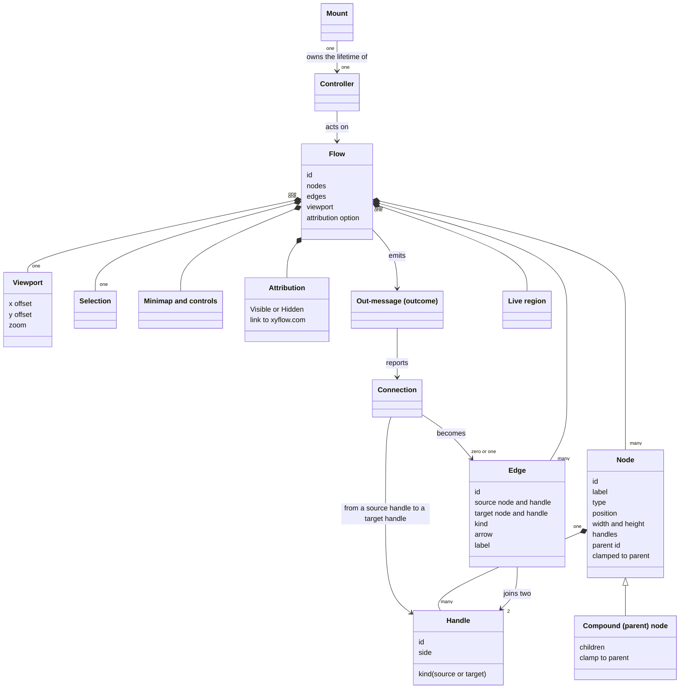

<!-- Generated by tools/intent from model/. Do not edit by hand: change the model and run `bun run generate`. -->

# Concepts Model

The Concepts Model fixes the vocabulary: concepts, their attributes and their relations (`isa`, part-of, and plain relations with a label and a multiplicity).

Method: 4EM (Sandkuhl, Stirna, Persson and Wißotzki, *Enterprise Modeling: Tackling Business Challenges with the 4EM Method*, Springer 2014). Every element cites its source; `decided` means a source shows that the operator decided it.

## The organisation

9 elements: 9 decided, 0 proposed, 0 open.

```mermaid
classDiagram
    class concept_org_ir["Persistent IR"]
    concept_org_ir : a schema for a chosen subset of SMIL, SCXML and FRP constructs
    concept_org_ir : isomorphic codecs where formats round-trip
    class concept_org_artifact["Artifact"]
    concept_org_artifact : static or dynamic interface
    concept_org_artifact : interaction surfaces
    class concept_org_interaction["Interaction"]
    class concept_org_tier["Free and paid tier"]
    concept_org_tier : feature
    concept_org_tier : run cost
    class concept_org_plugin["Plugin or extension"]
    class concept_org_agent_tool_protocol["Agent tool protocol"]
    concept_org_agent_tool_protocol : Name
    concept_org_agent_tool_protocol : Input Schema
    concept_org_agent_tool_protocol : Output Schema
    concept_org_agent_tool_protocol : Annotation
    concept_org_agent_tool_protocol : Effect
    class concept_org_model["Model"]
    class concept_org_plan["Plan"]
    class concept_org_build_graph["Build graph"]
    concept_org_build_graph : dynamic dependencies
    concept_org_build_graph : early cutoff
    concept_org_build_graph : content-addressed trace
    concept_org_ir --> concept_org_artifact : is built into
    concept_org_artifact *-- concept_org_interaction : a dynamic artifact exposes
    concept_org_plugin --> concept_org_artifact : can render
    concept_org_agent_tool_protocol "0..*" -->  "1"concept_org_ir : edits
    concept_org_model --> concept_org_plan : is unrolled into
    concept_org_plan --> concept_org_build_graph : is made by
    concept_org_build_graph --> concept_org_artifact : produces
```

| Element | Statement | Status | Links | Sources |
| --- | --- | --- | --- | --- |
| <code>concept-org-ir</code> Concept | **Persistent IR.** The intermediate representation of a story: JSON owned by tsukuri, with a schema for a chosen subset of SMIL, SCXML and FRP constructs. It is a format authors and tools edit, not an artifact. Attributes: a schema for a chosen subset of SMIL, SCXML and FRP constructs; isomorphic codecs where formats round-trip. | decided |  | [log L25][1] |
| <code>concept-org-artifact</code> Concept | **Artifact.** A produced file or site that people consume: a video, a presentation deck, or an interactive website. Artifact formats are not IR formats. Fountain is both an importer (a screenplay becomes a story) and an artifact renderer (a story becomes a screenplay); it is not the persistent IR, which stays JSON. Attributes: static or dynamic interface; interaction surfaces. | decided |  | [log L25][1], [log L37][2], [log L67-69][3] |
| <code>concept-org-interaction</code> Concept | **Interaction.** An interaction is an element that can trigger events. It is surfaced to people and agents as a function, a tool call or a web control, and in a video as a scheduled event with a visible cursor. | decided |  | [log L37][2], [log L38][4], [log L39][5] |
| <code>concept-org-tier</code> Concept | **Free and paid tier.** A free tier holds the basic features that cost nothing to run. Costly premium features, such as multiplayer collaboration and heavily integrated hosted AI agents, sit behind a paywall. Attributes: feature; run cost. | decided |  | [log L43][6] |
| <code>concept-org-plugin</code> Concept | **Plugin or extension.** A piece written by a user that extends the compiler or a product, such as a plugin, an extension or a render engine built with the SDK. It builds on the modular contracts and building blocks of the compiler. | decided |  | [log L28][7], [log L43][6] |
| <code>concept-org-agent-tool-protocol</code> Concept | **Agent tool protocol.** Each tool through which an agent reads a story, applies an edit and runs the checks is declared once, in a protocol-neutral way. MCP is the first adapter, and its schema is generated from the declaration. A user's own agent gets the same tools as a hosted one, through MCP. Attributes: Name; Input Schema; Output Schema; Annotation; Effect. | decided |  | [log L77][8], [log L43][6], [tsukuri:docs/design/open-core-boundary.md:25][9] |
| <code>concept-org-model</code> Concept | **Model.** The statechart-plus-time form of a story. It may contain cycles, such as interactive loops and repeats. | decided |  | [log L62][10] |
| <code>concept-org-plan</code> Concept | **Plan.** The unrolling of the Model for one artifact: a timeline for video, steps for a deck, a navigable graph for a website. | decided |  | [log L62][10] |
| <code>concept-org-build-graph</code> Concept | **Build graph.** The incremental DAG of build tasks with dynamic dependencies, early cutoff and content-addressed persistent traces. Only this graph is a DAG. Attributes: dynamic dependencies; early cutoff; content-addressed trace. | decided |  | [log L62][10] |

## tsukuri (the compiler)

31 elements: 30 decided, 1 proposed, 0 open.

| Element | Statement | Status | Links | Sources |
| --- | --- | --- | --- | --- |
| <code>concept-tsukuri-screenplay</code> Concept | **Screenplay.** A Fountain file with tsukuri's fixed vocabulary. It is an input of the importer, which reads it into a Story, and an artifact that a renderer writes from a Story. In release 1 the importer is the only way to declare a Story. A Screenplay is not the persistent IR: JSON stays the IR. | decided |  | [record tsukuri:docs/specs/0001-release-1-screenplay-to-deck-and-video.md:213][11], [tsukuri:GLOSSARY.md:21-23][12], [log L25][1], [log L67-69][3] |
| <code>concept-tsukuri-scene</code> Concept | **Scene.** A Scene is a compound State: it groups States in the story's statechart. | decided |  | [log L19][13] |
| <code>concept-tsukuri-state</code> Concept | **State.** A node of the story's statechart. Scenes and States are nodes, and Beats are the edges between them. | decided |  | [log L19][13] |
| <code>concept-tsukuri-beat</code> Concept | **Beat.** A Beat is a transition, an edge between States. | decided |  | [log L19][13] |
| <code>concept-tsukuri-keyframe</code> Concept | **Keyframe.** The visual part of a State: every visible Element with its properties. | decided |  | [tsukuri:GLOSSARY.md:37-39][14], [log L118][15] |
| <code>concept-tsukuri-line</code> Concept | **Line.** The narration of a Scene: the dialogue of the NARRATOR, aligned to words. Its narration text is the dialogue itself. Subtitles and speaker notes carry exactly that text. Attributes: narration text; aligned word times; delivery hints. | decided |  | [log L27][16], [tsukuri:GLOSSARY.md:41-43][17], [log L118][15] |
| <code>concept-tsukuri-effect</code> Concept | **Effect.** An effect is declared in a Scene's effects block and is timed against an anchor. | decided |  | [record tsukuri:docs/specs/0002-explicit-anchors-and-syntax.md:162][18], [record tsukuri:docs/specs/0002-explicit-anchors-and-syntax.md:163][19], [tsukuri:GLOSSARY.md:45-47][20], [log L118][15] |
| <code>concept-tsukuri-anchor</code> Concept | **Anchor.** A named moment an effect is timed against: a word, `scene.start`, `scene.end`, the transition into the Scene (its start, its end or a percent of the way), or an Element's lifecycle. | decided |  | [record tsukuri:docs/specs/0002-explicit-anchors-and-syntax.md:163][19], [tsukuri:docs/specs/0002-explicit-anchors-and-syntax.md:15][21], [tsukuri:GLOSSARY.md:49-51][22], [log L118][15] |
| <code>concept-tsukuri-transition-anchor</code> Concept | **Transition anchor.** The Scene's incoming slide transition as an anchor: its start, its end or a percent of the way. A sound that belongs to the slide change is anchored here, so it follows the motion and not the voice. | decided |  | [record tsukuri:docs/specs/0002-explicit-anchors-and-syntax.md:163][19], [tsukuri:GLOSSARY.md:57-59][23], [log L118][15] |
| <code>concept-tsukuri-lifecycle-event</code> Concept | **Lifecycle event.** What happens to an Element in a Scene, from the identity diff: enter, exit, move or update. Enter, exit, move and update each have a start and an end, except an instant such as an exit, which has no window and no percent. Move and update follow the renderer's declared easing. The others are linear in time. | decided |  | [tsukuri:GLOSSARY.md:53-55][24], [log L118][15] |
| <code>concept-tsukuri-hint</code> Concept | **Hint.** An optional instruction that the content alone does not carry: a delivery parenthetical before a Line, or a transition between Scenes. | decided |  | [tsukuri:GLOSSARY.md:61-63][25], [log L118][15] |
| <code>concept-tsukuri-element</code> Concept | **Element.** A visible thing with an id. Elements declare styles and transitions, and the same id is the same entity across Scenes. | decided |  | [log L20][26], [log L23][27] |
| <code>concept-tsukuri-identity-diff</code> Concept | **Identity diff.** The comparison of two Keyframes by Element id that derives motion. Ids are story-global, so one id is one entity. An id only in the second enters, an id only in the first exits, and an id in both updates. Until spec 0005 the comparison runs between adjacent Scenes. | decided |  | [tsukuri:docs/specs/0001-release-1-screenplay-to-deck-and-video.md:213][11], [log L23][27], [log L83][28], [tsukuri:GLOSSARY.md:114-116][29] |
| <code>concept-tsukuri-plan</code> Concept | **Plan.** The named compiler stage between the Story and the schedule. It lists every Element, effect and identity decision, keeps the author's intent, and is plain data for review and golden tests. `tsukuri plan` prints it. Attributes: source hash; Scenes, Elements, effects, identity; canonical JSON, byte-comparable. | decided |  | [tsukuri:docs/design/keyframe-engine.md:1112][30], [tsukuri:docs/specs/0001-release-1-screenplay-to-deck-and-video.md:90][31], [log L118][15] |
| <code>concept-tsukuri-timeline</code> Concept | **Timeline.** The Plan with every Line, effect, step and slide change placed at an integer frame. The schedule stage builds it from the aligned words and the renderer's lifecycle. Attributes: total frames; frame of each effect. | decided |  | [tsukuri:docs/design/keyframe-engine.md:1112][30], [tsukuri:docs/specs/0001-release-1-screenplay-to-deck-and-video.md:68][32], [log L118][15] |
| <code>concept-tsukuri-model</code> Concept | **Model.** The first of three layers: a statechart plus functional reactive and SMIL time. It may contain cycles, such as interactive loops and repeats. | decided |  | [log L62][10] |
| <code>concept-tsukuri-build-graph</code> Concept | **Build graph.** The third layer: an incremental graph with dynamic dependencies, early cutoff and content-addressed persistent traces. "DAG" applies to this graph only. | decided |  | [log L62][10] |
| <code>concept-tsukuri-ir</code> Concept | **Story IR and Timeline IR.** tsukuri's own JSON format, defined by an Effect Schema, for the story and for the timeline. The story IR is public and versioned. The timeline IR is an unstable build artifact, tagged unstable until the website Plan and the engine protocol exist. Exact time is stored in flicks. The JSON Schema is generated from the Effect Schema. | decided |  | [log L25][1], [log L85][33], [tsukuri:docs/specs/0007-scxml-persistent-ir-spike.md:23][34], [pr tsukuri#17][35] |
| <code>concept-tsukuri-rendering</code> Concept | **Rendering.** An output derived from a Story. It is an artifact, and artifact formats are different from IR formats. | decided |  | [log L25][1] |
| <code>concept-tsukuri-deck</code> Concept | **Deck.** A rendering that is a reveal.js presentation. | decided |  | [record tsukuri:docs/specs/0001-release-1-screenplay-to-deck-and-video.md:213][11], [tsukuri:README.md:5][36], [tsukuri:GLOSSARY.md:127-129][37], [log L118][15] |
| <code>concept-tsukuri-video</code> Concept | **Video.** A rendering captured from the Deck's page on a controlled clock. | decided |  | [record tsukuri:docs/specs/0001-release-1-screenplay-to-deck-and-video.md:213][11], [tsukuri:README.md:6][38], [tsukuri:GLOSSARY.md:124-125][39], [log L118][15] |
| <code>concept-tsukuri-chapter</code> Concept | **Chapter.** A named run of consecutive Scenes, introduced by a Section heading. A Video's chapter marks and a Deck's slide groups come from it. | decided |  | [tsukuri:GLOSSARY.md:173-174][40], [tsukuri:GLOSSARY.md:138][41], [log L118][15] |
| <code>concept-tsukuri-library</code> Concept | **Library.** Pure code with no runtime and no service. | decided |  | [record tsukuri:docs/specs/0001-release-1-screenplay-to-deck-and-video.md:235][42], [tsukuri:GLOSSARY.md:150-151][43], [log L118][15] |
| <code>concept-tsukuri-service</code> Concept | **Service.** An Effect interface plus a contract that every implementation passes. | decided |  | [record tsukuri:docs/specs/0001-release-1-screenplay-to-deck-and-video.md:235][42], [tsukuri:docs/design/keyframe-engine.md:1225][44], [tsukuri:GLOSSARY.md:153-155][45], [log L118][15] |
| <code>concept-tsukuri-adapter</code> Concept | **Adapter.** A Layer that implements a service on an outside runtime. It is an integration. | decided |  | [record tsukuri:docs/specs/0001-release-1-screenplay-to-deck-and-video.md:235][42], [tsukuri:GLOSSARY.md:157-159][46], [log L118][15] |
| <code>concept-tsukuri-selection</code> Concept | **Selection.** Which adapter fills each service. Selection is explicit configuration at the composition root, and it never falls back silently. | decided |  | [record tsukuri:docs/specs/0001-release-1-screenplay-to-deck-and-video.md:235][42], [tsukuri:GLOSSARY.md:161-162][47], [tsukuri:packages/services/src/selection.ts:18-26][48], [log L118][15] |
| <code>concept-tsukuri-stand-in</code> Concept | **Stand-in.** An offline stand-in for an integration, used in tests. | decided |  | [record tsukuri:docs/specs/0001-release-1-screenplay-to-deck-and-video.md:235][42], [tsukuri:GLOSSARY.md:164-166][49], [log L118][15] |
| <code>concept-tsukuri-egress</code> Concept | **Egress.** What an integration sends out of the machine, declared by the integration. | decided |  | [record tsukuri:docs/specs/0001-release-1-screenplay-to-deck-and-video.md:235][42], [tsukuri:GLOSSARY.md:168-169][50], [log L118][15] |
| <code>concept-tsukuri-contract-suite</code> Concept | **Contract suite.** The suite that every adapter of one service must pass. | decided |  | [record tsukuri:docs/specs/0001-release-1-screenplay-to-deck-and-video.md:235][42], [tsukuri:docs/design/keyframe-engine.md:1225][44], [tsukuri:docs/specs/0001-release-1-screenplay-to-deck-and-video.md:259][51], [log L118][15] |
| <code>concept-tsukuri-tier</code> Concept | **Tier.** One of three categories, library, service or integration, with one dependency direction. | decided |  | [record tsukuri:docs/specs/0001-release-1-screenplay-to-deck-and-video.md:235][42], [log L118][15] |
| <code>concept-tsukuri-story</code> Concept | **Story.** The largest unit with one concern and one audience. It contains Scenes. Its declaration is the story IR, and in release 1 a Story is imported from one Screenplay. A Video is a rendering of a Story, not the Story. Attributes: one concern and one audience; title, author and default speech speed. *Why proposed:* Observed in the repository: the glossary, which an agent wrote, defines Story and says its source is one Screenplay. The operator later said that JSON stays the persistent IR and that a Screenplay is both an importer input and an artifact (log:25, log:67-69). The glossary does not yet say so. The decision log defines Scene, State and Beat but does not define Story, so confirm it. | proposed |  | [tsukuri:GLOSSARY.md:17-19][52], [log L25][1], [log L67-69][3] |

## tsukuri studio

19 elements: 16 decided, 3 proposed, 0 open.

```mermaid
classDiagram
    class concept_studio_lens["Lens"]
    concept_studio_lens : phase of work
    class concept_studio_playhead["Playhead and preview"]
    concept_studio_playhead : playhead position (media time)
    concept_studio_playhead : preview frame at that time
    class concept_studio_tier["Free tier and paid tier"]
    concept_studio_tier : cost driver (browser, always-on server, inference, render minutes)
    concept_studio_tier : tier (free or paid)
    class concept_studio_keyed_document["Keyed document"]
    class concept_studio_loro_update["Loro update"]
    class concept_studio_json_patch["JSON Patch"]
    class concept_studio_revision["Revision"]
    concept_studio_revision : SHA-256 of the projected IR text
    class concept_studio_document_port["Document port"]
    class concept_studio_validation_gate["Validation gate"]
    class concept_studio_repair_proposal["Repair proposal"]
    class concept_studio_suggestion["Suggestion"]
    concept_studio_suggestion : author (agent or person)
    concept_studio_suggestion : patch that describes the edit
    concept_studio_suggestion : accepted or rejected, and by whom
    class concept_studio_sync_room["Sync room"]
    concept_studio_sync_room : one object per story
    concept_studio_sync_room : update log compacted to a snapshot
    concept_studio_sync_room : snapshots over 2 MB are chunked
    class concept_studio_peer["Peer"]
    concept_studio_peer : peer id (issued by the server)
    concept_studio_peer : authenticated user it is bound to (a person, an agent or a system)
    class concept_studio_deck_view["Deck view"]
    class concept_studio_take["Take"]
    class concept_studio_narration_piece["Narration piece"]
    class concept_studio_anchor_offset["Anchor and offset"]
    class concept_studio_agent_scope["Agent panel scope"]
    concept_studio_agent_scope : action set on resources
    concept_studio_agent_scope : presets read, suggest and apply
    concept_studio_agent_scope : set per agent
    concept_studio_agent_scope : default preset per lens
    class concept_studio_feature_map["Feature map"]
    concept_studio_feature_map : entry id and spec
    concept_studio_feature_map : how to observe
    concept_studio_feature_map : broken when
    concept_studio_lens *-- concept_studio_playhead : present in every lens
    concept_studio_keyed_document --> concept_studio_loro_update : replicates as
    concept_studio_loro_update --> concept_studio_json_patch : described by
    concept_studio_json_patch --> concept_studio_loro_update : describes the edit of
    concept_studio_revision --> concept_studio_keyed_document : projected from
    concept_studio_sync_room *-- concept_studio_validation_gate
    concept_studio_repair_proposal --> concept_studio_validation_gate : offered after a refusal
    concept_studio_suggestion --> concept_studio_json_patch : applies as
    concept_studio_suggestion --> concept_studio_repair_proposal : a repair is one kind
    concept_studio_sync_room --> concept_studio_keyed_document : holds the shared copy of
    concept_studio_peer --> concept_studio_loro_update : produces
    concept_studio_lens <|-- concept_studio_deck_view
    concept_studio_deck_view *-- concept_studio_take
    concept_studio_deck_view *-- concept_studio_narration_piece
    concept_studio_anchor_offset --> concept_studio_narration_piece : an anchor can be a narration word
    concept_studio_agent_scope --> concept_studio_suggestion : suggest scope creates
```

| Element | Statement | Status | Links | Sources |
| --- | --- | --- | --- | --- |
| <code>concept-studio-lens</code> Concept | **Lens.** A lens is a phase-based page of the editor, inspired by DaVinci Resolve's pages. Each lens fits one phase of work. Attributes: phase of work. | decided |  | [log L45][53], [record studio:docs/specs/0001-first-felt-journey.md:171][54] |
| <code>concept-studio-playhead</code> Concept | **Playhead and preview.** The preview shows the story at the playhead. The preview, the playhead and the agent panel are present in every lens. Attributes: playhead position (media time); preview frame at that time. | decided |  | [studio:docs/design/lenses.md:9][55], [studio:docs/design/lenses.md:108][56], [log L118][15] |
| <code>concept-studio-tier</code> Concept | **Free tier and paid tier.** A free feature costs the project nothing to run. A paid feature costs the project money to run. The tier follows the cost driver, not what the screen shows. Attributes: cost driver (browser, always-on server, inference, render minutes); tier (free or paid). | decided |  | [log L43][6], [studio:docs/design/lenses.md:15][57], [studio:docs/specs/0001-first-felt-journey.md:125][58], [log L118][15] |
| <code>concept-studio-keyed-document</code> Concept | **Keyed document.** The shared story is held in a merge-based keyed document, with a validation gate in the sync server. | decided |  | [log L47][59], [record studio:docs/specs/0002-collaboration-spike.md:198][60] |
| <code>concept-studio-loro-update</code> Concept | **Loro update.** The replicated unit of collaboration is the Loro update. | decided |  | [record studio:docs/specs/0001-first-felt-journey.md:172][61], [log L47][59] |
| <code>concept-studio-json-patch</code> Concept | **JSON Patch.** A JSON Patch describes an edit, for agents' tool calls, review, proposals and undo. It is not what peers exchange. | decided |  | [record studio:docs/specs/0001-first-felt-journey.md:172][61], [log L118][15] |
| <code>concept-studio-revision</code> Concept | **Revision.** A revision is the SHA-256 of the canonical story text projected from the document. It does not come from the CRDT's saved bytes. Attributes: SHA-256 of the projected IR text. | decided |  | [studio:docs/specs/0001-first-felt-journey.md:88][62], [studio:docs/specs/0002-collaboration-spike.md:129][63], [log L118][15] |
| <code>concept-studio-document-port</code> Concept | **Document port.** Loro sits behind a ten-method document port. | decided |  | [record studio:docs/specs/0002-collaboration-spike.md:198][60], [log L118][15] |
| <code>concept-studio-validation-gate</code> Concept | **Validation gate.** The validation gate is in the sync server, which is a Durable Object. | decided |  | [log L47][59], [record studio:docs/specs/0002-collaboration-spike.md:198][60] |
| <code>concept-studio-repair-proposal</code> Concept | **Repair proposal.** A repair for an invalid merge is offered as a proposal and is never applied without a person. | decided |  | [record studio:docs/specs/0002-collaboration-spike.md:198][60], [log L118][15] |
| <code>concept-studio-peer</code> Concept | **Peer.** A peer is a person, an agent or a system that edits through its own replica of the document. The server issues the peer's identity and binds it to an authenticated user when the peer connects. The free local mode uses one local principal. Attributes: peer id (issued by the server); authenticated user it is bound to (a person, an agent or a system). | decided |  | [studio:docs/specs/0002-collaboration-spike.md:27][64], [studio:docs/specs/0002-collaboration-spike.md:138][65], [log L98][66] |
| <code>concept-studio-deck-view</code> Concept | **Deck view.** The deck view is where narration is recorded and cut narration pieces are tied to beat lifecycle events. | decided |  | [log L45][53] |
| <code>concept-studio-take</code> Concept | **Take.** A take is one recording of a Line. A Line can have several takes, and the author picks the best one. | decided |  | [studio:docs/design/lenses.md:38][67], [log L45][53], [log L118][15] |
| <code>concept-studio-narration-piece</code> Concept | **Narration piece.** A narration piece is a cut part of narration that is tied to a beat lifecycle event. | decided |  | [log L45][53] |
| <code>concept-studio-agent-scope</code> Concept | **Agent panel scope.** A scope is an action set on resources (scenes, elements, effects, timing, narration), declared in code, that says what an agent may do. Read, suggest and apply are named presets: read may read the story, suggest may propose edits that wait for a person, and apply may edit directly. Per-lens defaults are UI presets. Attributes: action set on resources; presets read, suggest and apply; set per agent; default preset per lens. | decided |  | [studio:docs/design/lenses.md:91-99][68], [log L99][69] |
| <code>concept-studio-feature-map</code> Concept | **Feature map.** The feature map lists each user-visible feature with how to observe it and what counts as broken. The verify skill drives it in a real browser. Attributes: entry id and spec; how to observe; broken when. | decided |  | [studio:docs/specs/0003-review-and-verify-skills.md:14][70], [studio:.agents/skills/verify-studio/features/README.md:3-5][71], [log L118][15] |
| <code>concept-studio-suggestion</code> Concept | **Suggestion.** A suggestion is an edit proposed by an agent or a collaborator that is not yet applied. It carries who proposed it. Attributes: author (agent or person); patch that describes the edit; accepted or rejected, and by whom. *Why proposed:* Spec plan: the lenses note designs suggestion mode. The operator decided only the repair proposal. The operator should confirm the general suggestion and attribution semantics. | proposed |  | [studio:docs/design/lenses.md:67][72] |
| <code>concept-studio-sync-room</code> Concept | **Sync room.** The sync room is one Cloudflare Durable Object for each story. It uses WebSocket hibernation, keeps an update log in SQLite and compacts it to a snapshot. Attributes: one object per story; update log compacted to a snapshot; snapshots over 2 MB are chunked. *Why proposed:* Spec plan: the operator decided a sync server with a gate, which is the Durable Object (log:47 and spec 0002 line 198). One object per story, hibernation, the SQLite log and chunking are the spike's recommendation, run only on local workerd. The operator should confirm these room-design details. | proposed |  | [studio:docs/specs/0002-collaboration-spike.md:28][73], [studio:docs/specs/0002-collaboration-spike.md:192][74] |
| <code>concept-studio-anchor-offset</code> Concept | **Anchor and offset.** An effect is timed against an anchor, a named moment such as a word of the narration, a scene start or end, or another effect. An offset moves the effect from its anchor by a signed time or a share of a window. Retiming in studio changes the offset and keeps the anchor. *Why proposed:* Tsukuri's GLOSSARY.md defines the anchor and the offset (lines 39-40; the syntax came with spec 0002, merged in tsukuri PR 4 on 2026-10-29). The lenses note applies them to retiming in the Timeline lens (line 56). The operator should confirm that studio uses the terms as the tsukuri glossary defines them. | proposed |  | [studio:docs/design/lenses.md:56][75], [tsukuri:GLOSSARY.md:49-50][76] |

## foldkit-flow

14 elements: 10 decided, 4 proposed, 0 open.

| Element | Statement | Status | Links | Sources |
| --- | --- | --- | --- | --- |
| <code>concept-flow-flow</code> Concept | **Flow.** A Flow is one node-based graph canvas inside a Foldkit application. It holds the nodes, edges, viewport and selection, and it lives in the application's Model. Attributes: id; nodes; edges; viewport; attribution option. | decided |  | [log L48][77], [foldkit-flow:README.md:3][78], [foldkit-flow:README.md:24][79], [foldkit-flow:packages/flow/src/model.ts:14-29][80], [log L118][15] |
| <code>concept-flow-handle</code> Concept | **Handle.** A handle is a connection point on a node. A person drags from one handle to another to make a connection. Attributes: id; kind (source or target); side. | decided |  | [foldkit-flow:README.md:3][78], [foldkit-flow:README.md:43][81], [foldkit-flow:packages/flow/src/types.ts:33-38][82], [log L118][15] |
| <code>concept-flow-connection</code> Concept | **Connection.** A connection is a pair of handles that a person joins with a gesture. The application's check accepts or refuses it, and the application turns an accepted one into an edge. | decided |  | [foldkit-flow:README.md:53-54][83], [foldkit-flow:packages/flow/src/types.ts:81-89][84], [log L118][15] |
| <code>concept-flow-parent-node</code> Concept | **Compound (parent) node.** A parent node contains child nodes. A child positions relative to its parent and may be clamped inside it. A Scene holding States is one example. Attributes: children; clamp to parent. | decided |  | [log L19][13], [foldkit-flow:README.md:45][85], [foldkit-flow:README.md:66][86], [foldkit-flow:packages/flow/src/types.ts:52-54][87], [log L118][15] |
| <code>concept-flow-viewport</code> Concept | **Viewport.** The viewport is the visible part of the canvas, given by an offset and a zoom. Pan and zoom change it and touch no node. Attributes: x offset; y offset; zoom. | decided |  | [foldkit-flow:README.md:3][78], [foldkit-flow:README.md:82][88], [foldkit-flow:packages/flow/src/types.ts:10-14][89], [log L118][15] |
| <code>concept-flow-selection</code> Concept | **Selection.** The selection is the set of nodes and edges the person has picked by click, box or key. Delete, move and clear act on it. | decided |  | [foldkit-flow:README.md:3][78], [foldkit-flow:README.md:66][86], [foldkit-flow:packages/flow/src/selection.ts:5-7][90], [log L118][15] |
| <code>concept-flow-attribution</code> Concept | **Attribution.** Attribution is the "Built with xyflow" link in the corner of the canvas. It is either Visible or Hidden. Visible is the default, and an application may set it to Hidden. Attributes: Visible or Hidden; link to xyflow.com. | decided |  | [log L106][91], [foldkit-flow:README.md:86][92], [foldkit-flow:docs/specs/0000-development-lifecycle.md:53][93], [foldkit-flow:packages/flow/src/attribution.ts:15-22][94] |
| <code>concept-flow-mount</code> Concept | **Mount.** A Mount is a Foldkit construct that runs work when an element appears and cleans up when it goes. The library uses Mounts to own its controllers. | decided |  | [foldkit-flow:AGENTS.md:63][95], [foldkit-flow:packages/flow/src/mounts.ts:34-39][96], [log L118][15] |
| <code>concept-flow-controller</code> Concept | **Controller.** A controller is an xyflow object that handles one kind of interaction: pan and zoom, node drag, handle connection or the minimap. | decided |  | [foldkit-flow:README.md:86][92], [foldkit-flow:AGENTS.md:63][95], [foldkit-flow:packages/flow/src/xyflow.ts:7-20][97], [log L118][15] |
| <code>concept-flow-out-message</code> Concept | **Out-message (outcome).** An out-message tells the application what a gesture produced: Connected, Reconnected, Deleted, Moved or a selection change. The library only reports it, and the application decides what to do with it and applies the graph change. | decided |  | [log L109][98], [foldkit-flow:README.md:52][99], [foldkit-flow:packages/flow/src/message.ts:67-83][100] |
| <code>concept-flow-node</code> Concept | **Node.** A node is one box on the canvas. It declares its position, size and handles, and the application draws its content. Attributes: id; label; type; position; width and height; handles; parent id; clamped to parent. *Why proposed:* README lines 35 to 47 show the node fields in use, and types.ts lines 42 to 59 define them. A node declares its size and handles, so edges are placed without measuring the DOM. The operator must confirm the vocabulary. | proposed |  | [foldkit-flow:README.md:3][78], [foldkit-flow:README.md:35-47][101], [foldkit-flow:packages/flow/src/types.ts:42-59][102] |
| <code>concept-flow-edge</code> Concept | **Edge.** An edge is a line between a source handle and a target handle. It can be a bezier, smooth-step or straight line, with an optional arrow. Attributes: id; source node and handle; target node and handle; kind; arrow; label. *Why proposed:* README line 47 shows an edge, and line 66 says there are three edge types with an optional arrow. types.ts lines 63 to 77 define the kinds (Bezier, SmoothStep, Straight) and the fields, including a label. The operator must confirm the vocabulary. | proposed |  | [foldkit-flow:README.md:47][103], [foldkit-flow:README.md:66][86], [foldkit-flow:packages/flow/src/types.ts:63-77][104] |
| <code>concept-flow-minimap</code> Concept | **Minimap and controls.** The minimap is a small overview of the graph that a person can drag to pan. The controls are buttons to zoom in, zoom out and fit the view. *Why proposed:* README line 66 lists a minimap, zoom controls and fit view as built. view.ts draws the controls (lines 464 to 478) and the minimap (lines 499 to 523), and the minimap Mount lets a person drag it to pan (mounts.ts lines 757 to 779). The operator must confirm them as part of the first release. | proposed |  | [foldkit-flow:README.md:66][86], [foldkit-flow:packages/flow/src/view.ts:464-478][105], [foldkit-flow:packages/flow/src/view.ts:499-523][106] |
| <code>concept-flow-live-region</code> Concept | **Live region.** The live region is a polite status area that announces selection, moves, connections and deletions to screen readers. *Why proposed:* README line 76 says a polite live region (`role="status"`) announces selection, moves, connections and deletions, and view.ts lines 665 to 673 render it. The operator must confirm the live region as part of the keyboard contract. | proposed |  | [foldkit-flow:README.md:76][107], [foldkit-flow:packages/flow/src/view.ts:665-673][108] |

[1]: ../sources/operator-decisions-2026-10.md#L25
[2]: ../sources/operator-decisions-2026-10.md#L37
[3]: ../sources/operator-decisions-2026-10.md#L67
[4]: ../sources/operator-decisions-2026-10.md#L38
[5]: ../sources/operator-decisions-2026-10.md#L39
[6]: ../sources/operator-decisions-2026-10.md#L43
[7]: ../sources/operator-decisions-2026-10.md#L28
[8]: ../sources/operator-decisions-2026-10.md#L77
[9]: https://github.com/tsukuri-labs/tsukuri/blob/215868c28f58ed9bbb6ad62dfa20870247e650ff/docs/design/open-core-boundary.md#L25
[10]: ../sources/operator-decisions-2026-10.md#L62
[11]: https://github.com/tsukuri-labs/tsukuri/blob/215868c28f58ed9bbb6ad62dfa20870247e650ff/docs/specs/0001-release-1-screenplay-to-deck-and-video.md#L213
[12]: https://github.com/tsukuri-labs/tsukuri/blob/215868c28f58ed9bbb6ad62dfa20870247e650ff/GLOSSARY.md#L21-L23
[13]: ../sources/operator-decisions-2026-10.md#L19
[14]: https://github.com/tsukuri-labs/tsukuri/blob/215868c28f58ed9bbb6ad62dfa20870247e650ff/GLOSSARY.md#L37-L39
[15]: ../sources/operator-decisions-2026-10.md#L118
[16]: ../sources/operator-decisions-2026-10.md#L27
[17]: https://github.com/tsukuri-labs/tsukuri/blob/215868c28f58ed9bbb6ad62dfa20870247e650ff/GLOSSARY.md#L41-L43
[18]: https://github.com/tsukuri-labs/tsukuri/blob/215868c28f58ed9bbb6ad62dfa20870247e650ff/docs/specs/0002-explicit-anchors-and-syntax.md#L162
[19]: https://github.com/tsukuri-labs/tsukuri/blob/215868c28f58ed9bbb6ad62dfa20870247e650ff/docs/specs/0002-explicit-anchors-and-syntax.md#L163
[20]: https://github.com/tsukuri-labs/tsukuri/blob/215868c28f58ed9bbb6ad62dfa20870247e650ff/GLOSSARY.md#L45-L47
[21]: https://github.com/tsukuri-labs/tsukuri/blob/215868c28f58ed9bbb6ad62dfa20870247e650ff/docs/specs/0002-explicit-anchors-and-syntax.md#L15
[22]: https://github.com/tsukuri-labs/tsukuri/blob/215868c28f58ed9bbb6ad62dfa20870247e650ff/GLOSSARY.md#L49-L51
[23]: https://github.com/tsukuri-labs/tsukuri/blob/215868c28f58ed9bbb6ad62dfa20870247e650ff/GLOSSARY.md#L57-L59
[24]: https://github.com/tsukuri-labs/tsukuri/blob/215868c28f58ed9bbb6ad62dfa20870247e650ff/GLOSSARY.md#L53-L55
[25]: https://github.com/tsukuri-labs/tsukuri/blob/215868c28f58ed9bbb6ad62dfa20870247e650ff/GLOSSARY.md#L61-L63
[26]: ../sources/operator-decisions-2026-10.md#L20
[27]: ../sources/operator-decisions-2026-10.md#L23
[28]: ../sources/operator-decisions-2026-10.md#L83
[29]: https://github.com/tsukuri-labs/tsukuri/blob/215868c28f58ed9bbb6ad62dfa20870247e650ff/GLOSSARY.md#L114-L116
[30]: https://github.com/tsukuri-labs/tsukuri/blob/215868c28f58ed9bbb6ad62dfa20870247e650ff/docs/design/keyframe-engine.md#L1112
[31]: https://github.com/tsukuri-labs/tsukuri/blob/215868c28f58ed9bbb6ad62dfa20870247e650ff/docs/specs/0001-release-1-screenplay-to-deck-and-video.md#L90
[32]: https://github.com/tsukuri-labs/tsukuri/blob/215868c28f58ed9bbb6ad62dfa20870247e650ff/docs/specs/0001-release-1-screenplay-to-deck-and-video.md#L68
[33]: ../sources/operator-decisions-2026-10.md#L85
[34]: https://github.com/tsukuri-labs/tsukuri/blob/215868c28f58ed9bbb6ad62dfa20870247e650ff/docs/specs/0007-scxml-persistent-ir-spike.md#L23
[35]: https://github.com/tsukuri-labs/tsukuri/pull/17
[36]: https://github.com/tsukuri-labs/tsukuri/blob/215868c28f58ed9bbb6ad62dfa20870247e650ff/README.md#L5
[37]: https://github.com/tsukuri-labs/tsukuri/blob/215868c28f58ed9bbb6ad62dfa20870247e650ff/GLOSSARY.md#L127-L129
[38]: https://github.com/tsukuri-labs/tsukuri/blob/215868c28f58ed9bbb6ad62dfa20870247e650ff/README.md#L6
[39]: https://github.com/tsukuri-labs/tsukuri/blob/215868c28f58ed9bbb6ad62dfa20870247e650ff/GLOSSARY.md#L124-L125
[40]: https://github.com/tsukuri-labs/tsukuri/blob/215868c28f58ed9bbb6ad62dfa20870247e650ff/GLOSSARY.md#L173-L174
[41]: https://github.com/tsukuri-labs/tsukuri/blob/215868c28f58ed9bbb6ad62dfa20870247e650ff/GLOSSARY.md#L138
[42]: https://github.com/tsukuri-labs/tsukuri/blob/215868c28f58ed9bbb6ad62dfa20870247e650ff/docs/specs/0001-release-1-screenplay-to-deck-and-video.md#L235
[43]: https://github.com/tsukuri-labs/tsukuri/blob/215868c28f58ed9bbb6ad62dfa20870247e650ff/GLOSSARY.md#L150-L151
[44]: https://github.com/tsukuri-labs/tsukuri/blob/215868c28f58ed9bbb6ad62dfa20870247e650ff/docs/design/keyframe-engine.md#L1225
[45]: https://github.com/tsukuri-labs/tsukuri/blob/215868c28f58ed9bbb6ad62dfa20870247e650ff/GLOSSARY.md#L153-L155
[46]: https://github.com/tsukuri-labs/tsukuri/blob/215868c28f58ed9bbb6ad62dfa20870247e650ff/GLOSSARY.md#L157-L159
[47]: https://github.com/tsukuri-labs/tsukuri/blob/215868c28f58ed9bbb6ad62dfa20870247e650ff/GLOSSARY.md#L161-L162
[48]: https://github.com/tsukuri-labs/tsukuri/blob/215868c28f58ed9bbb6ad62dfa20870247e650ff/packages/services/src/selection.ts#L18-L26
[49]: https://github.com/tsukuri-labs/tsukuri/blob/215868c28f58ed9bbb6ad62dfa20870247e650ff/GLOSSARY.md#L164-L166
[50]: https://github.com/tsukuri-labs/tsukuri/blob/215868c28f58ed9bbb6ad62dfa20870247e650ff/GLOSSARY.md#L168-L169
[51]: https://github.com/tsukuri-labs/tsukuri/blob/215868c28f58ed9bbb6ad62dfa20870247e650ff/docs/specs/0001-release-1-screenplay-to-deck-and-video.md#L259
[52]: https://github.com/tsukuri-labs/tsukuri/blob/215868c28f58ed9bbb6ad62dfa20870247e650ff/GLOSSARY.md#L17-L19
[53]: ../sources/operator-decisions-2026-10.md#L45
[54]: https://github.com/tsukuri-labs/studio/blob/14df3cdacb15b1883da33abbf21ff8bed08f1e14/docs/specs/0001-first-felt-journey.md#L171
[55]: https://github.com/tsukuri-labs/studio/blob/14df3cdacb15b1883da33abbf21ff8bed08f1e14/docs/design/lenses.md#L9
[56]: https://github.com/tsukuri-labs/studio/blob/14df3cdacb15b1883da33abbf21ff8bed08f1e14/docs/design/lenses.md#L108
[57]: https://github.com/tsukuri-labs/studio/blob/14df3cdacb15b1883da33abbf21ff8bed08f1e14/docs/design/lenses.md#L15
[58]: https://github.com/tsukuri-labs/studio/blob/14df3cdacb15b1883da33abbf21ff8bed08f1e14/docs/specs/0001-first-felt-journey.md#L125
[59]: ../sources/operator-decisions-2026-10.md#L47
[60]: https://github.com/tsukuri-labs/studio/blob/14df3cdacb15b1883da33abbf21ff8bed08f1e14/docs/specs/0002-collaboration-spike.md#L198
[61]: https://github.com/tsukuri-labs/studio/blob/14df3cdacb15b1883da33abbf21ff8bed08f1e14/docs/specs/0001-first-felt-journey.md#L172
[62]: https://github.com/tsukuri-labs/studio/blob/14df3cdacb15b1883da33abbf21ff8bed08f1e14/docs/specs/0001-first-felt-journey.md#L88
[63]: https://github.com/tsukuri-labs/studio/blob/14df3cdacb15b1883da33abbf21ff8bed08f1e14/docs/specs/0002-collaboration-spike.md#L129
[64]: https://github.com/tsukuri-labs/studio/blob/14df3cdacb15b1883da33abbf21ff8bed08f1e14/docs/specs/0002-collaboration-spike.md#L27
[65]: https://github.com/tsukuri-labs/studio/blob/14df3cdacb15b1883da33abbf21ff8bed08f1e14/docs/specs/0002-collaboration-spike.md#L138
[66]: ../sources/operator-decisions-2026-10.md#L98
[67]: https://github.com/tsukuri-labs/studio/blob/14df3cdacb15b1883da33abbf21ff8bed08f1e14/docs/design/lenses.md#L38
[68]: https://github.com/tsukuri-labs/studio/blob/14df3cdacb15b1883da33abbf21ff8bed08f1e14/docs/design/lenses.md#L91-L99
[69]: ../sources/operator-decisions-2026-10.md#L99
[70]: https://github.com/tsukuri-labs/studio/blob/14df3cdacb15b1883da33abbf21ff8bed08f1e14/docs/specs/0003-review-and-verify-skills.md#L14
[71]: https://github.com/tsukuri-labs/studio/blob/14df3cdacb15b1883da33abbf21ff8bed08f1e14/.agents/skills/verify-studio/features/README.md#L3-L5
[72]: https://github.com/tsukuri-labs/studio/blob/14df3cdacb15b1883da33abbf21ff8bed08f1e14/docs/design/lenses.md#L67
[73]: https://github.com/tsukuri-labs/studio/blob/14df3cdacb15b1883da33abbf21ff8bed08f1e14/docs/specs/0002-collaboration-spike.md#L28
[74]: https://github.com/tsukuri-labs/studio/blob/14df3cdacb15b1883da33abbf21ff8bed08f1e14/docs/specs/0002-collaboration-spike.md#L192
[75]: https://github.com/tsukuri-labs/studio/blob/14df3cdacb15b1883da33abbf21ff8bed08f1e14/docs/design/lenses.md#L56
[76]: https://github.com/tsukuri-labs/tsukuri/blob/215868c28f58ed9bbb6ad62dfa20870247e650ff/GLOSSARY.md#L49-L50
[77]: ../sources/operator-decisions-2026-10.md#L48
[78]: https://github.com/tsukuri-labs/foldkit-flow/blob/a31331a24360bcfc64fd8e3a1ef36914f41b047b/README.md#L3
[79]: https://github.com/tsukuri-labs/foldkit-flow/blob/a31331a24360bcfc64fd8e3a1ef36914f41b047b/README.md#L24
[80]: https://github.com/tsukuri-labs/foldkit-flow/blob/a31331a24360bcfc64fd8e3a1ef36914f41b047b/packages/flow/src/model.ts#L14-L29
[81]: https://github.com/tsukuri-labs/foldkit-flow/blob/a31331a24360bcfc64fd8e3a1ef36914f41b047b/README.md#L43
[82]: https://github.com/tsukuri-labs/foldkit-flow/blob/a31331a24360bcfc64fd8e3a1ef36914f41b047b/packages/flow/src/types.ts#L33-L38
[83]: https://github.com/tsukuri-labs/foldkit-flow/blob/a31331a24360bcfc64fd8e3a1ef36914f41b047b/README.md#L53-L54
[84]: https://github.com/tsukuri-labs/foldkit-flow/blob/a31331a24360bcfc64fd8e3a1ef36914f41b047b/packages/flow/src/types.ts#L81-L89
[85]: https://github.com/tsukuri-labs/foldkit-flow/blob/a31331a24360bcfc64fd8e3a1ef36914f41b047b/README.md#L45
[86]: https://github.com/tsukuri-labs/foldkit-flow/blob/a31331a24360bcfc64fd8e3a1ef36914f41b047b/README.md#L66
[87]: https://github.com/tsukuri-labs/foldkit-flow/blob/a31331a24360bcfc64fd8e3a1ef36914f41b047b/packages/flow/src/types.ts#L52-L54
[88]: https://github.com/tsukuri-labs/foldkit-flow/blob/a31331a24360bcfc64fd8e3a1ef36914f41b047b/README.md#L82
[89]: https://github.com/tsukuri-labs/foldkit-flow/blob/a31331a24360bcfc64fd8e3a1ef36914f41b047b/packages/flow/src/types.ts#L10-L14
[90]: https://github.com/tsukuri-labs/foldkit-flow/blob/a31331a24360bcfc64fd8e3a1ef36914f41b047b/packages/flow/src/selection.ts#L5-L7
[91]: ../sources/operator-decisions-2026-10.md#L106
[92]: https://github.com/tsukuri-labs/foldkit-flow/blob/a31331a24360bcfc64fd8e3a1ef36914f41b047b/README.md#L86
[93]: https://github.com/tsukuri-labs/foldkit-flow/blob/a31331a24360bcfc64fd8e3a1ef36914f41b047b/docs/specs/0000-development-lifecycle.md#L53
[94]: https://github.com/tsukuri-labs/foldkit-flow/blob/a31331a24360bcfc64fd8e3a1ef36914f41b047b/packages/flow/src/attribution.ts#L15-L22
[95]: https://github.com/tsukuri-labs/foldkit-flow/blob/a31331a24360bcfc64fd8e3a1ef36914f41b047b/AGENTS.md#L63
[96]: https://github.com/tsukuri-labs/foldkit-flow/blob/a31331a24360bcfc64fd8e3a1ef36914f41b047b/packages/flow/src/mounts.ts#L34-L39
[97]: https://github.com/tsukuri-labs/foldkit-flow/blob/a31331a24360bcfc64fd8e3a1ef36914f41b047b/packages/flow/src/xyflow.ts#L7-L20
[98]: ../sources/operator-decisions-2026-10.md#L109
[99]: https://github.com/tsukuri-labs/foldkit-flow/blob/a31331a24360bcfc64fd8e3a1ef36914f41b047b/README.md#L52
[100]: https://github.com/tsukuri-labs/foldkit-flow/blob/a31331a24360bcfc64fd8e3a1ef36914f41b047b/packages/flow/src/message.ts#L67-L83
[101]: https://github.com/tsukuri-labs/foldkit-flow/blob/a31331a24360bcfc64fd8e3a1ef36914f41b047b/README.md#L35-L47
[102]: https://github.com/tsukuri-labs/foldkit-flow/blob/a31331a24360bcfc64fd8e3a1ef36914f41b047b/packages/flow/src/types.ts#L42-L59
[103]: https://github.com/tsukuri-labs/foldkit-flow/blob/a31331a24360bcfc64fd8e3a1ef36914f41b047b/README.md#L47
[104]: https://github.com/tsukuri-labs/foldkit-flow/blob/a31331a24360bcfc64fd8e3a1ef36914f41b047b/packages/flow/src/types.ts#L63-L77
[105]: https://github.com/tsukuri-labs/foldkit-flow/blob/a31331a24360bcfc64fd8e3a1ef36914f41b047b/packages/flow/src/view.ts#L464-L478
[106]: https://github.com/tsukuri-labs/foldkit-flow/blob/a31331a24360bcfc64fd8e3a1ef36914f41b047b/packages/flow/src/view.ts#L499-L523
[107]: https://github.com/tsukuri-labs/foldkit-flow/blob/a31331a24360bcfc64fd8e3a1ef36914f41b047b/README.md#L76
[108]: https://github.com/tsukuri-labs/foldkit-flow/blob/a31331a24360bcfc64fd8e3a1ef36914f41b047b/packages/flow/src/view.ts#L665-L673
