<!-- Generated by tools/intent from model/. Do not edit by hand: change the model and run `bun run generate`. -->

# Goals Model

The Goals Model says why: what the products must achieve, what stands in the way and what could help. Goals are rounded boxes, problems are hexagons, constraints are slanted boxes and opportunities are stadiums. An arrow `subgoal-of` points to the parent goal; dashed arrows show what hinders. Dashed grey boxes are elements of another scope.

Method: 4EM (Sandkuhl, Stirna, Persson and Wißotzki, *Enterprise Modeling: Tackling Business Challenges with the 4EM Method*, Springer 2014). Every element cites its source; `decided` means a source shows that the operator decided it.

## The organisation

28 elements: 24 decided, 3 proposed, 1 open.

```mermaid
flowchart BT
    classDef decided fill:#d8f0d8,stroke:#2d7a2d,color:#111
    classDef proposed fill:#fff3c4,stroke:#a07800,color:#111
    classDef open fill:#f8d7d7,stroke:#a02020,color:#111
    classDef outside fill:#eee,stroke:#999,color:#333,stroke-dasharray:4 3
    goal_org_vision("Multimedia that authors<br/>declare and tools rebuild"):::decided
    goal_org_declarative_creation("Declare scenes and<br/>transitions, not build steps"):::decided
    goal_org_accessible_artifacts("Accessible artifacts for<br/>every audience"):::decided
    goal_org_reproducible_builds("Reproducible builds"):::decided
    goal_org_incremental_builds("Fast, incremental, reactive<br/>builds"):::decided
    goal_org_interactive_multimedia("Interactive multimedia for<br/>learning"):::decided
    goal_org_modular_extensible("Modular and extensible by<br/>users"):::decided
    goal_org_open_compiler("An open compiler and open<br/>formats"):::decided
    goal_org_product_family("A family of products on the<br/>open core"):::decided
    goal_org_sustainable_funding("Fund the work with paid<br/>features that cost money to<br/>run"):::decided
    goal_org_correctness_by_construction("Correctness by construction"):::decided
    goal_org_stay_on_supported_stack("Stay on supported Effect<br/>APIs and fix problems<br/>upstream"):::decided
    goal_org_written_intent("Intent written down, sourced<br/>and testable"):::proposed
    problem_org_imperative_tools{{"Video tools model a video as<br/>imperative steps"}}:::decided
    problem_org_demand_unmeasured{{"Demand for the products is<br/>not measured"}}:::decided
    problem_org_lifecycle_copies{{"The lifecycle toolchain is<br/>copied into every repository"}}:::decided
    problem_org_no_written_roadmap{{"The product READMEs do not<br/>link the generated roadmap"}}:::open
    constraint_org_apache_2[/"The compiler and formats are<br/>Apache-2.0"/]:::decided
    constraint_org_gpl_ffmpeg[/"ffmpeg with libx264 is GPL"/]:::decided
    constraint_org_working_name[/"The name reebeat stays for<br/>now"/]:::decided
    opportunity_org_one_declaration_many_surfaces(["One declaration, many<br/>surfaces"]):::proposed
    opportunity_org_accessibility_from_one_source(["Accessible variants come<br/>from the same declaration"]):::proposed
    constraint_org_novelty_claim[/"Claim novelty only for the<br/>combination"/]:::decided
    constraint_org_ffmpeg_process_boundary[/"reebeat calls ffmpeg as a<br/>separate process"/]:::decided
    problem_org_react_no_whole_timeline_plan{{"React cannot plan the whole<br/>timeline"}}:::decided
    problem_org_react_wall_clock_scheduler{{"The React scheduler runs on<br/>wall-clock time"}}:::decided
    problem_org_react_local_keys_one_host{{"React keys are<br/>sibling-scoped and it has<br/>one host tree"}}:::decided
    problem_org_react_in_process_no_audio{{"React caches in process and<br/>has no audio"}}:::decided
    goal_org_declarative_creation -->|subgoal-of| goal_org_vision
    goal_org_accessible_artifacts -->|subgoal-of| goal_org_vision
    goal_org_reproducible_builds -->|subgoal-of| goal_org_vision
    goal_org_incremental_builds -->|subgoal-of| goal_org_vision
    goal_org_interactive_multimedia -->|subgoal-of| goal_org_vision
    goal_org_modular_extensible -->|subgoal-of| goal_org_vision
    goal_org_open_compiler -->|supports| goal_org_modular_extensible
    goal_org_product_family -->|subgoal-of| goal_org_vision
    goal_org_sustainable_funding -->|supports| goal_org_product_family
    problem_org_imperative_tools ==>|motivates| goal_org_declarative_creation
    problem_org_demand_unmeasured -.->|hinders| goal_org_sustainable_funding
    constraint_org_apache_2 -.->|hinders| goal_org_sustainable_funding
    constraint_org_gpl_ffmpeg -.->|hinders| goal_org_product_family
    opportunity_org_one_declaration_many_surfaces -->|supports| goal_org_interactive_multimedia
    opportunity_org_accessibility_from_one_source -->|supports| goal_org_accessible_artifacts
    constraint_org_ffmpeg_process_boundary -.->|hinders| goal_org_product_family
```

| Element | Statement | Status | Links | Sources |
| --- | --- | --- | --- | --- |
| <code>goal-org-vision</code> Goal | **Multimedia that authors declare and tools rebuild.** People make multimedia by declaring its narrative and structure. reebeat builds the artifacts, so they stay accessible and reproducible and are rebuilt as the author edits. | decided |  | [log L7][1], [log L9][2], [log L10][3], [log L60-61][4] |
| <code>goal-org-declarative-creation</code> Goal | **Declare scenes and transitions, not build steps.** Authors declare the story: scenes, states and the transitions between them, with effects tied to events. They do not write the imperative steps that build the video. | decided | subgoal-of: [Multimedia that authors declare and tools rebuild](goals.md#goal-org-vision) | [log L11][5], [log L14][6], [log L19][7] |
| <code>goal-org-accessible-artifacts</code> Goal | **Accessible artifacts for every audience.** Every artifact can serve hearing-impaired, visually impaired and reduced-motion audiences, and language variants adjust the timing. | decided | subgoal-of: [Multimedia that authors declare and tools rebuild](goals.md#goal-org-vision) | [log L10][3], [log L32][8] |
| <code>goal-org-reproducible-builds</code> Goal | **Reproducible builds.** Builds are reproducible. | decided | subgoal-of: [Multimedia that authors declare and tools rebuild](goals.md#goal-org-vision) | [log L10][3] |
| <code>goal-org-incremental-builds</code> Goal | **Fast, incremental, reactive builds.** An edit rebuilds only what it changes, fast enough that the author sees the result as they edit. | decided | subgoal-of: [Multimedia that authors declare and tools rebuild](goals.md#goal-org-vision) | [log L10][3], [log L7][1] |
| <code>goal-org-interactive-multimedia</code> Goal | **Interactive multimedia for learning.** Interactivity is the missing multimedia dimension. Websites become an artifact type with interactive learning material. Interactive lessons are deferred for later investigation. | decided | subgoal-of: [Multimedia that authors declare and tools rebuild](goals.md#goal-org-vision) | [log L36][9], [log L37][10], [log L38][11] |
| <code>goal-org-modular-extensible</code> Goal | **Modular and extensible by users.** The compiler gives modular contracts, components and building blocks. Users can write plugins and extensions, add render engines through an SDK, and bring their own agents. | decided | subgoal-of: [Multimedia that authors declare and tools rebuild](goals.md#goal-org-vision) | [log L15][12], [log L28][13], [log L43][14] |
| <code>goal-org-open-compiler</code> Goal | **An open compiler and open formats.** The compiler and its formats are open source under Apache-2.0, so products and plugins can build on them. | decided | supports: [Modular and extensible by users](goals.md#goal-org-modular-extensible) | [log L43][14], [log L44][15] |
| <code>goal-org-product-family</code> Goal | **A family of products on the open core.** The family has a collaborative editor, closed source and built on the open compiler, and a node-graph UI library for Foldkit, in its own repository under the MIT licence. | decided | subgoal-of: [Multimedia that authors declare and tools rebuild](goals.md#goal-org-vision) | [log L43][14], [log L45][16], [log L48][17] |
| <code>goal-org-sustainable-funding</code> Goal | **Fund the work with paid features that cost money to run.** The editor has a free tier for basic features that cost nothing to run. Costly premium features sit behind a paywall: multiplayer collaboration and deeply integrated hosted AI agents. | decided | supports: [A family of products on the open core](goals.md#goal-org-product-family) | [log L43][14] |
| <code>goal-org-correctness-by-construction</code> Goal | **Correctness by construction.** Make bad states unrepresentable, keep one source for every fact, and give every derived thing an explicit edge back to its core. | decided |  | [log L54][18] |
| <code>goal-org-stay-on-supported-stack</code> Goal | **Stay on supported Effect APIs and fix problems upstream.** Packages that use unstable Effect APIs cap their version range below the next minor. Upstream fixes through Effect's own services are preferred to workarounds. | decided |  | [log L55][19], [log L56][20] |
| <code>problem-org-imperative-tools</code> Problem | **Video tools model a video as imperative steps.** Traditional video editors and motion-graphics tools treat a video as a sequence of imperative commands or steps. The implicit state machine stays hidden. | decided | motivates: [Declare scenes and transitions, not build steps](goals.md#goal-org-declarative-creation) | [log L14][6], [log L19][7] |
| <code>problem-org-demand-unmeasured</code> Problem | **Demand for the products is not measured.** Demand is validated before tiers are designed. The project publishes the roadmap, collects a waitlist for the sync server and hosted agents, interviews prospective creators and sets a threshold; no pricing or billing code is written before the threshold is met. The repositories read hold no measure of demand yet, so this work is still to do. | decided | hinders: [Fund the work with paid features that cost money to run](goals.md#goal-org-sustainable-funding) | [log L79][21], [reebeat:docs/design/open-core-boundary.md:69][22] |
| <code>problem-org-lifecycle-copies</code> Problem | **The lifecycle toolchain is copied into every repository.** The four repositories keep their own copies of the lifecycle toolchain (hooks, scripts and CI), each with a provenance note. A drift test in `reebeat/.github` compares blob hashes of the files that should be identical and fails on a difference; unifying the copies stays manual. The test does not exist yet. **Gap in org.** Fix: Add a script to reebeat/.github that compares blob hashes of the files that should be identical across the four repositories and fails on a difference. | decided | hinders: [The shared lifecycle toolchain](technical-components.md#comp-org-lifecycle-toolchain) | [log L80][23], [studio:PROVENANCE.md:3][24], [foldkit-flow:PROVENANCE.md:3][25] |
| <code>constraint-org-apache-2</code> Constraint | **The compiler and formats are Apache-2.0.** The compiler and its formats are licensed under Apache-2.0. The copyright holder is the operator as an individual; contributions stay with their authors under the same licence. Type: legal. | decided | hinders: [Fund the work with paid features that cost money to run](goals.md#goal-org-sustainable-funding) | [log L44][15], [record reebeat:docs/design/open-core-boundary.md:64][26] |
| <code>constraint-org-gpl-ffmpeg</code> Constraint | **ffmpeg with libx264 is GPL.** ffmpeg with libx264 is GPL. The operator decided to keep libx264 and never bundle ffmpeg, so GPL duties arise only if a product ever bundles it (issue 7). Type: legal. | decided | hinders: [A family of products on the open core](goals.md#goal-org-product-family) | [log L50][27], [log L78][28] |
| <code>constraint-org-working-name</code> Constraint | **The name reebeat stays for now.** The name `reebeat` stays the working name. The clearance check found no register hit for REEBEAT itself, but a registered EU mark REBEAT (classes 9, 35, 41, to 2034) and an active Norwegian registration FREEBEAT (classes 16, 28, 38, 41, 42). The operator paused the first npm publish until a Norwegian IP advisor has given an opinion. If the advisor flags a conflict, the project renames before any package exists. The GitHub and npm organisations named reebeat are reserved. A trademark policy follows once the name is cleared. Type: organisational. | decided |  | [log L75][29], [log L113][30], [reebeat:README.md:42][31], [reebeat:docs/design/open-core-boundary.md:68][32] |
| <code>constraint-org-novelty-claim</code> Constraint | **Claim novelty only for the combination.** The parts are prior art: statecharts, SMIL, FRP, build systems, Effect and XState. Only their combination applied to multimedia is new. The build engine may be designed generically, but it is claimed only for multimedia until it is proven elsewhere. Type: organisational. | decided |  | [log L63][33] |
| <code>constraint-org-ffmpeg-process-boundary</code> Constraint | **reebeat calls ffmpeg as a separate process.** For now reebeat keeps libx264 and never bundles ffmpeg: it runs the user's own ffmpeg (or the devenv one) as a separate process, so the GPL of ffmpeg does not reach the reebeat code. A hosted service does not distribute ffmpeg. In future, several encoders may sit behind an adapter. If a product ever bundles ffmpeg, it takes on GPL duties for that binary. Type: legal. | decided | hinders: [A family of products on the open core](goals.md#goal-org-product-family) | [log L78][28], [reebeat:docs/design/third-party.md:5-12][34] |
| <code>problem-org-react-no-whole-timeline-plan</code> Problem | **React cannot plan the whole timeline.** React has no whole-timeline planning. | decided | hinders: [React's core as the compiler core (rejected)](technical-components.md#comp-org-react-core-compiler) | [log L64][35] |
| <code>problem-org-react-wall-clock-scheduler</code> Problem | **The React scheduler runs on wall-clock time.** The scheduler follows the wall clock. A reproducible build needs time that the compiler controls. | decided | hinders: [React's core as the compiler core (rejected)](technical-components.md#comp-org-react-core-compiler) | [log L64][35] |
| <code>problem-org-react-local-keys-one-host</code> Problem | **React keys are sibling-scoped and it has one host tree.** Keys only identify siblings, but a story needs identity across Scenes. One host tree does not fit several artifacts and render engines. | decided | hinders: [React's core as the compiler core (rejected)](technical-components.md#comp-org-react-core-compiler) | [log L64][35], [log L23][36] |
| <code>problem-org-react-in-process-no-audio</code> Problem | **React caches in process and has no audio.** React keeps incremental state inside one process, not in persistent traces. It has no notion of audio. | decided | hinders: [React's core as the compiler core (rejected)](technical-components.md#comp-org-react-core-compiler) | [log L64][35], [log L62][37] |
| <code>goal-org-written-intent</code> Goal | **Intent written down, sourced and testable.** Why the products exist, what they must do and what is still open is written in one model. Every element cites a source, and CI fails when the model contradicts itself. *Why proposed:* The operator asked for this model in the session of 2026-10-29. The request is not a line of the decision log, so the goal waits for the operator to confirm it. | proposed |  | [log L3][38] |
| <code>opportunity-org-one-declaration-many-surfaces</code> Opportunity | **One declaration, many surfaces.** One declared interaction can become an agent function, a web control, a visible-cursor action in a video and a deck step. Authors do not write each surface by hand. *Why proposed:* Proposed in comments on issue 19. The operator's log states the interaction model (lines 37 to 39) but not this slogan or the capability negotiation it needs. | proposed | supports: [Interactive multimedia for learning](goals.md#goal-org-interactive-multimedia) | [log L37-39][10], [issue reebeat#19][39] |
| <code>opportunity-org-accessibility-from-one-source</code> Opportunity | **Accessible variants come from the same declaration.** Captions, audio description, reduced motion and language variants can be derived from the declared story, instead of being made by hand for each audience. *Why proposed:* The operator names accessibility as the project's power (log line 10). That derived variants beat hand-made ones is an inference from issue 12, not an operator statement. | proposed | supports: [Accessible artifacts for every audience](goals.md#goal-org-accessible-artifacts) | [log L10][3], [issue reebeat#12][40] |
| <code>problem-org-no-written-roadmap</code> Problem | **The product READMEs do not link the generated roadmap.** The roadmap is generated in the `reebeat/.github` repository (`docs/roadmap.md`) and linked from the organisation profile. The READMEs of reebeat and studio do not link it, and neither contains the word "roadmap". The root of both repositories has no ROADMAP file. **Gap in reebeat.** Fix: Link the generated roadmap of the reebeat/.github repository from the README of reebeat and of studio. *Why open:* Checked at the pinned commits of reebeat and studio. Issues 19 and 20 of reebeat are roadmap entries kept as issues. The gap is one link in each README. The operator should confirm that the generated roadmap is the place to link. | open |  | [absent reebeat:ROADMAP.md][41], [absent studio:ROADMAP.md][42], [reebeat:README.md:1][43], [studio:README.md:1][44] |

## reebeat (the compiler)

60 elements: 33 decided, 11 proposed, 16 open.

```mermaid
flowchart BT
    classDef decided fill:#d8f0d8,stroke:#2d7a2d,color:#111
    classDef proposed fill:#fff3c4,stroke:#a07800,color:#111
    classDef open fill:#f8d7d7,stroke:#a02020,color:#111
    classDef outside fill:#eee,stroke:#999,color:#333,stroke-dasharray:4 3
    goal_reebeat_vision("Declare the story, reebeat<br/>builds the artifacts"):::decided
    goal_reebeat_screenplay_first("One screenplay, every<br/>rendering"):::decided
    goal_reebeat_deck_and_video("A Deck and a Video from one<br/>source"):::decided
    goal_reebeat_explicit_source("An explicit source nobody<br/>can misread"):::proposed
    goal_reebeat_event_timing("Effects connect to produced<br/>events"):::decided
    goal_reebeat_statechart_model("Declare the implicit state<br/>machine explicitly"):::decided
    goal_reebeat_accessible_artifacts("Accessible artifacts for<br/>different audiences"):::decided
    goal_reebeat_localisation("One story, several narration<br/>languages"):::decided
    goal_reebeat_reproducible_builds("Reproducible builds"):::decided
    goal_reebeat_incremental_builds("Fast, incremental and<br/>reactive builds"):::decided
    goal_reebeat_interactive_website("An interactive website as an<br/>artifact type"):::decided
    goal_reebeat_interactive_lessons("Interactive lessons,<br/>deferred for later"):::open
    goal_reebeat_teaching_lint("A teaching lint for<br/>explainer stories"):::proposed
    goal_reebeat_plugin_sdk("Plugins and a render-engine<br/>SDK"):::decided
    goal_reebeat_multi_renderer("Several render engines in<br/>one story"):::decided
    goal_reebeat_npm_publication("Publish @reebeat packages to<br/>npm"):::decided
    goal_reebeat_apache_licence("License the compiler and its<br/>formats under Apache-2.0"):::decided
    goal_reebeat_correct_by_construction("A compiler whose structure<br/>prevents bad states"):::decided
    goal_reebeat_verified_output("Check the written files, not<br/>the pipeline's memory"):::proposed
    goal_reebeat_visible_egress("Every build says what leaves<br/>the machine"):::decided
    problem_reebeat_ffmpeg_gpl{{"ffmpeg is GPL, so it is<br/>never bundled"}}:::decided
    problem_reebeat_state_stale{{"STATE.md is out of date"}}:::open
    problem_reebeat_spec_status_mismatch{{"Spec status lines disagree<br/>with the pull requests"}}:::open
    problem_reebeat_exceptions_gate_blind{{"The exception gate ignores<br/>@effect-diagnostics comments"}}:::open
    problem_reebeat_bun_not_pinned{{"vp run uses its own Bun"}}:::open
    problem_reebeat_no_contributing{{"No CONTRIBUTING.md"}}:::open
    problem_reebeat_no_security_policy{{"Security reporting comes<br/>from reebeat/.github"}}:::decided
    problem_reebeat_no_code_of_conduct{{"Conduct defaults come from<br/>reebeat/.github"}}:::decided
    problem_reebeat_no_issue_templates{{"No issue templates"}}:::open
    problem_reebeat_no_pr_template{{"No pull request template"}}:::open
    problem_reebeat_goals_not_in_readme{{"The README does not state<br/>the goals"}}:::open
    problem_reebeat_roadmap_only_in_issues{{"The README does not link the<br/>generated roadmap"}}:::open
    problem_reebeat_demand_unmeasured{{"Demand is measured with<br/>pilot users and a waitlist"}}:::decided
    problem_reebeat_packages_private{{"No pre-release yet; cli and<br/>adapters unpublished"}}:::open
    problem_reebeat_xstate_alpha_risk{{"XState v6 is an alpha with<br/>breaking releases"}}:::proposed
    problem_reebeat_experimental_gate_open{{"No gate for experimental<br/>types in the API"}}:::open
    problem_reebeat_extension_points_open{{"Extension points are staged<br/>under ADR-0000"}}:::decided
    problem_reebeat_no_incremental_render{{"The build engine is<br/>incremental, built in steps"}}:::decided
    problem_reebeat_identity_scene_bounded{{"Element ids are<br/>story-global; motion is<br/>adjacent first"}}:::decided
    problem_reebeat_transition_lines_positional{{"Transition lines stay<br/>Fountain's, the IR is<br/>explicit"}}:::decided
    problem_reebeat_anchor_probes_missing{{"Two anchor kinds have no<br/>probe"}}:::open
    problem_reebeat_speed_interim{{"One Line keeps an interim<br/>speed hint"}}:::open
    problem_reebeat_licence_gate_declared_only{{"The licence gate trusts the<br/>declared licence field"}}:::open
    problem_reebeat_dco_and_trademark_open{{"DCO is enforced now; the<br/>trademark policy waits"}}:::decided
    problem_reebeat_review_cleanup{{"Verify cleanup misses a<br/>Chromium from build or<br/>journey"}}:::proposed
    problem_reebeat_state_machine_conformance{{"Explicit state machines (PR<br/>#17) are not merged"}}:::proposed
    constraint_reebeat_apache_2[/"The compiler and its formats<br/>are Apache-2.0"/]:::decided
    constraint_reebeat_ffmpeg_process_only[/"External tools run as<br/>separate processes"/]:::proposed
    constraint_reebeat_public_repo[/"The repository is public, no<br/>private material"/]:::proposed
    constraint_reebeat_working_name[/"The name reebeat stays for<br/>now"/]:::decided
    constraint_reebeat_effect_pin[/"Effect is pinned at 4.1.0 as<br/>one family"/]:::proposed
    constraint_reebeat_xstate_pinned[/"XState is a pinned alpha<br/>behind a boundary"/]:::decided
    constraint_reebeat_local_tools[/"A local build needs Linux,<br/>Chromium and ffmpeg"/]:::decided
    constraint_reebeat_canvas[/"Release 1 renders 1280x720<br/>at 30 fps"/]:::open
    opportunity_reebeat_identity_diff_motion(["The identity diff derives<br/>motion"]):::decided
    opportunity_reebeat_one_declaration_many_surfaces(["One declaration, many<br/>surfaces"]):::decided
    opportunity_reebeat_offline_standins(["Offline stand-ins need no<br/>model"]):::proposed
    opportunity_reebeat_byo_agents(["A text source agents can<br/>write and repair"]):::proposed
    opportunity_reebeat_lint_open_fixes_paid(["Lint in the compiler, fixes<br/>in the editor"]):::decided
    opportunity_reebeat_react_engine(["React as render engine, JSX<br/>as importer"]):::decided
    goal_org_vision("Multimedia that authors<br/>declare and tools rebuild"):::outside
    goal_org_declarative_creation("Declare scenes and<br/>transitions, not build steps"):::outside
    goal_org_accessible_artifacts("Accessible artifacts for<br/>every audience"):::outside
    goal_org_reproducible_builds("Reproducible builds"):::outside
    goal_org_incremental_builds("Fast, incremental, reactive<br/>builds"):::outside
    goal_org_interactive_multimedia("Interactive multimedia for<br/>learning"):::outside
    goal_org_modular_extensible("Modular and extensible by<br/>users"):::outside
    goal_org_open_compiler("An open compiler and open<br/>formats"):::outside
    goal_org_correctness_by_construction("Correctness by construction"):::outside
    goal_org_written_intent("Intent written down, sourced<br/>and testable"):::outside
    goal_reebeat_vision -->|subgoal-of| goal_org_vision
    goal_reebeat_screenplay_first -->|subgoal-of| goal_reebeat_vision
    goal_reebeat_screenplay_first -->|supports| goal_org_declarative_creation
    goal_reebeat_deck_and_video -->|subgoal-of| goal_reebeat_screenplay_first
    goal_reebeat_explicit_source -->|subgoal-of| goal_reebeat_screenplay_first
    goal_reebeat_event_timing -->|subgoal-of| goal_org_declarative_creation
    goal_reebeat_statechart_model -->|subgoal-of| goal_org_declarative_creation
    goal_reebeat_accessible_artifacts -->|subgoal-of| goal_reebeat_vision
    goal_reebeat_accessible_artifacts -->|supports| goal_org_accessible_artifacts
    goal_reebeat_localisation -->|subgoal-of| goal_reebeat_accessible_artifacts
    goal_reebeat_reproducible_builds -->|subgoal-of| goal_reebeat_vision
    goal_reebeat_reproducible_builds -->|supports| goal_org_reproducible_builds
    goal_reebeat_incremental_builds -->|subgoal-of| goal_reebeat_vision
    goal_reebeat_incremental_builds -->|supports| goal_org_incremental_builds
    goal_reebeat_interactive_website -->|subgoal-of| goal_reebeat_vision
    goal_reebeat_interactive_website -->|supports| goal_org_interactive_multimedia
    goal_reebeat_interactive_lessons -->|subgoal-of| goal_reebeat_interactive_website
    goal_reebeat_teaching_lint -->|supports| goal_reebeat_interactive_website
    goal_reebeat_teaching_lint -->|supports| goal_org_interactive_multimedia
    goal_reebeat_plugin_sdk -->|subgoal-of| goal_org_modular_extensible
    goal_reebeat_multi_renderer -->|subgoal-of| goal_reebeat_plugin_sdk
    goal_reebeat_npm_publication -->|supports| goal_org_open_compiler
    goal_reebeat_npm_publication -->|supports| goal_org_modular_extensible
    goal_reebeat_apache_licence -->|supports| goal_org_open_compiler
    goal_reebeat_correct_by_construction -->|supports| goal_org_correctness_by_construction
    goal_reebeat_verified_output -->|subgoal-of| goal_reebeat_correct_by_construction
    goal_reebeat_verified_output -->|supports| goal_reebeat_reproducible_builds
    goal_reebeat_visible_egress -->|subgoal-of| goal_reebeat_correct_by_construction
    problem_reebeat_ffmpeg_gpl -.->|hinders| goal_reebeat_npm_publication
    problem_reebeat_state_stale -.->|hinders| goal_org_correctness_by_construction
    problem_reebeat_spec_status_mismatch -.->|hinders| goal_org_correctness_by_construction
    problem_reebeat_bun_not_pinned -.->|hinders| goal_reebeat_reproducible_builds
    problem_reebeat_no_contributing -.->|hinders| goal_org_open_compiler
    problem_reebeat_no_security_policy -.->|hinders| goal_org_open_compiler
    problem_reebeat_no_code_of_conduct -.->|hinders| goal_org_open_compiler
    problem_reebeat_no_issue_templates -.->|hinders| goal_org_open_compiler
    problem_reebeat_no_pr_template -.->|hinders| goal_org_open_compiler
    problem_reebeat_goals_not_in_readme -.->|hinders| goal_reebeat_vision
    problem_reebeat_roadmap_only_in_issues -.->|hinders| goal_org_written_intent
    problem_reebeat_demand_unmeasured -.->|hinders| goal_reebeat_vision
    problem_reebeat_packages_private -.->|hinders| goal_reebeat_npm_publication
    problem_reebeat_extension_points_open -.->|hinders| goal_reebeat_plugin_sdk
    problem_reebeat_extension_points_open -.->|hinders| goal_reebeat_multi_renderer
    problem_reebeat_no_incremental_render -.->|hinders| goal_reebeat_incremental_builds
    problem_reebeat_identity_scene_bounded -.->|hinders| goal_reebeat_statechart_model
    problem_reebeat_transition_lines_positional -.->|hinders| goal_reebeat_explicit_source
    problem_reebeat_anchor_probes_missing -.->|hinders| goal_reebeat_verified_output
    problem_reebeat_speed_interim -.->|hinders| goal_reebeat_event_timing
    problem_reebeat_licence_gate_declared_only -.->|hinders| goal_reebeat_apache_licence
    problem_reebeat_dco_and_trademark_open -.->|hinders| goal_reebeat_apache_licence
    problem_reebeat_state_machine_conformance -.->|hinders| goal_reebeat_statechart_model
    opportunity_reebeat_identity_diff_motion -->|supports| goal_reebeat_vision
    opportunity_reebeat_identity_diff_motion -->|supports| goal_reebeat_statechart_model
    opportunity_reebeat_one_declaration_many_surfaces -->|supports| goal_reebeat_interactive_website
    opportunity_reebeat_one_declaration_many_surfaces -->|supports| goal_reebeat_multi_renderer
    opportunity_reebeat_offline_standins -->|supports| goal_reebeat_plugin_sdk
    opportunity_reebeat_offline_standins -->|supports| goal_reebeat_reproducible_builds
    opportunity_reebeat_byo_agents -->|supports| goal_reebeat_plugin_sdk
    opportunity_reebeat_byo_agents -->|supports| goal_reebeat_explicit_source
    opportunity_reebeat_lint_open_fixes_paid -->|supports| goal_reebeat_teaching_lint
    opportunity_reebeat_react_engine -->|supports| goal_reebeat_multi_renderer
```

| Element | Statement | Status | Links | Sources |
| --- | --- | --- | --- | --- |
| <code>goal-reebeat-vision</code> Goal | **Declare the story, reebeat builds the artifacts.** reebeat takes care of building, so you can focus on creating. You declare the story's beats and what they mean. reebeat derives motion, timing and every artifact, reproducibly, and rebuilds only what an edit changes. | decided | subgoal-of: [Multimedia that authors declare and tools rebuild](goals.md#goal-org-vision) | [log L7][1], [log L9][2], [log L10][3], [log L61][45] |
| <code>goal-reebeat-screenplay-first</code> Goal | **One screenplay, every rendering.** Authors declare the narrative and its structure, and artifacts are generated from that declaration. In release 1 the declaration is imported from one Fountain file. A Fountain file is an input of the importer, not the persistent IR. | decided | subgoal-of: [Declare the story, reebeat builds the artifacts](goals.md#goal-reebeat-vision); supports: [Declare scenes and transitions, not build steps](goals.md#goal-org-declarative-creation) | [log L11][5], [log L25][46], [log L67-69][47], [record reebeat:docs/specs/0001-release-1-screenplay-to-deck-and-video.md:213][48], [reebeat:README.md:3][49], [reebeat:GLOSSARY.md:15-17][50] |
| <code>goal-reebeat-deck-and-video</code> Goal | **A Deck and a Video from one source.** In release 1 a reveal.js Deck and a Video, captured from the same page on a controlled clock, are generated from the one source. | decided | subgoal-of: [One screenplay, every rendering](goals.md#goal-reebeat-screenplay-first) | [record reebeat:docs/specs/0001-release-1-screenplay-to-deck-and-video.md:213][48], [reebeat:README.md:3-6][51], [reebeat:docs/specs/0001-release-1-screenplay-to-deck-and-video.md:9-12][52] |
| <code>goal-reebeat-event-timing</code> Goal | **Effects connect to produced events.** Sound and visual effects connect to produced events. Narration produces and consumes events that the timeline adjusts to. Sound effects can too, but by default more mildly. | decided | subgoal-of: [Declare scenes and transitions, not build steps](goals.md#goal-org-declarative-creation) | [log L20][53], [log L27][54], [reebeat:docs/specs/0002-explicit-anchors-and-syntax.md:15][55] |
| <code>goal-reebeat-statechart-model</code> Goal | **Declare the implicit state machine explicitly.** Scenes and States are the nodes of a statechart and Beats are its transitions. Time comes from a small, ratified subset of SMIL and functional reactive time. The model may contain cycles, and each artifact unrolls it into its own Plan. | decided | subgoal-of: [Declare scenes and transitions, not build steps](goals.md#goal-org-declarative-creation) | [log L19][7], [log L24][56], [log L62][37] |
| <code>goal-reebeat-accessible-artifacts</code> Goal | **Accessible artifacts for different audiences.** Material produces accessible artifacts for hearing-impaired viewers, visually impaired viewers and people who want reduced motion. Subtitles stay readable at a reasonable pace. | decided | subgoal-of: [Declare the story, reebeat builds the artifacts](goals.md#goal-reebeat-vision); supports: [Accessible artifacts for every audience](goals.md#goal-org-accessible-artifacts) | [log L10][3], [log L27][54], [log L32][8] |
| <code>goal-reebeat-localisation</code> Goal | **One story, several narration languages.** One story can have language variants, and each variant adjusts the timings. | decided | subgoal-of: [Accessible artifacts for different audiences](goals.md#goal-reebeat-accessible-artifacts) | [log L32][8] |
| <code>goal-reebeat-reproducible-builds</code> Goal | **Reproducible builds.** Builds are reproducible: the same declared story gives the same artifact. | decided | subgoal-of: [Declare the story, reebeat builds the artifacts](goals.md#goal-reebeat-vision); supports: [Reproducible builds](goals.md#goal-org-reproducible-builds) | [log L10][3], [reebeat:docs/specs/0001-release-1-screenplay-to-deck-and-video.md:151][57] |
| <code>goal-reebeat-incremental-builds</code> Goal | **Fast, incremental and reactive builds.** An edit rebuilds only what it changes. The build is an incremental graph with dynamic dependencies, early cutoff and content-addressed traces that persist between builds. | decided | subgoal-of: [Declare the story, reebeat builds the artifacts](goals.md#goal-reebeat-vision); supports: [Fast, incremental, reactive builds](goals.md#goal-org-incremental-builds) | [log L10][3], [log L62][37] |
| <code>goal-reebeat-interactive-website</code> Goal | **An interactive website as an artifact type.** Websites become an artifact type, with a focus on interactive learning material that uses the story's multimedia. Websites support clicking and other interactions. | decided | subgoal-of: [Declare the story, reebeat builds the artifacts](goals.md#goal-reebeat-vision); supports: [Interactive multimedia for learning](goals.md#goal-org-interactive-multimedia) | [log L36][9], [log L37][10] |
| <code>goal-reebeat-plugin-sdk</code> Goal | **Plugins and a render-engine SDK.** The compiler gives modular contracts, components and building blocks. Users can write plugins and extensions, and an SDK supports building render engines. | decided | subgoal-of: [Modular and extensible by users](goals.md#goal-org-modular-extensible) | [log L15][12], [log L28][13], [log L43][14] |
| <code>goal-reebeat-multi-renderer</code> Goal | **Several render engines in one story.** A Scene can name its own render engine, for example one for math scenes. Beats that join Scenes of different engines follow explicit transition rules. | decided | subgoal-of: [Plugins and a render-engine SDK](goals.md#goal-reebeat-plugin-sdk) | [log L28][13] |
| <code>goal-reebeat-npm-publication</code> Goal | **Publish @reebeat packages to npm.** reebeat publishes `@reebeat/*` pre-releases to npm, so products and plugin authors can depend on them. The npm organisation `reebeat` exists. | decided | supports: [An open compiler and open formats](goals.md#goal-org-open-compiler), [Modular and extensible by users](goals.md#goal-org-modular-extensible) | [log L49][58] |
| <code>goal-reebeat-apache-licence</code> Goal | **License the compiler and its formats under Apache-2.0.** The compiler and its formats, the IR, its JSON Schema and the codecs, are open source under Apache-2.0. | decided | supports: [An open compiler and open formats](goals.md#goal-org-open-compiler) | [log L44][15], [record reebeat:docs/design/open-core-boundary.md:21-22][59] |
| <code>goal-reebeat-correct-by-construction</code> Goal | **A compiler whose structure prevents bad states.** The compiler follows correctness by construction: one source of truth for every fact, and explicit dependency graphs between the core and its derivations. | decided | supports: [Correctness by construction](goals.md#goal-org-correctness-by-construction) | [log L54][18] |
| <code>goal-reebeat-visible-egress</code> Goal | **Every build says what leaves the machine.** Every integration declares what it sends out, and the output manifest records provenance. | decided | subgoal-of: [A compiler whose structure prevents bad states](goals.md#goal-reebeat-correct-by-construction) | [record reebeat:docs/specs/0001-release-1-screenplay-to-deck-and-video.md:235][60], [reebeat:docs/design/keyframe-engine.md:1241-1242][61], [reebeat:GLOSSARY.md:119-120][62] |
| <code>problem-reebeat-ffmpeg-gpl</code> Problem | **ffmpeg is GPL, so it is never bundled.** Libx264 stays and the project never bundles ffmpeg: a person uses their own ffmpeg or the one in devenv, and a hosted service does not distribute it. This holds for now; in future the compiler may support multiple encoders behind an adapter. If a product ever bundles ffmpeg, it complies with the GPL for that binary. | decided | hinders: [encode-ffmpeg, mix and mux](technical-components.md#comp-reebeat-encode-ffmpeg), [Publish @reebeat packages to npm](goals.md#goal-reebeat-npm-publication) | [log L50][27], [log L78][28], [issue reebeat#7][63], [reebeat:docs/design/third-party.md:18-20][64] |
| <code>problem-reebeat-no-security-policy</code> Problem | **Security reporting comes from reebeat/.github.** The security policy comes from the organisation-level defaults in reebeat/.github, which this repository inherits, and private vulnerability reporting is enabled for this repository. A SECURITY.md in this repository would override the default. This repository has none yet. **Gap in reebeat.** Fix: Enable private vulnerability reporting for this repository, and add SECURITY.md to the organisation defaults in reebeat/.github. | decided | hinders: [An open compiler and open formats](goals.md#goal-org-open-compiler) | [log L90][65], [absent reebeat:SECURITY.md][41] |
| <code>problem-reebeat-no-code-of-conduct</code> Problem | **Conduct defaults come from reebeat/.github.** The code of conduct comes from the organisation-level defaults in reebeat/.github, which this repository inherits. A CODE_OF_CONDUCT.md in this repository would override them. This repository has none yet. **Gap in org.** Fix: Add CODE_OF_CONDUCT.md to the organisation defaults in reebeat/.github. | decided | hinders: [An open compiler and open formats](goals.md#goal-org-open-compiler) | [log L90][65], [absent reebeat:CODE_OF_CONDUCT.md][41] |
| <code>problem-reebeat-demand-unmeasured</code> Problem | **Demand is measured with pilot users and a waitlist.** Demand is measured with named pilot users and a waitlist, using one activation step: a story built end to end. The README and the specs read for this model report no usage or uptake yet. **Gap in reebeat.** Fix: Recruit named pilot users, open a waitlist and record the activation step, a story built end to end. | decided | hinders: [Declare the story, reebeat builds the artifacts](goals.md#goal-reebeat-vision) | [reebeat:README.md:1-50][66], [log L92][67] |
| <code>problem-reebeat-extension-points-open</code> Problem | **Extension points are staged under ADR-0000.** The extension ADR-0000 is adopted in stages, decision by decision. Extension points that are still open are tagged unstable until a second real engine has run the protocol. Adapter seams are the plugin API today; new effect kinds, new importers and the agent tool protocol come through the ADR. **Gap in reebeat.** Fix: Write ADR-0000 in stages, including capability declarations and the agent tool protocol, and tag open points unstable. | decided | hinders: [Plugins and a render-engine SDK](goals.md#goal-reebeat-plugin-sdk), [Several render engines in one story](goals.md#goal-reebeat-multi-renderer) | [reebeat:docs/design/open-core-boundary.md:24-25][68], [issue reebeat#19][69], [log L86][70] |
| <code>problem-reebeat-no-incremental-render</code> Problem | **The build engine is incremental, built in steps.** The build reuses work with the decided incremental build engine, built in steps: a build library with tasks, a trace store and early cutoff. Stages become tasks first and render segments later. Until then speech assets are cached by content, and an edit still rebuilds the whole timeline and the whole render. **Gap in reebeat.** Fix: Build the incremental build engine in steps, with stages as tasks first and render segments later. | decided | hinders: [Fast, incremental and reactive builds](goals.md#goal-reebeat-incremental-builds) | [issue reebeat#9][71], [log L62][37], [log L88][72], [reebeat:docs/specs/0001-release-1-screenplay-to-deck-and-video.md:78][73], [reebeat:packages/pipeline/src/buildProgram.ts:5-7][74] |
| <code>problem-reebeat-identity-scene-bounded</code> Problem | **Element ids are story-global; motion is adjacent first.** Element ids are story-global: one id is one entity in the whole story, as a rule enforced by a lint. Until spec 0005, motion runs only between adjacent Scenes. Release 1 matches ids only between two consecutive Scenes joined by AUTO-ANIMATE. **Gap in reebeat.** Fix: Add the story-global id lint, change the glossary to story-wide identity now, and build non-adjacent motion in spec 0005. | decided | hinders: [Declare the implicit state machine explicitly](goals.md#goal-reebeat-statechart-model) | [log L23][36], [log L83][75], [reebeat:GLOSSARY.md:19-21][76], [pr reebeat#17][77] |
| <code>problem-reebeat-transition-lines-positional</code> Problem | **Transition lines stay Fountain's, the IR is explicit.** Fountain's own transition line stays, and the IR carries each Scene's incoming transition explicitly as a property. The positional reading, where a transition line applies to the Scene below, lives in one adapter only. **Gap in reebeat.** Fix: Add each Scene's incoming transition as an explicit IR property, and keep the positional reading in the Fountain adapter only. | decided | hinders: [An explicit source nobody can misread](goals.md#goal-reebeat-explicit-source) | [log L84][78], [reebeat:docs/specs/0002-explicit-anchors-and-syntax.md:203][79], [reebeat:docs/specs/0002-explicit-anchors-and-syntax.md:11][80] |
| <code>problem-reebeat-dco-and-trademark-open</code> Problem | **DCO is enforced now; the trademark policy waits.** DCO sign-off is enforced now: CI checks a Signed-off-by trailer on commits, including commits written by coding agents. The trademark policy is written after the name is cleared. Commits that are already unsigned stay unsigned. **Gap in reebeat.** Fix: Add a CI check for the Signed-off-by trailer, and write the trademark policy once the name is cleared. | decided | hinders: [License the compiler and its formats under Apache-2.0](goals.md#goal-reebeat-apache-licence) | [log L82][81], [reebeat:docs/design/open-core-boundary.md:63][82], [reebeat:docs/design/open-core-boundary.md:68][32] |
| <code>constraint-reebeat-apache-2</code> Constraint | **The compiler and its formats are Apache-2.0.** The compiler and its formats are Apache-2.0. Contributions come in under the same licence, with no contributor agreement. The copyright holder is the individual named in NOTICE. Type: legal. | decided | constrains: [reebeat, the open compiler](technical-components.md#comp-reebeat-product) | [log L44][15], [reebeat:NOTICE:2][83], [record reebeat:docs/design/open-core-boundary.md:21][84], [record reebeat:docs/design/open-core-boundary.md:62][85], [record reebeat:docs/design/open-core-boundary.md:64][26] |
| <code>constraint-reebeat-working-name</code> Constraint | **The name reebeat stays for now.** The name `reebeat` stays the working name. The clearance check found no register hit for REEBEAT itself, but a registered EU mark REBEAT and an active Norwegian registration FREEBEAT. The operator paused the first npm publish until a Norwegian IP advisor has answered. If the advisor flags a conflict, the project renames before any package exists. The GitHub and npm organisations are reserved, and a trademark policy follows once the name is cleared. Type: organisational. | decided | constrains: [reebeat, the open compiler](technical-components.md#comp-reebeat-product) | [log L75][29], [log L113][30], [reebeat:README.md:42][31], [reebeat:docs/design/open-core-boundary.md:68][32] |
| <code>constraint-reebeat-xstate-pinned</code> Constraint | **XState is a pinned alpha behind a boundary.** The build-time interpreter is XState v6 alpha, pinned exactly at alpha.71, using its pure system API. It sits in an integration package behind a reebeat-owned service, and its types never appear in the public API. Type: technical. | decided | constrains: [statechart-xstate, the build-time interpreter](technical-components.md#comp-reebeat-statechart-xstate) | [log L26][86], [record reebeat:docs/specs/0007-scxml-persistent-ir-spike.md:616-620][87] |
| <code>constraint-reebeat-local-tools</code> Constraint | **A local build needs Linux, Chromium and ffmpeg.** A local build runs on Linux inside devenv only, for now. Even with offline stand-ins for speech and alignment, a build still needs Chromium and ffmpeg. Others use their own Linux environment, and there is no macOS or Windows support. Type: technical. | decided | constrains: [Capture the frames](business-processes.md#process-reebeat-capture-frames), [Encode and mux the Video](business-processes.md#process-reebeat-encode-video) | [log L89][88], [reebeat:README.md:12][89], [reebeat:README.md:23][90], [reebeat:docs/specs/0001-release-1-screenplay-to-deck-and-video.md:190][91] |
| <code>opportunity-reebeat-identity-diff-motion</code> Opportunity | **The identity diff derives motion.** Element ids are story-global, so when the same id appears in two Keyframes the compiler derives enter, exit and update. Authors do not write the motion by hand. Until spec 0005 the motion runs between adjacent Scenes. | decided | supports: [Declare the story, reebeat builds the artifacts](goals.md#goal-reebeat-vision), [Declare the implicit state machine explicitly](goals.md#goal-reebeat-statechart-model) | [log L23][36], [log L83][75], [reebeat:GLOSSARY.md:65-67][92] |
| <code>opportunity-reebeat-one-declaration-many-surfaces</code> Opportunity | **One declaration, many surfaces.** One interaction declaration generates an agent function signature, a web control, a visible-cursor action in a Video and a Deck step. No one writes each surface by hand. An artifact that cannot realise a declared interaction fails at plan time for that output. A flag may bypass the plan-time failure for a specific output, so the drift is silent but explicit (a declared opt-out, never a default). | decided | supports: [An interactive website as an artifact type](goals.md#goal-reebeat-interactive-website), [Several render engines in one story](goals.md#goal-reebeat-multi-renderer) | [issue reebeat#19][39], [log L38][11], [log L87][93] |
| <code>opportunity-reebeat-lint-open-fixes-paid</code> Opportunity | **Lint in the compiler, fixes in the editor.** The lint and its deterministic `--fix` are open and live in the compiler. Only hosted-AI guided fixes in the editor are paid, because they cost inference money. | decided | supports: [A teaching lint for explainer stories](goals.md#goal-reebeat-teaching-lint) | [issue reebeat#8][94], [log L43][14], [log L91][95] |
| <code>opportunity-reebeat-react-engine</code> Opportunity | **React as render engine, JSX as importer.** React's core was rejected as the compiler core. The operator kept it as a possible render engine, and JSX as a possible authoring importer. | decided | supports: [Several render engines in one story](goals.md#goal-reebeat-multi-renderer) | [log L64][35] |
| <code>goal-reebeat-explicit-source</code> Goal | **An explicit source nobody can misread.** Every reference in a screenplay is written down: Elements, Scenes, effects and anchors each have an id. Nothing means "the next one" or "the one above". Errors say the file and line, what was found and the nearest valid form. *Why proposed:* Spec plan: spec 0002 states this goal. The operator picked the effects syntax and named properties (spec 0002 line 161), not the universal rule on references and errors, so confirm it. | proposed | subgoal-of: [One screenplay, every rendering](goals.md#goal-reebeat-screenplay-first) | [reebeat:docs/specs/0002-explicit-anchors-and-syntax.md:11][80], [reebeat:docs/specs/0002-explicit-anchors-and-syntax.md:16-18][96] |
| <code>goal-reebeat-teaching-lint</code> Goal | **A teaching lint for explainer stories.** The compiler checks explainer stories against multimedia-learning principles: temporal contiguity, signalling, redundancy and coherence. Each threshold comes from its primary source. *Why proposed:* Issue #8 was queued by the operator on 2026-10-29, but the decision log does not mention a teaching lint. The operator should confirm it as a product goal. | proposed | supports: [An interactive website as an artifact type](goals.md#goal-reebeat-interactive-website), [Interactive multimedia for learning](goals.md#goal-org-interactive-multimedia) | [issue reebeat#8][94] |
| <code>goal-reebeat-verified-output</code> Goal | **Check the written files, not the pipeline's memory.** A check reads the files a build wrote and the source, never the build's internal state. Each falsifier has a negative control that fails at the stated place. *Why proposed:* Spec plan: spec 0001 sets out the output-side check and the negative controls. The operator has not decided them, so confirm it. | proposed | subgoal-of: [A compiler whose structure prevents bad states](goals.md#goal-reebeat-correct-by-construction); supports: [Reproducible builds](goals.md#goal-reebeat-reproducible-builds) | [reebeat:docs/specs/0001-release-1-screenplay-to-deck-and-video.md:28][97], [reebeat:docs/specs/0001-release-1-screenplay-to-deck-and-video.md:142][98] |
| <code>problem-reebeat-xstate-alpha-risk</code> Problem | **XState v6 is an alpha with breaking releases.** The planned build-time interpreter, XState v6, is an alpha. Its releases renamed public names without aliases, and its declarations failed under the stricter compiler flags of the packages. *Why proposed:* The operator accepted an exactly pinned alpha behind a reebeat-owned boundary (spec 0007 decisions). That the alpha is a risk to keep watching is the spike's own finding, not an operator statement. | proposed | hinders: [statechart-xstate, the build-time interpreter](technical-components.md#comp-reebeat-statechart-xstate) | [reebeat:docs/specs/0007-scxml-persistent-ir-spike.md:582-584][99], [reebeat:docs/specs/0007-scxml-persistent-ir-spike.md:586-588][100], [log L26][86] |
| <code>problem-reebeat-review-cleanup</code> Problem | **Verify cleanup misses a Chromium from build or journey.** The `verify-reebeat` cleanup does not stop a Chromium that `reebeat build` or `journey` starts through capture-chromium. Playwright launches it detached, in its own process group, and nothing records it in `pids.txt`. After an interrupted build it can stay running. *Why proposed:* PR #16 merged at the pinned commit and disclosed this gap in the `cleanup.sh` header and in the skill. Issue #25 (open) tracks it. It is a finding of a review round and an issue, not an operator statement, so confirm it. | proposed | hinders: [Verify the written build](business-processes.md#process-reebeat-verify-build) | [issue reebeat#25][101], [reebeat:.agents/skills/verify-reebeat/scripts/cleanup.sh:4-6][102], [reebeat:.agents/skills/verify-reebeat/scripts/run.sh:48][103], [reebeat:.agents/skills/verify-reebeat/SKILL.md:83][104] |
| <code>problem-reebeat-state-machine-conformance</code> Problem | **Explicit state machines (PR #17) are not merged.** Spec 0004 (explicit state machines and timing combinators, pull request #17) is not merged at the pinned commit. Its review findings change with each push and live on the pull request. *Why proposed:* Pull request #17 was open at head 9394420 on 2026-10-29, and no spec 0004 file exists at the pinned commit. The model keeps the fact, not the review rounds, which belong to the tracker. Confirm it. | proposed | hinders: [Declare the implicit state machine explicitly](goals.md#goal-reebeat-statechart-model) | [pr reebeat#17][77], [absent reebeat:docs/specs/0004-explicit-state-machines-and-timing-combinators.md][41] |
| <code>constraint-reebeat-ffmpeg-process-only</code> Constraint | **External tools run as separate processes.** reebeat calls ffmpeg, ffprobe, whisper-cli and Chromium as external processes. It neither links nor bundles them, so their licences do not reach reebeat's code. Type: legal. *Why proposed:* The third-party audit states the reading and says it is not legal advice. The operator noted the GPL status (log:50) but has not recorded this reading as a decision. | proposed | constrains: [encode-ffmpeg, mix and mux](technical-components.md#comp-reebeat-encode-ffmpeg), [capture-chromium, frame capture](technical-components.md#comp-reebeat-capture-chromium), [align-whisper, word alignment](technical-components.md#comp-reebeat-align-whisper) | [reebeat:docs/design/third-party.md:12][105], [reebeat:README.md:46][106], [log L50][27] |
| <code>constraint-reebeat-public-repo</code> Constraint | **The repository is public, no private material.** The repository is public. It holds no secret, no personal data and no course-private material. A regression baseline derived from course material stays outside the repository. Type: process. *Why proposed:* AGENTS.md and spec 0000 state it, and gitleaks enforces part of it. The decision log does not repeat it, so the operator should confirm it as standing. | proposed | constrains: [reebeat, the open compiler](technical-components.md#comp-reebeat-product) | [reebeat:AGENTS.md:3][107], [reebeat:docs/specs/0000-development-lifecycle.md:34][108], [reebeat:docs/design/4em-regression-baseline.md:11-12][109] |
| <code>constraint-reebeat-effect-pin</code> Constraint | **Effect is pinned at 4.1.0 as one family.** `effect` and every `@effect/*` runtime package share one version, 4.1.0, pinned in the root catalog. `@effect/tsgo` is one version for the whole repository. An upgrade is its own spec. Type: technical. *Why proposed:* Observed in the repository: the catalog pins 4.1.0 and the family check enforces one version. Spec 0003 says the operator asked for the latest Effect in every repository, but not this pin, so confirm it. | proposed | constrains: [reebeat, the open compiler](technical-components.md#comp-reebeat-product) | [reebeat:package.json:70][110], [reebeat:AGENTS.md:56][111], [log L55][19] |
| <code>opportunity-reebeat-offline-standins</code> Opportunity | **Offline stand-ins need no model.** A silent narrator, an even aligner, tone sounds and an in-memory cache let anyone build and test the whole pipeline with no model, key or network. *Why proposed:* Observed in the repository: the README and the glossary describe the stand-ins. The operator decided only that every integration has a stand-in (spec 0001 line 234), so confirm the benefit. | proposed | supports: [Plugins and a render-engine SDK](goals.md#goal-reebeat-plugin-sdk), [Reproducible builds](goals.md#goal-reebeat-reproducible-builds) | [reebeat:docs/specs/0001-release-1-screenplay-to-deck-and-video.md:235][60], [reebeat:README.md:23][90], [reebeat:GLOSSARY.md:115-117][112] |
| <code>opportunity-reebeat-byo-agents</code> Opportunity | **A text source agents can write and repair.** A story is one text file, and `plan`, `lint` and `check` print line-numbered results. A user's own agent can write and repair stories with the same tools as a hosted agent. *Why proposed:* The operator decided that users can bring their own agents (log:43). That a line-numbered text source suits agents is the spec's reading of the earlier positional grammar. | proposed | supports: [Plugins and a render-engine SDK](goals.md#goal-reebeat-plugin-sdk), [An explicit source nobody can misread](goals.md#goal-reebeat-explicit-source) | [log L43][14], [reebeat:docs/specs/0002-explicit-anchors-and-syntax.md:11][80], [reebeat:docs/specs/0002-explicit-anchors-and-syntax.md:119][113] |
| <code>goal-reebeat-interactive-lessons</code> Goal | **Interactive lessons, deferred for later.** Interactive lessons would add learner input, branching, progress and feedback to the website artifact. The operator deferred them for later investigation. Nothing is planned. *Why open:* The operator deferred this item (log:36). It stays open until the investigation of prior art (issue #20) starts and the operator decides whether to plan it. | open | subgoal-of: [An interactive website as an artifact type](goals.md#goal-reebeat-interactive-website) | [log L36][9] |
| <code>problem-reebeat-state-stale</code> Problem | **STATE.md is out of date.** STATE.md says specs 0001 and 0002 are in review. Both pull requests are merged. The file also lists "candidates for 0003" that are not the spec 0003 the repository holds. **Gap in reebeat.** Fix: Rewrite STATE.md from the merged pull requests and the specs that exist, or generate it from this model. *Why open:* Found by reading STATE.md against the pinned repository: spec 0003 is the Effect 4.1 upgrade (docs/specs/0003-effect-4-1-upgrade.md:1) and PRs #3 and #4 are merged. The fix belongs to the repository owner. | open | hinders: [Correctness by construction](goals.md#goal-org-correctness-by-construction) | [reebeat:STATE.md:7][114], [reebeat:STATE.md:13][115], [reebeat:docs/specs/0003-effect-4-1-upgrade.md:1][116], [pr reebeat#3][117], [pr reebeat#4][118] |
| <code>problem-reebeat-spec-status-mismatch</code> Problem | **Spec status lines disagree with the pull requests.** Spec 0002 says "built; in review (PR #4)" and spec 0001 and spec 0003 say "plan", but all three pull requests are merged. A reader cannot tell the state of a spec from the spec. **Gap in reebeat.** Fix: Show merge state from GitHub in generated views and leave the frozen spec text alone. *Why open:* Spec 0000 freezes a spec when its pull request opens, so a stale status line may be by design. The mismatch with STATE.md and with GitHub is a real gap in the single current state; the operator should say how a spec shows that it is merged. | open | hinders: [Correctness by construction](goals.md#goal-org-correctness-by-construction) | [reebeat:docs/specs/0002-explicit-anchors-and-syntax.md:3][119], [reebeat:docs/specs/0001-release-1-screenplay-to-deck-and-video.md:3][120], [reebeat:docs/specs/0003-effect-4-1-upgrade.md:3][121], [reebeat:docs/specs/0000-development-lifecycle.md:129][122] |
| <code>problem-reebeat-exceptions-gate-blind</code> Problem | **The exception gate ignores @effect-diagnostics comments.** `check:exceptions` does not count `@effect-diagnostics` directives. One such comment can silence an Effect rule with no registry entry, which breaks the rule that every suppression is registered. **Gap in reebeat.** Fix: Add both @effect-diagnostics forms to the directive pattern, add a negative control and register existing directives. *Why open:* Issue #14 reports it, found in a foldkit-flow review. The fix and its negative control are proposed there. | open | hinders: [quality gates, the repository checks](technical-components.md#comp-reebeat-quality-gates) | [issue reebeat#14][123], [reebeat:AGENTS.md:46][124], [reebeat:tools/quality/effectExceptions.ts:44][125] |
| <code>problem-reebeat-bun-not-pinned</code> Problem | **vp run uses its own Bun.** The repository declares Bun as `^1.4.2` and asks to download when the installed Bun does not match. `vp run` then uses its own Bun, not the one devenv pins, so scripts may run on another version. **Gap in reebeat.** Fix: Pin devEngines.packageManager to the devenv Bun version exactly and check that both report the same revision. *Why open:* Issue #15 reports it and proposes to pin the version exactly and to bump it together with devenv. | open | hinders: [Reproducible builds](goals.md#goal-reebeat-reproducible-builds) | [issue reebeat#15][126], [reebeat:package.json:55-61][127], [reebeat:devenv.nix:17][128] |
| <code>problem-reebeat-no-contributing</code> Problem | **No CONTRIBUTING.md.** The repository has no CONTRIBUTING.md. The README points contributors to AGENTS.md and spec 0000 instead. **Gap in reebeat.** Fix: Add a short CONTRIBUTING.md that links AGENTS.md and the spec, code and pull request road. *Why open:* The path does not exist at the pinned commit. Whether a standalone file is wanted is the operator's choice, since the README already links the procedure. | open | hinders: [An open compiler and open formats](goals.md#goal-org-open-compiler) | [absent reebeat:CONTRIBUTING.md][41], [reebeat:README.md:50][129] |
| <code>problem-reebeat-no-issue-templates</code> Problem | **No issue templates.** The .github directory holds only a workflow. There are no issue templates, so a report may arrive without the spec, journey or version that a maintainer needs. **Gap in reebeat.** Fix: Add issue templates for a bug and for a roadmap item under .github/ISSUE_TEMPLATE. *Why open:* The path does not exist at the pinned commit, which is all the source shows. The risk to reports is an inference. Whether to add templates is the operator's choice. | open | hinders: [An open compiler and open formats](goals.md#goal-org-open-compiler) | [absent reebeat:.github/ISSUE_TEMPLATE][41] |
| <code>problem-reebeat-no-pr-template</code> Problem | **No pull request template.** The repository has no pull request template. The report format of spec 0000 lives in a skill, so a contributor without the skill does not see it. **Gap in reebeat.** Fix: Add .github/PULL_REQUEST_TEMPLATE.md with the eight report sections. *Why open:* The file does not exist at the pinned commit. Spec 0000 lines 59-70 define the eight sections of the report. | open | hinders: [An open compiler and open formats](goals.md#goal-org-open-compiler) | [absent reebeat:.github/PULL_REQUEST_TEMPLATE.md][41], [reebeat:docs/specs/0000-development-lifecycle.md:60-71][130] |
| <code>problem-reebeat-goals-not-in-readme</code> Problem | **The README does not state the goals.** The README opens with the mechanism, "explainer videos from a screenplay". It does not state the tagline or the qualities the operator wants to promote. **Gap in reebeat.** Fix: Open the README with the tagline and the four qualities, and generate that text from this model. *Why open:* The operator said the compiler framing feels too internal and asked to promote the qualities (log:9). The README at the pinned commit has no tagline. | open | hinders: [Declare the story, reebeat builds the artifacts](goals.md#goal-reebeat-vision) | [log L7][1], [log L9][2], [reebeat:README.md:1-3][131] |
| <code>problem-reebeat-roadmap-only-in-issues</code> Problem | **The README does not link the generated roadmap.** The reebeat README has no link to the roadmap that reebeat/.github generates from the model and the tracker, and STATE.md is out of date. The reebeat repository holds no roadmap file. **Gap in reebeat.** Fix: Link the generated roadmap from the README and bring STATE.md up to date. *Why open:* No roadmap file exists at the pinned commit, and the README does not mention a roadmap. The roadmap now exists as `docs/roadmap.md` of reebeat/.github, generated from this model, which keeps a single source. The open item is the link. The stale STATE.md is also recorded in problem-reebeat-state-stale. | open | hinders: [Intent written down, sourced and testable](goals.md#goal-org-written-intent) | [absent reebeat:ROADMAP.md][41], [reebeat:README.md:1-50][66], [reebeat:STATE.md:7][114], [issue reebeat#19][69], [issue reebeat#20][132] |
| <code>problem-reebeat-packages-private</code> Problem | **No pre-release yet; cli and adapters unpublished.** No `@reebeat/*` package is on npm yet: the registry answered 404 for `@reebeat/core` on 2026-10-29. Seven packages are set up to publish (core, subtitles, lint, services, pipeline, sounds-synth, render-reveal). The `reebeat` command (`cli`), `verify` and the five Node adapters stay `"private": true`, so they have no distribution path. **Gap in reebeat.** Fix: Publish the first alpha release after the operator steps, and decide how the cli and the Node adapters are distributed. *Why open:* Observed at the pinned commit: seven of the 14 manifests under `packages/` carry no `"private": true`, and `.github/workflows/release.yml` exists (PR #18, merged). The other seven are private by design (spec 0009). A lookup of `@reebeat/core` in the npm registry returned 404 on 2026-10-29, which a pinned file cannot show. Spec 0009 says the first release needs operator steps (claim the names, configure trusted publishers); whether they are done is not verified. The operator should confirm the gap and say how the `reebeat` command and the adapters are distributed. | open | hinders: [Publish @reebeat packages to npm](goals.md#goal-reebeat-npm-publication) | [reebeat:packages/core/package.json:11-14][133], [reebeat:packages/cli/package.json:4][134], [reebeat:packages/verify/package.json:4][135], [reebeat:packages/speech-kokoro/package.json:4][136], [reebeat:packages/align-whisper/package.json:4][137], [reebeat:packages/capture-chromium/package.json:4][138], [reebeat:packages/encode-ffmpeg/package.json:4][139], [reebeat:packages/cache-fs/package.json:4][140], [reebeat:.github/workflows/release.yml:1-5][141], [reebeat:docs/design/open-core-boundary.md:26][142], [reebeat:docs/specs/0009-npm-prereleases.md:23][143], [reebeat:docs/specs/0009-npm-prereleases.md:36-38][144], [pr reebeat#18][145] |
| <code>problem-reebeat-experimental-gate-open</code> Problem | **No gate for experimental types in the API.** The rule that experimental types stay out of the public API is decided, but no test enforces it. Whether to scan exported declarations is open. **Gap in reebeat.** Fix: Add a test that scans exported declarations for imports from a list of experimental packages. *Why open:* Open-core-boundary says the gate is open. Today none of the locked dependencies is experimental, so nothing leaks yet. | open | hinders: [quality gates, the repository checks](technical-components.md#comp-reebeat-quality-gates) | [reebeat:docs/design/open-core-boundary.md:58][146], [reebeat:docs/design/third-party.md:48][147] |
| <code>problem-reebeat-anchor-probes-missing</code> Problem | **Two anchor kinds have no probe.** The `update` and `scene.end` anchors exist in code, but no check observes them in the written media. No lint reports an Element that is declared and never used. **Gap in reebeat.** Fix: Add probes for update and scene.end and an unusedElement lint rule. *Why open:* Spec 0002 lists them as not done at its as-built entry. | open | hinders: [Check the written files, not the pipeline's memory](goals.md#goal-reebeat-verified-output) | [reebeat:docs/specs/0002-explicit-anchors-and-syntax.md:200][148] |
| <code>problem-reebeat-speed-interim</code> Problem | **One Line keeps an interim speed hint.** The story `same-id` keeps `(speed 1.05)` on one Line as an interim fix. Removal waits for word timings from the synthesiser or for alignment judged by its path. **Gap in reebeat.** Fix: Remove the speed hint once word timings come from the synthesiser or alignment is judged by its path. *Why open:* Spec 0001 names it a follow-up to release 1, not part of spec 0002. STATE.md lists it too. | open | hinders: [Effects connect to produced events](goals.md#goal-reebeat-event-timing) | [reebeat:docs/specs/0001-release-1-screenplay-to-deck-and-video.md:275][149], [reebeat:STATE.md:12][150] |
| <code>problem-reebeat-licence-gate-declared-only</code> Problem | **The licence gate trusts the declared licence field.** The licence gate reads the `license` field of each package. It does not read licence files inside packages, the licences of what a package bundles, or the binaries and models. **Gap in reebeat.** Fix: Read licence files inside packages for those that bundle components. *Why open:* The audit states the limit itself. A package can declare a licence wrongly, so assurance is partial. | open | hinders: [License the compiler and its formats under Apache-2.0](goals.md#goal-reebeat-apache-licence) | [reebeat:docs/design/third-party.md:93][151] |
| <code>constraint-reebeat-canvas</code> Constraint | **Release 1 renders 1280x720 at 30 fps.** The release-1 canvas is 1280 by 720 at 30 frames per second. Frame rate is meant to be explicit configuration with presets 24, 30 and 60. A larger canvas costs more capture time. Type: technical. *Why open:* The operator asked for explicit frame rates with presets (log:22). Spec 0001 asks whether 1920 by 1080 is wanted and the question stays open. | open | constrains: [Capture the frames](business-processes.md#process-reebeat-capture-frames) | [log L22][152], [reebeat:docs/specs/0001-release-1-screenplay-to-deck-and-video.md:80-82][153], [reebeat:docs/specs/0001-release-1-screenplay-to-deck-and-video.md:209][154] |

## reebeat studio

53 elements: 22 decided, 21 proposed, 10 open.

```mermaid
flowchart BT
    classDef decided fill:#d8f0d8,stroke:#2d7a2d,color:#111
    classDef proposed fill:#fff3c4,stroke:#a07800,color:#111
    classDef open fill:#f8d7d7,stroke:#a02020,color:#111
    classDef outside fill:#eee,stroke:#999,color:#333,stroke-dasharray:4 3
    goal_studio_vision("A collaborative editor for<br/>reebeat stories"):::decided
    goal_studio_free_paid_split("Free tier for basic<br/>features, paid premium<br/>features"):::decided
    goal_studio_people_and_agents("People and agents edit<br/>stories together"):::decided
    goal_studio_collaboration("Many people and agents edit<br/>one story"):::decided
    goal_studio_valid_shared_story("Check merged changes with a<br/>validation gate"):::decided
    goal_studio_deck_view_narration("Record narration in a deck<br/>view"):::decided
    goal_studio_web_and_binary("Ship web first and a single<br/>binary"):::decided
    goal_studio_lenses("Organise the editor by<br/>lenses"):::decided
    goal_studio_first_felt_journey("Edit one thing and see it at<br/>once"):::proposed
    goal_studio_offline_free_journey("The free journey needs no<br/>server or account"):::proposed
    goal_studio_preview_fidelity("The preview shows what the<br/>Video will show"):::decided
    goal_studio_human_control("People decide on what agents<br/>and others suggest"):::proposed
    goal_studio_checked_change("Every change passes the same<br/>gates"):::proposed
    goal_studio_lens_manuscript("Manuscript lens, read the<br/>story as text"):::decided
    goal_studio_lens_story_graph("Story graph lens, lay out<br/>scenes, States and Beats"):::decided
    goal_studio_lens_timeline("Timeline lens, time the<br/>story"):::decided
    goal_studio_lens_deliver("Deliver lens, render and<br/>present"):::decided
    goal_studio_lens_wiring("Wiring lens, explain why<br/>something happens when it<br/>does"):::proposed
    goal_studio_lens_review("Review lens, compare<br/>versions and accept<br/>suggestions"):::proposed
    goal_studio_lens_coach("Coach lens, lint for<br/>teaching quality"):::proposed
    goal_studio_lens_languages("Languages lens, one story in<br/>several narrations"):::proposed
    goal_studio_lens_agent_panel("Agent panel in every lens"):::decided
    problem_studio_no_licence{{"Studio has no LICENSE file"}}:::decided
    problem_studio_no_glossary{{"Studio has no glossary of<br/>its own"}}:::open
    problem_studio_goals_not_in_readme{{"The README does not state<br/>product goals"}}:::open
    problem_studio_first_journey_blocked{{"The first journey waits for<br/>the reebeat story IR"}}:::open
    problem_studio_browser_compile_gaps{{"Browser compile and seek in<br/>reebeat are unverified"}}:::proposed
    problem_studio_foldkit_vite_plugin{{"The Foldkit Vite plugin is<br/>still off in studio"}}:::open
    problem_studio_alchemy_release{{"The web deploy waits for an<br/>Alchemy release"}}:::open
    problem_studio_exceptions_miss_diagnostics{{"The exception check misses<br/>effect-diagnostics comments"}}:::open
    problem_studio_do_unmeasured{{"The Durable Object room is<br/>unmeasured at the edge"}}:::decided
    problem_studio_demand_unmeasured{{"Demand and willingness to<br/>pay are not measured"}}:::open
    problem_studio_ffmpeg_gpl{{"ffmpeg with libx264 is GPL"}}:::decided
    problem_studio_unsigned_binaries{{"The binaries are not signed"}}:::open
    problem_studio_stale_state{{"STATE.md still says spec<br/>0003 is in review"}}:::open
    problem_studio_merge_semantics_open{{"Composite values merge<br/>atomically"}}:::decided
    problem_studio_lens_order_open{{"Lens order and shared lens<br/>state are undecided"}}:::open
    problem_studio_invalid_merges{{"A merge can break the story"}}:::proposed
    problem_studio_index_patch_unsafe{{"A patch addressed by array<br/>index can edit the wrong<br/>item"}}:::proposed
    problem_studio_preview_may_diverge{{"The preview may differ from<br/>the Video"}}:::decided
    constraint_studio_licence_undecided[/"Public repository, all<br/>rights reserved"/]:::decided
    constraint_studio_public_repo_hygiene[/"A public repository holds no<br/>secret or private material"/]:::proposed
    constraint_studio_ir_stability[/"No editing feature before<br/>the reebeat IR is stable"/]:::proposed
    constraint_studio_effect_foldkit_peer[/"Effect 4.1.0 runs against<br/>Foldkit 0.169.0's peer"/]:::proposed
    constraint_studio_foldkit_plugin_off[/"Keep the Foldkit Vite plugin<br/>off until the bump"/]:::proposed
    constraint_studio_no_chromium_devenv[/"devenv has no Chromium,<br/>ffmpeg or whisper"/]:::proposed
    constraint_studio_do_limits[/"Durable Object storage has<br/>size limits"/]:::proposed
    opportunity_studio_paid_sync_and_agents(["Paid sync and hosted agents<br/>fund the work"]):::proposed
    opportunity_studio_byo_agents_and_plugins(["Users bring their own<br/>agents, and likely write<br/>plugins"]):::decided
    opportunity_studio_loro_attribution(["Loro gives cheap authorship<br/>and proposal branches"]):::proposed
    opportunity_studio_preview_is_video_page(["The Deck preview can be the<br/>Video's own page"]):::decided
    opportunity_studio_offline_binary(["One binary gives an offline<br/>local studio"]):::proposed
    opportunity_studio_foldkit_flow_graph(["The story graph lens could<br/>use foldkit-flow"]):::proposed
    goal_org_product_family("A family of products on the<br/>open core"):::outside
    goal_org_sustainable_funding("Fund the work with paid<br/>features that cost money to<br/>run"):::outside
    goal_org_modular_extensible("Modular and extensible by<br/>users"):::outside
    goal_org_correctness_by_construction("Correctness by construction"):::outside
    goal_org_incremental_builds("Fast, incremental, reactive<br/>builds"):::outside
    goal_org_reproducible_builds("Reproducible builds"):::outside
    goal_org_interactive_multimedia("Interactive multimedia for<br/>learning"):::outside
    goal_org_accessible_artifacts("Accessible artifacts for<br/>every audience"):::outside
    goal_studio_vision -->|subgoal-of| goal_org_product_family
    goal_studio_free_paid_split -->|subgoal-of| goal_org_sustainable_funding
    goal_studio_people_and_agents -->|supports| goal_org_modular_extensible
    goal_studio_people_and_agents -->|subgoal-of| goal_studio_vision
    goal_studio_collaboration -->|subgoal-of| goal_studio_vision
    goal_studio_valid_shared_story -->|subgoal-of| goal_studio_collaboration
    goal_studio_valid_shared_story -->|supports| goal_org_correctness_by_construction
    goal_studio_deck_view_narration -->|subgoal-of| goal_studio_lenses
    goal_studio_web_and_binary -->|subgoal-of| goal_studio_vision
    goal_studio_lenses -->|subgoal-of| goal_studio_vision
    goal_studio_first_felt_journey -->|subgoal-of| goal_studio_vision
    goal_studio_first_felt_journey -->|supports| goal_org_incremental_builds
    goal_studio_first_felt_journey -->|requires| constraint_studio_ir_stability
    goal_studio_offline_free_journey -->|subgoal-of| goal_studio_first_felt_journey
    goal_studio_preview_fidelity -->|subgoal-of| goal_studio_first_felt_journey
    goal_studio_preview_fidelity -->|supports| goal_org_reproducible_builds
    goal_studio_human_control -->|subgoal-of| goal_studio_people_and_agents
    goal_studio_checked_change -->|supports| goal_org_correctness_by_construction
    goal_studio_lens_manuscript -->|subgoal-of| goal_studio_lenses
    goal_studio_lens_story_graph -->|subgoal-of| goal_studio_lenses
    goal_studio_lens_timeline -->|subgoal-of| goal_studio_lenses
    goal_studio_lens_deliver -->|subgoal-of| goal_studio_lenses
    goal_studio_lens_deliver -->|supports| goal_org_reproducible_builds
    goal_studio_lens_wiring -->|subgoal-of| goal_studio_lenses
    goal_studio_lens_review -->|subgoal-of| goal_studio_lenses
    goal_studio_lens_review -->|subgoal-of| goal_studio_human_control
    goal_studio_lens_coach -->|subgoal-of| goal_studio_lenses
    goal_studio_lens_coach -->|supports| goal_org_interactive_multimedia
    goal_studio_lens_languages -->|subgoal-of| goal_studio_lenses
    goal_studio_lens_languages -->|supports| goal_org_accessible_artifacts
    goal_studio_lens_agent_panel -->|subgoal-of| goal_studio_lenses
    goal_studio_lens_agent_panel -->|subgoal-of| goal_studio_people_and_agents
    problem_studio_no_licence -.->|hinders| goal_studio_web_and_binary
    problem_studio_no_glossary -.->|hinders| goal_studio_lenses
    problem_studio_goals_not_in_readme -.->|hinders| goal_studio_vision
    problem_studio_first_journey_blocked -.->|hinders| goal_studio_first_felt_journey
    problem_studio_browser_compile_gaps -.->|hinders| goal_studio_preview_fidelity
    problem_studio_alchemy_release -.->|hinders| goal_studio_web_and_binary
    problem_studio_do_unmeasured -.->|hinders| goal_studio_valid_shared_story
    problem_studio_demand_unmeasured -.->|hinders| goal_studio_free_paid_split
    problem_studio_ffmpeg_gpl -.->|hinders| goal_studio_web_and_binary
    problem_studio_unsigned_binaries -.->|hinders| goal_studio_web_and_binary
    problem_studio_stale_state -.->|hinders| goal_studio_checked_change
    problem_studio_merge_semantics_open -.->|hinders| goal_studio_collaboration
    problem_studio_lens_order_open -.->|hinders| goal_studio_lenses
    problem_studio_invalid_merges ==>|motivates| goal_studio_valid_shared_story
    problem_studio_preview_may_diverge -.->|hinders| goal_studio_preview_fidelity
    opportunity_studio_paid_sync_and_agents -->|supports| goal_studio_free_paid_split
    opportunity_studio_byo_agents_and_plugins -->|supports| goal_studio_people_and_agents
    opportunity_studio_loro_attribution -->|supports| goal_studio_human_control
    opportunity_studio_preview_is_video_page -->|supports| goal_studio_preview_fidelity
    opportunity_studio_offline_binary -->|supports| goal_studio_offline_free_journey
    opportunity_studio_foldkit_flow_graph -->|supports| goal_studio_lens_story_graph
```

| Element | Statement | Status | Links | Sources |
| --- | --- | --- | --- | --- |
| <code>goal-studio-vision</code> Goal | **A collaborative editor for reebeat stories.** reebeat studio is a collaborative editor for reebeat stories, a product built on the open compiler. It is proprietary, all rights reserved. | decided | subgoal-of: [A family of products on the open core](goals.md#goal-org-product-family) | [log L43][14], [log L45][16], [log L95][155], [studio:README.md:3][156] |
| <code>goal-studio-free-paid-split</code> Goal | **Free tier for basic features, paid premium features.** Studio has a free tier for basic features that cost nothing to run. Costly premium features, such as multiplayer collaboration and heavily integrated AI agents, are behind a paywall. | decided | subgoal-of: [Fund the work with paid features that cost money to run](goals.md#goal-org-sustainable-funding) | [log L43][14] |
| <code>goal-studio-people-and-agents</code> Goal | **People and agents edit stories together.** Studio offers editor interfaces for pure human creation, pure agent creation, and work shared between humans and agents. Users can bring their own agents and give them access to the editing tools. Job: when I run my own agent next to a story I am editing, I want to give the agent access to the editing tools, so that it can edit the story with me. | decided | supports: [Modular and extensible by users](goals.md#goal-org-modular-extensible); subgoal-of: [A collaborative editor for reebeat stories](goals.md#goal-studio-vision) | [log L43][14], [log L45][16] |
| <code>goal-studio-collaboration</code> Goal | **Many people and agents edit one story.** Humans and agents can edit one story at the same time. A merge-based keyed document, held by Loro, joins their edits. | decided | subgoal-of: [A collaborative editor for reebeat stories](goals.md#goal-studio-vision) | [log L45][16], [log L47][157], [record studio:docs/specs/0002-collaboration-spike.md:198][158] |
| <code>goal-studio-valid-shared-story</code> Goal | **Check merged changes with a validation gate.** The sync server has a validation gate that checks merged changes. | decided | subgoal-of: [Many people and agents edit one story](goals.md#goal-studio-collaboration); supports: [Correctness by construction](goals.md#goal-org-correctness-by-construction) | [log L47][157], [record studio:docs/specs/0002-collaboration-spike.md:198][158] |
| <code>goal-studio-deck-view-narration</code> Goal | **Record narration in a deck view.** A deck view is where a person records narration. The cut narration pieces are tied to beat lifecycle events. Job: when I record the voice for a deck, I want to cut my narration into pieces and tie each piece to a beat lifecycle event, so that the pieces follow the story's beats. | decided | subgoal-of: [Organise the editor by lenses](goals.md#goal-studio-lenses) | [log L45][16] |
| <code>goal-studio-web-and-binary</code> Goal | **Ship web first and a single binary.** Studio reaches users as a web app first and as one binary built with Bun. Native builds come later. | decided | subgoal-of: [A collaborative editor for reebeat stories](goals.md#goal-studio-vision) | [log L46][159], [pr studio#6][160] |
| <code>goal-studio-lenses</code> Goal | **Organise the editor by lenses.** Studio's user experience is inspired by DaVinci Resolve's phase-based pages, which studio calls lenses. Each lens fits one phase of work. | decided | subgoal-of: [A collaborative editor for reebeat stories](goals.md#goal-studio-vision) | [log L45][16], [record studio:docs/specs/0001-first-felt-journey.md:171][161] |
| <code>goal-studio-preview-fidelity</code> Goal | **The preview shows what the Video will show.** The in-browser preview is the Deck in an iframe. It matches the Video frame byte for byte for the frames gate F2 checks, on the same Chromium build. Other browsers may differ, and if F2 fails the differences are named in the spec, not assumed away. | decided | subgoal-of: [Edit one thing and see it at once](goals.md#goal-studio-first-felt-journey); supports: [Reproducible builds](goals.md#goal-org-reproducible-builds) | [studio:docs/specs/0001-first-felt-journey.md:59][162], [studio:docs/specs/0001-first-felt-journey.md:132][163], [studio:docs/specs/0001-first-felt-journey.md:160][164], [log L97][165] |
| <code>goal-studio-lens-manuscript</code> Goal | **Manuscript lens, read the story as text.** Studio has a manuscript view of the story. | decided | subgoal-of: [Organise the editor by lenses](goals.md#goal-studio-lenses) | [log L45][16], [studio:docs/design/lenses.md:21][166], [studio:docs/design/lenses.md:32-34][167] |
| <code>goal-studio-lens-story-graph</code> Goal | **Story graph lens, lay out scenes, States and Beats.** Studio has a view of scenes, states and beats. | decided | subgoal-of: [Organise the editor by lenses](goals.md#goal-studio-lenses) | [log L45][16], [studio:docs/design/lenses.md:23][168], [studio:docs/design/lenses.md:50-52][169] |
| <code>goal-studio-lens-timeline</code> Goal | **Timeline lens, time the story.** Studio has a timeline view. | decided | subgoal-of: [Organise the editor by lenses](goals.md#goal-studio-lenses) | [log L45][16], [studio:docs/design/lenses.md:24][170], [studio:docs/design/lenses.md:54-56][171] |
| <code>goal-studio-lens-deliver</code> Goal | **Deliver lens, render and present.** Studio has a render view that supports both generated video and decks. | decided | subgoal-of: [Organise the editor by lenses](goals.md#goal-studio-lenses); supports: [Reproducible builds](goals.md#goal-org-reproducible-builds) | [log L45][16], [studio:docs/design/lenses.md:29][172], [studio:docs/design/lenses.md:79-87][173] |
| <code>goal-studio-lens-agent-panel</code> Goal | **Agent panel in every lens.** Each lens has an agent panel. A person brings their own agent or uses a hosted one, and sets what it may do as an action set on resources. Read, suggest and apply are named presets, and each lens has a default preset. | decided | subgoal-of: [Organise the editor by lenses](goals.md#goal-studio-lenses), [People and agents edit stories together](goals.md#goal-studio-people-and-agents) | [studio:docs/design/lenses.md:30][174], [studio:docs/design/lenses.md:89-99][175], [log L99][176] |
| <code>problem-studio-no-licence</code> Problem | **Studio has no LICENSE file.** Studio is proprietary, all rights reserved, with a LICENSE file and third-party notices. At the pinned commit the repository is public but has no licence file, so the file and the notices are still to be added. **Gap in studio.** Fix: Add a LICENSE file (proprietary, all rights reserved), third-party notices and terms for binary users, and update the README and AGENTS.md that still say the licence is undecided. | decided | hinders: [Ship web first and a single binary](goals.md#goal-studio-web-and-binary) | [absent studio:LICENSE][42], [studio:README.md:27][177], [studio:AGENTS.md:64][178], [log L45][16], [log L95][155] |
| <code>problem-studio-do-unmeasured</code> Problem | **The Durable Object room is unmeasured at the edge.** A small measured spike on the real Cloudflare edge comes first. It runs the gate inside a Durable Object and measures bundle size, cold start, sockets and cost per story-hour, and the sync spec follows the numbers. So far the room ran only on local workerd, without the gate. **Gap in studio.** Fix: Run the spike with the gate in a Durable Object on the Cloudflare edge, measure size, cold start, sockets and cost per story-hour, then write the sync spec. | decided | hinders: [Check merged changes with a validation gate](goals.md#goal-studio-valid-shared-story) | [studio:docs/specs/0002-collaboration-spike.md:28][179], [studio:docs/specs/0002-collaboration-spike.md:66][180], [studio:docs/specs/0002-collaboration-spike.md:208][181], [studio:docs/specs/0002-collaboration-spike.md:214-215][182], [log L101][183] |
| <code>problem-studio-ffmpeg-gpl</code> Problem | **ffmpeg with libx264 is GPL.** Studio keeps libx264 and never bundles ffmpeg. The user's own ffmpeg or devenv supplies it, as now, and a hosted service does not distribute it. This holds for now; in future multiple encoders sit behind an adapter. If a product ever bundles ffmpeg, it complies with the GPL for that binary. **Gap in studio.** Fix: Keep ffmpeg out of every studio binary, as the binary does today; add an encoder adapter when a second encoder is wanted, and meet the GPL for any binary that bundles ffmpeg. | decided | hinders: [Ship web first and a single binary](goals.md#goal-studio-web-and-binary) | [log L78][28], [log L50][27], [issue reebeat#7][63], [pr studio#6][160] |
| <code>problem-studio-merge-semantics-open</code> Problem | **Composite values merge atomically.** Composite values, a position and a curve point, merge atomically: the schema declares them atomic, and a whole value wins or loses together. The other properties merge property-wise. One concurrent edit of a single axis can be lost. **Gap in studio.** Fix: Declare position and curve point atomic in the keyed document's schema, keep the annotation in the stored shape and record the choice in spec 0002. | decided | hinders: [Many people and agents edit one story](goals.md#goal-studio-collaboration) | [studio:docs/specs/0002-collaboration-spike.md:100-101][184], [studio:docs/specs/0002-collaboration-spike.md:229][185], [log L100][186] |
| <code>problem-studio-preview-may-diverge</code> Problem | **The preview may differ from the Video.** The in-browser preview could differ from the rendered Video where audio or the browser build differ. The decision is a hybrid: the Deck in an iframe, gated by byte-equal frames (F2) on the same Chromium build. Other browsers may differ, and if F2 fails the differences become part of the spec. | decided | hinders: [The preview shows what the Video will show](goals.md#goal-studio-preview-fidelity) | [studio:docs/specs/0001-first-felt-journey.md:53][187], [studio:docs/specs/0001-first-felt-journey.md:59][162], [log L97][165] |
| <code>constraint-studio-licence-undecided</code> Constraint | **Public repository, all rights reserved.** Studio is proprietary, all rights reserved. The repository is public, but nothing in it is licensed for reuse, and third-party code keeps its own licence. Type: legal. | decided | constrains: [reebeat studio](technical-components.md#comp-studio-product) | [log L95][155], [log L45][16] |
| <code>opportunity-studio-byo-agents-and-plugins</code> Opportunity | **Users bring their own agents, and likely write plugins.** Studio is modular and extensible, so users can bring their own agents and give them access to the editing tools. The operator expects users will likely develop plugins and extensions. | decided | supports: [People and agents edit stories together](goals.md#goal-studio-people-and-agents) | [log L43][14] |
| <code>opportunity-studio-preview-is-video-page</code> Opportunity | **The Deck preview can be the Video's own page.** The preview is the Deck in an iframe, and gate F2 checks its frames against the Video. Where the gate passes, the free in-browser preview is not an approximation. It is the page the renderer photographs. | decided | supports: [The preview shows what the Video will show](goals.md#goal-studio-preview-fidelity) | [studio:docs/specs/0001-first-felt-journey.md:59][162], [studio:docs/specs/0001-first-felt-journey.md:132][163], [log L97][165] |
| <code>goal-studio-first-felt-journey</code> Goal | **Edit one thing and see it at once.** A person or an agent opens a story, sees its States and Beats as a graph and a timeline, scrubs a preview, edits one Element property and sees the preview update. No server is needed. Job: when I want to change one Element of a story, I want to see the result at once, without a rebuild, so that I judge the change by looking at it, not by opening files. *Why proposed:* Spec 0001 states this journey, and its header calls the journey the operator's proposal of 2026-10-29. No line records the operator accepting it, and the spec is blocked on reebeat. The operator must confirm the journey. | proposed | subgoal-of: [A collaborative editor for reebeat stories](goals.md#goal-studio-vision); supports: [Fast, incremental, reactive builds](goals.md#goal-org-incremental-builds); requires: [No editing feature before the reebeat IR is stable](goals.md#constraint-studio-ir-stability) | [studio:docs/specs/0001-first-felt-journey.md:3][188], [studio:docs/specs/0001-first-felt-journey.md:11-22][189] |
| <code>goal-studio-offline-free-journey</code> Goal | **The free journey needs no server or account.** The first journey works offline, with no account. The story lives in the browser's private storage, with import and export of IR JSON, and the preview runs in the user's browser. *Why proposed:* Spec 0001 proposes falsifier F8 (no network) and the free rule says the free tier costs the project nothing. The operator log says only that basic non-cost features are free (log:43). The operator must confirm that offline is a goal. | proposed | subgoal-of: [Edit one thing and see it at once](goals.md#goal-studio-first-felt-journey) | [studio:docs/specs/0001-first-felt-journey.md:13][190], [studio:docs/specs/0001-first-felt-journey.md:138][191], [studio:docs/design/lenses.md:15][192] |
| <code>goal-studio-human-control</code> Goal | **People decide on what agents and others suggest.** An edit suggested by an agent or a collaborator waits for a person to accept or reject it. Studio keeps who proposed it and who accepted it. *Why proposed:* The operator decided that a repair is offered as a proposal and never applied without a person (spec 0002 line 198). The lenses note extends this to all suggestions (Review lens). That wider goal is the lens design, not a recorded decision. The operator should confirm the wider goal for all suggestions. | proposed | subgoal-of: [People and agents edit stories together](goals.md#goal-studio-people-and-agents) | [studio:docs/design/lenses.md:67][193], [record studio:docs/specs/0002-collaboration-spike.md:198][158] |
| <code>goal-studio-checked-change</code> Goal | **Every change passes the same gates.** A change reaches main only through spec, code and pull request. It passes the same gates locally, in CI and in a recorded review round. *Why proposed:* Observed in the repository: spec 0000 and AGENTS.md describe the lifecycle. The spec header says the operator assigned the lifecycle as a whole, which does not decide each gate. The operator must confirm the gates as a goal. | proposed | supports: [Correctness by construction](goals.md#goal-org-correctness-by-construction) | [studio:docs/specs/0000-development-lifecycle.md:9][194], [studio:AGENTS.md:13-20][195] |
| <code>goal-studio-lens-wiring</code> Goal | **Wiring lens, explain why something happens when it does.** For each effect, the lens shows the event it follows and a trace down to the exact time and frame. It shows unresolved anchors and cycles with the line they come from. *Why proposed:* The lenses note designs this lens (design only). The operator named the manuscript, state, timeline and render views in log line 45, not this one. The operator must confirm it. | proposed | subgoal-of: [Organise the editor by lenses](goals.md#goal-studio-lenses) | [studio:docs/design/lenses.md:25][196], [studio:docs/design/lenses.md:58-60][197] |
| <code>goal-studio-lens-review</code> Goal | **Review lens, compare versions and accept suggestions.** The lens shows a meaning-level diff between two versions with both renders side by side. Suggestions from agents and collaborators wait there for a person. *Why proposed:* The lenses note designs this lens (design only). The operator decided only that repairs are proposals. The operator must confirm the lens. | proposed | subgoal-of: [Organise the editor by lenses](goals.md#goal-studio-lenses), [People decide on what agents and others suggest](goals.md#goal-studio-human-control) | [studio:docs/design/lenses.md:26][198], [studio:docs/design/lenses.md:62-67][199] |
| <code>goal-studio-lens-coach</code> Goal | **Coach lens, lint for teaching quality.** Checks of an explainer against multimedia-learning principles show their findings on the timeline. Each threshold must come from its primary source before it is built. *Why proposed:* The lenses note designs this lens and depends on reebeat issue 8. No operator decision names it. The operator must confirm it. | proposed | subgoal-of: [Organise the editor by lenses](goals.md#goal-studio-lenses); supports: [Interactive multimedia for learning](goals.md#goal-org-interactive-multimedia) | [studio:docs/design/lenses.md:27][200], [studio:docs/design/lenses.md:71-73][201] |
| <code>goal-studio-lens-languages</code> Goal | **Languages lens, one story in several narrations.** The lens compares narration versions and shows timing drift: which effects move and which cannot, because they use an absolute time. *Why proposed:* The lenses note designs this lens and depends on reebeat issue 10. The operator log asks for language variants with adjusted timings (log line 32) but does not name this lens. The operator should confirm the lens and its drift report. | proposed | subgoal-of: [Organise the editor by lenses](goals.md#goal-studio-lenses); supports: [Accessible artifacts for every audience](goals.md#goal-org-accessible-artifacts) | [studio:docs/design/lenses.md:28][202], [studio:docs/design/lenses.md:75-77][203], [log L32][8] |
| <code>problem-studio-browser-compile-gaps</code> Problem | **Browser compile and seek in reebeat are unverified.** The in-browser preview needs a browser-safe compile, a seekable Deck page and a Deck generator that does not read the file system. Spec 0001 lists them as new reebeat work, and says the browser safety of the compile is not yet checked. **Gap in reebeat.** Fix: Add a browser-safe compile path, a seek(frame) on the Deck page and an assembleDeck that takes its assets as input. *Why proposed:* Spec 0001 names the needs as D5 to D7 and marks the first one as not yet checked. The operator must confirm that reebeat takes this work. | proposed | hinders: [The preview shows what the Video will show](goals.md#goal-studio-preview-fidelity) | [studio:docs/specs/0001-first-felt-journey.md:38-42][204] |
| <code>problem-studio-invalid-merges</code> Problem | **A merge can break the story.** In the spike, 31 of 57 runs on a naive IR-shaped document merged to an invalid story, and 17 of 57 on a keyed one. A repair made 15 of the 17 valid and could not fix the other two (one left an Element hidden and never revealed). *Why proposed:* Observed in the repository: these are spike measurements (spec 0002, cases a1 to e4). The operator decided the validation gate that answers them (log:47), not the measurements. The operator must confirm the problem as stated. | proposed | motivates: [Check merged changes with a validation gate](goals.md#goal-studio-valid-shared-story) | [studio:docs/specs/0002-collaboration-spike.md:24-25][205], [studio:docs/specs/0002-collaboration-spike.md:94][206], [studio:docs/specs/0002-collaboration-spike.md:111][207] |
| <code>problem-studio-index-patch-unsafe</code> Problem | **A patch addressed by array index can edit the wrong item.** Effect's JSON Patch compares arrays by position. In the spike, one inserted effect became 26 operations that rewrite the next effects field by field, and applied to a document that moved on, that patch gave an invalid story. A one-operation patch applied by index to a document that moved on edited the wrong effect, and the story stayed valid. *Why proposed:* This is a finding of the spike (T2). The operator decided the keyed model that removes it, but no line records the finding itself as accepted. The operator should confirm the finding. | proposed | motivates: [Edit by Element id, not by array index](business-rules.md#rule-studio-edit-by-element-id) | [studio:docs/specs/0002-collaboration-spike.md:27][208], [studio:docs/specs/0002-collaboration-spike.md:140-142][209] |
| <code>constraint-studio-public-repo-hygiene</code> Constraint | **A public repository holds no secret or private material.** The operator made the studio repository public. So it never holds a secret, personal data or course-private material. Type: organisational. *Why proposed:* Observed in the repository: AGENTS.md and spec 0000 state the hygiene rule. The operator log decides only that the repository is public (log:45). The operator must confirm the rule for studio. | proposed | constrains: [The public repository reebeat/studio](actors-and-resources.md#resource-studio-repo) | [log L45][16], [studio:AGENTS.md:3][210], [studio:docs/specs/0000-development-lifecycle.md:35][211] |
| <code>constraint-studio-ir-stability</code> Constraint | **No editing feature before the reebeat IR is stable.** Studio builds no editing feature against the story IR until reebeat specs 0004 to 0006 stabilise it. The shell, toolchain and docs are allowed. Type: process. *Why proposed:* AGENTS.md, STATE.md and spec 0001 all state it. The spec header attributes the plan to the operator's proposal, but no line records the operator deciding this rule. The operator should confirm the rule. | proposed | constrains: [The editor app (apps/editor)](technical-components.md#comp-studio-editor) | [studio:AGENTS.md:3][210], [studio:STATE.md:12][212], [studio:docs/specs/0001-first-felt-journey.md:30-42][213], [studio:docs/specs/0000-development-lifecycle.md:89][214] |
| <code>constraint-studio-effect-foldkit-peer</code> Constraint | **Effect 4.1.0 runs against Foldkit 0.169.0's peer.** Foldkit 0.169.0 declares a peer of effect 4.0.0, and studio runs 4.1.0 with it at the pinned commit. Bun prints warnings. The tests, build and a browser run pass on 4.1.0, and a boot test guards the mismatch. Foldkit 0.170.0 (2026-10-29) peers effect ~4.1.0, so the mismatch holds only while studio stays on 0.169.0. Type: technical. *Why proposed:* AGENTS.md calls the choice a lead decision. The operator's stack policy pins Effect to 4.1 or later, but no line decides this mismatch. Checked on npm on 2026-10-29: the peer ranges of foldkit 0.169.0 and 0.170.0. The operator should confirm that the mismatch is acceptable until studio bumps Foldkit. | proposed | constrains: [The editor app (apps/editor)](technical-components.md#comp-studio-editor) | [studio:AGENTS.md:54][215], [studio:docs/specs/0000-development-lifecycle.md:96][216], [studio:docs/specs/0000-development-lifecycle.md:34][217] |
| <code>constraint-studio-foldkit-plugin-off</code> Constraint | **Keep the Foldkit Vite plugin off until the bump.** At the pinned commit, the Foldkit Vite plugin stays off, and studio stays on Effect 4.1.0, until a Foldkit release imports effect/crypto. That release exists: @foldkit/vite-plugin 0.29.0 (2026-10-29). The constraint is temporary and ends when studio bumps and re-enables the plugin. Type: technical. *Why proposed:* Observed in the repository: AGENTS.md and spec 0000 record this as a lead decision. The operator log prefers upstream fixes over workarounds (log:56) but does not decide this plugin choice. The operator must confirm that the constraint stays until the bump lands, then goes. | proposed | constrains: [The editor app (apps/editor)](technical-components.md#comp-studio-editor) | [log L56][20], [studio:AGENTS.md:54][215], [studio:docs/specs/0000-development-lifecycle.md:125][218], [issue studio#4][219] |
| <code>constraint-studio-no-chromium-devenv</code> Constraint | **devenv has no Chromium, ffmpeg or whisper.** The development environment provides Bun, Node and gitleaks only. Browser runs use the host Chromium, and CI has no browser gate. Type: technical. *Why proposed:* devenv.nix and spec 0000 show the choice, and the verify skill needs a host Chromium. No line records the operator deciding it. A CI browser job is an open question in spec 0003. The operator should confirm whether a CI browser job is wanted. | proposed | constrains: [The verify-studio skill and feature map](technical-components.md#comp-studio-verify-skill) | [studio:devenv.nix:7-11][220], [studio:docs/specs/0000-development-lifecycle.md:42][221], [studio:docs/specs/0000-development-lifecycle.md:120][222], [studio:docs/specs/0003-review-and-verify-skills.md:100][223] |
| <code>constraint-studio-do-limits</code> Constraint | **Durable Object storage has size limits.** A SQLite value or row in a Durable Object is at most 2 MB, so a larger snapshot must be chunked. A received WebSocket message is at most 32 MiB. Type: technical. *Why proposed:* The spike took the limits from Cloudflare's documentation. The room design is a proposal, not a decision. The operator should confirm the room design. | proposed | constrains: [The sync server (planned)](technical-components.md#comp-studio-sync-server) | [studio:docs/specs/0002-collaboration-spike.md:66][180], [studio:docs/specs/0002-collaboration-spike.md:192][224] |
| <code>opportunity-studio-paid-sync-and-agents</code> Opportunity | **Paid sync and hosted agents fund the work.** Multiplayer sync and hosted agents cost the project money to run, so they can earn revenue. *Why proposed:* The operator decided to gate these features (log line 43). No source gives a price, a plan or evidence that anyone would pay, so the revenue claim is an inference. The operator should confirm that revenue from these features is a goal. | proposed | supports: [Free tier for basic features, paid premium features](goals.md#goal-studio-free-paid-split) | [log L43][14], [studio:docs/specs/0001-first-felt-journey.md:120-122][225] |
| <code>opportunity-studio-loro-attribution</code> Opportunity | **Loro gives cheap authorship and proposal branches.** Loro names the last editor of a field, records change messages and forks a document at an older version. These features suit agent attribution and suggestions. *Why proposed:* Spec 0002 measured them (getLastEditor, commit messages, forkAt). The operator chose Loro, but not for this reason. The operator should confirm that attribution is a reason to keep Loro. | proposed | supports: [People decide on what agents and others suggest](goals.md#goal-studio-human-control) | [studio:docs/specs/0002-collaboration-spike.md:23][226], [studio:docs/specs/0002-collaboration-spike.md:150-152][227] |
| <code>opportunity-studio-offline-binary</code> Opportunity | **One binary gives an offline local studio.** The single binary serves the editor on the user's own machine. It reaches users with no account or server of ours. *Why proposed:* PR 6 builds the binary and reports it tested. The link to the free offline journey is an inference. The operator should confirm that the binary serves the free offline journey. | proposed | supports: [The free journey needs no server or account](goals.md#goal-studio-offline-free-journey) | [pr studio#6][160], [log L46][159] |
| <code>opportunity-studio-foldkit-flow-graph</code> Opportunity | **The story graph lens could use foldkit-flow.** foldkit-flow is a node-based graph UI for Foldkit. At its pinned commit, its README shows a Compound graph of Scenes holding States, the statechart shape, with parent nodes, keyboard control and a live region. The Story graph lens needs a graph in a Foldkit app. *Why proposed:* The log describes foldkit-flow as its own repository (line 48), and the lens note describes a statechart map. No studio document at the pinned commit names foldkit-flow. Its README says it is not published yet, and packages/flow is private, so studio cannot install it from npm. Studio's use needs a published release or a workspace link. The operator must confirm the use as an opportunity, not a commitment. | proposed | supports: [Story graph lens, lay out scenes, States and Beats](goals.md#goal-studio-lens-story-graph) | [log L48][17], [studio:docs/design/lenses.md:50-52][169], [foldkit-flow:README.md:3][228], [foldkit-flow:README.md:5][229], [foldkit-flow:README.md:20][230], [foldkit-flow:README.md:66][231], [foldkit-flow:packages/flow/package.json:4][232] |
| <code>problem-studio-no-glossary</code> Problem | **Studio has no glossary of its own.** At the pinned commit, studio uses reebeat's words (State, Beat, Scene, effect) but has no GLOSSARY.md. It points readers to reebeat's glossary. **Gap in studio.** Fix: Add a glossary for studio's own terms, or a clear pointer to reebeat's glossary. *Why open:* AGENTS.md and the lenses note send readers to reebeat's GLOSSARY.md, and PROVENANCE.md lists it as not copied. The operator should confirm whether a pointer is enough or studio needs its own terms (lens, take, gate, scope). | open | hinders: [Organise the editor by lenses](goals.md#goal-studio-lenses) | [absent studio:GLOSSARY.md][42], [studio:AGENTS.md:3][210], [studio:docs/design/lenses.md:11][233], [studio:PROVENANCE.md:29][234] |
| <code>problem-studio-goals-not-in-readme</code> Problem | **The README does not state product goals.** At the pinned commit, the README gives a one-line purpose and the status of a placeholder shell. It does not state the product goals, the free and paid split or the roadmap. **Gap in studio.** Fix: Add a product goals section to the README that links to the generated intent model. *Why open:* The goals sit in the lenses note and in specs 0001 and 0002. Spec 0000 states the lifecycle as its goal. The operator should say where product goals belong. | open | hinders: [A collaborative editor for reebeat stories](goals.md#goal-studio-vision) | [studio:README.md:3-5][235], [studio:docs/specs/0001-first-felt-journey.md:11-13][236], [studio:docs/specs/0000-development-lifecycle.md:9][194] |
| <code>problem-studio-first-journey-blocked</code> Problem | **The first journey waits for the reebeat story IR.** At the pinned commit, spec 0001 is blocked on reebeat specs 0004 and 0006, and needs spec 0005 for story-wide identity. Until the IR is stable, studio builds no editing feature. **Gap in reebeat.** Fix: Merge reebeat specs 0004 to 0006 so the story IR is closed, versioned and the committed source. *Why open:* STATE.md and AGENTS.md record the block. It ends when reebeat merges those specs. The operator owns the sequence of reebeat work. The operator should confirm when reebeat specs 0004 to 0006 are enough. | open | hinders: [Edit one thing and see it at once](goals.md#goal-studio-first-felt-journey) | [studio:AGENTS.md:3][210], [studio:STATE.md:12][212], [studio:STATE.md:18][237], [studio:docs/specs/0001-first-felt-journey.md:3][188], [studio:docs/specs/0001-first-felt-journey.md:30-42][213] |
| <code>problem-studio-foldkit-vite-plugin</code> Problem | **The Foldkit Vite plugin is still off in studio.** At the pinned commit, studio keeps the Foldkit Vite plugin off, so the dev tools bridge and model-preserving reload are off. The cause is fixed upstream: @foldkit/vite-plugin 0.29.0 (npm, 2026-10-29) imports SecureRandom from effect/crypto and peers effect ~4.1.0. Studio has not bumped, and issue 4 is open. **Gap in studio.** Fix: Bump Foldkit and the Foldkit Vite plugin (0.170.0 and 0.29.0 or later), re-enable the plugin, then drop the Effect 4.0.0 peer note. *Why open:* Issue 4 tracks re-enabling the plugin. Checked by npm pack of 0.29.0: dist/index.js imports SecureRandom from effect/crypto, and the peers are effect ~4.1.0 and foldkit >=0.167.0. The plugin still uses node:crypto for createHmac, createHash and randomUUID in its own code, where the operator preferred Effect's service (log:56). Not verified: that studio's build works with 0.29.0. The operator should confirm that studio re-enables the plugin in a bump change and whether the node:crypto use is acceptable. | open | hinders: [The editor app (apps/editor)](technical-components.md#comp-studio-editor) | [studio:AGENTS.md:54][215], [studio:docs/specs/0000-development-lifecycle.md:114][238], [issue studio#4][219], [log L56][20] |
| <code>problem-studio-alchemy-release</code> Problem | **The web deploy waits for an Alchemy release.** At the pinned commit, the current Alchemy release imports an Effect module that Effect 4.1 does not have. The fix, alchemy-run/alchemy#2754, was merged but not released, so pull request 6 was a draft. **Gap in studio.** Fix: Bump Alchemy when a release has alchemy-run/alchemy#2754, run the deploy falsifiers, then take PR 6 out of draft. *Why open:* PR 6 says the binary is built and tested and the web deploy has not run. The deploy needs a release after 2.0.0-beta.84 that contains the fix. The operator should confirm the bump once that release exists. | open | hinders: [Ship web first and a single binary](goals.md#goal-studio-web-and-binary) | [pr studio#6][160], [studio:docs/specs/0000-development-lifecycle.md:34][217] |
| <code>problem-studio-exceptions-miss-diagnostics</code> Problem | **The exception check misses effect-diagnostics comments.** At the pinned commit, the suppression pattern in tools/quality does not match effect-diagnostics comments. Such a comment can silence a rule with no registry entry. **Gap in studio.** Fix: Add the effect-diagnostics comment forms to directivePattern, with a failing control. *Why open:* Issue 7 tracks the fix: extend the pattern and add a negative control. The operator should confirm the fix. | open | hinders: [Quality tools (tools/quality)](technical-components.md#comp-studio-quality-tools) | [studio:tools/quality/effectExceptions.ts:44-45][239], [issue studio#7][240] |
| <code>problem-studio-demand-unmeasured</code> Problem | **Demand and willingness to pay are not measured.** The free and paid split follows running cost. No source measures whether people want studio or would pay for sync or hosted agents. **Gap in studio.** Fix: Measure demand and willingness to pay before building the paid tier. *Why open:* The lenses note and spec 0001 justify each tier by cost driver only. The org model holds the same gap for the whole project. The operator should decide how to measure demand. | open | hinders: [Free tier for basic features, paid premium features](goals.md#goal-studio-free-paid-split) | [studio:docs/design/lenses.md:13-15][241], [studio:docs/specs/0001-first-felt-journey.md:112-123][242] |
| <code>problem-studio-unsigned-binaries</code> Problem | **The binaries are not signed.** The macOS and Windows binaries are not signed or notarised, so those systems warn the user. **Gap in studio.** Fix: Sign and notarise the macOS and Windows binaries before a public release. *Why open:* PR 6 records signing and notarisation as not done. The operator must decide when to sign. | open | hinders: [Ship web first and a single binary](goals.md#goal-studio-web-and-binary) | [pr studio#6][160] |
| <code>problem-studio-stale-state</code> Problem | **STATE.md still says spec 0003 is in review.** At the pinned commit, STATE.md says the review and verify skills are in review and lists their review as the next step. PR 5 has merged. The branch of PR 6 rewrites both lines to say 0003 has merged, so the text is wrong on main until PR 6 merges. **Gap in studio.** Fix: Merge PR 6, whose branch already says spec 0003 has merged and names spec 0004. *Why open:* The pinned main commit is the merge of PR 5, yet STATE.md line 7 still says "in review". Compare line 7 with the repository log. On the branch of PR 6 (a draft on 2026-10-29), STATE.md line 7 says 0003 is merged and line 11 names spec 0004. The operator should confirm that PR 6 carries the update of STATE.md. | open | hinders: [Every change passes the same gates](goals.md#goal-studio-checked-change) | [studio:STATE.md:7][243], [studio:STATE.md:11][244], [pr studio#5][245], [pr studio#6][160] |
| <code>problem-studio-lens-order-open</code> Problem | **Lens order and shared lens state are undecided.** The lenses note does not decide the build order of lenses after spec 0001, whether the playhead is shared between collaborators, or how lenses use Foldkit Submodels. *Why open:* The note lists these under what it does not decide. The shared-state question belongs to the sync spec. The operator should decide the order of the lenses and whether the playhead is shared. | open | hinders: [Organise the editor by lenses](goals.md#goal-studio-lenses) | [studio:docs/design/lenses.md:105-109][246] |

## foldkit-flow

37 elements: 16 decided, 8 proposed, 13 open.

```mermaid
flowchart BT
    classDef decided fill:#d8f0d8,stroke:#2d7a2d,color:#111
    classDef proposed fill:#fff3c4,stroke:#a07800,color:#111
    classDef open fill:#f8d7d7,stroke:#a02020,color:#111
    classDef outside fill:#eee,stroke:#999,color:#333,stroke-dasharray:4 3
    goal_flow_vision("A graph canvas for Foldkit<br/>applications"):::decided
    goal_flow_generic_library("A generic library with no<br/>product logic"):::proposed
    goal_flow_studio_story_graph("Carry reebeat studio's story<br/>graph"):::decided
    goal_flow_first_journey("One felt journey works end<br/>to end"):::proposed
    goal_flow_keyboard_access("Keyboard-accessible graph<br/>editing"):::decided
    goal_flow_performance("Stay smooth at 500 nodes and<br/>700 edges"):::proposed
    goal_flow_browser_proof("Prove interaction in a real<br/>browser"):::proposed
    goal_flow_lifecycle("Every change travels spec,<br/>code, PR"):::proposed
    goal_flow_upstream_offer("Offer the library to Foldkit"):::decided
    goal_flow_publish("Publish the package for<br/>others to use"):::decided
    goal_flow_respect_xyflow("Credit and respect xyflow"):::decided
    problem_flow_unpublished{{"The package is unpublished<br/>and private"}}:::decided
    problem_flow_licence_scan_missing{{"No licence scan of published<br/>dependencies"}}:::open
    problem_flow_library_applies_deletion{{"The library applies a<br/>deletion itself"}}:::open
    problem_flow_goals_undocumented{{"No stated goals beyond the<br/>README"}}:::open
    problem_flow_no_glossary{{"No glossary for the graph<br/>terms"}}:::open
    problem_flow_state_blocked_nothing{{"STATE says nothing is<br/>blocked"}}:::open
    problem_flow_bun_mismatch{{"vp run may use a different<br/>Bun than devenv"}}:::open
    problem_flow_keyboard_connect_missing{{"Keyboard users cannot create<br/>connections"}}:::decided
    problem_flow_journey_not_in_ci{{"The browser journey does not<br/>run in CI"}}:::open
    problem_flow_browsers_untested{{"Only Chromium and mouse<br/>input were tested"}}:::open
    problem_flow_demand_unmeasured{{"Demand and users are not<br/>measured"}}:::open
    problem_flow_upstream_terms_open{{"Terms of the Foldkit offer<br/>remain to record"}}:::decided
    problem_flow_deferred_workflow_questions{{"Workflow hardening is<br/>deferred"}}:::open
    problem_flow_lint_mocking_gap{{"The module-mocking lint rule<br/>has a gap"}}:::open
    problem_flow_community_files{{"No security, conduct or<br/>contributing files"}}:::open
    constraint_flow_mit_licence[/"The library is MIT licensed"/]:::decided
    constraint_flow_public_repo[/"The repository is public and<br/>holds no secrets"/]:::proposed
    constraint_flow_xyflow_notice[/"Keep xyflow's licence notice<br/>and credit"/]:::decided
    constraint_flow_no_elk[/"ELK stays out of the library"/]:::decided
    constraint_flow_effect_range[/"Cap the Effect range for<br/>unstable API use"/]:::decided
    constraint_flow_effect_peer_mismatch[/"Foldkit declares Effect<br/>4.0.0, the repo runs 4.1.0"/]:::open
    constraint_flow_vite_plugin_crypto[/"The Foldkit Vite plugin<br/>cannot run on Effect 4.1.0"/]:::proposed
    constraint_flow_xyflow_pinned[/"Pin @xyflow/system exactly"/]:::decided
    opportunity_flow_xyflow_core(["Reuse xyflow's<br/>framework-free core"]):::decided
    opportunity_flow_other_foldkit_apps(["Other Foldkit apps can use<br/>it"]):::decided
    opportunity_flow_real_browser_defects(["A real browser finds defects<br/>unit tests miss"]):::proposed
    goal_org_product_family("A family of products on the<br/>open core"):::outside
    goal_org_accessible_artifacts("Accessible artifacts for<br/>every audience"):::outside
    goal_org_correctness_by_construction("Correctness by construction"):::outside
    goal_org_written_intent("Intent written down, sourced<br/>and testable"):::outside
    goal_flow_vision -->|subgoal-of| goal_org_product_family
    goal_flow_generic_library -->|subgoal-of| goal_flow_vision
    goal_flow_studio_story_graph -->|subgoal-of| goal_flow_vision
    goal_flow_first_journey -->|subgoal-of| goal_flow_vision
    goal_flow_keyboard_access -->|supports| goal_org_accessible_artifacts
    goal_flow_keyboard_access -->|subgoal-of| goal_flow_vision
    goal_flow_performance -->|subgoal-of| goal_flow_vision
    goal_flow_browser_proof -->|supports| goal_flow_first_journey
    goal_flow_lifecycle -->|supports| goal_org_correctness_by_construction
    goal_flow_lifecycle -->|supports| goal_org_written_intent
    goal_flow_publish -->|subgoal-of| goal_flow_vision
    goal_flow_respect_xyflow -->|subgoal-of| goal_flow_vision
    problem_flow_unpublished -.->|hinders| goal_flow_publish
    problem_flow_goals_undocumented -.->|hinders| goal_flow_vision
    problem_flow_no_glossary -.->|hinders| goal_flow_first_journey
    problem_flow_state_blocked_nothing -.->|hinders| goal_flow_lifecycle
    problem_flow_keyboard_connect_missing -.->|hinders| goal_flow_keyboard_access
    problem_flow_journey_not_in_ci -.->|hinders| goal_flow_browser_proof
    problem_flow_demand_unmeasured -.->|hinders| goal_flow_publish
    problem_flow_upstream_terms_open -.->|hinders| goal_flow_upstream_offer
    problem_flow_deferred_workflow_questions -.->|hinders| goal_flow_lifecycle
    problem_flow_lint_mocking_gap -.->|hinders| goal_flow_lifecycle
    problem_flow_community_files -.->|hinders| goal_flow_publish
    constraint_flow_xyflow_notice -.->|hinders| goal_flow_publish
    opportunity_flow_xyflow_core -->|supports| goal_flow_first_journey
    opportunity_flow_other_foldkit_apps -->|supports| goal_flow_upstream_offer
    opportunity_flow_real_browser_defects -->|supports| goal_flow_browser_proof
```

| Element | Statement | Status | Links | Sources |
| --- | --- | --- | --- | --- |
| <code>goal-flow-vision</code> Goal | **A graph canvas for Foldkit applications.** foldkit-flow is a node-based graph UI for Foldkit, like React Flow or Svelte Flow, in its own repository. | decided | subgoal-of: [A family of products on the open core](goals.md#goal-org-product-family) | [log L48][17], [foldkit-flow:README.md:3][228] |
| <code>goal-flow-studio-story-graph</code> Goal | **Carry reebeat studio's story graph.** The library can draw a statechart map in which Scenes contain States, so reebeat studio can use it for its story graph. reebeat studio is an intended consumer, not a committed one: it depends on the library only once a studio spec adopts it. | decided | subgoal-of: [A graph canvas for Foldkit applications](goals.md#goal-flow-vision) | [log L19][7], [log L108][247], [studio:docs/design/lenses.md:50-52][169], [foldkit-flow:README.md:20][230], [foldkit-flow:packages/flow/src/types.ts:54][248] |
| <code>goal-flow-keyboard-access</code> Goal | **Keyboard-accessible graph editing.** A person who uses only the keyboard can reach nodes, select, move and delete them, and hear the result announced. Creating a connection by keyboard is not in the 0.x releases: the README documents it as a gap, the project builds it as the next spec, and 1.0 waits for it. Job: when I cannot or do not use a pointer, I want to select, move and delete nodes with keys, so that I can edit the same graph as a pointer user. | decided | supports: [Accessible artifacts for every audience](goals.md#goal-org-accessible-artifacts); subgoal-of: [A graph canvas for Foldkit applications](goals.md#goal-flow-vision) | [log L110][249], [foldkit-flow:README.md:74-78][250], [foldkit-flow:docs/specs/0001-first-felt-journey.md:87][251], [foldkit-flow:docs/specs/0000-development-lifecycle.md:3][252] |
| <code>goal-flow-upstream-offer</code> Goal | **Offer the library to Foldkit.** When the API has settled, the project offers the library to Foldkit as `@foldkit/flow`. It does not offer it earlier. | decided |  | [record foldkit-flow:STATE.md:14][253], [foldkit-flow:docs/specs/0000-development-lifecycle.md:111][254] |
| <code>goal-flow-publish</code> Goal | **Publish the package for others to use.** Once the name is cleared (the first npm publish is paused, log line 113), the project publishes pre-releases of the library as `@reebeat/flow` under the reebeat npm organisation, so other applications can install it. The repository stays `foldkit-flow`. If Foldkit adopts the library, the project publishes `@foldkit/flow` and deprecates `@reebeat/flow`. | decided | subgoal-of: [A graph canvas for Foldkit applications](goals.md#goal-flow-vision) | [log L49][58], [log L105][255], [log L113][30], [foldkit-flow:README.md:5][229], [foldkit-flow:packages/flow/package.json:4][232] |
| <code>goal-flow-respect-xyflow</code> Goal | **Credit and respect xyflow.** The project keeps xyflow's licence notice and credit. The credit link is visible by default, and an application may hide it. xyflow asks its users to keep its attribution or to support the project. | decided | subgoal-of: [A graph canvas for Foldkit applications](goals.md#goal-flow-vision) | [log L106][256], [foldkit-flow:NOTICE:4-17][257], [foldkit-flow:README.md:86][258], [foldkit-flow:docs/specs/0000-development-lifecycle.md:34][259] |
| <code>problem-flow-unpublished</code> Problem | **The package is unpublished and private.** The operator decided to publish `@reebeat/flow` pre-releases under the npm org. Nothing is published yet: the library package is private at version 0.0.0 and still named `foldkit-flow`, and the README says it is not published yet. The first npm publish is paused until a Norwegian IP advisor has given an opinion on the name (log line 113). **Gap in foldkit-flow.** Fix: Rename the package to `@reebeat/flow`, drop `private`, and publish a pre-release through the org's publish process. | decided | hinders: [Publish the package for others to use](goals.md#goal-flow-publish) | [log L105][255], [log L113][30], [foldkit-flow:README.md:5][229], [foldkit-flow:packages/flow/package.json:4][232] |
| <code>problem-flow-keyboard-connect-missing</code> Problem | **Keyboard users cannot create connections.** The operator decided to publish 0.x with keyboard connect documented as a gap, to build it as the next spec, and to block 1.0 on it. Today the built journey does not let a keyboard-only person connect two handles: README line 78 says keyboard connect is not built, and spec 0001 lists it as an open question. **Gap in foldkit-flow.** Fix: Write the keyboard connect spec (choose a handle, then a target with arrow keys) and build it as the next spec; keep the gap in the README until then, and do not release 1.0 before it ships. | decided | hinders: [Keyboard-accessible graph editing](goals.md#goal-flow-keyboard-access) | [log L110][249], [foldkit-flow:README.md:78][260], [foldkit-flow:docs/specs/0001-first-felt-journey.md:116][261], [foldkit-flow:STATE.md:11][262] |
| <code>problem-flow-upstream-terms-open</code> Problem | **Terms of the Foldkit offer remain to record.** The operator decided to offer the library as `@foldkit/flow` once its API settles. If Foldkit adopts it, the project publishes `@foldkit/flow` and deprecates `@reebeat/flow`. What counts as settled, the date and the licence header are not yet recorded. **Gap in foldkit-flow.** Fix: Record what counts as a settled API, the date and the licence header in a spec revision. | decided | hinders: [Offer the library to Foldkit](goals.md#goal-flow-upstream-offer) | [log L105][255], [foldkit-flow:docs/specs/0000-development-lifecycle.md:111][254], [foldkit-flow:STATE.md:14][253] |
| <code>constraint-flow-mit-licence</code> Constraint | **The library is MIT licensed.** foldkit-flow is released under the MIT licence. Type: legal. | decided | constrains: [foldkit-flow](technical-components.md#comp-flow-product) | [log L48][17], [foldkit-flow:LICENSE:1-3][263], [foldkit-flow:README.md:96][264] |
| <code>constraint-flow-xyflow-notice</code> Constraint | **Keep xyflow's licence notice and credit.** xyflow's code is MIT licensed. The project keeps its notice in NOTICE, credits it in the README and shows the credit link by default. An application may hide the link. Type: legal. | decided | constrains: [packages/flow (the library)](technical-components.md#comp-flow-library); hinders: [Publish the package for others to use](goals.md#goal-flow-publish) | [log L106][256], [foldkit-flow:NOTICE:4-17][257], [foldkit-flow:README.md:86][258], [foldkit-flow:AGENTS.md:73][265] |
| <code>constraint-flow-no-elk</code> Constraint | **ELK stays out of the library.** ELK.js is licensed EPL-2.0 OR GPL-3.0. It stays out of `packages/`, so the library does not depend on it. A private example may use it, and layout stays with the application. Type: legal. | decided | constrains: [packages/flow (the library)](technical-components.md#comp-flow-library) | [log L111][266], [foldkit-flow:AGENTS.md:31][267], [foldkit-flow:docs/specs/0000-development-lifecycle.md:35][268], [foldkit-flow:README.md:7][269] |
| <code>constraint-flow-effect-range</code> Constraint | **Cap the Effect range for unstable API use.** A package that uses an unstable or experimental Effect API accepts nothing above the next minor. Type: technical. | decided | constrains: [packages/flow (the library)](technical-components.md#comp-flow-library) | [log L55][19], [record foldkit-flow:AGENTS.md:65][270], [foldkit-flow:packages/flow/package.json:30-33][271] |
| <code>constraint-flow-xyflow-pinned</code> Constraint | **Pin @xyflow/system exactly.** The library depends on `@xyflow/system` at the exact version 0.0.83, because a 0.0.x release may break. The project bumps the pin on purpose, and the journey gate decides each bump. Type: technical. | decided | constrains: [@xyflow/system](actors-and-resources.md#resource-flow-xyflow-system) | [log L107][272], [foldkit-flow:packages/flow/package.json:18][273], [foldkit-flow:docs/specs/0001-first-felt-journey.md:42][274], [foldkit-flow:docs/specs/0001-first-felt-journey.md:111][275] |
| <code>opportunity-flow-xyflow-core</code> Opportunity | **Reuse xyflow's framework-free core.** React Flow and Svelte Flow share `@xyflow/system`, which holds pan and zoom, drag, handles, edge paths and the minimap. The Foldkit binding reuses it at an exact pin that the project bumps on purpose, instead of rewriting that interaction code. | decided | supports: [One felt journey works end to end](goals.md#goal-flow-first-journey) | [log L107][272], [foldkit-flow:README.md:86][258], [foldkit-flow:NOTICE:12-15][276] |
| <code>opportunity-flow-other-foldkit-apps</code> Opportunity | **Other Foldkit apps can use it.** Foldkit app developers are the audience: a generic library with no product logic can serve any Foldkit application, and Foldkit itself may adopt it. The example app is the only consumer for now. | decided | supports: [Offer the library to Foldkit](goals.md#goal-flow-upstream-offer) | [log L48][17], [log L108][247], [foldkit-flow:STATE.md:14][253] |
| <code>goal-flow-generic-library</code> Goal | **A generic library with no product logic.** foldkit-flow stays a generic library. It holds no reebeat product logic, so any Foldkit application can use it. *Why proposed:* Observed in the repository: AGENTS.md, README and spec 0000 say the library has no product logic, and the spec 0000 header says the operator's assignment named a "generic library with no reebeat product logic". The decision log does not say it (line 48 gives a separate MIT repository), and a spec header shows only that the operator accepted the plan as a whole. "Any Foldkit application can use it" is an inference. The operator must confirm. | proposed | subgoal-of: [A graph canvas for Foldkit applications](goals.md#goal-flow-vision) | [foldkit-flow:docs/specs/0000-development-lifecycle.md:3][252], [foldkit-flow:docs/specs/0000-development-lifecycle.md:35][268], [foldkit-flow:README.md:7][269] |
| <code>goal-flow-first-journey</code> Goal | **One felt journey works end to end.** A person opens the example, sees a graph, pans and zooms, drags a node, connects two handles, reconnects an edge and selects by box. A keyboard-only person can select, move and delete nodes. Job: when I build a Foldkit application that shows a graph, I want a ready canvas with pan, zoom, drag, connect and selection, so that I do not write that interaction code myself. *Why proposed:* README line 5 says the first journey is built (spec 0001) and not published yet. Lines 20 and 66 list what it holds: pan and zoom, drag, connect and reconnect with validation, compound nodes, box select, minimap, zoom controls, fit view and node-level keyboard control. Keyboard connect is not built (line 78; see problem-flow-keyboard-connect-missing). The operator must accept this built journey as the first release scope, and confirm that the merged canvas is the intended first release. | proposed | subgoal-of: [A graph canvas for Foldkit applications](goals.md#goal-flow-vision) | [foldkit-flow:README.md:5][229], [foldkit-flow:README.md:20][230], [foldkit-flow:README.md:66][231], [foldkit-flow:README.md:78][260] |
| <code>goal-flow-performance</code> Goal | **Stay smooth at 500 nodes and 700 edges.** Dragging one node in a graph of 500 nodes and 700 edges feels smooth, and zoom and pan re-render no node. *Why proposed:* Spec 0001 sets this budget as falsifier J9 (line 91): the median of three p95 scripting times per pointer move is under 8 ms. README line 82 says `bun run journey` measures it, and that the command exits 75 (not run, never passed) when the host is busy. The budget is a spec's plan and not an operator line. The operator must confirm 500 nodes and 700 edges as the target size. | proposed | subgoal-of: [A graph canvas for Foldkit applications](goals.md#goal-flow-vision) | [foldkit-flow:docs/specs/0001-first-felt-journey.md:91][277], [foldkit-flow:README.md:82][278] |
| <code>goal-flow-browser-proof</code> Goal | **Prove interaction in a real browser.** Graph behaviour is checked with real pointer and keyboard input in a real browser, not only in unit tests. *Why proposed:* Spec 0000 plans the browser journey as a local gate (line 92). The gate is built: `bun run journey` (AGENTS.md line 48). Spec 0001 line 130 says the real Chromium runs found five defects that unit tests missed, all fixed. The operator must confirm this as a standing goal, not a one-off. | proposed | supports: [One felt journey works end to end](goals.md#goal-flow-first-journey) | [foldkit-flow:docs/specs/0000-development-lifecycle.md:92][279], [foldkit-flow:AGENTS.md:48][280], [foldkit-flow:docs/specs/0001-first-felt-journey.md:130][281] |
| <code>goal-flow-lifecycle</code> Goal | **Every change travels spec, code, PR.** Each change has one spec, one branch and one PR. It passes the same gates locally, in CI and in a recorded review. *Why proposed:* Observed in the repository: spec 0000 and AGENTS.md state the goal. The operator's assignment of spec 0000 (its header) accepted the plan as a whole, not this wording. The operator must confirm. | proposed | supports: [Correctness by construction](goals.md#goal-org-correctness-by-construction), [Intent written down, sourced and testable](goals.md#goal-org-written-intent) | [foldkit-flow:docs/specs/0000-development-lifecycle.md:3][252], [foldkit-flow:docs/specs/0000-development-lifecycle.md:9][282], [foldkit-flow:AGENTS.md:13-19][283] |
| <code>constraint-flow-public-repo</code> Constraint | **The repository is public and holds no secrets.** The repository is public. It never holds a secret or personal data. Type: organisational. *Why proposed:* Observed in the repository: AGENTS.md says it is public and holds no secret or personal data. The spec 0000 header says the operator's assignment named "its own public repository"; the decision log (line 48) says only "its own repository", and the no-secret rule is in neither. The operator must confirm public visibility and the content rule. | proposed | constrains: [The project's own repository](actors-and-resources.md#resource-flow-repo) | [foldkit-flow:docs/specs/0000-development-lifecycle.md:3][252], [foldkit-flow:AGENTS.md:3][284] |
| <code>constraint-flow-vite-plugin-crypto</code> Constraint | **The Foldkit Vite plugin cannot run on Effect 4.1.0.** `@foldkit/vite-plugin` 0.28.0 imports `Crypto` from the Effect root, which 4.1.0 lacks, so the example does not use it. The project waits for an upstream fix and does not work around it. Type: technical. *Why proposed:* Observed in the repository: AGENTS.md and spec 0000 describe the mismatch and the choice to wait. The operator decided in general to prefer upstream fixes (log line 56); this specific plugin case is not in the log. On 2026-10-29 the published `@foldkit/vite-plugin` 0.29.0 imports `SecureRandom` from `effect/crypto` (its dist/index.js line 2) and Effect 4.1.0 exports `effect/crypto`; the repository has not tried it, and STATE.md line 13 plans to re-enable the plugin then. The operator must confirm, and decide when to try it. | proposed | constrains: [apps/example (the example app)](technical-components.md#comp-flow-example-app) | [log L56][20], [foldkit-flow:AGENTS.md:64][285], [foldkit-flow:STATE.md:13][286], [foldkit-flow:docs/specs/0000-development-lifecycle.md:104][287] |
| <code>opportunity-flow-real-browser-defects</code> Opportunity | **A real browser finds defects unit tests miss.** Spec 0001 records that real Chromium runs found defects that unit tests missed: the connect gesture, the minimap, teardown, reconnect ends and the lazy cache. *Why proposed:* Spec 0001 (line 130) lists five defects the journey found and one performance defect, all fixed before the merge. The PR round-1 review also reports its own run of the journey (12 of 12 passed); that is a statement on the PR, not an observation made while writing this model. If the defects hold, they support keeping the browser journey as a standing gate. The operator must confirm. | proposed | supports: [Prove interaction in a real browser](goals.md#goal-flow-browser-proof) | [foldkit-flow:docs/specs/0001-first-felt-journey.md:130][281], [pr foldkit-flow#4][288] |
| <code>problem-flow-licence-scan-missing</code> Problem | **No licence scan of published dependencies.** The operator decided to add a licence scan of the published dependencies, so that no copyleft licence reaches `packages/`. No gate runs it: the `ready` script lists no licence check. **Gap in foldkit-flow.** Fix: Add a licence scan of the published dependencies to `ready` and CI, failing on an EPL or GPL licence. *Why open:* The operator decision (log line 111) adds the scan. The scripts in package.json line 13 show no licence gate at the pinned commit. | open | hinders: [MIT library, xyflow credited, no copyleft dependency](technical-components.md#req-flow-licence-hygiene) | [log L111][266], [foldkit-flow:package.json:13][289] |
| <code>problem-flow-library-applies-deletion</code> Problem | **The library applies a deletion itself.** The operator decided that the library reports outcomes and the app applies graph changes (log line 109). For a deletion, the Flow removes the deleted nodes and edges from its own Model and then reports them. **Gap in foldkit-flow.** Fix: Report a deletion as an outcome that the application applies, or record that the Flow's own Model is the application's. *Why open:* update.ts lines 289 to 343 remove the nodes and edges and report both sets. The log line does not say whether a deletion counts as a graph change that the app applies, or whether the Flow's own Model is the app's. The operator must say how "the app applies" reads for a deletion. | open | hinders: [Flow Submodel (Model, update, view)](technical-components.md#comp-flow-flow-submodel) | [log L109][290], [foldkit-flow:packages/flow/src/update.ts:289-343][291] |
| <code>problem-flow-goals-undocumented</code> Problem | **No stated goals beyond the README.** The README gives one sentence of purpose, and spec 0000 states the goal of its lifecycle. No file gives the library's own product goals, users or success measures. **Gap in foldkit-flow.** Fix: Link this model's goals from the README so the purpose is written once. *Why open:* The README intro and STATE.md describe what the library is; spec 0000 lists goals for the development lifecycle, not for the product. This model is the first written list of product goals. The operator must confirm which goals hold. | open | hinders: [A graph canvas for Foldkit applications](goals.md#goal-flow-vision) | [foldkit-flow:README.md:3-7][292], [foldkit-flow:docs/specs/0000-development-lifecycle.md:9][282], [foldkit-flow:STATE.md:7][293] |
| <code>problem-flow-no-glossary</code> Problem | **No glossary for the graph terms.** The repository has no GLOSSARY.md. Terms such as node, handle, connection and controller have no single definition. **Gap in foldkit-flow.** Fix: Add a GLOSSARY.md generated from the concepts in this model. *Why open:* Terms come from xyflow and Foldkit and are used across README, specs and code. A glossary would fix their meaning. | open | hinders: [One felt journey works end to end](goals.md#goal-flow-first-journey) | [absent foldkit-flow:GLOSSARY.md][294] |
| <code>problem-flow-state-blocked-nothing</code> Problem | **STATE says nothing is blocked.** STATE.md lists "Blocked: Nothing". The same file names the Foldkit plugin mismatch, and issue #3 about the Bun toolchain is open. **Gap in foldkit-flow.** Fix: Add a "Risks" list to STATE.md that names the plugin mismatch and issue #3. *Why open:* The plugin and Bun problems do not stop work today, so "nothing" may be right. But the file does not say they are known risks. The maintainer must decide how STATE.md reports risks that do not block. | open | hinders: [Every change travels spec, code, PR](goals.md#goal-flow-lifecycle) | [foldkit-flow:STATE.md:13][286], [foldkit-flow:STATE.md:16-18][295], [issue foldkit-flow#3][296] |
| <code>problem-flow-bun-mismatch</code> Problem | **vp run may use a different Bun than devenv.** The package manager range is `^1.4.2` with download on failure. `vp run` can download its own Bun and so differ from the Bun that devenv pins. **Gap in foldkit-flow.** Fix: Pin devEngines to Bun 1.4.2 exactly and bump it together with devenv. *Why open:* Issue #3 reports a downloaded Bun 1.4.3 where devenv pins 1.4.2. It proposes pinning the version exactly. The fix is not made yet. | open | hinders: [The same Bun runs everywhere](technical-components.md#req-flow-reproducible-toolchain) | [issue foldkit-flow#3][296], [foldkit-flow:package.json:44-48][297], [foldkit-flow:devenv.nix:8][298] |
| <code>problem-flow-journey-not-in-ci</code> Problem | **The browser journey does not run in CI.** CI has no browser. The journey and the performance check run only on a developer's machine. **Gap in foldkit-flow.** Fix: Run the journey in CI with a pinned Chromium, or record who runs it before each merge. *Why open:* The workflow header says it has no journey step (checks.yml line 3). AGENTS.md line 48 says the journey runs locally, not in `ready` or CI, and STATE.md line 12 plans to add it once CI has a Chromium. A regression in pointer or keyboard behaviour could merge without a failing check. | open | hinders: [Prove interaction in a real browser](goals.md#goal-flow-browser-proof) | [foldkit-flow:.github/workflows/checks.yml:3][299], [foldkit-flow:docs/specs/0000-development-lifecycle.md:92][279], [foldkit-flow:AGENTS.md:48][280], [foldkit-flow:STATE.md:12][300] |
| <code>problem-flow-browsers-untested</code> Problem | **Only Chromium and mouse input were tested.** The journey ran in one Chromium version. Firefox, WebKit and touch input were not run. **Gap in foldkit-flow.** Fix: Choose which browsers and input types the library supports, then add them to the journey. *Why open:* PR #4 lists these runs as "not run". Support for other browsers is unknown, and no goal sets a target. | open | hinders: [Supported browsers and input types](technical-components.md#req-flow-portability-browsers) | [pr foldkit-flow#4][288] |
| <code>problem-flow-demand-unmeasured</code> Problem | **Demand and users are not measured.** The cited sources show no measure of who needs the library or who uses it. Nothing is published, and the sources record no user count or request. **Gap in foldkit-flow.** Fix: Choose a signal to read after publishing, such as downloads or issues, and write it down. *Why open:* The library exists because the operator wants it (log line 48). The cited sources hold no evidence of other users, and not every place a measure could live was searched. The organisation has the same gap. The operator must decide what evidence of demand would count. | open | hinders: [Publish the package for others to use](goals.md#goal-flow-publish) | [foldkit-flow:README.md:5][229], [foldkit-flow:packages/flow/package.json:4][232] |
| <code>problem-flow-deferred-workflow-questions</code> Problem | **Workflow hardening is deferred.** Vendoring Foldkit as a subtree, requiring human approval, signed commits and Renovate are all deferred. **Gap in foldkit-flow.** Fix: Decide each item or record that it stays deferred. *Why open:* Spec 0000 leaves these as open questions for the operator. The deferral matches studio and reebeat. | open | hinders: [Every change travels spec, code, PR](goals.md#goal-flow-lifecycle) | [foldkit-flow:docs/specs/0000-development-lifecycle.md:112-113][301] |
| <code>problem-flow-lint-mocking-gap</code> Problem | **The module-mocking lint rule has a gap.** The lint rule that forbids module mocking matches only the `vitest` import source, so a mock imported from `vite-plus/test` passes. **Gap in foldkit-flow.** Fix: Make the anti-slop module-mocking rule match the `vite-plus/test` source too. *Why open:* Spec 0001 records in its round-2 revision (line 142) that the rule matches only the `vitest` import source (no-module-mocking.ts lines 41 and 42). The library test now injects controller factories instead of mocking a module, but the rule is not fixed. Issue #5 tracks it. | open | hinders: [Every change travels spec, code, PR](goals.md#goal-flow-lifecycle) | [foldkit-flow:docs/specs/0001-first-felt-journey.md:142][302], [foldkit-flow:tools/oxlint/anti-slop/rules/no-module-mocking.ts:41-42][303], [issue foldkit-flow#5][304] |
| <code>problem-flow-community-files</code> Problem | **No security, conduct or contributing files.** The public repository has no SECURITY.md, CODE_OF_CONDUCT.md or CONTRIBUTING.md. The README has a short contributing section. **Gap in foldkit-flow.** Fix: Add the three files before the first publish. *Why open:* A published library needs a way to report vulnerabilities and a conduct policy. The operator must decide the content. | open | hinders: [Publish the package for others to use](goals.md#goal-flow-publish) | [absent foldkit-flow:SECURITY.md][294], [absent foldkit-flow:CODE_OF_CONDUCT.md][294], [absent foldkit-flow:CONTRIBUTING.md][294], [foldkit-flow:README.md:98-100][305] |
| <code>constraint-flow-effect-peer-mismatch</code> Constraint | **Foldkit declares Effect 4.0.0, the repo runs 4.1.0.** Foldkit 0.169.0 declares a peer of `effect@4.0.0`. The repository runs 4.1.0, so Bun prints peer warnings. Type: technical. *Why open:* AGENTS.md line 64 says the warnings stay until a Foldkit release lists 4.1. On 2026-10-29 npm lists foldkit 0.170.0 with a peer of `effect ~4.1.0`; the repository still pins 0.169.0 and has not tried it. The operator must decide when to upgrade. | open | hinders: [packages/flow (the library)](technical-components.md#comp-flow-library) | [foldkit-flow:AGENTS.md:64][285], [foldkit-flow:docs/specs/0000-development-lifecycle.md:103][306] |

[1]: ../sources/operator-decisions-2026-10.md#L7
[2]: ../sources/operator-decisions-2026-10.md#L9
[3]: ../sources/operator-decisions-2026-10.md#L10
[4]: ../sources/operator-decisions-2026-10.md#L60
[5]: ../sources/operator-decisions-2026-10.md#L11
[6]: ../sources/operator-decisions-2026-10.md#L14
[7]: ../sources/operator-decisions-2026-10.md#L19
[8]: ../sources/operator-decisions-2026-10.md#L32
[9]: ../sources/operator-decisions-2026-10.md#L36
[10]: ../sources/operator-decisions-2026-10.md#L37
[11]: ../sources/operator-decisions-2026-10.md#L38
[12]: ../sources/operator-decisions-2026-10.md#L15
[13]: ../sources/operator-decisions-2026-10.md#L28
[14]: ../sources/operator-decisions-2026-10.md#L43
[15]: ../sources/operator-decisions-2026-10.md#L44
[16]: ../sources/operator-decisions-2026-10.md#L45
[17]: ../sources/operator-decisions-2026-10.md#L48
[18]: ../sources/operator-decisions-2026-10.md#L54
[19]: ../sources/operator-decisions-2026-10.md#L55
[20]: ../sources/operator-decisions-2026-10.md#L56
[21]: ../sources/operator-decisions-2026-10.md#L79
[22]: https://github.com/reebeat/reebeat/blob/82ee66f8806558460917b33ad9ad8d21c47a9a5b/docs/design/open-core-boundary.md#L69
[23]: ../sources/operator-decisions-2026-10.md#L80
[24]: https://github.com/reebeat/studio/blob/d4fd75eaca83b9e8a98f073d5b1d957da5d6b8b8/PROVENANCE.md#L3
[25]: https://github.com/reebeat/foldkit-flow/blob/8124d5b08fe5e87c75c85b067c3079e2ce46a5a6/PROVENANCE.md#L3
[26]: https://github.com/reebeat/reebeat/blob/82ee66f8806558460917b33ad9ad8d21c47a9a5b/docs/design/open-core-boundary.md#L64
[27]: ../sources/operator-decisions-2026-10.md#L50
[28]: ../sources/operator-decisions-2026-10.md#L78
[29]: ../sources/operator-decisions-2026-10.md#L75
[30]: ../sources/operator-decisions-2026-10.md#L113
[31]: https://github.com/reebeat/reebeat/blob/82ee66f8806558460917b33ad9ad8d21c47a9a5b/README.md#L42
[32]: https://github.com/reebeat/reebeat/blob/82ee66f8806558460917b33ad9ad8d21c47a9a5b/docs/design/open-core-boundary.md#L68
[33]: ../sources/operator-decisions-2026-10.md#L63
[34]: https://github.com/reebeat/reebeat/blob/82ee66f8806558460917b33ad9ad8d21c47a9a5b/docs/design/third-party.md#L5-L12
[35]: ../sources/operator-decisions-2026-10.md#L64
[36]: ../sources/operator-decisions-2026-10.md#L23
[37]: ../sources/operator-decisions-2026-10.md#L62
[38]: ../sources/operator-decisions-2026-10.md#L3
[39]: https://github.com/reebeat/reebeat/issues/19#issuecomment-6503203735
[40]: https://github.com/reebeat/reebeat/issues/12
[41]: https://github.com/reebeat/reebeat/tree/82ee66f8806558460917b33ad9ad8d21c47a9a5b
[42]: https://github.com/reebeat/studio/tree/d4fd75eaca83b9e8a98f073d5b1d957da5d6b8b8
[43]: https://github.com/reebeat/reebeat/blob/82ee66f8806558460917b33ad9ad8d21c47a9a5b/README.md#L1
[44]: https://github.com/reebeat/studio/blob/d4fd75eaca83b9e8a98f073d5b1d957da5d6b8b8/README.md#L1
[45]: ../sources/operator-decisions-2026-10.md#L61
[46]: ../sources/operator-decisions-2026-10.md#L25
[47]: ../sources/operator-decisions-2026-10.md#L67
[48]: https://github.com/reebeat/reebeat/blob/82ee66f8806558460917b33ad9ad8d21c47a9a5b/docs/specs/0001-release-1-screenplay-to-deck-and-video.md#L213
[49]: https://github.com/reebeat/reebeat/blob/82ee66f8806558460917b33ad9ad8d21c47a9a5b/README.md#L3
[50]: https://github.com/reebeat/reebeat/blob/82ee66f8806558460917b33ad9ad8d21c47a9a5b/GLOSSARY.md#L15-L17
[51]: https://github.com/reebeat/reebeat/blob/82ee66f8806558460917b33ad9ad8d21c47a9a5b/README.md#L3-L6
[52]: https://github.com/reebeat/reebeat/blob/82ee66f8806558460917b33ad9ad8d21c47a9a5b/docs/specs/0001-release-1-screenplay-to-deck-and-video.md#L9-L12
[53]: ../sources/operator-decisions-2026-10.md#L20
[54]: ../sources/operator-decisions-2026-10.md#L27
[55]: https://github.com/reebeat/reebeat/blob/82ee66f8806558460917b33ad9ad8d21c47a9a5b/docs/specs/0002-explicit-anchors-and-syntax.md#L15
[56]: ../sources/operator-decisions-2026-10.md#L24
[57]: https://github.com/reebeat/reebeat/blob/82ee66f8806558460917b33ad9ad8d21c47a9a5b/docs/specs/0001-release-1-screenplay-to-deck-and-video.md#L151
[58]: ../sources/operator-decisions-2026-10.md#L49
[59]: https://github.com/reebeat/reebeat/blob/82ee66f8806558460917b33ad9ad8d21c47a9a5b/docs/design/open-core-boundary.md#L21-L22
[60]: https://github.com/reebeat/reebeat/blob/82ee66f8806558460917b33ad9ad8d21c47a9a5b/docs/specs/0001-release-1-screenplay-to-deck-and-video.md#L235
[61]: https://github.com/reebeat/reebeat/blob/82ee66f8806558460917b33ad9ad8d21c47a9a5b/docs/design/keyframe-engine.md#L1241-L1242
[62]: https://github.com/reebeat/reebeat/blob/82ee66f8806558460917b33ad9ad8d21c47a9a5b/GLOSSARY.md#L119-L120
[63]: https://github.com/reebeat/reebeat/issues/7
[64]: https://github.com/reebeat/reebeat/blob/82ee66f8806558460917b33ad9ad8d21c47a9a5b/docs/design/third-party.md#L18-L20
[65]: ../sources/operator-decisions-2026-10.md#L90
[66]: https://github.com/reebeat/reebeat/blob/82ee66f8806558460917b33ad9ad8d21c47a9a5b/README.md#L1-L50
[67]: ../sources/operator-decisions-2026-10.md#L92
[68]: https://github.com/reebeat/reebeat/blob/82ee66f8806558460917b33ad9ad8d21c47a9a5b/docs/design/open-core-boundary.md#L24-L25
[69]: https://github.com/reebeat/reebeat/issues/19
[70]: ../sources/operator-decisions-2026-10.md#L86
[71]: https://github.com/reebeat/reebeat/issues/9
[72]: ../sources/operator-decisions-2026-10.md#L88
[73]: https://github.com/reebeat/reebeat/blob/82ee66f8806558460917b33ad9ad8d21c47a9a5b/docs/specs/0001-release-1-screenplay-to-deck-and-video.md#L78
[74]: https://github.com/reebeat/reebeat/blob/82ee66f8806558460917b33ad9ad8d21c47a9a5b/packages/pipeline/src/buildProgram.ts#L5-L7
[75]: ../sources/operator-decisions-2026-10.md#L83
[76]: https://github.com/reebeat/reebeat/blob/82ee66f8806558460917b33ad9ad8d21c47a9a5b/GLOSSARY.md#L19-L21
[77]: https://github.com/reebeat/reebeat/pull/17
[78]: ../sources/operator-decisions-2026-10.md#L84
[79]: https://github.com/reebeat/reebeat/blob/82ee66f8806558460917b33ad9ad8d21c47a9a5b/docs/specs/0002-explicit-anchors-and-syntax.md#L203
[80]: https://github.com/reebeat/reebeat/blob/82ee66f8806558460917b33ad9ad8d21c47a9a5b/docs/specs/0002-explicit-anchors-and-syntax.md#L11
[81]: ../sources/operator-decisions-2026-10.md#L82
[82]: https://github.com/reebeat/reebeat/blob/82ee66f8806558460917b33ad9ad8d21c47a9a5b/docs/design/open-core-boundary.md#L63
[83]: https://github.com/reebeat/reebeat/blob/82ee66f8806558460917b33ad9ad8d21c47a9a5b/NOTICE#L2
[84]: https://github.com/reebeat/reebeat/blob/82ee66f8806558460917b33ad9ad8d21c47a9a5b/docs/design/open-core-boundary.md#L21
[85]: https://github.com/reebeat/reebeat/blob/82ee66f8806558460917b33ad9ad8d21c47a9a5b/docs/design/open-core-boundary.md#L62
[86]: ../sources/operator-decisions-2026-10.md#L26
[87]: https://github.com/reebeat/reebeat/blob/82ee66f8806558460917b33ad9ad8d21c47a9a5b/docs/specs/0007-scxml-persistent-ir-spike.md#L616-L620
[88]: ../sources/operator-decisions-2026-10.md#L89
[89]: https://github.com/reebeat/reebeat/blob/82ee66f8806558460917b33ad9ad8d21c47a9a5b/README.md#L12
[90]: https://github.com/reebeat/reebeat/blob/82ee66f8806558460917b33ad9ad8d21c47a9a5b/README.md#L23
[91]: https://github.com/reebeat/reebeat/blob/82ee66f8806558460917b33ad9ad8d21c47a9a5b/docs/specs/0001-release-1-screenplay-to-deck-and-video.md#L190
[92]: https://github.com/reebeat/reebeat/blob/82ee66f8806558460917b33ad9ad8d21c47a9a5b/GLOSSARY.md#L65-L67
[93]: ../sources/operator-decisions-2026-10.md#L87
[94]: https://github.com/reebeat/reebeat/issues/8
[95]: ../sources/operator-decisions-2026-10.md#L91
[96]: https://github.com/reebeat/reebeat/blob/82ee66f8806558460917b33ad9ad8d21c47a9a5b/docs/specs/0002-explicit-anchors-and-syntax.md#L16-L18
[97]: https://github.com/reebeat/reebeat/blob/82ee66f8806558460917b33ad9ad8d21c47a9a5b/docs/specs/0001-release-1-screenplay-to-deck-and-video.md#L28
[98]: https://github.com/reebeat/reebeat/blob/82ee66f8806558460917b33ad9ad8d21c47a9a5b/docs/specs/0001-release-1-screenplay-to-deck-and-video.md#L142
[99]: https://github.com/reebeat/reebeat/blob/82ee66f8806558460917b33ad9ad8d21c47a9a5b/docs/specs/0007-scxml-persistent-ir-spike.md#L582-L584
[100]: https://github.com/reebeat/reebeat/blob/82ee66f8806558460917b33ad9ad8d21c47a9a5b/docs/specs/0007-scxml-persistent-ir-spike.md#L586-L588
[101]: https://github.com/reebeat/reebeat/issues/25
[102]: https://github.com/reebeat/reebeat/blob/82ee66f8806558460917b33ad9ad8d21c47a9a5b/.agents/skills/verify-reebeat/scripts/cleanup.sh#L4-L6
[103]: https://github.com/reebeat/reebeat/blob/82ee66f8806558460917b33ad9ad8d21c47a9a5b/.agents/skills/verify-reebeat/scripts/run.sh#L48
[104]: https://github.com/reebeat/reebeat/blob/82ee66f8806558460917b33ad9ad8d21c47a9a5b/.agents/skills/verify-reebeat/SKILL.md#L83
[105]: https://github.com/reebeat/reebeat/blob/82ee66f8806558460917b33ad9ad8d21c47a9a5b/docs/design/third-party.md#L12
[106]: https://github.com/reebeat/reebeat/blob/82ee66f8806558460917b33ad9ad8d21c47a9a5b/README.md#L46
[107]: https://github.com/reebeat/reebeat/blob/82ee66f8806558460917b33ad9ad8d21c47a9a5b/AGENTS.md#L3
[108]: https://github.com/reebeat/reebeat/blob/82ee66f8806558460917b33ad9ad8d21c47a9a5b/docs/specs/0000-development-lifecycle.md#L34
[109]: https://github.com/reebeat/reebeat/blob/82ee66f8806558460917b33ad9ad8d21c47a9a5b/docs/design/4em-regression-baseline.md#L11-L12
[110]: https://github.com/reebeat/reebeat/blob/82ee66f8806558460917b33ad9ad8d21c47a9a5b/package.json#L70
[111]: https://github.com/reebeat/reebeat/blob/82ee66f8806558460917b33ad9ad8d21c47a9a5b/AGENTS.md#L56
[112]: https://github.com/reebeat/reebeat/blob/82ee66f8806558460917b33ad9ad8d21c47a9a5b/GLOSSARY.md#L115-L117
[113]: https://github.com/reebeat/reebeat/blob/82ee66f8806558460917b33ad9ad8d21c47a9a5b/docs/specs/0002-explicit-anchors-and-syntax.md#L119
[114]: https://github.com/reebeat/reebeat/blob/82ee66f8806558460917b33ad9ad8d21c47a9a5b/STATE.md#L7
[115]: https://github.com/reebeat/reebeat/blob/82ee66f8806558460917b33ad9ad8d21c47a9a5b/STATE.md#L13
[116]: https://github.com/reebeat/reebeat/blob/82ee66f8806558460917b33ad9ad8d21c47a9a5b/docs/specs/0003-effect-4-1-upgrade.md#L1
[117]: https://github.com/reebeat/reebeat/pull/3
[118]: https://github.com/reebeat/reebeat/pull/4
[119]: https://github.com/reebeat/reebeat/blob/82ee66f8806558460917b33ad9ad8d21c47a9a5b/docs/specs/0002-explicit-anchors-and-syntax.md#L3
[120]: https://github.com/reebeat/reebeat/blob/82ee66f8806558460917b33ad9ad8d21c47a9a5b/docs/specs/0001-release-1-screenplay-to-deck-and-video.md#L3
[121]: https://github.com/reebeat/reebeat/blob/82ee66f8806558460917b33ad9ad8d21c47a9a5b/docs/specs/0003-effect-4-1-upgrade.md#L3
[122]: https://github.com/reebeat/reebeat/blob/82ee66f8806558460917b33ad9ad8d21c47a9a5b/docs/specs/0000-development-lifecycle.md#L129
[123]: https://github.com/reebeat/reebeat/issues/14
[124]: https://github.com/reebeat/reebeat/blob/82ee66f8806558460917b33ad9ad8d21c47a9a5b/AGENTS.md#L46
[125]: https://github.com/reebeat/reebeat/blob/82ee66f8806558460917b33ad9ad8d21c47a9a5b/tools/quality/effectExceptions.ts#L44
[126]: https://github.com/reebeat/reebeat/issues/15
[127]: https://github.com/reebeat/reebeat/blob/82ee66f8806558460917b33ad9ad8d21c47a9a5b/package.json#L55-L61
[128]: https://github.com/reebeat/reebeat/blob/82ee66f8806558460917b33ad9ad8d21c47a9a5b/devenv.nix#L17
[129]: https://github.com/reebeat/reebeat/blob/82ee66f8806558460917b33ad9ad8d21c47a9a5b/README.md#L50
[130]: https://github.com/reebeat/reebeat/blob/82ee66f8806558460917b33ad9ad8d21c47a9a5b/docs/specs/0000-development-lifecycle.md#L60-L71
[131]: https://github.com/reebeat/reebeat/blob/82ee66f8806558460917b33ad9ad8d21c47a9a5b/README.md#L1-L3
[132]: https://github.com/reebeat/reebeat/issues/20
[133]: https://github.com/reebeat/reebeat/blob/82ee66f8806558460917b33ad9ad8d21c47a9a5b/packages/core/package.json#L11-L14
[134]: https://github.com/reebeat/reebeat/blob/82ee66f8806558460917b33ad9ad8d21c47a9a5b/packages/cli/package.json#L4
[135]: https://github.com/reebeat/reebeat/blob/82ee66f8806558460917b33ad9ad8d21c47a9a5b/packages/verify/package.json#L4
[136]: https://github.com/reebeat/reebeat/blob/82ee66f8806558460917b33ad9ad8d21c47a9a5b/packages/speech-kokoro/package.json#L4
[137]: https://github.com/reebeat/reebeat/blob/82ee66f8806558460917b33ad9ad8d21c47a9a5b/packages/align-whisper/package.json#L4
[138]: https://github.com/reebeat/reebeat/blob/82ee66f8806558460917b33ad9ad8d21c47a9a5b/packages/capture-chromium/package.json#L4
[139]: https://github.com/reebeat/reebeat/blob/82ee66f8806558460917b33ad9ad8d21c47a9a5b/packages/encode-ffmpeg/package.json#L4
[140]: https://github.com/reebeat/reebeat/blob/82ee66f8806558460917b33ad9ad8d21c47a9a5b/packages/cache-fs/package.json#L4
[141]: https://github.com/reebeat/reebeat/blob/82ee66f8806558460917b33ad9ad8d21c47a9a5b/.github/workflows/release.yml#L1-L5
[142]: https://github.com/reebeat/reebeat/blob/82ee66f8806558460917b33ad9ad8d21c47a9a5b/docs/design/open-core-boundary.md#L26
[143]: https://github.com/reebeat/reebeat/blob/82ee66f8806558460917b33ad9ad8d21c47a9a5b/docs/specs/0009-npm-prereleases.md#L23
[144]: https://github.com/reebeat/reebeat/blob/82ee66f8806558460917b33ad9ad8d21c47a9a5b/docs/specs/0009-npm-prereleases.md#L36-L38
[145]: https://github.com/reebeat/reebeat/pull/18
[146]: https://github.com/reebeat/reebeat/blob/82ee66f8806558460917b33ad9ad8d21c47a9a5b/docs/design/open-core-boundary.md#L58
[147]: https://github.com/reebeat/reebeat/blob/82ee66f8806558460917b33ad9ad8d21c47a9a5b/docs/design/third-party.md#L48
[148]: https://github.com/reebeat/reebeat/blob/82ee66f8806558460917b33ad9ad8d21c47a9a5b/docs/specs/0002-explicit-anchors-and-syntax.md#L200
[149]: https://github.com/reebeat/reebeat/blob/82ee66f8806558460917b33ad9ad8d21c47a9a5b/docs/specs/0001-release-1-screenplay-to-deck-and-video.md#L275
[150]: https://github.com/reebeat/reebeat/blob/82ee66f8806558460917b33ad9ad8d21c47a9a5b/STATE.md#L12
[151]: https://github.com/reebeat/reebeat/blob/82ee66f8806558460917b33ad9ad8d21c47a9a5b/docs/design/third-party.md#L93
[152]: ../sources/operator-decisions-2026-10.md#L22
[153]: https://github.com/reebeat/reebeat/blob/82ee66f8806558460917b33ad9ad8d21c47a9a5b/docs/specs/0001-release-1-screenplay-to-deck-and-video.md#L80-L82
[154]: https://github.com/reebeat/reebeat/blob/82ee66f8806558460917b33ad9ad8d21c47a9a5b/docs/specs/0001-release-1-screenplay-to-deck-and-video.md#L209
[155]: ../sources/operator-decisions-2026-10.md#L95
[156]: https://github.com/reebeat/studio/blob/d4fd75eaca83b9e8a98f073d5b1d957da5d6b8b8/README.md#L3
[157]: ../sources/operator-decisions-2026-10.md#L47
[158]: https://github.com/reebeat/studio/blob/d4fd75eaca83b9e8a98f073d5b1d957da5d6b8b8/docs/specs/0002-collaboration-spike.md#L198
[159]: ../sources/operator-decisions-2026-10.md#L46
[160]: https://github.com/reebeat/studio/pull/6
[161]: https://github.com/reebeat/studio/blob/d4fd75eaca83b9e8a98f073d5b1d957da5d6b8b8/docs/specs/0001-first-felt-journey.md#L171
[162]: https://github.com/reebeat/studio/blob/d4fd75eaca83b9e8a98f073d5b1d957da5d6b8b8/docs/specs/0001-first-felt-journey.md#L59
[163]: https://github.com/reebeat/studio/blob/d4fd75eaca83b9e8a98f073d5b1d957da5d6b8b8/docs/specs/0001-first-felt-journey.md#L132
[164]: https://github.com/reebeat/studio/blob/d4fd75eaca83b9e8a98f073d5b1d957da5d6b8b8/docs/specs/0001-first-felt-journey.md#L160
[165]: ../sources/operator-decisions-2026-10.md#L97
[166]: https://github.com/reebeat/studio/blob/d4fd75eaca83b9e8a98f073d5b1d957da5d6b8b8/docs/design/lenses.md#L21
[167]: https://github.com/reebeat/studio/blob/d4fd75eaca83b9e8a98f073d5b1d957da5d6b8b8/docs/design/lenses.md#L32-L34
[168]: https://github.com/reebeat/studio/blob/d4fd75eaca83b9e8a98f073d5b1d957da5d6b8b8/docs/design/lenses.md#L23
[169]: https://github.com/reebeat/studio/blob/d4fd75eaca83b9e8a98f073d5b1d957da5d6b8b8/docs/design/lenses.md#L50-L52
[170]: https://github.com/reebeat/studio/blob/d4fd75eaca83b9e8a98f073d5b1d957da5d6b8b8/docs/design/lenses.md#L24
[171]: https://github.com/reebeat/studio/blob/d4fd75eaca83b9e8a98f073d5b1d957da5d6b8b8/docs/design/lenses.md#L54-L56
[172]: https://github.com/reebeat/studio/blob/d4fd75eaca83b9e8a98f073d5b1d957da5d6b8b8/docs/design/lenses.md#L29
[173]: https://github.com/reebeat/studio/blob/d4fd75eaca83b9e8a98f073d5b1d957da5d6b8b8/docs/design/lenses.md#L79-L87
[174]: https://github.com/reebeat/studio/blob/d4fd75eaca83b9e8a98f073d5b1d957da5d6b8b8/docs/design/lenses.md#L30
[175]: https://github.com/reebeat/studio/blob/d4fd75eaca83b9e8a98f073d5b1d957da5d6b8b8/docs/design/lenses.md#L89-L99
[176]: ../sources/operator-decisions-2026-10.md#L99
[177]: https://github.com/reebeat/studio/blob/d4fd75eaca83b9e8a98f073d5b1d957da5d6b8b8/README.md#L27
[178]: https://github.com/reebeat/studio/blob/d4fd75eaca83b9e8a98f073d5b1d957da5d6b8b8/AGENTS.md#L64
[179]: https://github.com/reebeat/studio/blob/d4fd75eaca83b9e8a98f073d5b1d957da5d6b8b8/docs/specs/0002-collaboration-spike.md#L28
[180]: https://github.com/reebeat/studio/blob/d4fd75eaca83b9e8a98f073d5b1d957da5d6b8b8/docs/specs/0002-collaboration-spike.md#L66
[181]: https://github.com/reebeat/studio/blob/d4fd75eaca83b9e8a98f073d5b1d957da5d6b8b8/docs/specs/0002-collaboration-spike.md#L208
[182]: https://github.com/reebeat/studio/blob/d4fd75eaca83b9e8a98f073d5b1d957da5d6b8b8/docs/specs/0002-collaboration-spike.md#L214-L215
[183]: ../sources/operator-decisions-2026-10.md#L101
[184]: https://github.com/reebeat/studio/blob/d4fd75eaca83b9e8a98f073d5b1d957da5d6b8b8/docs/specs/0002-collaboration-spike.md#L100-L101
[185]: https://github.com/reebeat/studio/blob/d4fd75eaca83b9e8a98f073d5b1d957da5d6b8b8/docs/specs/0002-collaboration-spike.md#L229
[186]: ../sources/operator-decisions-2026-10.md#L100
[187]: https://github.com/reebeat/studio/blob/d4fd75eaca83b9e8a98f073d5b1d957da5d6b8b8/docs/specs/0001-first-felt-journey.md#L53
[188]: https://github.com/reebeat/studio/blob/d4fd75eaca83b9e8a98f073d5b1d957da5d6b8b8/docs/specs/0001-first-felt-journey.md#L3
[189]: https://github.com/reebeat/studio/blob/d4fd75eaca83b9e8a98f073d5b1d957da5d6b8b8/docs/specs/0001-first-felt-journey.md#L11-L22
[190]: https://github.com/reebeat/studio/blob/d4fd75eaca83b9e8a98f073d5b1d957da5d6b8b8/docs/specs/0001-first-felt-journey.md#L13
[191]: https://github.com/reebeat/studio/blob/d4fd75eaca83b9e8a98f073d5b1d957da5d6b8b8/docs/specs/0001-first-felt-journey.md#L138
[192]: https://github.com/reebeat/studio/blob/d4fd75eaca83b9e8a98f073d5b1d957da5d6b8b8/docs/design/lenses.md#L15
[193]: https://github.com/reebeat/studio/blob/d4fd75eaca83b9e8a98f073d5b1d957da5d6b8b8/docs/design/lenses.md#L67
[194]: https://github.com/reebeat/studio/blob/d4fd75eaca83b9e8a98f073d5b1d957da5d6b8b8/docs/specs/0000-development-lifecycle.md#L9
[195]: https://github.com/reebeat/studio/blob/d4fd75eaca83b9e8a98f073d5b1d957da5d6b8b8/AGENTS.md#L13-L20
[196]: https://github.com/reebeat/studio/blob/d4fd75eaca83b9e8a98f073d5b1d957da5d6b8b8/docs/design/lenses.md#L25
[197]: https://github.com/reebeat/studio/blob/d4fd75eaca83b9e8a98f073d5b1d957da5d6b8b8/docs/design/lenses.md#L58-L60
[198]: https://github.com/reebeat/studio/blob/d4fd75eaca83b9e8a98f073d5b1d957da5d6b8b8/docs/design/lenses.md#L26
[199]: https://github.com/reebeat/studio/blob/d4fd75eaca83b9e8a98f073d5b1d957da5d6b8b8/docs/design/lenses.md#L62-L67
[200]: https://github.com/reebeat/studio/blob/d4fd75eaca83b9e8a98f073d5b1d957da5d6b8b8/docs/design/lenses.md#L27
[201]: https://github.com/reebeat/studio/blob/d4fd75eaca83b9e8a98f073d5b1d957da5d6b8b8/docs/design/lenses.md#L71-L73
[202]: https://github.com/reebeat/studio/blob/d4fd75eaca83b9e8a98f073d5b1d957da5d6b8b8/docs/design/lenses.md#L28
[203]: https://github.com/reebeat/studio/blob/d4fd75eaca83b9e8a98f073d5b1d957da5d6b8b8/docs/design/lenses.md#L75-L77
[204]: https://github.com/reebeat/studio/blob/d4fd75eaca83b9e8a98f073d5b1d957da5d6b8b8/docs/specs/0001-first-felt-journey.md#L38-L42
[205]: https://github.com/reebeat/studio/blob/d4fd75eaca83b9e8a98f073d5b1d957da5d6b8b8/docs/specs/0002-collaboration-spike.md#L24-L25
[206]: https://github.com/reebeat/studio/blob/d4fd75eaca83b9e8a98f073d5b1d957da5d6b8b8/docs/specs/0002-collaboration-spike.md#L94
[207]: https://github.com/reebeat/studio/blob/d4fd75eaca83b9e8a98f073d5b1d957da5d6b8b8/docs/specs/0002-collaboration-spike.md#L111
[208]: https://github.com/reebeat/studio/blob/d4fd75eaca83b9e8a98f073d5b1d957da5d6b8b8/docs/specs/0002-collaboration-spike.md#L27
[209]: https://github.com/reebeat/studio/blob/d4fd75eaca83b9e8a98f073d5b1d957da5d6b8b8/docs/specs/0002-collaboration-spike.md#L140-L142
[210]: https://github.com/reebeat/studio/blob/d4fd75eaca83b9e8a98f073d5b1d957da5d6b8b8/AGENTS.md#L3
[211]: https://github.com/reebeat/studio/blob/d4fd75eaca83b9e8a98f073d5b1d957da5d6b8b8/docs/specs/0000-development-lifecycle.md#L35
[212]: https://github.com/reebeat/studio/blob/d4fd75eaca83b9e8a98f073d5b1d957da5d6b8b8/STATE.md#L12
[213]: https://github.com/reebeat/studio/blob/d4fd75eaca83b9e8a98f073d5b1d957da5d6b8b8/docs/specs/0001-first-felt-journey.md#L30-L42
[214]: https://github.com/reebeat/studio/blob/d4fd75eaca83b9e8a98f073d5b1d957da5d6b8b8/docs/specs/0000-development-lifecycle.md#L89
[215]: https://github.com/reebeat/studio/blob/d4fd75eaca83b9e8a98f073d5b1d957da5d6b8b8/AGENTS.md#L54
[216]: https://github.com/reebeat/studio/blob/d4fd75eaca83b9e8a98f073d5b1d957da5d6b8b8/docs/specs/0000-development-lifecycle.md#L96
[217]: https://github.com/reebeat/studio/blob/d4fd75eaca83b9e8a98f073d5b1d957da5d6b8b8/docs/specs/0000-development-lifecycle.md#L34
[218]: https://github.com/reebeat/studio/blob/d4fd75eaca83b9e8a98f073d5b1d957da5d6b8b8/docs/specs/0000-development-lifecycle.md#L125
[219]: https://github.com/reebeat/studio/issues/4
[220]: https://github.com/reebeat/studio/blob/d4fd75eaca83b9e8a98f073d5b1d957da5d6b8b8/devenv.nix#L7-L11
[221]: https://github.com/reebeat/studio/blob/d4fd75eaca83b9e8a98f073d5b1d957da5d6b8b8/docs/specs/0000-development-lifecycle.md#L42
[222]: https://github.com/reebeat/studio/blob/d4fd75eaca83b9e8a98f073d5b1d957da5d6b8b8/docs/specs/0000-development-lifecycle.md#L120
[223]: https://github.com/reebeat/studio/blob/d4fd75eaca83b9e8a98f073d5b1d957da5d6b8b8/docs/specs/0003-review-and-verify-skills.md#L100
[224]: https://github.com/reebeat/studio/blob/d4fd75eaca83b9e8a98f073d5b1d957da5d6b8b8/docs/specs/0002-collaboration-spike.md#L192
[225]: https://github.com/reebeat/studio/blob/d4fd75eaca83b9e8a98f073d5b1d957da5d6b8b8/docs/specs/0001-first-felt-journey.md#L120-L122
[226]: https://github.com/reebeat/studio/blob/d4fd75eaca83b9e8a98f073d5b1d957da5d6b8b8/docs/specs/0002-collaboration-spike.md#L23
[227]: https://github.com/reebeat/studio/blob/d4fd75eaca83b9e8a98f073d5b1d957da5d6b8b8/docs/specs/0002-collaboration-spike.md#L150-L152
[228]: https://github.com/reebeat/foldkit-flow/blob/8124d5b08fe5e87c75c85b067c3079e2ce46a5a6/README.md#L3
[229]: https://github.com/reebeat/foldkit-flow/blob/8124d5b08fe5e87c75c85b067c3079e2ce46a5a6/README.md#L5
[230]: https://github.com/reebeat/foldkit-flow/blob/8124d5b08fe5e87c75c85b067c3079e2ce46a5a6/README.md#L20
[231]: https://github.com/reebeat/foldkit-flow/blob/8124d5b08fe5e87c75c85b067c3079e2ce46a5a6/README.md#L66
[232]: https://github.com/reebeat/foldkit-flow/blob/8124d5b08fe5e87c75c85b067c3079e2ce46a5a6/packages/flow/package.json#L4
[233]: https://github.com/reebeat/studio/blob/d4fd75eaca83b9e8a98f073d5b1d957da5d6b8b8/docs/design/lenses.md#L11
[234]: https://github.com/reebeat/studio/blob/d4fd75eaca83b9e8a98f073d5b1d957da5d6b8b8/PROVENANCE.md#L29
[235]: https://github.com/reebeat/studio/blob/d4fd75eaca83b9e8a98f073d5b1d957da5d6b8b8/README.md#L3-L5
[236]: https://github.com/reebeat/studio/blob/d4fd75eaca83b9e8a98f073d5b1d957da5d6b8b8/docs/specs/0001-first-felt-journey.md#L11-L13
[237]: https://github.com/reebeat/studio/blob/d4fd75eaca83b9e8a98f073d5b1d957da5d6b8b8/STATE.md#L18
[238]: https://github.com/reebeat/studio/blob/d4fd75eaca83b9e8a98f073d5b1d957da5d6b8b8/docs/specs/0000-development-lifecycle.md#L114
[239]: https://github.com/reebeat/studio/blob/d4fd75eaca83b9e8a98f073d5b1d957da5d6b8b8/tools/quality/effectExceptions.ts#L44-L45
[240]: https://github.com/reebeat/studio/issues/7
[241]: https://github.com/reebeat/studio/blob/d4fd75eaca83b9e8a98f073d5b1d957da5d6b8b8/docs/design/lenses.md#L13-L15
[242]: https://github.com/reebeat/studio/blob/d4fd75eaca83b9e8a98f073d5b1d957da5d6b8b8/docs/specs/0001-first-felt-journey.md#L112-L123
[243]: https://github.com/reebeat/studio/blob/d4fd75eaca83b9e8a98f073d5b1d957da5d6b8b8/STATE.md#L7
[244]: https://github.com/reebeat/studio/blob/d4fd75eaca83b9e8a98f073d5b1d957da5d6b8b8/STATE.md#L11
[245]: https://github.com/reebeat/studio/pull/5
[246]: https://github.com/reebeat/studio/blob/d4fd75eaca83b9e8a98f073d5b1d957da5d6b8b8/docs/design/lenses.md#L105-L109
[247]: ../sources/operator-decisions-2026-10.md#L108
[248]: https://github.com/reebeat/foldkit-flow/blob/8124d5b08fe5e87c75c85b067c3079e2ce46a5a6/packages/flow/src/types.ts#L54
[249]: ../sources/operator-decisions-2026-10.md#L110
[250]: https://github.com/reebeat/foldkit-flow/blob/8124d5b08fe5e87c75c85b067c3079e2ce46a5a6/README.md#L74-L78
[251]: https://github.com/reebeat/foldkit-flow/blob/8124d5b08fe5e87c75c85b067c3079e2ce46a5a6/docs/specs/0001-first-felt-journey.md#L87
[252]: https://github.com/reebeat/foldkit-flow/blob/8124d5b08fe5e87c75c85b067c3079e2ce46a5a6/docs/specs/0000-development-lifecycle.md#L3
[253]: https://github.com/reebeat/foldkit-flow/blob/8124d5b08fe5e87c75c85b067c3079e2ce46a5a6/STATE.md#L14
[254]: https://github.com/reebeat/foldkit-flow/blob/8124d5b08fe5e87c75c85b067c3079e2ce46a5a6/docs/specs/0000-development-lifecycle.md#L111
[255]: ../sources/operator-decisions-2026-10.md#L105
[256]: ../sources/operator-decisions-2026-10.md#L106
[257]: https://github.com/reebeat/foldkit-flow/blob/8124d5b08fe5e87c75c85b067c3079e2ce46a5a6/NOTICE#L4-L17
[258]: https://github.com/reebeat/foldkit-flow/blob/8124d5b08fe5e87c75c85b067c3079e2ce46a5a6/README.md#L86
[259]: https://github.com/reebeat/foldkit-flow/blob/8124d5b08fe5e87c75c85b067c3079e2ce46a5a6/docs/specs/0000-development-lifecycle.md#L34
[260]: https://github.com/reebeat/foldkit-flow/blob/8124d5b08fe5e87c75c85b067c3079e2ce46a5a6/README.md#L78
[261]: https://github.com/reebeat/foldkit-flow/blob/8124d5b08fe5e87c75c85b067c3079e2ce46a5a6/docs/specs/0001-first-felt-journey.md#L116
[262]: https://github.com/reebeat/foldkit-flow/blob/8124d5b08fe5e87c75c85b067c3079e2ce46a5a6/STATE.md#L11
[263]: https://github.com/reebeat/foldkit-flow/blob/8124d5b08fe5e87c75c85b067c3079e2ce46a5a6/LICENSE#L1-L3
[264]: https://github.com/reebeat/foldkit-flow/blob/8124d5b08fe5e87c75c85b067c3079e2ce46a5a6/README.md#L96
[265]: https://github.com/reebeat/foldkit-flow/blob/8124d5b08fe5e87c75c85b067c3079e2ce46a5a6/AGENTS.md#L73
[266]: ../sources/operator-decisions-2026-10.md#L111
[267]: https://github.com/reebeat/foldkit-flow/blob/8124d5b08fe5e87c75c85b067c3079e2ce46a5a6/AGENTS.md#L31
[268]: https://github.com/reebeat/foldkit-flow/blob/8124d5b08fe5e87c75c85b067c3079e2ce46a5a6/docs/specs/0000-development-lifecycle.md#L35
[269]: https://github.com/reebeat/foldkit-flow/blob/8124d5b08fe5e87c75c85b067c3079e2ce46a5a6/README.md#L7
[270]: https://github.com/reebeat/foldkit-flow/blob/8124d5b08fe5e87c75c85b067c3079e2ce46a5a6/AGENTS.md#L65
[271]: https://github.com/reebeat/foldkit-flow/blob/8124d5b08fe5e87c75c85b067c3079e2ce46a5a6/packages/flow/package.json#L30-L33
[272]: ../sources/operator-decisions-2026-10.md#L107
[273]: https://github.com/reebeat/foldkit-flow/blob/8124d5b08fe5e87c75c85b067c3079e2ce46a5a6/packages/flow/package.json#L18
[274]: https://github.com/reebeat/foldkit-flow/blob/8124d5b08fe5e87c75c85b067c3079e2ce46a5a6/docs/specs/0001-first-felt-journey.md#L42
[275]: https://github.com/reebeat/foldkit-flow/blob/8124d5b08fe5e87c75c85b067c3079e2ce46a5a6/docs/specs/0001-first-felt-journey.md#L111
[276]: https://github.com/reebeat/foldkit-flow/blob/8124d5b08fe5e87c75c85b067c3079e2ce46a5a6/NOTICE#L12-L15
[277]: https://github.com/reebeat/foldkit-flow/blob/8124d5b08fe5e87c75c85b067c3079e2ce46a5a6/docs/specs/0001-first-felt-journey.md#L91
[278]: https://github.com/reebeat/foldkit-flow/blob/8124d5b08fe5e87c75c85b067c3079e2ce46a5a6/README.md#L82
[279]: https://github.com/reebeat/foldkit-flow/blob/8124d5b08fe5e87c75c85b067c3079e2ce46a5a6/docs/specs/0000-development-lifecycle.md#L92
[280]: https://github.com/reebeat/foldkit-flow/blob/8124d5b08fe5e87c75c85b067c3079e2ce46a5a6/AGENTS.md#L48
[281]: https://github.com/reebeat/foldkit-flow/blob/8124d5b08fe5e87c75c85b067c3079e2ce46a5a6/docs/specs/0001-first-felt-journey.md#L130
[282]: https://github.com/reebeat/foldkit-flow/blob/8124d5b08fe5e87c75c85b067c3079e2ce46a5a6/docs/specs/0000-development-lifecycle.md#L9
[283]: https://github.com/reebeat/foldkit-flow/blob/8124d5b08fe5e87c75c85b067c3079e2ce46a5a6/AGENTS.md#L13-L19
[284]: https://github.com/reebeat/foldkit-flow/blob/8124d5b08fe5e87c75c85b067c3079e2ce46a5a6/AGENTS.md#L3
[285]: https://github.com/reebeat/foldkit-flow/blob/8124d5b08fe5e87c75c85b067c3079e2ce46a5a6/AGENTS.md#L64
[286]: https://github.com/reebeat/foldkit-flow/blob/8124d5b08fe5e87c75c85b067c3079e2ce46a5a6/STATE.md#L13
[287]: https://github.com/reebeat/foldkit-flow/blob/8124d5b08fe5e87c75c85b067c3079e2ce46a5a6/docs/specs/0000-development-lifecycle.md#L104
[288]: https://github.com/reebeat/foldkit-flow/pull/4
[289]: https://github.com/reebeat/foldkit-flow/blob/8124d5b08fe5e87c75c85b067c3079e2ce46a5a6/package.json#L13
[290]: ../sources/operator-decisions-2026-10.md#L109
[291]: https://github.com/reebeat/foldkit-flow/blob/8124d5b08fe5e87c75c85b067c3079e2ce46a5a6/packages/flow/src/update.ts#L289-L343
[292]: https://github.com/reebeat/foldkit-flow/blob/8124d5b08fe5e87c75c85b067c3079e2ce46a5a6/README.md#L3-L7
[293]: https://github.com/reebeat/foldkit-flow/blob/8124d5b08fe5e87c75c85b067c3079e2ce46a5a6/STATE.md#L7
[294]: https://github.com/reebeat/foldkit-flow/tree/8124d5b08fe5e87c75c85b067c3079e2ce46a5a6
[295]: https://github.com/reebeat/foldkit-flow/blob/8124d5b08fe5e87c75c85b067c3079e2ce46a5a6/STATE.md#L16-L18
[296]: https://github.com/reebeat/foldkit-flow/issues/3
[297]: https://github.com/reebeat/foldkit-flow/blob/8124d5b08fe5e87c75c85b067c3079e2ce46a5a6/package.json#L44-L48
[298]: https://github.com/reebeat/foldkit-flow/blob/8124d5b08fe5e87c75c85b067c3079e2ce46a5a6/devenv.nix#L8
[299]: https://github.com/reebeat/foldkit-flow/blob/8124d5b08fe5e87c75c85b067c3079e2ce46a5a6/.github/workflows/checks.yml#L3
[300]: https://github.com/reebeat/foldkit-flow/blob/8124d5b08fe5e87c75c85b067c3079e2ce46a5a6/STATE.md#L12
[301]: https://github.com/reebeat/foldkit-flow/blob/8124d5b08fe5e87c75c85b067c3079e2ce46a5a6/docs/specs/0000-development-lifecycle.md#L112-L113
[302]: https://github.com/reebeat/foldkit-flow/blob/8124d5b08fe5e87c75c85b067c3079e2ce46a5a6/docs/specs/0001-first-felt-journey.md#L142
[303]: https://github.com/reebeat/foldkit-flow/blob/8124d5b08fe5e87c75c85b067c3079e2ce46a5a6/tools/oxlint/anti-slop/rules/no-module-mocking.ts#L41-L42
[304]: https://github.com/reebeat/foldkit-flow/issues/5
[305]: https://github.com/reebeat/foldkit-flow/blob/8124d5b08fe5e87c75c85b067c3079e2ce46a5a6/README.md#L98-L100
[306]: https://github.com/reebeat/foldkit-flow/blob/8124d5b08fe5e87c75c85b067c3079e2ce46a5a6/docs/specs/0000-development-lifecycle.md#L103
