<!-- Generated by tools/intent from model/. Do not edit by hand: change the model and run `bun run generate`. -->

# Goals Model

The Goals Model says why: what the products must achieve, what stands in the way and what could help. Goals are rounded boxes, problems are hexagons, constraints are slanted boxes and opportunities are stadiums. An arrow `subgoal-of` points to the parent goal; dashed arrows show what hinders. Dashed grey boxes are elements of another scope.

Method: 4EM (Sandkuhl, Stirna, Persson and Wißotzki, *Enterprise Modeling: Tackling Business Challenges with the 4EM Method*, Springer 2014). Every element cites its source; `decided` means a source shows that the operator decided it.

## The organisation

29 elements: 28 decided, 0 proposed, 1 open.

```mermaid
flowchart BT
    classDef decided fill:#d8f0d8,stroke:#2d7a2d,color:#111
    classDef proposed fill:#fff3c4,stroke:#a07800,color:#111
    classDef open fill:#f8d7d7,stroke:#a02020,color:#111
    classDef outside fill:#eee,stroke:#999,color:#333,stroke-dasharray:4 3
    goal_org_vision("Multimedia that authors<br/>declare and tools rebuild"):::decided
    goal_org_declarative_creation("Declare scenes and<br/>transitions, not build steps"):::decided
    goal_org_accessible_artifacts("Accessible artifacts for<br/>every audience"):::decided
    goal_org_reproducible_builds("Reproducible builds"):::decided
    goal_org_incremental_builds("Fast, incremental, reactive<br/>builds"):::decided
    goal_org_interactive_multimedia("Interactive multimedia for<br/>learning"):::decided
    goal_org_modular_extensible("Modular and extensible by<br/>users"):::decided
    goal_org_open_compiler("An open compiler and open<br/>formats"):::decided
    goal_org_product_family("A family of products on the<br/>open core"):::decided
    goal_org_sustainable_funding("Fund the work with paid<br/>features that cost money to<br/>run"):::decided
    goal_org_correctness_by_construction("Correctness by construction"):::decided
    goal_org_stay_on_supported_stack("Stay on supported Effect<br/>APIs and fix problems<br/>upstream"):::decided
    goal_org_written_intent("Intent written down, sourced<br/>and testable"):::decided
    problem_org_imperative_tools{{"Video tools model a video as<br/>imperative steps"}}:::decided
    problem_org_demand_unmeasured{{"Demand for the products is<br/>not measured"}}:::decided
    problem_org_lifecycle_copies{{"The lifecycle toolchain is<br/>copied into every repository"}}:::decided
    problem_org_no_written_roadmap{{"The product READMEs do not<br/>link the generated roadmap"}}:::open
    constraint_org_apache_2[/"The compiler and formats are<br/>Apache-2.0"/]:::decided
    constraint_org_gpl_ffmpeg[/"ffmpeg with libx264 is GPL"/]:::decided
    constraint_org_working_name[/"The name reebeat was the<br/>working name"/]:::decided
    constraint_org_final_name[/"The product is published as<br/>Tsukuri, without an<br/>advisor's clearance, at the<br/>operator's risk"/]:::decided
    opportunity_org_one_declaration_many_surfaces(["One declaration, many<br/>surfaces"]):::decided
    opportunity_org_accessibility_from_one_source(["Accessible variants come<br/>from the same declaration"]):::decided
    constraint_org_novelty_claim[/"Claim novelty only for the<br/>combination"/]:::decided
    constraint_org_ffmpeg_process_boundary[/"tsukuri calls ffmpeg as a<br/>separate process"/]:::decided
    problem_org_react_no_whole_timeline_plan{{"React cannot plan the whole<br/>timeline"}}:::decided
    problem_org_react_wall_clock_scheduler{{"The React scheduler runs on<br/>wall-clock time"}}:::decided
    problem_org_react_local_keys_one_host{{"React keys are<br/>sibling-scoped and it has<br/>one host tree"}}:::decided
    problem_org_react_in_process_no_audio{{"React caches in process and<br/>has no audio"}}:::decided
    goal_org_declarative_creation -->|subgoal-of| goal_org_vision
    goal_org_accessible_artifacts -->|subgoal-of| goal_org_vision
    goal_org_reproducible_builds -->|subgoal-of| goal_org_vision
    goal_org_incremental_builds -->|subgoal-of| goal_org_vision
    goal_org_interactive_multimedia -->|subgoal-of| goal_org_vision
    goal_org_modular_extensible -->|subgoal-of| goal_org_vision
    goal_org_open_compiler -->|supports| goal_org_modular_extensible
    goal_org_product_family -->|subgoal-of| goal_org_vision
    goal_org_sustainable_funding -->|supports| goal_org_product_family
    problem_org_imperative_tools ==>|motivates| goal_org_declarative_creation
    problem_org_demand_unmeasured -.->|hinders| goal_org_sustainable_funding
    constraint_org_apache_2 -.->|hinders| goal_org_sustainable_funding
    constraint_org_gpl_ffmpeg -.->|hinders| goal_org_product_family
    opportunity_org_one_declaration_many_surfaces -->|supports| goal_org_interactive_multimedia
    opportunity_org_accessibility_from_one_source -->|supports| goal_org_accessible_artifacts
    constraint_org_ffmpeg_process_boundary -.->|hinders| goal_org_product_family
```

| Element | Statement | Status | Links | Sources |
| --- | --- | --- | --- | --- |
| <code>goal-org-vision</code> Goal | **Multimedia that authors declare and tools rebuild.** People make multimedia by declaring its narrative and structure. tsukuri builds the artifacts, so they stay accessible and reproducible and are rebuilt as the author edits. | decided |  | [log L7][1], [log L9][2], [log L10][3], [log L60-61][4] |
| <code>goal-org-declarative-creation</code> Goal | **Declare scenes and transitions, not build steps.** Authors declare the story: scenes, states and the transitions between them, with effects tied to events. They do not write the imperative steps that build the video. | decided | subgoal-of: [Multimedia that authors declare and tools rebuild](goals.md#goal-org-vision) | [log L11][5], [log L14][6], [log L19][7] |
| <code>goal-org-accessible-artifacts</code> Goal | **Accessible artifacts for every audience.** Every artifact can serve hearing-impaired, visually impaired and reduced-motion audiences, and language variants adjust the timing. | decided | subgoal-of: [Multimedia that authors declare and tools rebuild](goals.md#goal-org-vision) | [log L10][3], [log L32][8] |
| <code>goal-org-reproducible-builds</code> Goal | **Reproducible builds.** Builds are reproducible. | decided | subgoal-of: [Multimedia that authors declare and tools rebuild](goals.md#goal-org-vision) | [log L10][3] |
| <code>goal-org-incremental-builds</code> Goal | **Fast, incremental, reactive builds.** An edit rebuilds only what it changes, fast enough that the author sees the result as they edit. | decided | subgoal-of: [Multimedia that authors declare and tools rebuild](goals.md#goal-org-vision) | [log L10][3], [log L7][1] |
| <code>goal-org-interactive-multimedia</code> Goal | **Interactive multimedia for learning.** Interactivity is the missing multimedia dimension. Websites become an artifact type with interactive learning material. Interactive lessons are deferred for later investigation. | decided | subgoal-of: [Multimedia that authors declare and tools rebuild](goals.md#goal-org-vision) | [log L36][9], [log L37][10], [log L38][11] |
| <code>goal-org-modular-extensible</code> Goal | **Modular and extensible by users.** The compiler gives modular contracts, components and building blocks. Users can write plugins and extensions, add render engines through an SDK, and bring their own agents. | decided | subgoal-of: [Multimedia that authors declare and tools rebuild](goals.md#goal-org-vision) | [log L15][12], [log L28][13], [log L43][14] |
| <code>goal-org-open-compiler</code> Goal | **An open compiler and open formats.** The compiler and its formats are open source under Apache-2.0, so products and plugins can build on them. | decided | supports: [Modular and extensible by users](goals.md#goal-org-modular-extensible) | [log L43][14], [log L44][15] |
| <code>goal-org-product-family</code> Goal | **A family of products on the open core.** The family has a collaborative editor, closed source and built on the open compiler, and a node-graph UI library for Foldkit, in its own repository under the MIT licence. | decided | subgoal-of: [Multimedia that authors declare and tools rebuild](goals.md#goal-org-vision) | [log L43][14], [log L45][16], [log L48][17] |
| <code>goal-org-sustainable-funding</code> Goal | **Fund the work with paid features that cost money to run.** The editor has a free tier for basic features that cost nothing to run. Costly premium features sit behind a paywall: multiplayer collaboration and deeply integrated hosted AI agents. | decided | supports: [A family of products on the open core](goals.md#goal-org-product-family) | [log L43][14] |
| <code>goal-org-correctness-by-construction</code> Goal | **Correctness by construction.** Make bad states unrepresentable, keep one source for every fact, and give every derived thing an explicit edge back to its core. | decided |  | [log L54][18] |
| <code>goal-org-stay-on-supported-stack</code> Goal | **Stay on supported Effect APIs and fix problems upstream.** Packages that use unstable Effect APIs cap their version range below the next minor. Upstream fixes through Effect's own services are preferred to workarounds. | decided |  | [log L55][19], [log L56][20] |
| <code>goal-org-written-intent</code> Goal | **Intent written down, sourced and testable.** Why the products exist, what they must do and what is still open is written in one model. Every element cites a source, and CI fails when the model contradicts itself. | decided |  | [log L3][21], [log L118][22] |
| <code>problem-org-imperative-tools</code> Problem | **Video tools model a video as imperative steps.** Traditional video editors and motion-graphics tools treat a video as a sequence of imperative commands or steps. The implicit state machine stays hidden. | decided | motivates: [Declare scenes and transitions, not build steps](goals.md#goal-org-declarative-creation) | [log L14][6], [log L19][7] |
| <code>problem-org-demand-unmeasured</code> Problem | **Demand for the products is not measured.** Demand is validated before tiers are designed. The project publishes the roadmap, collects a waitlist for the sync server and hosted agents, interviews prospective creators and sets a threshold; no pricing or billing code is written before the threshold is met. The repositories read hold no measure of demand yet, so this work is still to do. | decided | hinders: [Fund the work with paid features that cost money to run](goals.md#goal-org-sustainable-funding) | [log L79][23], [tsukuri:docs/design/open-core-boundary.md:69][24] |
| <code>problem-org-lifecycle-copies</code> Problem | **The lifecycle toolchain is copied into every repository.** The four repositories keep their own copies of the lifecycle toolchain (hooks, scripts and CI), each with a provenance note. A drift test in `tsukuri-labs/.github` compares blob hashes of the files that should be identical and fails on a difference; unifying the copies stays manual. The test does not exist yet. **Gap in org.** Fix: Add a script to tsukuri-labs/.github that compares blob hashes of the files that should be identical across the four repositories and fails on a difference. | decided | hinders: [The shared lifecycle toolchain](technical-components.md#comp-org-lifecycle-toolchain) | [log L80][25], [studio:PROVENANCE.md:3][26], [foldkit-flow:PROVENANCE.md:3][27] |
| <code>constraint-org-apache-2</code> Constraint | **The compiler and formats are Apache-2.0.** The compiler and its formats are licensed under Apache-2.0. The copyright holder is the operator as an individual; contributions stay with their authors under the same licence. Type: legal. | decided | hinders: [Fund the work with paid features that cost money to run](goals.md#goal-org-sustainable-funding) | [log L44][15], [record tsukuri:docs/design/open-core-boundary.md:64][28] |
| <code>constraint-org-gpl-ffmpeg</code> Constraint | **ffmpeg with libx264 is GPL.** ffmpeg with libx264 is GPL. The operator decided to keep libx264 and never bundle ffmpeg, so GPL duties arise only if a product ever bundles it (issue 7). Type: legal. | decided | hinders: [A family of products on the open core](goals.md#goal-org-product-family) | [log L50][29], [log L78][30] |
| <code>constraint-org-working-name</code> Constraint | **The name reebeat was the working name.** `reebeat` was the working name until 2026-10-30; the operator replaced it with Tsukuri (see constraint-org-final-name). The clearance check found no register hit for REEBEAT itself, but a registered EU mark REBEAT (classes 9, 35, 41, to 2034) and an active Norwegian registration FREEBEAT (classes 16, 28, 38, 41, 42). The operator paused the first npm publish for a Norwegian IP advisor's opinion (line 113), then named Tsukuri the preferred replacement (line 114) and decided on 2026-10-30 not to wait for the advisor (lines 118 and 119). The GitHub and npm organisations named reebeat were reserved. A trademark policy is not written yet. Type: organisational. | decided |  | [log L75][31], [log L113][32], [log L114][33], [log L118][22], [log L119][34], [tsukuri:README.md:43][35], [tsukuri:docs/design/open-core-boundary.md:68][36] |
| <code>constraint-org-final-name</code> Constraint | **The product is published as Tsukuri, without an advisor's clearance, at the operator's risk.** The operator said Tsukuri (作り) is good and named it the preferred replacement for the working name `reebeat` (line 114), and decided on 2026-10-30 to publish `@tsukuri/*` now, without waiting for the Norwegian IP advisor (lines 118 and 119). No advisor has cleared Tsukuri; line 114 had asked for that opinion, and the operator accepts the trademark risk (line 119, D4). The npm organisation `tsukuri` is owned by the operator (line 118). The GitHub organisation handle is `tsukuri-labs`: the operator decided to rename the organisation and never to delete it (lines 117 and 118). The domain `tsukuri.dev` is registered and managed in Cloudflare (line 123). Type: organisational. | decided | constrains: [tsukuri, the open compiler](technical-components.md#comp-tsukuri-product) | [log L114][33], [log L117][37], [log L118][22], [log L119][34], [log L123][38] |
| <code>opportunity-org-one-declaration-many-surfaces</code> Opportunity | **One declaration, many surfaces.** One declared interaction can become an agent function, a web control, a visible-cursor action in a video and a deck step. Authors do not write each surface by hand. | decided | supports: [Interactive multimedia for learning](goals.md#goal-org-interactive-multimedia) | [log L37-39][10], [issue tsukuri#19][39], [log L118][22] |
| <code>opportunity-org-accessibility-from-one-source</code> Opportunity | **Accessible variants come from the same declaration.** Captions, audio description, reduced motion and language variants can be derived from the declared story, instead of being made by hand for each audience. | decided | supports: [Accessible artifacts for every audience](goals.md#goal-org-accessible-artifacts) | [log L10][3], [issue tsukuri#12][40], [log L118][22] |
| <code>constraint-org-novelty-claim</code> Constraint | **Claim novelty only for the combination.** The parts are prior art: statecharts, SMIL, FRP, build systems, Effect and XState. Only their combination applied to multimedia is new. The build engine may be designed generically, but it is claimed only for multimedia until it is proven elsewhere. Type: organisational. | decided |  | [log L63][41] |
| <code>constraint-org-ffmpeg-process-boundary</code> Constraint | **tsukuri calls ffmpeg as a separate process.** For now tsukuri keeps libx264 and never bundles ffmpeg: it runs the user's own ffmpeg (or the devenv one) as a separate process, so the GPL of ffmpeg does not reach the tsukuri code. A hosted service does not distribute ffmpeg. In future, several encoders may sit behind an adapter. If a product ever bundles ffmpeg, it takes on GPL duties for that binary. Type: legal. | decided | hinders: [A family of products on the open core](goals.md#goal-org-product-family) | [log L78][30], [tsukuri:docs/design/third-party.md:5-12][42] |
| <code>problem-org-react-no-whole-timeline-plan</code> Problem | **React cannot plan the whole timeline.** React has no whole-timeline planning. | decided | hinders: [React's core as the compiler core (rejected)](technical-components.md#comp-org-react-core-compiler) | [log L64][43] |
| <code>problem-org-react-wall-clock-scheduler</code> Problem | **The React scheduler runs on wall-clock time.** The scheduler follows the wall clock. A reproducible build needs time that the compiler controls. | decided | hinders: [React's core as the compiler core (rejected)](technical-components.md#comp-org-react-core-compiler) | [log L64][43] |
| <code>problem-org-react-local-keys-one-host</code> Problem | **React keys are sibling-scoped and it has one host tree.** Keys only identify siblings, but a story needs identity across Scenes. One host tree does not fit several artifacts and render engines. | decided | hinders: [React's core as the compiler core (rejected)](technical-components.md#comp-org-react-core-compiler) | [log L64][43], [log L23][44] |
| <code>problem-org-react-in-process-no-audio</code> Problem | **React caches in process and has no audio.** React keeps incremental state inside one process, not in persistent traces. It has no notion of audio. | decided | hinders: [React's core as the compiler core (rejected)](technical-components.md#comp-org-react-core-compiler) | [log L64][43], [log L62][45] |
| <code>problem-org-no-written-roadmap</code> Problem | **The product READMEs do not link the generated roadmap.** The roadmap is generated in the `tsukuri-labs/.github` repository (`docs/roadmap.md`) and linked from the organisation profile. The READMEs of tsukuri and studio do not link it, and neither contains the word "roadmap". The root of both repositories has no ROADMAP file. **Gap in tsukuri.** Fix: Link the generated roadmap of the tsukuri-labs/.github repository from the README of tsukuri and of studio. *Why open:* Checked at the pinned commits of tsukuri and studio. Issues 19 and 20 of tsukuri are roadmap entries kept as issues. The gap is one link in each README. The operator should confirm that the generated roadmap is the place to link. | open |  | [absent tsukuri:ROADMAP.md][46], [absent studio:ROADMAP.md][47], [tsukuri:README.md:1][48], [studio:README.md:1][49] |

## tsukuri (the compiler)

59 elements: 56 decided, 1 proposed, 2 open.

```mermaid
flowchart BT
    classDef decided fill:#d8f0d8,stroke:#2d7a2d,color:#111
    classDef proposed fill:#fff3c4,stroke:#a07800,color:#111
    classDef open fill:#f8d7d7,stroke:#a02020,color:#111
    classDef outside fill:#eee,stroke:#999,color:#333,stroke-dasharray:4 3
    goal_tsukuri_vision("Declare the story, tsukuri<br/>builds the artifacts"):::decided
    goal_tsukuri_screenplay_first("One screenplay, every<br/>rendering"):::decided
    goal_tsukuri_deck_and_video("A Deck and a Video from one<br/>source"):::decided
    goal_tsukuri_explicit_source("An explicit source nobody<br/>can misread"):::decided
    goal_tsukuri_event_timing("Effects connect to produced<br/>events"):::decided
    goal_tsukuri_statechart_model("Declare the implicit state<br/>machine explicitly"):::decided
    goal_tsukuri_accessible_artifacts("Accessible artifacts for<br/>different audiences"):::decided
    goal_tsukuri_localisation("One story, several narration<br/>languages"):::decided
    goal_tsukuri_reproducible_builds("Reproducible builds"):::decided
    goal_tsukuri_incremental_builds("Fast, incremental and<br/>reactive builds"):::decided
    goal_tsukuri_interactive_website("An interactive website as an<br/>artifact type"):::decided
    goal_tsukuri_interactive_lessons("Interactive lessons,<br/>deferred for later"):::decided
    goal_tsukuri_teaching_lint("A teaching lint for<br/>explainer stories"):::decided
    goal_tsukuri_plugin_sdk("Plugins and a render-engine<br/>SDK"):::decided
    goal_tsukuri_multi_renderer("Several render engines in<br/>one story"):::decided
    goal_tsukuri_npm_publication("Publish @tsukuri packages to<br/>npm"):::decided
    goal_tsukuri_apache_licence("License the compiler and its<br/>formats under Apache-2.0"):::decided
    goal_tsukuri_correct_by_construction("A compiler whose structure<br/>prevents bad states"):::decided
    goal_tsukuri_verified_output("Check the written files, not<br/>the pipeline's memory"):::decided
    goal_tsukuri_visible_egress("Every build says what leaves<br/>the machine"):::decided
    problem_tsukuri_ffmpeg_gpl{{"ffmpeg is GPL, so it is<br/>never bundled"}}:::decided
    problem_tsukuri_state_stale{{"STATE.md is out of date"}}:::decided
    problem_tsukuri_spec_status_mismatch{{"Spec status lines disagree<br/>with the pull requests"}}:::decided
    problem_tsukuri_exceptions_gate_blind{{"The exception gate ignores<br/>@effect-diagnostics comments"}}:::decided
    problem_tsukuri_bun_not_pinned{{"vp run uses its own Bun"}}:::decided
    problem_tsukuri_no_contributing{{"No CONTRIBUTING.md"}}:::decided
    problem_tsukuri_no_security_policy{{"Security reporting comes<br/>from tsukuri-labs/.github"}}:::decided
    problem_tsukuri_no_code_of_conduct{{"Conduct defaults come from<br/>tsukuri-labs/.github"}}:::decided
    problem_tsukuri_no_issue_templates{{"No issue templates"}}:::decided
    problem_tsukuri_no_pr_template{{"No pull request template"}}:::decided
    problem_tsukuri_goals_not_in_readme{{"The README does not state<br/>the goals"}}:::decided
    problem_tsukuri_roadmap_only_in_issues{{"The README does not link the<br/>generated roadmap"}}:::open
    problem_tsukuri_demand_unmeasured{{"Demand is measured with<br/>pilot users and a waitlist"}}:::decided
    problem_tsukuri_packages_private{{"No pre-release yet; cli and<br/>adapters unpublished"}}:::open
    problem_tsukuri_xstate_alpha_risk{{"XState v6 is an alpha with<br/>breaking releases"}}:::decided
    problem_tsukuri_experimental_gate_open{{"No gate for experimental<br/>types in the API"}}:::decided
    problem_tsukuri_extension_points_open{{"Extension points are staged<br/>under ADR-0000"}}:::decided
    problem_tsukuri_no_incremental_render{{"The build engine is<br/>incremental, built in steps"}}:::decided
    problem_tsukuri_identity_scene_bounded{{"Element ids are<br/>story-global; motion is<br/>adjacent first"}}:::decided
    problem_tsukuri_transition_lines_positional{{"Transition lines stay<br/>Fountain's, the IR is<br/>explicit"}}:::decided
    problem_tsukuri_anchor_probes_missing{{"Two anchor kinds have no<br/>probe"}}:::decided
    problem_tsukuri_speed_interim{{"One Line keeps an interim<br/>speed hint"}}:::decided
    problem_tsukuri_licence_gate_declared_only{{"The licence gate trusts the<br/>declared licence field"}}:::decided
    problem_tsukuri_dco_and_trademark_open{{"DCO is enforced now; the<br/>trademark policy waits"}}:::decided
    problem_tsukuri_review_cleanup{{"Verify cleanup misses a<br/>Chromium from build or<br/>journey"}}:::proposed
    constraint_tsukuri_apache_2[/"The compiler and its formats<br/>are Apache-2.0"/]:::decided
    constraint_tsukuri_ffmpeg_process_only[/"External tools run as<br/>separate processes"/]:::decided
    constraint_tsukuri_public_repo[/"The repository is public, no<br/>private material"/]:::decided
    constraint_reebeat_working_name[/"The name reebeat was the<br/>working name"/]:::decided
    constraint_tsukuri_effect_pin[/"Effect is pinned at 4.1.0 as<br/>one family"/]:::decided
    constraint_tsukuri_xstate_pinned[/"XState is a pinned alpha<br/>behind a boundary"/]:::decided
    constraint_tsukuri_local_tools[/"A local build needs Linux,<br/>Chromium and ffmpeg"/]:::decided
    constraint_tsukuri_canvas[/"Release 1 renders 1280x720<br/>at 30 fps"/]:::decided
    opportunity_tsukuri_identity_diff_motion(["The identity diff derives<br/>motion"]):::decided
    opportunity_tsukuri_one_declaration_many_surfaces(["One declaration, many<br/>surfaces"]):::decided
    opportunity_tsukuri_offline_standins(["Offline stand-ins need no<br/>model"]):::decided
    opportunity_tsukuri_byo_agents(["A text source agents can<br/>write and repair"]):::decided
    opportunity_tsukuri_lint_open_fixes_paid(["Lint in the compiler, fixes<br/>in the editor"]):::decided
    opportunity_tsukuri_react_engine(["React as render engine, JSX<br/>as importer"]):::decided
    goal_org_vision("Multimedia that authors<br/>declare and tools rebuild"):::outside
    goal_org_declarative_creation("Declare scenes and<br/>transitions, not build steps"):::outside
    goal_org_accessible_artifacts("Accessible artifacts for<br/>every audience"):::outside
    goal_org_reproducible_builds("Reproducible builds"):::outside
    goal_org_incremental_builds("Fast, incremental, reactive<br/>builds"):::outside
    goal_org_interactive_multimedia("Interactive multimedia for<br/>learning"):::outside
    goal_org_modular_extensible("Modular and extensible by<br/>users"):::outside
    goal_org_open_compiler("An open compiler and open<br/>formats"):::outside
    goal_org_correctness_by_construction("Correctness by construction"):::outside
    goal_org_written_intent("Intent written down, sourced<br/>and testable"):::outside
    goal_tsukuri_vision -->|subgoal-of| goal_org_vision
    goal_tsukuri_screenplay_first -->|subgoal-of| goal_tsukuri_vision
    goal_tsukuri_screenplay_first -->|supports| goal_org_declarative_creation
    goal_tsukuri_deck_and_video -->|subgoal-of| goal_tsukuri_screenplay_first
    goal_tsukuri_explicit_source -->|subgoal-of| goal_tsukuri_screenplay_first
    goal_tsukuri_event_timing -->|subgoal-of| goal_org_declarative_creation
    goal_tsukuri_statechart_model -->|subgoal-of| goal_org_declarative_creation
    goal_tsukuri_accessible_artifacts -->|subgoal-of| goal_tsukuri_vision
    goal_tsukuri_accessible_artifacts -->|supports| goal_org_accessible_artifacts
    goal_tsukuri_localisation -->|subgoal-of| goal_tsukuri_accessible_artifacts
    goal_tsukuri_reproducible_builds -->|subgoal-of| goal_tsukuri_vision
    goal_tsukuri_reproducible_builds -->|supports| goal_org_reproducible_builds
    goal_tsukuri_incremental_builds -->|subgoal-of| goal_tsukuri_vision
    goal_tsukuri_incremental_builds -->|supports| goal_org_incremental_builds
    goal_tsukuri_interactive_website -->|subgoal-of| goal_tsukuri_vision
    goal_tsukuri_interactive_website -->|supports| goal_org_interactive_multimedia
    goal_tsukuri_interactive_lessons -->|subgoal-of| goal_tsukuri_interactive_website
    goal_tsukuri_teaching_lint -->|supports| goal_tsukuri_interactive_website
    goal_tsukuri_teaching_lint -->|supports| goal_org_interactive_multimedia
    goal_tsukuri_plugin_sdk -->|subgoal-of| goal_org_modular_extensible
    goal_tsukuri_multi_renderer -->|subgoal-of| goal_tsukuri_plugin_sdk
    goal_tsukuri_npm_publication -->|supports| goal_org_open_compiler
    goal_tsukuri_npm_publication -->|supports| goal_org_modular_extensible
    goal_tsukuri_apache_licence -->|supports| goal_org_open_compiler
    goal_tsukuri_correct_by_construction -->|supports| goal_org_correctness_by_construction
    goal_tsukuri_verified_output -->|subgoal-of| goal_tsukuri_correct_by_construction
    goal_tsukuri_verified_output -->|supports| goal_tsukuri_reproducible_builds
    goal_tsukuri_visible_egress -->|subgoal-of| goal_tsukuri_correct_by_construction
    problem_tsukuri_ffmpeg_gpl -.->|hinders| goal_tsukuri_npm_publication
    problem_tsukuri_state_stale -.->|hinders| goal_org_correctness_by_construction
    problem_tsukuri_spec_status_mismatch -.->|hinders| goal_org_correctness_by_construction
    problem_tsukuri_bun_not_pinned -.->|hinders| goal_tsukuri_reproducible_builds
    problem_tsukuri_no_contributing -.->|hinders| goal_org_open_compiler
    problem_tsukuri_no_security_policy -.->|hinders| goal_org_open_compiler
    problem_tsukuri_no_code_of_conduct -.->|hinders| goal_org_open_compiler
    problem_tsukuri_no_issue_templates -.->|hinders| goal_org_open_compiler
    problem_tsukuri_no_pr_template -.->|hinders| goal_org_open_compiler
    problem_tsukuri_goals_not_in_readme -.->|hinders| goal_tsukuri_vision
    problem_tsukuri_roadmap_only_in_issues -.->|hinders| goal_org_written_intent
    problem_tsukuri_demand_unmeasured -.->|hinders| goal_tsukuri_vision
    problem_tsukuri_packages_private -.->|hinders| goal_tsukuri_npm_publication
    problem_tsukuri_extension_points_open -.->|hinders| goal_tsukuri_plugin_sdk
    problem_tsukuri_extension_points_open -.->|hinders| goal_tsukuri_multi_renderer
    problem_tsukuri_no_incremental_render -.->|hinders| goal_tsukuri_incremental_builds
    problem_tsukuri_identity_scene_bounded -.->|hinders| goal_tsukuri_statechart_model
    problem_tsukuri_transition_lines_positional -.->|hinders| goal_tsukuri_explicit_source
    problem_tsukuri_anchor_probes_missing -.->|hinders| goal_tsukuri_verified_output
    problem_tsukuri_speed_interim -.->|hinders| goal_tsukuri_event_timing
    problem_tsukuri_licence_gate_declared_only -.->|hinders| goal_tsukuri_apache_licence
    problem_tsukuri_dco_and_trademark_open -.->|hinders| goal_tsukuri_apache_licence
    opportunity_tsukuri_identity_diff_motion -->|supports| goal_tsukuri_vision
    opportunity_tsukuri_identity_diff_motion -->|supports| goal_tsukuri_statechart_model
    opportunity_tsukuri_one_declaration_many_surfaces -->|supports| goal_tsukuri_interactive_website
    opportunity_tsukuri_one_declaration_many_surfaces -->|supports| goal_tsukuri_multi_renderer
    opportunity_tsukuri_offline_standins -->|supports| goal_tsukuri_plugin_sdk
    opportunity_tsukuri_offline_standins -->|supports| goal_tsukuri_reproducible_builds
    opportunity_tsukuri_byo_agents -->|supports| goal_tsukuri_plugin_sdk
    opportunity_tsukuri_byo_agents -->|supports| goal_tsukuri_explicit_source
    opportunity_tsukuri_lint_open_fixes_paid -->|supports| goal_tsukuri_teaching_lint
    opportunity_tsukuri_react_engine -->|supports| goal_tsukuri_multi_renderer
```

| Element | Statement | Status | Links | Sources |
| --- | --- | --- | --- | --- |
| <code>goal-tsukuri-vision</code> Goal | **Declare the story, tsukuri builds the artifacts.** tsukuri takes care of building, so you can focus on creating. You declare the story's beats and what they mean. tsukuri derives motion, timing and every artifact, reproducibly, and rebuilds only what an edit changes. | decided | subgoal-of: [Multimedia that authors declare and tools rebuild](goals.md#goal-org-vision) | [log L7][1], [log L9][2], [log L10][3], [log L61][50] |
| <code>goal-tsukuri-screenplay-first</code> Goal | **One screenplay, every rendering.** Authors declare the narrative and its structure, and artifacts are generated from that declaration. In release 1 the declaration is imported from one Fountain file. A Fountain file is an input of the importer, not the persistent IR. | decided | subgoal-of: [Declare the story, tsukuri builds the artifacts](goals.md#goal-tsukuri-vision); supports: [Declare scenes and transitions, not build steps](goals.md#goal-org-declarative-creation) | [log L11][5], [log L25][51], [log L67-69][52], [record tsukuri:docs/specs/0001-release-1-screenplay-to-deck-and-video.md:213][53], [tsukuri:README.md:3][54], [tsukuri:GLOSSARY.md:21-23][55] |
| <code>goal-tsukuri-deck-and-video</code> Goal | **A Deck and a Video from one source.** In release 1 a reveal.js Deck and a Video, captured from the same page on a controlled clock, are generated from the one source. | decided | subgoal-of: [One screenplay, every rendering](goals.md#goal-tsukuri-screenplay-first) | [record tsukuri:docs/specs/0001-release-1-screenplay-to-deck-and-video.md:213][53], [tsukuri:README.md:3-6][56], [tsukuri:docs/specs/0001-release-1-screenplay-to-deck-and-video.md:9-12][57], [log L118][22] |
| <code>goal-tsukuri-explicit-source</code> Goal | **An explicit source nobody can misread.** Every reference in a screenplay is written down: Elements, Scenes, effects and anchors each have an id. Nothing means "the next one" or "the one above". Errors say the file and line, what was found and the nearest valid form. | decided | subgoal-of: [One screenplay, every rendering](goals.md#goal-tsukuri-screenplay-first) | [tsukuri:docs/specs/0002-explicit-anchors-and-syntax.md:11][58], [tsukuri:docs/specs/0002-explicit-anchors-and-syntax.md:16-18][59], [log L118][22] |
| <code>goal-tsukuri-event-timing</code> Goal | **Effects connect to produced events.** Sound and visual effects connect to produced events. Narration produces and consumes events that the timeline adjusts to. Sound effects can too, but by default more mildly. | decided | subgoal-of: [Declare scenes and transitions, not build steps](goals.md#goal-org-declarative-creation) | [log L20][60], [log L27][61], [tsukuri:docs/specs/0002-explicit-anchors-and-syntax.md:15][62] |
| <code>goal-tsukuri-statechart-model</code> Goal | **Declare the implicit state machine explicitly.** Scenes and States are the nodes of a statechart and Beats are its transitions. Time comes from a small, ratified subset of SMIL and functional reactive time. The model may contain cycles, and each artifact unrolls it into its own Plan. | decided | subgoal-of: [Declare scenes and transitions, not build steps](goals.md#goal-org-declarative-creation) | [log L19][7], [log L24][63], [log L62][45] |
| <code>goal-tsukuri-accessible-artifacts</code> Goal | **Accessible artifacts for different audiences.** Material produces accessible artifacts for hearing-impaired viewers, visually impaired viewers and people who want reduced motion. Subtitles stay readable at a reasonable pace. | decided | subgoal-of: [Declare the story, tsukuri builds the artifacts](goals.md#goal-tsukuri-vision); supports: [Accessible artifacts for every audience](goals.md#goal-org-accessible-artifacts) | [log L10][3], [log L27][61], [log L32][8] |
| <code>goal-tsukuri-localisation</code> Goal | **One story, several narration languages.** One story can have language variants, and each variant adjusts the timings. | decided | subgoal-of: [Accessible artifacts for different audiences](goals.md#goal-tsukuri-accessible-artifacts) | [log L32][8] |
| <code>goal-tsukuri-reproducible-builds</code> Goal | **Reproducible builds.** Builds are reproducible: the same declared story gives the same artifact. | decided | subgoal-of: [Declare the story, tsukuri builds the artifacts](goals.md#goal-tsukuri-vision); supports: [Reproducible builds](goals.md#goal-org-reproducible-builds) | [log L10][3], [tsukuri:docs/specs/0001-release-1-screenplay-to-deck-and-video.md:151][64] |
| <code>goal-tsukuri-incremental-builds</code> Goal | **Fast, incremental and reactive builds.** An edit rebuilds only what it changes. The build is an incremental graph with dynamic dependencies, early cutoff and content-addressed traces that persist between builds. | decided | subgoal-of: [Declare the story, tsukuri builds the artifacts](goals.md#goal-tsukuri-vision); supports: [Fast, incremental, reactive builds](goals.md#goal-org-incremental-builds) | [log L10][3], [log L62][45] |
| <code>goal-tsukuri-interactive-website</code> Goal | **An interactive website as an artifact type.** Websites become an artifact type, with a focus on interactive learning material that uses the story's multimedia. Websites support clicking and other interactions. | decided | subgoal-of: [Declare the story, tsukuri builds the artifacts](goals.md#goal-tsukuri-vision); supports: [Interactive multimedia for learning](goals.md#goal-org-interactive-multimedia) | [log L36][9], [log L37][10] |
| <code>goal-tsukuri-interactive-lessons</code> Goal | **Interactive lessons, deferred for later.** Interactive lessons would add learner input, branching, progress and feedback to the website artifact. The operator deferred them for later investigation. Nothing is planned. | decided | subgoal-of: [An interactive website as an artifact type](goals.md#goal-tsukuri-interactive-website) | [log L36][9], [log L118][22] |
| <code>goal-tsukuri-teaching-lint</code> Goal | **A teaching lint for explainer stories.** The compiler checks explainer stories against multimedia-learning principles: temporal contiguity, signalling, redundancy and coherence. Each threshold comes from its primary source. | decided | supports: [An interactive website as an artifact type](goals.md#goal-tsukuri-interactive-website), [Interactive multimedia for learning](goals.md#goal-org-interactive-multimedia) | [issue tsukuri#8][65], [log L118][22] |
| <code>goal-tsukuri-plugin-sdk</code> Goal | **Plugins and a render-engine SDK.** The compiler gives modular contracts, components and building blocks. Users can write plugins and extensions, and an SDK supports building render engines. | decided | subgoal-of: [Modular and extensible by users](goals.md#goal-org-modular-extensible) | [log L15][12], [log L28][13], [log L43][14] |
| <code>goal-tsukuri-multi-renderer</code> Goal | **Several render engines in one story.** A Scene can name its own render engine, for example one for math scenes. Beats that join Scenes of different engines follow explicit transition rules. | decided | subgoal-of: [Plugins and a render-engine SDK](goals.md#goal-tsukuri-plugin-sdk) | [log L28][13] |
| <code>goal-tsukuri-npm-publication</code> Goal | **Publish @tsukuri packages to npm.** tsukuri publishes `@tsukuri/*` pre-releases to npm, so products and plugin authors can depend on them. The npm organisation `tsukuri` exists. | decided | supports: [An open compiler and open formats](goals.md#goal-org-open-compiler), [Modular and extensible by users](goals.md#goal-org-modular-extensible) | [log L49][66] |
| <code>goal-tsukuri-apache-licence</code> Goal | **License the compiler and its formats under Apache-2.0.** The compiler and its formats, the IR, its JSON Schema and the codecs, are open source under Apache-2.0. | decided | supports: [An open compiler and open formats](goals.md#goal-org-open-compiler) | [log L44][15], [record tsukuri:docs/design/open-core-boundary.md:21-22][67] |
| <code>goal-tsukuri-correct-by-construction</code> Goal | **A compiler whose structure prevents bad states.** The compiler follows correctness by construction: one source of truth for every fact, and explicit dependency graphs between the core and its derivations. | decided | supports: [Correctness by construction](goals.md#goal-org-correctness-by-construction) | [log L54][18] |
| <code>goal-tsukuri-verified-output</code> Goal | **Check the written files, not the pipeline's memory.** A check reads the files a build wrote and the source, never the build's internal state. Each falsifier has a negative control that fails at the stated place. | decided | subgoal-of: [A compiler whose structure prevents bad states](goals.md#goal-tsukuri-correct-by-construction); supports: [Reproducible builds](goals.md#goal-tsukuri-reproducible-builds) | [tsukuri:docs/specs/0001-release-1-screenplay-to-deck-and-video.md:28][68], [tsukuri:docs/specs/0001-release-1-screenplay-to-deck-and-video.md:142][69], [log L118][22] |
| <code>goal-tsukuri-visible-egress</code> Goal | **Every build says what leaves the machine.** Every integration declares what it sends out, and the output manifest records provenance. | decided | subgoal-of: [A compiler whose structure prevents bad states](goals.md#goal-tsukuri-correct-by-construction) | [record tsukuri:docs/specs/0001-release-1-screenplay-to-deck-and-video.md:235][70], [tsukuri:docs/design/keyframe-engine.md:1241-1242][71], [tsukuri:GLOSSARY.md:168-169][72], [log L118][22] |
| <code>problem-tsukuri-ffmpeg-gpl</code> Problem | **ffmpeg is GPL, so it is never bundled.** Libx264 stays and the project never bundles ffmpeg: a person uses their own ffmpeg or the one in devenv, and a hosted service does not distribute it. This holds for now; in future the compiler may support multiple encoders behind an adapter. If a product ever bundles ffmpeg, it complies with the GPL for that binary. | decided | hinders: [encode-ffmpeg, mix and mux](technical-components.md#comp-tsukuri-encode-ffmpeg), [Publish @tsukuri packages to npm](goals.md#goal-tsukuri-npm-publication) | [log L50][29], [log L78][30], [issue tsukuri#7][73], [tsukuri:docs/design/third-party.md:18-20][74] |
| <code>problem-tsukuri-state-stale</code> Problem | **STATE.md is out of date.** STATE.md says spec 0004 (explicit state machines) is in review as PR 17. PR 17 is merged. The file lists the specs 0000 to 0003 as merged and 0004 as active, so it is one spec behind. **Gap in tsukuri.** Fix: Rewrite STATE.md from the merged pull requests and the specs that exist, or generate it from this model. | decided | hinders: [Correctness by construction](goals.md#goal-org-correctness-by-construction) | [tsukuri:STATE.md:7][75], [tsukuri:STATE.md:11][76], [pr tsukuri#17][77], [log L118][22] |
| <code>problem-tsukuri-spec-status-mismatch</code> Problem | **Spec status lines disagree with the pull requests.** Spec 0002 says "built; in review (PR #4)" and spec 0001 and spec 0003 say "plan", but all three pull requests are merged. A reader cannot tell the state of a spec from the spec. **Gap in tsukuri.** Fix: Show merge state from GitHub in generated views and leave the frozen spec text alone. | decided | hinders: [Correctness by construction](goals.md#goal-org-correctness-by-construction) | [tsukuri:docs/specs/0002-explicit-anchors-and-syntax.md:3][78], [tsukuri:docs/specs/0001-release-1-screenplay-to-deck-and-video.md:3][79], [tsukuri:docs/specs/0003-effect-4-1-upgrade.md:3][80], [tsukuri:docs/specs/0000-development-lifecycle.md:129][81], [log L118][22] |
| <code>problem-tsukuri-exceptions-gate-blind</code> Problem | **The exception gate ignores @effect-diagnostics comments.** `check:exceptions` does not count `@effect-diagnostics` directives. One such comment can silence an Effect rule with no registry entry, which breaks the rule that every suppression is registered. **Gap in tsukuri.** Fix: Add both @effect-diagnostics forms to the directive pattern, add a negative control and register existing directives. | decided | hinders: [quality gates, the repository checks](technical-components.md#comp-tsukuri-quality-gates) | [issue tsukuri#14][82], [tsukuri:AGENTS.md:47][83], [tsukuri:tools/quality/effectExceptions.ts:44][84], [log L118][22] |
| <code>problem-tsukuri-bun-not-pinned</code> Problem | **vp run uses its own Bun.** The repository declares Bun as `^1.4.2` and asks to download when the installed Bun does not match. `vp run` then uses its own Bun, not the one devenv pins, so scripts may run on another version. **Gap in tsukuri.** Fix: Pin devEngines.packageManager to the devenv Bun version exactly and check that both report the same revision. | decided | hinders: [Reproducible builds](goals.md#goal-tsukuri-reproducible-builds) | [issue tsukuri#15][85], [tsukuri:package.json:55-61][86], [tsukuri:devenv.nix:17][87], [log L118][22] |
| <code>problem-tsukuri-no-contributing</code> Problem | **No CONTRIBUTING.md.** The repository has no CONTRIBUTING.md. The README points contributors to AGENTS.md and spec 0000 instead. **Gap in tsukuri.** Fix: Add a short CONTRIBUTING.md that links AGENTS.md and the spec, code and pull request road. | decided | hinders: [An open compiler and open formats](goals.md#goal-org-open-compiler) | [absent tsukuri:CONTRIBUTING.md][46], [tsukuri:README.md:51][88], [log L118][22] |
| <code>problem-tsukuri-no-security-policy</code> Problem | **Security reporting comes from tsukuri-labs/.github.** The security policy comes from the organisation-level defaults in tsukuri-labs/.github, which this repository inherits, and private vulnerability reporting is enabled for this repository. A SECURITY.md in this repository would override the default. This repository has none yet. **Gap in tsukuri.** Fix: Enable private vulnerability reporting for this repository, and add SECURITY.md to the organisation defaults in tsukuri-labs/.github. | decided | hinders: [An open compiler and open formats](goals.md#goal-org-open-compiler) | [log L90][89], [absent tsukuri:SECURITY.md][46] |
| <code>problem-tsukuri-no-code-of-conduct</code> Problem | **Conduct defaults come from tsukuri-labs/.github.** The code of conduct comes from the organisation-level defaults in tsukuri-labs/.github, which this repository inherits. A CODE_OF_CONDUCT.md in this repository would override them. This repository has none yet. **Gap in org.** Fix: Add CODE_OF_CONDUCT.md to the organisation defaults in tsukuri-labs/.github. | decided | hinders: [An open compiler and open formats](goals.md#goal-org-open-compiler) | [log L90][89], [absent tsukuri:CODE_OF_CONDUCT.md][46] |
| <code>problem-tsukuri-no-issue-templates</code> Problem | **No issue templates.** The .github directory holds only a workflow. There are no issue templates, so a report may arrive without the spec, journey or version that a maintainer needs. **Gap in tsukuri.** Fix: Add issue templates for a bug and for a roadmap item under .github/ISSUE_TEMPLATE. | decided | hinders: [An open compiler and open formats](goals.md#goal-org-open-compiler) | [absent tsukuri:.github/ISSUE_TEMPLATE][46], [log L118][22] |
| <code>problem-tsukuri-no-pr-template</code> Problem | **No pull request template.** The repository has no pull request template. The report format of spec 0000 lives in a skill, so a contributor without the skill does not see it. **Gap in tsukuri.** Fix: Add .github/PULL_REQUEST_TEMPLATE.md with the eight report sections. | decided | hinders: [An open compiler and open formats](goals.md#goal-org-open-compiler) | [absent tsukuri:.github/PULL_REQUEST_TEMPLATE.md][46], [tsukuri:docs/specs/0000-development-lifecycle.md:60-71][90], [log L118][22] |
| <code>problem-tsukuri-goals-not-in-readme</code> Problem | **The README does not state the goals.** The README opens with the mechanism, "explainer videos from a screenplay". It does not state the tagline or the qualities the operator wants to promote. **Gap in tsukuri.** Fix: Open the README with the tagline and the four qualities, and generate that text from this model. | decided | hinders: [Declare the story, tsukuri builds the artifacts](goals.md#goal-tsukuri-vision) | [log L7][1], [log L9][2], [tsukuri:README.md:1-3][91], [log L118][22] |
| <code>problem-tsukuri-demand-unmeasured</code> Problem | **Demand is measured with pilot users and a waitlist.** Demand is measured with named pilot users and a waitlist, using one activation step: a story built end to end. The README and the specs read for this model report no usage or uptake yet. **Gap in tsukuri.** Fix: Recruit named pilot users, open a waitlist and record the activation step, a story built end to end. | decided | hinders: [Declare the story, tsukuri builds the artifacts](goals.md#goal-tsukuri-vision) | [tsukuri:README.md:1-50][92], [log L92][93] |
| <code>problem-tsukuri-xstate-alpha-risk</code> Problem | **XState v6 is an alpha with breaking releases.** The planned build-time interpreter, XState v6, is an alpha. Its releases renamed public names without aliases, and its declarations failed under the stricter compiler flags of the packages. | decided | hinders: [statechart-xstate, the build-time interpreter](technical-components.md#comp-tsukuri-statechart-xstate) | [tsukuri:docs/specs/0007-scxml-persistent-ir-spike.md:582-584][94], [tsukuri:docs/specs/0007-scxml-persistent-ir-spike.md:586-588][95], [log L26][96], [log L118][22] |
| <code>problem-tsukuri-experimental-gate-open</code> Problem | **No gate for experimental types in the API.** The rule that experimental types stay out of the public API is decided, but no test enforces it. Whether to scan exported declarations is open. **Gap in tsukuri.** Fix: Add a test that scans exported declarations for imports from a list of experimental packages. | decided | hinders: [quality gates, the repository checks](technical-components.md#comp-tsukuri-quality-gates) | [tsukuri:docs/design/open-core-boundary.md:58][97], [tsukuri:docs/design/third-party.md:48][98], [log L118][22] |
| <code>problem-tsukuri-extension-points-open</code> Problem | **Extension points are staged under ADR-0000.** The extension ADR-0000 is adopted in stages, decision by decision. Extension points that are still open are tagged unstable until a second real engine has run the protocol. Adapter seams are the plugin API today; new effect kinds, new importers and the agent tool protocol come through the ADR. **Gap in tsukuri.** Fix: Write ADR-0000 in stages, including capability declarations and the agent tool protocol, and tag open points unstable. | decided | hinders: [Plugins and a render-engine SDK](goals.md#goal-tsukuri-plugin-sdk), [Several render engines in one story](goals.md#goal-tsukuri-multi-renderer) | [tsukuri:docs/design/open-core-boundary.md:24-25][99], [issue tsukuri#19][100], [log L86][101] |
| <code>problem-tsukuri-no-incremental-render</code> Problem | **The build engine is incremental, built in steps.** The build reuses work with the decided incremental build engine, built in steps: a build library with tasks, a trace store and early cutoff. Stages become tasks first and render segments later. Until then speech assets are cached by content, and an edit still rebuilds the whole timeline and the whole render. **Gap in tsukuri.** Fix: Build the incremental build engine in steps, with stages as tasks first and render segments later. | decided | hinders: [Fast, incremental and reactive builds](goals.md#goal-tsukuri-incremental-builds) | [issue tsukuri#9][102], [log L62][45], [log L88][103], [tsukuri:docs/specs/0001-release-1-screenplay-to-deck-and-video.md:78][104], [tsukuri:packages/pipeline/src/buildProgram.ts:5-7][105] |
| <code>problem-tsukuri-identity-scene-bounded</code> Problem | **Element ids are story-global; motion is adjacent first.** Element ids are story-global: one id is one entity in the whole story, as a rule enforced by a lint. Until spec 0005, motion runs only between adjacent Scenes. Release 1 matches ids only between two consecutive Scenes joined by AUTO-ANIMATE. **Gap in tsukuri.** Fix: Add the story-global id lint, change the glossary to story-wide identity now, and build non-adjacent motion in spec 0005. | decided | hinders: [Declare the implicit state machine explicitly](goals.md#goal-tsukuri-statechart-model) | [log L23][44], [log L83][106], [tsukuri:GLOSSARY.md:29-31][107], [pr tsukuri#17][77] |
| <code>problem-tsukuri-transition-lines-positional</code> Problem | **Transition lines stay Fountain's, the IR is explicit.** Fountain's own transition line stays, and the IR carries each Scene's incoming transition explicitly as a property. The positional reading, where a transition line applies to the Scene below, lives in one adapter only. **Gap in tsukuri.** Fix: Add each Scene's incoming transition as an explicit IR property, and keep the positional reading in the Fountain adapter only. | decided | hinders: [An explicit source nobody can misread](goals.md#goal-tsukuri-explicit-source) | [log L84][108], [tsukuri:docs/specs/0002-explicit-anchors-and-syntax.md:203][109], [tsukuri:docs/specs/0002-explicit-anchors-and-syntax.md:11][58] |
| <code>problem-tsukuri-anchor-probes-missing</code> Problem | **Two anchor kinds have no probe.** The `update` and `scene.end` anchors exist in code, but no check observes them in the written media. No lint reports an Element that is declared and never used. **Gap in tsukuri.** Fix: Add probes for update and scene.end and an unusedElement lint rule. | decided | hinders: [Check the written files, not the pipeline's memory](goals.md#goal-tsukuri-verified-output) | [tsukuri:docs/specs/0002-explicit-anchors-and-syntax.md:200][110], [log L118][22] |
| <code>problem-tsukuri-speed-interim</code> Problem | **One Line keeps an interim speed hint.** The story `same-id` keeps `(speed 1.05)` on one Line as an interim fix. Removal waits for word timings from the synthesiser or for alignment judged by its path. **Gap in tsukuri.** Fix: Remove the speed hint once word timings come from the synthesiser or alignment is judged by its path. | decided | hinders: [Effects connect to produced events](goals.md#goal-tsukuri-event-timing) | [tsukuri:docs/specs/0001-release-1-screenplay-to-deck-and-video.md:275][111], [tsukuri:STATE.md:12][112], [log L118][22] |
| <code>problem-tsukuri-licence-gate-declared-only</code> Problem | **The licence gate trusts the declared licence field.** The licence gate reads the `license` field of each package. It does not read licence files inside packages, the licences of what a package bundles, or the binaries and models. **Gap in tsukuri.** Fix: Read licence files inside packages for those that bundle components. | decided | hinders: [License the compiler and its formats under Apache-2.0](goals.md#goal-tsukuri-apache-licence) | [tsukuri:docs/design/third-party.md:93][113], [log L118][22] |
| <code>problem-tsukuri-dco-and-trademark-open</code> Problem | **DCO is enforced now; the trademark policy waits.** DCO sign-off is enforced now: CI checks a Signed-off-by trailer on commits, including commits written by coding agents. The trademark policy is written after the name is cleared (line 82). The operator has since chosen Tsukuri and skipped the advisor's clearance (lines 118 and 119), so the log names no trigger for the policy now. Commits that are already unsigned stay unsigned. **Gap in tsukuri.** Fix: Add a CI check for the Signed-off-by trailer, and write the trademark policy (the operator names no trigger since lines 118 and 119). | decided | hinders: [License the compiler and its formats under Apache-2.0](goals.md#goal-tsukuri-apache-licence) | [log L82][114], [log L118][22], [log L119][34], [tsukuri:docs/design/open-core-boundary.md:63][115], [tsukuri:docs/design/open-core-boundary.md:68][36] |
| <code>constraint-tsukuri-apache-2</code> Constraint | **The compiler and its formats are Apache-2.0.** The compiler and its formats are Apache-2.0. Contributions come in under the same licence, with no contributor agreement. The copyright holder is the individual named in NOTICE. Type: legal. | decided | constrains: [tsukuri, the open compiler](technical-components.md#comp-tsukuri-product) | [log L44][15], [tsukuri:NOTICE:2][116], [record tsukuri:docs/design/open-core-boundary.md:21][117], [record tsukuri:docs/design/open-core-boundary.md:62][118], [record tsukuri:docs/design/open-core-boundary.md:64][28] |
| <code>constraint-tsukuri-ffmpeg-process-only</code> Constraint | **External tools run as separate processes.** tsukuri calls ffmpeg, ffprobe, whisper-cli and Chromium as external processes. It neither links nor bundles them, so their licences do not reach tsukuri's code. Type: legal. | decided | constrains: [encode-ffmpeg, mix and mux](technical-components.md#comp-tsukuri-encode-ffmpeg), [capture-chromium, frame capture](technical-components.md#comp-tsukuri-capture-chromium), [align-whisper, word alignment](technical-components.md#comp-tsukuri-align-whisper) | [tsukuri:docs/design/third-party.md:12][119], [tsukuri:README.md:47][120], [log L50][29], [log L118][22] |
| <code>constraint-tsukuri-public-repo</code> Constraint | **The repository is public, no private material.** The repository is public. It holds no secret, no personal data and no course-private material. A regression baseline derived from course material stays outside the repository. Type: process. | decided | constrains: [tsukuri, the open compiler](technical-components.md#comp-tsukuri-product) | [tsukuri:AGENTS.md:3][121], [tsukuri:docs/specs/0000-development-lifecycle.md:34][122], [tsukuri:docs/design/4em-regression-baseline.md:11-12][123], [log L118][22] |
| <code>constraint-reebeat-working-name</code> Constraint | **The name reebeat was the working name.** `reebeat` was the working name until 2026-10-30; the operator replaced it with Tsukuri (see constraint-org-final-name). The clearance check found no register hit for REEBEAT itself, but a registered EU mark REBEAT and an active Norwegian registration FREEBEAT. The operator paused the first npm publish for a Norwegian IP advisor's opinion, then named Tsukuri the preferred replacement (line 114) and decided on 2026-10-30 not to wait for the advisor (lines 118 and 119). The GitHub and npm organisations were reserved, and a trademark policy is not written yet. Type: organisational. | decided | constrains: [tsukuri, the open compiler](technical-components.md#comp-tsukuri-product) | [log L75][31], [log L113][32], [log L114][33], [log L118][22], [log L119][34], [tsukuri:README.md:43][35], [tsukuri:docs/design/open-core-boundary.md:68][36] |
| <code>constraint-tsukuri-effect-pin</code> Constraint | **Effect is pinned at 4.1.0 as one family.** `effect` and every `@effect/*` runtime package share one version, 4.1.0, pinned in the root catalog. `@effect/tsgo` is one version for the whole repository. An upgrade is its own spec. Type: technical. | decided | constrains: [tsukuri, the open compiler](technical-components.md#comp-tsukuri-product) | [tsukuri:package.json:70][124], [tsukuri:AGENTS.md:57][125], [log L55][19], [log L118][22] |
| <code>constraint-tsukuri-xstate-pinned</code> Constraint | **XState is a pinned alpha behind a boundary.** The build-time interpreter is XState v6 alpha, pinned exactly at alpha.71, using its pure system API. It sits in an integration package behind a tsukuri-owned service, and its types never appear in the public API. Type: technical. | decided | constrains: [statechart-xstate, the build-time interpreter](technical-components.md#comp-tsukuri-statechart-xstate) | [log L26][96], [record tsukuri:docs/specs/0007-scxml-persistent-ir-spike.md:616-620][126] |
| <code>constraint-tsukuri-local-tools</code> Constraint | **A local build needs Linux, Chromium and ffmpeg.** A local build runs on Linux inside devenv only, for now. Even with offline stand-ins for speech and alignment, a build still needs Chromium and ffmpeg. Others use their own Linux environment, and there is no macOS or Windows support. Type: technical. | decided | constrains: [Capture the frames](business-processes.md#process-tsukuri-capture-frames), [Encode and mux the Video](business-processes.md#process-tsukuri-encode-video) | [log L89][127], [tsukuri:README.md:12][128], [tsukuri:README.md:24][129], [tsukuri:docs/specs/0001-release-1-screenplay-to-deck-and-video.md:190][130] |
| <code>constraint-tsukuri-canvas</code> Constraint | **Release 1 renders 1280x720 at 30 fps.** The release-1 canvas is 1280 by 720 at 30 frames per second. Frame rate is meant to be explicit configuration with presets 24, 30 and 60. A larger canvas costs more capture time. Type: technical. | decided | constrains: [Capture the frames](business-processes.md#process-tsukuri-capture-frames) | [log L22][131], [tsukuri:docs/specs/0001-release-1-screenplay-to-deck-and-video.md:80-82][132], [tsukuri:docs/specs/0001-release-1-screenplay-to-deck-and-video.md:209][133], [log L118][22] |
| <code>opportunity-tsukuri-identity-diff-motion</code> Opportunity | **The identity diff derives motion.** Element ids are story-global, so when the same id appears in two Keyframes the compiler derives enter, exit and update. Authors do not write the motion by hand. Until spec 0005 the motion runs between adjacent Scenes. | decided | supports: [Declare the story, tsukuri builds the artifacts](goals.md#goal-tsukuri-vision), [Declare the implicit state machine explicitly](goals.md#goal-tsukuri-statechart-model) | [log L23][44], [log L83][106], [tsukuri:GLOSSARY.md:114-116][134] |
| <code>opportunity-tsukuri-one-declaration-many-surfaces</code> Opportunity | **One declaration, many surfaces.** One interaction declaration generates an agent function signature, a web control, a visible-cursor action in a Video and a Deck step. No one writes each surface by hand. An artifact that cannot realise a declared interaction fails at plan time for that output. A flag may bypass the plan-time failure for a specific output, so the drift is silent but explicit (a declared opt-out, never a default). | decided | supports: [An interactive website as an artifact type](goals.md#goal-tsukuri-interactive-website), [Several render engines in one story](goals.md#goal-tsukuri-multi-renderer) | [issue tsukuri#19][39], [log L38][11], [log L87][135] |
| <code>opportunity-tsukuri-offline-standins</code> Opportunity | **Offline stand-ins need no model.** A silent narrator, an even aligner, tone sounds and an in-memory cache let anyone build and test the whole pipeline with no model, key or network. | decided | supports: [Plugins and a render-engine SDK](goals.md#goal-tsukuri-plugin-sdk), [Reproducible builds](goals.md#goal-tsukuri-reproducible-builds) | [tsukuri:docs/specs/0001-release-1-screenplay-to-deck-and-video.md:235][70], [tsukuri:README.md:24][129], [tsukuri:GLOSSARY.md:164-166][136], [log L118][22] |
| <code>opportunity-tsukuri-byo-agents</code> Opportunity | **A text source agents can write and repair.** A story is one text file, and `plan`, `lint` and `check` print line-numbered results. A user's own agent can write and repair stories with the same tools as a hosted agent. | decided | supports: [Plugins and a render-engine SDK](goals.md#goal-tsukuri-plugin-sdk), [An explicit source nobody can misread](goals.md#goal-tsukuri-explicit-source) | [log L43][14], [tsukuri:docs/specs/0002-explicit-anchors-and-syntax.md:11][58], [tsukuri:docs/specs/0002-explicit-anchors-and-syntax.md:119][137], [log L118][22] |
| <code>opportunity-tsukuri-lint-open-fixes-paid</code> Opportunity | **Lint in the compiler, fixes in the editor.** The lint and its deterministic `--fix` are open and live in the compiler. Only hosted-AI guided fixes in the editor are paid, because they cost inference money. | decided | supports: [A teaching lint for explainer stories](goals.md#goal-tsukuri-teaching-lint) | [issue tsukuri#8][65], [log L43][14], [log L91][138] |
| <code>opportunity-tsukuri-react-engine</code> Opportunity | **React as render engine, JSX as importer.** React's core was rejected as the compiler core. The operator kept it as a possible render engine, and JSX as a possible authoring importer. | decided | supports: [Several render engines in one story](goals.md#goal-tsukuri-multi-renderer) | [log L64][43] |
| <code>problem-tsukuri-review-cleanup</code> Problem | **Verify cleanup misses a Chromium from build or journey.** The `verify-tsukuri` cleanup does not stop a Chromium that `tsukuri build` or `journey` starts through capture-chromium. Playwright launches it detached, in its own process group, and nothing records it in `pids.txt`. After an interrupted build it can stay running. *Why proposed:* PR #16 merged at the pinned commit and disclosed this gap in the `cleanup.sh` header and in the skill. Issue #25 (open) tracks it. It is a finding of a review round and an issue, not an operator statement, so confirm it. | proposed | hinders: [Verify the written build](business-processes.md#process-tsukuri-verify-build) | [issue tsukuri#25][139], [tsukuri:.agents/skills/verify-tsukuri/scripts/cleanup.sh:4-6][140], [tsukuri:.agents/skills/verify-tsukuri/scripts/run.sh:48][141], [tsukuri:.agents/skills/verify-tsukuri/SKILL.md:83][142] |
| <code>problem-tsukuri-roadmap-only-in-issues</code> Problem | **The README does not link the generated roadmap.** The tsukuri README has no link to the roadmap that tsukuri-labs/.github generates from the model and the tracker, and STATE.md is out of date. The tsukuri repository holds no roadmap file. **Gap in tsukuri.** Fix: Link the generated roadmap from the README and bring STATE.md up to date. *Why open:* No roadmap file exists at the pinned commit, and the README does not mention a roadmap. The roadmap now exists as `docs/roadmap.md` of tsukuri-labs/.github, generated from this model, which keeps a single source. The open item is the link. The stale STATE.md is also recorded in problem-tsukuri-state-stale. | open | hinders: [Intent written down, sourced and testable](goals.md#goal-org-written-intent) | [absent tsukuri:ROADMAP.md][46], [tsukuri:README.md:1-50][92], [tsukuri:STATE.md:7][75], [issue tsukuri#19][100], [issue tsukuri#20][143] |
| <code>problem-tsukuri-packages-private</code> Problem | **No pre-release yet; cli and adapters unpublished.** No `@tsukuri/*` package is on npm yet: the registry answered 404 for `@tsukuri/core` on 2026-10-29. Seven packages are set up to publish (core, subtitles, lint, services, pipeline, sounds-synth, render-reveal). The `tsukuri` command (`cli`), `verify` and the five Node adapters stay `"private": true`, so they have no distribution path. **Gap in tsukuri.** Fix: Publish the first alpha release after the operator steps, and decide how the cli and the Node adapters are distributed. *Why open:* Observed at the pinned commit: seven of the 14 manifests under `packages/` carry no `"private": true`, and `.github/workflows/release.yml` exists (PR #18, merged). The other seven are private by design (spec 0009). A lookup of `@tsukuri/core` in the npm registry returned 404 on 2026-10-29, which a pinned file cannot show. Spec 0009 says the first release needs operator steps (claim the names, configure trusted publishers); whether they are done is not verified. The operator should confirm the gap and say how the `tsukuri` command and the adapters are distributed. | open | hinders: [Publish @tsukuri packages to npm](goals.md#goal-tsukuri-npm-publication) | [tsukuri:packages/core/package.json:11-14][144], [tsukuri:packages/cli/package.json:4][145], [tsukuri:packages/verify/package.json:4][146], [tsukuri:packages/speech-kokoro/package.json:4][147], [tsukuri:packages/align-whisper/package.json:4][148], [tsukuri:packages/capture-chromium/package.json:4][149], [tsukuri:packages/encode-ffmpeg/package.json:4][150], [tsukuri:packages/cache-fs/package.json:4][151], [tsukuri:.github/workflows/release.yml:1-5][152], [tsukuri:docs/design/open-core-boundary.md:26][153], [tsukuri:docs/specs/0009-npm-prereleases.md:23][154], [tsukuri:docs/specs/0009-npm-prereleases.md:36-38][155], [pr tsukuri#18][156] |

## tsukuri studio

50 elements: 47 decided, 2 proposed, 1 open.

```mermaid
flowchart BT
    classDef decided fill:#d8f0d8,stroke:#2d7a2d,color:#111
    classDef proposed fill:#fff3c4,stroke:#a07800,color:#111
    classDef open fill:#f8d7d7,stroke:#a02020,color:#111
    classDef outside fill:#eee,stroke:#999,color:#333,stroke-dasharray:4 3
    goal_studio_vision("A collaborative editor for<br/>tsukuri stories"):::decided
    goal_studio_free_paid_split("Free tier for basic<br/>features, paid premium<br/>features"):::decided
    goal_studio_people_and_agents("People and agents edit<br/>stories together"):::decided
    goal_studio_collaboration("Many people and agents edit<br/>one story"):::decided
    goal_studio_valid_shared_story("Check merged changes with a<br/>validation gate"):::decided
    goal_studio_deck_view_narration("Record narration in a deck<br/>view"):::decided
    goal_studio_web_and_binary("Ship web first and a single<br/>binary"):::decided
    goal_studio_lenses("Organise the editor by<br/>lenses"):::decided
    goal_studio_first_felt_journey("Edit one thing and see it at<br/>once"):::decided
    goal_studio_offline_free_journey("The free journey needs no<br/>server or account"):::decided
    goal_studio_preview_fidelity("The preview shows what the<br/>Video will show"):::decided
    goal_studio_human_control("People decide on what agents<br/>and others suggest"):::proposed
    goal_studio_checked_change("Every change passes the same<br/>gates"):::decided
    goal_studio_lens_manuscript("Manuscript lens, read the<br/>story as text"):::decided
    goal_studio_lens_story_graph("Story graph lens, lay out<br/>scenes, States and Beats"):::decided
    goal_studio_lens_timeline("Timeline lens, time the<br/>story"):::decided
    goal_studio_lens_deliver("Deliver lens, render and<br/>present"):::decided
    goal_studio_lens_wiring("Wiring lens, explain why<br/>something happens when it<br/>does"):::decided
    goal_studio_lens_review("Review lens, compare<br/>versions and accept<br/>suggestions"):::decided
    goal_studio_lens_coach("Coach lens, lint for<br/>teaching quality"):::decided
    goal_studio_lens_languages("Languages lens, one story in<br/>several narrations"):::decided
    goal_studio_lens_agent_panel("Agent panel in every lens"):::decided
    problem_studio_no_licence{{"Studio has no LICENSE file"}}:::decided
    problem_studio_no_glossary{{"Studio has no glossary of<br/>its own"}}:::decided
    problem_studio_goals_not_in_readme{{"The README does not state<br/>product goals"}}:::decided
    problem_studio_first_journey_blocked{{"The first journey waits for<br/>the tsukuri story IR"}}:::decided
    problem_studio_browser_compile_gaps{{"Browser compile and seek in<br/>tsukuri are unverified"}}:::decided
    problem_studio_alchemy_release{{"The web deploy waits for an<br/>Alchemy release"}}:::decided
    problem_studio_exceptions_miss_diagnostics{{"The exception check misses<br/>effect-diagnostics comments"}}:::decided
    problem_studio_do_unmeasured{{"The Durable Object room is<br/>unmeasured at the edge"}}:::decided
    problem_studio_demand_unmeasured{{"Demand and willingness to<br/>pay are not measured"}}:::decided
    problem_studio_ffmpeg_gpl{{"ffmpeg with libx264 is GPL"}}:::decided
    problem_studio_unsigned_binaries{{"The binaries are not signed"}}:::decided
    problem_studio_stale_state{{"STATE.md still says spec<br/>0005 is in review"}}:::open
    problem_studio_merge_semantics_open{{"Composite values merge<br/>atomically"}}:::decided
    problem_studio_lens_order_open{{"Lens order and shared lens<br/>state are undecided"}}:::decided
    problem_studio_invalid_merges{{"A merge can break the story"}}:::decided
    problem_studio_index_patch_unsafe{{"A patch addressed by array<br/>index can edit the wrong<br/>item"}}:::decided
    problem_studio_preview_may_diverge{{"The preview may differ from<br/>the Video"}}:::decided
    constraint_studio_licence_undecided[/"Public repository, all<br/>rights reserved"/]:::decided
    constraint_studio_public_repo_hygiene[/"A public repository holds no<br/>secret or private material"/]:::decided
    constraint_studio_ir_stability[/"No editing feature before<br/>the tsukuri IR is stable"/]:::decided
    constraint_studio_no_chromium_devenv[/"devenv has no Chromium,<br/>ffmpeg or whisper"/]:::decided
    constraint_studio_do_limits[/"Durable Object storage has<br/>size limits"/]:::decided
    opportunity_studio_paid_sync_and_agents(["Paid sync and hosted agents<br/>fund the work"]):::decided
    opportunity_studio_byo_agents_and_plugins(["Users bring their own<br/>agents, and likely write<br/>plugins"]):::decided
    opportunity_studio_loro_attribution(["Loro gives cheap authorship<br/>and proposal branches"]):::decided
    opportunity_studio_preview_is_video_page(["The Deck preview can be the<br/>Video's own page"]):::decided
    opportunity_studio_offline_binary(["One binary gives an offline<br/>local studio"]):::decided
    opportunity_studio_foldkit_flow_graph(["The story graph lens could<br/>use foldkit-flow"]):::proposed
    goal_org_product_family("A family of products on the<br/>open core"):::outside
    goal_org_sustainable_funding("Fund the work with paid<br/>features that cost money to<br/>run"):::outside
    goal_org_modular_extensible("Modular and extensible by<br/>users"):::outside
    goal_org_correctness_by_construction("Correctness by construction"):::outside
    goal_org_incremental_builds("Fast, incremental, reactive<br/>builds"):::outside
    goal_org_reproducible_builds("Reproducible builds"):::outside
    goal_org_interactive_multimedia("Interactive multimedia for<br/>learning"):::outside
    goal_org_accessible_artifacts("Accessible artifacts for<br/>every audience"):::outside
    goal_studio_vision -->|subgoal-of| goal_org_product_family
    goal_studio_free_paid_split -->|subgoal-of| goal_org_sustainable_funding
    goal_studio_people_and_agents -->|supports| goal_org_modular_extensible
    goal_studio_people_and_agents -->|subgoal-of| goal_studio_vision
    goal_studio_collaboration -->|subgoal-of| goal_studio_vision
    goal_studio_valid_shared_story -->|subgoal-of| goal_studio_collaboration
    goal_studio_valid_shared_story -->|supports| goal_org_correctness_by_construction
    goal_studio_deck_view_narration -->|subgoal-of| goal_studio_lenses
    goal_studio_web_and_binary -->|subgoal-of| goal_studio_vision
    goal_studio_lenses -->|subgoal-of| goal_studio_vision
    goal_studio_first_felt_journey -->|subgoal-of| goal_studio_vision
    goal_studio_first_felt_journey -->|supports| goal_org_incremental_builds
    goal_studio_first_felt_journey -->|requires| constraint_studio_ir_stability
    goal_studio_offline_free_journey -->|subgoal-of| goal_studio_first_felt_journey
    goal_studio_preview_fidelity -->|subgoal-of| goal_studio_first_felt_journey
    goal_studio_preview_fidelity -->|supports| goal_org_reproducible_builds
    goal_studio_human_control -->|subgoal-of| goal_studio_people_and_agents
    goal_studio_checked_change -->|supports| goal_org_correctness_by_construction
    goal_studio_lens_manuscript -->|subgoal-of| goal_studio_lenses
    goal_studio_lens_story_graph -->|subgoal-of| goal_studio_lenses
    goal_studio_lens_timeline -->|subgoal-of| goal_studio_lenses
    goal_studio_lens_deliver -->|subgoal-of| goal_studio_lenses
    goal_studio_lens_deliver -->|supports| goal_org_reproducible_builds
    goal_studio_lens_wiring -->|subgoal-of| goal_studio_lenses
    goal_studio_lens_review -->|subgoal-of| goal_studio_lenses
    goal_studio_lens_review -->|subgoal-of| goal_studio_human_control
    goal_studio_lens_coach -->|subgoal-of| goal_studio_lenses
    goal_studio_lens_coach -->|supports| goal_org_interactive_multimedia
    goal_studio_lens_languages -->|subgoal-of| goal_studio_lenses
    goal_studio_lens_languages -->|supports| goal_org_accessible_artifacts
    goal_studio_lens_agent_panel -->|subgoal-of| goal_studio_lenses
    goal_studio_lens_agent_panel -->|subgoal-of| goal_studio_people_and_agents
    problem_studio_no_licence -.->|hinders| goal_studio_web_and_binary
    problem_studio_no_glossary -.->|hinders| goal_studio_lenses
    problem_studio_goals_not_in_readme -.->|hinders| goal_studio_vision
    problem_studio_first_journey_blocked -.->|hinders| goal_studio_first_felt_journey
    problem_studio_browser_compile_gaps -.->|hinders| goal_studio_preview_fidelity
    problem_studio_alchemy_release -.->|hinders| goal_studio_web_and_binary
    problem_studio_do_unmeasured -.->|hinders| goal_studio_valid_shared_story
    problem_studio_demand_unmeasured -.->|hinders| goal_studio_free_paid_split
    problem_studio_ffmpeg_gpl -.->|hinders| goal_studio_web_and_binary
    problem_studio_unsigned_binaries -.->|hinders| goal_studio_web_and_binary
    problem_studio_stale_state -.->|hinders| goal_studio_checked_change
    problem_studio_merge_semantics_open -.->|hinders| goal_studio_collaboration
    problem_studio_lens_order_open -.->|hinders| goal_studio_lenses
    problem_studio_invalid_merges ==>|motivates| goal_studio_valid_shared_story
    problem_studio_preview_may_diverge -.->|hinders| goal_studio_preview_fidelity
    opportunity_studio_paid_sync_and_agents -->|supports| goal_studio_free_paid_split
    opportunity_studio_byo_agents_and_plugins -->|supports| goal_studio_people_and_agents
    opportunity_studio_loro_attribution -->|supports| goal_studio_human_control
    opportunity_studio_preview_is_video_page -->|supports| goal_studio_preview_fidelity
    opportunity_studio_offline_binary -->|supports| goal_studio_offline_free_journey
    opportunity_studio_foldkit_flow_graph -->|supports| goal_studio_lens_story_graph
```

| Element | Statement | Status | Links | Sources |
| --- | --- | --- | --- | --- |
| <code>goal-studio-vision</code> Goal | **A collaborative editor for tsukuri stories.** tsukuri studio is a collaborative editor for tsukuri stories, a product built on the open compiler. It is proprietary, all rights reserved. | decided | subgoal-of: [A family of products on the open core](goals.md#goal-org-product-family) | [log L43][14], [log L45][16], [log L95][157], [studio:README.md:3][158] |
| <code>goal-studio-free-paid-split</code> Goal | **Free tier for basic features, paid premium features.** Studio has a free tier for basic features that cost nothing to run. Costly premium features, such as multiplayer collaboration and heavily integrated AI agents, are behind a paywall. | decided | subgoal-of: [Fund the work with paid features that cost money to run](goals.md#goal-org-sustainable-funding) | [log L43][14] |
| <code>goal-studio-people-and-agents</code> Goal | **People and agents edit stories together.** Studio offers editor interfaces for pure human creation, pure agent creation, and work shared between humans and agents. Users can bring their own agents and give them access to the editing tools. Job: when I run my own agent next to a story I am editing, I want to give the agent access to the editing tools, so that it can edit the story with me. | decided | supports: [Modular and extensible by users](goals.md#goal-org-modular-extensible); subgoal-of: [A collaborative editor for tsukuri stories](goals.md#goal-studio-vision) | [log L43][14], [log L45][16] |
| <code>goal-studio-collaboration</code> Goal | **Many people and agents edit one story.** Humans and agents can edit one story at the same time. A merge-based keyed document, held by Loro, joins their edits. | decided | subgoal-of: [A collaborative editor for tsukuri stories](goals.md#goal-studio-vision) | [log L45][16], [log L47][159], [record studio:docs/specs/0002-collaboration-spike.md:198][160] |
| <code>goal-studio-valid-shared-story</code> Goal | **Check merged changes with a validation gate.** The sync server has a validation gate that checks merged changes. | decided | subgoal-of: [Many people and agents edit one story](goals.md#goal-studio-collaboration); supports: [Correctness by construction](goals.md#goal-org-correctness-by-construction) | [log L47][159], [record studio:docs/specs/0002-collaboration-spike.md:198][160] |
| <code>goal-studio-deck-view-narration</code> Goal | **Record narration in a deck view.** A deck view is where a person records narration. The cut narration pieces are tied to beat lifecycle events. Job: when I record the voice for a deck, I want to cut my narration into pieces and tie each piece to a beat lifecycle event, so that the pieces follow the story's beats. | decided | subgoal-of: [Organise the editor by lenses](goals.md#goal-studio-lenses) | [log L45][16] |
| <code>goal-studio-web-and-binary</code> Goal | **Ship web first and a single binary.** Studio reaches users as a web app first and as one binary built with Bun. Native builds come later. | decided | subgoal-of: [A collaborative editor for tsukuri stories](goals.md#goal-studio-vision) | [log L46][161], [pr studio#6][162] |
| <code>goal-studio-lenses</code> Goal | **Organise the editor by lenses.** Studio's user experience is inspired by DaVinci Resolve's phase-based pages, which studio calls lenses. Each lens fits one phase of work. | decided | subgoal-of: [A collaborative editor for tsukuri stories](goals.md#goal-studio-vision) | [log L45][16], [record studio:docs/specs/0001-first-felt-journey.md:171][163] |
| <code>goal-studio-first-felt-journey</code> Goal | **Edit one thing and see it at once.** A person or an agent opens a story, sees its States and Beats as a graph and a timeline, scrubs a preview, edits one Element property and sees the preview update. No server is needed. Job: when I want to change one Element of a story, I want to see the result at once, without a rebuild, so that I judge the change by looking at it, not by opening files. | decided | subgoal-of: [A collaborative editor for tsukuri stories](goals.md#goal-studio-vision); supports: [Fast, incremental, reactive builds](goals.md#goal-org-incremental-builds); requires: [No editing feature before the tsukuri IR is stable](goals.md#constraint-studio-ir-stability) | [studio:docs/specs/0001-first-felt-journey.md:3][164], [studio:docs/specs/0001-first-felt-journey.md:11-22][165], [log L118][22] |
| <code>goal-studio-offline-free-journey</code> Goal | **The free journey needs no server or account.** The first journey works offline, with no account. The story lives in the browser's private storage, with import and export of IR JSON, and the preview runs in the user's browser. | decided | subgoal-of: [Edit one thing and see it at once](goals.md#goal-studio-first-felt-journey) | [studio:docs/specs/0001-first-felt-journey.md:13][166], [studio:docs/specs/0001-first-felt-journey.md:138][167], [studio:docs/design/lenses.md:15][168], [log L118][22] |
| <code>goal-studio-preview-fidelity</code> Goal | **The preview shows what the Video will show.** The in-browser preview is the Deck in an iframe. It matches the Video frame byte for byte for the frames gate F2 checks, on the same Chromium build. Other browsers may differ, and if F2 fails the differences are named in the spec, not assumed away. | decided | subgoal-of: [Edit one thing and see it at once](goals.md#goal-studio-first-felt-journey); supports: [Reproducible builds](goals.md#goal-org-reproducible-builds) | [studio:docs/specs/0001-first-felt-journey.md:59][169], [studio:docs/specs/0001-first-felt-journey.md:132][170], [studio:docs/specs/0001-first-felt-journey.md:160][171], [log L97][172] |
| <code>goal-studio-checked-change</code> Goal | **Every change passes the same gates.** A change reaches main only through spec, code and pull request. It passes the same gates locally, in CI and in a recorded review round. | decided | supports: [Correctness by construction](goals.md#goal-org-correctness-by-construction) | [studio:docs/specs/0000-development-lifecycle.md:9][173], [studio:AGENTS.md:13-20][174], [log L118][22] |
| <code>goal-studio-lens-manuscript</code> Goal | **Manuscript lens, read the story as text.** Studio has a manuscript view of the story. | decided | subgoal-of: [Organise the editor by lenses](goals.md#goal-studio-lenses) | [log L45][16], [studio:docs/design/lenses.md:21][175], [studio:docs/design/lenses.md:32-34][176] |
| <code>goal-studio-lens-story-graph</code> Goal | **Story graph lens, lay out scenes, States and Beats.** Studio has a view of scenes, states and beats. | decided | subgoal-of: [Organise the editor by lenses](goals.md#goal-studio-lenses) | [log L45][16], [studio:docs/design/lenses.md:23][177], [studio:docs/design/lenses.md:50-52][178] |
| <code>goal-studio-lens-timeline</code> Goal | **Timeline lens, time the story.** Studio has a timeline view. | decided | subgoal-of: [Organise the editor by lenses](goals.md#goal-studio-lenses) | [log L45][16], [studio:docs/design/lenses.md:24][179], [studio:docs/design/lenses.md:54-56][180] |
| <code>goal-studio-lens-deliver</code> Goal | **Deliver lens, render and present.** Studio has a render view that supports both generated video and decks. | decided | subgoal-of: [Organise the editor by lenses](goals.md#goal-studio-lenses); supports: [Reproducible builds](goals.md#goal-org-reproducible-builds) | [log L45][16], [studio:docs/design/lenses.md:29][181], [studio:docs/design/lenses.md:79-87][182] |
| <code>goal-studio-lens-wiring</code> Goal | **Wiring lens, explain why something happens when it does.** For each effect, the lens shows the event it follows and a trace down to the exact time and frame. It shows unresolved anchors and cycles with the line they come from. | decided | subgoal-of: [Organise the editor by lenses](goals.md#goal-studio-lenses) | [studio:docs/design/lenses.md:25][183], [studio:docs/design/lenses.md:58-60][184], [log L118][22] |
| <code>goal-studio-lens-review</code> Goal | **Review lens, compare versions and accept suggestions.** The lens shows a meaning-level diff between two versions with both renders side by side. Suggestions from agents and collaborators wait there for a person. | decided | subgoal-of: [Organise the editor by lenses](goals.md#goal-studio-lenses), [People decide on what agents and others suggest](goals.md#goal-studio-human-control) | [studio:docs/design/lenses.md:26][185], [studio:docs/design/lenses.md:62-67][186], [log L118][22] |
| <code>goal-studio-lens-coach</code> Goal | **Coach lens, lint for teaching quality.** Checks of an explainer against multimedia-learning principles show their findings on the timeline. Each threshold must come from its primary source before it is built. | decided | subgoal-of: [Organise the editor by lenses](goals.md#goal-studio-lenses); supports: [Interactive multimedia for learning](goals.md#goal-org-interactive-multimedia) | [studio:docs/design/lenses.md:27][187], [studio:docs/design/lenses.md:71-73][188], [log L118][22] |
| <code>goal-studio-lens-languages</code> Goal | **Languages lens, one story in several narrations.** The lens compares narration versions and shows timing drift: which effects move and which cannot, because they use an absolute time. | decided | subgoal-of: [Organise the editor by lenses](goals.md#goal-studio-lenses); supports: [Accessible artifacts for every audience](goals.md#goal-org-accessible-artifacts) | [studio:docs/design/lenses.md:28][189], [studio:docs/design/lenses.md:75-77][190], [log L32][8], [log L118][22] |
| <code>goal-studio-lens-agent-panel</code> Goal | **Agent panel in every lens.** Each lens has an agent panel. A person brings their own agent or uses a hosted one, and sets what it may do as an action set on resources. Read, suggest and apply are named presets, and each lens has a default preset. | decided | subgoal-of: [Organise the editor by lenses](goals.md#goal-studio-lenses), [People and agents edit stories together](goals.md#goal-studio-people-and-agents) | [studio:docs/design/lenses.md:30][191], [studio:docs/design/lenses.md:89-99][192], [log L99][193] |
| <code>problem-studio-no-licence</code> Problem | **Studio has no LICENSE file.** Studio is proprietary, all rights reserved, with a LICENSE file and third-party notices. At the pinned commit the repository is public but has no licence file, so the file and the notices are still to be added. **Gap in studio.** Fix: Add a LICENSE file (proprietary, all rights reserved), third-party notices and terms for binary users, and update the README and AGENTS.md that still say the licence is undecided. | decided | hinders: [Ship web first and a single binary](goals.md#goal-studio-web-and-binary) | [absent studio:LICENSE][47], [studio:README.md:27][194], [studio:AGENTS.md:64][195], [log L45][16], [log L95][157] |
| <code>problem-studio-no-glossary</code> Problem | **Studio has no glossary of its own.** At the pinned commit, studio uses tsukuri's words (State, Beat, Scene, effect) but has no GLOSSARY.md. It points readers to tsukuri's glossary. **Gap in studio.** Fix: Add a glossary for studio's own terms, or a clear pointer to tsukuri's glossary. | decided | hinders: [Organise the editor by lenses](goals.md#goal-studio-lenses) | [absent studio:GLOSSARY.md][47], [studio:AGENTS.md:3][196], [studio:docs/design/lenses.md:11][197], [studio:PROVENANCE.md:29][198], [log L118][22] |
| <code>problem-studio-goals-not-in-readme</code> Problem | **The README does not state product goals.** At the pinned commit, the README gives a one-line purpose and the status of a placeholder shell. It does not state the product goals, the free and paid split or the roadmap. **Gap in studio.** Fix: Add a product goals section to the README that links to the generated intent model. | decided | hinders: [A collaborative editor for tsukuri stories](goals.md#goal-studio-vision) | [studio:README.md:3-5][199], [studio:docs/specs/0001-first-felt-journey.md:11-13][200], [studio:docs/specs/0000-development-lifecycle.md:9][173], [log L118][22] |
| <code>problem-studio-first-journey-blocked</code> Problem | **The first journey waits for the tsukuri story IR.** At the pinned commit, spec 0001 is blocked on tsukuri specs 0004 and 0006, and needs spec 0005 for story-wide identity. Until the IR is stable, studio builds no editing feature. **Gap in tsukuri.** Fix: Merge tsukuri specs 0004 to 0006 so the story IR is closed, versioned and the committed source. | decided | hinders: [Edit one thing and see it at once](goals.md#goal-studio-first-felt-journey) | [studio:AGENTS.md:3][196], [studio:STATE.md:12][201], [studio:STATE.md:17][202], [studio:docs/specs/0001-first-felt-journey.md:3][164], [studio:docs/specs/0001-first-felt-journey.md:30-42][203], [log L118][22] |
| <code>problem-studio-browser-compile-gaps</code> Problem | **Browser compile and seek in tsukuri are unverified.** The in-browser preview needs a browser-safe compile, a seekable Deck page and a Deck generator that does not read the file system. Spec 0001 lists them as new tsukuri work, and says the browser safety of the compile is not yet checked. **Gap in tsukuri.** Fix: Add a browser-safe compile path, a seek(frame) on the Deck page and an assembleDeck that takes its assets as input. | decided | hinders: [The preview shows what the Video will show](goals.md#goal-studio-preview-fidelity) | [studio:docs/specs/0001-first-felt-journey.md:38-42][204], [log L118][22] |
| <code>problem-studio-alchemy-release</code> Problem | **The web deploy waits for an Alchemy release.** At the pinned commit, the current Alchemy release imports an Effect module that Effect 4.1 does not have. The fix, alchemy-run/alchemy#2754, was merged but not released, so pull request 6 was a draft. **Gap in studio.** Fix: Bump Alchemy when a release has alchemy-run/alchemy#2754, run the deploy falsifiers, then take PR 6 out of draft. | decided | hinders: [Ship web first and a single binary](goals.md#goal-studio-web-and-binary) | [pr studio#6][162], [studio:docs/specs/0000-development-lifecycle.md:34][205], [log L118][22] |
| <code>problem-studio-exceptions-miss-diagnostics</code> Problem | **The exception check misses effect-diagnostics comments.** At the pinned commit, the suppression pattern in tools/quality does not match effect-diagnostics comments. Such a comment can silence a rule with no registry entry. **Gap in studio.** Fix: Add the effect-diagnostics comment forms to directivePattern, with a failing control. | decided | hinders: [Quality tools (tools/quality)](technical-components.md#comp-studio-quality-tools) | [studio:tools/quality/effectExceptions.ts:44-45][206], [issue studio#7][207], [log L118][22] |
| <code>problem-studio-do-unmeasured</code> Problem | **The Durable Object room is unmeasured at the edge.** A small measured spike on the real Cloudflare edge comes first. It runs the gate inside a Durable Object and measures bundle size, cold start, sockets and cost per story-hour, and the sync spec follows the numbers. So far the room ran only on local workerd, without the gate. **Gap in studio.** Fix: Run the spike with the gate in a Durable Object on the Cloudflare edge, measure size, cold start, sockets and cost per story-hour, then write the sync spec. | decided | hinders: [Check merged changes with a validation gate](goals.md#goal-studio-valid-shared-story) | [studio:docs/specs/0002-collaboration-spike.md:28][208], [studio:docs/specs/0002-collaboration-spike.md:66][209], [studio:docs/specs/0002-collaboration-spike.md:208][210], [studio:docs/specs/0002-collaboration-spike.md:214-215][211], [log L101][212] |
| <code>problem-studio-demand-unmeasured</code> Problem | **Demand and willingness to pay are not measured.** The free and paid split follows running cost. No source measures whether people want studio or would pay for sync or hosted agents. **Gap in studio.** Fix: Measure demand and willingness to pay before building the paid tier. | decided | hinders: [Free tier for basic features, paid premium features](goals.md#goal-studio-free-paid-split) | [studio:docs/design/lenses.md:13-15][213], [studio:docs/specs/0001-first-felt-journey.md:112-123][214], [log L118][22] |
| <code>problem-studio-ffmpeg-gpl</code> Problem | **ffmpeg with libx264 is GPL.** Studio keeps libx264 and never bundles ffmpeg. The user's own ffmpeg or devenv supplies it, as now, and a hosted service does not distribute it. This holds for now; in future multiple encoders sit behind an adapter. If a product ever bundles ffmpeg, it complies with the GPL for that binary. **Gap in studio.** Fix: Keep ffmpeg out of every studio binary, as the binary does today; add an encoder adapter when a second encoder is wanted, and meet the GPL for any binary that bundles ffmpeg. | decided | hinders: [Ship web first and a single binary](goals.md#goal-studio-web-and-binary) | [log L78][30], [log L50][29], [issue tsukuri#7][73], [pr studio#6][162] |
| <code>problem-studio-unsigned-binaries</code> Problem | **The binaries are not signed.** The macOS and Windows binaries are not signed or notarised, so those systems warn the user. **Gap in studio.** Fix: Sign and notarise the macOS and Windows binaries before a public release. | decided | hinders: [Ship web first and a single binary](goals.md#goal-studio-web-and-binary) | [pr studio#6][162], [log L118][22] |
| <code>problem-studio-merge-semantics-open</code> Problem | **Composite values merge atomically.** Composite values, a position and a curve point, merge atomically: the schema declares them atomic, and a whole value wins or loses together. The other properties merge property-wise. One concurrent edit of a single axis can be lost. **Gap in studio.** Fix: Declare position and curve point atomic in the keyed document's schema, keep the annotation in the stored shape and record the choice in spec 0002. | decided | hinders: [Many people and agents edit one story](goals.md#goal-studio-collaboration) | [studio:docs/specs/0002-collaboration-spike.md:100-101][215], [studio:docs/specs/0002-collaboration-spike.md:229][216], [log L100][217] |
| <code>problem-studio-lens-order-open</code> Problem | **Lens order and shared lens state are undecided.** The lenses note does not decide the build order of lenses after spec 0001, whether the playhead is shared between collaborators, or how lenses use Foldkit Submodels. | decided | hinders: [Organise the editor by lenses](goals.md#goal-studio-lenses) | [studio:docs/design/lenses.md:105-109][218], [log L118][22] |
| <code>problem-studio-invalid-merges</code> Problem | **A merge can break the story.** In the spike, 31 of 57 runs on a naive IR-shaped document merged to an invalid story, and 17 of 57 on a keyed one. A repair made 15 of the 17 valid and could not fix the other two (one left an Element hidden and never revealed). | decided | motivates: [Check merged changes with a validation gate](goals.md#goal-studio-valid-shared-story) | [studio:docs/specs/0002-collaboration-spike.md:24-25][219], [studio:docs/specs/0002-collaboration-spike.md:94][220], [studio:docs/specs/0002-collaboration-spike.md:111][221], [log L118][22] |
| <code>problem-studio-index-patch-unsafe</code> Problem | **A patch addressed by array index can edit the wrong item.** Effect's JSON Patch compares arrays by position. In the spike, one inserted effect became 26 operations that rewrite the next effects field by field, and applied to a document that moved on, that patch gave an invalid story. A one-operation patch applied by index to a document that moved on edited the wrong effect, and the story stayed valid. | decided | motivates: [Edit by Element id, not by array index](business-rules.md#rule-studio-edit-by-element-id) | [studio:docs/specs/0002-collaboration-spike.md:27][222], [studio:docs/specs/0002-collaboration-spike.md:140-142][223], [log L118][22] |
| <code>problem-studio-preview-may-diverge</code> Problem | **The preview may differ from the Video.** The in-browser preview could differ from the rendered Video where audio or the browser build differ. The decision is a hybrid: the Deck in an iframe, gated by byte-equal frames (F2) on the same Chromium build. Other browsers may differ, and if F2 fails the differences become part of the spec. | decided | hinders: [The preview shows what the Video will show](goals.md#goal-studio-preview-fidelity) | [studio:docs/specs/0001-first-felt-journey.md:53][224], [studio:docs/specs/0001-first-felt-journey.md:59][169], [log L97][172] |
| <code>constraint-studio-licence-undecided</code> Constraint | **Public repository, all rights reserved.** Studio is proprietary, all rights reserved. The repository is public, but nothing in it is licensed for reuse, and third-party code keeps its own licence. Type: legal. | decided | constrains: [tsukuri studio](technical-components.md#comp-studio-product) | [log L95][157], [log L45][16] |
| <code>constraint-studio-public-repo-hygiene</code> Constraint | **A public repository holds no secret or private material.** The operator made the studio repository public. So it never holds a secret, personal data or course-private material. Type: organisational. | decided | constrains: [The public repository tsukuri-labs/studio](actors-and-resources.md#resource-studio-repo) | [log L45][16], [studio:AGENTS.md:3][196], [studio:docs/specs/0000-development-lifecycle.md:35][225], [log L118][22] |
| <code>constraint-studio-ir-stability</code> Constraint | **No editing feature before the tsukuri IR is stable.** Studio builds no editing feature against the story IR until tsukuri specs 0004 to 0006 stabilise it. The shell, toolchain and docs are allowed. Type: process. | decided | constrains: [The editor app (apps/editor)](technical-components.md#comp-studio-editor) | [studio:AGENTS.md:3][196], [studio:STATE.md:12][201], [studio:docs/specs/0001-first-felt-journey.md:30-42][203], [studio:docs/specs/0000-development-lifecycle.md:89][226], [log L118][22] |
| <code>constraint-studio-no-chromium-devenv</code> Constraint | **devenv has no Chromium, ffmpeg or whisper.** The development environment provides Bun, Node and gitleaks only. Browser runs use the host Chromium, and CI has no browser gate. Type: technical. | decided | constrains: [The verify-studio skill and feature map](technical-components.md#comp-studio-verify-skill) | [studio:devenv.nix:7-11][227], [studio:docs/specs/0000-development-lifecycle.md:42][228], [studio:docs/specs/0000-development-lifecycle.md:120][229], [studio:docs/specs/0003-review-and-verify-skills.md:100][230], [log L118][22] |
| <code>constraint-studio-do-limits</code> Constraint | **Durable Object storage has size limits.** A SQLite value or row in a Durable Object is at most 2 MB, so a larger snapshot must be chunked. A received WebSocket message is at most 32 MiB. Type: technical. | decided | constrains: [The sync server (planned)](technical-components.md#comp-studio-sync-server) | [studio:docs/specs/0002-collaboration-spike.md:66][209], [studio:docs/specs/0002-collaboration-spike.md:192][231], [log L118][22] |
| <code>opportunity-studio-paid-sync-and-agents</code> Opportunity | **Paid sync and hosted agents fund the work.** Multiplayer sync and hosted agents cost the project money to run, so they can earn revenue. | decided | supports: [Free tier for basic features, paid premium features](goals.md#goal-studio-free-paid-split) | [log L43][14], [studio:docs/specs/0001-first-felt-journey.md:120-122][232], [log L118][22] |
| <code>opportunity-studio-byo-agents-and-plugins</code> Opportunity | **Users bring their own agents, and likely write plugins.** Studio is modular and extensible, so users can bring their own agents and give them access to the editing tools. The operator expects users will likely develop plugins and extensions. | decided | supports: [People and agents edit stories together](goals.md#goal-studio-people-and-agents) | [log L43][14] |
| <code>opportunity-studio-loro-attribution</code> Opportunity | **Loro gives cheap authorship and proposal branches.** Loro names the last editor of a field, records change messages and forks a document at an older version. These features suit agent attribution and suggestions. | decided | supports: [People decide on what agents and others suggest](goals.md#goal-studio-human-control) | [studio:docs/specs/0002-collaboration-spike.md:23][233], [studio:docs/specs/0002-collaboration-spike.md:150-152][234], [log L118][22] |
| <code>opportunity-studio-preview-is-video-page</code> Opportunity | **The Deck preview can be the Video's own page.** The preview is the Deck in an iframe, and gate F2 checks its frames against the Video. Where the gate passes, the free in-browser preview is not an approximation. It is the page the renderer photographs. | decided | supports: [The preview shows what the Video will show](goals.md#goal-studio-preview-fidelity) | [studio:docs/specs/0001-first-felt-journey.md:59][169], [studio:docs/specs/0001-first-felt-journey.md:132][170], [log L97][172] |
| <code>opportunity-studio-offline-binary</code> Opportunity | **One binary gives an offline local studio.** The single binary serves the editor on the user's own machine. It reaches users with no account or server of ours. | decided | supports: [The free journey needs no server or account](goals.md#goal-studio-offline-free-journey) | [pr studio#6][162], [log L46][161], [log L118][22] |
| <code>goal-studio-human-control</code> Goal | **People decide on what agents and others suggest.** An edit suggested by an agent or a collaborator waits for a person to accept or reject it. Studio keeps who proposed it and who accepted it. *Why proposed:* The operator decided that a repair is offered as a proposal and never applied without a person (spec 0002 line 198). The lenses note extends this to all suggestions (Review lens). That wider goal is the lens design, not a recorded decision. The operator should confirm the wider goal for all suggestions. | proposed | subgoal-of: [People and agents edit stories together](goals.md#goal-studio-people-and-agents) | [studio:docs/design/lenses.md:67][235], [record studio:docs/specs/0002-collaboration-spike.md:198][160] |
| <code>opportunity-studio-foldkit-flow-graph</code> Opportunity | **The story graph lens could use foldkit-flow.** foldkit-flow is a node-based graph UI for Foldkit. At its pinned commit, its README shows a Compound graph of Scenes holding States, the statechart shape, with parent nodes, keyboard control and a live region. The Story graph lens needs a graph in a Foldkit app. *Why proposed:* The log describes foldkit-flow as its own repository (line 48), and the lens note describes a statechart map. No studio document at the pinned commit names foldkit-flow. Its README says it is not published yet, and packages/flow is private, so studio cannot install it from npm. Studio's use needs a published release or a workspace link. The operator must confirm the use as an opportunity, not a commitment. | proposed | supports: [Story graph lens, lay out scenes, States and Beats](goals.md#goal-studio-lens-story-graph) | [log L48][17], [studio:docs/design/lenses.md:50-52][178], [foldkit-flow:README.md:3][236], [foldkit-flow:README.md:5][237], [foldkit-flow:README.md:20][238], [foldkit-flow:README.md:66][239], [foldkit-flow:packages/flow/package.json:4][240] |
| <code>problem-studio-stale-state</code> Problem | **STATE.md still says spec 0005 is in review.** At the pinned commit, STATE.md says spec 0005 (Foldkit 0.170.0 and the Vite plugin) is in review as PR 9 and lists its review as the next step. PR 9 is merged: the pinned main commit is its merge. STATE.md is wrong until a later change rewrites it. **Gap in studio.** Fix: Rewrite STATE.md to say spec 0005 has merged (PR 6, the distribution spec, also edits it and waits for an Alchemy release). *Why open:* The pinned main commit is the merge of PR 9 (`git log`), yet STATE.md line 7 still says "in review". Compare line 7 with the repository log. The operator should confirm that the next spec updates STATE.md. | open | hinders: [Every change passes the same gates](goals.md#goal-studio-checked-change) | [studio:STATE.md:7][241], [studio:STATE.md:11][242], [pr studio#5][243], [pr studio#6][162] |

## foldkit-flow

35 elements: 32 decided, 1 proposed, 2 open.

```mermaid
flowchart BT
    classDef decided fill:#d8f0d8,stroke:#2d7a2d,color:#111
    classDef proposed fill:#fff3c4,stroke:#a07800,color:#111
    classDef open fill:#f8d7d7,stroke:#a02020,color:#111
    classDef outside fill:#eee,stroke:#999,color:#333,stroke-dasharray:4 3
    goal_flow_vision("A graph canvas for Foldkit<br/>applications"):::decided
    goal_flow_generic_library("A generic library with no<br/>product logic"):::decided
    goal_flow_studio_story_graph("Carry tsukuri studio's story<br/>graph"):::decided
    goal_flow_first_journey("One felt journey works end<br/>to end"):::proposed
    goal_flow_keyboard_access("Keyboard-accessible graph<br/>editing"):::decided
    goal_flow_performance("Stay smooth at 500 nodes and<br/>700 edges"):::decided
    goal_flow_browser_proof("Prove interaction in a real<br/>browser"):::decided
    goal_flow_lifecycle("Every change travels spec,<br/>code, PR"):::decided
    goal_flow_upstream_offer("Offer the library to Foldkit"):::decided
    goal_flow_publish("Publish the package for<br/>others to use"):::decided
    goal_flow_respect_xyflow("Credit and respect xyflow"):::decided
    problem_flow_unpublished{{"The package is unpublished<br/>and private"}}:::decided
    problem_flow_licence_scan_missing{{"No licence scan of published<br/>dependencies"}}:::open
    problem_flow_library_applies_deletion{{"The library applies a<br/>deletion itself"}}:::open
    problem_flow_goals_undocumented{{"No stated goals beyond the<br/>README"}}:::decided
    problem_flow_no_glossary{{"No glossary for the graph<br/>terms"}}:::decided
    problem_flow_state_blocked_nothing{{"STATE says nothing is<br/>blocked"}}:::decided
    problem_flow_bun_mismatch{{"vp run may use a different<br/>Bun than devenv"}}:::decided
    problem_flow_keyboard_connect_missing{{"Keyboard users cannot create<br/>connections"}}:::decided
    problem_flow_journey_not_in_ci{{"The browser journey does not<br/>run in CI"}}:::decided
    problem_flow_browsers_untested{{"Only Chromium and mouse<br/>input were tested"}}:::decided
    problem_flow_demand_unmeasured{{"Demand and users are not<br/>measured"}}:::decided
    problem_flow_upstream_terms_open{{"Terms of the Foldkit offer<br/>remain to record"}}:::decided
    problem_flow_deferred_workflow_questions{{"Workflow hardening is<br/>deferred"}}:::decided
    problem_flow_lint_mocking_gap{{"The module-mocking lint rule<br/>has a gap"}}:::decided
    problem_flow_community_files{{"No security, conduct or<br/>contributing files"}}:::decided
    constraint_flow_mit_licence[/"The library is MIT licensed"/]:::decided
    constraint_flow_public_repo[/"The repository is public and<br/>holds no secrets"/]:::decided
    constraint_flow_xyflow_notice[/"Keep xyflow's licence notice<br/>and credit"/]:::decided
    constraint_flow_no_elk[/"ELK stays out of the library"/]:::decided
    constraint_flow_effect_range[/"Cap the Effect range for<br/>unstable API use"/]:::decided
    constraint_flow_xyflow_pinned[/"Pin @xyflow/system exactly"/]:::decided
    opportunity_flow_xyflow_core(["Reuse xyflow's<br/>framework-free core"]):::decided
    opportunity_flow_other_foldkit_apps(["Other Foldkit apps can use<br/>it"]):::decided
    opportunity_flow_real_browser_defects(["A real browser finds defects<br/>unit tests miss"]):::decided
    goal_org_product_family("A family of products on the<br/>open core"):::outside
    goal_org_accessible_artifacts("Accessible artifacts for<br/>every audience"):::outside
    goal_org_correctness_by_construction("Correctness by construction"):::outside
    goal_org_written_intent("Intent written down, sourced<br/>and testable"):::outside
    goal_flow_vision -->|subgoal-of| goal_org_product_family
    goal_flow_generic_library -->|subgoal-of| goal_flow_vision
    goal_flow_studio_story_graph -->|subgoal-of| goal_flow_vision
    goal_flow_first_journey -->|subgoal-of| goal_flow_vision
    goal_flow_keyboard_access -->|supports| goal_org_accessible_artifacts
    goal_flow_keyboard_access -->|subgoal-of| goal_flow_vision
    goal_flow_performance -->|subgoal-of| goal_flow_vision
    goal_flow_browser_proof -->|supports| goal_flow_first_journey
    goal_flow_lifecycle -->|supports| goal_org_correctness_by_construction
    goal_flow_lifecycle -->|supports| goal_org_written_intent
    goal_flow_publish -->|subgoal-of| goal_flow_vision
    goal_flow_respect_xyflow -->|subgoal-of| goal_flow_vision
    problem_flow_unpublished -.->|hinders| goal_flow_publish
    problem_flow_goals_undocumented -.->|hinders| goal_flow_vision
    problem_flow_no_glossary -.->|hinders| goal_flow_first_journey
    problem_flow_state_blocked_nothing -.->|hinders| goal_flow_lifecycle
    problem_flow_keyboard_connect_missing -.->|hinders| goal_flow_keyboard_access
    problem_flow_journey_not_in_ci -.->|hinders| goal_flow_browser_proof
    problem_flow_demand_unmeasured -.->|hinders| goal_flow_publish
    problem_flow_upstream_terms_open -.->|hinders| goal_flow_upstream_offer
    problem_flow_deferred_workflow_questions -.->|hinders| goal_flow_lifecycle
    problem_flow_lint_mocking_gap -.->|hinders| goal_flow_lifecycle
    problem_flow_community_files -.->|hinders| goal_flow_publish
    constraint_flow_xyflow_notice -.->|hinders| goal_flow_publish
    opportunity_flow_xyflow_core -->|supports| goal_flow_first_journey
    opportunity_flow_other_foldkit_apps -->|supports| goal_flow_upstream_offer
    opportunity_flow_real_browser_defects -->|supports| goal_flow_browser_proof
```

| Element | Statement | Status | Links | Sources |
| --- | --- | --- | --- | --- |
| <code>goal-flow-vision</code> Goal | **A graph canvas for Foldkit applications.** foldkit-flow is a node-based graph UI for Foldkit, like React Flow or Svelte Flow, in its own repository. | decided | subgoal-of: [A family of products on the open core](goals.md#goal-org-product-family) | [log L48][17], [foldkit-flow:README.md:3][236] |
| <code>goal-flow-generic-library</code> Goal | **A generic library with no product logic.** foldkit-flow stays a generic library. It holds no tsukuri product logic, so any Foldkit application can use it. | decided | subgoal-of: [A graph canvas for Foldkit applications](goals.md#goal-flow-vision) | [foldkit-flow:docs/specs/0000-development-lifecycle.md:3][244], [foldkit-flow:docs/specs/0000-development-lifecycle.md:35][245], [foldkit-flow:README.md:7][246], [log L118][22] |
| <code>goal-flow-studio-story-graph</code> Goal | **Carry tsukuri studio's story graph.** The library can draw a statechart map in which Scenes contain States, so tsukuri studio can use it for its story graph. tsukuri studio is an intended consumer, not a committed one: it depends on the library only once a studio spec adopts it. | decided | subgoal-of: [A graph canvas for Foldkit applications](goals.md#goal-flow-vision) | [log L19][7], [log L108][247], [studio:docs/design/lenses.md:50-52][178], [foldkit-flow:README.md:20][238], [foldkit-flow:packages/flow/src/types.ts:54][248] |
| <code>goal-flow-keyboard-access</code> Goal | **Keyboard-accessible graph editing.** A person who uses only the keyboard can reach nodes, select, move and delete them, and hear the result announced. Creating a connection by keyboard is not in the 0.x releases: the README documents it as a gap, the project builds it as the next spec, and 1.0 waits for it. Job: when I cannot or do not use a pointer, I want to select, move and delete nodes with keys, so that I can edit the same graph as a pointer user. | decided | supports: [Accessible artifacts for every audience](goals.md#goal-org-accessible-artifacts); subgoal-of: [A graph canvas for Foldkit applications](goals.md#goal-flow-vision) | [log L110][249], [foldkit-flow:README.md:74-78][250], [foldkit-flow:docs/specs/0001-first-felt-journey.md:87][251], [foldkit-flow:docs/specs/0000-development-lifecycle.md:3][244] |
| <code>goal-flow-performance</code> Goal | **Stay smooth at 500 nodes and 700 edges.** Dragging one node in a graph of 500 nodes and 700 edges feels smooth, and zoom and pan re-render no node. | decided | subgoal-of: [A graph canvas for Foldkit applications](goals.md#goal-flow-vision) | [foldkit-flow:docs/specs/0001-first-felt-journey.md:91][252], [foldkit-flow:README.md:82][253], [log L118][22] |
| <code>goal-flow-browser-proof</code> Goal | **Prove interaction in a real browser.** Graph behaviour is checked with real pointer and keyboard input in a real browser, not only in unit tests. | decided | supports: [One felt journey works end to end](goals.md#goal-flow-first-journey) | [foldkit-flow:docs/specs/0000-development-lifecycle.md:92][254], [foldkit-flow:AGENTS.md:48][255], [foldkit-flow:docs/specs/0001-first-felt-journey.md:130][256], [log L118][22] |
| <code>goal-flow-lifecycle</code> Goal | **Every change travels spec, code, PR.** Each change has one spec, one branch and one PR. It passes the same gates locally, in CI and in a recorded review. | decided | supports: [Correctness by construction](goals.md#goal-org-correctness-by-construction), [Intent written down, sourced and testable](goals.md#goal-org-written-intent) | [foldkit-flow:docs/specs/0000-development-lifecycle.md:3][244], [foldkit-flow:docs/specs/0000-development-lifecycle.md:9][257], [foldkit-flow:AGENTS.md:13-19][258], [log L118][22] |
| <code>goal-flow-upstream-offer</code> Goal | **Offer the library to Foldkit.** When the API has settled, the project offers the library to Foldkit as `@foldkit/flow`. It does not offer it earlier. | decided |  | [record foldkit-flow:STATE.md:13][259], [foldkit-flow:docs/specs/0000-development-lifecycle.md:111][260], [log L118][22] |
| <code>goal-flow-publish</code> Goal | **Publish the package for others to use.** The project publishes pre-releases of the library as `@tsukuri/flow` under the tsukuri npm organisation, so other applications can install it; on 2026-10-30 the operator decided not to wait for the Norwegian IP advisor (log line 118). The repository stays `foldkit-flow`. If Foldkit adopts the library, the project publishes `@foldkit/flow` and deprecates `@tsukuri/flow`. | decided | subgoal-of: [A graph canvas for Foldkit applications](goals.md#goal-flow-vision) | [log L49][66], [log L105][261], [log L113][32], [log L118][22], [foldkit-flow:README.md:5][237], [foldkit-flow:packages/flow/package.json:4][240] |
| <code>goal-flow-respect-xyflow</code> Goal | **Credit and respect xyflow.** The project keeps xyflow's licence notice and credit. The credit link is visible by default, and an application may hide it. xyflow asks its users to keep its attribution or to support the project. | decided | subgoal-of: [A graph canvas for Foldkit applications](goals.md#goal-flow-vision) | [log L106][262], [foldkit-flow:NOTICE:4-17][263], [foldkit-flow:README.md:86][264], [foldkit-flow:docs/specs/0000-development-lifecycle.md:34][265] |
| <code>problem-flow-unpublished</code> Problem | **The package is unpublished and private.** The operator decided to publish `@tsukuri/flow` pre-releases under the npm org. Nothing is published yet: the library package is private at version 0.0.0 and still named `foldkit-flow`, and the README says it is not published yet. On 2026-10-30 the operator decided to publish without waiting for the Norwegian IP advisor (log line 118). **Gap in foldkit-flow.** Fix: Rename the package to `@tsukuri/flow`, drop `private`, and publish a pre-release through the org's publish process. | decided | hinders: [Publish the package for others to use](goals.md#goal-flow-publish) | [log L105][261], [log L113][32], [log L118][22], [foldkit-flow:README.md:5][237], [foldkit-flow:packages/flow/package.json:4][240] |
| <code>problem-flow-goals-undocumented</code> Problem | **No stated goals beyond the README.** The README gives one sentence of purpose, and spec 0000 states the goal of its lifecycle. No file gives the library's own product goals, users or success measures. **Gap in foldkit-flow.** Fix: Link this model's goals from the README so the purpose is written once. | decided | hinders: [A graph canvas for Foldkit applications](goals.md#goal-flow-vision) | [foldkit-flow:README.md:3-7][266], [foldkit-flow:docs/specs/0000-development-lifecycle.md:9][257], [foldkit-flow:STATE.md:7][267], [log L118][22] |
| <code>problem-flow-no-glossary</code> Problem | **No glossary for the graph terms.** The repository has no GLOSSARY.md. Terms such as node, handle, connection and controller have no single definition. **Gap in foldkit-flow.** Fix: Add a GLOSSARY.md generated from the concepts in this model. | decided | hinders: [One felt journey works end to end](goals.md#goal-flow-first-journey) | [absent foldkit-flow:GLOSSARY.md][268], [log L118][22] |
| <code>problem-flow-state-blocked-nothing</code> Problem | **STATE says nothing is blocked.** STATE.md lists "Blocked: Nothing". Issue #3 about the Bun toolchain is open, and STATE.md does not name it. **Gap in foldkit-flow.** Fix: Add a "Risks" list to STATE.md that names issue #3. | decided | hinders: [Every change travels spec, code, PR](goals.md#goal-flow-lifecycle) | [foldkit-flow:STATE.md:15-17][269], [issue foldkit-flow#3][270], [log L118][22] |
| <code>problem-flow-bun-mismatch</code> Problem | **vp run may use a different Bun than devenv.** The package manager range is `^1.4.2` with download on failure. `vp run` can download its own Bun and so differ from the Bun that devenv pins. **Gap in foldkit-flow.** Fix: Pin devEngines to Bun 1.4.2 exactly and bump it together with devenv. | decided | hinders: [The same Bun runs everywhere](technical-components.md#req-flow-reproducible-toolchain) | [issue foldkit-flow#3][270], [foldkit-flow:package.json:44-48][271], [foldkit-flow:devenv.nix:8][272], [log L118][22] |
| <code>problem-flow-keyboard-connect-missing</code> Problem | **Keyboard users cannot create connections.** The operator decided to publish 0.x with keyboard connect documented as a gap, to build it as the next spec, and to block 1.0 on it. Today the built journey does not let a keyboard-only person connect two handles: README line 78 says keyboard connect is not built, and spec 0001 lists it as an open question. **Gap in foldkit-flow.** Fix: Write the keyboard connect spec (choose a handle, then a target with arrow keys) and build it as the next spec; keep the gap in the README until then, and do not release 1.0 before it ships. | decided | hinders: [Keyboard-accessible graph editing](goals.md#goal-flow-keyboard-access) | [log L110][249], [foldkit-flow:README.md:78][273], [foldkit-flow:docs/specs/0001-first-felt-journey.md:116][274], [foldkit-flow:STATE.md:11][275] |
| <code>problem-flow-journey-not-in-ci</code> Problem | **The browser journey does not run in CI.** CI has no browser. The journey and the performance check run only on a developer's machine. **Gap in foldkit-flow.** Fix: Run the journey in CI with a pinned Chromium, or record who runs it before each merge. | decided | hinders: [Prove interaction in a real browser](goals.md#goal-flow-browser-proof) | [foldkit-flow:.github/workflows/checks.yml:3][276], [foldkit-flow:docs/specs/0000-development-lifecycle.md:92][254], [foldkit-flow:AGENTS.md:48][255], [foldkit-flow:STATE.md:12][277], [log L118][22] |
| <code>problem-flow-browsers-untested</code> Problem | **Only Chromium and mouse input were tested.** The journey ran in one Chromium version. Firefox, WebKit and touch input were not run. **Gap in foldkit-flow.** Fix: Choose which browsers and input types the library supports, then add them to the journey. | decided | hinders: [Supported browsers and input types](technical-components.md#req-flow-portability-browsers) | [pr foldkit-flow#4][278], [log L118][22] |
| <code>problem-flow-demand-unmeasured</code> Problem | **Demand and users are not measured.** The cited sources show no measure of who needs the library or who uses it. Nothing is published, and the sources record no user count or request. **Gap in foldkit-flow.** Fix: Choose a signal to read after publishing, such as downloads or issues, and write it down. | decided | hinders: [Publish the package for others to use](goals.md#goal-flow-publish) | [foldkit-flow:README.md:5][237], [foldkit-flow:packages/flow/package.json:4][240], [log L118][22] |
| <code>problem-flow-upstream-terms-open</code> Problem | **Terms of the Foldkit offer remain to record.** The operator decided to offer the library as `@foldkit/flow` once its API settles. If Foldkit adopts it, the project publishes `@foldkit/flow` and deprecates `@tsukuri/flow`. What counts as settled, the date and the licence header are not yet recorded. **Gap in foldkit-flow.** Fix: Record what counts as a settled API, the date and the licence header in a spec revision. | decided | hinders: [Offer the library to Foldkit](goals.md#goal-flow-upstream-offer) | [log L105][261], [foldkit-flow:docs/specs/0000-development-lifecycle.md:111][260], [foldkit-flow:STATE.md:13][259] |
| <code>problem-flow-deferred-workflow-questions</code> Problem | **Workflow hardening is deferred.** Vendoring Foldkit as a subtree, requiring human approval, signed commits and Renovate are all deferred. **Gap in foldkit-flow.** Fix: Decide each item or record that it stays deferred. | decided | hinders: [Every change travels spec, code, PR](goals.md#goal-flow-lifecycle) | [foldkit-flow:docs/specs/0000-development-lifecycle.md:112-113][279], [log L118][22] |
| <code>problem-flow-lint-mocking-gap</code> Problem | **The module-mocking lint rule has a gap.** The lint rule that forbids module mocking matches only the `vitest` import source, so a mock imported from `vite-plus/test` passes. **Gap in foldkit-flow.** Fix: Make the anti-slop module-mocking rule match the `vite-plus/test` source too. | decided | hinders: [Every change travels spec, code, PR](goals.md#goal-flow-lifecycle) | [foldkit-flow:docs/specs/0001-first-felt-journey.md:142][280], [foldkit-flow:tools/oxlint/anti-slop/rules/no-module-mocking.ts:42-43][281], [issue foldkit-flow#5][282], [log L118][22] |
| <code>problem-flow-community-files</code> Problem | **No security, conduct or contributing files.** The public repository has no SECURITY.md, CODE_OF_CONDUCT.md or CONTRIBUTING.md. The README has a short contributing section. **Gap in foldkit-flow.** Fix: Add the three files before the first publish. | decided | hinders: [Publish the package for others to use](goals.md#goal-flow-publish) | [absent foldkit-flow:SECURITY.md][268], [absent foldkit-flow:CODE_OF_CONDUCT.md][268], [absent foldkit-flow:CONTRIBUTING.md][268], [foldkit-flow:README.md:98-100][283], [log L118][22] |
| <code>constraint-flow-mit-licence</code> Constraint | **The library is MIT licensed.** foldkit-flow is released under the MIT licence. Type: legal. | decided | constrains: [foldkit-flow](technical-components.md#comp-flow-product) | [log L48][17], [foldkit-flow:LICENSE:1-3][284], [foldkit-flow:README.md:96][285] |
| <code>constraint-flow-public-repo</code> Constraint | **The repository is public and holds no secrets.** The repository is public. It never holds a secret or personal data. Type: organisational. | decided | constrains: [The project's own repository](actors-and-resources.md#resource-flow-repo) | [foldkit-flow:docs/specs/0000-development-lifecycle.md:3][244], [foldkit-flow:AGENTS.md:3][286], [log L118][22] |
| <code>constraint-flow-xyflow-notice</code> Constraint | **Keep xyflow's licence notice and credit.** xyflow's code is MIT licensed. The project keeps its notice in NOTICE, credits it in the README and shows the credit link by default. An application may hide the link. Type: legal. | decided | constrains: [packages/flow (the library)](technical-components.md#comp-flow-library); hinders: [Publish the package for others to use](goals.md#goal-flow-publish) | [log L106][262], [foldkit-flow:NOTICE:4-17][263], [foldkit-flow:README.md:86][264], [foldkit-flow:AGENTS.md:73][287] |
| <code>constraint-flow-no-elk</code> Constraint | **ELK stays out of the library.** ELK.js is licensed EPL-2.0 OR GPL-3.0. It stays out of `packages/`, so the library does not depend on it. A private example may use it, and layout stays with the application. Type: legal. | decided | constrains: [packages/flow (the library)](technical-components.md#comp-flow-library) | [log L111][288], [foldkit-flow:AGENTS.md:31][289], [foldkit-flow:docs/specs/0000-development-lifecycle.md:35][245], [foldkit-flow:README.md:7][246] |
| <code>constraint-flow-effect-range</code> Constraint | **Cap the Effect range for unstable API use.** A package that uses an unstable or experimental Effect API accepts nothing above the next minor. Type: technical. | decided | constrains: [packages/flow (the library)](technical-components.md#comp-flow-library) | [log L55][19], [record foldkit-flow:AGENTS.md:65][290], [foldkit-flow:packages/flow/package.json:30-33][291] |
| <code>constraint-flow-xyflow-pinned</code> Constraint | **Pin @xyflow/system exactly.** The library depends on `@xyflow/system` at the exact version 0.0.83, because a 0.0.x release may break. The project bumps the pin on purpose, and the journey gate decides each bump. Type: technical. | decided | constrains: [@xyflow/system](actors-and-resources.md#resource-flow-xyflow-system) | [log L107][292], [foldkit-flow:packages/flow/package.json:18][293], [foldkit-flow:docs/specs/0001-first-felt-journey.md:42][294], [foldkit-flow:docs/specs/0001-first-felt-journey.md:111][295] |
| <code>opportunity-flow-xyflow-core</code> Opportunity | **Reuse xyflow's framework-free core.** React Flow and Svelte Flow share `@xyflow/system`, which holds pan and zoom, drag, handles, edge paths and the minimap. The Foldkit binding reuses it at an exact pin that the project bumps on purpose, instead of rewriting that interaction code. | decided | supports: [One felt journey works end to end](goals.md#goal-flow-first-journey) | [log L107][292], [foldkit-flow:README.md:86][264], [foldkit-flow:NOTICE:12-15][296] |
| <code>opportunity-flow-other-foldkit-apps</code> Opportunity | **Other Foldkit apps can use it.** Foldkit app developers are the audience: a generic library with no product logic can serve any Foldkit application, and Foldkit itself may adopt it. The example app is the only consumer for now. | decided | supports: [Offer the library to Foldkit](goals.md#goal-flow-upstream-offer) | [log L48][17], [log L108][247], [foldkit-flow:STATE.md:13][259] |
| <code>opportunity-flow-real-browser-defects</code> Opportunity | **A real browser finds defects unit tests miss.** Spec 0001 records that real Chromium runs found defects that unit tests missed: the connect gesture, the minimap, teardown, reconnect ends and the lazy cache. | decided | supports: [Prove interaction in a real browser](goals.md#goal-flow-browser-proof) | [foldkit-flow:docs/specs/0001-first-felt-journey.md:130][256], [pr foldkit-flow#4][278], [log L118][22] |
| <code>goal-flow-first-journey</code> Goal | **One felt journey works end to end.** A person opens the example, sees a graph, pans and zooms, drags a node, connects two handles, reconnects an edge and selects by box. A keyboard-only person can select, move and delete nodes. Job: when I build a Foldkit application that shows a graph, I want a ready canvas with pan, zoom, drag, connect and selection, so that I do not write that interaction code myself. *Why proposed:* README line 5 says the first journey is built (spec 0001) and not published yet. Lines 20 and 66 list what it holds: pan and zoom, drag, connect and reconnect with validation, compound nodes, box select, minimap, zoom controls, fit view and node-level keyboard control. Keyboard connect is not built (line 78; see problem-flow-keyboard-connect-missing). The operator must accept this built journey as the first release scope, and confirm that the merged canvas is the intended first release. | proposed | subgoal-of: [A graph canvas for Foldkit applications](goals.md#goal-flow-vision) | [foldkit-flow:README.md:5][237], [foldkit-flow:README.md:20][238], [foldkit-flow:README.md:66][239], [foldkit-flow:README.md:78][273] |
| <code>problem-flow-licence-scan-missing</code> Problem | **No licence scan of published dependencies.** The operator decided to add a licence scan of the published dependencies, so that no copyleft licence reaches `packages/`. No gate runs it: the `ready` script lists no licence check. **Gap in foldkit-flow.** Fix: Add a licence scan of the published dependencies to `ready` and CI, failing on an EPL or GPL licence. *Why open:* The operator decision (log line 111) adds the scan. The scripts in package.json line 13 show no licence gate at the pinned commit. | open | hinders: [MIT library, xyflow credited, no copyleft dependency](technical-components.md#req-flow-licence-hygiene) | [log L111][288], [foldkit-flow:package.json:13][297] |
| <code>problem-flow-library-applies-deletion</code> Problem | **The library applies a deletion itself.** The operator decided that the library reports outcomes and the app applies graph changes (log line 109). For a deletion, the Flow removes the deleted nodes and edges from its own Model and then reports them. **Gap in foldkit-flow.** Fix: Report a deletion as an outcome that the application applies, or record that the Flow's own Model is the application's. *Why open:* update.ts lines 289 to 343 remove the nodes and edges and report both sets. The log line does not say whether a deletion counts as a graph change that the app applies, or whether the Flow's own Model is the app's. The operator must say how "the app applies" reads for a deletion. | open | hinders: [Flow Submodel (Model, update, view)](technical-components.md#comp-flow-flow-submodel) | [log L109][298], [foldkit-flow:packages/flow/src/update.ts:289-343][299] |

[1]: ../sources/operator-decisions-2026-10.md#L7
[2]: ../sources/operator-decisions-2026-10.md#L9
[3]: ../sources/operator-decisions-2026-10.md#L10
[4]: ../sources/operator-decisions-2026-10.md#L60
[5]: ../sources/operator-decisions-2026-10.md#L11
[6]: ../sources/operator-decisions-2026-10.md#L14
[7]: ../sources/operator-decisions-2026-10.md#L19
[8]: ../sources/operator-decisions-2026-10.md#L32
[9]: ../sources/operator-decisions-2026-10.md#L36
[10]: ../sources/operator-decisions-2026-10.md#L37
[11]: ../sources/operator-decisions-2026-10.md#L38
[12]: ../sources/operator-decisions-2026-10.md#L15
[13]: ../sources/operator-decisions-2026-10.md#L28
[14]: ../sources/operator-decisions-2026-10.md#L43
[15]: ../sources/operator-decisions-2026-10.md#L44
[16]: ../sources/operator-decisions-2026-10.md#L45
[17]: ../sources/operator-decisions-2026-10.md#L48
[18]: ../sources/operator-decisions-2026-10.md#L54
[19]: ../sources/operator-decisions-2026-10.md#L55
[20]: ../sources/operator-decisions-2026-10.md#L56
[21]: ../sources/operator-decisions-2026-10.md#L3
[22]: ../sources/operator-decisions-2026-10.md#L118
[23]: ../sources/operator-decisions-2026-10.md#L79
[24]: https://github.com/tsukuri-labs/tsukuri/blob/215868c28f58ed9bbb6ad62dfa20870247e650ff/docs/design/open-core-boundary.md#L69
[25]: ../sources/operator-decisions-2026-10.md#L80
[26]: https://github.com/tsukuri-labs/studio/blob/14df3cdacb15b1883da33abbf21ff8bed08f1e14/PROVENANCE.md#L3
[27]: https://github.com/tsukuri-labs/foldkit-flow/blob/a31331a24360bcfc64fd8e3a1ef36914f41b047b/PROVENANCE.md#L3
[28]: https://github.com/tsukuri-labs/tsukuri/blob/215868c28f58ed9bbb6ad62dfa20870247e650ff/docs/design/open-core-boundary.md#L64
[29]: ../sources/operator-decisions-2026-10.md#L50
[30]: ../sources/operator-decisions-2026-10.md#L78
[31]: ../sources/operator-decisions-2026-10.md#L75
[32]: ../sources/operator-decisions-2026-10.md#L113
[33]: ../sources/operator-decisions-2026-10.md#L114
[34]: ../sources/operator-decisions-2026-10.md#L119
[35]: https://github.com/tsukuri-labs/tsukuri/blob/215868c28f58ed9bbb6ad62dfa20870247e650ff/README.md#L43
[36]: https://github.com/tsukuri-labs/tsukuri/blob/215868c28f58ed9bbb6ad62dfa20870247e650ff/docs/design/open-core-boundary.md#L68
[37]: ../sources/operator-decisions-2026-10.md#L117
[38]: ../sources/operator-decisions-2026-10.md#L123
[39]: https://github.com/tsukuri-labs/tsukuri/issues/19#issuecomment-6503203735
[40]: https://github.com/tsukuri-labs/tsukuri/issues/12
[41]: ../sources/operator-decisions-2026-10.md#L63
[42]: https://github.com/tsukuri-labs/tsukuri/blob/215868c28f58ed9bbb6ad62dfa20870247e650ff/docs/design/third-party.md#L5-L12
[43]: ../sources/operator-decisions-2026-10.md#L64
[44]: ../sources/operator-decisions-2026-10.md#L23
[45]: ../sources/operator-decisions-2026-10.md#L62
[46]: https://github.com/tsukuri-labs/tsukuri/tree/215868c28f58ed9bbb6ad62dfa20870247e650ff
[47]: https://github.com/tsukuri-labs/studio/tree/14df3cdacb15b1883da33abbf21ff8bed08f1e14
[48]: https://github.com/tsukuri-labs/tsukuri/blob/215868c28f58ed9bbb6ad62dfa20870247e650ff/README.md#L1
[49]: https://github.com/tsukuri-labs/studio/blob/14df3cdacb15b1883da33abbf21ff8bed08f1e14/README.md#L1
[50]: ../sources/operator-decisions-2026-10.md#L61
[51]: ../sources/operator-decisions-2026-10.md#L25
[52]: ../sources/operator-decisions-2026-10.md#L67
[53]: https://github.com/tsukuri-labs/tsukuri/blob/215868c28f58ed9bbb6ad62dfa20870247e650ff/docs/specs/0001-release-1-screenplay-to-deck-and-video.md#L213
[54]: https://github.com/tsukuri-labs/tsukuri/blob/215868c28f58ed9bbb6ad62dfa20870247e650ff/README.md#L3
[55]: https://github.com/tsukuri-labs/tsukuri/blob/215868c28f58ed9bbb6ad62dfa20870247e650ff/GLOSSARY.md#L21-L23
[56]: https://github.com/tsukuri-labs/tsukuri/blob/215868c28f58ed9bbb6ad62dfa20870247e650ff/README.md#L3-L6
[57]: https://github.com/tsukuri-labs/tsukuri/blob/215868c28f58ed9bbb6ad62dfa20870247e650ff/docs/specs/0001-release-1-screenplay-to-deck-and-video.md#L9-L12
[58]: https://github.com/tsukuri-labs/tsukuri/blob/215868c28f58ed9bbb6ad62dfa20870247e650ff/docs/specs/0002-explicit-anchors-and-syntax.md#L11
[59]: https://github.com/tsukuri-labs/tsukuri/blob/215868c28f58ed9bbb6ad62dfa20870247e650ff/docs/specs/0002-explicit-anchors-and-syntax.md#L16-L18
[60]: ../sources/operator-decisions-2026-10.md#L20
[61]: ../sources/operator-decisions-2026-10.md#L27
[62]: https://github.com/tsukuri-labs/tsukuri/blob/215868c28f58ed9bbb6ad62dfa20870247e650ff/docs/specs/0002-explicit-anchors-and-syntax.md#L15
[63]: ../sources/operator-decisions-2026-10.md#L24
[64]: https://github.com/tsukuri-labs/tsukuri/blob/215868c28f58ed9bbb6ad62dfa20870247e650ff/docs/specs/0001-release-1-screenplay-to-deck-and-video.md#L151
[65]: https://github.com/tsukuri-labs/tsukuri/issues/8
[66]: ../sources/operator-decisions-2026-10.md#L49
[67]: https://github.com/tsukuri-labs/tsukuri/blob/215868c28f58ed9bbb6ad62dfa20870247e650ff/docs/design/open-core-boundary.md#L21-L22
[68]: https://github.com/tsukuri-labs/tsukuri/blob/215868c28f58ed9bbb6ad62dfa20870247e650ff/docs/specs/0001-release-1-screenplay-to-deck-and-video.md#L28
[69]: https://github.com/tsukuri-labs/tsukuri/blob/215868c28f58ed9bbb6ad62dfa20870247e650ff/docs/specs/0001-release-1-screenplay-to-deck-and-video.md#L142
[70]: https://github.com/tsukuri-labs/tsukuri/blob/215868c28f58ed9bbb6ad62dfa20870247e650ff/docs/specs/0001-release-1-screenplay-to-deck-and-video.md#L235
[71]: https://github.com/tsukuri-labs/tsukuri/blob/215868c28f58ed9bbb6ad62dfa20870247e650ff/docs/design/keyframe-engine.md#L1241-L1242
[72]: https://github.com/tsukuri-labs/tsukuri/blob/215868c28f58ed9bbb6ad62dfa20870247e650ff/GLOSSARY.md#L168-L169
[73]: https://github.com/tsukuri-labs/tsukuri/issues/7
[74]: https://github.com/tsukuri-labs/tsukuri/blob/215868c28f58ed9bbb6ad62dfa20870247e650ff/docs/design/third-party.md#L18-L20
[75]: https://github.com/tsukuri-labs/tsukuri/blob/215868c28f58ed9bbb6ad62dfa20870247e650ff/STATE.md#L7
[76]: https://github.com/tsukuri-labs/tsukuri/blob/215868c28f58ed9bbb6ad62dfa20870247e650ff/STATE.md#L11
[77]: https://github.com/tsukuri-labs/tsukuri/pull/17
[78]: https://github.com/tsukuri-labs/tsukuri/blob/215868c28f58ed9bbb6ad62dfa20870247e650ff/docs/specs/0002-explicit-anchors-and-syntax.md#L3
[79]: https://github.com/tsukuri-labs/tsukuri/blob/215868c28f58ed9bbb6ad62dfa20870247e650ff/docs/specs/0001-release-1-screenplay-to-deck-and-video.md#L3
[80]: https://github.com/tsukuri-labs/tsukuri/blob/215868c28f58ed9bbb6ad62dfa20870247e650ff/docs/specs/0003-effect-4-1-upgrade.md#L3
[81]: https://github.com/tsukuri-labs/tsukuri/blob/215868c28f58ed9bbb6ad62dfa20870247e650ff/docs/specs/0000-development-lifecycle.md#L129
[82]: https://github.com/tsukuri-labs/tsukuri/issues/14
[83]: https://github.com/tsukuri-labs/tsukuri/blob/215868c28f58ed9bbb6ad62dfa20870247e650ff/AGENTS.md#L47
[84]: https://github.com/tsukuri-labs/tsukuri/blob/215868c28f58ed9bbb6ad62dfa20870247e650ff/tools/quality/effectExceptions.ts#L44
[85]: https://github.com/tsukuri-labs/tsukuri/issues/15
[86]: https://github.com/tsukuri-labs/tsukuri/blob/215868c28f58ed9bbb6ad62dfa20870247e650ff/package.json#L55-L61
[87]: https://github.com/tsukuri-labs/tsukuri/blob/215868c28f58ed9bbb6ad62dfa20870247e650ff/devenv.nix#L17
[88]: https://github.com/tsukuri-labs/tsukuri/blob/215868c28f58ed9bbb6ad62dfa20870247e650ff/README.md#L51
[89]: ../sources/operator-decisions-2026-10.md#L90
[90]: https://github.com/tsukuri-labs/tsukuri/blob/215868c28f58ed9bbb6ad62dfa20870247e650ff/docs/specs/0000-development-lifecycle.md#L60-L71
[91]: https://github.com/tsukuri-labs/tsukuri/blob/215868c28f58ed9bbb6ad62dfa20870247e650ff/README.md#L1-L3
[92]: https://github.com/tsukuri-labs/tsukuri/blob/215868c28f58ed9bbb6ad62dfa20870247e650ff/README.md#L1-L50
[93]: ../sources/operator-decisions-2026-10.md#L92
[94]: https://github.com/tsukuri-labs/tsukuri/blob/215868c28f58ed9bbb6ad62dfa20870247e650ff/docs/specs/0007-scxml-persistent-ir-spike.md#L582-L584
[95]: https://github.com/tsukuri-labs/tsukuri/blob/215868c28f58ed9bbb6ad62dfa20870247e650ff/docs/specs/0007-scxml-persistent-ir-spike.md#L586-L588
[96]: ../sources/operator-decisions-2026-10.md#L26
[97]: https://github.com/tsukuri-labs/tsukuri/blob/215868c28f58ed9bbb6ad62dfa20870247e650ff/docs/design/open-core-boundary.md#L58
[98]: https://github.com/tsukuri-labs/tsukuri/blob/215868c28f58ed9bbb6ad62dfa20870247e650ff/docs/design/third-party.md#L48
[99]: https://github.com/tsukuri-labs/tsukuri/blob/215868c28f58ed9bbb6ad62dfa20870247e650ff/docs/design/open-core-boundary.md#L24-L25
[100]: https://github.com/tsukuri-labs/tsukuri/issues/19
[101]: ../sources/operator-decisions-2026-10.md#L86
[102]: https://github.com/tsukuri-labs/tsukuri/issues/9
[103]: ../sources/operator-decisions-2026-10.md#L88
[104]: https://github.com/tsukuri-labs/tsukuri/blob/215868c28f58ed9bbb6ad62dfa20870247e650ff/docs/specs/0001-release-1-screenplay-to-deck-and-video.md#L78
[105]: https://github.com/tsukuri-labs/tsukuri/blob/215868c28f58ed9bbb6ad62dfa20870247e650ff/packages/pipeline/src/buildProgram.ts#L5-L7
[106]: ../sources/operator-decisions-2026-10.md#L83
[107]: https://github.com/tsukuri-labs/tsukuri/blob/215868c28f58ed9bbb6ad62dfa20870247e650ff/GLOSSARY.md#L29-L31
[108]: ../sources/operator-decisions-2026-10.md#L84
[109]: https://github.com/tsukuri-labs/tsukuri/blob/215868c28f58ed9bbb6ad62dfa20870247e650ff/docs/specs/0002-explicit-anchors-and-syntax.md#L203
[110]: https://github.com/tsukuri-labs/tsukuri/blob/215868c28f58ed9bbb6ad62dfa20870247e650ff/docs/specs/0002-explicit-anchors-and-syntax.md#L200
[111]: https://github.com/tsukuri-labs/tsukuri/blob/215868c28f58ed9bbb6ad62dfa20870247e650ff/docs/specs/0001-release-1-screenplay-to-deck-and-video.md#L275
[112]: https://github.com/tsukuri-labs/tsukuri/blob/215868c28f58ed9bbb6ad62dfa20870247e650ff/STATE.md#L12
[113]: https://github.com/tsukuri-labs/tsukuri/blob/215868c28f58ed9bbb6ad62dfa20870247e650ff/docs/design/third-party.md#L93
[114]: ../sources/operator-decisions-2026-10.md#L82
[115]: https://github.com/tsukuri-labs/tsukuri/blob/215868c28f58ed9bbb6ad62dfa20870247e650ff/docs/design/open-core-boundary.md#L63
[116]: https://github.com/tsukuri-labs/tsukuri/blob/215868c28f58ed9bbb6ad62dfa20870247e650ff/NOTICE#L2
[117]: https://github.com/tsukuri-labs/tsukuri/blob/215868c28f58ed9bbb6ad62dfa20870247e650ff/docs/design/open-core-boundary.md#L21
[118]: https://github.com/tsukuri-labs/tsukuri/blob/215868c28f58ed9bbb6ad62dfa20870247e650ff/docs/design/open-core-boundary.md#L62
[119]: https://github.com/tsukuri-labs/tsukuri/blob/215868c28f58ed9bbb6ad62dfa20870247e650ff/docs/design/third-party.md#L12
[120]: https://github.com/tsukuri-labs/tsukuri/blob/215868c28f58ed9bbb6ad62dfa20870247e650ff/README.md#L47
[121]: https://github.com/tsukuri-labs/tsukuri/blob/215868c28f58ed9bbb6ad62dfa20870247e650ff/AGENTS.md#L3
[122]: https://github.com/tsukuri-labs/tsukuri/blob/215868c28f58ed9bbb6ad62dfa20870247e650ff/docs/specs/0000-development-lifecycle.md#L34
[123]: https://github.com/tsukuri-labs/tsukuri/blob/215868c28f58ed9bbb6ad62dfa20870247e650ff/docs/design/4em-regression-baseline.md#L11-L12
[124]: https://github.com/tsukuri-labs/tsukuri/blob/215868c28f58ed9bbb6ad62dfa20870247e650ff/package.json#L70
[125]: https://github.com/tsukuri-labs/tsukuri/blob/215868c28f58ed9bbb6ad62dfa20870247e650ff/AGENTS.md#L57
[126]: https://github.com/tsukuri-labs/tsukuri/blob/215868c28f58ed9bbb6ad62dfa20870247e650ff/docs/specs/0007-scxml-persistent-ir-spike.md#L616-L620
[127]: ../sources/operator-decisions-2026-10.md#L89
[128]: https://github.com/tsukuri-labs/tsukuri/blob/215868c28f58ed9bbb6ad62dfa20870247e650ff/README.md#L12
[129]: https://github.com/tsukuri-labs/tsukuri/blob/215868c28f58ed9bbb6ad62dfa20870247e650ff/README.md#L24
[130]: https://github.com/tsukuri-labs/tsukuri/blob/215868c28f58ed9bbb6ad62dfa20870247e650ff/docs/specs/0001-release-1-screenplay-to-deck-and-video.md#L190
[131]: ../sources/operator-decisions-2026-10.md#L22
[132]: https://github.com/tsukuri-labs/tsukuri/blob/215868c28f58ed9bbb6ad62dfa20870247e650ff/docs/specs/0001-release-1-screenplay-to-deck-and-video.md#L80-L82
[133]: https://github.com/tsukuri-labs/tsukuri/blob/215868c28f58ed9bbb6ad62dfa20870247e650ff/docs/specs/0001-release-1-screenplay-to-deck-and-video.md#L209
[134]: https://github.com/tsukuri-labs/tsukuri/blob/215868c28f58ed9bbb6ad62dfa20870247e650ff/GLOSSARY.md#L114-L116
[135]: ../sources/operator-decisions-2026-10.md#L87
[136]: https://github.com/tsukuri-labs/tsukuri/blob/215868c28f58ed9bbb6ad62dfa20870247e650ff/GLOSSARY.md#L164-L166
[137]: https://github.com/tsukuri-labs/tsukuri/blob/215868c28f58ed9bbb6ad62dfa20870247e650ff/docs/specs/0002-explicit-anchors-and-syntax.md#L119
[138]: ../sources/operator-decisions-2026-10.md#L91
[139]: https://github.com/tsukuri-labs/tsukuri/issues/25
[140]: https://github.com/tsukuri-labs/tsukuri/blob/215868c28f58ed9bbb6ad62dfa20870247e650ff/.agents/skills/verify-tsukuri/scripts/cleanup.sh#L4-L6
[141]: https://github.com/tsukuri-labs/tsukuri/blob/215868c28f58ed9bbb6ad62dfa20870247e650ff/.agents/skills/verify-tsukuri/scripts/run.sh#L48
[142]: https://github.com/tsukuri-labs/tsukuri/blob/215868c28f58ed9bbb6ad62dfa20870247e650ff/.agents/skills/verify-tsukuri/SKILL.md#L83
[143]: https://github.com/tsukuri-labs/tsukuri/issues/20
[144]: https://github.com/tsukuri-labs/tsukuri/blob/215868c28f58ed9bbb6ad62dfa20870247e650ff/packages/core/package.json#L11-L14
[145]: https://github.com/tsukuri-labs/tsukuri/blob/215868c28f58ed9bbb6ad62dfa20870247e650ff/packages/cli/package.json#L4
[146]: https://github.com/tsukuri-labs/tsukuri/blob/215868c28f58ed9bbb6ad62dfa20870247e650ff/packages/verify/package.json#L4
[147]: https://github.com/tsukuri-labs/tsukuri/blob/215868c28f58ed9bbb6ad62dfa20870247e650ff/packages/speech-kokoro/package.json#L4
[148]: https://github.com/tsukuri-labs/tsukuri/blob/215868c28f58ed9bbb6ad62dfa20870247e650ff/packages/align-whisper/package.json#L4
[149]: https://github.com/tsukuri-labs/tsukuri/blob/215868c28f58ed9bbb6ad62dfa20870247e650ff/packages/capture-chromium/package.json#L4
[150]: https://github.com/tsukuri-labs/tsukuri/blob/215868c28f58ed9bbb6ad62dfa20870247e650ff/packages/encode-ffmpeg/package.json#L4
[151]: https://github.com/tsukuri-labs/tsukuri/blob/215868c28f58ed9bbb6ad62dfa20870247e650ff/packages/cache-fs/package.json#L4
[152]: https://github.com/tsukuri-labs/tsukuri/blob/215868c28f58ed9bbb6ad62dfa20870247e650ff/.github/workflows/release.yml#L1-L5
[153]: https://github.com/tsukuri-labs/tsukuri/blob/215868c28f58ed9bbb6ad62dfa20870247e650ff/docs/design/open-core-boundary.md#L26
[154]: https://github.com/tsukuri-labs/tsukuri/blob/215868c28f58ed9bbb6ad62dfa20870247e650ff/docs/specs/0009-npm-prereleases.md#L23
[155]: https://github.com/tsukuri-labs/tsukuri/blob/215868c28f58ed9bbb6ad62dfa20870247e650ff/docs/specs/0009-npm-prereleases.md#L36-L38
[156]: https://github.com/tsukuri-labs/tsukuri/pull/18
[157]: ../sources/operator-decisions-2026-10.md#L95
[158]: https://github.com/tsukuri-labs/studio/blob/14df3cdacb15b1883da33abbf21ff8bed08f1e14/README.md#L3
[159]: ../sources/operator-decisions-2026-10.md#L47
[160]: https://github.com/tsukuri-labs/studio/blob/14df3cdacb15b1883da33abbf21ff8bed08f1e14/docs/specs/0002-collaboration-spike.md#L198
[161]: ../sources/operator-decisions-2026-10.md#L46
[162]: https://github.com/tsukuri-labs/studio/pull/6
[163]: https://github.com/tsukuri-labs/studio/blob/14df3cdacb15b1883da33abbf21ff8bed08f1e14/docs/specs/0001-first-felt-journey.md#L171
[164]: https://github.com/tsukuri-labs/studio/blob/14df3cdacb15b1883da33abbf21ff8bed08f1e14/docs/specs/0001-first-felt-journey.md#L3
[165]: https://github.com/tsukuri-labs/studio/blob/14df3cdacb15b1883da33abbf21ff8bed08f1e14/docs/specs/0001-first-felt-journey.md#L11-L22
[166]: https://github.com/tsukuri-labs/studio/blob/14df3cdacb15b1883da33abbf21ff8bed08f1e14/docs/specs/0001-first-felt-journey.md#L13
[167]: https://github.com/tsukuri-labs/studio/blob/14df3cdacb15b1883da33abbf21ff8bed08f1e14/docs/specs/0001-first-felt-journey.md#L138
[168]: https://github.com/tsukuri-labs/studio/blob/14df3cdacb15b1883da33abbf21ff8bed08f1e14/docs/design/lenses.md#L15
[169]: https://github.com/tsukuri-labs/studio/blob/14df3cdacb15b1883da33abbf21ff8bed08f1e14/docs/specs/0001-first-felt-journey.md#L59
[170]: https://github.com/tsukuri-labs/studio/blob/14df3cdacb15b1883da33abbf21ff8bed08f1e14/docs/specs/0001-first-felt-journey.md#L132
[171]: https://github.com/tsukuri-labs/studio/blob/14df3cdacb15b1883da33abbf21ff8bed08f1e14/docs/specs/0001-first-felt-journey.md#L160
[172]: ../sources/operator-decisions-2026-10.md#L97
[173]: https://github.com/tsukuri-labs/studio/blob/14df3cdacb15b1883da33abbf21ff8bed08f1e14/docs/specs/0000-development-lifecycle.md#L9
[174]: https://github.com/tsukuri-labs/studio/blob/14df3cdacb15b1883da33abbf21ff8bed08f1e14/AGENTS.md#L13-L20
[175]: https://github.com/tsukuri-labs/studio/blob/14df3cdacb15b1883da33abbf21ff8bed08f1e14/docs/design/lenses.md#L21
[176]: https://github.com/tsukuri-labs/studio/blob/14df3cdacb15b1883da33abbf21ff8bed08f1e14/docs/design/lenses.md#L32-L34
[177]: https://github.com/tsukuri-labs/studio/blob/14df3cdacb15b1883da33abbf21ff8bed08f1e14/docs/design/lenses.md#L23
[178]: https://github.com/tsukuri-labs/studio/blob/14df3cdacb15b1883da33abbf21ff8bed08f1e14/docs/design/lenses.md#L50-L52
[179]: https://github.com/tsukuri-labs/studio/blob/14df3cdacb15b1883da33abbf21ff8bed08f1e14/docs/design/lenses.md#L24
[180]: https://github.com/tsukuri-labs/studio/blob/14df3cdacb15b1883da33abbf21ff8bed08f1e14/docs/design/lenses.md#L54-L56
[181]: https://github.com/tsukuri-labs/studio/blob/14df3cdacb15b1883da33abbf21ff8bed08f1e14/docs/design/lenses.md#L29
[182]: https://github.com/tsukuri-labs/studio/blob/14df3cdacb15b1883da33abbf21ff8bed08f1e14/docs/design/lenses.md#L79-L87
[183]: https://github.com/tsukuri-labs/studio/blob/14df3cdacb15b1883da33abbf21ff8bed08f1e14/docs/design/lenses.md#L25
[184]: https://github.com/tsukuri-labs/studio/blob/14df3cdacb15b1883da33abbf21ff8bed08f1e14/docs/design/lenses.md#L58-L60
[185]: https://github.com/tsukuri-labs/studio/blob/14df3cdacb15b1883da33abbf21ff8bed08f1e14/docs/design/lenses.md#L26
[186]: https://github.com/tsukuri-labs/studio/blob/14df3cdacb15b1883da33abbf21ff8bed08f1e14/docs/design/lenses.md#L62-L67
[187]: https://github.com/tsukuri-labs/studio/blob/14df3cdacb15b1883da33abbf21ff8bed08f1e14/docs/design/lenses.md#L27
[188]: https://github.com/tsukuri-labs/studio/blob/14df3cdacb15b1883da33abbf21ff8bed08f1e14/docs/design/lenses.md#L71-L73
[189]: https://github.com/tsukuri-labs/studio/blob/14df3cdacb15b1883da33abbf21ff8bed08f1e14/docs/design/lenses.md#L28
[190]: https://github.com/tsukuri-labs/studio/blob/14df3cdacb15b1883da33abbf21ff8bed08f1e14/docs/design/lenses.md#L75-L77
[191]: https://github.com/tsukuri-labs/studio/blob/14df3cdacb15b1883da33abbf21ff8bed08f1e14/docs/design/lenses.md#L30
[192]: https://github.com/tsukuri-labs/studio/blob/14df3cdacb15b1883da33abbf21ff8bed08f1e14/docs/design/lenses.md#L89-L99
[193]: ../sources/operator-decisions-2026-10.md#L99
[194]: https://github.com/tsukuri-labs/studio/blob/14df3cdacb15b1883da33abbf21ff8bed08f1e14/README.md#L27
[195]: https://github.com/tsukuri-labs/studio/blob/14df3cdacb15b1883da33abbf21ff8bed08f1e14/AGENTS.md#L64
[196]: https://github.com/tsukuri-labs/studio/blob/14df3cdacb15b1883da33abbf21ff8bed08f1e14/AGENTS.md#L3
[197]: https://github.com/tsukuri-labs/studio/blob/14df3cdacb15b1883da33abbf21ff8bed08f1e14/docs/design/lenses.md#L11
[198]: https://github.com/tsukuri-labs/studio/blob/14df3cdacb15b1883da33abbf21ff8bed08f1e14/PROVENANCE.md#L29
[199]: https://github.com/tsukuri-labs/studio/blob/14df3cdacb15b1883da33abbf21ff8bed08f1e14/README.md#L3-L5
[200]: https://github.com/tsukuri-labs/studio/blob/14df3cdacb15b1883da33abbf21ff8bed08f1e14/docs/specs/0001-first-felt-journey.md#L11-L13
[201]: https://github.com/tsukuri-labs/studio/blob/14df3cdacb15b1883da33abbf21ff8bed08f1e14/STATE.md#L12
[202]: https://github.com/tsukuri-labs/studio/blob/14df3cdacb15b1883da33abbf21ff8bed08f1e14/STATE.md#L17
[203]: https://github.com/tsukuri-labs/studio/blob/14df3cdacb15b1883da33abbf21ff8bed08f1e14/docs/specs/0001-first-felt-journey.md#L30-L42
[204]: https://github.com/tsukuri-labs/studio/blob/14df3cdacb15b1883da33abbf21ff8bed08f1e14/docs/specs/0001-first-felt-journey.md#L38-L42
[205]: https://github.com/tsukuri-labs/studio/blob/14df3cdacb15b1883da33abbf21ff8bed08f1e14/docs/specs/0000-development-lifecycle.md#L34
[206]: https://github.com/tsukuri-labs/studio/blob/14df3cdacb15b1883da33abbf21ff8bed08f1e14/tools/quality/effectExceptions.ts#L44-L45
[207]: https://github.com/tsukuri-labs/studio/issues/7
[208]: https://github.com/tsukuri-labs/studio/blob/14df3cdacb15b1883da33abbf21ff8bed08f1e14/docs/specs/0002-collaboration-spike.md#L28
[209]: https://github.com/tsukuri-labs/studio/blob/14df3cdacb15b1883da33abbf21ff8bed08f1e14/docs/specs/0002-collaboration-spike.md#L66
[210]: https://github.com/tsukuri-labs/studio/blob/14df3cdacb15b1883da33abbf21ff8bed08f1e14/docs/specs/0002-collaboration-spike.md#L208
[211]: https://github.com/tsukuri-labs/studio/blob/14df3cdacb15b1883da33abbf21ff8bed08f1e14/docs/specs/0002-collaboration-spike.md#L214-L215
[212]: ../sources/operator-decisions-2026-10.md#L101
[213]: https://github.com/tsukuri-labs/studio/blob/14df3cdacb15b1883da33abbf21ff8bed08f1e14/docs/design/lenses.md#L13-L15
[214]: https://github.com/tsukuri-labs/studio/blob/14df3cdacb15b1883da33abbf21ff8bed08f1e14/docs/specs/0001-first-felt-journey.md#L112-L123
[215]: https://github.com/tsukuri-labs/studio/blob/14df3cdacb15b1883da33abbf21ff8bed08f1e14/docs/specs/0002-collaboration-spike.md#L100-L101
[216]: https://github.com/tsukuri-labs/studio/blob/14df3cdacb15b1883da33abbf21ff8bed08f1e14/docs/specs/0002-collaboration-spike.md#L229
[217]: ../sources/operator-decisions-2026-10.md#L100
[218]: https://github.com/tsukuri-labs/studio/blob/14df3cdacb15b1883da33abbf21ff8bed08f1e14/docs/design/lenses.md#L105-L109
[219]: https://github.com/tsukuri-labs/studio/blob/14df3cdacb15b1883da33abbf21ff8bed08f1e14/docs/specs/0002-collaboration-spike.md#L24-L25
[220]: https://github.com/tsukuri-labs/studio/blob/14df3cdacb15b1883da33abbf21ff8bed08f1e14/docs/specs/0002-collaboration-spike.md#L94
[221]: https://github.com/tsukuri-labs/studio/blob/14df3cdacb15b1883da33abbf21ff8bed08f1e14/docs/specs/0002-collaboration-spike.md#L111
[222]: https://github.com/tsukuri-labs/studio/blob/14df3cdacb15b1883da33abbf21ff8bed08f1e14/docs/specs/0002-collaboration-spike.md#L27
[223]: https://github.com/tsukuri-labs/studio/blob/14df3cdacb15b1883da33abbf21ff8bed08f1e14/docs/specs/0002-collaboration-spike.md#L140-L142
[224]: https://github.com/tsukuri-labs/studio/blob/14df3cdacb15b1883da33abbf21ff8bed08f1e14/docs/specs/0001-first-felt-journey.md#L53
[225]: https://github.com/tsukuri-labs/studio/blob/14df3cdacb15b1883da33abbf21ff8bed08f1e14/docs/specs/0000-development-lifecycle.md#L35
[226]: https://github.com/tsukuri-labs/studio/blob/14df3cdacb15b1883da33abbf21ff8bed08f1e14/docs/specs/0000-development-lifecycle.md#L89
[227]: https://github.com/tsukuri-labs/studio/blob/14df3cdacb15b1883da33abbf21ff8bed08f1e14/devenv.nix#L7-L11
[228]: https://github.com/tsukuri-labs/studio/blob/14df3cdacb15b1883da33abbf21ff8bed08f1e14/docs/specs/0000-development-lifecycle.md#L42
[229]: https://github.com/tsukuri-labs/studio/blob/14df3cdacb15b1883da33abbf21ff8bed08f1e14/docs/specs/0000-development-lifecycle.md#L120
[230]: https://github.com/tsukuri-labs/studio/blob/14df3cdacb15b1883da33abbf21ff8bed08f1e14/docs/specs/0003-review-and-verify-skills.md#L100
[231]: https://github.com/tsukuri-labs/studio/blob/14df3cdacb15b1883da33abbf21ff8bed08f1e14/docs/specs/0002-collaboration-spike.md#L192
[232]: https://github.com/tsukuri-labs/studio/blob/14df3cdacb15b1883da33abbf21ff8bed08f1e14/docs/specs/0001-first-felt-journey.md#L120-L122
[233]: https://github.com/tsukuri-labs/studio/blob/14df3cdacb15b1883da33abbf21ff8bed08f1e14/docs/specs/0002-collaboration-spike.md#L23
[234]: https://github.com/tsukuri-labs/studio/blob/14df3cdacb15b1883da33abbf21ff8bed08f1e14/docs/specs/0002-collaboration-spike.md#L150-L152
[235]: https://github.com/tsukuri-labs/studio/blob/14df3cdacb15b1883da33abbf21ff8bed08f1e14/docs/design/lenses.md#L67
[236]: https://github.com/tsukuri-labs/foldkit-flow/blob/a31331a24360bcfc64fd8e3a1ef36914f41b047b/README.md#L3
[237]: https://github.com/tsukuri-labs/foldkit-flow/blob/a31331a24360bcfc64fd8e3a1ef36914f41b047b/README.md#L5
[238]: https://github.com/tsukuri-labs/foldkit-flow/blob/a31331a24360bcfc64fd8e3a1ef36914f41b047b/README.md#L20
[239]: https://github.com/tsukuri-labs/foldkit-flow/blob/a31331a24360bcfc64fd8e3a1ef36914f41b047b/README.md#L66
[240]: https://github.com/tsukuri-labs/foldkit-flow/blob/a31331a24360bcfc64fd8e3a1ef36914f41b047b/packages/flow/package.json#L4
[241]: https://github.com/tsukuri-labs/studio/blob/14df3cdacb15b1883da33abbf21ff8bed08f1e14/STATE.md#L7
[242]: https://github.com/tsukuri-labs/studio/blob/14df3cdacb15b1883da33abbf21ff8bed08f1e14/STATE.md#L11
[243]: https://github.com/tsukuri-labs/studio/pull/5
[244]: https://github.com/tsukuri-labs/foldkit-flow/blob/a31331a24360bcfc64fd8e3a1ef36914f41b047b/docs/specs/0000-development-lifecycle.md#L3
[245]: https://github.com/tsukuri-labs/foldkit-flow/blob/a31331a24360bcfc64fd8e3a1ef36914f41b047b/docs/specs/0000-development-lifecycle.md#L35
[246]: https://github.com/tsukuri-labs/foldkit-flow/blob/a31331a24360bcfc64fd8e3a1ef36914f41b047b/README.md#L7
[247]: ../sources/operator-decisions-2026-10.md#L108
[248]: https://github.com/tsukuri-labs/foldkit-flow/blob/a31331a24360bcfc64fd8e3a1ef36914f41b047b/packages/flow/src/types.ts#L54
[249]: ../sources/operator-decisions-2026-10.md#L110
[250]: https://github.com/tsukuri-labs/foldkit-flow/blob/a31331a24360bcfc64fd8e3a1ef36914f41b047b/README.md#L74-L78
[251]: https://github.com/tsukuri-labs/foldkit-flow/blob/a31331a24360bcfc64fd8e3a1ef36914f41b047b/docs/specs/0001-first-felt-journey.md#L87
[252]: https://github.com/tsukuri-labs/foldkit-flow/blob/a31331a24360bcfc64fd8e3a1ef36914f41b047b/docs/specs/0001-first-felt-journey.md#L91
[253]: https://github.com/tsukuri-labs/foldkit-flow/blob/a31331a24360bcfc64fd8e3a1ef36914f41b047b/README.md#L82
[254]: https://github.com/tsukuri-labs/foldkit-flow/blob/a31331a24360bcfc64fd8e3a1ef36914f41b047b/docs/specs/0000-development-lifecycle.md#L92
[255]: https://github.com/tsukuri-labs/foldkit-flow/blob/a31331a24360bcfc64fd8e3a1ef36914f41b047b/AGENTS.md#L48
[256]: https://github.com/tsukuri-labs/foldkit-flow/blob/a31331a24360bcfc64fd8e3a1ef36914f41b047b/docs/specs/0001-first-felt-journey.md#L130
[257]: https://github.com/tsukuri-labs/foldkit-flow/blob/a31331a24360bcfc64fd8e3a1ef36914f41b047b/docs/specs/0000-development-lifecycle.md#L9
[258]: https://github.com/tsukuri-labs/foldkit-flow/blob/a31331a24360bcfc64fd8e3a1ef36914f41b047b/AGENTS.md#L13-L19
[259]: https://github.com/tsukuri-labs/foldkit-flow/blob/a31331a24360bcfc64fd8e3a1ef36914f41b047b/STATE.md#L13
[260]: https://github.com/tsukuri-labs/foldkit-flow/blob/a31331a24360bcfc64fd8e3a1ef36914f41b047b/docs/specs/0000-development-lifecycle.md#L111
[261]: ../sources/operator-decisions-2026-10.md#L105
[262]: ../sources/operator-decisions-2026-10.md#L106
[263]: https://github.com/tsukuri-labs/foldkit-flow/blob/a31331a24360bcfc64fd8e3a1ef36914f41b047b/NOTICE#L4-L17
[264]: https://github.com/tsukuri-labs/foldkit-flow/blob/a31331a24360bcfc64fd8e3a1ef36914f41b047b/README.md#L86
[265]: https://github.com/tsukuri-labs/foldkit-flow/blob/a31331a24360bcfc64fd8e3a1ef36914f41b047b/docs/specs/0000-development-lifecycle.md#L34
[266]: https://github.com/tsukuri-labs/foldkit-flow/blob/a31331a24360bcfc64fd8e3a1ef36914f41b047b/README.md#L3-L7
[267]: https://github.com/tsukuri-labs/foldkit-flow/blob/a31331a24360bcfc64fd8e3a1ef36914f41b047b/STATE.md#L7
[268]: https://github.com/tsukuri-labs/foldkit-flow/tree/a31331a24360bcfc64fd8e3a1ef36914f41b047b
[269]: https://github.com/tsukuri-labs/foldkit-flow/blob/a31331a24360bcfc64fd8e3a1ef36914f41b047b/STATE.md#L15-L17
[270]: https://github.com/tsukuri-labs/foldkit-flow/issues/3
[271]: https://github.com/tsukuri-labs/foldkit-flow/blob/a31331a24360bcfc64fd8e3a1ef36914f41b047b/package.json#L44-L48
[272]: https://github.com/tsukuri-labs/foldkit-flow/blob/a31331a24360bcfc64fd8e3a1ef36914f41b047b/devenv.nix#L8
[273]: https://github.com/tsukuri-labs/foldkit-flow/blob/a31331a24360bcfc64fd8e3a1ef36914f41b047b/README.md#L78
[274]: https://github.com/tsukuri-labs/foldkit-flow/blob/a31331a24360bcfc64fd8e3a1ef36914f41b047b/docs/specs/0001-first-felt-journey.md#L116
[275]: https://github.com/tsukuri-labs/foldkit-flow/blob/a31331a24360bcfc64fd8e3a1ef36914f41b047b/STATE.md#L11
[276]: https://github.com/tsukuri-labs/foldkit-flow/blob/a31331a24360bcfc64fd8e3a1ef36914f41b047b/.github/workflows/checks.yml#L3
[277]: https://github.com/tsukuri-labs/foldkit-flow/blob/a31331a24360bcfc64fd8e3a1ef36914f41b047b/STATE.md#L12
[278]: https://github.com/tsukuri-labs/foldkit-flow/pull/4
[279]: https://github.com/tsukuri-labs/foldkit-flow/blob/a31331a24360bcfc64fd8e3a1ef36914f41b047b/docs/specs/0000-development-lifecycle.md#L112-L113
[280]: https://github.com/tsukuri-labs/foldkit-flow/blob/a31331a24360bcfc64fd8e3a1ef36914f41b047b/docs/specs/0001-first-felt-journey.md#L142
[281]: https://github.com/tsukuri-labs/foldkit-flow/blob/a31331a24360bcfc64fd8e3a1ef36914f41b047b/tools/oxlint/anti-slop/rules/no-module-mocking.ts#L42-L43
[282]: https://github.com/tsukuri-labs/foldkit-flow/issues/5
[283]: https://github.com/tsukuri-labs/foldkit-flow/blob/a31331a24360bcfc64fd8e3a1ef36914f41b047b/README.md#L98-L100
[284]: https://github.com/tsukuri-labs/foldkit-flow/blob/a31331a24360bcfc64fd8e3a1ef36914f41b047b/LICENSE#L1-L3
[285]: https://github.com/tsukuri-labs/foldkit-flow/blob/a31331a24360bcfc64fd8e3a1ef36914f41b047b/README.md#L96
[286]: https://github.com/tsukuri-labs/foldkit-flow/blob/a31331a24360bcfc64fd8e3a1ef36914f41b047b/AGENTS.md#L3
[287]: https://github.com/tsukuri-labs/foldkit-flow/blob/a31331a24360bcfc64fd8e3a1ef36914f41b047b/AGENTS.md#L73
[288]: ../sources/operator-decisions-2026-10.md#L111
[289]: https://github.com/tsukuri-labs/foldkit-flow/blob/a31331a24360bcfc64fd8e3a1ef36914f41b047b/AGENTS.md#L31
[290]: https://github.com/tsukuri-labs/foldkit-flow/blob/a31331a24360bcfc64fd8e3a1ef36914f41b047b/AGENTS.md#L65
[291]: https://github.com/tsukuri-labs/foldkit-flow/blob/a31331a24360bcfc64fd8e3a1ef36914f41b047b/packages/flow/package.json#L30-L33
[292]: ../sources/operator-decisions-2026-10.md#L107
[293]: https://github.com/tsukuri-labs/foldkit-flow/blob/a31331a24360bcfc64fd8e3a1ef36914f41b047b/packages/flow/package.json#L18
[294]: https://github.com/tsukuri-labs/foldkit-flow/blob/a31331a24360bcfc64fd8e3a1ef36914f41b047b/docs/specs/0001-first-felt-journey.md#L42
[295]: https://github.com/tsukuri-labs/foldkit-flow/blob/a31331a24360bcfc64fd8e3a1ef36914f41b047b/docs/specs/0001-first-felt-journey.md#L111
[296]: https://github.com/tsukuri-labs/foldkit-flow/blob/a31331a24360bcfc64fd8e3a1ef36914f41b047b/NOTICE#L12-L15
[297]: https://github.com/tsukuri-labs/foldkit-flow/blob/a31331a24360bcfc64fd8e3a1ef36914f41b047b/package.json#L13
[298]: ../sources/operator-decisions-2026-10.md#L109
[299]: https://github.com/tsukuri-labs/foldkit-flow/blob/a31331a24360bcfc64fd8e3a1ef36914f41b047b/packages/flow/src/update.ts#L289-L343
