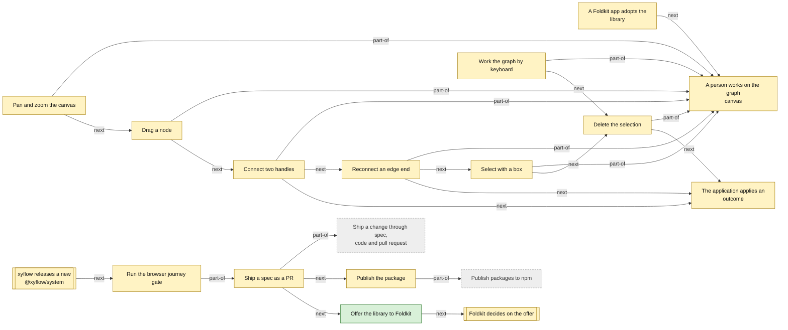

<!-- Generated by tools/intent from model/. Do not edit by hand: change the model and run `bun run generate`. -->

# foldkit-flow

A node-based graph UI for Foldkit, like React Flow or Svelte Flow, in its own repository under the MIT licence.

Repository: [reebeat/foldkit-flow][1]. Licence: MIT. Status of this description: decided.

136 model elements: 9 decided, 111 proposed, 16 open.

## Product vision board

After Roman Pichler's product vision board. Each cell is built from the model; click through to the element.

| Cell | Content |
| --- | --- |
| Vision | [A graph canvas for Foldkit applications](../goals.md#goal-flow-vision) (decided): foldkit-flow is a node-based graph UI for Foldkit, like React Flow or Svelte Flow, in its own repository. |
| Target group | [Foldkit app developer](../actors-and-resources.md#actor-flow-app-developer) (proposed) [Keyboard-only user](../actors-and-resources.md#actor-flow-keyboard-user) (proposed) [End user of a graph canvas](../actors-and-resources.md#actor-flow-end-user) (proposed) [Contributor (human or agent)](../actors-and-resources.md#actor-flow-contributor) (proposed) |
| Needs (jobs to be done) | When I build a Foldkit application that shows a graph, I want a ready canvas with pan, zoom, drag, connect and selection, so that I do not write that interaction code myself (proposed) When I cannot or do not use a pointer, I want to select, move and delete nodes with keys, so that I can edit the same graph as a pointer user (proposed) |
| Product (key features) | [packages/flow (the library)](../technical-components.md#comp-flow-library) (proposed) [apps/example (the example app)](../technical-components.md#comp-flow-example-app) (proposed) [tools/quality (repository checks)](../technical-components.md#comp-flow-quality-tools) (proposed) [tools/oxlint (vendored lint rules)](../technical-components.md#comp-flow-oxlint-rules) (proposed) [tools/journey (browser gate)](../technical-components.md#comp-flow-journey-tool) (proposed) [CI workflow (checks)](../technical-components.md#comp-flow-ci) (proposed) [Review and PR skills](../technical-components.md#comp-flow-agent-skills) (proposed) [Attribution option and view](../technical-components.md#comp-flow-attribution) (proposed) [Flow Submodel (Model, update, view)](../technical-components.md#comp-flow-flow-submodel) (proposed) [Mounts that own the xyflow controllers](../technical-components.md#comp-flow-mounts) (proposed) [Pan and zoom by wheel and drag](../technical-components.md#req-flow-pan-zoom) (proposed) [Drag a node, edges follow](../technical-components.md#req-flow-drag-node) (proposed) [Connect handles with validation](../technical-components.md#req-flow-connect) (proposed) [Reconnect an edge end](../technical-components.md#req-flow-reconnect) (proposed) [Select with a box](../technical-components.md#req-flow-box-select) (proposed) [Controls, fit view and minimap](../technical-components.md#req-flow-controls-minimap) (proposed) [Compound nodes with relative positions](../technical-components.md#req-flow-compound-nodes) (proposed) [Delete a parent with its descendants and edges](../technical-components.md#req-flow-delete-closure) (proposed) [Edit the graph by keyboard](../technical-components.md#req-flow-keyboard-edit) (proposed) [The app draws node content](../technical-components.md#req-flow-custom-nodes) (proposed) [Show the xyflow credit by default, allow hiding](../technical-components.md#req-flow-attribution-toggle) (proposed) [A browser journey gate](../technical-components.md#req-flow-browser-gate) (proposed) |
| Business goals | [Accessible artifacts for every audience](../goals.md#goal-org-accessible-artifacts) (decided) [Correctness by construction](../goals.md#goal-org-correctness-by-construction) (decided) [Intent written down, sourced and testable](../goals.md#goal-org-written-intent) (proposed) |

Scope `foldkit-flow`: 136 elements.

## Goals and quality requirements (arc42 sections 1 and 10)

### 1.1 Requirements overview

| Requirement | Statement | Status | Sources |
| --- | --- | --- | --- |
| [Pan and zoom by wheel and drag](../technical-components.md#req-flow-pan-zoom) | A wheel or a drag on the empty canvas changes the viewport. No node is re-rendered. | proposed | [pr foldkit-flow#4][2] |
| [Drag a node, edges follow](../technical-components.md#req-flow-drag-node) | Dragging a node changes its position in the Model, and the edges attached to it follow. | proposed | [pr foldkit-flow#4][2] |
| [Connect handles with validation](../technical-components.md#req-flow-connect) | Dragging from a source handle to a target handle makes a Connected outcome. A target the application refuses makes none. | proposed | [pr foldkit-flow#4][2] |
| [Reconnect an edge end](../technical-components.md#req-flow-reconnect) | Dragging one end of a selected edge to another handle makes a Reconnected outcome. | proposed | [pr foldkit-flow#4][2] |
| [Select with a box](../technical-components.md#req-flow-box-select) | Shift and drag on the empty canvas selects the nodes inside the box and no others. A plain drag pans. | proposed | [pr foldkit-flow#4][2] |
| [Controls, fit view and minimap](../technical-components.md#req-flow-controls-minimap) | Buttons zoom in, zoom out and fit the view. A minimap shows the nodes and pans when dragged. | proposed | [pr foldkit-flow#4][2] |
| [Compound nodes with relative positions](../technical-components.md#req-flow-compound-nodes) | A child node has a position relative to its parent. Dragging the parent moves the child, and a clamped child stays inside the parent. | proposed | [pr foldkit-flow#4][2], [log L19][3] |
| [Delete a parent with its descendants and edges](../technical-components.md#req-flow-delete-closure) | Deleting a parent removes all its descendants and every edge attached to any of them, and reports the full sets. | proposed | [pr foldkit-flow#4][2] |
| [Edit the graph by keyboard](../technical-components.md#req-flow-keyboard-edit) | Nodes take focus. Enter or Space selects, arrow keys move (Shift makes a larger step), Delete removes, Escape clears, and a live region announces each result. | proposed | [pr foldkit-flow#4][2] |
| [The app draws node content](../technical-components.md#req-flow-custom-nodes) | Nodes render through one callback that the application supplies. Handles are declared on the node. Edges come in three kinds with an optional arrow. | proposed | [pr foldkit-flow#4][2] |
| [Show the xyflow credit by default, allow hiding](../technical-components.md#req-flow-attribution-toggle) | The "Built with xyflow" link shows unless the application sets Attribution to Hidden. | proposed | [foldkit-flow:docs/specs/0000-development-lifecycle.md:53][4], [foldkit-flow:docs/specs/0000-development-lifecycle.md:90][5], [foldkit-flow:README.md:21][6] |
| [A browser journey gate](../technical-components.md#req-flow-browser-gate) | One command drives the built example in headless Chromium with real pointer and keyboard input and fails if a journey step fails. | proposed | [pr foldkit-flow#4][2] |

### 1.2 Quality goals

| Quality | Goal | Scenario | Status |
| --- | --- | --- | --- |
| performance | [Dragging stays fast at 500 nodes and 700 edges](../technical-components.md#req-flow-perf-drag): Dragging one node of 500 nodes and 700 edges has a median p95 scripting time per pointer move under 8 ms. At least 95 percent of frame intervals are within 33.5 ms. | A person drags one node of the Large graph (500 nodes, 700 edges) for 150 pointer moves, three times, in headless Chromium on the production build. The median of the three p95 scripting times per move is under 8 ms, and 95 percent of frame intervals are within 33.5 ms. Ten wheel steps change no node or edge. | proposed |
| accessibility | [Keyboard-only use with announcements](../technical-components.md#req-flow-a11y-keyboard): Selecting, moving, deleting and clearing nodes works with the keyboard alone, and results are announced to assistive technology. Creating or reconnecting a connection, and using the minimap, are not specified. | A keyboard-only user presses Tab to reach a node, Enter to select it, an arrow key to move it by 10, Shift and an arrow to move it by 40, Escape to clear, Enter again and Delete to remove it. The canvas has role application, each node has role group and a name, and a polite live region says what happened. | proposed |
| correctness | [Controllers never leak after unmount](../technical-components.md#req-flow-correct-lifetimes): Every controller is destroyed when its Mount is released, and no listener it added remains. | A test mounts the Flow, presses a handle before the drag threshold, then disposes the runtime. Every created controller is destroyed once, and no document or window listener from the library remains. | proposed |
| maintainability | [Gates catch drift, dead code and copies](../technical-components.md#req-flow-maintain-gates): Gates catch suppressions without a registry entry, unused code and copy-paste, and every gate runs locally and in CI. | A contributor pastes a 40-token block twice and `bun run cpd` fails. A contributor adds a suppression directive with no registry entry and `bun run check:exceptions` fails. | proposed |
| maintainability | [Tools, packages and apps stay separate](../technical-components.md#req-flow-maintain-tiers): Apps, packages and tools are separate workspaces. The app depends on the library and tools depend on neither. | A reader lists the workspaces and finds apps, packages and tools apart. The example app declares the library as a workspace dependency, and the library does not depend on the app. | proposed |
| reproducibility | [The same Bun runs everywhere](../technical-components.md#req-flow-reproducible-toolchain): `vp run` and devenv use the same Bun version. | A contributor runs `vp exec -- bun --revision` and `bun --revision` in devenv. Both print the same version. The check does not show that every gate gives the same result in both. | open |
| licensing | [MIT library, xyflow credited, no copyleft dependency](../technical-components.md#req-flow-licence-hygiene): The library is MIT licensed with xyflow's notice kept. It does not depend on ELK.js or another copyleft package. | A reader opens LICENSE, NOTICE and packages/flow/package.json. They find MIT, the xyflow copyright and licence, and no EPL or GPL dependency. | proposed |
| reliability | [A new Effect minor cannot break the library](../technical-components.md#req-flow-effect-range-gated): A published package that uses an unstable or experimental Effect API cannot accept the next Effect minor, and a test fails if it does. | A contributor changes the library's Effect peer range to `^4.1.0` and imports an unstable API from the `effect` root. `bun run test` fails in the published-range test. | proposed |
| portability | [Supported browsers and input types](../technical-components.md#req-flow-portability-browsers): The library states which browsers and input types it supports, and the journey covers them. | The journey runs in each supported browser and input type and passes. Today it runs in one Chromium with mouse and keyboard. | open |

### 1.3 Stakeholders

| Stakeholder | Role in the product | Status |
| --- | --- | --- |
| [Foldkit app developer](../actors-and-resources.md#actor-flow-app-developer) | A person who builds a Foldkit application and wants a graph canvas in it. They add the library and own the application's graph data, layout and node views. | proposed |
| [reebeat studio (consuming product)](../actors-and-resources.md#actor-flow-studio) | reebeat studio is the product that would draw its story graph with the library. It is a consumer, not part of the library. | proposed |
| [End user of a graph canvas](../actors-and-resources.md#actor-flow-end-user) | A person who uses an application built with the library. They pan, zoom, drag, connect and select with a pointer. | proposed |
| [Keyboard-only user](../actors-and-resources.md#actor-flow-keyboard-user) | A person who uses only the keyboard, and may use a screen reader. They need to reach, select, move and delete nodes without a pointer. | proposed |
| [Contributor (human or agent)](../actors-and-resources.md#actor-flow-contributor) | A person or an agent who writes specs and code, opens PRs and takes part in review rounds. | proposed |
| [The xyflow project](../actors-and-resources.md#actor-flow-xyflow) | xyflow (webkid GmbH) makes React Flow, Svelte Flow and `@xyflow/system`. It asks its users to keep its attribution or to support the project. | proposed |
| [The Foldkit project](../actors-and-resources.md#actor-flow-foldkit-project) | Foldkit makes the framework the library is built for. It owns the plugin the example cannot use yet, and the project may take the library upstream. | proposed |

## Problems and constraints

- [The package is unpublished and private](../goals.md#problem-flow-unpublished) (open): Nothing is published. The library package is marked private and the README says it is under construction.
- [The canvas was not on main at the pin](../goals.md#problem-flow-canvas-unmerged) (proposed): The README at the pinned commit 5dd44a9 says the canvas, nodes, edges and selection arrive with spec 0001. PR #4 carried them and had not merged at the pin.
- [No stated goals beyond the README](../goals.md#problem-flow-goals-undocumented) (open): The README gives one sentence of purpose, and spec 0000 states the goal of its lifecycle. No file gives the library's own product goals, users or success measures.
- [No glossary for the graph terms](../goals.md#problem-flow-no-glossary) (open): The repository has no GLOSSARY.md. Terms such as node, handle, connection and controller have no single definition.
- [STATE says nothing is blocked](../goals.md#problem-flow-state-blocked-nothing) (open): STATE.md lists "Blocked: Nothing". The same file names the Foldkit plugin mismatch, and issue #3 about the Bun toolchain is open.
- [vp run may use a different Bun than devenv](../goals.md#problem-flow-bun-mismatch) (open): The package manager range is `^1.4.2` with download on failure. `vp run` can download its own Bun and so differ from the Bun that devenv pins.
- [Keyboard users cannot create connections](../goals.md#problem-flow-keyboard-connect-missing) (open): The first journey does not let a keyboard-only person connect two handles. PR #4 lists keyboard connect as an open question.
- [The browser journey does not run in CI](../goals.md#problem-flow-journey-not-in-ci) (open): CI has no browser. The journey and the performance check run only on a developer's machine.
- [Only Chromium and mouse input were tested](../goals.md#problem-flow-browsers-untested) (open): The journey ran in one Chromium version. Firefox, WebKit and touch input were not run.
- [Demand and users are not measured](../goals.md#problem-flow-demand-unmeasured) (open): The cited sources show no measure of who needs the library or who uses it. Nothing is published, and the sources record no user count or request.
- [Details of the Foldkit offer are undecided](../goals.md#problem-flow-upstream-terms-open) (open): The operator decided to offer the library as `@foldkit/flow` once its API settles. Spec 0000 still asks when, and under which licence header.
- [Workflow hardening is deferred](../goals.md#problem-flow-deferred-workflow-questions) (open): Vendoring Foldkit as a subtree, requiring human approval, signed commits and Renovate are all deferred.
- [The module-mocking lint rule has a gap](../goals.md#problem-flow-lint-mocking-gap) (open): The lint rule that forbids module mocking matches only the `vitest` import source, so a mock imported from `vite-plus/test` passes.
- [No security, conduct or contributing files](../goals.md#problem-flow-community-files) (open): The public repository has no SECURITY.md, CODE_OF_CONDUCT.md or CONTRIBUTING.md. The README has a short contributing section.
- [The library is MIT licensed](../goals.md#constraint-flow-mit-licence) (decided): foldkit-flow is released under the MIT licence.
- [The repository is public and holds no secrets](../goals.md#constraint-flow-public-repo) (proposed): The repository is public. It never holds a secret or personal data.
- [Keep xyflow's licence notice and credit](../goals.md#constraint-flow-xyflow-notice) (proposed): xyflow's code is MIT licensed. The project keeps its notice in NOTICE, credits it in the README and shows the credit link by default.
- [ELK stays out of the library](../goals.md#constraint-flow-no-elk) (proposed): ELK.js is licensed EPL-2.0 OR GPL-3.0. The library does not depend on it, and layout stays with the application.
- [Cap the Effect range for unstable API use](../goals.md#constraint-flow-effect-range) (decided): A package that uses an unstable or experimental Effect API accepts nothing above the next minor.
- [Foldkit declares Effect 4.0.0, the repo runs 4.1.0](../goals.md#constraint-flow-effect-peer-mismatch) (open): Foldkit 0.169.0 declares a peer of `effect@4.0.0`. The repository runs 4.1.0, so Bun prints peer warnings.
- [The Foldkit Vite plugin cannot run on Effect 4.1.0](../goals.md#constraint-flow-vite-plugin-crypto) (proposed): `@foldkit/vite-plugin` 0.28.0 imports `Crypto` from the Effect root, which 4.1.0 lacks, so the example does not use it. The project waits for an upstream fix and does not work around it.
- [Pin @xyflow/system exactly](../goals.md#constraint-flow-xyflow-pinned) (proposed): The library depends on `@xyflow/system` 0.0.83 at an exact version, because a 0.0.x release may break.

## Goals it serves

```mermaid
flowchart BT
    classDef decided fill:#d8f0d8,stroke:#2d7a2d,color:#111
    classDef proposed fill:#fff3c4,stroke:#a07800,color:#111
    classDef open fill:#f8d7d7,stroke:#a02020,color:#111
    classDef outside fill:#eee,stroke:#999,color:#333,stroke-dasharray:4 3
    goal_flow_vision("A graph canvas for Foldkit<br/>applications"):::decided
    goal_flow_generic_library("A generic library with no<br/>product logic"):::proposed
    goal_flow_studio_story_graph("Carry reebeat studio's story<br/>graph"):::proposed
    goal_flow_first_journey("One felt journey works end<br/>to end"):::proposed
    goal_flow_keyboard_access("Keyboard-accessible graph<br/>editing"):::proposed
    goal_flow_performance("Stay smooth at 500 nodes and<br/>700 edges"):::proposed
    goal_flow_browser_proof("Prove interaction in a real<br/>browser"):::proposed
    goal_flow_lifecycle("Every change travels spec,<br/>code, PR"):::proposed
    goal_flow_upstream_offer("Offer the library to Foldkit"):::decided
    goal_flow_publish("Publish the package for<br/>others to use"):::proposed
    goal_flow_respect_xyflow("Credit and respect xyflow"):::proposed
    problem_flow_unpublished{{"The package is unpublished<br/>and private"}}:::open
    problem_flow_canvas_unmerged{{"The canvas was not on main<br/>at the pin"}}:::proposed
    problem_flow_goals_undocumented{{"No stated goals beyond the<br/>README"}}:::open
    problem_flow_no_glossary{{"No glossary for the graph<br/>terms"}}:::open
    problem_flow_state_blocked_nothing{{"STATE says nothing is<br/>blocked"}}:::open
    problem_flow_bun_mismatch{{"vp run may use a different<br/>Bun than devenv"}}:::open
    problem_flow_keyboard_connect_missing{{"Keyboard users cannot create<br/>connections"}}:::open
    problem_flow_journey_not_in_ci{{"The browser journey does not<br/>run in CI"}}:::open
    problem_flow_browsers_untested{{"Only Chromium and mouse<br/>input were tested"}}:::open
    problem_flow_demand_unmeasured{{"Demand and users are not<br/>measured"}}:::open
    problem_flow_upstream_terms_open{{"Details of the Foldkit offer<br/>are undecided"}}:::open
    problem_flow_deferred_workflow_questions{{"Workflow hardening is<br/>deferred"}}:::open
    problem_flow_lint_mocking_gap{{"The module-mocking lint rule<br/>has a gap"}}:::open
    problem_flow_community_files{{"No security, conduct or<br/>contributing files"}}:::open
    constraint_flow_mit_licence[/"The library is MIT licensed"/]:::decided
    constraint_flow_public_repo[/"The repository is public and<br/>holds no secrets"/]:::proposed
    constraint_flow_xyflow_notice[/"Keep xyflow's licence notice<br/>and credit"/]:::proposed
    constraint_flow_no_elk[/"ELK stays out of the library"/]:::proposed
    constraint_flow_effect_range[/"Cap the Effect range for<br/>unstable API use"/]:::decided
    constraint_flow_effect_peer_mismatch[/"Foldkit declares Effect<br/>4.0.0, the repo runs 4.1.0"/]:::open
    constraint_flow_vite_plugin_crypto[/"The Foldkit Vite plugin<br/>cannot run on Effect 4.1.0"/]:::proposed
    constraint_flow_xyflow_pinned[/"Pin @xyflow/system exactly"/]:::proposed
    opportunity_flow_xyflow_core(["Reuse xyflow's<br/>framework-free core"]):::proposed
    opportunity_flow_other_foldkit_apps(["Other Foldkit apps can use<br/>it"]):::proposed
    opportunity_flow_real_browser_defects(["A real browser finds defects<br/>unit tests miss"]):::proposed
    goal_org_product_family("A family of products on the<br/>open core"):::outside
    goal_org_accessible_artifacts("Accessible artifacts for<br/>every audience"):::outside
    goal_org_correctness_by_construction("Correctness by construction"):::outside
    goal_org_written_intent("Intent written down, sourced<br/>and testable"):::outside
    goal_flow_vision -->|subgoal-of| goal_org_product_family
    goal_flow_generic_library -->|subgoal-of| goal_flow_vision
    goal_flow_studio_story_graph -->|subgoal-of| goal_flow_vision
    goal_flow_first_journey -->|subgoal-of| goal_flow_vision
    goal_flow_keyboard_access -->|supports| goal_org_accessible_artifacts
    goal_flow_keyboard_access -->|subgoal-of| goal_flow_vision
    goal_flow_performance -->|subgoal-of| goal_flow_vision
    goal_flow_browser_proof -->|supports| goal_flow_first_journey
    goal_flow_lifecycle -->|supports| goal_org_correctness_by_construction
    goal_flow_lifecycle -->|supports| goal_org_written_intent
    goal_flow_publish -->|subgoal-of| goal_flow_vision
    goal_flow_respect_xyflow -->|subgoal-of| goal_flow_vision
    problem_flow_unpublished -.->|hinders| goal_flow_publish
    problem_flow_canvas_unmerged -.->|hinders| goal_flow_first_journey
    problem_flow_goals_undocumented -.->|hinders| goal_flow_vision
    problem_flow_no_glossary -.->|hinders| goal_flow_first_journey
    problem_flow_state_blocked_nothing -.->|hinders| goal_flow_lifecycle
    problem_flow_keyboard_connect_missing -.->|hinders| goal_flow_keyboard_access
    problem_flow_journey_not_in_ci -.->|hinders| goal_flow_browser_proof
    problem_flow_demand_unmeasured -.->|hinders| goal_flow_publish
    problem_flow_upstream_terms_open -.->|hinders| goal_flow_upstream_offer
    problem_flow_deferred_workflow_questions -.->|hinders| goal_flow_lifecycle
    problem_flow_lint_mocking_gap -.->|hinders| goal_flow_lifecycle
    problem_flow_community_files -.->|hinders| goal_flow_publish
    constraint_flow_xyflow_notice -.->|hinders| goal_flow_publish
    opportunity_flow_xyflow_core -->|supports| goal_flow_first_journey
    opportunity_flow_other_foldkit_apps -->|supports| goal_flow_upstream_offer
    opportunity_flow_real_browser_defects -->|supports| goal_flow_browser_proof
```

## Key processes

## Rules

Full tables and diagrams: [Business Rules Model](../business-rules.md).

- [The library reports outcomes; the app changes the graph](../business-rules.md#rule-flow-outcomes-not-mutations) (business rule, proposed)
- [Controllers attach in Mounts and die on unmount](../business-rules.md#rule-flow-controllers-in-mounts) (business rule, proposed)
- [Model, update and view stay pure](../business-rules.md#rule-flow-pure-update) (business rule, proposed)
- [Tools, packages and apps depend one way](../business-rules.md#rule-flow-dependency-direction) (business rule, proposed)
- [No product logic in the library](../business-rules.md#rule-flow-no-product-logic) (business rule, proposed)
- [The application owns node layout](../business-rules.md#rule-flow-layout-by-app) (business rule, proposed)
- [Credit xyflow by default](../business-rules.md#rule-flow-attribution-default) (business rule, proposed)
- [One spec, one branch, one PR](../business-rules.md#rule-flow-spec-code-pr) (business rule, proposed)
- [Open the PR only after the journey is built](../business-rules.md#rule-flow-pr-after-ready) (business rule, proposed)
- [Main takes PRs that pass checks](../business-rules.md#rule-flow-main-protected) (business rule, proposed)
- [Every lint suppression has a registry entry](../business-rules.md#rule-flow-exceptions-registered) (business rule, proposed)
- [A package accepts only the Effect versions it can trust](../business-rules.md#rule-flow-effect-range-by-stability) (business rule, decided)
- [Deleting a parent deletes its descendants and their edges](../business-rules.md#rule-flow-delete-closure) (business rule, proposed)
- [A connection the app refuses makes no edge](../business-rules.md#rule-flow-invalid-connection-refused) (business rule, proposed)
- [A clamped child stays inside its parent](../business-rules.md#rule-flow-child-clamp) (business rule, proposed)
- [Keys select, move, delete and clear](../business-rules.md#rule-flow-keyboard-actions) (business rule, proposed)
- [Pointer moves re-render only what changed](../business-rules.md#rule-flow-memoised-views) (business rule, proposed)

## Actors and resources

Full tables and diagrams: [Actors and Resources Model](../actors-and-resources.md).

- [Foldkit app developer](../actors-and-resources.md#actor-flow-app-developer) (actor, proposed)
- [reebeat studio (consuming product)](../actors-and-resources.md#actor-flow-studio) (actor, proposed)
- [End user of a graph canvas](../actors-and-resources.md#actor-flow-end-user) (actor, proposed)
- [Keyboard-only user](../actors-and-resources.md#actor-flow-keyboard-user) (actor, proposed)
- [Contributor (human or agent)](../actors-and-resources.md#actor-flow-contributor) (actor, proposed)
- [The xyflow project](../actors-and-resources.md#actor-flow-xyflow) (actor, proposed)
- [The Foldkit project](../actors-and-resources.md#actor-flow-foldkit-project) (actor, proposed)
- [@xyflow/system](../actors-and-resources.md#resource-flow-xyflow-system) (resource, proposed)
- [Foldkit](../actors-and-resources.md#resource-flow-foldkit) (resource, decided)
- [Foldkit 0.169.0 and its peer range](../actors-and-resources.md#resource-flow-foldkit-pin) (resource, proposed)
- [Effect 4.1.0](../actors-and-resources.md#resource-flow-effect) (resource, proposed)
- [The project's own repository](../actors-and-resources.md#resource-flow-repo) (resource, decided)
- [Devenv, Bun, Vite+ and Oxlint toolchain](../actors-and-resources.md#resource-flow-toolchain) (resource, proposed)
- [Specs in docs/specs](../actors-and-resources.md#resource-flow-specs) (resource, proposed)
- [STATE.md](../actors-and-resources.md#resource-flow-state-file) (resource, proposed)
- [LICENSE and NOTICE](../actors-and-resources.md#resource-flow-notice) (resource, proposed)
- [Chromium for the journey gate](../actors-and-resources.md#resource-flow-chromium) (resource, proposed)

## Components, requirements and IS goals

Full tables and diagrams: [Technical Components and Requirements Model](../technical-components.md).

- [foldkit-flow](../technical-components.md#comp-flow-product) (technical component, decided)
- [packages/flow (the library)](../technical-components.md#comp-flow-library) (technical component, proposed)
- [apps/example (the example app)](../technical-components.md#comp-flow-example-app) (technical component, proposed)
- [tools/quality (repository checks)](../technical-components.md#comp-flow-quality-tools) (technical component, proposed)
- [tools/oxlint (vendored lint rules)](../technical-components.md#comp-flow-oxlint-rules) (technical component, proposed)
- [tools/journey (browser gate)](../technical-components.md#comp-flow-journey-tool) (technical component, proposed)
- [CI workflow (checks)](../technical-components.md#comp-flow-ci) (technical component, proposed)
- [Review and PR skills](../technical-components.md#comp-flow-agent-skills) (technical component, proposed)
- [Attribution option and view](../technical-components.md#comp-flow-attribution) (technical component, proposed)
- [Flow Submodel (Model, update, view)](../technical-components.md#comp-flow-flow-submodel) (technical component, proposed)
- [Mounts that own the xyflow controllers](../technical-components.md#comp-flow-mounts) (technical component, proposed)
- [The graph lives in the app's Model](../technical-components.md#isgoal-flow-elm-boundary) (information system goal, proposed)
- [Reuse xyflow's controllers](../technical-components.md#isgoal-flow-reuse-controllers) (information system goal, proposed)
- [Gates make bad changes impossible to merge](../technical-components.md#isgoal-flow-structural-gates) (information system goal, proposed)
- [Measure the performance budget](../technical-components.md#isgoal-flow-measured-budget) (information system goal, proposed)
- [Pan and zoom by wheel and drag](../technical-components.md#req-flow-pan-zoom) (requirement, proposed)
- [Drag a node, edges follow](../technical-components.md#req-flow-drag-node) (requirement, proposed)
- [Connect handles with validation](../technical-components.md#req-flow-connect) (requirement, proposed)
- [Reconnect an edge end](../technical-components.md#req-flow-reconnect) (requirement, proposed)
- [Select with a box](../technical-components.md#req-flow-box-select) (requirement, proposed)
- [Controls, fit view and minimap](../technical-components.md#req-flow-controls-minimap) (requirement, proposed)
- [Compound nodes with relative positions](../technical-components.md#req-flow-compound-nodes) (requirement, proposed)
- [Delete a parent with its descendants and edges](../technical-components.md#req-flow-delete-closure) (requirement, proposed)
- [Edit the graph by keyboard](../technical-components.md#req-flow-keyboard-edit) (requirement, proposed)
- [The app draws node content](../technical-components.md#req-flow-custom-nodes) (requirement, proposed)
- [Show the xyflow credit by default, allow hiding](../technical-components.md#req-flow-attribution-toggle) (requirement, proposed)
- [A browser journey gate](../technical-components.md#req-flow-browser-gate) (requirement, proposed)
- [Dragging stays fast at 500 nodes and 700 edges](../technical-components.md#req-flow-perf-drag) (requirement, proposed)
- [Keyboard-only use with announcements](../technical-components.md#req-flow-a11y-keyboard) (requirement, proposed)
- [Controllers never leak after unmount](../technical-components.md#req-flow-correct-lifetimes) (requirement, proposed)
- [Gates catch drift, dead code and copies](../technical-components.md#req-flow-maintain-gates) (requirement, proposed)
- [Tools, packages and apps stay separate](../technical-components.md#req-flow-maintain-tiers) (requirement, proposed)
- [The same Bun runs everywhere](../technical-components.md#req-flow-reproducible-toolchain) (requirement, open)
- [MIT library, xyflow credited, no copyleft dependency](../technical-components.md#req-flow-licence-hygiene) (requirement, proposed)
- [A new Effect minor cannot break the library](../technical-components.md#req-flow-effect-range-gated) (requirement, proposed)
- [Supported browsers and input types](../technical-components.md#req-flow-portability-browsers) (requirement, open)

## Concepts

Full tables and diagrams: [Concepts Model](../concepts.md).

- [Flow](../concepts.md#concept-flow-flow) (concept, proposed)
- [Node](../concepts.md#concept-flow-node) (concept, proposed)
- [Edge](../concepts.md#concept-flow-edge) (concept, proposed)
- [Handle](../concepts.md#concept-flow-handle) (concept, proposed)
- [Connection](../concepts.md#concept-flow-connection) (concept, proposed)
- [Compound (parent) node](../concepts.md#concept-flow-parent-node) (concept, proposed)
- [Viewport](../concepts.md#concept-flow-viewport) (concept, proposed)
- [Selection](../concepts.md#concept-flow-selection) (concept, proposed)
- [Minimap and controls](../concepts.md#concept-flow-minimap) (concept, proposed)
- [Attribution](../concepts.md#concept-flow-attribution) (concept, proposed)
- [Mount](../concepts.md#concept-flow-mount) (concept, proposed)
- [Controller](../concepts.md#concept-flow-controller) (concept, proposed)
- [Out-message (outcome)](../concepts.md#concept-flow-out-message) (concept, proposed)
- [Live region](../concepts.md#concept-flow-live-region) (concept, proposed)

## Work items

| Item | Title | State | Element |
| --- | --- | --- | --- |
| pr:foldkit-flow#4 | feat: first felt journey (spec 0001) | merged | [End user of a graph canvas](../actors-and-resources.md#actor-flow-end-user) |
| pr:foldkit-flow#4 | feat: first felt journey (spec 0001) | merged | [Keyboard-only user](../actors-and-resources.md#actor-flow-keyboard-user) |
| pr:foldkit-flow#4 | feat: first felt journey (spec 0001) | merged | [Chromium for the journey gate](../actors-and-resources.md#resource-flow-chromium) |
| pr:foldkit-flow#4 | feat: first felt journey (spec 0001) | merged | [Flow](../concepts.md#concept-flow-flow) |
| pr:foldkit-flow#4 | feat: first felt journey (spec 0001) | merged | [Node](../concepts.md#concept-flow-node) |
| pr:foldkit-flow#4 | feat: first felt journey (spec 0001) | merged | [Edge](../concepts.md#concept-flow-edge) |
| pr:foldkit-flow#4 | feat: first felt journey (spec 0001) | merged | [Handle](../concepts.md#concept-flow-handle) |
| pr:foldkit-flow#4 | feat: first felt journey (spec 0001) | merged | [Connection](../concepts.md#concept-flow-connection) |
| pr:foldkit-flow#4 | feat: first felt journey (spec 0001) | merged | [Compound (parent) node](../concepts.md#concept-flow-parent-node) |
| pr:foldkit-flow#4 | feat: first felt journey (spec 0001) | merged | [Viewport](../concepts.md#concept-flow-viewport) |
| pr:foldkit-flow#4 | feat: first felt journey (spec 0001) | merged | [Selection](../concepts.md#concept-flow-selection) |
| pr:foldkit-flow#4 | feat: first felt journey (spec 0001) | merged | [Minimap and controls](../concepts.md#concept-flow-minimap) |
| pr:foldkit-flow#4 | feat: first felt journey (spec 0001) | merged | [Mount](../concepts.md#concept-flow-mount) |
| pr:foldkit-flow#4 | feat: first felt journey (spec 0001) | merged | [Controller](../concepts.md#concept-flow-controller) |
| pr:foldkit-flow#4 | feat: first felt journey (spec 0001) | merged | [Out-message (outcome)](../concepts.md#concept-flow-out-message) |
| pr:foldkit-flow#4 | feat: first felt journey (spec 0001) | merged | [Live region](../concepts.md#concept-flow-live-region) |
| pr:foldkit-flow#4 | feat: first felt journey (spec 0001) | merged | [Carry reebeat studio's story graph](../goals.md#goal-flow-studio-story-graph) |
| pr:foldkit-flow#4 | feat: first felt journey (spec 0001) | merged | [One felt journey works end to end](../goals.md#goal-flow-first-journey) |
| pr:foldkit-flow#4 | feat: first felt journey (spec 0001) | merged | [Keyboard-accessible graph editing](../goals.md#goal-flow-keyboard-access) |
| pr:foldkit-flow#4 | feat: first felt journey (spec 0001) | merged | [Stay smooth at 500 nodes and 700 edges](../goals.md#goal-flow-performance) |
| pr:foldkit-flow#4 | feat: first felt journey (spec 0001) | merged | [Prove interaction in a real browser](../goals.md#goal-flow-browser-proof) |
| pr:foldkit-flow#4 | feat: first felt journey (spec 0001) | merged | [The canvas was not on main at the pin](../goals.md#problem-flow-canvas-unmerged) |
| issue:foldkit-flow#3 | vp run uses a downloaded Bun, not the devenv Bun (devEngines ^1.4.2) | open | [STATE says nothing is blocked](../goals.md#problem-flow-state-blocked-nothing) |
| issue:foldkit-flow#3 | vp run uses a downloaded Bun, not the devenv Bun (devEngines ^1.4.2) | open | [vp run may use a different Bun than devenv](../goals.md#problem-flow-bun-mismatch) |
| pr:foldkit-flow#4 | feat: first felt journey (spec 0001) | merged | [Keyboard users cannot create connections](../goals.md#problem-flow-keyboard-connect-missing) |
| pr:foldkit-flow#4 | feat: first felt journey (spec 0001) | merged | [The browser journey does not run in CI](../goals.md#problem-flow-journey-not-in-ci) |
| pr:foldkit-flow#4 | feat: first felt journey (spec 0001) | merged | [Only Chromium and mouse input were tested](../goals.md#problem-flow-browsers-untested) |
| pr:foldkit-flow#4 | feat: first felt journey (spec 0001) | merged | [The module-mocking lint rule has a gap](../goals.md#problem-flow-lint-mocking-gap) |
| pr:foldkit-flow#4 | feat: first felt journey (spec 0001) | merged | [Pin @xyflow/system exactly](../goals.md#constraint-flow-xyflow-pinned) |
| pr:foldkit-flow#4 | feat: first felt journey (spec 0001) | merged | [A real browser finds defects unit tests miss](../goals.md#opportunity-flow-real-browser-defects) |
| pr:foldkit-flow#4 | feat: first felt journey (spec 0001) | merged | [A Foldkit app adopts the library](../business-processes.md#process-flow-adopt-library) |
| pr:foldkit-flow#4 | feat: first felt journey (spec 0001) | merged | [A person works on the graph canvas](../business-processes.md#process-flow-use-canvas) |
| pr:foldkit-flow#4 | feat: first felt journey (spec 0001) | merged | [Pan and zoom the canvas](../business-processes.md#process-flow-pan-zoom) |
| pr:foldkit-flow#4 | feat: first felt journey (spec 0001) | merged | [Drag a node](../business-processes.md#process-flow-drag-node) |
| pr:foldkit-flow#4 | feat: first felt journey (spec 0001) | merged | [Connect two handles](../business-processes.md#process-flow-connect-handles) |
| pr:foldkit-flow#4 | feat: first felt journey (spec 0001) | merged | [Reconnect an edge end](../business-processes.md#process-flow-reconnect-edge) |
| pr:foldkit-flow#4 | feat: first felt journey (spec 0001) | merged | [Select with a box](../business-processes.md#process-flow-box-select) |
| pr:foldkit-flow#4 | feat: first felt journey (spec 0001) | merged | [Work the graph by keyboard](../business-processes.md#process-flow-keyboard-navigate) |
| pr:foldkit-flow#4 | feat: first felt journey (spec 0001) | merged | [Delete the selection](../business-processes.md#process-flow-delete-selection) |
| pr:foldkit-flow#4 | feat: first felt journey (spec 0001) | merged | [The application applies an outcome](../business-processes.md#process-flow-apply-outcome) |
| pr:foldkit-flow#4 | feat: first felt journey (spec 0001) | merged | [Run the browser journey gate](../business-processes.md#process-flow-run-journey-gate) |
| pr:foldkit-flow#4 | feat: first felt journey (spec 0001) | merged | [xyflow releases a new @xyflow/system](../business-processes.md#extproc-flow-xyflow-release) |
| pr:foldkit-flow#4 | feat: first felt journey (spec 0001) | merged | [The library reports outcomes; the app changes the graph](../business-rules.md#rule-flow-outcomes-not-mutations) |
| pr:foldkit-flow#4 | feat: first felt journey (spec 0001) | merged | [Controllers attach in Mounts and die on unmount](../business-rules.md#rule-flow-controllers-in-mounts) |
| pr:foldkit-flow#4 | feat: first felt journey (spec 0001) | merged | [The application owns node layout](../business-rules.md#rule-flow-layout-by-app) |
| pr:foldkit-flow#4 | feat: first felt journey (spec 0001) | merged | [Deleting a parent deletes its descendants and their edges](../business-rules.md#rule-flow-delete-closure) |
| pr:foldkit-flow#4 | feat: first felt journey (spec 0001) | merged | [A connection the app refuses makes no edge](../business-rules.md#rule-flow-invalid-connection-refused) |
| pr:foldkit-flow#4 | feat: first felt journey (spec 0001) | merged | [A clamped child stays inside its parent](../business-rules.md#rule-flow-child-clamp) |
| pr:foldkit-flow#4 | feat: first felt journey (spec 0001) | merged | [Keys select, move, delete and clear](../business-rules.md#rule-flow-keyboard-actions) |
| pr:foldkit-flow#4 | feat: first felt journey (spec 0001) | merged | [Pointer moves re-render only what changed](../business-rules.md#rule-flow-memoised-views) |
| pr:foldkit-flow#4 | feat: first felt journey (spec 0001) | merged | [packages/flow (the library)](../technical-components.md#comp-flow-library) |
| pr:foldkit-flow#4 | feat: first felt journey (spec 0001) | merged | [tools/journey (browser gate)](../technical-components.md#comp-flow-journey-tool) |
| pr:foldkit-flow#4 | feat: first felt journey (spec 0001) | merged | [Flow Submodel (Model, update, view)](../technical-components.md#comp-flow-flow-submodel) |
| pr:foldkit-flow#4 | feat: first felt journey (spec 0001) | merged | [Mounts that own the xyflow controllers](../technical-components.md#comp-flow-mounts) |
| pr:foldkit-flow#4 | feat: first felt journey (spec 0001) | merged | [The graph lives in the app's Model](../technical-components.md#isgoal-flow-elm-boundary) |
| pr:foldkit-flow#4 | feat: first felt journey (spec 0001) | merged | [Reuse xyflow's controllers](../technical-components.md#isgoal-flow-reuse-controllers) |
| pr:foldkit-flow#4 | feat: first felt journey (spec 0001) | merged | [Measure the performance budget](../technical-components.md#isgoal-flow-measured-budget) |
| pr:foldkit-flow#4 | feat: first felt journey (spec 0001) | merged | [Pan and zoom by wheel and drag](../technical-components.md#req-flow-pan-zoom) |
| pr:foldkit-flow#4 | feat: first felt journey (spec 0001) | merged | [Drag a node, edges follow](../technical-components.md#req-flow-drag-node) |
| pr:foldkit-flow#4 | feat: first felt journey (spec 0001) | merged | [Connect handles with validation](../technical-components.md#req-flow-connect) |
| pr:foldkit-flow#4 | feat: first felt journey (spec 0001) | merged | [Reconnect an edge end](../technical-components.md#req-flow-reconnect) |
| pr:foldkit-flow#4 | feat: first felt journey (spec 0001) | merged | [Select with a box](../technical-components.md#req-flow-box-select) |
| pr:foldkit-flow#4 | feat: first felt journey (spec 0001) | merged | [Controls, fit view and minimap](../technical-components.md#req-flow-controls-minimap) |
| pr:foldkit-flow#4 | feat: first felt journey (spec 0001) | merged | [Compound nodes with relative positions](../technical-components.md#req-flow-compound-nodes) |
| pr:foldkit-flow#4 | feat: first felt journey (spec 0001) | merged | [Delete a parent with its descendants and edges](../technical-components.md#req-flow-delete-closure) |
| pr:foldkit-flow#4 | feat: first felt journey (spec 0001) | merged | [Edit the graph by keyboard](../technical-components.md#req-flow-keyboard-edit) |
| pr:foldkit-flow#4 | feat: first felt journey (spec 0001) | merged | [The app draws node content](../technical-components.md#req-flow-custom-nodes) |
| pr:foldkit-flow#4 | feat: first felt journey (spec 0001) | merged | [A browser journey gate](../technical-components.md#req-flow-browser-gate) |
| pr:foldkit-flow#4 | feat: first felt journey (spec 0001) | merged | [Dragging stays fast at 500 nodes and 700 edges](../technical-components.md#req-flow-perf-drag) |
| pr:foldkit-flow#4 | feat: first felt journey (spec 0001) | merged | [Keyboard-only use with announcements](../technical-components.md#req-flow-a11y-keyboard) |
| pr:foldkit-flow#4 | feat: first felt journey (spec 0001) | merged | [Controllers never leak after unmount](../technical-components.md#req-flow-correct-lifetimes) |
| issue:foldkit-flow#3 | vp run uses a downloaded Bun, not the devenv Bun (devEngines ^1.4.2) | open | [The same Bun runs everywhere](../technical-components.md#req-flow-reproducible-toolchain) |
| pr:foldkit-flow#4 | feat: first felt journey (spec 0001) | merged | [Supported browsers and input types](../technical-components.md#req-flow-portability-browsers) |

[1]: https://github.com/reebeat/foldkit-flow
[2]: https://github.com/reebeat/foldkit-flow/pull/4
[3]: ../../sources/operator-decisions-2026-10.md#L19
[4]: https://github.com/reebeat/foldkit-flow/blob/5dd44a9fe34f1adabca41d9757eefe410f03f60b/docs/specs/0000-development-lifecycle.md#L53
[5]: https://github.com/reebeat/foldkit-flow/blob/5dd44a9fe34f1adabca41d9757eefe410f03f60b/docs/specs/0000-development-lifecycle.md#L90
[6]: https://github.com/reebeat/foldkit-flow/blob/5dd44a9fe34f1adabca41d9757eefe410f03f60b/README.md#L21
