<!-- Generated by tools/intent from model/. Do not edit by hand: change the model and run `bun run generate`. -->

# reebeat, the open compiler

> Declarative multimedia: accessible, reproducible, rebuilt as you edit.

Semantically declared story beats, compiled into multimedia artifacts: statecharts for structure, functional reactive time, and an incremental build graph, written in Effect. The compiler and its formats are open source, and running them locally is free.

Repository: [reebeat/reebeat][1]. Licence: Apache-2.0. Status of this description: decided.

233 model elements: 53 decided, 154 proposed, 26 open.

## Product vision board

After Roman Pichler's product vision board. Each cell is built from the model; click through to the element.

| Cell | Content |
| --- | --- |
| Vision | [Declare the story, reebeat builds the artifacts](../goals.md#goal-reebeat-vision) (decided): reebeat takes care of building, so you can focus on creating. You declare the story's beats and what they mean. reebeat derives motion, timing and every artifact, reproducibly, and rebuilds only what an edit changes. |
| Target group | [Story author](../actors-and-resources.md#actor-reebeat-story-author) (proposed) [Presenter](../actors-and-resources.md#actor-reebeat-presenter) (proposed) [Agent operator](../actors-and-resources.md#actor-reebeat-agent-operator) (proposed) [Plugin author](../actors-and-resources.md#actor-reebeat-plugin-author) (proposed) [Independent reviewers and the fixer](../actors-and-resources.md#actor-reebeat-reviewers) (proposed) [Maintainer](../actors-and-resources.md#actor-reebeat-maintainer) (proposed) |
| Needs (jobs to be done) | _No jobs stated for this product yet._ |
| Product (key features) | [core, from screenplay to Plan and Timeline](../technical-components.md#comp-reebeat-core) (proposed) [subtitles, WebVTT and SubRip writers](../technical-components.md#comp-reebeat-subtitles) (proposed) [lint, pure rules over a Plan](../technical-components.md#comp-reebeat-lint) (proposed) [services, the seven contracts](../technical-components.md#comp-reebeat-services) (proposed) [pipeline, the build program](../technical-components.md#comp-reebeat-pipeline) (proposed) [speech-kokoro, local speech synthesis](../technical-components.md#comp-reebeat-speech-kokoro) (proposed) [align-whisper, word alignment](../technical-components.md#comp-reebeat-align-whisper) (proposed) [sounds-synth, built-in sound effects](../technical-components.md#comp-reebeat-sounds-synth) (proposed) [render-reveal, the Deck renderer](../technical-components.md#comp-reebeat-render-reveal) (proposed) [capture-chromium, frame capture](../technical-components.md#comp-reebeat-capture-chromium) (proposed) [encode-ffmpeg, mix and mux](../technical-components.md#comp-reebeat-encode-ffmpeg) (proposed) [cache-fs, the content-addressed cache](../technical-components.md#comp-reebeat-cache-fs) (proposed) [verify, the output-side checks](../technical-components.md#comp-reebeat-verify) (proposed) [cli, the reebeat command](../technical-components.md#comp-reebeat-cli) (proposed) [quality gates, the repository checks](../technical-components.md#comp-reebeat-quality-gates) (proposed) [statechart-xstate, the build-time interpreter](../technical-components.md#comp-reebeat-statechart-xstate) (proposed) [website renderer, a planned artifact renderer](../technical-components.md#comp-reebeat-website-renderer) (proposed) [plan.json, the one input of the renderers](../technical-components.md#comp-reebeat-plan-json) (proposed) [build.json, the build manifest](../technical-components.md#comp-reebeat-build-manifest) (proposed) [deck.html, the Deck artifact](../technical-components.md#comp-reebeat-deck-output) (proposed) [the MP4 Video artifact](../technical-components.md#comp-reebeat-video-output) (proposed) [The generated effects grammar document](../technical-components.md#comp-reebeat-grammar-doc) (proposed) [The CI workflow](../technical-components.md#comp-reebeat-ci-workflow) (proposed) [The review and pull request skills](../technical-components.md#comp-reebeat-review-skills) (proposed) [The suppression registry](../technical-components.md#comp-reebeat-exception-registry) (proposed) [Print a reviewable Plan](../technical-components.md#req-reebeat-plan) (proposed) [Build a Deck from the Plan](../technical-components.md#req-reebeat-deck) (proposed) [Build a narrated Video from the Plan](../technical-components.md#req-reebeat-video) (proposed) [Write a story as a Fountain screenplay](../technical-components.md#req-reebeat-fountain-artifact-renderer) (proposed) [Check a build against its source](../technical-components.md#req-reebeat-check) (proposed) [Lint a story and say the fix](../technical-components.md#req-reebeat-lint) (proposed) [Select adapters by configuration](../technical-components.md#req-reebeat-selection) (proposed) [Cache speech by content](../technical-components.md#req-reebeat-speech-cache) (proposed) [One command runs the whole road](../technical-components.md#req-reebeat-journey) (proposed) [A renderer declares its lifecycle timing](../technical-components.md#req-reebeat-renderer-lifecycle) (proposed) [Interpreters pass one contract suite](../technical-components.md#req-reebeat-statechart-interpreter) (decided) [Explicit state machines and timing combinators](../technical-components.md#req-reebeat-state-machines) (proposed) [Generate captions, audio description and reduced motion](../technical-components.md#req-reebeat-accessible-variants) (proposed) [Subtitles stay readable](../technical-components.md#req-reebeat-readable-subtitles) (proposed) [Build one story in several narration languages](../technical-components.md#req-reebeat-language-variants) (proposed) [Cache render segments](../technical-components.md#req-reebeat-render-segment-cache) (proposed) [Emit a static interactive website](../technical-components.md#req-reebeat-website-artifact) (proposed) [One interaction declaration for every surface](../technical-components.md#req-reebeat-interaction-declaration) (proposed) [Renderers declare what they can realise](../technical-components.md#req-reebeat-renderer-capabilities) (proposed) [Lint temporal contiguity, signalling, redundancy and coherence](../technical-components.md#req-reebeat-teaching-lint) (proposed) [Publish only built, audited packages](../technical-components.md#req-reebeat-npm-prerelease) (proposed) [Any chosen encoder keeps builds byte-identical](../technical-components.md#req-reebeat-encoder-reproducible) (proposed) [The exception gate counts @effect-diagnostics comments](../technical-components.md#req-reebeat-exception-directives) (proposed) [Pin the package manager to the devenv Bun](../technical-components.md#req-reebeat-pin-bun) (proposed) |
| Business goals | [Declare scenes and transitions, not build steps](../goals.md#goal-org-declarative-creation) (decided) [Accessible artifacts for every audience](../goals.md#goal-org-accessible-artifacts) (decided) [Reproducible builds](../goals.md#goal-org-reproducible-builds) (decided) [Fast, incremental, reactive builds](../goals.md#goal-org-incremental-builds) (decided) [Interactive multimedia for learning](../goals.md#goal-org-interactive-multimedia) (decided) [An open compiler and open formats](../goals.md#goal-org-open-compiler) (decided) [Modular and extensible by users](../goals.md#goal-org-modular-extensible) (decided) [Correctness by construction](../goals.md#goal-org-correctness-by-construction) (decided) |

Scope `reebeat`: 233 elements.

## Goals and quality requirements (arc42 sections 1 and 10)

### 1.1 Requirements overview

| Requirement | Statement | Status | Sources |
| --- | --- | --- | --- |
| [Print a reviewable Plan](../technical-components.md#req-reebeat-plan) | `reebeat plan` prints every Scene, Element, effect and identity decision, with the written intent and the resolved frame. It needs no audio and no browser, and two runs are equal. | proposed | [reebeat:docs/specs/0001-release-1-screenplay-to-deck-and-video.md:28][2], [reebeat:docs/specs/0002-explicit-anchors-and-syntax.md:123][3], [reebeat:docs/design/open-core-boundary.md:39][4] |
| [Build a Deck from the Plan](../technical-components.md#req-reebeat-deck) | The Deck is a reveal.js page. Narration is in the speaker notes, show and focus effects are fragments in time order, and sounds ride with the step or slide they are anchored to. | proposed | [reebeat:README.md:5][5], [reebeat:docs/specs/0002-explicit-anchors-and-syntax.md:162][6], [reebeat:docs/design/open-core-boundary.md:39][4] |
| [Build a narrated Video from the Plan](../technical-components.md#req-reebeat-video) | The Video is the same page captured frame by frame on a controlled clock, muxed with narration, sound effects, WebVTT subtitles and chapter marks. | proposed | [reebeat:README.md:6][7], [reebeat:docs/design/open-core-boundary.md:39][4] |
| [Write a story as a Fountain screenplay](../technical-components.md#req-reebeat-fountain-artifact-renderer) | A story becomes a Fountain screenplay, a static artifact. The importer already reads a screenplay into a story; this renderer is the other direction and is not built at the pinned commit. | proposed | [log L67-69][8], [reebeat:docs/decisions/0000-extension-architecture.md:141][9] |
| [Check a build against its source](../technical-components.md#req-reebeat-check) | `reebeat check` reads a written build and the source, gives one verdict per falsifier, and reports for every effect where it was resolved and where the video and audio show it. | proposed | [reebeat:README.md:8][10], [reebeat:README.md:18][11], [reebeat:docs/design/open-core-boundary.md:39][4] |
| [Lint a story and say the fix](../technical-components.md#req-reebeat-lint) | `reebeat lint` prints every problem with its line and the fix, and lists every absolute time. | proposed | [reebeat:docs/specs/0002-explicit-anchors-and-syntax.md:123][3], [reebeat:packages/cli/src/cli.ts:118][12] |
| [Select adapters by configuration](../technical-components.md#req-reebeat-selection) | A config file beside the story or a flag names one adapter per service. A flag wins over the file, local adapters are the default, and no choice is part of the screenplay. | proposed | [reebeat:README.md:23][13], [reebeat:packages/services/src/selection.ts:18-26][14] |
| [Cache speech by content](../technical-components.md#req-reebeat-speech-cache) | Each Line's audio and word times are cached under a key made from its narration text and the adapter settings. A cache hit loads no model. A miss fails and names the Line unless the build is refreshing, or the narrator is the silent stand-in, which fills a miss without the flag. | proposed | [reebeat:docs/specs/0001-release-1-screenplay-to-deck-and-video.md:78][15], [reebeat:docs/specs/0001-release-1-screenplay-to-deck-and-video.md:261][16], [reebeat:packages/cli/src/build.ts:26-31][17] |
| [One command runs the whole road](../technical-components.md#req-reebeat-journey) | `reebeat journey` builds a story, checks it, builds it again and compares the two builds. | proposed | [reebeat:AGENTS.md:42][18], [reebeat:packages/cli/src/journey.ts:1-3][19] |
| [A renderer declares its lifecycle timing](../technical-components.md#req-reebeat-renderer-lifecycle) | Each Renderer declares, as plain data, when an Element's motion starts and ends and its easing. The schedule reads it to place frames, and the check observes it in the output. | proposed | [reebeat:docs/design/keyframe-engine.md:1259][20], [reebeat:docs/specs/0002-explicit-anchors-and-syntax.md:34][21] |
| [Interpreters pass one contract suite](../technical-components.md#req-reebeat-statechart-interpreter) | A reebeat-owned StatechartInterpreter service wraps the build-time interpreter. A hand-written interpreter must pass the same contract suite, which compares byte-equal logs across interpreters. | decided | [record reebeat:docs/specs/0007-scxml-persistent-ir-spike.md:616-620][22] |
| [Explicit state machines and timing combinators](../technical-components.md#req-reebeat-state-machines) | The compiler declares presence, position, style, effect, slide and Beat lifecycles as machines. It stores exact time as flicks, generates the JSON Schema from the Effect Schema, and rejects cycles and nonsense. | proposed | [pr reebeat#17][23], [log L24][24] |
| [Generate captions, audio description and reduced motion](../technical-components.md#req-reebeat-accessible-variants) | The compiler generates SDH captions from narration and sound metadata, audio description from Element tags and state changes, a transcript, an accessible Deck, and a reduced-motion variant that uses cuts or crossfades. It checks rendered frames for flashes and for contrast. | proposed | [issue reebeat#12][25], [log L32][26] |
| [Subtitles stay readable](../technical-components.md#req-reebeat-readable-subtitles) | The compiler checks subtitle speed, duration, line length and line count against one cited guideline. The default repair extends the State hold, and splitting or condensing are alternatives. | proposed | [issue reebeat#12][25], [log L27][27] |
| [Build one story in several narration languages](../technical-components.md#req-reebeat-language-variants) | A story builds with a narration in each language, and anchors tied to words and events retime on their own. Open choices, not settled: whether subtitles and Deck notes are per language, whether the speech cache is keyed by language and voice, and how word anchors map across translations. | proposed | [issue reebeat#10][28], [log L32][26] |
| [Cache render segments](../technical-components.md#req-reebeat-render-segment-cache) | The build caches render segments by state pair, transition program and time window. After a narration change it retimes and reuses the later segments instead of rendering them again. | proposed | [issue reebeat#9][29], [log L62][30] |
| [Emit a static interactive website](../technical-components.md#req-reebeat-website-artifact) | The compiler emits a folder of static HTML, CSS and JavaScript from the same IR as the Video and the Deck. The viewer steps by Beat or scrubs the timeline, and narration, captions and sounds follow. It is keyboard accessible and supports reduced motion and transcripts. | proposed | [issue reebeat#19][31], [log L36][32], [log L65][33] |
| [One interaction declaration for every surface](../technical-components.md#req-reebeat-interaction-declaration) | An interaction is a declared event-raising element with a payload schema and a label. Static artifacts realise it at build time, for example with a visible cursor in a Video. Dynamic artifacts realise it at view time. | proposed | [issue reebeat#19][34], [log L38][35], [log L65][33] |
| [Renderers declare what they can realise](../technical-components.md#req-reebeat-renderer-capabilities) | A renderer declares whether its artifact is static or dynamic, which interaction kinds it can realise and which surfaces it exposes. Beats between Scenes of different renderers follow declared transition rules. | proposed | [issue reebeat#19][36], [log L28][37] |
| [Lint temporal contiguity, signalling, redundancy and coherence](../technical-components.md#req-reebeat-teaching-lint) | Lint rules read the semantic tags on Elements and check the four principles. Each threshold is set from its primary source before the rule is built. | proposed | [issue reebeat#8][38] |
| [Publish only built, audited packages](../technical-components.md#req-reebeat-npm-prerelease) | A release stages only built JavaScript, types, docs and the licence, enforces peer ranges for unstable Effect APIs, requires clean checks, and publishes by trusted publishing with provenance. | proposed | [pr reebeat#18][39], [log L49][40] |
| [Any chosen encoder keeps builds byte-identical](../technical-components.md#req-reebeat-encoder-reproducible) | Whichever encoder replaces or complements ffmpeg with libx264 must keep two builds byte-identical, and the determinism check must be measured again. | proposed | [issue reebeat#7][41] |
| [The exception gate counts @effect-diagnostics comments](../technical-components.md#req-reebeat-exception-directives) | The exception gate recognises both `@effect-diagnostics` and `@effect-diagnostics-next-line`, has a negative control, and every existing directive is registered. | proposed | [issue reebeat#14][42] |
| [Pin the package manager to the devenv Bun](../technical-components.md#req-reebeat-pin-bun) | `devEngines.packageManager` names the exact Bun version of devenv, and a check shows that both report the same revision. Both are bumped together. | proposed | [issue reebeat#15][43] |

### 1.2 Quality goals

| Quality | Goal | Scenario | Status |
| --- | --- | --- | --- |
| reproducibility | [Two builds are identical](../technical-components.md#req-reebeat-nfr-reproducibility): The same source and cache, built twice on the same machine, give identical decoded video frames and identical decoded audio samples. Container bytes are compared and the result is recorded. | A developer builds `stories/same-id` twice with the same speech cache. `reebeat journey` compares every decoded frame hash and the decoded audio hash. The check passes when all agree. Adding random jitter to the clock makes it fail and name the first differing frame. | proposed |
| accessibility | [Artifacts serve different audiences](../technical-components.md#req-reebeat-nfr-accessibility): Subtitles and speaker notes carry the narration text exactly. Captions, audio description and reduced-motion variants for the other audiences follow in issue #12. | A viewer who cannot hear opens the Video and reads the WebVTT subtitles. The check confirms one cue per Line with text equal to the narration. A viewer who prefers reduced motion gets a variant with cuts or crossfades, which is planned and not built. | proposed |
| correctness | [Effects appear within one frame of their anchor](../technical-components.md#req-reebeat-nfr-timing): Every effect shows in the written video, and sounds in the written audio, within one frame of the frame its anchor resolves to. | A story has a sound anchored to the start of a transition. After a build, the check measures the first changed frame and the sound onset in the files. The check passes when both are within one frame. Shifting one effect by three frames makes it fail and name the effect. | proposed |
| correctness | [The package direction is enforced by a gate](../technical-components.md#req-reebeat-nfr-tier-gate): A package cannot depend on a tier it may not use, in its manifest or in an import, and no package directory can exist outside a tier. | A contributor makes the core import the services package. `bun run check:tiers` fails and names the edge. Adding a directory under `packages/` that is in no tier also fails. | proposed |
| extensibility | [A new adapter needs no core change](../technical-components.md#req-reebeat-nfr-extensibility): A plugin author adds an adapter by implementing a service's Layer and passing its contract suite. The name is then selectable, and the core, the program and the screenplay do not change. | A plugin author writes a hosted speech adapter. It must pass the speech contract suite. Selecting it by name builds the story, and the manifest lists the adapter and what it sends out. Without its credential the build fails and falls back to nothing. | proposed |
| licensing | [Licences are checked before a dependency lands](../technical-components.md#req-reebeat-nfr-licensing): Every manifest declares Apache-2.0, and every locked package has a recorded licence on the allowlist. GPL, AGPL, SSPL and unknown licences are rejected. | A contributor adds a package to `bun.lock` without recording its licence. `bun run test` fails and names the package. Adding a GPL package fails too. | proposed |
| usability | [Errors say how to fix the source](../technical-components.md#req-reebeat-nfr-usability): Each error names the file and line, what was found, what was expected and the nearest valid form. Old forms are rejected with the replacement in the message. | An author writes the old `[[next]]` cue. The parser stops, names the line and shows the form to use instead. A person who rewrote a story from the messages alone built and checked it. | proposed |
| reliability | [A failed build leaves no accepted output](../technical-components.md#req-reebeat-nfr-reliability): A speech cache miss with models absent, an alignment below the threshold, and a capture timeout each stop the build with a typed error. No directory remains that `check` would accept. | A developer deletes one speech cache entry and builds without refreshing. The build stops with a cache-miss error that names the Line. The output directory holds no partial build. | proposed |
| security | [Credentials never reach outputs](../technical-components.md#req-reebeat-nfr-security): Credentials are read from the environment inside the adapter. They never appear in a cache key, the Plan, the manifest or an output. | A test adapter needs a credential from the environment. Without it the build fails and names the requirement and writes nothing. With it, a canary value never appears in any written file. | proposed |
| performance | [An edit rebuilds only what it changes](../technical-components.md#req-reebeat-nfr-incremental): After an edit, the build redoes only the work that depends on it, and the result is byte-identical to a cold build. | An author changes one narration line in a story. Only that Line's speech and the render segments that depend on its length are rebuilt. The output equals a cold build of the new story. This is planned and not built. | proposed |
| portability | [Release 1 runs on Linux inside devenv](../technical-components.md#req-reebeat-nfr-portability): A build runs on Linux with the pinned devenv tools. Other systems need their own Chromium, and Windows and macOS are not supported. | A contributor clones the repository on Linux and runs the journey inside `devenv shell`. It builds and checks the story. On another system the contributor sets the Chromium path and installs the other tools by hand. | open |

### 1.3 Stakeholders

| Stakeholder | Role in the product | Status |
| --- | --- | --- |
| [Story author](../actors-and-resources.md#actor-reebeat-story-author) | A creator who writes one Fountain screenplay and runs `plan`, `build` and `check`. They declare the story and leave the building to reebeat. | proposed |
| [Presenter](../actors-and-resources.md#actor-reebeat-presenter) | A speaker who steps through the Deck with the arrow keys and reads the narration as speaker notes. | proposed |
| [Agent operator](../actors-and-resources.md#actor-reebeat-agent-operator) | A person whose own agent writes and repairs stories with the compiler's text source and its line-numbered messages. | proposed |
| [Plugin author](../actors-and-resources.md#actor-reebeat-plugin-author) | A developer who writes an adapter for one service and proves it with the service's contract suite. | proposed |
| [The reebeat command](../actors-and-resources.md#actor-reebeat-cli) | The `reebeat` command with `plan`, `lint`, `build`, `check` and `journey`. It is the one composition root that reads the selection and fills each service with an adapter. | proposed |
| [The build program](../actors-and-resources.md#actor-reebeat-build-program) | One Effect program over the seven services. It runs every stage from the story to a finished build directory and knows no model, browser or binary. | proposed |
| [The local adapters](../actors-and-resources.md#actor-reebeat-local-adapters) | The adapters for Kokoro, whisper.cpp, synthesised sounds, reveal.js, Chromium, ffmpeg and the file cache. Each runs on the user's machine and sends nothing out. | proposed |
| [The verifier](../actors-and-resources.md#actor-reebeat-verifier) | The `verify` tool reads a written build and the source, and prints one verdict per falsifier. It never reads the pipeline's memory. | proposed |
| [Independent reviewers and the fixer](../actors-and-resources.md#actor-reebeat-reviewers) | A verification reviewer and a conformance reviewer judge the plan, the code and their agreement. A fixer addresses the findings. Reviewers are read-only on product code. | proposed |
| [Maintainer](../actors-and-resources.md#actor-reebeat-maintainer) | The person who owns the repository. They answer operator-owned forks, merge a pull request that has a passing recorded round, and provision the npm and GitHub environment for a release. | proposed |

## Problems and constraints

- [ffmpeg is GPL, so shipping needs a decision](../goals.md#problem-reebeat-ffmpeg-gpl) (open): The ffmpeg build used here is GPL. A product that distributes it takes on GPL duties for that binary. The options are an LGPL build with another encoder, another codec, or GPL compliance. None is chosen.
- [STATE.md is out of date](../goals.md#problem-reebeat-state-stale) (open): STATE.md says specs 0001 and 0002 are in review. Both pull requests are merged. The file also lists "candidates for 0003" that are not the spec 0003 the repository holds.
- [Spec status lines disagree with the pull requests](../goals.md#problem-reebeat-spec-status-mismatch) (open): Spec 0002 says "built; in review (PR #4)" and spec 0001 and spec 0003 say "plan", but all three pull requests are merged. A reader cannot tell the state of a spec from the spec.
- [The exception gate ignores @effect-diagnostics comments](../goals.md#problem-reebeat-exceptions-gate-blind) (open): `check:exceptions` does not count `@effect-diagnostics` directives. One such comment can silence an Effect rule with no registry entry, which breaks the rule that every suppression is registered.
- [vp run uses its own Bun](../goals.md#problem-reebeat-bun-not-pinned) (open): The repository declares Bun as `^1.4.2` and asks to download when the installed Bun does not match. `vp run` then uses its own Bun, not the one devenv pins, so scripts may run on another version.
- [No CONTRIBUTING.md](../goals.md#problem-reebeat-no-contributing) (open): The repository has no CONTRIBUTING.md. The README points contributors to AGENTS.md and spec 0000 instead.
- [No SECURITY.md](../goals.md#problem-reebeat-no-security-policy) (open): The repository has no SECURITY.md, so a reporter does not know where to send a vulnerability.
- [No CODE_OF_CONDUCT.md](../goals.md#problem-reebeat-no-code-of-conduct) (open): The repository has no CODE_OF_CONDUCT.md, so there is no stated standard for behaviour of contributors.
- [No issue templates](../goals.md#problem-reebeat-no-issue-templates) (open): The .github directory holds only a workflow. There are no issue templates, so a report may arrive without the spec, journey or version that a maintainer needs.
- [No pull request template](../goals.md#problem-reebeat-no-pr-template) (open): The repository has no pull request template. The report format of spec 0000 lives in a skill, so a contributor without the skill does not see it.
- [The README does not state the goals](../goals.md#problem-reebeat-goals-not-in-readme) (open): The README opens with the mechanism, "explainer videos from a screenplay". It does not state the tagline or the qualities the operator wants to promote.
- [The README does not link the generated roadmap](../goals.md#problem-reebeat-roadmap-only-in-issues) (open): The reebeat README has no link to the roadmap that reebeat/.github generates from the model and the tracker, and STATE.md is out of date. The reebeat repository holds no roadmap file.
- [Demand for reebeat is not measured](../goals.md#problem-reebeat-demand-unmeasured) (open): The README and the specs read for this model report no usage or uptake. The roadmap is not evidence of demand.
- [No pre-release yet; cli and adapters unpublished](../goals.md#problem-reebeat-packages-private) (open): No `@reebeat/*` package is on npm yet: the registry answered 404 for `@reebeat/core` on 2026-10-29. Seven packages are set up to publish (core, subtitles, lint, services, pipeline, sounds-synth, render-reveal). The `reebeat` command (`cli`), `verify` and the five Node adapters stay `"private": true`, so they have no distribution path.
- [XState v6 is an alpha with breaking releases](../goals.md#problem-reebeat-xstate-alpha-risk) (proposed): The planned build-time interpreter, XState v6, is an alpha. Its releases renamed public names without aliases, and its declarations failed under the stricter compiler flags of the packages.
- [No gate for experimental types in the API](../goals.md#problem-reebeat-experimental-gate-open) (open): The rule that experimental types stay out of the public API is decided, but no test enforces it. Whether to scan exported declarations is open.
- [Extension points beyond adapters are not defined](../goals.md#problem-reebeat-extension-points-open) (open): Plugins are supported, and the adapter seams are the proposed plugin API. New effect kinds, new importers and the agent tool protocol are open, and no extension ADR exists.
- [Every edit rebuilds the render](../goals.md#problem-reebeat-no-incremental-render) (open): Speech assets are cached by content. An edit still rebuilds the whole timeline and the whole render, so an editor cannot show fast previews.
- [Element identity stops at the Scene](../goals.md#problem-reebeat-identity-scene-bounded) (open): The operator decided that the same id is the same entity across Scenes. Release 1 matches ids only between two consecutive Scenes joined by AUTO-ANIMATE.
- [Transition lines still apply to the Scene below](../goals.md#problem-reebeat-transition-lines-positional) (open): `> AUTO-ANIMATE` and `> CUT` still apply to the Scene heading below them. That is positional, which spec 0002 set out to remove.
- [Two anchor kinds have no probe](../goals.md#problem-reebeat-anchor-probes-missing) (open): The `update` and `scene.end` anchors exist in code, but no check observes them in the written media. No lint reports an Element that is declared and never used.
- [One Line keeps an interim speed hint](../goals.md#problem-reebeat-speed-interim) (open): The story `same-id` keeps `(speed 1.05)` on one Line as an interim fix. Removal waits for word timings from the synthesiser or for alignment judged by its path.
- [The licence gate trusts the declared licence field](../goals.md#problem-reebeat-licence-gate-declared-only) (open): The licence gate reads the `license` field of each package. It does not read licence files inside packages, the licences of what a package bundles, or the binaries and models.
- [DCO enforcement and a trademark policy are undecided](../goals.md#problem-reebeat-dco-and-trademark-open) (open): A Developer Certificate of Origin sign-off is recommended and not enforced. A trademark policy waits for the final name.
- [Verify cleanup misses a Chromium from build or journey](../goals.md#problem-reebeat-review-cleanup) (proposed): The `verify-reebeat` cleanup does not stop a Chromium that `reebeat build` or `journey` starts through capture-chromium. Playwright launches it detached, in its own process group, and nothing records it in `pids.txt`. After an interrupted build it can stay running.
- [Explicit state machines (PR #17) are not merged](../goals.md#problem-reebeat-state-machine-conformance) (proposed): Spec 0004 (explicit state machines and timing combinators, pull request #17) is not merged at the pinned commit. Its review findings change with each push and live on the pull request.
- [The compiler and its formats are Apache-2.0](../goals.md#constraint-reebeat-apache-2) (decided): The compiler and its formats are Apache-2.0. Contributions come in under the same licence, with no contributor agreement. The copyright holder is the individual named in NOTICE.
- [External tools run as separate processes](../goals.md#constraint-reebeat-ffmpeg-process-only) (proposed): reebeat calls ffmpeg, ffprobe, whisper-cli and Chromium as external processes. It neither links nor bundles them, so their licences do not reach reebeat's code.
- [The repository is public, no private material](../goals.md#constraint-reebeat-public-repo) (proposed): The repository is public. It holds no secret, no personal data and no course-private material. A regression baseline derived from course material stays outside the repository.
- [The name reebeat is a working name](../goals.md#constraint-reebeat-working-name) (proposed): The name `reebeat` is provisional. The GitHub and npm organisations are reserved. A trademark policy waits for the final name.
- [Effect is pinned at 4.1.0 as one family](../goals.md#constraint-reebeat-effect-pin) (proposed): `effect` and every `@effect/*` runtime package share one version, 4.1.0, pinned in the root catalog. `@effect/tsgo` is one version for the whole repository. An upgrade is its own spec.
- [XState is a pinned alpha behind a boundary](../goals.md#constraint-reebeat-xstate-pinned) (decided): The build-time interpreter is XState v6 alpha, pinned exactly at alpha.71, using its pure system API. It sits in an integration package behind a reebeat-owned service, and its types never appear in the public API.
- [A local build needs Chromium and ffmpeg](../goals.md#constraint-reebeat-local-tools) (proposed): Release 1 builds on Linux inside devenv. Even with offline stand-ins for speech and alignment, a build still needs Chromium and ffmpeg.
- [Release 1 renders 1280x720 at 30 fps](../goals.md#constraint-reebeat-canvas) (open): The release-1 canvas is 1280 by 720 at 30 frames per second. Frame rate is meant to be explicit configuration with presets 24, 30 and 60. A larger canvas costs more capture time.

## Goals it serves

```mermaid
flowchart BT
    classDef decided fill:#d8f0d8,stroke:#2d7a2d,color:#111
    classDef proposed fill:#fff3c4,stroke:#a07800,color:#111
    classDef open fill:#f8d7d7,stroke:#a02020,color:#111
    classDef outside fill:#eee,stroke:#999,color:#333,stroke-dasharray:4 3
    goal_reebeat_vision("Declare the story, reebeat<br/>builds the artifacts"):::decided
    goal_reebeat_screenplay_first("One screenplay, every<br/>rendering"):::decided
    goal_reebeat_deck_and_video("A Deck and a Video from one<br/>source"):::decided
    goal_reebeat_explicit_source("An explicit source nobody<br/>can misread"):::proposed
    goal_reebeat_event_timing("Effects connect to produced<br/>events"):::decided
    goal_reebeat_statechart_model("Declare the implicit state<br/>machine explicitly"):::decided
    goal_reebeat_accessible_artifacts("Accessible artifacts for<br/>different audiences"):::decided
    goal_reebeat_localisation("One story, several narration<br/>languages"):::decided
    goal_reebeat_reproducible_builds("Reproducible builds"):::decided
    goal_reebeat_incremental_builds("Fast, incremental and<br/>reactive builds"):::decided
    goal_reebeat_interactive_website("An interactive website as an<br/>artifact type"):::decided
    goal_reebeat_interactive_lessons("Interactive lessons,<br/>deferred for later"):::open
    goal_reebeat_teaching_lint("A teaching lint for<br/>explainer stories"):::proposed
    goal_reebeat_plugin_sdk("Plugins and a render-engine<br/>SDK"):::decided
    goal_reebeat_multi_renderer("Several render engines in<br/>one story"):::decided
    goal_reebeat_npm_publication("Publish @reebeat packages to<br/>npm"):::decided
    goal_reebeat_apache_licence("License the compiler and its<br/>formats under Apache-2.0"):::decided
    goal_reebeat_correct_by_construction("A compiler whose structure<br/>prevents bad states"):::decided
    goal_reebeat_verified_output("Check the written files, not<br/>the pipeline's memory"):::proposed
    goal_reebeat_visible_egress("Every build says what leaves<br/>the machine"):::decided
    problem_reebeat_ffmpeg_gpl{{"ffmpeg is GPL, so shipping<br/>needs a decision"}}:::open
    problem_reebeat_state_stale{{"STATE.md is out of date"}}:::open
    problem_reebeat_spec_status_mismatch{{"Spec status lines disagree<br/>with the pull requests"}}:::open
    problem_reebeat_exceptions_gate_blind{{"The exception gate ignores<br/>@effect-diagnostics comments"}}:::open
    problem_reebeat_bun_not_pinned{{"vp run uses its own Bun"}}:::open
    problem_reebeat_no_contributing{{"No CONTRIBUTING.md"}}:::open
    problem_reebeat_no_security_policy{{"No SECURITY.md"}}:::open
    problem_reebeat_no_code_of_conduct{{"No CODE_OF_CONDUCT.md"}}:::open
    problem_reebeat_no_issue_templates{{"No issue templates"}}:::open
    problem_reebeat_no_pr_template{{"No pull request template"}}:::open
    problem_reebeat_goals_not_in_readme{{"The README does not state<br/>the goals"}}:::open
    problem_reebeat_roadmap_only_in_issues{{"The README does not link the<br/>generated roadmap"}}:::open
    problem_reebeat_demand_unmeasured{{"Demand for reebeat is not<br/>measured"}}:::open
    problem_reebeat_packages_private{{"No pre-release yet; cli and<br/>adapters unpublished"}}:::open
    problem_reebeat_xstate_alpha_risk{{"XState v6 is an alpha with<br/>breaking releases"}}:::proposed
    problem_reebeat_experimental_gate_open{{"No gate for experimental<br/>types in the API"}}:::open
    problem_reebeat_extension_points_open{{"Extension points beyond<br/>adapters are not defined"}}:::open
    problem_reebeat_no_incremental_render{{"Every edit rebuilds the<br/>render"}}:::open
    problem_reebeat_identity_scene_bounded{{"Element identity stops at<br/>the Scene"}}:::open
    problem_reebeat_transition_lines_positional{{"Transition lines still apply<br/>to the Scene below"}}:::open
    problem_reebeat_anchor_probes_missing{{"Two anchor kinds have no<br/>probe"}}:::open
    problem_reebeat_speed_interim{{"One Line keeps an interim<br/>speed hint"}}:::open
    problem_reebeat_licence_gate_declared_only{{"The licence gate trusts the<br/>declared licence field"}}:::open
    problem_reebeat_dco_and_trademark_open{{"DCO enforcement and a<br/>trademark policy are<br/>undecided"}}:::open
    problem_reebeat_review_cleanup{{"Verify cleanup misses a<br/>Chromium from build or<br/>journey"}}:::proposed
    problem_reebeat_state_machine_conformance{{"Explicit state machines (PR<br/>#17) are not merged"}}:::proposed
    constraint_reebeat_apache_2[/"The compiler and its formats<br/>are Apache-2.0"/]:::decided
    constraint_reebeat_ffmpeg_process_only[/"External tools run as<br/>separate processes"/]:::proposed
    constraint_reebeat_public_repo[/"The repository is public, no<br/>private material"/]:::proposed
    constraint_reebeat_working_name[/"The name reebeat is a<br/>working name"/]:::proposed
    constraint_reebeat_effect_pin[/"Effect is pinned at 4.1.0 as<br/>one family"/]:::proposed
    constraint_reebeat_xstate_pinned[/"XState is a pinned alpha<br/>behind a boundary"/]:::decided
    constraint_reebeat_local_tools[/"A local build needs Chromium<br/>and ffmpeg"/]:::proposed
    constraint_reebeat_canvas[/"Release 1 renders 1280x720<br/>at 30 fps"/]:::open
    opportunity_reebeat_identity_diff_motion(["The identity diff derives<br/>motion"]):::proposed
    opportunity_reebeat_one_declaration_many_surfaces(["One declaration, many<br/>surfaces"]):::proposed
    opportunity_reebeat_offline_standins(["Offline stand-ins need no<br/>model"]):::proposed
    opportunity_reebeat_byo_agents(["A text source agents can<br/>write and repair"]):::proposed
    opportunity_reebeat_lint_open_fixes_paid(["Lint in the compiler, fixes<br/>in the editor"]):::proposed
    opportunity_reebeat_react_engine(["React as render engine, JSX<br/>as importer"]):::decided
    goal_org_vision("Multimedia that authors<br/>declare and tools rebuild"):::outside
    goal_org_declarative_creation("Declare scenes and<br/>transitions, not build steps"):::outside
    goal_org_accessible_artifacts("Accessible artifacts for<br/>every audience"):::outside
    goal_org_reproducible_builds("Reproducible builds"):::outside
    goal_org_incremental_builds("Fast, incremental, reactive<br/>builds"):::outside
    goal_org_interactive_multimedia("Interactive multimedia for<br/>learning"):::outside
    goal_org_modular_extensible("Modular and extensible by<br/>users"):::outside
    goal_org_open_compiler("An open compiler and open<br/>formats"):::outside
    goal_org_correctness_by_construction("Correctness by construction"):::outside
    goal_org_written_intent("Intent written down, sourced<br/>and testable"):::outside
    goal_reebeat_vision -->|subgoal-of| goal_org_vision
    goal_reebeat_screenplay_first -->|subgoal-of| goal_reebeat_vision
    goal_reebeat_screenplay_first -->|supports| goal_org_declarative_creation
    goal_reebeat_deck_and_video -->|subgoal-of| goal_reebeat_screenplay_first
    goal_reebeat_explicit_source -->|subgoal-of| goal_reebeat_screenplay_first
    goal_reebeat_event_timing -->|subgoal-of| goal_org_declarative_creation
    goal_reebeat_statechart_model -->|subgoal-of| goal_org_declarative_creation
    goal_reebeat_accessible_artifacts -->|subgoal-of| goal_reebeat_vision
    goal_reebeat_accessible_artifacts -->|supports| goal_org_accessible_artifacts
    goal_reebeat_localisation -->|subgoal-of| goal_reebeat_accessible_artifacts
    goal_reebeat_reproducible_builds -->|subgoal-of| goal_reebeat_vision
    goal_reebeat_reproducible_builds -->|supports| goal_org_reproducible_builds
    goal_reebeat_incremental_builds -->|subgoal-of| goal_reebeat_vision
    goal_reebeat_incremental_builds -->|supports| goal_org_incremental_builds
    goal_reebeat_interactive_website -->|subgoal-of| goal_reebeat_vision
    goal_reebeat_interactive_website -->|supports| goal_org_interactive_multimedia
    goal_reebeat_interactive_lessons -->|subgoal-of| goal_reebeat_interactive_website
    goal_reebeat_teaching_lint -->|supports| goal_reebeat_interactive_website
    goal_reebeat_teaching_lint -->|supports| goal_org_interactive_multimedia
    goal_reebeat_plugin_sdk -->|subgoal-of| goal_org_modular_extensible
    goal_reebeat_multi_renderer -->|subgoal-of| goal_reebeat_plugin_sdk
    goal_reebeat_npm_publication -->|supports| goal_org_open_compiler
    goal_reebeat_npm_publication -->|supports| goal_org_modular_extensible
    goal_reebeat_apache_licence -->|supports| goal_org_open_compiler
    goal_reebeat_correct_by_construction -->|supports| goal_org_correctness_by_construction
    goal_reebeat_verified_output -->|subgoal-of| goal_reebeat_correct_by_construction
    goal_reebeat_verified_output -->|supports| goal_reebeat_reproducible_builds
    goal_reebeat_visible_egress -->|subgoal-of| goal_reebeat_correct_by_construction
    problem_reebeat_ffmpeg_gpl -.->|hinders| goal_reebeat_npm_publication
    problem_reebeat_state_stale -.->|hinders| goal_org_correctness_by_construction
    problem_reebeat_spec_status_mismatch -.->|hinders| goal_org_correctness_by_construction
    problem_reebeat_bun_not_pinned -.->|hinders| goal_reebeat_reproducible_builds
    problem_reebeat_no_contributing -.->|hinders| goal_org_open_compiler
    problem_reebeat_no_security_policy -.->|hinders| goal_org_open_compiler
    problem_reebeat_no_code_of_conduct -.->|hinders| goal_org_open_compiler
    problem_reebeat_no_issue_templates -.->|hinders| goal_org_open_compiler
    problem_reebeat_no_pr_template -.->|hinders| goal_org_open_compiler
    problem_reebeat_goals_not_in_readme -.->|hinders| goal_reebeat_vision
    problem_reebeat_roadmap_only_in_issues -.->|hinders| goal_org_written_intent
    problem_reebeat_demand_unmeasured -.->|hinders| goal_reebeat_vision
    problem_reebeat_packages_private -.->|hinders| goal_reebeat_npm_publication
    problem_reebeat_extension_points_open -.->|hinders| goal_reebeat_plugin_sdk
    problem_reebeat_extension_points_open -.->|hinders| goal_reebeat_multi_renderer
    problem_reebeat_no_incremental_render -.->|hinders| goal_reebeat_incremental_builds
    problem_reebeat_identity_scene_bounded -.->|hinders| goal_reebeat_statechart_model
    problem_reebeat_transition_lines_positional -.->|hinders| goal_reebeat_explicit_source
    problem_reebeat_anchor_probes_missing -.->|hinders| goal_reebeat_verified_output
    problem_reebeat_speed_interim -.->|hinders| goal_reebeat_event_timing
    problem_reebeat_licence_gate_declared_only -.->|hinders| goal_reebeat_apache_licence
    problem_reebeat_dco_and_trademark_open -.->|hinders| goal_reebeat_apache_licence
    problem_reebeat_state_machine_conformance -.->|hinders| goal_reebeat_statechart_model
    opportunity_reebeat_identity_diff_motion -->|supports| goal_reebeat_vision
    opportunity_reebeat_identity_diff_motion -->|supports| goal_reebeat_statechart_model
    opportunity_reebeat_one_declaration_many_surfaces -->|supports| goal_reebeat_interactive_website
    opportunity_reebeat_one_declaration_many_surfaces -->|supports| goal_reebeat_multi_renderer
    opportunity_reebeat_offline_standins -->|supports| goal_reebeat_plugin_sdk
    opportunity_reebeat_offline_standins -->|supports| goal_reebeat_reproducible_builds
    opportunity_reebeat_byo_agents -->|supports| goal_reebeat_plugin_sdk
    opportunity_reebeat_byo_agents -->|supports| goal_reebeat_explicit_source
    opportunity_reebeat_lint_open_fixes_paid -->|supports| goal_reebeat_teaching_lint
    opportunity_reebeat_react_engine -->|supports| goal_reebeat_multi_renderer
```

## Key processes

```mermaid
flowchart LR
    classDef decided fill:#d8f0d8,stroke:#2d7a2d,color:#111
    classDef proposed fill:#fff3c4,stroke:#a07800,color:#111
    classDef open fill:#f8d7d7,stroke:#a02020,color:#111
    classDef outside fill:#eee,stroke:#999,color:#333,stroke-dasharray:4 3
    process_reebeat_author_story["Author a story"]:::proposed
    process_reebeat_select_adapters["Select the adapters"]:::decided
    process_reebeat_parse_story["Parse the screenplay"]:::proposed
    process_reebeat_build_plan["Build the Plan"]:::proposed
    process_reebeat_review_plan["Review the Plan"]:::proposed
    process_reebeat_speech_stage["Make or reuse the narration<br/>audio"]:::proposed
    process_reebeat_schedule["Schedule the Timeline"]:::proposed
    process_reebeat_render_deck["Render the Deck"]:::proposed
    process_reebeat_capture_frames["Capture the frames"]:::proposed
    process_reebeat_encode_video["Encode and mux the Video"]:::proposed
    process_reebeat_write_manifest["Write the manifest and<br/>commit the build"]:::proposed
    process_reebeat_verify_build["Verify the written build"]:::proposed
    process_reebeat_run_journey["Run the whole journey on one<br/>story"]:::proposed
    process_reebeat_add_adapter["Add an adapter"]:::proposed
    process_reebeat_spec_lifecycle["Take a spec to an open pull<br/>request"]:::proposed
    process_reebeat_review_round["Hold a recorded review round"]:::proposed
    process_reebeat_guarded_merge["Merge only a head with a<br/>passing record"]:::proposed
    process_reebeat_release_publish["Publish pre-releases to npm"]:::proposed
    extproc_reebeat_github_ci[["GitHub Actions runs the<br/>gates"]]:::proposed
    extproc_reebeat_npm_trusted_publishing[["npm accepts a<br/>trusted-publisher release"]]:::proposed
    extproc_reebeat_model_download[["Hugging Face serves the<br/>speech models"]]:::proposed
    extproc_reebeat_branch_protection[["GitHub enforces branch<br/>protection on main"]]:::proposed
    process_org_ship_change["Ship a change through spec,<br/>code and pull request"]:::outside
    process_org_publish_packages["Publish packages to npm"]:::outside
    process_reebeat_author_story -->|next| process_reebeat_parse_story
    process_reebeat_select_adapters -->|next| process_reebeat_parse_story
    process_reebeat_parse_story -->|next| process_reebeat_build_plan
    process_reebeat_build_plan -->|next| process_reebeat_review_plan
    process_reebeat_build_plan -->|next| process_reebeat_speech_stage
    process_reebeat_speech_stage -->|next| process_reebeat_schedule
    process_reebeat_schedule -->|next| process_reebeat_render_deck
    process_reebeat_render_deck -->|next| process_reebeat_capture_frames
    process_reebeat_capture_frames -->|next| process_reebeat_encode_video
    process_reebeat_encode_video -->|next| process_reebeat_write_manifest
    process_reebeat_write_manifest -->|next| process_reebeat_verify_build
    process_reebeat_spec_lifecycle -->|part-of| process_org_ship_change
    process_reebeat_spec_lifecycle -->|next| extproc_reebeat_github_ci
    process_reebeat_review_round -->|part-of| process_org_ship_change
    process_reebeat_review_round -->|next| process_reebeat_guarded_merge
    process_reebeat_guarded_merge -->|part-of| process_org_ship_change
    process_reebeat_release_publish -->|part-of| process_org_publish_packages
    process_reebeat_release_publish -->|next| extproc_reebeat_npm_trusted_publishing
    extproc_reebeat_github_ci -->|next| process_reebeat_review_round
    extproc_reebeat_model_download -->|next| process_reebeat_speech_stage
```

## Rules

Full tables and diagrams: [Business Rules Model](../business-rules.md).

- [The grammar document is generated from the schema](../business-rules.md#rule-reebeat-grammar-generated) (business rule, proposed)
- [Packages depend in one direction only](../business-rules.md#rule-reebeat-tier-direction) (business rule, decided)
- [The tier gate reads manifests and imports](../business-rules.md#rule-reebeat-tier-gate) (business rule, proposed)
- [Only the cli composes adapters](../business-rules.md#rule-reebeat-only-cli-composes) (business rule, proposed)
- [A failed adapter never falls back silently](../business-rules.md#rule-reebeat-missing-adapter-fails) (business rule, decided)
- [An unknown selection fails and names the choices](../business-rules.md#rule-reebeat-unknown-selection-fails) (business rule, proposed)
- [Every adapter passes its service's contract suite](../business-rules.md#rule-reebeat-contract-suite) (business rule, decided)
- [Every integration has an offline stand-in](../business-rules.md#rule-reebeat-standin-for-model-adapters) (business rule, decided)
- [Every adapter declares what it sends out](../business-rules.md#rule-reebeat-egress-declared) (business rule, decided)
- [Credentials stay in the environment](../business-rules.md#rule-reebeat-no-secrets-in-outputs) (business rule, proposed)
- [Narration, subtitles and notes are one string](../business-rules.md#rule-reebeat-narration-text-equal) (business rule, proposed)
- [Unsupported constructs fail with a line number](../business-rules.md#rule-reebeat-unsupported-fails-with-line) (business rule, proposed)
- [Every reference is written down](../business-rules.md#rule-reebeat-every-reference-explicit) (business rule, proposed)
- [An absolute time needs a written reason](../business-rules.md#rule-reebeat-absolute-time-needs-reason) (business rule, decided)
- [The Plan keeps intent, the schedule resolves frames](../business-rules.md#rule-reebeat-intent-resolved-in-schedule) (business rule, proposed)
- [A renderer's declared timing must match the output](../business-rules.md#rule-reebeat-lifecycle-observed) (business rule, proposed)
- [A check reads written files only](../business-rules.md#rule-reebeat-check-reads-output) (business rule, proposed)
- [A failed build leaves no accepted output](../business-rules.md#rule-reebeat-failed-build-leaves-nothing) (business rule, proposed)
- [The build reads no wall clock or randomness](../business-rules.md#rule-reebeat-no-randomness-in-build) (business rule, proposed)
- [Attributes are serializable data](../business-rules.md#rule-reebeat-attributes-are-data) (business rule, decided)
- [Element ids are explicit, never by content](../business-rules.md#rule-reebeat-explicit-element-ids) (business rule, proposed)
- [The persistent IR is reebeat's own JSON](../business-rules.md#rule-reebeat-ir-owned-json) (business rule, decided)
- [XState lives behind a reebeat-owned service](../business-rules.md#rule-reebeat-xstate-behind-service) (business rule, decided)
- [Every suppression has a registry entry](../business-rules.md#rule-reebeat-suppression-registry) (business rule, proposed)
- [CI calls the same scripts as local gates](../business-rules.md#rule-reebeat-one-script-per-gate) (business rule, proposed)
- [A new dependency records its licence](../business-rules.md#rule-reebeat-dependency-licence-recorded) (business rule, proposed)
- [Effect packages share one version](../business-rules.md#rule-reebeat-effect-one-version) (business rule, proposed)
- [Narration check is N/A only for stand-ins](../business-rules.md#rule-reebeat-silent-narrator-na) (business rule, proposed)
- [A cached build equals a cold build](../business-rules.md#rule-reebeat-cache-identical-to-cold) (business rule, proposed)
- [Planning fails if a renderer cannot comply](../business-rules.md#rule-reebeat-capability-fail-planning) (business rule, proposed)
- [Timed items lead or follow](../business-rules.md#rule-reebeat-lead-follow-timing) (business rule, proposed)
- [Word anchors retime per language](../business-rules.md#rule-reebeat-localised-absolute-times) (business rule, proposed)
- [Renderer, capturer and encoder have no stand-in](../business-rules.md#rule-reebeat-standin-scope) (business rule, proposed)

## Actors and resources

Full tables and diagrams: [Actors and Resources Model](../actors-and-resources.md).

- [Story author](../actors-and-resources.md#actor-reebeat-story-author) (actor, proposed)
- [Presenter](../actors-and-resources.md#actor-reebeat-presenter) (actor, proposed)
- [Agent operator](../actors-and-resources.md#actor-reebeat-agent-operator) (actor, proposed)
- [Plugin author](../actors-and-resources.md#actor-reebeat-plugin-author) (actor, proposed)
- [The reebeat command](../actors-and-resources.md#actor-reebeat-cli) (actor, proposed)
- [The build program](../actors-and-resources.md#actor-reebeat-build-program) (actor, proposed)
- [The local adapters](../actors-and-resources.md#actor-reebeat-local-adapters) (actor, proposed)
- [The verifier](../actors-and-resources.md#actor-reebeat-verifier) (actor, proposed)
- [Independent reviewers and the fixer](../actors-and-resources.md#actor-reebeat-reviewers) (actor, proposed)
- [Maintainer](../actors-and-resources.md#actor-reebeat-maintainer) (actor, proposed)
- [Chromium](../actors-and-resources.md#resource-reebeat-chromium) (resource, proposed)
- [ffmpeg and ffprobe](../actors-and-resources.md#resource-reebeat-ffmpeg) (resource, proposed)
- [whisper.cpp](../actors-and-resources.md#resource-reebeat-whisper-cpp) (resource, proposed)
- [Kokoro speech model](../actors-and-resources.md#resource-reebeat-kokoro-model) (resource, proposed)
- [Whisper base English model](../actors-and-resources.md#resource-reebeat-whisper-model) (resource, proposed)
- [reveal.js](../actors-and-resources.md#resource-reebeat-reveal-js) (resource, proposed)
- [The Fountain screenplay format](../actors-and-resources.md#resource-reebeat-fountain-format) (resource, proposed)
- [The licence inventory](../actors-and-resources.md#resource-reebeat-licence-inventory) (resource, proposed)
- [devenv shell](../actors-and-resources.md#resource-reebeat-devenv) (resource, proposed)
- [The story same-id](../actors-and-resources.md#resource-reebeat-same-id-story) (resource, proposed)
- [The speech cache](../actors-and-resources.md#resource-reebeat-speech-cache) (resource, proposed)

## Components, requirements and IS goals

Full tables and diagrams: [Technical Components and Requirements Model](../technical-components.md).

- [reebeat, the open compiler](../technical-components.md#comp-reebeat-product) (technical component, decided)
- [core, from screenplay to Plan and Timeline](../technical-components.md#comp-reebeat-core) (technical component, proposed)
- [subtitles, WebVTT and SubRip writers](../technical-components.md#comp-reebeat-subtitles) (technical component, proposed)
- [lint, pure rules over a Plan](../technical-components.md#comp-reebeat-lint) (technical component, proposed)
- [services, the seven contracts](../technical-components.md#comp-reebeat-services) (technical component, proposed)
- [pipeline, the build program](../technical-components.md#comp-reebeat-pipeline) (technical component, proposed)
- [speech-kokoro, local speech synthesis](../technical-components.md#comp-reebeat-speech-kokoro) (technical component, proposed)
- [align-whisper, word alignment](../technical-components.md#comp-reebeat-align-whisper) (technical component, proposed)
- [sounds-synth, built-in sound effects](../technical-components.md#comp-reebeat-sounds-synth) (technical component, proposed)
- [render-reveal, the Deck renderer](../technical-components.md#comp-reebeat-render-reveal) (technical component, proposed)
- [capture-chromium, frame capture](../technical-components.md#comp-reebeat-capture-chromium) (technical component, proposed)
- [encode-ffmpeg, mix and mux](../technical-components.md#comp-reebeat-encode-ffmpeg) (technical component, proposed)
- [cache-fs, the content-addressed cache](../technical-components.md#comp-reebeat-cache-fs) (technical component, proposed)
- [verify, the output-side checks](../technical-components.md#comp-reebeat-verify) (technical component, proposed)
- [cli, the reebeat command](../technical-components.md#comp-reebeat-cli) (technical component, proposed)
- [quality gates, the repository checks](../technical-components.md#comp-reebeat-quality-gates) (technical component, proposed)
- [statechart-xstate, the build-time interpreter](../technical-components.md#comp-reebeat-statechart-xstate) (technical component, proposed)
- [website renderer, a planned artifact renderer](../technical-components.md#comp-reebeat-website-renderer) (technical component, proposed)
- [plan.json, the one input of the renderers](../technical-components.md#comp-reebeat-plan-json) (technical component, proposed)
- [build.json, the build manifest](../technical-components.md#comp-reebeat-build-manifest) (technical component, proposed)
- [deck.html, the Deck artifact](../technical-components.md#comp-reebeat-deck-output) (technical component, proposed)
- [the MP4 Video artifact](../technical-components.md#comp-reebeat-video-output) (technical component, proposed)
- [The generated effects grammar document](../technical-components.md#comp-reebeat-grammar-doc) (technical component, proposed)
- [The CI workflow](../technical-components.md#comp-reebeat-ci-workflow) (technical component, proposed)
- [The review and pull request skills](../technical-components.md#comp-reebeat-review-skills) (technical component, proposed)
- [The suppression registry](../technical-components.md#comp-reebeat-exception-registry) (technical component, proposed)
- [One declared story yields every rendering](../technical-components.md#isgoal-reebeat-one-source) (information system goal, proposed)
- [Every piece can be replaced one by one](../technical-components.md#isgoal-reebeat-replaceable-pieces) (information system goal, proposed)
- [The system can prove what it built](../technical-components.md#isgoal-reebeat-verifiable-output) (information system goal, proposed)
- [The manifest records provenance](../technical-components.md#isgoal-reebeat-visible-provenance) (information system goal, decided)
- [An agent can write and repair a story](../technical-components.md#isgoal-reebeat-agent-usable) (information system goal, proposed)
- [Print a reviewable Plan](../technical-components.md#req-reebeat-plan) (requirement, proposed)
- [Build a Deck from the Plan](../technical-components.md#req-reebeat-deck) (requirement, proposed)
- [Build a narrated Video from the Plan](../technical-components.md#req-reebeat-video) (requirement, proposed)
- [Write a story as a Fountain screenplay](../technical-components.md#req-reebeat-fountain-artifact-renderer) (requirement, proposed)
- [Check a build against its source](../technical-components.md#req-reebeat-check) (requirement, proposed)
- [Lint a story and say the fix](../technical-components.md#req-reebeat-lint) (requirement, proposed)
- [Select adapters by configuration](../technical-components.md#req-reebeat-selection) (requirement, proposed)
- [Cache speech by content](../technical-components.md#req-reebeat-speech-cache) (requirement, proposed)
- [One command runs the whole road](../technical-components.md#req-reebeat-journey) (requirement, proposed)
- [A renderer declares its lifecycle timing](../technical-components.md#req-reebeat-renderer-lifecycle) (requirement, proposed)
- [Interpreters pass one contract suite](../technical-components.md#req-reebeat-statechart-interpreter) (requirement, decided)
- [Explicit state machines and timing combinators](../technical-components.md#req-reebeat-state-machines) (requirement, proposed)
- [Generate captions, audio description and reduced motion](../technical-components.md#req-reebeat-accessible-variants) (requirement, proposed)
- [Subtitles stay readable](../technical-components.md#req-reebeat-readable-subtitles) (requirement, proposed)
- [Build one story in several narration languages](../technical-components.md#req-reebeat-language-variants) (requirement, proposed)
- [Cache render segments](../technical-components.md#req-reebeat-render-segment-cache) (requirement, proposed)
- [Emit a static interactive website](../technical-components.md#req-reebeat-website-artifact) (requirement, proposed)
- [One interaction declaration for every surface](../technical-components.md#req-reebeat-interaction-declaration) (requirement, proposed)
- [Renderers declare what they can realise](../technical-components.md#req-reebeat-renderer-capabilities) (requirement, proposed)
- [Lint temporal contiguity, signalling, redundancy and coherence](../technical-components.md#req-reebeat-teaching-lint) (requirement, proposed)
- [Publish only built, audited packages](../technical-components.md#req-reebeat-npm-prerelease) (requirement, proposed)
- [Any chosen encoder keeps builds byte-identical](../technical-components.md#req-reebeat-encoder-reproducible) (requirement, proposed)
- [The exception gate counts @effect-diagnostics comments](../technical-components.md#req-reebeat-exception-directives) (requirement, proposed)
- [Pin the package manager to the devenv Bun](../technical-components.md#req-reebeat-pin-bun) (requirement, proposed)
- [Two builds are identical](../technical-components.md#req-reebeat-nfr-reproducibility) (requirement, proposed)
- [Artifacts serve different audiences](../technical-components.md#req-reebeat-nfr-accessibility) (requirement, proposed)
- [Effects appear within one frame of their anchor](../technical-components.md#req-reebeat-nfr-timing) (requirement, proposed)
- [The package direction is enforced by a gate](../technical-components.md#req-reebeat-nfr-tier-gate) (requirement, proposed)
- [A new adapter needs no core change](../technical-components.md#req-reebeat-nfr-extensibility) (requirement, proposed)
- [Licences are checked before a dependency lands](../technical-components.md#req-reebeat-nfr-licensing) (requirement, proposed)
- [Errors say how to fix the source](../technical-components.md#req-reebeat-nfr-usability) (requirement, proposed)
- [A failed build leaves no accepted output](../technical-components.md#req-reebeat-nfr-reliability) (requirement, proposed)
- [Credentials never reach outputs](../technical-components.md#req-reebeat-nfr-security) (requirement, proposed)
- [An edit rebuilds only what it changes](../technical-components.md#req-reebeat-nfr-incremental) (requirement, proposed)
- [Release 1 runs on Linux inside devenv](../technical-components.md#req-reebeat-nfr-portability) (requirement, open)

## Concepts

Full tables and diagrams: [Concepts Model](../concepts.md).

- [Story](../concepts.md#concept-reebeat-story) (concept, proposed)
- [Screenplay](../concepts.md#concept-reebeat-screenplay) (concept, decided)
- [Scene](../concepts.md#concept-reebeat-scene) (concept, decided)
- [State](../concepts.md#concept-reebeat-state) (concept, decided)
- [Beat](../concepts.md#concept-reebeat-beat) (concept, decided)
- [Keyframe](../concepts.md#concept-reebeat-keyframe) (concept, proposed)
- [Line](../concepts.md#concept-reebeat-line) (concept, proposed)
- [Effect](../concepts.md#concept-reebeat-effect) (concept, decided)
- [Anchor](../concepts.md#concept-reebeat-anchor) (concept, decided)
- [Transition anchor](../concepts.md#concept-reebeat-transition-anchor) (concept, decided)
- [Lifecycle event](../concepts.md#concept-reebeat-lifecycle-event) (concept, proposed)
- [Hint](../concepts.md#concept-reebeat-hint) (concept, proposed)
- [Element](../concepts.md#concept-reebeat-element) (concept, decided)
- [Identity diff](../concepts.md#concept-reebeat-identity-diff) (concept, proposed)
- [Plan](../concepts.md#concept-reebeat-plan) (concept, proposed)
- [Timeline](../concepts.md#concept-reebeat-timeline) (concept, proposed)
- [Model](../concepts.md#concept-reebeat-model) (concept, decided)
- [Build graph](../concepts.md#concept-reebeat-build-graph) (concept, decided)
- [Story IR and Timeline IR](../concepts.md#concept-reebeat-ir) (concept, proposed)
- [Rendering](../concepts.md#concept-reebeat-rendering) (concept, decided)
- [Deck](../concepts.md#concept-reebeat-deck) (concept, decided)
- [Video](../concepts.md#concept-reebeat-video) (concept, decided)
- [Chapter](../concepts.md#concept-reebeat-chapter) (concept, proposed)
- [Library](../concepts.md#concept-reebeat-library) (concept, decided)
- [Service](../concepts.md#concept-reebeat-service) (concept, decided)
- [Adapter](../concepts.md#concept-reebeat-adapter) (concept, decided)
- [Selection](../concepts.md#concept-reebeat-selection) (concept, decided)
- [Stand-in](../concepts.md#concept-reebeat-stand-in) (concept, decided)
- [Egress](../concepts.md#concept-reebeat-egress) (concept, decided)
- [Contract suite](../concepts.md#concept-reebeat-contract-suite) (concept, decided)
- [Tier](../concepts.md#concept-reebeat-tier) (concept, decided)

## Work items

| Item | Title | State | Element |
| --- | --- | --- | --- |
| pr:reebeat#17 | feat: explicit state machines and timing combinators (spec 0004) | open | [Story IR and Timeline IR](../concepts.md#concept-reebeat-ir) |
| pr:reebeat#17 | feat: explicit state machines and timing combinators (spec 0004) | open | [Declare the implicit state machine explicitly](../goals.md#goal-reebeat-statechart-model) |
| issue:reebeat#12 | Accessible artifacts: captions, audio description, reduced motion and readable subtitles | open | [Accessible artifacts for different audiences](../goals.md#goal-reebeat-accessible-artifacts) |
| issue:reebeat#10 | Localisation: one story, several narration languages | open | [One story, several narration languages](../goals.md#goal-reebeat-localisation) |
| issue:reebeat#9 | Incremental builds: cache render segments, not only speech | open | [Fast, incremental and reactive builds](../goals.md#goal-reebeat-incremental-builds) |
| issue:reebeat#19 | Roadmap: interactive website as an artifact type | open | [An interactive website as an artifact type](../goals.md#goal-reebeat-interactive-website) |
| issue:reebeat#20 | Roadmap (deferred): interactive lessons — investigate later | open | [Interactive lessons, deferred for later](../goals.md#goal-reebeat-interactive-lessons) |
| issue:reebeat#8 | Teaching lint: check explainer stories against multimedia-learning principles | open | [A teaching lint for explainer stories](../goals.md#goal-reebeat-teaching-lint) |
| pr:reebeat#18 | feat(release): publish @reebeat/* pre-releases to npm by trusted publishing (spec 0009) | merged | [Publish @reebeat packages to npm](../goals.md#goal-reebeat-npm-publication) |
| issue:reebeat#7 | ffmpeg with libx264 is GPL: decide before distributing a binary | open | [ffmpeg is GPL, so shipping needs a decision](../goals.md#problem-reebeat-ffmpeg-gpl) |
| pr:reebeat#3 | feat: screenplay to deck and video, release 1 (spec 0001) | merged | [STATE.md is out of date](../goals.md#problem-reebeat-state-stale) |
| pr:reebeat#4 | feat: effects anchored to lifecycle events and an explicit syntax (spec 0002) | merged | [STATE.md is out of date](../goals.md#problem-reebeat-state-stale) |
| issue:reebeat#14 | check:exceptions ignores @effect-diagnostics suppression comments | open | [The exception gate ignores @effect-diagnostics comments](../goals.md#problem-reebeat-exceptions-gate-blind) |
| issue:reebeat#15 | vp run uses a downloaded Bun, not the devenv Bun (devEngines ^1.4.2) | open | [vp run uses its own Bun](../goals.md#problem-reebeat-bun-not-pinned) |
| issue:reebeat#19 | Roadmap: interactive website as an artifact type | open | [The README does not link the generated roadmap](../goals.md#problem-reebeat-roadmap-only-in-issues) |
| issue:reebeat#20 | Roadmap (deferred): interactive lessons — investigate later | open | [The README does not link the generated roadmap](../goals.md#problem-reebeat-roadmap-only-in-issues) |
| pr:reebeat#18 | feat(release): publish @reebeat/* pre-releases to npm by trusted publishing (spec 0009) | merged | [No pre-release yet; cli and adapters unpublished](../goals.md#problem-reebeat-packages-private) |
| pr:reebeat#23 | docs: extension architecture, ADR-0000 and spec 0012 | merged | [Extension points beyond adapters are not defined](../goals.md#problem-reebeat-extension-points-open) |
| issue:reebeat#19 | Roadmap: interactive website as an artifact type | open | [Extension points beyond adapters are not defined](../goals.md#problem-reebeat-extension-points-open) |
| issue:reebeat#9 | Incremental builds: cache render segments, not only speech | open | [Every edit rebuilds the render](../goals.md#problem-reebeat-no-incremental-render) |
| pr:reebeat#17 | feat: explicit state machines and timing combinators (spec 0004) | open | [Element identity stops at the Scene](../goals.md#problem-reebeat-identity-scene-bounded) |
| issue:reebeat#25 | verify-reebeat cleanup does not stop a capture Chromium started by build or journey | open | [Verify cleanup misses a Chromium from build or journey](../goals.md#problem-reebeat-review-cleanup) |
| pr:reebeat#17 | feat: explicit state machines and timing combinators (spec 0004) | open | [Explicit state machines (PR #17) are not merged](../goals.md#problem-reebeat-state-machine-conformance) |
| issue:reebeat#19 | Roadmap: interactive website as an artifact type | open | [One declaration, many surfaces](../goals.md#opportunity-reebeat-one-declaration-many-surfaces) |
| issue:reebeat#8 | Teaching lint: check explainer stories against multimedia-learning principles | open | [Lint in the compiler, fixes in the editor](../goals.md#opportunity-reebeat-lint-open-fixes-paid) |
| pr:reebeat#18 | feat(release): publish @reebeat/* pre-releases to npm by trusted publishing (spec 0009) | merged | [Publish pre-releases to npm](../business-processes.md#process-reebeat-release-publish) |
| pr:reebeat#18 | feat(release): publish @reebeat/* pre-releases to npm by trusted publishing (spec 0009) | merged | [npm accepts a trusted-publisher release](../business-processes.md#extproc-reebeat-npm-trusted-publishing) |
| issue:reebeat#9 | Incremental builds: cache render segments, not only speech | open | [A cached build equals a cold build](../business-rules.md#rule-reebeat-cache-identical-to-cold) |
| issue:reebeat#19 | Roadmap: interactive website as an artifact type | open | [Planning fails if a renderer cannot comply](../business-rules.md#rule-reebeat-capability-fail-planning) |
| issue:reebeat#12 | Accessible artifacts: captions, audio description, reduced motion and readable subtitles | open | [Timed items lead or follow](../business-rules.md#rule-reebeat-lead-follow-timing) |
| issue:reebeat#10 | Localisation: one story, several narration languages | open | [Word anchors retime per language](../business-rules.md#rule-reebeat-localised-absolute-times) |
| issue:reebeat#19 | Roadmap: interactive website as an artifact type | open | [website renderer, a planned artifact renderer](../technical-components.md#comp-reebeat-website-renderer) |
| pr:reebeat#23 | docs: extension architecture, ADR-0000 and spec 0012 | merged | [Write a story as a Fountain screenplay](../technical-components.md#req-reebeat-fountain-artifact-renderer) |
| pr:reebeat#17 | feat: explicit state machines and timing combinators (spec 0004) | open | [Explicit state machines and timing combinators](../technical-components.md#req-reebeat-state-machines) |
| issue:reebeat#12 | Accessible artifacts: captions, audio description, reduced motion and readable subtitles | open | [Generate captions, audio description and reduced motion](../technical-components.md#req-reebeat-accessible-variants) |
| issue:reebeat#12 | Accessible artifacts: captions, audio description, reduced motion and readable subtitles | open | [Subtitles stay readable](../technical-components.md#req-reebeat-readable-subtitles) |
| issue:reebeat#10 | Localisation: one story, several narration languages | open | [Build one story in several narration languages](../technical-components.md#req-reebeat-language-variants) |
| issue:reebeat#9 | Incremental builds: cache render segments, not only speech | open | [Cache render segments](../technical-components.md#req-reebeat-render-segment-cache) |
| issue:reebeat#19 | Roadmap: interactive website as an artifact type | open | [Emit a static interactive website](../technical-components.md#req-reebeat-website-artifact) |
| issue:reebeat#19 | Roadmap: interactive website as an artifact type | open | [One interaction declaration for every surface](../technical-components.md#req-reebeat-interaction-declaration) |
| issue:reebeat#19 | Roadmap: interactive website as an artifact type | open | [Renderers declare what they can realise](../technical-components.md#req-reebeat-renderer-capabilities) |
| issue:reebeat#8 | Teaching lint: check explainer stories against multimedia-learning principles | open | [Lint temporal contiguity, signalling, redundancy and coherence](../technical-components.md#req-reebeat-teaching-lint) |
| pr:reebeat#18 | feat(release): publish @reebeat/* pre-releases to npm by trusted publishing (spec 0009) | merged | [Publish only built, audited packages](../technical-components.md#req-reebeat-npm-prerelease) |
| issue:reebeat#7 | ffmpeg with libx264 is GPL: decide before distributing a binary | open | [Any chosen encoder keeps builds byte-identical](../technical-components.md#req-reebeat-encoder-reproducible) |
| issue:reebeat#14 | check:exceptions ignores @effect-diagnostics suppression comments | open | [The exception gate counts @effect-diagnostics comments](../technical-components.md#req-reebeat-exception-directives) |
| issue:reebeat#15 | vp run uses a downloaded Bun, not the devenv Bun (devEngines ^1.4.2) | open | [Pin the package manager to the devenv Bun](../technical-components.md#req-reebeat-pin-bun) |
| issue:reebeat#12 | Accessible artifacts: captions, audio description, reduced motion and readable subtitles | open | [Artifacts serve different audiences](../technical-components.md#req-reebeat-nfr-accessibility) |
| issue:reebeat#9 | Incremental builds: cache render segments, not only speech | open | [An edit rebuilds only what it changes](../technical-components.md#req-reebeat-nfr-incremental) |

[1]: https://github.com/reebeat/reebeat
[2]: https://github.com/reebeat/reebeat/blob/82ee66f8806558460917b33ad9ad8d21c47a9a5b/docs/specs/0001-release-1-screenplay-to-deck-and-video.md#L28
[3]: https://github.com/reebeat/reebeat/blob/82ee66f8806558460917b33ad9ad8d21c47a9a5b/docs/specs/0002-explicit-anchors-and-syntax.md#L123
[4]: https://github.com/reebeat/reebeat/blob/82ee66f8806558460917b33ad9ad8d21c47a9a5b/docs/design/open-core-boundary.md#L39
[5]: https://github.com/reebeat/reebeat/blob/82ee66f8806558460917b33ad9ad8d21c47a9a5b/README.md#L5
[6]: https://github.com/reebeat/reebeat/blob/82ee66f8806558460917b33ad9ad8d21c47a9a5b/docs/specs/0002-explicit-anchors-and-syntax.md#L162
[7]: https://github.com/reebeat/reebeat/blob/82ee66f8806558460917b33ad9ad8d21c47a9a5b/README.md#L6
[8]: ../../sources/operator-decisions-2026-10.md#L67
[9]: https://github.com/reebeat/reebeat/blob/82ee66f8806558460917b33ad9ad8d21c47a9a5b/docs/decisions/0000-extension-architecture.md#L141
[10]: https://github.com/reebeat/reebeat/blob/82ee66f8806558460917b33ad9ad8d21c47a9a5b/README.md#L8
[11]: https://github.com/reebeat/reebeat/blob/82ee66f8806558460917b33ad9ad8d21c47a9a5b/README.md#L18
[12]: https://github.com/reebeat/reebeat/blob/82ee66f8806558460917b33ad9ad8d21c47a9a5b/packages/cli/src/cli.ts#L118
[13]: https://github.com/reebeat/reebeat/blob/82ee66f8806558460917b33ad9ad8d21c47a9a5b/README.md#L23
[14]: https://github.com/reebeat/reebeat/blob/82ee66f8806558460917b33ad9ad8d21c47a9a5b/packages/services/src/selection.ts#L18-L26
[15]: https://github.com/reebeat/reebeat/blob/82ee66f8806558460917b33ad9ad8d21c47a9a5b/docs/specs/0001-release-1-screenplay-to-deck-and-video.md#L78
[16]: https://github.com/reebeat/reebeat/blob/82ee66f8806558460917b33ad9ad8d21c47a9a5b/docs/specs/0001-release-1-screenplay-to-deck-and-video.md#L261
[17]: https://github.com/reebeat/reebeat/blob/82ee66f8806558460917b33ad9ad8d21c47a9a5b/packages/cli/src/build.ts#L26-L31
[18]: https://github.com/reebeat/reebeat/blob/82ee66f8806558460917b33ad9ad8d21c47a9a5b/AGENTS.md#L42
[19]: https://github.com/reebeat/reebeat/blob/82ee66f8806558460917b33ad9ad8d21c47a9a5b/packages/cli/src/journey.ts#L1-L3
[20]: https://github.com/reebeat/reebeat/blob/82ee66f8806558460917b33ad9ad8d21c47a9a5b/docs/design/keyframe-engine.md#L1259
[21]: https://github.com/reebeat/reebeat/blob/82ee66f8806558460917b33ad9ad8d21c47a9a5b/docs/specs/0002-explicit-anchors-and-syntax.md#L34
[22]: https://github.com/reebeat/reebeat/blob/82ee66f8806558460917b33ad9ad8d21c47a9a5b/docs/specs/0007-scxml-persistent-ir-spike.md#L616-L620
[23]: https://github.com/reebeat/reebeat/pull/17
[24]: ../../sources/operator-decisions-2026-10.md#L24
[25]: https://github.com/reebeat/reebeat/issues/12
[26]: ../../sources/operator-decisions-2026-10.md#L32
[27]: ../../sources/operator-decisions-2026-10.md#L27
[28]: https://github.com/reebeat/reebeat/issues/10
[29]: https://github.com/reebeat/reebeat/issues/9
[30]: ../../sources/operator-decisions-2026-10.md#L62
[31]: https://github.com/reebeat/reebeat/issues/19
[32]: ../../sources/operator-decisions-2026-10.md#L36
[33]: ../../sources/operator-decisions-2026-10.md#L65
[34]: https://github.com/reebeat/reebeat/issues/19#issuecomment-6503203735
[35]: ../../sources/operator-decisions-2026-10.md#L38
[36]: https://github.com/reebeat/reebeat/issues/19#issuecomment-6503256239
[37]: ../../sources/operator-decisions-2026-10.md#L28
[38]: https://github.com/reebeat/reebeat/issues/8
[39]: https://github.com/reebeat/reebeat/pull/18
[40]: ../../sources/operator-decisions-2026-10.md#L49
[41]: https://github.com/reebeat/reebeat/issues/7
[42]: https://github.com/reebeat/reebeat/issues/14
[43]: https://github.com/reebeat/reebeat/issues/15
