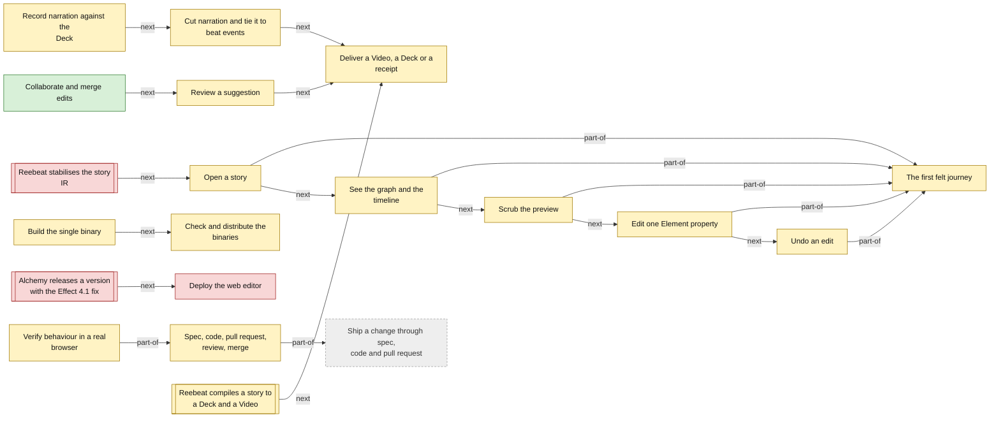

<!-- Generated by tools/intent from model/. Do not edit by hand: change the model and run `bun run generate`. -->

# reebeat studio

> The collaborative editor for reebeat stories

Studio is a collaborative editor for reebeat stories, a product built on the open compiler. It ships web first and as one binary built with Bun. Its licence is not decided.

Repository: [reebeat/studio][1]. Licence: none; all rights reserved, undecided. Status of this description: decided.

199 model elements: 45 decided, 135 proposed, 19 open.

## Product vision board

After Roman Pichler's product vision board. Each cell is built from the model; click through to the element.

| Cell | Content |
| --- | --- |
| Vision | [A collaborative editor for reebeat stories](../goals.md#goal-studio-vision) (decided): reebeat studio is a collaborative editor for reebeat stories, a product built on the open compiler. Its licence is not decided. |
| Target group | [Agent operator](../actors-and-resources.md#actor-agent-operator) (proposed) [Presenter](../actors-and-resources.md#actor-presenter) (proposed) [Creator](../actors-and-resources.md#actor-creator) (proposed) [Story author in studio](../actors-and-resources.md#actor-studio-story-author) (proposed) [Narrator in the deck view](../actors-and-resources.md#actor-studio-narrator) (proposed) [Person who brings their own agent](../actors-and-resources.md#actor-studio-agent-owner) (proposed) [Collaborator on a shared story](../actors-and-resources.md#actor-studio-collaborator) (proposed) [The operator as owner of studio](../actors-and-resources.md#actor-studio-product-owner) (decided) [Contributor who writes a spec and its pull request](../actors-and-resources.md#actor-studio-pr-author) (proposed) [Independent reviewer](../actors-and-resources.md#actor-studio-reviewer) (proposed) |
| Needs (jobs to be done) | When I run my own agent next to a story I am editing, I want to give the agent access to the editing tools, so that it can edit the story with me (decided) When I record the voice for a deck, I want to cut my narration into pieces and tie each piece to a beat lifecycle event, so that the pieces follow the story's beats (decided) When I want to change one Element of a story, I want to see the result at once, without a rebuild, so that I judge the change by looking at it, not by opening files (proposed) |
| Product (key features) | [The editor app (apps/editor)](../technical-components.md#comp-studio-editor) (proposed) [In-browser Deck preview](../technical-components.md#comp-studio-preview) (proposed) [The validated edit path](../technical-components.md#comp-studio-edit-path) (proposed) [Manuscript lens](../technical-components.md#comp-studio-lens-manuscript) (proposed) [Deck and Record lens](../technical-components.md#comp-studio-lens-record) (proposed) [Story graph lens](../technical-components.md#comp-studio-lens-story-graph) (proposed) [Timeline lens](../technical-components.md#comp-studio-lens-timeline) (proposed) [Wiring lens](../technical-components.md#comp-studio-lens-wiring) (proposed) [Review lens](../technical-components.md#comp-studio-lens-review) (proposed) [Coach lens](../technical-components.md#comp-studio-lens-coach) (proposed) [Languages lens](../technical-components.md#comp-studio-lens-languages) (proposed) [Deliver lens](../technical-components.md#comp-studio-lens-deliver) (proposed) [Agent panel](../technical-components.md#comp-studio-lens-agent-panel) (proposed) [The agent tool protocol](../technical-components.md#comp-studio-tool-protocol) (proposed) [Reference tool server over a local story file](../technical-components.md#comp-studio-reference-server) (proposed) [Hosted agents](../technical-components.md#comp-studio-hosted-agent) (decided) [Hosted alignment, speech and translation](../technical-components.md#comp-studio-hosted-speech) (proposed) [Cloud rendering](../technical-components.md#comp-studio-cloud-render) (proposed) [The sync server (planned)](../technical-components.md#comp-studio-sync-server) (decided) [The document port over Loro](../technical-components.md#comp-studio-document-port) (decided) [The validation gate](../technical-components.md#comp-studio-validation-gate) (decided) [The repair function](../technical-components.md#comp-studio-repair) (decided) [The single-binary launcher](../technical-components.md#comp-studio-launcher) (proposed) [The web deploy (inert)](../technical-components.md#comp-studio-web-deploy) (proposed) [Quality tools (tools/quality)](../technical-components.md#comp-studio-quality-tools) (proposed) [CI checks workflow](../technical-components.md#comp-studio-ci) (proposed) [Review and PR creation skills](../technical-components.md#comp-studio-review-skills) (proposed) [The verify-studio skill and feature map](../technical-components.md#comp-studio-verify-skill) (proposed) [The graph is the engine's graph](../technical-components.md#req-studio-graph-matches-plan) (proposed) [The playhead seeks the preview to any frame](../technical-components.md#req-studio-scrub-frame) (proposed) [One property edit is one change](../technical-components.md#req-studio-edit-one-property) (proposed) [Undo restores the old story exactly](../technical-components.md#req-studio-undo-restores) (proposed) [Record several takes with a teleprompter](../technical-components.md#req-studio-record-takes) (proposed) [Tie cut narration pieces to beat events](../technical-components.md#req-studio-cut-narration-by-word) (decided) [The sync server refuses an invalid merge with a reason](../technical-components.md#req-studio-gate-refuses-invalid) (proposed) [Offer a repair as a proposal](../technical-components.md#req-studio-repair-proposal) (decided) [The sync room stores an update log and a snapshot](../technical-components.md#req-studio-sync-persistence) (proposed) [Agents get tools to read and edit a story](../technical-components.md#req-studio-agent-tools) (proposed) [A user can bring their own agent](../technical-components.md#req-studio-bring-your-own-agent) (decided) [Set an agent's scope per lens](../technical-components.md#req-studio-agent-scopes) (proposed) [The binary opens the editor in the user's browser](../technical-components.md#req-studio-serve-local) (proposed) |
| Business goals | [Modular and extensible by users](../goals.md#goal-org-modular-extensible) (decided) [Correctness by construction](../goals.md#goal-org-correctness-by-construction) (decided) [Fast, incremental, reactive builds](../goals.md#goal-org-incremental-builds) (decided) [Reproducible builds](../goals.md#goal-org-reproducible-builds) (decided) [Interactive multimedia for learning](../goals.md#goal-org-interactive-multimedia) (decided) [Accessible artifacts for every audience](../goals.md#goal-org-accessible-artifacts) (decided) [Free tier for basic features, paid premium features](../goals.md#goal-studio-free-paid-split) (decided) [Paid sync and hosted agents fund the work](../goals.md#opportunity-studio-paid-sync-and-agents) (proposed) [Hosted agents](../technical-components.md#comp-studio-hosted-agent) (decided) [Hosted alignment, speech and translation](../technical-components.md#comp-studio-hosted-speech) (proposed) [Cloud rendering](../technical-components.md#comp-studio-cloud-render) (proposed) [The sync server (planned)](../technical-components.md#comp-studio-sync-server) (decided) |

Scope `studio`: 199 elements.

## Goals and quality requirements (arc42 sections 1 and 10)

### 1.1 Requirements overview

| Requirement | Statement | Status | Sources |
| --- | --- | --- | --- |
| [The graph is the engine's graph](../technical-components.md#req-studio-graph-matches-plan) | The States and Beats the editor draws equal the ones reebeat's timing plan lists, with the same ids, count and order. | proposed | [studio:docs/specs/0001-first-felt-journey.md:17][2], [studio:docs/specs/0001-first-felt-journey.md:131][3] |
| [The playhead seeks the preview to any frame](../technical-components.md#req-studio-scrub-frame) | Dragging the playhead shows that frame and its narration word in the preview. | proposed | [studio:docs/specs/0001-first-felt-journey.md:18][4], [studio:docs/specs/0001-first-felt-journey.md:39][5] |
| [One property edit is one change](../technical-components.md#req-studio-edit-one-property) | Setting an Element property changes the story by exactly one replace. An invalid result is refused with a reason and leaves the story unchanged. | proposed | [studio:docs/specs/0001-first-felt-journey.md:19-21][6], [studio:docs/specs/0001-first-felt-journey.md:133-134][7] |
| [Undo restores the old story exactly](../technical-components.md#req-studio-undo-restores) | Undo gives back the story byte for byte, using the computed inverse of the edit. | proposed | [studio:docs/specs/0001-first-felt-journey.md:20-21][8], [studio:docs/specs/0001-first-felt-journey.md:93][9], [studio:docs/specs/0001-first-felt-journey.md:136][10] |
| [Record several takes with a teleprompter](../technical-components.md#req-studio-record-takes) | The presenter reads a Line from a teleprompter, keeps several takes and picks the best one. | proposed | [log L45][11], [studio:docs/design/lenses.md:38][12] |
| [Tie cut narration pieces to beat events](../technical-components.md#req-studio-cut-narration-by-word) | Cut narration pieces are tied to beat lifecycle events. | decided | [log L45][11] |
| [The sync server refuses an invalid merge with a reason](../technical-components.md#req-studio-gate-refuses-invalid) | The server applies a change set to a copy and keeps it only when the result decodes as a valid story. It returns the reason so the author can rebase. | proposed | [log L47][13], [studio:docs/specs/0002-collaboration-spike.md:25][14], [studio:docs/specs/0002-collaboration-spike.md:111-112][15] |
| [Offer a repair as a proposal](../technical-components.md#req-studio-repair-proposal) | When a repair is offered for an invalid merge, it applies only after a person accepts. | decided | [record studio:docs/specs/0002-collaboration-spike.md:198][16] |
| [The sync room stores an update log and a snapshot](../technical-components.md#req-studio-sync-persistence) | The room appends each update to storage, compacts the log to a snapshot and chunks a snapshot over 2 MB. A new object started from storage returns the same document. | proposed | [studio:docs/specs/0002-collaboration-spike.md:28][17], [studio:docs/specs/0002-collaboration-spike.md:56][18], [studio:docs/specs/0002-collaboration-spike.md:66][19] |
| [Agents get tools to read and edit a story](../technical-components.md#req-studio-agent-tools) | Tools let an agent read the story, read the schema, plan timing, apply a patch, set a property by Element id and render a frame. They return the same typed errors the editor shows. | proposed | [studio:docs/specs/0001-first-felt-journey.md:95-108][20] |
| [A user can bring their own agent](../technical-components.md#req-studio-bring-your-own-agent) | A user connects an agent of their choice and gives it access to the editing tools. | decided | [log L43][21] |
| [Set an agent's scope per lens](../technical-components.md#req-studio-agent-scopes) | A person sets read, suggest or apply for each agent, and the scope can differ for each lens. | proposed | [studio:docs/design/lenses.md:91-99][22] |
| [The binary opens the editor in the user's browser](../technical-components.md#req-studio-serve-local) | Running the binary starts a local server and opens the browser on a loopback address and port. | proposed | [pr studio#6][23], [log L46][24] |

### 1.2 Quality goals

| Quality | Goal | Scenario | Status |
| --- | --- | --- | --- |
| correctness | [A preview frame equals the Video frame](../technical-components.md#req-studio-preview-equals-video): The in-browser preview at a frame equals the Video's frame at the same time. | For the first frame, a mid-transition frame, a frame inside a focus ring and the last frame of the same-id story, the preview at seek(frame) and the Video frame are byte for byte equal after PNG decode, on the same Chromium build. | proposed |
| reliability | [The free journey works offline](../technical-components.md#req-studio-offline-free-tier): With the network off, the free journey still works and the page requests nothing but its own static files. | With the network off and the static assets served, a person opens a story, sees the graph and timeline, scrubs, edits one property and undoes it. The page makes no request except for its own files. | proposed |
| accessibility | [Every editor region has an accessible name](../technical-components.md#req-studio-accessible-regions): The editor has one h1, and each region and the inspector has an accessible name. The inspector button exposes its state with aria-expanded. | A screen reader user lists the landmarks and finds Story graph, Preview, Timeline and Inspector by name. The Hide inspector button reports aria-expanded true while the inspector shows, and false when it is hidden. | proposed |
| correctness | [A merged story is valid or refused](../technical-components.md#req-studio-validity-under-merge): After any merge, the shared story is a valid story. No merge stores an invalid one. | Two peers edit a story at the same time and then merge. If the merged document does not decode as a valid story, the server refuses it and names the reason. Over the 66 valid spike outcomes, it refused none. | proposed |
| reproducibility | [The same updates give the same story on every peer](../technical-components.md#req-studio-deterministic-merge): Updates replayed in any order give the same projected story text on every peer. | Replay the same updates in 200 random orders into fresh replicas. Every replica gives the same story text, with 0 differing texts, on Bun and on Node. | proposed |
| performance | [Edit latency and edge cost are not yet measured](../technical-components.md#req-studio-performance-unmeasured): An edit must show in the preview within a latency budget, and the sync gate must start and run within a measured size. At the pinned commit neither number exists. | Milestone M0 measures the compile and render time of the same-id story in a browser and sets the budget for one edit. A Cloudflare edge run measures the gate's bundle size, cold start and load with many sockets. | open |
| security | [The binary serves only on loopback and only reads](../technical-components.md#req-studio-binary-loopback-readonly): The binary binds a loopback address, answers GET and HEAD only and refuses a path outside its embedded files. | A client on a non-loopback address of the same machine cannot connect. A POST returns 405. A request path with dot-dot segments reaches no file outside the embedded set, although a normalised path can answer with an embedded file. | proposed |
| portability | [The binary runs on five targets](../technical-components.md#req-studio-binary-portable): The release builds binaries for Linux x64 and arm64, macOS arm64 and x64, and Windows x64. No Linux binary names a path in the Nix store. | On the runners that run the full smoke (Linux x64 and arm64, macOS arm64 and x64), the binary starts, serves and exits cleanly on a stop signal. On Windows only the start-and-check step runs. A file-type check fails any Linux binary that names /nix/store. | proposed |
| licensing | [Every distributed artifact has a known licence](../technical-components.md#req-studio-licence-clear): Before studio distributes a binary, the licence of studio and of any bundled third-party code is known. At the pinned commit studio's licence is undecided, and its binary does not bundle ffmpeg. | Before a release, the operator has chosen a licence and added a LICENSE file. A binary that bundles ffmpeg with libx264 has had its GPL terms reviewed. | open |
| maintainability | [One command runs every gate](../technical-components.md#req-studio-maintainable-gates): The ready command runs format, lint, types, the exception check, tests, build, dead code, duplication and secret scans. CI runs the same gates. | On a clean tree, the ready command exits 0. Adding a lint suppression with no registry entry makes the exception check fail and name the file and line. | proposed |
| extensibility | [Users extend studio with their own agents and plugins](../technical-components.md#req-studio-extensible-agents): Studio stays modular so users add agents and plugins without changing studio's code. | A user connects an agent that studio did not ship, through the published tool protocol, and the agent edits a story with the same tools the editor uses. | proposed |

### 1.3 Stakeholders

| Stakeholder | Role in the product | Status |
| --- | --- | --- |
| [Story author in studio](../actors-and-resources.md#actor-studio-story-author) | A person who opens a story in the editor, looks at its graph and timeline, and edits it. This is the creator persona at work in studio. | proposed |
| [Narrator in the deck view](../actors-and-resources.md#actor-studio-narrator) | A person who records the voice of a story, picks the best take and ties the cut pieces to beat events. This is the presenter persona at work in studio. | proposed |
| [Person who brings their own agent](../actors-and-resources.md#actor-studio-agent-owner) | A person who connects an agent of their choice to studio's editing tools and sets what the agent may do. This is the agent operator persona at work in studio. | proposed |
| [Collaborator on a shared story](../actors-and-resources.md#actor-studio-collaborator) | A person who edits the same story as others through the sync server. Their suggested edits wait for a person's decision. | proposed |
| [The operator as owner of studio](../actors-and-resources.md#actor-studio-product-owner) | The operator made the studio repository public and has not decided its licence. | decided |
| [Contributor who writes a spec and its pull request](../actors-and-resources.md#actor-studio-pr-author) | A human or an agent who writes a spec, builds it on its own branch and opens one pull request. | proposed |
| [Independent reviewer](../actors-and-resources.md#actor-studio-reviewer) | A reviewer judges the plan, the code and their agreement, and runs the verify skill for the changed behaviour. A reviewer is never the author of the head. | proposed |
| [An agent that runs on the user's side](../actors-and-resources.md#actor-studio-own-agent) | An agent that the user brings. The user gives it access to the editing tools. | decided |
| [A hosted agent run by the project](../actors-and-resources.md#actor-studio-hosted-agent) | A heavily integrated AI agent that the project offers is a premium feature behind the paywall. | decided |
| [The sync server](../actors-and-resources.md#actor-studio-sync-server) | The sync server holds the validation gate on the merge-based keyed document. | decided |

## Problems and constraints

- [Studio has no LICENSE file](../goals.md#problem-studio-no-licence) (open): At the pinned commit, the repository is public but has no licence file. Studio's own material is not licensed for reuse, because the operator has not decided a licence. Third-party code keeps its own licence.
- [Studio has no glossary of its own](../goals.md#problem-studio-no-glossary) (open): At the pinned commit, studio uses reebeat's words (State, Beat, Scene, effect) but has no GLOSSARY.md. It points readers to reebeat's glossary.
- [The README does not state product goals](../goals.md#problem-studio-goals-not-in-readme) (open): At the pinned commit, the README gives a one-line purpose and the status of a placeholder shell. It does not state the product goals, the free and paid split or the roadmap.
- [The first journey waits for the reebeat story IR](../goals.md#problem-studio-first-journey-blocked) (open): At the pinned commit, spec 0001 is blocked on reebeat specs 0004 and 0006, and needs spec 0005 for story-wide identity. Until the IR is stable, studio builds no editing feature.
- [Browser compile and seek in reebeat are unverified](../goals.md#problem-studio-browser-compile-gaps) (proposed): The in-browser preview needs a browser-safe compile, a seekable Deck page and a Deck generator that does not read the file system. Spec 0001 lists them as new reebeat work, and says the browser safety of the compile is not yet checked.
- [Foldkit's Vite plugin imports a missing Crypto](../goals.md#problem-studio-foldkit-vite-plugin) (open): At the pinned commit, the Foldkit Vite plugin imports Crypto from the effect root, which Effect 4.1.0 does not have. The plugin stays off, so the dev tools bridge and model-preserving reload are off.
- [The web deploy waits for an Alchemy release](../goals.md#problem-studio-alchemy-release) (open): At the pinned commit, the current Alchemy release imports an Effect module that Effect 4.1 does not have. The fix, alchemy-run/alchemy#2754, was merged but not released, so pull request 6 was a draft.
- [The exception check misses effect-diagnostics comments](../goals.md#problem-studio-exceptions-miss-diagnostics) (open): At the pinned commit, the suppression pattern in tools/quality does not match effect-diagnostics comments. Such a comment can silence a rule with no registry entry.
- [The Durable Object room is unmeasured at the edge](../goals.md#problem-studio-do-unmeasured) (open): The room ran only on local workerd, without the validation gate. Nobody measured the real Cloudflare edge, load, many sockets, or the gate's bundle size and cold start.
- [Demand and willingness to pay are not measured](../goals.md#problem-studio-demand-unmeasured) (open): The free and paid split follows running cost. No source measures whether people want studio or would pay for sync or hosted agents.
- [ffmpeg with libx264 is GPL](../goals.md#problem-studio-ffmpeg-gpl) (open): A studio binary that bundles ffmpeg with libx264 would carry GPL terms. The operator wants this reviewed before any such binary is distributed.
- [The binaries are not signed](../goals.md#problem-studio-unsigned-binaries) (open): The macOS and Windows binaries are not signed or notarised, so those systems warn the user.
- [STATE.md still says spec 0003 is in review](../goals.md#problem-studio-stale-state) (open): At the pinned commit, STATE.md says the review and verify skills are in review and lists their review as the next step. PR 5 has merged.
- [Merge rule for positions and curve points is open](../goals.md#problem-studio-merge-semantics-open) (open): Two people can move one Element along different axes. A property-wise merge gives a position nobody chose. An atomic merge keeps one whole position. The operator has not chosen.
- [Lens order and shared lens state are undecided](../goals.md#problem-studio-lens-order-open) (open): The lenses note does not decide the build order of lenses after spec 0001, whether the playhead is shared between collaborators, or how lenses use Foldkit Submodels.
- [A merge can break the story](../goals.md#problem-studio-invalid-merges) (proposed): In the spike, 31 of 57 runs on a naive IR-shaped document merged to an invalid story, and 17 of 57 on a keyed one. A repair made 15 of the 17 valid and could not fix the other two (one left an Element hidden and never revealed).
- [A patch addressed by array index can edit the wrong item](../goals.md#problem-studio-index-patch-unsafe) (proposed): Effect's JSON Patch compares arrays by position. In the spike, one inserted effect became 26 operations that rewrite the next effects field by field, and applied to a document that moved on, that patch gave an invalid story. A one-operation patch applied by index to a document that moved on edited the wrong effect, and the story stayed valid.
- [The preview may differ from the Video](../goals.md#problem-studio-preview-may-diverge) (proposed): The in-browser preview could differ from the rendered Video where audio or the browser build differ. Spec 0001 answers this with a falsifier, not trust.
- [Public repository, all rights reserved, licence undecided](../goals.md#constraint-studio-licence-undecided) (decided): The studio licence is not decided. The README carries a copyright notice that reserves all rights, and no licence file is present on purpose.
- [A public repository holds no secret or private material](../goals.md#constraint-studio-public-repo-hygiene) (proposed): The operator made the studio repository public. So it never holds a secret, personal data or course-private material.
- [No editing feature before the reebeat IR is stable](../goals.md#constraint-studio-ir-stability) (proposed): Studio builds no editing feature against the story IR until reebeat specs 0004 to 0006 stabilise it. The shell, toolchain and docs are allowed.
- [Effect 4.1.0 runs against Foldkit's peer of 4.0.0](../goals.md#constraint-studio-effect-foldkit-peer) (proposed): Foldkit 0.169.0 declares a peer of effect 4.0.0, and studio runs 4.1.0. Bun prints warnings. The tests, build and a browser run pass on 4.1.0, and a boot test guards the mismatch.
- [Keep the Foldkit Vite plugin off until upstream fixes it](../goals.md#constraint-studio-foldkit-plugin-off) (proposed): The Foldkit Vite plugin stays off, and studio stays on Effect 4.1.0, until a Foldkit release imports effect/crypto.
- [devenv has no Chromium, ffmpeg or whisper](../goals.md#constraint-studio-no-chromium-devenv) (proposed): The development environment provides Bun, Node and gitleaks only. Browser runs use the host Chromium, and CI has no browser gate.
- [Durable Object storage has size limits](../goals.md#constraint-studio-do-limits) (proposed): A SQLite value or row in a Durable Object is at most 2 MB, so a larger snapshot must be chunked. A received WebSocket message is at most 32 MiB.

## Goals it serves

```mermaid
flowchart BT
    classDef decided fill:#d8f0d8,stroke:#2d7a2d,color:#111
    classDef proposed fill:#fff3c4,stroke:#a07800,color:#111
    classDef open fill:#f8d7d7,stroke:#a02020,color:#111
    classDef outside fill:#eee,stroke:#999,color:#333,stroke-dasharray:4 3
    goal_studio_vision("A collaborative editor for<br/>reebeat stories"):::decided
    goal_studio_free_paid_split("Free tier for basic<br/>features, paid premium<br/>features"):::decided
    goal_studio_people_and_agents("People and agents edit<br/>stories together"):::decided
    goal_studio_collaboration("Many people and agents edit<br/>one story"):::decided
    goal_studio_valid_shared_story("Check merged changes with a<br/>validation gate"):::decided
    goal_studio_deck_view_narration("Record narration in a deck<br/>view"):::decided
    goal_studio_web_and_binary("Ship web first and a single<br/>binary"):::decided
    goal_studio_lenses("Organise the editor by<br/>lenses"):::decided
    goal_studio_first_felt_journey("Edit one thing and see it at<br/>once"):::proposed
    goal_studio_offline_free_journey("The free journey needs no<br/>server or account"):::proposed
    goal_studio_preview_fidelity("The preview shows what the<br/>Video will show"):::proposed
    goal_studio_human_control("People decide on what agents<br/>and others suggest"):::proposed
    goal_studio_checked_change("Every change passes the same<br/>gates"):::proposed
    goal_studio_lens_manuscript("Manuscript lens, read the<br/>story as text"):::decided
    goal_studio_lens_story_graph("Story graph lens, lay out<br/>scenes, States and Beats"):::decided
    goal_studio_lens_timeline("Timeline lens, time the<br/>story"):::decided
    goal_studio_lens_deliver("Deliver lens, render and<br/>present"):::decided
    goal_studio_lens_wiring("Wiring lens, explain why<br/>something happens when it<br/>does"):::proposed
    goal_studio_lens_review("Review lens, compare<br/>versions and accept<br/>suggestions"):::proposed
    goal_studio_lens_coach("Coach lens, lint for<br/>teaching quality"):::proposed
    goal_studio_lens_languages("Languages lens, one story in<br/>several narrations"):::proposed
    goal_studio_lens_agent_panel("Agent panel in every lens"):::proposed
    problem_studio_no_licence{{"Studio has no LICENSE file"}}:::open
    problem_studio_no_glossary{{"Studio has no glossary of<br/>its own"}}:::open
    problem_studio_goals_not_in_readme{{"The README does not state<br/>product goals"}}:::open
    problem_studio_first_journey_blocked{{"The first journey waits for<br/>the reebeat story IR"}}:::open
    problem_studio_browser_compile_gaps{{"Browser compile and seek in<br/>reebeat are unverified"}}:::proposed
    problem_studio_foldkit_vite_plugin{{"Foldkit's Vite plugin<br/>imports a missing Crypto"}}:::open
    problem_studio_alchemy_release{{"The web deploy waits for an<br/>Alchemy release"}}:::open
    problem_studio_exceptions_miss_diagnostics{{"The exception check misses<br/>effect-diagnostics comments"}}:::open
    problem_studio_do_unmeasured{{"The Durable Object room is<br/>unmeasured at the edge"}}:::open
    problem_studio_demand_unmeasured{{"Demand and willingness to<br/>pay are not measured"}}:::open
    problem_studio_ffmpeg_gpl{{"ffmpeg with libx264 is GPL"}}:::open
    problem_studio_unsigned_binaries{{"The binaries are not signed"}}:::open
    problem_studio_stale_state{{"STATE.md still says spec<br/>0003 is in review"}}:::open
    problem_studio_merge_semantics_open{{"Merge rule for positions and<br/>curve points is open"}}:::open
    problem_studio_lens_order_open{{"Lens order and shared lens<br/>state are undecided"}}:::open
    problem_studio_invalid_merges{{"A merge can break the story"}}:::proposed
    problem_studio_index_patch_unsafe{{"A patch addressed by array<br/>index can edit the wrong<br/>item"}}:::proposed
    problem_studio_preview_may_diverge{{"The preview may differ from<br/>the Video"}}:::proposed
    constraint_studio_licence_undecided[/"Public repository, all<br/>rights reserved, licence<br/>undecided"/]:::decided
    constraint_studio_public_repo_hygiene[/"A public repository holds no<br/>secret or private material"/]:::proposed
    constraint_studio_ir_stability[/"No editing feature before<br/>the reebeat IR is stable"/]:::proposed
    constraint_studio_effect_foldkit_peer[/"Effect 4.1.0 runs against<br/>Foldkit's peer of 4.0.0"/]:::proposed
    constraint_studio_foldkit_plugin_off[/"Keep the Foldkit Vite plugin<br/>off until upstream fixes it"/]:::proposed
    constraint_studio_no_chromium_devenv[/"devenv has no Chromium,<br/>ffmpeg or whisper"/]:::proposed
    constraint_studio_do_limits[/"Durable Object storage has<br/>size limits"/]:::proposed
    opportunity_studio_paid_sync_and_agents(["Paid sync and hosted agents<br/>fund the work"]):::proposed
    opportunity_studio_byo_agents_and_plugins(["Users bring their own<br/>agents, and likely write<br/>plugins"]):::decided
    opportunity_studio_loro_attribution(["Loro gives cheap authorship<br/>and proposal branches"]):::proposed
    opportunity_studio_preview_is_video_page(["The Deck preview can be the<br/>Video's own page"]):::proposed
    opportunity_studio_offline_binary(["One binary gives an offline<br/>local studio"]):::proposed
    opportunity_studio_foldkit_flow_graph(["The story graph lens could<br/>use foldkit-flow"]):::proposed
    goal_org_product_family("A family of products on the<br/>open core"):::outside
    goal_org_sustainable_funding("Fund the work with paid<br/>features that cost money to<br/>run"):::outside
    goal_org_modular_extensible("Modular and extensible by<br/>users"):::outside
    goal_org_correctness_by_construction("Correctness by construction"):::outside
    goal_org_incremental_builds("Fast, incremental, reactive<br/>builds"):::outside
    goal_org_reproducible_builds("Reproducible builds"):::outside
    goal_org_interactive_multimedia("Interactive multimedia for<br/>learning"):::outside
    goal_org_accessible_artifacts("Accessible artifacts for<br/>every audience"):::outside
    goal_studio_vision -->|subgoal-of| goal_org_product_family
    goal_studio_free_paid_split -->|subgoal-of| goal_org_sustainable_funding
    goal_studio_people_and_agents -->|supports| goal_org_modular_extensible
    goal_studio_people_and_agents -->|subgoal-of| goal_studio_vision
    goal_studio_collaboration -->|subgoal-of| goal_studio_vision
    goal_studio_valid_shared_story -->|subgoal-of| goal_studio_collaboration
    goal_studio_valid_shared_story -->|supports| goal_org_correctness_by_construction
    goal_studio_deck_view_narration -->|subgoal-of| goal_studio_lenses
    goal_studio_web_and_binary -->|subgoal-of| goal_studio_vision
    goal_studio_lenses -->|subgoal-of| goal_studio_vision
    goal_studio_first_felt_journey -->|subgoal-of| goal_studio_vision
    goal_studio_first_felt_journey -->|supports| goal_org_incremental_builds
    goal_studio_first_felt_journey -->|requires| constraint_studio_ir_stability
    goal_studio_offline_free_journey -->|subgoal-of| goal_studio_first_felt_journey
    goal_studio_preview_fidelity -->|subgoal-of| goal_studio_first_felt_journey
    goal_studio_preview_fidelity -->|supports| goal_org_reproducible_builds
    goal_studio_human_control -->|subgoal-of| goal_studio_people_and_agents
    goal_studio_checked_change -->|supports| goal_org_correctness_by_construction
    goal_studio_lens_manuscript -->|subgoal-of| goal_studio_lenses
    goal_studio_lens_story_graph -->|subgoal-of| goal_studio_lenses
    goal_studio_lens_timeline -->|subgoal-of| goal_studio_lenses
    goal_studio_lens_deliver -->|subgoal-of| goal_studio_lenses
    goal_studio_lens_deliver -->|supports| goal_org_reproducible_builds
    goal_studio_lens_wiring -->|subgoal-of| goal_studio_lenses
    goal_studio_lens_review -->|subgoal-of| goal_studio_lenses
    goal_studio_lens_review -->|subgoal-of| goal_studio_human_control
    goal_studio_lens_coach -->|subgoal-of| goal_studio_lenses
    goal_studio_lens_coach -->|supports| goal_org_interactive_multimedia
    goal_studio_lens_languages -->|subgoal-of| goal_studio_lenses
    goal_studio_lens_languages -->|supports| goal_org_accessible_artifacts
    goal_studio_lens_agent_panel -->|subgoal-of| goal_studio_lenses
    goal_studio_lens_agent_panel -->|subgoal-of| goal_studio_people_and_agents
    problem_studio_no_licence -.->|hinders| goal_studio_web_and_binary
    problem_studio_no_glossary -.->|hinders| goal_studio_lenses
    problem_studio_goals_not_in_readme -.->|hinders| goal_studio_vision
    problem_studio_first_journey_blocked -.->|hinders| goal_studio_first_felt_journey
    problem_studio_browser_compile_gaps -.->|hinders| goal_studio_preview_fidelity
    problem_studio_alchemy_release -.->|hinders| goal_studio_web_and_binary
    problem_studio_do_unmeasured -.->|hinders| goal_studio_valid_shared_story
    problem_studio_demand_unmeasured -.->|hinders| goal_studio_free_paid_split
    problem_studio_ffmpeg_gpl -.->|hinders| goal_studio_web_and_binary
    problem_studio_unsigned_binaries -.->|hinders| goal_studio_web_and_binary
    problem_studio_stale_state -.->|hinders| goal_studio_checked_change
    problem_studio_merge_semantics_open -.->|hinders| goal_studio_collaboration
    problem_studio_lens_order_open -.->|hinders| goal_studio_lenses
    problem_studio_invalid_merges ==>|motivates| goal_studio_valid_shared_story
    problem_studio_preview_may_diverge -.->|hinders| goal_studio_preview_fidelity
    opportunity_studio_paid_sync_and_agents -->|supports| goal_studio_free_paid_split
    opportunity_studio_byo_agents_and_plugins -->|supports| goal_studio_people_and_agents
    opportunity_studio_loro_attribution -->|supports| goal_studio_human_control
    opportunity_studio_preview_is_video_page -->|supports| goal_studio_preview_fidelity
    opportunity_studio_offline_binary -->|supports| goal_studio_offline_free_journey
    opportunity_studio_foldkit_flow_graph -->|supports| goal_studio_lens_story_graph
```

## Key processes

## Rules

Full tables and diagrams: [Business Rules Model](../business-rules.md).

- [Free means it costs the project nothing to run](../business-rules.md#rule-studio-free-costs-nothing) (business rule, proposed)
- [Every edit goes through one validated path](../business-rules.md#rule-studio-single-edit-path) (business rule, proposed)
- [Edit by Element id, not by array index](../business-rules.md#rule-studio-edit-by-element-id) (business rule, proposed)
- [Objects with an id are keyed by an immutable uid](../business-rules.md#rule-studio-keyed-by-uid) (business rule, proposed)
- [Peers exchange Loro updates, not JSON Patches](../business-rules.md#rule-studio-replicate-updates-not-patches) (business rule, decided)
- [The gate refuses a merge that is not a valid story](../business-rules.md#rule-studio-gate-refuses-invalid-merge) (business rule, proposed)
- [A repair is a proposal, never applied silently](../business-rules.md#rule-studio-repair-is-proposal) (business rule, decided)
- [Hash the projected IR text, not CRDT bytes](../business-rules.md#rule-studio-hash-projected-ir) (business rule, proposed)
- [A suggestion needs a human to accept it](../business-rules.md#rule-studio-suggestions-need-human-accept) (business rule, proposed)
- [Each agent has a read, suggest or apply scope per lens](../business-rules.md#rule-studio-agent-scope) (business rule, proposed)
- [A narration piece drives timing or follows an event](../business-rules.md#rule-studio-narration-drives-or-follows) (business rule, proposed)
- [A narration cycle is reported, not resolved](../business-rules.md#rule-studio-no-narration-cycles) (business rule, proposed)
- [Retiming changes the offset from the anchor](../business-rules.md#rule-studio-retime-by-offset) (business rule, proposed)
- [Switching lens never changes the story](../business-rules.md#rule-studio-lens-switch-never-mutates) (business rule, proposed)
- [A late compile never replaces a newer one](../business-rules.md#rule-studio-stale-result-dropped) (business rule, proposed)
- [update and view stay pure](../business-rules.md#rule-studio-pure-update) (business rule, proposed)
- [Effect packages stay on one pinned version](../business-rules.md#rule-studio-effect-one-version) (business rule, proposed)
- [One spec, one branch, one pull request](../business-rules.md#rule-studio-one-spec-one-pr) (business rule, proposed)
- [Main needs a pull request and a passing check](../business-rules.md#rule-studio-main-protected) (business rule, proposed)
- [Every suppression has a registry entry](../business-rules.md#rule-studio-exceptions-registered) (business rule, proposed)
- [A reviewer is never the author of the head](../business-rules.md#rule-studio-reviewer-not-author) (business rule, proposed)
- [A user-visible change updates the verify skill](../business-rules.md#rule-studio-verify-skill-maintenance) (business rule, proposed)
- [A heavy job needs machine headroom first](../business-rules.md#rule-studio-heavy-job-headroom) (business rule, decided)
- [Do not add a LICENSE file until the operator decides](../business-rules.md#rule-studio-no-licence-file) (business rule, proposed)

## Actors and resources

Full tables and diagrams: [Actors and Resources Model](../actors-and-resources.md).

- [Story author in studio](../actors-and-resources.md#actor-studio-story-author) (actor, proposed)
- [Narrator in the deck view](../actors-and-resources.md#actor-studio-narrator) (actor, proposed)
- [Person who brings their own agent](../actors-and-resources.md#actor-studio-agent-owner) (actor, proposed)
- [Collaborator on a shared story](../actors-and-resources.md#actor-studio-collaborator) (actor, proposed)
- [The operator as owner of studio](../actors-and-resources.md#actor-studio-product-owner) (actor, decided)
- [Contributor who writes a spec and its pull request](../actors-and-resources.md#actor-studio-pr-author) (actor, proposed)
- [Independent reviewer](../actors-and-resources.md#actor-studio-reviewer) (actor, proposed)
- [An agent that runs on the user's side](../actors-and-resources.md#actor-studio-own-agent) (actor, decided)
- [A hosted agent run by the project](../actors-and-resources.md#actor-studio-hosted-agent) (actor, decided)
- [The sync server](../actors-and-resources.md#actor-studio-sync-server) (actor, decided)
- [The public repository reebeat/studio](../actors-and-resources.md#resource-studio-repo) (resource, decided)
- [The reebeat compiler and its IR](../actors-and-resources.md#resource-studio-reebeat-compiler) (resource, proposed)
- [Foldkit, the UI framework](../actors-and-resources.md#resource-studio-foldkit) (resource, proposed)
- [Effect 4.1.0](../actors-and-resources.md#resource-studio-effect) (resource, proposed)
- [Loro, the CRDT library](../actors-and-resources.md#resource-studio-loro) (resource, decided)
- [loro-crdt 1.17.1 under the MIT licence](../actors-and-resources.md#resource-studio-loro-release) (resource, proposed)
- [Cloudflare Workers and Durable Objects](../actors-and-resources.md#resource-studio-cloudflare) (resource, proposed)
- [Alchemy v2](../actors-and-resources.md#resource-studio-alchemy) (resource, proposed)
- [Bun, the runtime and compiler](../actors-and-resources.md#resource-studio-bun) (resource, decided)
- [A story IR file](../actors-and-resources.md#resource-studio-story-file) (resource, proposed)
- [Narration speech cache](../actors-and-resources.md#resource-studio-speech-cache) (resource, proposed)
- [Specs and the lenses design note](../actors-and-resources.md#resource-studio-specs) (resource, proposed)
- [The collaboration spike code](../actors-and-resources.md#resource-studio-spike-code) (resource, proposed)
- [GitHub Actions checks](../actors-and-resources.md#resource-studio-ci) (resource, proposed)
- [The host Chromium for browser runs](../actors-and-resources.md#resource-studio-host-chromium) (resource, proposed)
- [Cost of servers and inference](../actors-and-resources.md#resource-studio-hosting-cost) (resource, decided)

## Components, requirements and IS goals

Full tables and diagrams: [Technical Components and Requirements Model](../technical-components.md).

- [reebeat studio](../technical-components.md#comp-studio-product) (technical component, decided)
- [The editor app (apps/editor)](../technical-components.md#comp-studio-editor) (technical component, proposed)
- [In-browser Deck preview](../technical-components.md#comp-studio-preview) (technical component, proposed)
- [The validated edit path](../technical-components.md#comp-studio-edit-path) (technical component, proposed)
- [Manuscript lens](../technical-components.md#comp-studio-lens-manuscript) (technical component, proposed)
- [Deck and Record lens](../technical-components.md#comp-studio-lens-record) (technical component, proposed)
- [Story graph lens](../technical-components.md#comp-studio-lens-story-graph) (technical component, proposed)
- [Timeline lens](../technical-components.md#comp-studio-lens-timeline) (technical component, proposed)
- [Wiring lens](../technical-components.md#comp-studio-lens-wiring) (technical component, proposed)
- [Review lens](../technical-components.md#comp-studio-lens-review) (technical component, proposed)
- [Coach lens](../technical-components.md#comp-studio-lens-coach) (technical component, proposed)
- [Languages lens](../technical-components.md#comp-studio-lens-languages) (technical component, proposed)
- [Deliver lens](../technical-components.md#comp-studio-lens-deliver) (technical component, proposed)
- [Agent panel](../technical-components.md#comp-studio-lens-agent-panel) (technical component, proposed)
- [The agent tool protocol](../technical-components.md#comp-studio-tool-protocol) (technical component, proposed)
- [Reference tool server over a local story file](../technical-components.md#comp-studio-reference-server) (technical component, proposed)
- [Hosted agents](../technical-components.md#comp-studio-hosted-agent) (technical component, decided)
- [Hosted alignment, speech and translation](../technical-components.md#comp-studio-hosted-speech) (technical component, proposed)
- [Cloud rendering](../technical-components.md#comp-studio-cloud-render) (technical component, proposed)
- [The sync server (planned)](../technical-components.md#comp-studio-sync-server) (technical component, decided)
- [The document port over Loro](../technical-components.md#comp-studio-document-port) (technical component, decided)
- [The validation gate](../technical-components.md#comp-studio-validation-gate) (technical component, decided)
- [The repair function](../technical-components.md#comp-studio-repair) (technical component, decided)
- [The single-binary launcher](../technical-components.md#comp-studio-launcher) (technical component, proposed)
- [The web deploy (inert)](../technical-components.md#comp-studio-web-deploy) (technical component, proposed)
- [Quality tools (tools/quality)](../technical-components.md#comp-studio-quality-tools) (technical component, proposed)
- [CI checks workflow](../technical-components.md#comp-studio-ci) (technical component, proposed)
- [Review and PR creation skills](../technical-components.md#comp-studio-review-skills) (technical component, proposed)
- [The verify-studio skill and feature map](../technical-components.md#comp-studio-verify-skill) (technical component, proposed)
- [The graph is the engine's graph](../technical-components.md#req-studio-graph-matches-plan) (requirement, proposed)
- [The playhead seeks the preview to any frame](../technical-components.md#req-studio-scrub-frame) (requirement, proposed)
- [One property edit is one change](../technical-components.md#req-studio-edit-one-property) (requirement, proposed)
- [Undo restores the old story exactly](../technical-components.md#req-studio-undo-restores) (requirement, proposed)
- [Record several takes with a teleprompter](../technical-components.md#req-studio-record-takes) (requirement, proposed)
- [Tie cut narration pieces to beat events](../technical-components.md#req-studio-cut-narration-by-word) (requirement, decided)
- [The sync server refuses an invalid merge with a reason](../technical-components.md#req-studio-gate-refuses-invalid) (requirement, proposed)
- [Offer a repair as a proposal](../technical-components.md#req-studio-repair-proposal) (requirement, decided)
- [The sync room stores an update log and a snapshot](../technical-components.md#req-studio-sync-persistence) (requirement, proposed)
- [Agents get tools to read and edit a story](../technical-components.md#req-studio-agent-tools) (requirement, proposed)
- [A user can bring their own agent](../technical-components.md#req-studio-bring-your-own-agent) (requirement, decided)
- [Set an agent's scope per lens](../technical-components.md#req-studio-agent-scopes) (requirement, proposed)
- [The binary opens the editor in the user's browser](../technical-components.md#req-studio-serve-local) (requirement, proposed)
- [A preview frame equals the Video frame](../technical-components.md#req-studio-preview-equals-video) (requirement, proposed)
- [The free journey works offline](../technical-components.md#req-studio-offline-free-tier) (requirement, proposed)
- [Every editor region has an accessible name](../technical-components.md#req-studio-accessible-regions) (requirement, proposed)
- [A merged story is valid or refused](../technical-components.md#req-studio-validity-under-merge) (requirement, proposed)
- [The same updates give the same story on every peer](../technical-components.md#req-studio-deterministic-merge) (requirement, proposed)
- [Edit latency and edge cost are not yet measured](../technical-components.md#req-studio-performance-unmeasured) (requirement, open)
- [The binary serves only on loopback and only reads](../technical-components.md#req-studio-binary-loopback-readonly) (requirement, proposed)
- [The binary runs on five targets](../technical-components.md#req-studio-binary-portable) (requirement, proposed)
- [Every distributed artifact has a known licence](../technical-components.md#req-studio-licence-clear) (requirement, open)
- [One command runs every gate](../technical-components.md#req-studio-maintainable-gates) (requirement, proposed)
- [Users extend studio with their own agents and plugins](../technical-components.md#req-studio-extensible-agents) (requirement, proposed)
- [Every change enters through one validated path](../technical-components.md#isgoal-studio-one-edit-path) (information system goal, proposed)
- [A validation gate guards the shared document](../technical-components.md#isgoal-studio-story-always-valid) (information system goal, decided)
- [The system knows who made each change](../technical-components.md#isgoal-studio-attribution) (information system goal, proposed)
- [An agent is a named peer with its own replica](../technical-components.md#isgoal-studio-agents-as-peers) (information system goal, proposed)
- [Free features run with no server of ours](../technical-components.md#isgoal-studio-free-runs-locally) (information system goal, proposed)

## Concepts

Full tables and diagrams: [Concepts Model](../concepts.md).

- [Lens](../concepts.md#concept-studio-lens) (concept, decided)
- [Playhead and preview](../concepts.md#concept-studio-playhead) (concept, proposed)
- [Free tier and paid tier](../concepts.md#concept-studio-tier) (concept, proposed)
- [Keyed document](../concepts.md#concept-studio-keyed-document) (concept, decided)
- [Loro update](../concepts.md#concept-studio-loro-update) (concept, decided)
- [JSON Patch](../concepts.md#concept-studio-json-patch) (concept, decided)
- [Revision](../concepts.md#concept-studio-revision) (concept, proposed)
- [Document port](../concepts.md#concept-studio-document-port) (concept, decided)
- [Validation gate](../concepts.md#concept-studio-validation-gate) (concept, decided)
- [Repair proposal](../concepts.md#concept-studio-repair-proposal) (concept, decided)
- [Suggestion](../concepts.md#concept-studio-suggestion) (concept, proposed)
- [Sync room](../concepts.md#concept-studio-sync-room) (concept, proposed)
- [Peer](../concepts.md#concept-studio-peer) (concept, proposed)
- [Deck view](../concepts.md#concept-studio-deck-view) (concept, decided)
- [Take](../concepts.md#concept-studio-take) (concept, proposed)
- [Narration piece](../concepts.md#concept-studio-narration-piece) (concept, decided)
- [Anchor and offset](../concepts.md#concept-studio-anchor-offset) (concept, proposed)
- [Agent panel scope](../concepts.md#concept-studio-agent-scope) (concept, proposed)
- [Feature map](../concepts.md#concept-studio-feature-map) (concept, proposed)

## Work items

| Item | Title | State | Element |
| --- | --- | --- | --- |
| pr:studio#6 | feat: distribution, a single binary now and the web deploy when Alchemy supports effect 4.1 (spec 0004) | open | [Cloudflare Workers and Durable Objects](../actors-and-resources.md#resource-studio-cloudflare) |
| pr:studio#6 | feat: distribution, a single binary now and the web deploy when Alchemy supports effect 4.1 (spec 0004) | open | [Alchemy v2](../actors-and-resources.md#resource-studio-alchemy) |
| pr:studio#6 | feat: distribution, a single binary now and the web deploy when Alchemy supports effect 4.1 (spec 0004) | open | [Ship web first and a single binary](../goals.md#goal-studio-web-and-binary) |
| issue:studio#4 | Re-enable @foldkit/vite-plugin when a release supports effect 4.1.0 | open | [Foldkit's Vite plugin imports a missing Crypto](../goals.md#problem-studio-foldkit-vite-plugin) |
| pr:studio#6 | feat: distribution, a single binary now and the web deploy when Alchemy supports effect 4.1 (spec 0004) | open | [The web deploy waits for an Alchemy release](../goals.md#problem-studio-alchemy-release) |
| issue:studio#7 | check:exceptions ignores @effect-diagnostics suppression comments | open | [The exception check misses effect-diagnostics comments](../goals.md#problem-studio-exceptions-miss-diagnostics) |
| issue:reebeat#7 | ffmpeg with libx264 is GPL: decide before distributing a binary | open | [ffmpeg with libx264 is GPL](../goals.md#problem-studio-ffmpeg-gpl) |
| pr:studio#6 | feat: distribution, a single binary now and the web deploy when Alchemy supports effect 4.1 (spec 0004) | open | [ffmpeg with libx264 is GPL](../goals.md#problem-studio-ffmpeg-gpl) |
| pr:studio#6 | feat: distribution, a single binary now and the web deploy when Alchemy supports effect 4.1 (spec 0004) | open | [The binaries are not signed](../goals.md#problem-studio-unsigned-binaries) |
| pr:studio#5 | feat: review, PR creation and verification skills (spec 0003) | merged | [STATE.md still says spec 0003 is in review](../goals.md#problem-studio-stale-state) |
| issue:studio#4 | Re-enable @foldkit/vite-plugin when a release supports effect 4.1.0 | open | [Keep the Foldkit Vite plugin off until upstream fixes it](../goals.md#constraint-studio-foldkit-plugin-off) |
| pr:studio#6 | feat: distribution, a single binary now and the web deploy when Alchemy supports effect 4.1 (spec 0004) | open | [One binary gives an offline local studio](../goals.md#opportunity-studio-offline-binary) |
| pr:studio#6 | feat: distribution, a single binary now and the web deploy when Alchemy supports effect 4.1 (spec 0004) | open | [Build the single binary](../business-processes.md#process-studio-build-binary) |
| pr:studio#6 | feat: distribution, a single binary now and the web deploy when Alchemy supports effect 4.1 (spec 0004) | open | [Check and distribute the binaries](../business-processes.md#process-studio-distribute-binary) |
| pr:studio#6 | feat: distribution, a single binary now and the web deploy when Alchemy supports effect 4.1 (spec 0004) | open | [Deploy the web editor](../business-processes.md#process-studio-deploy-web) |
| pr:studio#6 | feat: distribution, a single binary now and the web deploy when Alchemy supports effect 4.1 (spec 0004) | open | [Alchemy releases a version with the Effect 4.1 fix](../business-processes.md#extproc-studio-alchemy-release) |
| issue:studio#7 | check:exceptions ignores @effect-diagnostics suppression comments | open | [Every suppression has a registry entry](../business-rules.md#rule-studio-exceptions-registered) |
| pr:studio#6 | feat: distribution, a single binary now and the web deploy when Alchemy supports effect 4.1 (spec 0004) | open | [The single-binary launcher](../technical-components.md#comp-studio-launcher) |
| pr:studio#6 | feat: distribution, a single binary now and the web deploy when Alchemy supports effect 4.1 (spec 0004) | open | [The web deploy (inert)](../technical-components.md#comp-studio-web-deploy) |
| pr:studio#6 | feat: distribution, a single binary now and the web deploy when Alchemy supports effect 4.1 (spec 0004) | open | [The binary opens the editor in the user's browser](../technical-components.md#req-studio-serve-local) |
| pr:studio#6 | feat: distribution, a single binary now and the web deploy when Alchemy supports effect 4.1 (spec 0004) | open | [The binary serves only on loopback and only reads](../technical-components.md#req-studio-binary-loopback-readonly) |
| pr:studio#6 | feat: distribution, a single binary now and the web deploy when Alchemy supports effect 4.1 (spec 0004) | open | [The binary runs on five targets](../technical-components.md#req-studio-binary-portable) |

[1]: https://github.com/reebeat/studio
[2]: https://github.com/reebeat/studio/blob/d4fd75eaca83b9e8a98f073d5b1d957da5d6b8b8/docs/specs/0001-first-felt-journey.md#L17
[3]: https://github.com/reebeat/studio/blob/d4fd75eaca83b9e8a98f073d5b1d957da5d6b8b8/docs/specs/0001-first-felt-journey.md#L131
[4]: https://github.com/reebeat/studio/blob/d4fd75eaca83b9e8a98f073d5b1d957da5d6b8b8/docs/specs/0001-first-felt-journey.md#L18
[5]: https://github.com/reebeat/studio/blob/d4fd75eaca83b9e8a98f073d5b1d957da5d6b8b8/docs/specs/0001-first-felt-journey.md#L39
[6]: https://github.com/reebeat/studio/blob/d4fd75eaca83b9e8a98f073d5b1d957da5d6b8b8/docs/specs/0001-first-felt-journey.md#L19-L21
[7]: https://github.com/reebeat/studio/blob/d4fd75eaca83b9e8a98f073d5b1d957da5d6b8b8/docs/specs/0001-first-felt-journey.md#L133-L134
[8]: https://github.com/reebeat/studio/blob/d4fd75eaca83b9e8a98f073d5b1d957da5d6b8b8/docs/specs/0001-first-felt-journey.md#L20-L21
[9]: https://github.com/reebeat/studio/blob/d4fd75eaca83b9e8a98f073d5b1d957da5d6b8b8/docs/specs/0001-first-felt-journey.md#L93
[10]: https://github.com/reebeat/studio/blob/d4fd75eaca83b9e8a98f073d5b1d957da5d6b8b8/docs/specs/0001-first-felt-journey.md#L136
[11]: ../../sources/operator-decisions-2026-10.md#L45
[12]: https://github.com/reebeat/studio/blob/d4fd75eaca83b9e8a98f073d5b1d957da5d6b8b8/docs/design/lenses.md#L38
[13]: ../../sources/operator-decisions-2026-10.md#L47
[14]: https://github.com/reebeat/studio/blob/d4fd75eaca83b9e8a98f073d5b1d957da5d6b8b8/docs/specs/0002-collaboration-spike.md#L25
[15]: https://github.com/reebeat/studio/blob/d4fd75eaca83b9e8a98f073d5b1d957da5d6b8b8/docs/specs/0002-collaboration-spike.md#L111-L112
[16]: https://github.com/reebeat/studio/blob/d4fd75eaca83b9e8a98f073d5b1d957da5d6b8b8/docs/specs/0002-collaboration-spike.md#L198
[17]: https://github.com/reebeat/studio/blob/d4fd75eaca83b9e8a98f073d5b1d957da5d6b8b8/docs/specs/0002-collaboration-spike.md#L28
[18]: https://github.com/reebeat/studio/blob/d4fd75eaca83b9e8a98f073d5b1d957da5d6b8b8/docs/specs/0002-collaboration-spike.md#L56
[19]: https://github.com/reebeat/studio/blob/d4fd75eaca83b9e8a98f073d5b1d957da5d6b8b8/docs/specs/0002-collaboration-spike.md#L66
[20]: https://github.com/reebeat/studio/blob/d4fd75eaca83b9e8a98f073d5b1d957da5d6b8b8/docs/specs/0001-first-felt-journey.md#L95-L108
[21]: ../../sources/operator-decisions-2026-10.md#L43
[22]: https://github.com/reebeat/studio/blob/d4fd75eaca83b9e8a98f073d5b1d957da5d6b8b8/docs/design/lenses.md#L91-L99
[23]: https://github.com/reebeat/studio/pull/6
[24]: ../../sources/operator-decisions-2026-10.md#L46
