<!-- Generated by tools/intent from model/. Do not edit by hand: change the model and run `bun run generate`. -->

# tsukuri, the open compiler

> Declarative multimedia: accessible, reproducible, rebuilt as you edit.

Semantically declared story beats, compiled into multimedia artifacts: statecharts for structure, functional reactive time, and an incremental build graph, written in Effect. The compiler and its formats are open source, and running them locally is free.

Repository: [tsukuri-labs/tsukuri][1]. Licence: Apache-2.0. Status of this description: decided.

232 model elements: 222 decided, 8 proposed, 2 open.

## Product vision board

After Roman Pichler's product vision board. Each cell is built from the model; click through to the element.

| Cell | Content |
| --- | --- |
| Vision | [Declare the story, tsukuri builds the artifacts](../goals.md#goal-tsukuri-vision) (decided): tsukuri takes care of building, so you can focus on creating. You declare the story's beats and what they mean. tsukuri derives motion, timing and every artifact, reproducibly, and rebuilds only what an edit changes. |
| Target group | [Story author](../actors-and-resources.md#actor-tsukuri-story-author) (decided) [Presenter](../actors-and-resources.md#actor-tsukuri-presenter) (decided) [Agent operator](../actors-and-resources.md#actor-tsukuri-agent-operator) (decided) [Plugin author](../actors-and-resources.md#actor-tsukuri-plugin-author) (decided) [Independent reviewers and the fixer](../actors-and-resources.md#actor-tsukuri-reviewers) (decided) [Maintainer](../actors-and-resources.md#actor-tsukuri-maintainer) (decided) |
| Needs (jobs to be done) | _No jobs stated for this product yet._ |
| Product (key features) | [core, from screenplay to Plan and Timeline](../technical-components.md#comp-tsukuri-core) (decided) [subtitles, WebVTT and SubRip writers](../technical-components.md#comp-tsukuri-subtitles) (decided) [lint, pure rules over a Plan](../technical-components.md#comp-tsukuri-lint) (decided) [services, the seven contracts](../technical-components.md#comp-tsukuri-services) (decided) [pipeline, the build program](../technical-components.md#comp-tsukuri-pipeline) (decided) [speech-kokoro, local speech synthesis](../technical-components.md#comp-tsukuri-speech-kokoro) (decided) [align-whisper, word alignment](../technical-components.md#comp-tsukuri-align-whisper) (decided) [sounds-synth, built-in sound effects](../technical-components.md#comp-tsukuri-sounds-synth) (decided) [render-reveal, the Deck renderer](../technical-components.md#comp-tsukuri-render-reveal) (decided) [capture-chromium, frame capture](../technical-components.md#comp-tsukuri-capture-chromium) (decided) [encode-ffmpeg, mix and mux](../technical-components.md#comp-tsukuri-encode-ffmpeg) (decided) [cache-fs, the content-addressed cache](../technical-components.md#comp-tsukuri-cache-fs) (decided) [verify, the output-side checks](../technical-components.md#comp-tsukuri-verify) (decided) [cli, the tsukuri command](../technical-components.md#comp-tsukuri-cli) (decided) [quality gates, the repository checks](../technical-components.md#comp-tsukuri-quality-gates) (decided) [statechart-xstate, the build-time interpreter](../technical-components.md#comp-tsukuri-statechart-xstate) (decided) [website renderer, a planned artifact renderer](../technical-components.md#comp-tsukuri-website-renderer) (proposed) [plan.json, the one input of the renderers](../technical-components.md#comp-tsukuri-plan-json) (decided) [build.json, the build manifest](../technical-components.md#comp-tsukuri-build-manifest) (decided) [deck.html, the Deck artifact](../technical-components.md#comp-tsukuri-deck-output) (decided) [the MP4 Video artifact](../technical-components.md#comp-tsukuri-video-output) (decided) [The generated effects grammar document](../technical-components.md#comp-tsukuri-grammar-doc) (decided) [The CI workflow](../technical-components.md#comp-tsukuri-ci-workflow) (decided) [The review and pull request skills](../technical-components.md#comp-tsukuri-review-skills) (decided) [The suppression registry](../technical-components.md#comp-tsukuri-exception-registry) (decided) [Print a reviewable Plan](../technical-components.md#req-tsukuri-plan) (decided) [Build a Deck from the Plan](../technical-components.md#req-tsukuri-deck) (decided) [Build a narrated Video from the Plan](../technical-components.md#req-tsukuri-video) (decided) [Write a story as a Fountain screenplay](../technical-components.md#req-tsukuri-fountain-artifact-renderer) (proposed) [Check a build against its source](../technical-components.md#req-tsukuri-check) (decided) [Lint a story and say the fix](../technical-components.md#req-tsukuri-lint) (decided) [Select adapters by configuration](../technical-components.md#req-tsukuri-selection) (decided) [Cache speech by content](../technical-components.md#req-tsukuri-speech-cache) (decided) [One command runs the whole road](../technical-components.md#req-tsukuri-journey) (decided) [A renderer declares its lifecycle timing](../technical-components.md#req-tsukuri-renderer-lifecycle) (decided) [Interpreters pass one contract suite](../technical-components.md#req-tsukuri-statechart-interpreter) (decided) [Explicit state machines and timing combinators](../technical-components.md#req-tsukuri-state-machines) (proposed) [Generate captions, audio description and reduced motion](../technical-components.md#req-tsukuri-accessible-variants) (decided) [Subtitles stay readable](../technical-components.md#req-tsukuri-readable-subtitles) (decided) [Build one story in several narration languages](../technical-components.md#req-tsukuri-language-variants) (decided) [Cache render segments](../technical-components.md#req-tsukuri-render-segment-cache) (decided) [Emit a static interactive website](../technical-components.md#req-tsukuri-website-artifact) (proposed) [One interaction declaration for every surface](../technical-components.md#req-tsukuri-interaction-declaration) (decided) [Renderers declare what they can realise](../technical-components.md#req-tsukuri-renderer-capabilities) (decided) [Lint temporal contiguity, signalling, redundancy and coherence](../technical-components.md#req-tsukuri-teaching-lint) (decided) [Publish only built, audited packages](../technical-components.md#req-tsukuri-npm-prerelease) (decided) [Any chosen encoder keeps decoded output identical](../technical-components.md#req-tsukuri-encoder-reproducible) (decided) [The exception gate counts @effect-diagnostics comments](../technical-components.md#req-tsukuri-exception-directives) (decided) [Pin the package manager to the devenv Bun](../technical-components.md#req-tsukuri-pin-bun) (decided) |
| Business goals | [Declare scenes and transitions, not build steps](../goals.md#goal-org-declarative-creation) (decided) [Accessible artifacts for every audience](../goals.md#goal-org-accessible-artifacts) (decided) [Reproducible builds](../goals.md#goal-org-reproducible-builds) (decided) [Fast, incremental, reactive builds](../goals.md#goal-org-incremental-builds) (decided) [Interactive multimedia for learning](../goals.md#goal-org-interactive-multimedia) (decided) [An open compiler and open formats](../goals.md#goal-org-open-compiler) (decided) [Modular and extensible by users](../goals.md#goal-org-modular-extensible) (decided) [Correctness by construction](../goals.md#goal-org-correctness-by-construction) (decided) |

Scope `tsukuri`: 232 elements.

## Goals and quality requirements (arc42 sections 1 and 10)

### 1.1 Requirements overview

| Requirement | Statement | Status | Sources |
| --- | --- | --- | --- |
| [Print a reviewable Plan](../technical-components.md#req-tsukuri-plan) | `tsukuri plan` prints every Scene, Element, effect and identity decision, with the written intent and the resolved frame. It needs no audio and no browser, and two runs are equal. | decided | [tsukuri:docs/specs/0001-release-1-screenplay-to-deck-and-video.md:28][2], [tsukuri:docs/specs/0002-explicit-anchors-and-syntax.md:123][3], [tsukuri:docs/design/open-core-boundary.md:39][4], [log L118][5] |
| [Build a Deck from the Plan](../technical-components.md#req-tsukuri-deck) | The Deck is a reveal.js page. Narration is in the speaker notes, show and focus effects are fragments in time order, and sounds ride with the step or slide they are anchored to. | decided | [tsukuri:README.md:5][6], [tsukuri:docs/specs/0002-explicit-anchors-and-syntax.md:162][7], [tsukuri:docs/design/open-core-boundary.md:39][4], [log L118][5] |
| [Build a narrated Video from the Plan](../technical-components.md#req-tsukuri-video) | The Video is the same page captured frame by frame on a controlled clock, muxed with narration, sound effects, WebVTT subtitles and chapter marks. | decided | [tsukuri:README.md:6][8], [tsukuri:docs/design/open-core-boundary.md:39][4], [log L118][5] |
| [Write a story as a Fountain screenplay](../technical-components.md#req-tsukuri-fountain-artifact-renderer) | A story becomes a Fountain screenplay, a static artifact. The importer already reads a screenplay into a story; this renderer is the other direction and is not built at the pinned commit. | proposed | [log L67-69][9], [tsukuri:docs/decisions/0000-extension-architecture.md:146][10] |
| [Check a build against its source](../technical-components.md#req-tsukuri-check) | `tsukuri check` reads a written build and the source, gives one verdict per falsifier, and reports for every effect where it was resolved and where the video and audio show it. | decided | [tsukuri:README.md:8][11], [tsukuri:README.md:19][12], [tsukuri:docs/design/open-core-boundary.md:39][4], [log L118][5] |
| [Lint a story and say the fix](../technical-components.md#req-tsukuri-lint) | `tsukuri lint` prints every problem with its line and the fix, and lists every absolute time. | decided | [tsukuri:docs/specs/0002-explicit-anchors-and-syntax.md:123][3], [tsukuri:packages/cli/src/cli.ts:121][13], [log L118][5] |
| [Select adapters by configuration](../technical-components.md#req-tsukuri-selection) | A config file beside the story or a flag names one adapter per service. A flag wins over the file, local adapters are the default, and no choice is part of the screenplay. | decided | [tsukuri:README.md:24][14], [tsukuri:packages/services/src/selection.ts:18-26][15], [log L118][5] |
| [Cache speech by content](../technical-components.md#req-tsukuri-speech-cache) | Each Line's audio and word times are cached under a key made from its narration text and the adapter settings. A cache hit loads no model. A miss fails and names the Line unless the build is refreshing, or the narrator is the silent stand-in, which fills a miss without the flag. | decided | [tsukuri:docs/specs/0001-release-1-screenplay-to-deck-and-video.md:78][16], [tsukuri:docs/specs/0001-release-1-screenplay-to-deck-and-video.md:261][17], [tsukuri:packages/cli/src/build.ts:26-31][18], [log L118][5] |
| [One command runs the whole road](../technical-components.md#req-tsukuri-journey) | `tsukuri journey` builds a story, checks it, builds it again and compares the two builds. | decided | [tsukuri:AGENTS.md:43][19], [tsukuri:packages/cli/src/journey.ts:1-3][20], [log L118][5] |
| [A renderer declares its lifecycle timing](../technical-components.md#req-tsukuri-renderer-lifecycle) | Each Renderer declares, as plain data, when an Element's motion starts and ends and its easing. The schedule reads it to place frames, and the check observes it in the output. | decided | [tsukuri:docs/design/keyframe-engine.md:1259][21], [tsukuri:docs/specs/0002-explicit-anchors-and-syntax.md:34][22], [log L118][5] |
| [Interpreters pass one contract suite](../technical-components.md#req-tsukuri-statechart-interpreter) | A tsukuri-owned StatechartInterpreter service wraps the build-time interpreter. A hand-written interpreter must pass the same contract suite, which compares byte-equal logs across interpreters. | decided | [record tsukuri:docs/specs/0007-scxml-persistent-ir-spike.md:616-620][23], [log L118][5] |
| [Explicit state machines and timing combinators](../technical-components.md#req-tsukuri-state-machines) | The compiler declares presence, position, style, effect, slide and Beat lifecycles as machines. It stores exact time as flicks, generates the JSON Schema from the Effect Schema, and rejects cycles and nonsense. | proposed | [pr tsukuri#17][24], [log L24][25] |
| [Generate captions, audio description and reduced motion](../technical-components.md#req-tsukuri-accessible-variants) | The compiler generates SDH captions from narration and sound metadata, audio description from Element tags and state changes, a transcript, an accessible Deck, and a reduced-motion variant that uses cuts or crossfades. It checks rendered frames for flashes and for contrast. | decided | [issue tsukuri#12][26], [log L32][27], [log L118][5] |
| [Subtitles stay readable](../technical-components.md#req-tsukuri-readable-subtitles) | The compiler checks subtitle speed, duration, line length and line count against one cited guideline. Narration, subtitles and notes stay one string, so the repair for a pace that is too fast extends the State hold. Videos can slow down as a result. | decided | [issue tsukuri#12][26], [log L27][28], [log L94][29] |
| [Build one story in several narration languages](../technical-components.md#req-tsukuri-language-variants) | A story builds with a narration in each language, and anchors tied to words and events retime on their own. Word anchors use phrase ids declared once in a per-language phrase table, so narration stays pure prose. Not yet settled: whether subtitles and Deck notes are per language, and whether the speech cache is keyed by language and voice. | decided | [issue tsukuri#10][30], [log L32][27], [log L93][31] |
| [Cache render segments](../technical-components.md#req-tsukuri-render-segment-cache) | The build caches render segments by state pair, transition program and time window, as tasks of the incremental build engine. This comes in a later step, after stages become tasks. After a narration change it retimes and reuses the later segments instead of rendering them again. | decided | [issue tsukuri#9][32], [log L62][33], [log L88][34] |
| [Emit a static interactive website](../technical-components.md#req-tsukuri-website-artifact) | The compiler emits a folder of static HTML, CSS and JavaScript from the same IR as the Video and the Deck. The viewer steps by Beat or scrubs the timeline, and narration, captions and sounds follow. It is keyboard accessible and supports reduced motion and transcripts. | proposed | [issue tsukuri#19][35], [log L36][36], [log L65][37] |
| [One interaction declaration for every surface](../technical-components.md#req-tsukuri-interaction-declaration) | An interaction is a declared event-raising element with a payload schema and a label, declared once for every surface. Each artifact declares what it realises. Static artifacts realise it at build time, for example with a visible cursor in a Video. Dynamic artifacts realise it at view time. An artifact that cannot realise it fails at plan time for that output, unless the author wrote an explicit fallback or a flag bypasses the failure for that output, so the drift is silent but explicit (a declared opt-out, never a default). | decided | [issue tsukuri#19][38], [log L38][39], [log L65][37], [log L87][40] |
| [Renderers declare what they can realise](../technical-components.md#req-tsukuri-renderer-capabilities) | A renderer declares whether its artifact is static or dynamic, which interaction kinds it can realise and which surfaces it exposes. Beats between Scenes of different renderers follow declared transition rules. The declarations come through the extension ADR-0000, adopted in stages, and stay tagged unstable until a second real engine has run the protocol. | decided | [issue tsukuri#19][41], [log L28][42], [log L86][43] |
| [Lint temporal contiguity, signalling, redundancy and coherence](../technical-components.md#req-tsukuri-teaching-lint) | Lint rules read the semantic tags on Elements and check the four principles. Each threshold is set from its primary source before the rule is built. | decided | [issue tsukuri#8][44], [log L118][5] |
| [Publish only built, audited packages](../technical-components.md#req-tsukuri-npm-prerelease) | A release stages only built JavaScript, types, docs and the licence, enforces peer ranges for unstable Effect APIs, requires clean checks, and publishes by trusted publishing with provenance. | decided | [pr tsukuri#18][45], [log L49][46], [log L118][5] |
| [Any chosen encoder keeps decoded output identical](../technical-components.md#req-tsukuri-encoder-reproducible) | Whichever encoder is used, now ffmpeg with libx264 and in future others behind an adapter, two builds with the pinned toolchain give identical decoded frames and audio samples, and container bytes are recorded. The determinism check is measured again when the encoder changes. | decided | [issue tsukuri#7][47], [log L78][48], [log L81][49] |
| [The exception gate counts @effect-diagnostics comments](../technical-components.md#req-tsukuri-exception-directives) | The exception gate recognises both `@effect-diagnostics` and `@effect-diagnostics-next-line`, has a negative control, and every existing directive is registered. | decided | [issue tsukuri#14][50], [log L118][5] |
| [Pin the package manager to the devenv Bun](../technical-components.md#req-tsukuri-pin-bun) | `devEngines.packageManager` names the exact Bun version of devenv, and a check shows that both report the same revision. Both are bumped together. | decided | [issue tsukuri#15][51], [log L118][5] |

### 1.2 Quality goals

| Quality | Goal | Scenario | Status |
| --- | --- | --- | --- |
| reproducibility | [Two builds are identical](../technical-components.md#req-tsukuri-nfr-reproducibility): Text and data artifacts are byte-identical across builds. For video, the same source and cache, built twice on the same machine with the pinned toolchain, give identical decoded frames and identical decoded audio samples. Container bytes are compared and the result is recorded. | A developer builds `stories/same-id` twice with the same speech cache. `tsukuri journey` compares every decoded frame hash and the decoded audio hash. The check passes when all agree. Adding random jitter to the clock makes it fail and name the first differing frame. | decided |
| accessibility | [Artifacts serve different audiences](../technical-components.md#req-tsukuri-nfr-accessibility): Subtitles and speaker notes carry the narration text exactly. Captions, audio description and reduced-motion variants for the other audiences follow in issue #12. | A viewer who cannot hear opens the Video and reads the WebVTT subtitles. The check confirms one cue per Line with text equal to the narration. A viewer who prefers reduced motion gets a variant with cuts or crossfades, which is planned and not built. | decided |
| correctness | [Effects appear within one frame of their anchor](../technical-components.md#req-tsukuri-nfr-timing): Every effect shows in the written video, and sounds in the written audio, within one frame of the frame its anchor resolves to. | A story has a sound anchored to the start of a transition. After a build, the check measures the first changed frame and the sound onset in the files. The check passes when both are within one frame. Shifting one effect by three frames makes it fail and name the effect. | decided |
| correctness | [The package direction is enforced by a gate](../technical-components.md#req-tsukuri-nfr-tier-gate): A package cannot depend on a tier it may not use, in its manifest or in an import, and no package directory can exist outside a tier. | A contributor makes the core import the services package. `bun run check:tiers` fails and names the edge. Adding a directory under `packages/` that is in no tier also fails. | decided |
| extensibility | [A new adapter needs no core change](../technical-components.md#req-tsukuri-nfr-extensibility): A plugin author adds an adapter by implementing a service's Layer and passing its contract suite. The name is then selectable, and the core, the program and the screenplay do not change. | A plugin author writes a hosted speech adapter. It must pass the speech contract suite. Selecting it by name builds the story, and the manifest lists the adapter and what it sends out. Without its credential the build fails and falls back to nothing. | decided |
| licensing | [Licences are checked before a dependency lands](../technical-components.md#req-tsukuri-nfr-licensing): Every manifest declares Apache-2.0, and every locked package has a recorded licence on the allowlist. GPL, AGPL, SSPL and unknown licences are rejected. | A contributor adds a package to `bun.lock` without recording its licence. `bun run test` fails and names the package. Adding a GPL package fails too. | decided |
| usability | [Errors say how to fix the source](../technical-components.md#req-tsukuri-nfr-usability): Each error names the file and line, what was found, what was expected and the nearest valid form. Old forms are rejected with the replacement in the message. | An author writes the old `[[next]]` cue. The parser stops, names the line and shows the form to use instead. A person who rewrote a story from the messages alone built and checked it. | decided |
| reliability | [A failed build leaves no accepted output](../technical-components.md#req-tsukuri-nfr-reliability): A speech cache miss with models absent, an alignment below the threshold, and a capture timeout each stop the build with a typed error. No directory remains that `check` would accept. | A developer deletes one speech cache entry and builds without refreshing. The build stops with a cache-miss error that names the Line. The output directory holds no partial build. | decided |
| security | [Credentials never reach outputs](../technical-components.md#req-tsukuri-nfr-security): Credentials are read from the environment inside the adapter. They never appear in a cache key, the Plan, the manifest or an output. | A test adapter needs a credential from the environment. Without it the build fails and names the requirement and writes nothing. With it, a canary value never appears in any written file. | decided |
| performance | [An edit rebuilds only what it changes](../technical-components.md#req-tsukuri-nfr-incremental): After an edit, the build redoes only the work that depends on it, and the result equals a cold build. The build engine is built in steps: a build library with tasks, a trace store and early cutoff, with stages as tasks first and render segments later. | An author changes one narration line in a story. Only that Line's speech and the render segments that depend on its length are rebuilt. The output equals a cold build of the new story. This is planned and not built. | decided |
| portability | [Release 1 runs on Linux inside devenv](../technical-components.md#req-tsukuri-nfr-portability): A build runs on Linux with the pinned devenv tools, for now. Others use their own Linux environment with their own Chromium. Windows and macOS are not supported, and nothing is maintained for them. | A contributor clones the repository on Linux and runs the journey inside `devenv shell`. It builds and checks the story. On another Linux system the contributor sets the Chromium path and installs the other tools by hand. | decided |

### 1.3 Stakeholders

| Stakeholder | Role in the product | Status |
| --- | --- | --- |
| [Story author](../actors-and-resources.md#actor-tsukuri-story-author) | A creator who writes one Fountain screenplay and runs `plan`, `build` and `check`. They declare the story and leave the building to tsukuri. | decided |
| [Presenter](../actors-and-resources.md#actor-tsukuri-presenter) | A speaker who steps through the Deck with the arrow keys and reads the narration as speaker notes. | decided |
| [Agent operator](../actors-and-resources.md#actor-tsukuri-agent-operator) | A person whose own agent writes and repairs stories with the compiler's text source and its line-numbered messages. | decided |
| [Plugin author](../actors-and-resources.md#actor-tsukuri-plugin-author) | A developer who writes an adapter for one service and proves it with the service's contract suite. | decided |
| [The tsukuri command](../actors-and-resources.md#actor-tsukuri-cli) | The `tsukuri` command with `plan`, `lint`, `build`, `check` and `journey`. It is the one composition root that reads the selection and fills each service with an adapter. | decided |
| [The build program](../actors-and-resources.md#actor-tsukuri-build-program) | One Effect program over the seven services. It runs every stage from the story to a finished build directory and knows no model, browser or binary. | decided |
| [The local adapters](../actors-and-resources.md#actor-tsukuri-local-adapters) | The adapters for Kokoro, whisper.cpp, synthesised sounds, reveal.js, Chromium, ffmpeg and the file cache. Each runs on the user's machine and sends nothing out. | decided |
| [The verifier](../actors-and-resources.md#actor-tsukuri-verifier) | The `verify` tool reads a written build and the source, and prints one verdict per falsifier. It never reads the pipeline's memory. | decided |
| [Independent reviewers and the fixer](../actors-and-resources.md#actor-tsukuri-reviewers) | A verification reviewer and a conformance reviewer judge the plan, the code and their agreement. A fixer addresses the findings. Reviewers are read-only on product code. | decided |
| [Maintainer](../actors-and-resources.md#actor-tsukuri-maintainer) | The person who owns the repository. They answer operator-owned forks, merge a pull request that has a passing recorded round, and provision the npm and GitHub environment for a release. | decided |

## Problems and constraints

- [ffmpeg is GPL, so it is never bundled](../goals.md#problem-tsukuri-ffmpeg-gpl) (decided): Libx264 stays and the project never bundles ffmpeg: a person uses their own ffmpeg or the one in devenv, and a hosted service does not distribute it. This holds for now; in future the compiler may support multiple encoders behind an adapter. If a product ever bundles ffmpeg, it complies with the GPL for that binary.
- [STATE.md is out of date](../goals.md#problem-tsukuri-state-stale) (decided): STATE.md says spec 0004 (explicit state machines) is in review as PR 17. PR 17 is merged. The file lists the specs 0000 to 0003 as merged and 0004 as active, so it is one spec behind.
- [Spec status lines disagree with the pull requests](../goals.md#problem-tsukuri-spec-status-mismatch) (decided): Spec 0002 says "built; in review (PR #4)" and spec 0001 and spec 0003 say "plan", but all three pull requests are merged. A reader cannot tell the state of a spec from the spec.
- [The exception gate ignores @effect-diagnostics comments](../goals.md#problem-tsukuri-exceptions-gate-blind) (decided): `check:exceptions` does not count `@effect-diagnostics` directives. One such comment can silence an Effect rule with no registry entry, which breaks the rule that every suppression is registered.
- [vp run uses its own Bun](../goals.md#problem-tsukuri-bun-not-pinned) (decided): The repository declares Bun as `^1.4.2` and asks to download when the installed Bun does not match. `vp run` then uses its own Bun, not the one devenv pins, so scripts may run on another version.
- [No CONTRIBUTING.md](../goals.md#problem-tsukuri-no-contributing) (decided): The repository has no CONTRIBUTING.md. The README points contributors to AGENTS.md and spec 0000 instead.
- [Security reporting comes from tsukuri-labs/.github](../goals.md#problem-tsukuri-no-security-policy) (decided): The security policy comes from the organisation-level defaults in tsukuri-labs/.github, which this repository inherits, and private vulnerability reporting is enabled for this repository. A SECURITY.md in this repository would override the default. This repository has none yet.
- [Conduct defaults come from tsukuri-labs/.github](../goals.md#problem-tsukuri-no-code-of-conduct) (decided): The code of conduct comes from the organisation-level defaults in tsukuri-labs/.github, which this repository inherits. A CODE_OF_CONDUCT.md in this repository would override them. This repository has none yet.
- [No issue templates](../goals.md#problem-tsukuri-no-issue-templates) (decided): The .github directory holds only a workflow. There are no issue templates, so a report may arrive without the spec, journey or version that a maintainer needs.
- [No pull request template](../goals.md#problem-tsukuri-no-pr-template) (decided): The repository has no pull request template. The report format of spec 0000 lives in a skill, so a contributor without the skill does not see it.
- [The README does not state the goals](../goals.md#problem-tsukuri-goals-not-in-readme) (decided): The README opens with the mechanism, "explainer videos from a screenplay". It does not state the tagline or the qualities the operator wants to promote.
- [The README does not link the generated roadmap](../goals.md#problem-tsukuri-roadmap-only-in-issues) (open): The tsukuri README has no link to the roadmap that tsukuri-labs/.github generates from the model and the tracker, and STATE.md is out of date. The tsukuri repository holds no roadmap file.
- [Demand is measured with pilot users and a waitlist](../goals.md#problem-tsukuri-demand-unmeasured) (decided): Demand is measured with named pilot users and a waitlist, using one activation step: a story built end to end. The README and the specs read for this model report no usage or uptake yet.
- [No pre-release yet; cli and adapters unpublished](../goals.md#problem-tsukuri-packages-private) (open): No `@tsukuri/*` package is on npm yet: the registry answered 404 for `@tsukuri/core` on 2026-10-29. Seven packages are set up to publish (core, subtitles, lint, services, pipeline, sounds-synth, render-reveal). The `tsukuri` command (`cli`), `verify` and the five Node adapters stay `"private": true`, so they have no distribution path.
- [XState v6 is an alpha with breaking releases](../goals.md#problem-tsukuri-xstate-alpha-risk) (decided): The planned build-time interpreter, XState v6, is an alpha. Its releases renamed public names without aliases, and its declarations failed under the stricter compiler flags of the packages.
- [No gate for experimental types in the API](../goals.md#problem-tsukuri-experimental-gate-open) (decided): The rule that experimental types stay out of the public API is decided, but no test enforces it. Whether to scan exported declarations is open.
- [Extension points are staged under ADR-0000](../goals.md#problem-tsukuri-extension-points-open) (decided): The extension ADR-0000 is adopted in stages, decision by decision. Extension points that are still open are tagged unstable until a second real engine has run the protocol. Adapter seams are the plugin API today; new effect kinds, new importers and the agent tool protocol come through the ADR.
- [The build engine is incremental, built in steps](../goals.md#problem-tsukuri-no-incremental-render) (decided): The build reuses work with the decided incremental build engine, built in steps: a build library with tasks, a trace store and early cutoff. Stages become tasks first and render segments later. Until then speech assets are cached by content, and an edit still rebuilds the whole timeline and the whole render.
- [Element ids are story-global; motion is adjacent first](../goals.md#problem-tsukuri-identity-scene-bounded) (decided): Element ids are story-global: one id is one entity in the whole story, as a rule enforced by a lint. Until spec 0005, motion runs only between adjacent Scenes. Release 1 matches ids only between two consecutive Scenes joined by AUTO-ANIMATE.
- [Transition lines stay Fountain's, the IR is explicit](../goals.md#problem-tsukuri-transition-lines-positional) (decided): Fountain's own transition line stays, and the IR carries each Scene's incoming transition explicitly as a property. The positional reading, where a transition line applies to the Scene below, lives in one adapter only.
- [Two anchor kinds have no probe](../goals.md#problem-tsukuri-anchor-probes-missing) (decided): The `update` and `scene.end` anchors exist in code, but no check observes them in the written media. No lint reports an Element that is declared and never used.
- [One Line keeps an interim speed hint](../goals.md#problem-tsukuri-speed-interim) (decided): The story `same-id` keeps `(speed 1.05)` on one Line as an interim fix. Removal waits for word timings from the synthesiser or for alignment judged by its path.
- [The licence gate trusts the declared licence field](../goals.md#problem-tsukuri-licence-gate-declared-only) (decided): The licence gate reads the `license` field of each package. It does not read licence files inside packages, the licences of what a package bundles, or the binaries and models.
- [DCO is enforced now; the trademark policy waits](../goals.md#problem-tsukuri-dco-and-trademark-open) (decided): DCO sign-off is enforced now: CI checks a Signed-off-by trailer on commits, including commits written by coding agents. The trademark policy is written after the name is cleared (line 82). The operator has since chosen Tsukuri and skipped the advisor's clearance (lines 118 and 119), so the log names no trigger for the policy now. Commits that are already unsigned stay unsigned.
- [Verify cleanup misses a Chromium from build or journey](../goals.md#problem-tsukuri-review-cleanup) (proposed): The `verify-tsukuri` cleanup does not stop a Chromium that `tsukuri build` or `journey` starts through capture-chromium. Playwright launches it detached, in its own process group, and nothing records it in `pids.txt`. After an interrupted build it can stay running.
- [The compiler and its formats are Apache-2.0](../goals.md#constraint-tsukuri-apache-2) (decided): The compiler and its formats are Apache-2.0. Contributions come in under the same licence, with no contributor agreement. The copyright holder is the individual named in NOTICE.
- [External tools run as separate processes](../goals.md#constraint-tsukuri-ffmpeg-process-only) (decided): tsukuri calls ffmpeg, ffprobe, whisper-cli and Chromium as external processes. It neither links nor bundles them, so their licences do not reach tsukuri's code.
- [The repository is public, no private material](../goals.md#constraint-tsukuri-public-repo) (decided): The repository is public. It holds no secret, no personal data and no course-private material. A regression baseline derived from course material stays outside the repository.
- [The name reebeat was the working name](../goals.md#constraint-reebeat-working-name) (decided): `reebeat` was the working name until 2026-10-30; the operator replaced it with Tsukuri (see constraint-org-final-name). The clearance check found no register hit for REEBEAT itself, but a registered EU mark REBEAT and an active Norwegian registration FREEBEAT. The operator paused the first npm publish for a Norwegian IP advisor's opinion, then named Tsukuri the preferred replacement (line 114) and decided on 2026-10-30 not to wait for the advisor (lines 118 and 119). The GitHub and npm organisations were reserved, and a trademark policy is not written yet.
- [Effect is pinned at 4.1.0 as one family](../goals.md#constraint-tsukuri-effect-pin) (decided): `effect` and every `@effect/*` runtime package share one version, 4.1.0, pinned in the root catalog. `@effect/tsgo` is one version for the whole repository. An upgrade is its own spec.
- [XState is a pinned alpha behind a boundary](../goals.md#constraint-tsukuri-xstate-pinned) (decided): The build-time interpreter is XState v6 alpha, pinned exactly at alpha.71, using its pure system API. It sits in an integration package behind a tsukuri-owned service, and its types never appear in the public API.
- [A local build needs Linux, Chromium and ffmpeg](../goals.md#constraint-tsukuri-local-tools) (decided): A local build runs on Linux inside devenv only, for now. Even with offline stand-ins for speech and alignment, a build still needs Chromium and ffmpeg. Others use their own Linux environment, and there is no macOS or Windows support.
- [Release 1 renders 1280x720 at 30 fps](../goals.md#constraint-tsukuri-canvas) (decided): The release-1 canvas is 1280 by 720 at 30 frames per second. Frame rate is meant to be explicit configuration with presets 24, 30 and 60. A larger canvas costs more capture time.

## Goals it serves

```mermaid
flowchart BT
    classDef decided fill:#d8f0d8,stroke:#2d7a2d,color:#111
    classDef proposed fill:#fff3c4,stroke:#a07800,color:#111
    classDef open fill:#f8d7d7,stroke:#a02020,color:#111
    classDef outside fill:#eee,stroke:#999,color:#333,stroke-dasharray:4 3
    goal_tsukuri_vision("Declare the story, tsukuri<br/>builds the artifacts"):::decided
    goal_tsukuri_screenplay_first("One screenplay, every<br/>rendering"):::decided
    goal_tsukuri_deck_and_video("A Deck and a Video from one<br/>source"):::decided
    goal_tsukuri_explicit_source("An explicit source nobody<br/>can misread"):::decided
    goal_tsukuri_event_timing("Effects connect to produced<br/>events"):::decided
    goal_tsukuri_statechart_model("Declare the implicit state<br/>machine explicitly"):::decided
    goal_tsukuri_accessible_artifacts("Accessible artifacts for<br/>different audiences"):::decided
    goal_tsukuri_localisation("One story, several narration<br/>languages"):::decided
    goal_tsukuri_reproducible_builds("Reproducible builds"):::decided
    goal_tsukuri_incremental_builds("Fast, incremental and<br/>reactive builds"):::decided
    goal_tsukuri_interactive_website("An interactive website as an<br/>artifact type"):::decided
    goal_tsukuri_interactive_lessons("Interactive lessons,<br/>deferred for later"):::decided
    goal_tsukuri_teaching_lint("A teaching lint for<br/>explainer stories"):::decided
    goal_tsukuri_plugin_sdk("Plugins and a render-engine<br/>SDK"):::decided
    goal_tsukuri_multi_renderer("Several render engines in<br/>one story"):::decided
    goal_tsukuri_npm_publication("Publish @tsukuri packages to<br/>npm"):::decided
    goal_tsukuri_apache_licence("License the compiler and its<br/>formats under Apache-2.0"):::decided
    goal_tsukuri_correct_by_construction("A compiler whose structure<br/>prevents bad states"):::decided
    goal_tsukuri_verified_output("Check the written files, not<br/>the pipeline's memory"):::decided
    goal_tsukuri_visible_egress("Every build says what leaves<br/>the machine"):::decided
    problem_tsukuri_ffmpeg_gpl{{"ffmpeg is GPL, so it is<br/>never bundled"}}:::decided
    problem_tsukuri_state_stale{{"STATE.md is out of date"}}:::decided
    problem_tsukuri_spec_status_mismatch{{"Spec status lines disagree<br/>with the pull requests"}}:::decided
    problem_tsukuri_exceptions_gate_blind{{"The exception gate ignores<br/>@effect-diagnostics comments"}}:::decided
    problem_tsukuri_bun_not_pinned{{"vp run uses its own Bun"}}:::decided
    problem_tsukuri_no_contributing{{"No CONTRIBUTING.md"}}:::decided
    problem_tsukuri_no_security_policy{{"Security reporting comes<br/>from tsukuri-labs/.github"}}:::decided
    problem_tsukuri_no_code_of_conduct{{"Conduct defaults come from<br/>tsukuri-labs/.github"}}:::decided
    problem_tsukuri_no_issue_templates{{"No issue templates"}}:::decided
    problem_tsukuri_no_pr_template{{"No pull request template"}}:::decided
    problem_tsukuri_goals_not_in_readme{{"The README does not state<br/>the goals"}}:::decided
    problem_tsukuri_roadmap_only_in_issues{{"The README does not link the<br/>generated roadmap"}}:::open
    problem_tsukuri_demand_unmeasured{{"Demand is measured with<br/>pilot users and a waitlist"}}:::decided
    problem_tsukuri_packages_private{{"No pre-release yet; cli and<br/>adapters unpublished"}}:::open
    problem_tsukuri_xstate_alpha_risk{{"XState v6 is an alpha with<br/>breaking releases"}}:::decided
    problem_tsukuri_experimental_gate_open{{"No gate for experimental<br/>types in the API"}}:::decided
    problem_tsukuri_extension_points_open{{"Extension points are staged<br/>under ADR-0000"}}:::decided
    problem_tsukuri_no_incremental_render{{"The build engine is<br/>incremental, built in steps"}}:::decided
    problem_tsukuri_identity_scene_bounded{{"Element ids are<br/>story-global; motion is<br/>adjacent first"}}:::decided
    problem_tsukuri_transition_lines_positional{{"Transition lines stay<br/>Fountain's, the IR is<br/>explicit"}}:::decided
    problem_tsukuri_anchor_probes_missing{{"Two anchor kinds have no<br/>probe"}}:::decided
    problem_tsukuri_speed_interim{{"One Line keeps an interim<br/>speed hint"}}:::decided
    problem_tsukuri_licence_gate_declared_only{{"The licence gate trusts the<br/>declared licence field"}}:::decided
    problem_tsukuri_dco_and_trademark_open{{"DCO is enforced now; the<br/>trademark policy waits"}}:::decided
    problem_tsukuri_review_cleanup{{"Verify cleanup misses a<br/>Chromium from build or<br/>journey"}}:::proposed
    constraint_tsukuri_apache_2[/"The compiler and its formats<br/>are Apache-2.0"/]:::decided
    constraint_tsukuri_ffmpeg_process_only[/"External tools run as<br/>separate processes"/]:::decided
    constraint_tsukuri_public_repo[/"The repository is public, no<br/>private material"/]:::decided
    constraint_reebeat_working_name[/"The name reebeat was the<br/>working name"/]:::decided
    constraint_tsukuri_effect_pin[/"Effect is pinned at 4.1.0 as<br/>one family"/]:::decided
    constraint_tsukuri_xstate_pinned[/"XState is a pinned alpha<br/>behind a boundary"/]:::decided
    constraint_tsukuri_local_tools[/"A local build needs Linux,<br/>Chromium and ffmpeg"/]:::decided
    constraint_tsukuri_canvas[/"Release 1 renders 1280x720<br/>at 30 fps"/]:::decided
    opportunity_tsukuri_identity_diff_motion(["The identity diff derives<br/>motion"]):::decided
    opportunity_tsukuri_one_declaration_many_surfaces(["One declaration, many<br/>surfaces"]):::decided
    opportunity_tsukuri_offline_standins(["Offline stand-ins need no<br/>model"]):::decided
    opportunity_tsukuri_byo_agents(["A text source agents can<br/>write and repair"]):::decided
    opportunity_tsukuri_lint_open_fixes_paid(["Lint in the compiler, fixes<br/>in the editor"]):::decided
    opportunity_tsukuri_react_engine(["React as render engine, JSX<br/>as importer"]):::decided
    goal_org_vision("Multimedia that authors<br/>declare and tools rebuild"):::outside
    goal_org_declarative_creation("Declare scenes and<br/>transitions, not build steps"):::outside
    goal_org_accessible_artifacts("Accessible artifacts for<br/>every audience"):::outside
    goal_org_reproducible_builds("Reproducible builds"):::outside
    goal_org_incremental_builds("Fast, incremental, reactive<br/>builds"):::outside
    goal_org_interactive_multimedia("Interactive multimedia for<br/>learning"):::outside
    goal_org_modular_extensible("Modular and extensible by<br/>users"):::outside
    goal_org_open_compiler("An open compiler and open<br/>formats"):::outside
    goal_org_correctness_by_construction("Correctness by construction"):::outside
    goal_org_written_intent("Intent written down, sourced<br/>and testable"):::outside
    goal_tsukuri_vision -->|subgoal-of| goal_org_vision
    goal_tsukuri_screenplay_first -->|subgoal-of| goal_tsukuri_vision
    goal_tsukuri_screenplay_first -->|supports| goal_org_declarative_creation
    goal_tsukuri_deck_and_video -->|subgoal-of| goal_tsukuri_screenplay_first
    goal_tsukuri_explicit_source -->|subgoal-of| goal_tsukuri_screenplay_first
    goal_tsukuri_event_timing -->|subgoal-of| goal_org_declarative_creation
    goal_tsukuri_statechart_model -->|subgoal-of| goal_org_declarative_creation
    goal_tsukuri_accessible_artifacts -->|subgoal-of| goal_tsukuri_vision
    goal_tsukuri_accessible_artifacts -->|supports| goal_org_accessible_artifacts
    goal_tsukuri_localisation -->|subgoal-of| goal_tsukuri_accessible_artifacts
    goal_tsukuri_reproducible_builds -->|subgoal-of| goal_tsukuri_vision
    goal_tsukuri_reproducible_builds -->|supports| goal_org_reproducible_builds
    goal_tsukuri_incremental_builds -->|subgoal-of| goal_tsukuri_vision
    goal_tsukuri_incremental_builds -->|supports| goal_org_incremental_builds
    goal_tsukuri_interactive_website -->|subgoal-of| goal_tsukuri_vision
    goal_tsukuri_interactive_website -->|supports| goal_org_interactive_multimedia
    goal_tsukuri_interactive_lessons -->|subgoal-of| goal_tsukuri_interactive_website
    goal_tsukuri_teaching_lint -->|supports| goal_tsukuri_interactive_website
    goal_tsukuri_teaching_lint -->|supports| goal_org_interactive_multimedia
    goal_tsukuri_plugin_sdk -->|subgoal-of| goal_org_modular_extensible
    goal_tsukuri_multi_renderer -->|subgoal-of| goal_tsukuri_plugin_sdk
    goal_tsukuri_npm_publication -->|supports| goal_org_open_compiler
    goal_tsukuri_npm_publication -->|supports| goal_org_modular_extensible
    goal_tsukuri_apache_licence -->|supports| goal_org_open_compiler
    goal_tsukuri_correct_by_construction -->|supports| goal_org_correctness_by_construction
    goal_tsukuri_verified_output -->|subgoal-of| goal_tsukuri_correct_by_construction
    goal_tsukuri_verified_output -->|supports| goal_tsukuri_reproducible_builds
    goal_tsukuri_visible_egress -->|subgoal-of| goal_tsukuri_correct_by_construction
    problem_tsukuri_ffmpeg_gpl -.->|hinders| goal_tsukuri_npm_publication
    problem_tsukuri_state_stale -.->|hinders| goal_org_correctness_by_construction
    problem_tsukuri_spec_status_mismatch -.->|hinders| goal_org_correctness_by_construction
    problem_tsukuri_bun_not_pinned -.->|hinders| goal_tsukuri_reproducible_builds
    problem_tsukuri_no_contributing -.->|hinders| goal_org_open_compiler
    problem_tsukuri_no_security_policy -.->|hinders| goal_org_open_compiler
    problem_tsukuri_no_code_of_conduct -.->|hinders| goal_org_open_compiler
    problem_tsukuri_no_issue_templates -.->|hinders| goal_org_open_compiler
    problem_tsukuri_no_pr_template -.->|hinders| goal_org_open_compiler
    problem_tsukuri_goals_not_in_readme -.->|hinders| goal_tsukuri_vision
    problem_tsukuri_roadmap_only_in_issues -.->|hinders| goal_org_written_intent
    problem_tsukuri_demand_unmeasured -.->|hinders| goal_tsukuri_vision
    problem_tsukuri_packages_private -.->|hinders| goal_tsukuri_npm_publication
    problem_tsukuri_extension_points_open -.->|hinders| goal_tsukuri_plugin_sdk
    problem_tsukuri_extension_points_open -.->|hinders| goal_tsukuri_multi_renderer
    problem_tsukuri_no_incremental_render -.->|hinders| goal_tsukuri_incremental_builds
    problem_tsukuri_identity_scene_bounded -.->|hinders| goal_tsukuri_statechart_model
    problem_tsukuri_transition_lines_positional -.->|hinders| goal_tsukuri_explicit_source
    problem_tsukuri_anchor_probes_missing -.->|hinders| goal_tsukuri_verified_output
    problem_tsukuri_speed_interim -.->|hinders| goal_tsukuri_event_timing
    problem_tsukuri_licence_gate_declared_only -.->|hinders| goal_tsukuri_apache_licence
    problem_tsukuri_dco_and_trademark_open -.->|hinders| goal_tsukuri_apache_licence
    opportunity_tsukuri_identity_diff_motion -->|supports| goal_tsukuri_vision
    opportunity_tsukuri_identity_diff_motion -->|supports| goal_tsukuri_statechart_model
    opportunity_tsukuri_one_declaration_many_surfaces -->|supports| goal_tsukuri_interactive_website
    opportunity_tsukuri_one_declaration_many_surfaces -->|supports| goal_tsukuri_multi_renderer
    opportunity_tsukuri_offline_standins -->|supports| goal_tsukuri_plugin_sdk
    opportunity_tsukuri_offline_standins -->|supports| goal_tsukuri_reproducible_builds
    opportunity_tsukuri_byo_agents -->|supports| goal_tsukuri_plugin_sdk
    opportunity_tsukuri_byo_agents -->|supports| goal_tsukuri_explicit_source
    opportunity_tsukuri_lint_open_fixes_paid -->|supports| goal_tsukuri_teaching_lint
    opportunity_tsukuri_react_engine -->|supports| goal_tsukuri_multi_renderer
```

## Key processes

```mermaid
flowchart LR
    classDef decided fill:#d8f0d8,stroke:#2d7a2d,color:#111
    classDef proposed fill:#fff3c4,stroke:#a07800,color:#111
    classDef open fill:#f8d7d7,stroke:#a02020,color:#111
    classDef outside fill:#eee,stroke:#999,color:#333,stroke-dasharray:4 3
    process_tsukuri_author_story["Author a story"]:::decided
    process_tsukuri_select_adapters["Select the adapters"]:::decided
    process_tsukuri_parse_story["Parse the screenplay"]:::decided
    process_tsukuri_build_plan["Build the Plan"]:::decided
    process_tsukuri_review_plan["Review the Plan"]:::decided
    process_tsukuri_speech_stage["Make or reuse the narration<br/>audio"]:::decided
    process_tsukuri_schedule["Schedule the Timeline"]:::decided
    process_tsukuri_render_deck["Render the Deck"]:::decided
    process_tsukuri_capture_frames["Capture the frames"]:::decided
    process_tsukuri_encode_video["Encode and mux the Video"]:::decided
    process_tsukuri_write_manifest["Write the manifest and<br/>commit the build"]:::decided
    process_tsukuri_verify_build["Verify the written build"]:::decided
    process_tsukuri_run_journey["Run the whole journey on one<br/>story"]:::decided
    process_tsukuri_add_adapter["Add an adapter"]:::decided
    process_tsukuri_spec_lifecycle["Take a spec to an open pull<br/>request"]:::decided
    process_tsukuri_review_round["Hold a recorded review round"]:::decided
    process_tsukuri_guarded_merge["Merge only a head with a<br/>passing record"]:::decided
    process_tsukuri_release_publish["Publish pre-releases to npm"]:::decided
    extproc_tsukuri_github_ci[["GitHub Actions runs the<br/>gates"]]:::decided
    extproc_tsukuri_npm_trusted_publishing[["npm accepts a<br/>trusted-publisher release"]]:::decided
    extproc_tsukuri_model_download[["Hugging Face serves the<br/>speech models"]]:::decided
    extproc_tsukuri_branch_protection[["GitHub enforces branch<br/>protection on main"]]:::decided
    process_org_ship_change["Ship a change through spec,<br/>code and pull request"]:::outside
    process_org_publish_packages["Publish packages to npm"]:::outside
    process_tsukuri_author_story -->|next| process_tsukuri_parse_story
    process_tsukuri_select_adapters -->|next| process_tsukuri_parse_story
    process_tsukuri_parse_story -->|next| process_tsukuri_build_plan
    process_tsukuri_build_plan -->|next| process_tsukuri_review_plan
    process_tsukuri_build_plan -->|next| process_tsukuri_speech_stage
    process_tsukuri_speech_stage -->|next| process_tsukuri_schedule
    process_tsukuri_schedule -->|next| process_tsukuri_render_deck
    process_tsukuri_render_deck -->|next| process_tsukuri_capture_frames
    process_tsukuri_capture_frames -->|next| process_tsukuri_encode_video
    process_tsukuri_encode_video -->|next| process_tsukuri_write_manifest
    process_tsukuri_write_manifest -->|next| process_tsukuri_verify_build
    process_tsukuri_spec_lifecycle -->|part-of| process_org_ship_change
    process_tsukuri_spec_lifecycle -->|next| extproc_tsukuri_github_ci
    process_tsukuri_review_round -->|part-of| process_org_ship_change
    process_tsukuri_review_round -->|next| process_tsukuri_guarded_merge
    process_tsukuri_guarded_merge -->|part-of| process_org_ship_change
    process_tsukuri_release_publish -->|part-of| process_org_publish_packages
    process_tsukuri_release_publish -->|next| extproc_tsukuri_npm_trusted_publishing
    extproc_tsukuri_github_ci -->|next| process_tsukuri_review_round
    extproc_tsukuri_model_download -->|next| process_tsukuri_speech_stage
```

## Rules

Full tables and diagrams: [Business Rules Model](../business-rules.md).

- [The grammar document is generated from the schema](../business-rules.md#rule-tsukuri-grammar-generated) (business rule, decided)
- [Packages depend in one direction only](../business-rules.md#rule-tsukuri-tier-direction) (business rule, decided)
- [The tier gate reads manifests and imports](../business-rules.md#rule-tsukuri-tier-gate) (business rule, decided)
- [Only the cli composes adapters](../business-rules.md#rule-tsukuri-only-cli-composes) (business rule, decided)
- [A failed adapter never falls back silently](../business-rules.md#rule-tsukuri-missing-adapter-fails) (business rule, decided)
- [An unknown selection fails and names the choices](../business-rules.md#rule-tsukuri-unknown-selection-fails) (business rule, decided)
- [Every adapter passes its service's contract suite](../business-rules.md#rule-tsukuri-contract-suite) (business rule, decided)
- [Every integration has an offline stand-in](../business-rules.md#rule-tsukuri-standin-for-model-adapters) (business rule, decided)
- [Every adapter declares what it sends out](../business-rules.md#rule-tsukuri-egress-declared) (business rule, decided)
- [Credentials stay in the environment](../business-rules.md#rule-tsukuri-no-secrets-in-outputs) (business rule, decided)
- [Narration, subtitles and notes are one string](../business-rules.md#rule-tsukuri-narration-text-equal) (business rule, decided)
- [Unsupported constructs fail with a line number](../business-rules.md#rule-tsukuri-unsupported-fails-with-line) (business rule, decided)
- [Every reference is written down](../business-rules.md#rule-tsukuri-every-reference-explicit) (business rule, decided)
- [An absolute time needs a written reason](../business-rules.md#rule-tsukuri-absolute-time-needs-reason) (business rule, decided)
- [The Plan keeps intent, the schedule resolves frames](../business-rules.md#rule-tsukuri-intent-resolved-in-schedule) (business rule, decided)
- [A renderer's declared timing must match the output](../business-rules.md#rule-tsukuri-lifecycle-observed) (business rule, decided)
- [A check reads written files only](../business-rules.md#rule-tsukuri-check-reads-output) (business rule, decided)
- [A failed build leaves no accepted output](../business-rules.md#rule-tsukuri-failed-build-leaves-nothing) (business rule, decided)
- [The build reads no wall clock or randomness](../business-rules.md#rule-tsukuri-no-randomness-in-build) (business rule, decided)
- [Attributes are serializable data](../business-rules.md#rule-tsukuri-attributes-are-data) (business rule, decided)
- [Element ids are explicit, never by content](../business-rules.md#rule-tsukuri-explicit-element-ids) (business rule, decided)
- [The persistent IR is tsukuri's own JSON](../business-rules.md#rule-tsukuri-ir-owned-json) (business rule, decided)
- [XState lives behind a tsukuri-owned service](../business-rules.md#rule-tsukuri-xstate-behind-service) (business rule, decided)
- [Every suppression has a registry entry](../business-rules.md#rule-tsukuri-suppression-registry) (business rule, decided)
- [CI calls the same scripts as local gates](../business-rules.md#rule-tsukuri-one-script-per-gate) (business rule, decided)
- [A new dependency records its licence](../business-rules.md#rule-tsukuri-dependency-licence-recorded) (business rule, decided)
- [Effect packages share one version](../business-rules.md#rule-tsukuri-effect-one-version) (business rule, decided)
- [Narration check is N/A only for stand-ins](../business-rules.md#rule-tsukuri-silent-narrator-na) (business rule, decided)
- [A cached build equals a cold build](../business-rules.md#rule-tsukuri-cache-identical-to-cold) (business rule, decided)
- [Planning fails if a renderer cannot comply](../business-rules.md#rule-tsukuri-capability-fail-planning) (business rule, decided)
- [Timed items lead or follow](../business-rules.md#rule-tsukuri-lead-follow-timing) (business rule, decided)
- [Word anchors retime per language](../business-rules.md#rule-tsukuri-localised-absolute-times) (business rule, decided)
- [Renderer, capturer and encoder have no stand-in](../business-rules.md#rule-tsukuri-standin-scope) (business rule, decided)

## Actors and resources

Full tables and diagrams: [Actors and Resources Model](../actors-and-resources.md).

- [Story author](../actors-and-resources.md#actor-tsukuri-story-author) (actor, decided)
- [Presenter](../actors-and-resources.md#actor-tsukuri-presenter) (actor, decided)
- [Agent operator](../actors-and-resources.md#actor-tsukuri-agent-operator) (actor, decided)
- [Plugin author](../actors-and-resources.md#actor-tsukuri-plugin-author) (actor, decided)
- [The tsukuri command](../actors-and-resources.md#actor-tsukuri-cli) (actor, decided)
- [The build program](../actors-and-resources.md#actor-tsukuri-build-program) (actor, decided)
- [The local adapters](../actors-and-resources.md#actor-tsukuri-local-adapters) (actor, decided)
- [The verifier](../actors-and-resources.md#actor-tsukuri-verifier) (actor, decided)
- [Independent reviewers and the fixer](../actors-and-resources.md#actor-tsukuri-reviewers) (actor, decided)
- [Maintainer](../actors-and-resources.md#actor-tsukuri-maintainer) (actor, decided)
- [Chromium](../actors-and-resources.md#resource-tsukuri-chromium) (resource, decided)
- [ffmpeg and ffprobe](../actors-and-resources.md#resource-tsukuri-ffmpeg) (resource, decided)
- [whisper.cpp](../actors-and-resources.md#resource-tsukuri-whisper-cpp) (resource, decided)
- [Kokoro speech model](../actors-and-resources.md#resource-tsukuri-kokoro-model) (resource, decided)
- [Whisper base English model](../actors-and-resources.md#resource-tsukuri-whisper-model) (resource, decided)
- [reveal.js](../actors-and-resources.md#resource-tsukuri-reveal-js) (resource, decided)
- [The Fountain screenplay format](../actors-and-resources.md#resource-tsukuri-fountain-format) (resource, proposed)
- [The licence inventory](../actors-and-resources.md#resource-tsukuri-licence-inventory) (resource, decided)
- [devenv shell](../actors-and-resources.md#resource-tsukuri-devenv) (resource, decided)
- [The story same-id](../actors-and-resources.md#resource-tsukuri-same-id-story) (resource, decided)
- [The speech cache](../actors-and-resources.md#resource-tsukuri-speech-cache) (resource, decided)

## Components, requirements and IS goals

Full tables and diagrams: [Technical Components and Requirements Model](../technical-components.md).

- [tsukuri, the open compiler](../technical-components.md#comp-tsukuri-product) (technical component, decided)
- [core, from screenplay to Plan and Timeline](../technical-components.md#comp-tsukuri-core) (technical component, decided)
- [subtitles, WebVTT and SubRip writers](../technical-components.md#comp-tsukuri-subtitles) (technical component, decided)
- [lint, pure rules over a Plan](../technical-components.md#comp-tsukuri-lint) (technical component, decided)
- [services, the seven contracts](../technical-components.md#comp-tsukuri-services) (technical component, decided)
- [pipeline, the build program](../technical-components.md#comp-tsukuri-pipeline) (technical component, decided)
- [speech-kokoro, local speech synthesis](../technical-components.md#comp-tsukuri-speech-kokoro) (technical component, decided)
- [align-whisper, word alignment](../technical-components.md#comp-tsukuri-align-whisper) (technical component, decided)
- [sounds-synth, built-in sound effects](../technical-components.md#comp-tsukuri-sounds-synth) (technical component, decided)
- [render-reveal, the Deck renderer](../technical-components.md#comp-tsukuri-render-reveal) (technical component, decided)
- [capture-chromium, frame capture](../technical-components.md#comp-tsukuri-capture-chromium) (technical component, decided)
- [encode-ffmpeg, mix and mux](../technical-components.md#comp-tsukuri-encode-ffmpeg) (technical component, decided)
- [cache-fs, the content-addressed cache](../technical-components.md#comp-tsukuri-cache-fs) (technical component, decided)
- [verify, the output-side checks](../technical-components.md#comp-tsukuri-verify) (technical component, decided)
- [cli, the tsukuri command](../technical-components.md#comp-tsukuri-cli) (technical component, decided)
- [quality gates, the repository checks](../technical-components.md#comp-tsukuri-quality-gates) (technical component, decided)
- [statechart-xstate, the build-time interpreter](../technical-components.md#comp-tsukuri-statechart-xstate) (technical component, decided)
- [website renderer, a planned artifact renderer](../technical-components.md#comp-tsukuri-website-renderer) (technical component, proposed)
- [plan.json, the one input of the renderers](../technical-components.md#comp-tsukuri-plan-json) (technical component, decided)
- [build.json, the build manifest](../technical-components.md#comp-tsukuri-build-manifest) (technical component, decided)
- [deck.html, the Deck artifact](../technical-components.md#comp-tsukuri-deck-output) (technical component, decided)
- [the MP4 Video artifact](../technical-components.md#comp-tsukuri-video-output) (technical component, decided)
- [The generated effects grammar document](../technical-components.md#comp-tsukuri-grammar-doc) (technical component, decided)
- [The CI workflow](../technical-components.md#comp-tsukuri-ci-workflow) (technical component, decided)
- [The review and pull request skills](../technical-components.md#comp-tsukuri-review-skills) (technical component, decided)
- [The suppression registry](../technical-components.md#comp-tsukuri-exception-registry) (technical component, decided)
- [One declared story yields every rendering](../technical-components.md#isgoal-tsukuri-one-source) (information system goal, proposed)
- [Every piece can be replaced one by one](../technical-components.md#isgoal-tsukuri-replaceable-pieces) (information system goal, decided)
- [The system can prove what it built](../technical-components.md#isgoal-tsukuri-verifiable-output) (information system goal, decided)
- [The manifest records provenance](../technical-components.md#isgoal-tsukuri-visible-provenance) (information system goal, decided)
- [An agent can write and repair a story](../technical-components.md#isgoal-tsukuri-agent-usable) (information system goal, decided)
- [Print a reviewable Plan](../technical-components.md#req-tsukuri-plan) (requirement, decided)
- [Build a Deck from the Plan](../technical-components.md#req-tsukuri-deck) (requirement, decided)
- [Build a narrated Video from the Plan](../technical-components.md#req-tsukuri-video) (requirement, decided)
- [Write a story as a Fountain screenplay](../technical-components.md#req-tsukuri-fountain-artifact-renderer) (requirement, proposed)
- [Check a build against its source](../technical-components.md#req-tsukuri-check) (requirement, decided)
- [Lint a story and say the fix](../technical-components.md#req-tsukuri-lint) (requirement, decided)
- [Select adapters by configuration](../technical-components.md#req-tsukuri-selection) (requirement, decided)
- [Cache speech by content](../technical-components.md#req-tsukuri-speech-cache) (requirement, decided)
- [One command runs the whole road](../technical-components.md#req-tsukuri-journey) (requirement, decided)
- [A renderer declares its lifecycle timing](../technical-components.md#req-tsukuri-renderer-lifecycle) (requirement, decided)
- [Interpreters pass one contract suite](../technical-components.md#req-tsukuri-statechart-interpreter) (requirement, decided)
- [Explicit state machines and timing combinators](../technical-components.md#req-tsukuri-state-machines) (requirement, proposed)
- [Generate captions, audio description and reduced motion](../technical-components.md#req-tsukuri-accessible-variants) (requirement, decided)
- [Subtitles stay readable](../technical-components.md#req-tsukuri-readable-subtitles) (requirement, decided)
- [Build one story in several narration languages](../technical-components.md#req-tsukuri-language-variants) (requirement, decided)
- [Cache render segments](../technical-components.md#req-tsukuri-render-segment-cache) (requirement, decided)
- [Emit a static interactive website](../technical-components.md#req-tsukuri-website-artifact) (requirement, proposed)
- [One interaction declaration for every surface](../technical-components.md#req-tsukuri-interaction-declaration) (requirement, decided)
- [Renderers declare what they can realise](../technical-components.md#req-tsukuri-renderer-capabilities) (requirement, decided)
- [Lint temporal contiguity, signalling, redundancy and coherence](../technical-components.md#req-tsukuri-teaching-lint) (requirement, decided)
- [Publish only built, audited packages](../technical-components.md#req-tsukuri-npm-prerelease) (requirement, decided)
- [Any chosen encoder keeps decoded output identical](../technical-components.md#req-tsukuri-encoder-reproducible) (requirement, decided)
- [The exception gate counts @effect-diagnostics comments](../technical-components.md#req-tsukuri-exception-directives) (requirement, decided)
- [Pin the package manager to the devenv Bun](../technical-components.md#req-tsukuri-pin-bun) (requirement, decided)
- [Two builds are identical](../technical-components.md#req-tsukuri-nfr-reproducibility) (requirement, decided)
- [Artifacts serve different audiences](../technical-components.md#req-tsukuri-nfr-accessibility) (requirement, decided)
- [Effects appear within one frame of their anchor](../technical-components.md#req-tsukuri-nfr-timing) (requirement, decided)
- [The package direction is enforced by a gate](../technical-components.md#req-tsukuri-nfr-tier-gate) (requirement, decided)
- [A new adapter needs no core change](../technical-components.md#req-tsukuri-nfr-extensibility) (requirement, decided)
- [Licences are checked before a dependency lands](../technical-components.md#req-tsukuri-nfr-licensing) (requirement, decided)
- [Errors say how to fix the source](../technical-components.md#req-tsukuri-nfr-usability) (requirement, decided)
- [A failed build leaves no accepted output](../technical-components.md#req-tsukuri-nfr-reliability) (requirement, decided)
- [Credentials never reach outputs](../technical-components.md#req-tsukuri-nfr-security) (requirement, decided)
- [An edit rebuilds only what it changes](../technical-components.md#req-tsukuri-nfr-incremental) (requirement, decided)
- [Release 1 runs on Linux inside devenv](../technical-components.md#req-tsukuri-nfr-portability) (requirement, decided)

## Concepts

Full tables and diagrams: [Concepts Model](../concepts.md).

- [Story](../concepts.md#concept-tsukuri-story) (concept, proposed)
- [Screenplay](../concepts.md#concept-tsukuri-screenplay) (concept, decided)
- [Scene](../concepts.md#concept-tsukuri-scene) (concept, decided)
- [State](../concepts.md#concept-tsukuri-state) (concept, decided)
- [Beat](../concepts.md#concept-tsukuri-beat) (concept, decided)
- [Keyframe](../concepts.md#concept-tsukuri-keyframe) (concept, decided)
- [Line](../concepts.md#concept-tsukuri-line) (concept, decided)
- [Effect](../concepts.md#concept-tsukuri-effect) (concept, decided)
- [Anchor](../concepts.md#concept-tsukuri-anchor) (concept, decided)
- [Transition anchor](../concepts.md#concept-tsukuri-transition-anchor) (concept, decided)
- [Lifecycle event](../concepts.md#concept-tsukuri-lifecycle-event) (concept, decided)
- [Hint](../concepts.md#concept-tsukuri-hint) (concept, decided)
- [Element](../concepts.md#concept-tsukuri-element) (concept, decided)
- [Identity diff](../concepts.md#concept-tsukuri-identity-diff) (concept, decided)
- [Plan](../concepts.md#concept-tsukuri-plan) (concept, decided)
- [Timeline](../concepts.md#concept-tsukuri-timeline) (concept, decided)
- [Model](../concepts.md#concept-tsukuri-model) (concept, decided)
- [Build graph](../concepts.md#concept-tsukuri-build-graph) (concept, decided)
- [Story IR and Timeline IR](../concepts.md#concept-tsukuri-ir) (concept, decided)
- [Rendering](../concepts.md#concept-tsukuri-rendering) (concept, decided)
- [Deck](../concepts.md#concept-tsukuri-deck) (concept, decided)
- [Video](../concepts.md#concept-tsukuri-video) (concept, decided)
- [Chapter](../concepts.md#concept-tsukuri-chapter) (concept, decided)
- [Library](../concepts.md#concept-tsukuri-library) (concept, decided)
- [Service](../concepts.md#concept-tsukuri-service) (concept, decided)
- [Adapter](../concepts.md#concept-tsukuri-adapter) (concept, decided)
- [Selection](../concepts.md#concept-tsukuri-selection) (concept, decided)
- [Stand-in](../concepts.md#concept-tsukuri-stand-in) (concept, decided)
- [Egress](../concepts.md#concept-tsukuri-egress) (concept, decided)
- [Contract suite](../concepts.md#concept-tsukuri-contract-suite) (concept, decided)
- [Tier](../concepts.md#concept-tsukuri-tier) (concept, decided)

## Work items

| Item | Title | State | Element |
| --- | --- | --- | --- |
| pr:tsukuri#17 | feat: explicit state machines and timing combinators (spec 0004) | open | [Story IR and Timeline IR](../concepts.md#concept-tsukuri-ir) |
| pr:tsukuri#17 | feat: explicit state machines and timing combinators (spec 0004) | open | [Declare the implicit state machine explicitly](../goals.md#goal-tsukuri-statechart-model) |
| issue:tsukuri#12 | Accessible artifacts: captions, audio description, reduced motion and readable subtitles | open | [Accessible artifacts for different audiences](../goals.md#goal-tsukuri-accessible-artifacts) |
| issue:tsukuri#10 | Localisation: one story, several narration languages | open | [One story, several narration languages](../goals.md#goal-tsukuri-localisation) |
| issue:tsukuri#9 | Incremental builds: cache render segments, not only speech | open | [Fast, incremental and reactive builds](../goals.md#goal-tsukuri-incremental-builds) |
| issue:tsukuri#19 | Roadmap: interactive website as an artifact type | open | [An interactive website as an artifact type](../goals.md#goal-tsukuri-interactive-website) |
| issue:tsukuri#20 | Roadmap (deferred): interactive lessons — investigate later | open | [Interactive lessons, deferred for later](../goals.md#goal-tsukuri-interactive-lessons) |
| issue:tsukuri#8 | Teaching lint: check explainer stories against multimedia-learning principles | open | [A teaching lint for explainer stories](../goals.md#goal-tsukuri-teaching-lint) |
| pr:tsukuri#18 | feat(release): publish @reebeat/* pre-releases to npm by trusted publishing (spec 0009) | merged | [Publish @tsukuri packages to npm](../goals.md#goal-tsukuri-npm-publication) |
| issue:tsukuri#7 | ffmpeg with libx264 is GPL: decide before distributing a binary | open | [ffmpeg is GPL, so it is never bundled](../goals.md#problem-tsukuri-ffmpeg-gpl) |
| pr:tsukuri#17 | feat: explicit state machines and timing combinators (spec 0004) | open | [STATE.md is out of date](../goals.md#problem-tsukuri-state-stale) |
| issue:tsukuri#14 | check:exceptions ignores @effect-diagnostics suppression comments | open | [The exception gate ignores @effect-diagnostics comments](../goals.md#problem-tsukuri-exceptions-gate-blind) |
| issue:tsukuri#15 | vp run uses a downloaded Bun, not the devenv Bun (devEngines ^1.4.2) | open | [vp run uses its own Bun](../goals.md#problem-tsukuri-bun-not-pinned) |
| issue:tsukuri#19 | Roadmap: interactive website as an artifact type | open | [The README does not link the generated roadmap](../goals.md#problem-tsukuri-roadmap-only-in-issues) |
| issue:tsukuri#20 | Roadmap (deferred): interactive lessons — investigate later | open | [The README does not link the generated roadmap](../goals.md#problem-tsukuri-roadmap-only-in-issues) |
| pr:tsukuri#18 | feat(release): publish @reebeat/* pre-releases to npm by trusted publishing (spec 0009) | merged | [No pre-release yet; cli and adapters unpublished](../goals.md#problem-tsukuri-packages-private) |
| pr:tsukuri#23 | docs: extension architecture, ADR-0000 and spec 0012 | merged | [Extension points are staged under ADR-0000](../goals.md#problem-tsukuri-extension-points-open) |
| issue:tsukuri#19 | Roadmap: interactive website as an artifact type | open | [Extension points are staged under ADR-0000](../goals.md#problem-tsukuri-extension-points-open) |
| issue:tsukuri#9 | Incremental builds: cache render segments, not only speech | open | [The build engine is incremental, built in steps](../goals.md#problem-tsukuri-no-incremental-render) |
| pr:tsukuri#17 | feat: explicit state machines and timing combinators (spec 0004) | open | [Element ids are story-global; motion is adjacent first](../goals.md#problem-tsukuri-identity-scene-bounded) |
| issue:tsukuri#25 | verify-reebeat cleanup does not stop a capture Chromium started by build or journey | open | [Verify cleanup misses a Chromium from build or journey](../goals.md#problem-tsukuri-review-cleanup) |
| issue:tsukuri#19 | Roadmap: interactive website as an artifact type | open | [One declaration, many surfaces](../goals.md#opportunity-tsukuri-one-declaration-many-surfaces) |
| issue:tsukuri#8 | Teaching lint: check explainer stories against multimedia-learning principles | open | [Lint in the compiler, fixes in the editor](../goals.md#opportunity-tsukuri-lint-open-fixes-paid) |
| pr:tsukuri#18 | feat(release): publish @reebeat/* pre-releases to npm by trusted publishing (spec 0009) | merged | [Publish pre-releases to npm](../business-processes.md#process-tsukuri-release-publish) |
| pr:tsukuri#18 | feat(release): publish @reebeat/* pre-releases to npm by trusted publishing (spec 0009) | merged | [npm accepts a trusted-publisher release](../business-processes.md#extproc-tsukuri-npm-trusted-publishing) |
| issue:tsukuri#9 | Incremental builds: cache render segments, not only speech | open | [A cached build equals a cold build](../business-rules.md#rule-tsukuri-cache-identical-to-cold) |
| issue:tsukuri#19 | Roadmap: interactive website as an artifact type | open | [Planning fails if a renderer cannot comply](../business-rules.md#rule-tsukuri-capability-fail-planning) |
| issue:tsukuri#12 | Accessible artifacts: captions, audio description, reduced motion and readable subtitles | open | [Timed items lead or follow](../business-rules.md#rule-tsukuri-lead-follow-timing) |
| issue:tsukuri#10 | Localisation: one story, several narration languages | open | [Word anchors retime per language](../business-rules.md#rule-tsukuri-localised-absolute-times) |
| issue:tsukuri#19 | Roadmap: interactive website as an artifact type | open | [website renderer, a planned artifact renderer](../technical-components.md#comp-tsukuri-website-renderer) |
| pr:tsukuri#23 | docs: extension architecture, ADR-0000 and spec 0012 | merged | [Write a story as a Fountain screenplay](../technical-components.md#req-tsukuri-fountain-artifact-renderer) |
| pr:tsukuri#17 | feat: explicit state machines and timing combinators (spec 0004) | open | [Explicit state machines and timing combinators](../technical-components.md#req-tsukuri-state-machines) |
| issue:tsukuri#12 | Accessible artifacts: captions, audio description, reduced motion and readable subtitles | open | [Generate captions, audio description and reduced motion](../technical-components.md#req-tsukuri-accessible-variants) |
| issue:tsukuri#12 | Accessible artifacts: captions, audio description, reduced motion and readable subtitles | open | [Subtitles stay readable](../technical-components.md#req-tsukuri-readable-subtitles) |
| issue:tsukuri#10 | Localisation: one story, several narration languages | open | [Build one story in several narration languages](../technical-components.md#req-tsukuri-language-variants) |
| issue:tsukuri#9 | Incremental builds: cache render segments, not only speech | open | [Cache render segments](../technical-components.md#req-tsukuri-render-segment-cache) |
| issue:tsukuri#19 | Roadmap: interactive website as an artifact type | open | [Emit a static interactive website](../technical-components.md#req-tsukuri-website-artifact) |
| issue:tsukuri#19 | Roadmap: interactive website as an artifact type | open | [One interaction declaration for every surface](../technical-components.md#req-tsukuri-interaction-declaration) |
| issue:tsukuri#19 | Roadmap: interactive website as an artifact type | open | [Renderers declare what they can realise](../technical-components.md#req-tsukuri-renderer-capabilities) |
| issue:tsukuri#8 | Teaching lint: check explainer stories against multimedia-learning principles | open | [Lint temporal contiguity, signalling, redundancy and coherence](../technical-components.md#req-tsukuri-teaching-lint) |
| pr:tsukuri#18 | feat(release): publish @reebeat/* pre-releases to npm by trusted publishing (spec 0009) | merged | [Publish only built, audited packages](../technical-components.md#req-tsukuri-npm-prerelease) |
| issue:tsukuri#7 | ffmpeg with libx264 is GPL: decide before distributing a binary | open | [Any chosen encoder keeps decoded output identical](../technical-components.md#req-tsukuri-encoder-reproducible) |
| issue:tsukuri#14 | check:exceptions ignores @effect-diagnostics suppression comments | open | [The exception gate counts @effect-diagnostics comments](../technical-components.md#req-tsukuri-exception-directives) |
| issue:tsukuri#15 | vp run uses a downloaded Bun, not the devenv Bun (devEngines ^1.4.2) | open | [Pin the package manager to the devenv Bun](../technical-components.md#req-tsukuri-pin-bun) |
| issue:tsukuri#12 | Accessible artifacts: captions, audio description, reduced motion and readable subtitles | open | [Artifacts serve different audiences](../technical-components.md#req-tsukuri-nfr-accessibility) |
| issue:tsukuri#9 | Incremental builds: cache render segments, not only speech | open | [An edit rebuilds only what it changes](../technical-components.md#req-tsukuri-nfr-incremental) |

[1]: https://github.com/tsukuri-labs/tsukuri
[2]: https://github.com/tsukuri-labs/tsukuri/blob/215868c28f58ed9bbb6ad62dfa20870247e650ff/docs/specs/0001-release-1-screenplay-to-deck-and-video.md#L28
[3]: https://github.com/tsukuri-labs/tsukuri/blob/215868c28f58ed9bbb6ad62dfa20870247e650ff/docs/specs/0002-explicit-anchors-and-syntax.md#L123
[4]: https://github.com/tsukuri-labs/tsukuri/blob/215868c28f58ed9bbb6ad62dfa20870247e650ff/docs/design/open-core-boundary.md#L39
[5]: ../../sources/operator-decisions-2026-10.md#L118
[6]: https://github.com/tsukuri-labs/tsukuri/blob/215868c28f58ed9bbb6ad62dfa20870247e650ff/README.md#L5
[7]: https://github.com/tsukuri-labs/tsukuri/blob/215868c28f58ed9bbb6ad62dfa20870247e650ff/docs/specs/0002-explicit-anchors-and-syntax.md#L162
[8]: https://github.com/tsukuri-labs/tsukuri/blob/215868c28f58ed9bbb6ad62dfa20870247e650ff/README.md#L6
[9]: ../../sources/operator-decisions-2026-10.md#L67
[10]: https://github.com/tsukuri-labs/tsukuri/blob/215868c28f58ed9bbb6ad62dfa20870247e650ff/docs/decisions/0000-extension-architecture.md#L146
[11]: https://github.com/tsukuri-labs/tsukuri/blob/215868c28f58ed9bbb6ad62dfa20870247e650ff/README.md#L8
[12]: https://github.com/tsukuri-labs/tsukuri/blob/215868c28f58ed9bbb6ad62dfa20870247e650ff/README.md#L19
[13]: https://github.com/tsukuri-labs/tsukuri/blob/215868c28f58ed9bbb6ad62dfa20870247e650ff/packages/cli/src/cli.ts#L121
[14]: https://github.com/tsukuri-labs/tsukuri/blob/215868c28f58ed9bbb6ad62dfa20870247e650ff/README.md#L24
[15]: https://github.com/tsukuri-labs/tsukuri/blob/215868c28f58ed9bbb6ad62dfa20870247e650ff/packages/services/src/selection.ts#L18-L26
[16]: https://github.com/tsukuri-labs/tsukuri/blob/215868c28f58ed9bbb6ad62dfa20870247e650ff/docs/specs/0001-release-1-screenplay-to-deck-and-video.md#L78
[17]: https://github.com/tsukuri-labs/tsukuri/blob/215868c28f58ed9bbb6ad62dfa20870247e650ff/docs/specs/0001-release-1-screenplay-to-deck-and-video.md#L261
[18]: https://github.com/tsukuri-labs/tsukuri/blob/215868c28f58ed9bbb6ad62dfa20870247e650ff/packages/cli/src/build.ts#L26-L31
[19]: https://github.com/tsukuri-labs/tsukuri/blob/215868c28f58ed9bbb6ad62dfa20870247e650ff/AGENTS.md#L43
[20]: https://github.com/tsukuri-labs/tsukuri/blob/215868c28f58ed9bbb6ad62dfa20870247e650ff/packages/cli/src/journey.ts#L1-L3
[21]: https://github.com/tsukuri-labs/tsukuri/blob/215868c28f58ed9bbb6ad62dfa20870247e650ff/docs/design/keyframe-engine.md#L1259
[22]: https://github.com/tsukuri-labs/tsukuri/blob/215868c28f58ed9bbb6ad62dfa20870247e650ff/docs/specs/0002-explicit-anchors-and-syntax.md#L34
[23]: https://github.com/tsukuri-labs/tsukuri/blob/215868c28f58ed9bbb6ad62dfa20870247e650ff/docs/specs/0007-scxml-persistent-ir-spike.md#L616-L620
[24]: https://github.com/tsukuri-labs/tsukuri/pull/17
[25]: ../../sources/operator-decisions-2026-10.md#L24
[26]: https://github.com/tsukuri-labs/tsukuri/issues/12
[27]: ../../sources/operator-decisions-2026-10.md#L32
[28]: ../../sources/operator-decisions-2026-10.md#L27
[29]: ../../sources/operator-decisions-2026-10.md#L94
[30]: https://github.com/tsukuri-labs/tsukuri/issues/10
[31]: ../../sources/operator-decisions-2026-10.md#L93
[32]: https://github.com/tsukuri-labs/tsukuri/issues/9
[33]: ../../sources/operator-decisions-2026-10.md#L62
[34]: ../../sources/operator-decisions-2026-10.md#L88
[35]: https://github.com/tsukuri-labs/tsukuri/issues/19
[36]: ../../sources/operator-decisions-2026-10.md#L36
[37]: ../../sources/operator-decisions-2026-10.md#L65
[38]: https://github.com/tsukuri-labs/tsukuri/issues/19#issuecomment-6503203735
[39]: ../../sources/operator-decisions-2026-10.md#L38
[40]: ../../sources/operator-decisions-2026-10.md#L87
[41]: https://github.com/tsukuri-labs/tsukuri/issues/19#issuecomment-6503256239
[42]: ../../sources/operator-decisions-2026-10.md#L28
[43]: ../../sources/operator-decisions-2026-10.md#L86
[44]: https://github.com/tsukuri-labs/tsukuri/issues/8
[45]: https://github.com/tsukuri-labs/tsukuri/pull/18
[46]: ../../sources/operator-decisions-2026-10.md#L49
[47]: https://github.com/tsukuri-labs/tsukuri/issues/7
[48]: ../../sources/operator-decisions-2026-10.md#L78
[49]: ../../sources/operator-decisions-2026-10.md#L81
[50]: https://github.com/tsukuri-labs/tsukuri/issues/14
[51]: https://github.com/tsukuri-labs/tsukuri/issues/15
