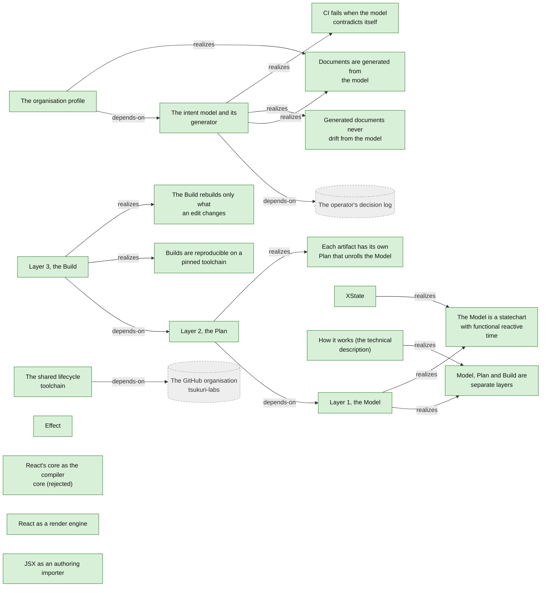

<!-- Generated by tools/intent from model/. Do not edit by hand: change the model and run `bun run generate`. -->

# Technical Components and Requirements Model

The Technical Components and Requirements Model says how: the components, the requirements they realize and the goals they serve. The first diagram of each scope shows structure; the second traces each component, requirement and IS goal to the goals it serves.

Method: 4EM (Sandkuhl, Stirna, Persson and Wißotzki, *Enterprise Modeling: Tackling Business Challenges with the 4EM Method*, Springer 2014). Every element cites its source; `decided` means a source shows that the operator decided it.

## The organisation

20 elements: 20 decided, 0 proposed, 0 open.

```mermaid
flowchart LR
    classDef decided fill:#d8f0d8,stroke:#2d7a2d,color:#111
    classDef proposed fill:#fff3c4,stroke:#a07800,color:#111
    classDef open fill:#f8d7d7,stroke:#a02020,color:#111
    classDef outside fill:#eee,stroke:#999,color:#333,stroke-dasharray:4 3
    isgoal_org_docs_generated_from_model["Documents are generated from<br/>the model"]:::decided
    req_org_intent_checks["CI fails when the model<br/>contradicts itself"]:::decided
    req_org_model_drift["Generated documents never<br/>drift from the model"]:::decided
    comp_org_intent_model["The intent model and its<br/>generator"]:::decided
    comp_org_profile["The organisation profile"]:::decided
    comp_org_lifecycle_toolchain["The shared lifecycle<br/>toolchain"]:::decided
    isgoal_org_three_layers["Model, Plan and Build are<br/>separate layers"]:::decided
    req_org_model_statechart_time["The Model is a statechart<br/>with functional reactive<br/>time"]:::decided
    req_org_plan_per_artifact["Each artifact has its own<br/>Plan that unrolls the Model"]:::decided
    req_org_build_incremental["The Build rebuilds only what<br/>an edit changes"]:::decided
    req_org_build_reproducible["Builds are reproducible on a<br/>pinned toolchain"]:::decided
    comp_org_layer_model["Layer 1, the Model"]:::decided
    comp_org_layer_plan["Layer 2, the Plan"]:::decided
    comp_org_layer_build["Layer 3, the Build"]:::decided
    comp_org_effect["Effect"]:::decided
    comp_org_xstate["XState"]:::decided
    comp_org_react_core_compiler["React's core as the compiler<br/>core (rejected)"]:::decided
    comp_org_react_render_engine["React as a render engine"]:::decided
    comp_org_jsx_importer["JSX as an authoring importer"]:::decided
    comp_org_how_it_works["How it works (the technical<br/>description)"]:::decided
    goal_org_written_intent("Intent written down, sourced<br/>and testable"):::outside
    goal_org_correctness_by_construction("Correctness by construction"):::outside
    goal_org_vision("Multimedia that authors<br/>declare and tools rebuild"):::outside
    goal_org_declarative_creation("Declare scenes and<br/>transitions, not build steps"):::outside
    goal_org_reproducible_builds("Reproducible builds"):::outside
    goal_org_incremental_builds("Fast, incremental, reactive<br/>builds"):::outside
    goal_org_interactive_multimedia("Interactive multimedia for<br/>learning"):::outside
    goal_org_accessible_artifacts("Accessible artifacts for<br/>every audience"):::outside
    goal_org_stay_on_supported_stack("Stay on supported Effect<br/>APIs and fix problems<br/>upstream"):::outside
    goal_org_modular_extensible("Modular and extensible by<br/>users"):::outside
    isgoal_org_docs_generated_from_model -->|supports| goal_org_written_intent
    req_org_intent_checks -->|serves| goal_org_written_intent
    req_org_model_drift -->|serves| goal_org_written_intent
    req_org_model_drift -->|serves| goal_org_correctness_by_construction
    comp_org_intent_model -->|serves| goal_org_written_intent
    comp_org_profile -->|serves| goal_org_vision
    comp_org_profile -->|serves| goal_org_written_intent
    comp_org_lifecycle_toolchain -->|serves| goal_org_correctness_by_construction
    isgoal_org_three_layers -->|supports| goal_org_declarative_creation
    isgoal_org_three_layers -->|supports| goal_org_reproducible_builds
    isgoal_org_three_layers -->|supports| goal_org_incremental_builds
    req_org_model_statechart_time -->|serves| goal_org_declarative_creation
    req_org_model_statechart_time -->|serves| goal_org_interactive_multimedia
    req_org_plan_per_artifact -->|serves| goal_org_accessible_artifacts
    req_org_plan_per_artifact -->|serves| goal_org_interactive_multimedia
    req_org_build_incremental -->|serves| goal_org_incremental_builds
    req_org_build_reproducible -->|serves| goal_org_reproducible_builds
    comp_org_layer_model -->|serves| goal_org_declarative_creation
    comp_org_layer_model -->|serves| goal_org_interactive_multimedia
    comp_org_layer_plan -->|serves| goal_org_accessible_artifacts
    comp_org_layer_plan -->|serves| goal_org_interactive_multimedia
    comp_org_layer_build -->|serves| goal_org_reproducible_builds
    comp_org_layer_build -->|serves| goal_org_incremental_builds
    comp_org_effect -->|serves| goal_org_correctness_by_construction
    comp_org_effect -->|serves| goal_org_stay_on_supported_stack
    comp_org_xstate -->|serves| goal_org_declarative_creation
    comp_org_react_render_engine -->|serves| goal_org_modular_extensible
    comp_org_jsx_importer -->|serves| goal_org_modular_extensible
    comp_org_how_it_works -->|serves| goal_org_vision
```

| Element | Statement | Status | Links | Sources |
| --- | --- | --- | --- | --- |
| <code>isgoal-org-docs-generated-from-model</code> Information system goal | **Documents are generated from the model.** The organisation profile, the sub-model pages, the product pages, the canvas, the roadmap and the gap report are generated from the model. No one edits them by hand. | decided | supports: [Intent written down, sourced and testable](goals.md#goal-org-written-intent) | [log L54][1], [log L118][2] |
| <code>req-org-intent-checks</code> Requirement | **CI fails when the model contradicts itself.** CI fails on a goal with no support, a component that serves no goal, a rule that cites no goal, an element with no source, and a "decided" element whose source is not an operator decision. | decided | serves: [Intent written down, sourced and testable](goals.md#goal-org-written-intent) | [log L54][1], [log L118][2] |
| <code>req-org-model-drift</code> Requirement | **Generated documents never drift from the model.** A test fails when a committed generated document differs from what the generator makes from the model. Quality: maintainability. Scenario: Someone edits a generated page by hand. The drift test fails in CI and names the page. | decided | serves: [Intent written down, sourced and testable](goals.md#goal-org-written-intent), [Correctness by construction](goals.md#goal-org-correctness-by-construction) | [log L54][1], [log L118][2] |
| <code>comp-org-intent-model</code> Technical component | **The intent model and its generator.** The YAML model in `model/`, its Effect Schema, the checks and the Bun generator in `tools/intent`. It is the only hand-written source of this repository's documents. Tier: tool. Where: `tools/intent`. Licence: Apache-2.0. | decided | serves: [Intent written down, sourced and testable](goals.md#goal-org-written-intent); realizes: [CI fails when the model contradicts itself](technical-components.md#req-org-intent-checks), [Generated documents never drift from the model](technical-components.md#req-org-model-drift), [Documents are generated from the model](technical-components.md#isgoal-org-docs-generated-from-model); depends-on: [The operator's decision log](actors-and-resources.md#resource-decision-log) | [log L3][3], [log L118][2] |
| <code>comp-org-profile</code> Technical component | **The organisation profile.** `profile/README.md` is the page that visitors see on the tsukuri organisation: vision, tagline, the product family, status and roadmap links. Tier: artifact. Where: `profile/README.md`. Licence: Apache-2.0. | decided | serves: [Multimedia that authors declare and tools rebuild](goals.md#goal-org-vision), [Intent written down, sourced and testable](goals.md#goal-org-written-intent); realizes: [Documents are generated from the model](technical-components.md#isgoal-org-docs-generated-from-model); depends-on: [The intent model and its generator](technical-components.md#comp-org-intent-model) | [log L7][4], [log L118][2] |
| <code>comp-org-lifecycle-toolchain</code> Technical component | **The shared lifecycle toolchain.** Git hooks, commitlint, gitleaks, the review and merge scripts and the CI workflow stay as copies in each of the four repositories, with a provenance record. A drift test in `tsukuri-labs/.github` compares blob hashes of the files that should be identical and fails on a difference; unifying the copies stays manual. Tier: process-asset. | decided | serves: [Correctness by construction](goals.md#goal-org-correctness-by-construction); depends-on: [The GitHub organisation tsukuri-labs](actors-and-resources.md#resource-github-org) | [log L80][5], [studio:PROVENANCE.md:3][6], [foldkit-flow:PROVENANCE.md:3][7] |
| <code>isgoal-org-three-layers</code> Information system goal | **Model, Plan and Build are separate layers.** The system keeps three layers apart: a Model that holds the story, a Plan that unrolls it for one artifact, and a Build that makes the artifact incrementally. | decided | supports: [Declare scenes and transitions, not build steps](goals.md#goal-org-declarative-creation), [Reproducible builds](goals.md#goal-org-reproducible-builds), [Fast, incremental, reactive builds](goals.md#goal-org-incremental-builds) | [log L62][8] |
| <code>req-org-model-statechart-time</code> Requirement | **The Model is a statechart with functional reactive time.** The Model is a statechart plus FRP and SMIL time. It may contain cycles, such as interactive loops and repeats. | decided | serves: [Declare scenes and transitions, not build steps](goals.md#goal-org-declarative-creation), [Interactive multimedia for learning](goals.md#goal-org-interactive-multimedia) | [log L62][8], [log L24][9] |
| <code>req-org-plan-per-artifact</code> Requirement | **Each artifact has its own Plan that unrolls the Model.** The Plan of a video is a linear timeline. The Plan of a deck is steps. The Plan of a website is a navigable graph. | decided | serves: [Accessible artifacts for every audience](goals.md#goal-org-accessible-artifacts), [Interactive multimedia for learning](goals.md#goal-org-interactive-multimedia) | [log L62][8], [log L37][10] |
| <code>req-org-build-incremental</code> Requirement | **The Build rebuilds only what an edit changes.** The Build is an incremental graph with dynamic dependencies and early cutoff. Quality: performance. Scenario: An author edits one line of narration. Only that line is re-synthesised, the plan verdict returns without pixels, and pixel reuse follows the spec for issue 9 (ADR-0000, merged). | decided | serves: [Fast, incremental, reactive builds](goals.md#goal-org-incremental-builds) | [log L62][8], [log L10][11], [issue tsukuri#9][12], [log L118][2] |
| <code>req-org-build-reproducible</code> Requirement | **Builds are reproducible on a pinned toolchain.** The Build keeps persistent traces that are addressed by content. Text and data artifacts are byte-identical across builds. For video, builds give identical decoded frames and audio samples on one machine with the pinned toolchain, and the container bytes are recorded. Quality: reproducibility. Scenario: The same story is built twice, once warm and once cold. The text and data artifacts are byte-identical; the video has identical decoded frames and audio samples, and its container bytes are recorded. | decided | serves: [Reproducible builds](goals.md#goal-org-reproducible-builds) | [log L81][13], [log L62][8], [log L10][11], [issue tsukuri#9][12] |
| <code>comp-org-layer-model</code> Technical component | **Layer 1, the Model.** The story as a statechart with functional reactive time: Scenes and States as nodes, Beats as transitions. It may contain cycles. Tier: layer. | decided | serves: [Declare scenes and transitions, not build steps](goals.md#goal-org-declarative-creation), [Interactive multimedia for learning](goals.md#goal-org-interactive-multimedia); realizes: [The Model is a statechart with functional reactive time](technical-components.md#req-org-model-statechart-time), [Model, Plan and Build are separate layers](technical-components.md#isgoal-org-three-layers) | [log L62][8], [log L19][14] |
| <code>comp-org-layer-plan</code> Technical component | **Layer 2, the Plan.** The unrolling of the Model for one artifact: a timeline for video, steps for a deck, a navigable graph for a website. Tier: layer. | decided | serves: [Accessible artifacts for every audience](goals.md#goal-org-accessible-artifacts), [Interactive multimedia for learning](goals.md#goal-org-interactive-multimedia); realizes: [Each artifact has its own Plan that unrolls the Model](technical-components.md#req-org-plan-per-artifact); depends-on: [Layer 1, the Model](technical-components.md#comp-org-layer-model) | [log L62][8] |
| <code>comp-org-layer-build</code> Technical component | **Layer 3, the Build.** An incremental build graph (a DAG) with dynamic dependencies, early cutoff and content-addressed persistent traces, after Build Systems a la Carte (Mokhov, Mitchell and Peyton Jones, ICFP 2018). Only the build graph is a DAG. Tier: layer. | decided | serves: [Reproducible builds](goals.md#goal-org-reproducible-builds), [Fast, incremental, reactive builds](goals.md#goal-org-incremental-builds); realizes: [The Build rebuilds only what an edit changes](technical-components.md#req-org-build-incremental), [Builds are reproducible on a pinned toolchain](technical-components.md#req-org-build-reproducible); depends-on: [Layer 2, the Plan](technical-components.md#comp-org-layer-plan) | [log L62][8] |
| <code>comp-org-effect</code> Technical component | **Effect.** tsukuri is written in Effect. Packages that use unstable Effect APIs cap their version range below the next minor. Tier: external. Licence: MIT. | decided | serves: [Correctness by construction](goals.md#goal-org-correctness-by-construction), [Stay on supported Effect APIs and fix problems upstream](goals.md#goal-org-stay-on-supported-stack) | [log L60][15], [log L55][16] |
| <code>comp-org-xstate</code> Technical component | **XState.** XState v6 with its Effect integration may be a build-time dependency. The runtime is a build step. Tier: external. Licence: MIT. | decided | serves: [Declare scenes and transitions, not build steps](goals.md#goal-org-declarative-creation); realizes: [The Model is a statechart with functional reactive time](technical-components.md#req-org-model-statechart-time) | [log L26][17] |
| <code>comp-org-react-core-compiler</code> Technical component | **React's core as the compiler core (rejected).** The React reconciler and scheduler were considered as the compiler core and rejected. React stays possible as a render engine and JSX as an authoring importer. Tier: external. **Rejected alternative.** | decided |  | [log L64][18] |
| <code>comp-org-react-render-engine</code> Technical component | **React as a render engine.** React stays possible as one render engine among others, behind the render-engine contract. Tier: integration. | decided | serves: [Modular and extensible by users](goals.md#goal-org-modular-extensible) | [log L64][18], [log L28][19], [log L118][2] |
| <code>comp-org-jsx-importer</code> Technical component | **JSX as an authoring importer.** JSX stays possible as an authoring importer that reads JSX and writes the IR. Tier: integration. | decided | serves: [Modular and extensible by users](goals.md#goal-org-modular-extensible) | [log L64][18], [log L118][2] |
| <code>comp-org-how-it-works</code> Technical component | **How it works (the technical description).** A note in the tsukuri repository that explains, for technical readers, how the qualities come from the mechanisms: the Model, Plan and Build layers, Effect and XState, prior art, the novelty claim and why React's core was rejected. Tier: artifact. | decided | serves: [Multimedia that authors declare and tools rebuild](goals.md#goal-org-vision); realizes: [Model, Plan and Build are separate layers](technical-components.md#isgoal-org-three-layers) | [log L58-65][20], [pr tsukuri#24][21], [log L118][2] |

## tsukuri (the compiler)

66 elements: 61 decided, 5 proposed, 0 open.

```mermaid
flowchart LR
    classDef decided fill:#d8f0d8,stroke:#2d7a2d,color:#111
    classDef proposed fill:#fff3c4,stroke:#a07800,color:#111
    classDef open fill:#f8d7d7,stroke:#a02020,color:#111
    classDef outside fill:#eee,stroke:#999,color:#333,stroke-dasharray:4 3
    comp_tsukuri_product["tsukuri, the open compiler"]:::decided
    comp_tsukuri_core["core, from screenplay to<br/>Plan and Timeline"]:::decided
    comp_tsukuri_subtitles["subtitles, WebVTT and SubRip<br/>writers"]:::decided
    comp_tsukuri_lint["lint, pure rules over a Plan"]:::decided
    comp_tsukuri_services["services, the seven<br/>contracts"]:::decided
    comp_tsukuri_pipeline["pipeline, the build program"]:::decided
    comp_tsukuri_speech_kokoro["speech-kokoro, local speech<br/>synthesis"]:::decided
    comp_tsukuri_align_whisper["align-whisper, word<br/>alignment"]:::decided
    comp_tsukuri_sounds_synth["sounds-synth, built-in sound<br/>effects"]:::decided
    comp_tsukuri_render_reveal["render-reveal, the Deck<br/>renderer"]:::decided
    comp_tsukuri_capture_chromium["capture-chromium, frame<br/>capture"]:::decided
    comp_tsukuri_encode_ffmpeg["encode-ffmpeg, mix and mux"]:::decided
    comp_tsukuri_cache_fs["cache-fs, the<br/>content-addressed cache"]:::decided
    comp_tsukuri_verify["verify, the output-side<br/>checks"]:::decided
    comp_tsukuri_cli["cli, the tsukuri command"]:::decided
    comp_tsukuri_quality_gates["quality gates, the<br/>repository checks"]:::decided
    comp_tsukuri_statechart_xstate["statechart-xstate, the<br/>build-time interpreter"]:::decided
    comp_tsukuri_website_renderer["website renderer, a planned<br/>artifact renderer"]:::proposed
    comp_tsukuri_plan_json["plan.json, the one input of<br/>the renderers"]:::decided
    comp_tsukuri_build_manifest["build.json, the build<br/>manifest"]:::decided
    comp_tsukuri_deck_output["deck.html, the Deck artifact"]:::decided
    comp_tsukuri_video_output["the MP4 Video artifact"]:::decided
    comp_tsukuri_grammar_doc["The generated effects<br/>grammar document"]:::decided
    comp_tsukuri_ci_workflow["The CI workflow"]:::decided
    comp_tsukuri_review_skills["The review and pull request<br/>skills"]:::decided
    comp_tsukuri_exception_registry["The suppression registry"]:::decided
    isgoal_tsukuri_one_source["One declared story yields<br/>every rendering"]:::proposed
    isgoal_tsukuri_replaceable_pieces["Every piece can be replaced<br/>one by one"]:::decided
    isgoal_tsukuri_verifiable_output["The system can prove what it<br/>built"]:::decided
    isgoal_tsukuri_visible_provenance["The manifest records<br/>provenance"]:::decided
    isgoal_tsukuri_agent_usable["An agent can write and<br/>repair a story"]:::decided
    req_tsukuri_plan["Print a reviewable Plan"]:::decided
    req_tsukuri_deck["Build a Deck from the Plan"]:::decided
    req_tsukuri_video["Build a narrated Video from<br/>the Plan"]:::decided
    req_tsukuri_fountain_artifact_renderer["Write a story as a Fountain<br/>screenplay"]:::proposed
    req_tsukuri_check["Check a build against its<br/>source"]:::decided
    req_tsukuri_lint["Lint a story and say the fix"]:::decided
    req_tsukuri_selection["Select adapters by<br/>configuration"]:::decided
    req_tsukuri_speech_cache["Cache speech by content"]:::decided
    req_tsukuri_journey["One command runs the whole<br/>road"]:::decided
    req_tsukuri_renderer_lifecycle["A renderer declares its<br/>lifecycle timing"]:::decided
    req_tsukuri_statechart_interpreter["Interpreters pass one<br/>contract suite"]:::decided
    req_tsukuri_state_machines["Explicit state machines and<br/>timing combinators"]:::proposed
    req_tsukuri_accessible_variants["Generate captions, audio<br/>description and reduced<br/>motion"]:::decided
    req_tsukuri_readable_subtitles["Subtitles stay readable"]:::decided
    req_tsukuri_language_variants["Build one story in several<br/>narration languages"]:::decided
    req_tsukuri_render_segment_cache["Cache render segments"]:::decided
    req_tsukuri_website_artifact["Emit a static interactive<br/>website"]:::proposed
    req_tsukuri_interaction_declaration["One interaction declaration<br/>for every surface"]:::decided
    req_tsukuri_renderer_capabilities["Renderers declare what they<br/>can realise"]:::decided
    req_tsukuri_teaching_lint["Lint temporal contiguity,<br/>signalling, redundancy and<br/>coherence"]:::decided
    req_tsukuri_npm_prerelease["Publish only built, audited<br/>packages"]:::decided
    req_tsukuri_encoder_reproducible["Any chosen encoder keeps<br/>decoded output identical"]:::decided
    req_tsukuri_exception_directives["The exception gate counts<br/>@effect-diagnostics comments"]:::decided
    req_tsukuri_pin_bun["Pin the package manager to<br/>the devenv Bun"]:::decided
    req_tsukuri_nfr_reproducibility["Two builds are identical"]:::decided
    req_tsukuri_nfr_accessibility["Artifacts serve different<br/>audiences"]:::decided
    req_tsukuri_nfr_timing["Effects appear within one<br/>frame of their anchor"]:::decided
    req_tsukuri_nfr_tier_gate["The package direction is<br/>enforced by a gate"]:::decided
    req_tsukuri_nfr_extensibility["A new adapter needs no core<br/>change"]:::decided
    req_tsukuri_nfr_licensing["Licences are checked before<br/>a dependency lands"]:::decided
    req_tsukuri_nfr_usability["Errors say how to fix the<br/>source"]:::decided
    req_tsukuri_nfr_reliability["A failed build leaves no<br/>accepted output"]:::decided
    req_tsukuri_nfr_security["Credentials never reach<br/>outputs"]:::decided
    req_tsukuri_nfr_incremental["An edit rebuilds only what<br/>it changes"]:::decided
    req_tsukuri_nfr_portability["Release 1 runs on Linux<br/>inside devenv"]:::decided
    comp_org_effect["Effect"]:::outside
    comp_org_layer_model["Layer 1, the Model"]:::outside
    comp_org_layer_plan["Layer 2, the Plan"]:::outside
    resource_tsukuri_fountain_format[("The Fountain screenplay<br/>format")]:::outside
    comp_org_layer_build["Layer 3, the Build"]:::outside
    resource_tsukuri_kokoro_model[("Kokoro speech model")]:::outside
    resource_tsukuri_whisper_cpp[("whisper.cpp")]:::outside
    resource_tsukuri_whisper_model[("Whisper base English model")]:::outside
    resource_tsukuri_reveal_js[("reveal.js")]:::outside
    resource_tsukuri_chromium[("Chromium")]:::outside
    resource_tsukuri_ffmpeg[("ffmpeg and ffprobe")]:::outside
    comp_org_xstate["XState"]:::outside
    comp_tsukuri_product -->|depends-on| comp_org_effect
    comp_tsukuri_core -->|part-of| comp_tsukuri_product
    comp_tsukuri_core -->|part-of| comp_org_layer_model
    comp_tsukuri_core -->|part-of| comp_org_layer_plan
    comp_tsukuri_core -->|depends-on| comp_org_effect
    comp_tsukuri_core -->|depends-on| resource_tsukuri_fountain_format
    comp_tsukuri_core -->|realizes| req_tsukuri_plan
    comp_tsukuri_core -->|realizes| req_tsukuri_nfr_timing
    comp_tsukuri_core -->|realizes| req_tsukuri_nfr_usability
    comp_tsukuri_subtitles -->|part-of| comp_tsukuri_product
    comp_tsukuri_subtitles -->|part-of| comp_org_layer_plan
    comp_tsukuri_subtitles -->|depends-on| comp_org_effect
    comp_tsukuri_subtitles -->|depends-on| comp_tsukuri_core
    comp_tsukuri_subtitles -->|realizes| req_tsukuri_nfr_accessibility
    comp_tsukuri_lint -->|part-of| comp_tsukuri_product
    comp_tsukuri_lint -->|part-of| comp_org_layer_plan
    comp_tsukuri_lint -->|depends-on| comp_org_effect
    comp_tsukuri_lint -->|depends-on| comp_tsukuri_core
    comp_tsukuri_lint -->|realizes| req_tsukuri_lint
    comp_tsukuri_lint -->|realizes| req_tsukuri_nfr_usability
    comp_tsukuri_services -->|part-of| comp_tsukuri_product
    comp_tsukuri_services -->|part-of| comp_org_layer_build
    comp_tsukuri_services -->|depends-on| comp_org_effect
    comp_tsukuri_services -->|depends-on| comp_tsukuri_core
    comp_tsukuri_services -->|realizes| req_tsukuri_selection
    comp_tsukuri_services -->|realizes| req_tsukuri_renderer_lifecycle
    comp_tsukuri_services -->|realizes| req_tsukuri_nfr_extensibility
    comp_tsukuri_services -->|realizes| req_tsukuri_nfr_security
    comp_tsukuri_pipeline -->|part-of| comp_tsukuri_product
    comp_tsukuri_pipeline -->|part-of| comp_org_layer_build
    comp_tsukuri_pipeline -->|depends-on| comp_org_effect
    comp_tsukuri_pipeline -->|depends-on| comp_tsukuri_core
    comp_tsukuri_pipeline -->|depends-on| comp_tsukuri_services
    comp_tsukuri_pipeline -->|depends-on| comp_tsukuri_subtitles
    comp_tsukuri_pipeline -->|realizes| req_tsukuri_deck
    comp_tsukuri_pipeline -->|realizes| req_tsukuri_video
    comp_tsukuri_pipeline -->|realizes| req_tsukuri_nfr_reliability
    comp_tsukuri_speech_kokoro -->|part-of| comp_tsukuri_product
    comp_tsukuri_speech_kokoro -->|part-of| comp_org_layer_build
    comp_tsukuri_speech_kokoro -->|depends-on| comp_org_effect
    comp_tsukuri_speech_kokoro -->|depends-on| comp_tsukuri_services
    comp_tsukuri_speech_kokoro -->|depends-on| resource_tsukuri_kokoro_model
    comp_tsukuri_speech_kokoro -->|realizes| req_tsukuri_speech_cache
    comp_tsukuri_align_whisper -->|part-of| comp_tsukuri_product
    comp_tsukuri_align_whisper -->|part-of| comp_org_layer_build
    comp_tsukuri_align_whisper -->|depends-on| comp_org_effect
    comp_tsukuri_align_whisper -->|depends-on| comp_tsukuri_core
    comp_tsukuri_align_whisper -->|depends-on| comp_tsukuri_services
    comp_tsukuri_align_whisper -->|depends-on| resource_tsukuri_whisper_cpp
    comp_tsukuri_align_whisper -->|depends-on| resource_tsukuri_whisper_model
    comp_tsukuri_align_whisper -->|realizes| req_tsukuri_speech_cache
    comp_tsukuri_sounds_synth -->|part-of| comp_tsukuri_product
    comp_tsukuri_sounds_synth -->|part-of| comp_org_layer_build
    comp_tsukuri_sounds_synth -->|depends-on| comp_org_effect
    comp_tsukuri_sounds_synth -->|depends-on| comp_tsukuri_core
    comp_tsukuri_sounds_synth -->|depends-on| comp_tsukuri_services
    comp_tsukuri_sounds_synth -->|realizes| req_tsukuri_video
    comp_tsukuri_render_reveal -->|part-of| comp_tsukuri_product
    comp_tsukuri_render_reveal -->|part-of| comp_org_layer_plan
    comp_tsukuri_render_reveal -->|depends-on| comp_org_effect
    comp_tsukuri_render_reveal -->|depends-on| comp_tsukuri_core
    comp_tsukuri_render_reveal -->|depends-on| comp_tsukuri_lint
    comp_tsukuri_render_reveal -->|depends-on| comp_tsukuri_services
    comp_tsukuri_render_reveal -->|depends-on| resource_tsukuri_reveal_js
    comp_tsukuri_render_reveal -->|realizes| req_tsukuri_deck
    comp_tsukuri_render_reveal -->|realizes| req_tsukuri_renderer_lifecycle
    comp_tsukuri_render_reveal -->|realizes| req_tsukuri_nfr_accessibility
    comp_tsukuri_capture_chromium -->|part-of| comp_tsukuri_product
    comp_tsukuri_capture_chromium -->|part-of| comp_org_layer_build
    comp_tsukuri_capture_chromium -->|depends-on| comp_org_effect
    comp_tsukuri_capture_chromium -->|depends-on| comp_tsukuri_core
    comp_tsukuri_capture_chromium -->|depends-on| comp_tsukuri_services
    comp_tsukuri_capture_chromium -->|depends-on| resource_tsukuri_chromium
    comp_tsukuri_capture_chromium -->|realizes| req_tsukuri_video
    comp_tsukuri_capture_chromium -->|realizes| req_tsukuri_nfr_reproducibility
    comp_tsukuri_encode_ffmpeg -->|part-of| comp_tsukuri_product
    comp_tsukuri_encode_ffmpeg -->|part-of| comp_org_layer_build
    comp_tsukuri_encode_ffmpeg -->|depends-on| comp_org_effect
    comp_tsukuri_encode_ffmpeg -->|depends-on| comp_tsukuri_services
    comp_tsukuri_encode_ffmpeg -->|depends-on| resource_tsukuri_ffmpeg
    comp_tsukuri_encode_ffmpeg -->|realizes| req_tsukuri_video
    comp_tsukuri_encode_ffmpeg -->|realizes| req_tsukuri_nfr_reproducibility
    comp_tsukuri_cache_fs -->|part-of| comp_tsukuri_product
    comp_tsukuri_cache_fs -->|part-of| comp_org_layer_build
    comp_tsukuri_cache_fs -->|depends-on| comp_org_effect
    comp_tsukuri_cache_fs -->|depends-on| comp_tsukuri_services
    comp_tsukuri_cache_fs -->|realizes| req_tsukuri_speech_cache
    comp_tsukuri_cache_fs -->|realizes| req_tsukuri_nfr_reproducibility
    comp_tsukuri_verify -->|part-of| comp_tsukuri_product
    comp_tsukuri_verify -->|part-of| comp_org_layer_build
    comp_tsukuri_verify -->|depends-on| comp_org_effect
    comp_tsukuri_verify -->|depends-on| comp_tsukuri_core
    comp_tsukuri_verify -->|depends-on| comp_tsukuri_encode_ffmpeg
    comp_tsukuri_verify -->|depends-on| comp_tsukuri_lint
    comp_tsukuri_verify -->|depends-on| comp_tsukuri_pipeline
    comp_tsukuri_verify -->|depends-on| comp_tsukuri_render_reveal
    comp_tsukuri_verify -->|depends-on| comp_tsukuri_services
    comp_tsukuri_verify -->|depends-on| comp_tsukuri_sounds_synth
    comp_tsukuri_verify -->|depends-on| comp_tsukuri_subtitles
    comp_tsukuri_verify -->|realizes| req_tsukuri_check
    comp_tsukuri_verify -->|realizes| req_tsukuri_nfr_timing
    comp_tsukuri_verify -->|realizes| req_tsukuri_nfr_reproducibility
    comp_tsukuri_cli -->|part-of| comp_tsukuri_product
    comp_tsukuri_cli -->|part-of| comp_org_layer_build
    comp_tsukuri_cli -->|depends-on| comp_org_effect
    comp_tsukuri_cli -->|depends-on| comp_tsukuri_align_whisper
    comp_tsukuri_cli -->|depends-on| comp_tsukuri_cache_fs
    comp_tsukuri_cli -->|depends-on| comp_tsukuri_capture_chromium
    comp_tsukuri_cli -->|depends-on| comp_tsukuri_core
    comp_tsukuri_cli -->|depends-on| comp_tsukuri_encode_ffmpeg
    comp_tsukuri_cli -->|depends-on| comp_tsukuri_lint
    comp_tsukuri_cli -->|depends-on| comp_tsukuri_pipeline
    comp_tsukuri_cli -->|depends-on| comp_tsukuri_render_reveal
    comp_tsukuri_cli -->|depends-on| comp_tsukuri_services
    comp_tsukuri_cli -->|depends-on| comp_tsukuri_sounds_synth
    comp_tsukuri_cli -->|depends-on| comp_tsukuri_speech_kokoro
    comp_tsukuri_cli -->|depends-on| comp_tsukuri_verify
    comp_tsukuri_cli -->|realizes| req_tsukuri_plan
    comp_tsukuri_cli -->|realizes| req_tsukuri_lint
    comp_tsukuri_cli -->|realizes| req_tsukuri_check
    comp_tsukuri_cli -->|realizes| req_tsukuri_selection
    comp_tsukuri_cli -->|realizes| req_tsukuri_journey
    comp_tsukuri_quality_gates -->|part-of| comp_tsukuri_product
    comp_tsukuri_quality_gates -->|depends-on| comp_org_effect
    comp_tsukuri_quality_gates -->|realizes| req_tsukuri_nfr_tier_gate
    comp_tsukuri_quality_gates -->|realizes| req_tsukuri_nfr_licensing
    comp_tsukuri_statechart_xstate -->|part-of| comp_tsukuri_product
    comp_tsukuri_statechart_xstate -->|part-of| comp_org_layer_plan
    comp_tsukuri_statechart_xstate -->|depends-on| comp_org_xstate
    comp_tsukuri_statechart_xstate -->|depends-on| comp_org_effect
    comp_tsukuri_statechart_xstate -->|depends-on| comp_tsukuri_services
    comp_tsukuri_statechart_xstate -->|realizes| req_tsukuri_statechart_interpreter
    comp_tsukuri_website_renderer -->|part-of| comp_tsukuri_product
    comp_tsukuri_website_renderer -->|part-of| comp_org_layer_plan
    comp_tsukuri_website_renderer -->|depends-on| comp_org_effect
    comp_tsukuri_website_renderer -->|depends-on| comp_tsukuri_services
    comp_tsukuri_website_renderer -->|realizes| req_tsukuri_website_artifact
    comp_tsukuri_website_renderer -->|realizes| req_tsukuri_interaction_declaration
    comp_tsukuri_plan_json -->|part-of| comp_tsukuri_product
    comp_tsukuri_build_manifest -->|part-of| comp_tsukuri_product
    comp_tsukuri_build_manifest -->|realizes| isgoal_tsukuri_visible_provenance
    comp_tsukuri_deck_output -->|part-of| comp_tsukuri_product
    comp_tsukuri_video_output -->|part-of| comp_tsukuri_product
    comp_tsukuri_grammar_doc -->|part-of| comp_tsukuri_product
    comp_tsukuri_ci_workflow -->|part-of| comp_tsukuri_product
    comp_tsukuri_review_skills -->|part-of| comp_tsukuri_product
    comp_tsukuri_exception_registry -->|part-of| comp_tsukuri_quality_gates
```

```mermaid
flowchart LR
    classDef decided fill:#d8f0d8,stroke:#2d7a2d,color:#111
    classDef proposed fill:#fff3c4,stroke:#a07800,color:#111
    classDef open fill:#f8d7d7,stroke:#a02020,color:#111
    classDef outside fill:#eee,stroke:#999,color:#333,stroke-dasharray:4 3
    comp_tsukuri_product["tsukuri, the open compiler"]:::decided
    comp_tsukuri_core["core, from screenplay to<br/>Plan and Timeline"]:::decided
    comp_tsukuri_subtitles["subtitles, WebVTT and SubRip<br/>writers"]:::decided
    comp_tsukuri_lint["lint, pure rules over a Plan"]:::decided
    comp_tsukuri_services["services, the seven<br/>contracts"]:::decided
    comp_tsukuri_pipeline["pipeline, the build program"]:::decided
    comp_tsukuri_speech_kokoro["speech-kokoro, local speech<br/>synthesis"]:::decided
    comp_tsukuri_align_whisper["align-whisper, word<br/>alignment"]:::decided
    comp_tsukuri_sounds_synth["sounds-synth, built-in sound<br/>effects"]:::decided
    comp_tsukuri_render_reveal["render-reveal, the Deck<br/>renderer"]:::decided
    comp_tsukuri_capture_chromium["capture-chromium, frame<br/>capture"]:::decided
    comp_tsukuri_encode_ffmpeg["encode-ffmpeg, mix and mux"]:::decided
    comp_tsukuri_cache_fs["cache-fs, the<br/>content-addressed cache"]:::decided
    comp_tsukuri_verify["verify, the output-side<br/>checks"]:::decided
    comp_tsukuri_cli["cli, the tsukuri command"]:::decided
    comp_tsukuri_quality_gates["quality gates, the<br/>repository checks"]:::decided
    comp_tsukuri_statechart_xstate["statechart-xstate, the<br/>build-time interpreter"]:::decided
    comp_tsukuri_website_renderer["website renderer, a planned<br/>artifact renderer"]:::proposed
    comp_tsukuri_plan_json["plan.json, the one input of<br/>the renderers"]:::decided
    comp_tsukuri_build_manifest["build.json, the build<br/>manifest"]:::decided
    comp_tsukuri_deck_output["deck.html, the Deck artifact"]:::decided
    comp_tsukuri_video_output["the MP4 Video artifact"]:::decided
    comp_tsukuri_grammar_doc["The generated effects<br/>grammar document"]:::decided
    comp_tsukuri_ci_workflow["The CI workflow"]:::decided
    comp_tsukuri_review_skills["The review and pull request<br/>skills"]:::decided
    comp_tsukuri_exception_registry["The suppression registry"]:::decided
    isgoal_tsukuri_one_source["One declared story yields<br/>every rendering"]:::proposed
    isgoal_tsukuri_replaceable_pieces["Every piece can be replaced<br/>one by one"]:::decided
    isgoal_tsukuri_verifiable_output["The system can prove what it<br/>built"]:::decided
    isgoal_tsukuri_visible_provenance["The manifest records<br/>provenance"]:::decided
    isgoal_tsukuri_agent_usable["An agent can write and<br/>repair a story"]:::decided
    req_tsukuri_plan["Print a reviewable Plan"]:::decided
    req_tsukuri_deck["Build a Deck from the Plan"]:::decided
    req_tsukuri_video["Build a narrated Video from<br/>the Plan"]:::decided
    req_tsukuri_fountain_artifact_renderer["Write a story as a Fountain<br/>screenplay"]:::proposed
    req_tsukuri_check["Check a build against its<br/>source"]:::decided
    req_tsukuri_lint["Lint a story and say the fix"]:::decided
    req_tsukuri_selection["Select adapters by<br/>configuration"]:::decided
    req_tsukuri_speech_cache["Cache speech by content"]:::decided
    req_tsukuri_journey["One command runs the whole<br/>road"]:::decided
    req_tsukuri_renderer_lifecycle["A renderer declares its<br/>lifecycle timing"]:::decided
    req_tsukuri_statechart_interpreter["Interpreters pass one<br/>contract suite"]:::decided
    req_tsukuri_state_machines["Explicit state machines and<br/>timing combinators"]:::proposed
    req_tsukuri_accessible_variants["Generate captions, audio<br/>description and reduced<br/>motion"]:::decided
    req_tsukuri_readable_subtitles["Subtitles stay readable"]:::decided
    req_tsukuri_language_variants["Build one story in several<br/>narration languages"]:::decided
    req_tsukuri_render_segment_cache["Cache render segments"]:::decided
    req_tsukuri_website_artifact["Emit a static interactive<br/>website"]:::proposed
    req_tsukuri_interaction_declaration["One interaction declaration<br/>for every surface"]:::decided
    req_tsukuri_renderer_capabilities["Renderers declare what they<br/>can realise"]:::decided
    req_tsukuri_teaching_lint["Lint temporal contiguity,<br/>signalling, redundancy and<br/>coherence"]:::decided
    req_tsukuri_npm_prerelease["Publish only built, audited<br/>packages"]:::decided
    req_tsukuri_encoder_reproducible["Any chosen encoder keeps<br/>decoded output identical"]:::decided
    req_tsukuri_exception_directives["The exception gate counts<br/>@effect-diagnostics comments"]:::decided
    req_tsukuri_pin_bun["Pin the package manager to<br/>the devenv Bun"]:::decided
    req_tsukuri_nfr_reproducibility["Two builds are identical"]:::decided
    req_tsukuri_nfr_accessibility["Artifacts serve different<br/>audiences"]:::decided
    req_tsukuri_nfr_timing["Effects appear within one<br/>frame of their anchor"]:::decided
    req_tsukuri_nfr_tier_gate["The package direction is<br/>enforced by a gate"]:::decided
    req_tsukuri_nfr_extensibility["A new adapter needs no core<br/>change"]:::decided
    req_tsukuri_nfr_licensing["Licences are checked before<br/>a dependency lands"]:::decided
    req_tsukuri_nfr_usability["Errors say how to fix the<br/>source"]:::decided
    req_tsukuri_nfr_reliability["A failed build leaves no<br/>accepted output"]:::decided
    req_tsukuri_nfr_security["Credentials never reach<br/>outputs"]:::decided
    req_tsukuri_nfr_incremental["An edit rebuilds only what<br/>it changes"]:::decided
    req_tsukuri_nfr_portability["Release 1 runs on Linux<br/>inside devenv"]:::decided
    goal_tsukuri_vision("Declare the story, tsukuri<br/>builds the artifacts"):::outside
    goal_tsukuri_screenplay_first("One screenplay, every<br/>rendering"):::outside
    goal_tsukuri_statechart_model("Declare the implicit state<br/>machine explicitly"):::outside
    goal_tsukuri_accessible_artifacts("Accessible artifacts for<br/>different audiences"):::outside
    goal_tsukuri_explicit_source("An explicit source nobody<br/>can misread"):::outside
    goal_tsukuri_plugin_sdk("Plugins and a render-engine<br/>SDK"):::outside
    goal_tsukuri_deck_and_video("A Deck and a Video from one<br/>source"):::outside
    goal_tsukuri_event_timing("Effects connect to produced<br/>events"):::outside
    goal_tsukuri_multi_renderer("Several render engines in<br/>one story"):::outside
    goal_tsukuri_reproducible_builds("Reproducible builds"):::outside
    goal_tsukuri_incremental_builds("Fast, incremental and<br/>reactive builds"):::outside
    goal_tsukuri_verified_output("Check the written files, not<br/>the pipeline's memory"):::outside
    goal_tsukuri_correct_by_construction("A compiler whose structure<br/>prevents bad states"):::outside
    goal_tsukuri_apache_licence("License the compiler and its<br/>formats under Apache-2.0"):::outside
    goal_tsukuri_interactive_website("An interactive website as an<br/>artifact type"):::outside
    goal_tsukuri_visible_egress("Every build says what leaves<br/>the machine"):::outside
    goal_tsukuri_localisation("One story, several narration<br/>languages"):::outside
    goal_tsukuri_teaching_lint("A teaching lint for<br/>explainer stories"):::outside
    goal_tsukuri_npm_publication("Publish @tsukuri packages to<br/>npm"):::outside
    comp_tsukuri_product -->|serves| goal_tsukuri_vision
    comp_tsukuri_core -->|serves| goal_tsukuri_screenplay_first
    comp_tsukuri_core -->|serves| goal_tsukuri_statechart_model
    comp_tsukuri_subtitles -->|serves| goal_tsukuri_accessible_artifacts
    comp_tsukuri_lint -->|serves| goal_tsukuri_explicit_source
    comp_tsukuri_services -->|serves| goal_tsukuri_plugin_sdk
    comp_tsukuri_pipeline -->|serves| goal_tsukuri_deck_and_video
    comp_tsukuri_speech_kokoro -->|serves| goal_tsukuri_deck_and_video
    comp_tsukuri_align_whisper -->|serves| goal_tsukuri_event_timing
    comp_tsukuri_sounds_synth -->|serves| goal_tsukuri_deck_and_video
    comp_tsukuri_render_reveal -->|serves| goal_tsukuri_deck_and_video
    comp_tsukuri_render_reveal -->|serves| goal_tsukuri_multi_renderer
    comp_tsukuri_capture_chromium -->|serves| goal_tsukuri_reproducible_builds
    comp_tsukuri_encode_ffmpeg -->|serves| goal_tsukuri_deck_and_video
    comp_tsukuri_cache_fs -->|serves| goal_tsukuri_incremental_builds
    comp_tsukuri_cache_fs -->|serves| goal_tsukuri_reproducible_builds
    comp_tsukuri_verify -->|serves| goal_tsukuri_verified_output
    comp_tsukuri_cli -->|serves| goal_tsukuri_vision
    comp_tsukuri_quality_gates -->|serves| goal_tsukuri_correct_by_construction
    comp_tsukuri_quality_gates -->|serves| goal_tsukuri_apache_licence
    comp_tsukuri_statechart_xstate -->|serves| goal_tsukuri_statechart_model
    comp_tsukuri_website_renderer -->|serves| goal_tsukuri_interactive_website
    comp_tsukuri_plan_json -->|serves| goal_tsukuri_screenplay_first
    comp_tsukuri_build_manifest -->|serves| goal_tsukuri_visible_egress
    comp_tsukuri_deck_output -->|serves| goal_tsukuri_deck_and_video
    comp_tsukuri_video_output -->|serves| goal_tsukuri_deck_and_video
    comp_tsukuri_video_output -->|serves| goal_tsukuri_accessible_artifacts
    comp_tsukuri_grammar_doc -->|serves| goal_tsukuri_explicit_source
    comp_tsukuri_ci_workflow -->|serves| goal_tsukuri_correct_by_construction
    comp_tsukuri_review_skills -->|serves| goal_tsukuri_correct_by_construction
    comp_tsukuri_exception_registry -->|serves| goal_tsukuri_correct_by_construction
    isgoal_tsukuri_one_source -->|serves| goal_tsukuri_screenplay_first
    isgoal_tsukuri_replaceable_pieces -->|serves| goal_tsukuri_plugin_sdk
    isgoal_tsukuri_verifiable_output -->|serves| goal_tsukuri_verified_output
    isgoal_tsukuri_visible_provenance -->|serves| goal_tsukuri_visible_egress
    isgoal_tsukuri_agent_usable -->|serves| goal_tsukuri_explicit_source
    isgoal_tsukuri_agent_usable -->|serves| goal_tsukuri_plugin_sdk
    req_tsukuri_plan -->|serves| goal_tsukuri_deck_and_video
    req_tsukuri_deck -->|serves| goal_tsukuri_deck_and_video
    req_tsukuri_video -->|serves| goal_tsukuri_deck_and_video
    req_tsukuri_fountain_artifact_renderer -->|serves| goal_tsukuri_screenplay_first
    req_tsukuri_check -->|serves| goal_tsukuri_verified_output
    req_tsukuri_lint -->|serves| goal_tsukuri_explicit_source
    req_tsukuri_selection -->|serves| goal_tsukuri_plugin_sdk
    req_tsukuri_selection -->|serves| goal_tsukuri_correct_by_construction
    req_tsukuri_speech_cache -->|serves| goal_tsukuri_reproducible_builds
    req_tsukuri_speech_cache -->|serves| goal_tsukuri_incremental_builds
    req_tsukuri_journey -->|serves| goal_tsukuri_verified_output
    req_tsukuri_journey -->|serves| goal_tsukuri_reproducible_builds
    req_tsukuri_renderer_lifecycle -->|serves| goal_tsukuri_event_timing
    req_tsukuri_renderer_lifecycle -->|serves| goal_tsukuri_multi_renderer
    req_tsukuri_statechart_interpreter -->|serves| goal_tsukuri_statechart_model
    req_tsukuri_state_machines -->|serves| goal_tsukuri_statechart_model
    req_tsukuri_accessible_variants -->|serves| goal_tsukuri_accessible_artifacts
    req_tsukuri_readable_subtitles -->|serves| goal_tsukuri_accessible_artifacts
    req_tsukuri_language_variants -->|serves| goal_tsukuri_localisation
    req_tsukuri_render_segment_cache -->|serves| goal_tsukuri_incremental_builds
    req_tsukuri_website_artifact -->|serves| goal_tsukuri_interactive_website
    req_tsukuri_interaction_declaration -->|serves| goal_tsukuri_interactive_website
    req_tsukuri_interaction_declaration -->|serves| goal_tsukuri_multi_renderer
    req_tsukuri_renderer_capabilities -->|serves| goal_tsukuri_multi_renderer
    req_tsukuri_renderer_capabilities -->|serves| goal_tsukuri_plugin_sdk
    req_tsukuri_teaching_lint -->|serves| goal_tsukuri_teaching_lint
    req_tsukuri_npm_prerelease -->|serves| goal_tsukuri_npm_publication
    req_tsukuri_encoder_reproducible -->|serves| goal_tsukuri_reproducible_builds
    req_tsukuri_exception_directives -->|serves| goal_tsukuri_correct_by_construction
    req_tsukuri_pin_bun -->|serves| goal_tsukuri_reproducible_builds
    req_tsukuri_nfr_reproducibility -->|serves| goal_tsukuri_reproducible_builds
    req_tsukuri_nfr_accessibility -->|serves| goal_tsukuri_accessible_artifacts
    req_tsukuri_nfr_timing -->|serves| goal_tsukuri_event_timing
    req_tsukuri_nfr_timing -->|serves| goal_tsukuri_verified_output
    req_tsukuri_nfr_tier_gate -->|serves| goal_tsukuri_correct_by_construction
    req_tsukuri_nfr_extensibility -->|serves| goal_tsukuri_plugin_sdk
    req_tsukuri_nfr_licensing -->|serves| goal_tsukuri_apache_licence
    req_tsukuri_nfr_usability -->|serves| goal_tsukuri_explicit_source
    req_tsukuri_nfr_reliability -->|serves| goal_tsukuri_correct_by_construction
    req_tsukuri_nfr_security -->|serves| goal_tsukuri_visible_egress
    req_tsukuri_nfr_incremental -->|serves| goal_tsukuri_incremental_builds
    req_tsukuri_nfr_portability -->|serves| goal_tsukuri_reproducible_builds
```

| Element | Statement | Status | Links | Sources |
| --- | --- | --- | --- | --- |
| <code>comp-tsukuri-product</code> Technical component | **tsukuri, the open compiler.** Semantically declared story beats, compiled into multimedia artifacts: statecharts for structure, functional reactive time, and an incremental build graph, written in Effect. The compiler and its formats are open source, and running them locally is free. Tier: product. Licence: Apache-2.0. | decided | serves: [Declare the story, tsukuri builds the artifacts](goals.md#goal-tsukuri-vision); depends-on: [Effect](technical-components.md#comp-org-effect) | [log L7][4], [log L60][15], [log L44][22], [log L43][23], [record tsukuri:docs/design/open-core-boundary.md:21][24], [record tsukuri:docs/design/open-core-boundary.md:39-44][25] |
| <code>comp-tsukuri-core</code> Technical component | **core, from screenplay to Plan and Timeline.** Pure code that parses a Fountain screenplay into a Story, runs the identity diff, builds the Plan, schedules the Timeline from aligned words, and prints the review text. It has no browser, ffmpeg, reveal.js or Node built-in. Tier: library. Where: `@tsukuri/core`. Licence: Apache-2.0. | decided | part-of: [tsukuri, the open compiler](technical-components.md#comp-tsukuri-product), [Layer 1, the Model](technical-components.md#comp-org-layer-model), [Layer 2, the Plan](technical-components.md#comp-org-layer-plan); depends-on: [Effect](technical-components.md#comp-org-effect), [The Fountain screenplay format](actors-and-resources.md#resource-tsukuri-fountain-format); realizes: [Print a reviewable Plan](technical-components.md#req-tsukuri-plan), [Effects appear within one frame of their anchor](technical-components.md#req-tsukuri-nfr-timing), [Errors say how to fix the source](technical-components.md#req-tsukuri-nfr-usability); serves: [One screenplay, every rendering](goals.md#goal-tsukuri-screenplay-first), [Declare the implicit state machine explicitly](goals.md#goal-tsukuri-statechart-model) | [tsukuri:docs/specs/0001-release-1-screenplay-to-deck-and-video.md:239][26], [tsukuri:packages/core/src/index.ts:1-2][27], [tsukuri:packages/core/package.json:5][28], [tsukuri:docs/design/open-core-boundary.md:39][29], [log L118][2] |
| <code>comp-tsukuri-subtitles</code> Technical component | **subtitles, WebVTT and SubRip writers.** Pure code that writes the narration of a scheduled Plan as WebVTT and SubRip, and reads WebVTT back into cues. Tier: library. Where: `@tsukuri/subtitles`. Licence: Apache-2.0. | decided | part-of: [tsukuri, the open compiler](technical-components.md#comp-tsukuri-product), [Layer 2, the Plan](technical-components.md#comp-org-layer-plan); depends-on: [Effect](technical-components.md#comp-org-effect), [core, from screenplay to Plan and Timeline](technical-components.md#comp-tsukuri-core); realizes: [Artifacts serve different audiences](technical-components.md#req-tsukuri-nfr-accessibility); serves: [Accessible artifacts for different audiences](goals.md#goal-tsukuri-accessible-artifacts) | [tsukuri:docs/specs/0001-release-1-screenplay-to-deck-and-video.md:240][30], [tsukuri:packages/subtitles/src/index.ts:1-2][31], [log L118][2] |
| <code>comp-tsukuri-lint</code> Technical component | **lint, pure rules over a Plan.** Pure rules that return diagnostics for a Plan: every absolute time needs a reason, contrast, and agreement of fragments with effects. The cross-reference checks live in the core, not here. Tier: library. Where: `@tsukuri/lint`. Licence: Apache-2.0. | decided | part-of: [tsukuri, the open compiler](technical-components.md#comp-tsukuri-product), [Layer 2, the Plan](technical-components.md#comp-org-layer-plan); depends-on: [Effect](technical-components.md#comp-org-effect), [core, from screenplay to Plan and Timeline](technical-components.md#comp-tsukuri-core); realizes: [Lint a story and say the fix](technical-components.md#req-tsukuri-lint), [Errors say how to fix the source](technical-components.md#req-tsukuri-nfr-usability); serves: [An explicit source nobody can misread](goals.md#goal-tsukuri-explicit-source) | [tsukuri:docs/specs/0001-release-1-screenplay-to-deck-and-video.md:241][32], [tsukuri:packages/lint/src/index.ts:1-4][33], [log L118][2] |
| <code>comp-tsukuri-services</code> Technical component | **services, the seven contracts.** The seven Effect service tags with their request types, tagged errors, the one cache key and the one selection registry. It also ships the contract suites and the offline stand-ins. This is the plugin seam. Tier: service. Where: `@tsukuri/services`. Licence: Apache-2.0. | decided | part-of: [tsukuri, the open compiler](technical-components.md#comp-tsukuri-product), [Layer 3, the Build](technical-components.md#comp-org-layer-build); depends-on: [Effect](technical-components.md#comp-org-effect), [core, from screenplay to Plan and Timeline](technical-components.md#comp-tsukuri-core); realizes: [Select adapters by configuration](technical-components.md#req-tsukuri-selection), [A renderer declares its lifecycle timing](technical-components.md#req-tsukuri-renderer-lifecycle), [A new adapter needs no core change](technical-components.md#req-tsukuri-nfr-extensibility), [Credentials never reach outputs](technical-components.md#req-tsukuri-nfr-security); serves: [Plugins and a render-engine SDK](goals.md#goal-tsukuri-plugin-sdk) | [tsukuri:docs/specs/0001-release-1-screenplay-to-deck-and-video.md:242][34], [tsukuri:packages/services/src/index.ts:1-3][35], [tsukuri:packages/services/package.json:22][36], [log L118][2] |
| <code>comp-tsukuri-pipeline</code> Technical component | **pipeline, the build program.** One Effect program over the seven services, from the story to a finished build directory, with the manifest schema. It names no model, browser, binary or directory. Tier: program. Where: `@tsukuri/pipeline`. Licence: Apache-2.0. | decided | part-of: [tsukuri, the open compiler](technical-components.md#comp-tsukuri-product), [Layer 3, the Build](technical-components.md#comp-org-layer-build); depends-on: [Effect](technical-components.md#comp-org-effect), [core, from screenplay to Plan and Timeline](technical-components.md#comp-tsukuri-core), [services, the seven contracts](technical-components.md#comp-tsukuri-services), [subtitles, WebVTT and SubRip writers](technical-components.md#comp-tsukuri-subtitles); realizes: [Build a Deck from the Plan](technical-components.md#req-tsukuri-deck), [Build a narrated Video from the Plan](technical-components.md#req-tsukuri-video), [A failed build leaves no accepted output](technical-components.md#req-tsukuri-nfr-reliability); serves: [A Deck and a Video from one source](goals.md#goal-tsukuri-deck-and-video) | [tsukuri:docs/specs/0001-release-1-screenplay-to-deck-and-video.md:243][37], [tsukuri:packages/pipeline/src/index.ts:1-2][38], [log L118][2] |
| <code>comp-tsukuri-speech-kokoro</code> Technical component | **speech-kokoro, local speech synthesis.** The SpeechSynthesizer adapter on `kokoro-js`. It runs locally, declares no egress, and has a silent stand-in. Tier: integration. Where: `@tsukuri/speech-kokoro`. Licence: Apache-2.0. | decided | part-of: [tsukuri, the open compiler](technical-components.md#comp-tsukuri-product), [Layer 3, the Build](technical-components.md#comp-org-layer-build); depends-on: [Effect](technical-components.md#comp-org-effect), [services, the seven contracts](technical-components.md#comp-tsukuri-services), [Kokoro speech model](actors-and-resources.md#resource-tsukuri-kokoro-model); realizes: [Cache speech by content](technical-components.md#req-tsukuri-speech-cache); serves: [A Deck and a Video from one source](goals.md#goal-tsukuri-deck-and-video) | [tsukuri:docs/specs/0001-release-1-screenplay-to-deck-and-video.md:244][39], [tsukuri:packages/speech-kokoro/src/index.ts:1][40], [log L118][2] |
| <code>comp-tsukuri-align-whisper</code> Technical component | **align-whisper, word alignment.** The WordAligner adapter on whisper.cpp. It gives word times for the narration, runs locally, and has an even-spread stand-in. Tier: integration. Where: `@tsukuri/align-whisper`. Licence: Apache-2.0. | decided | part-of: [tsukuri, the open compiler](technical-components.md#comp-tsukuri-product), [Layer 3, the Build](technical-components.md#comp-org-layer-build); depends-on: [Effect](technical-components.md#comp-org-effect), [core, from screenplay to Plan and Timeline](technical-components.md#comp-tsukuri-core), [services, the seven contracts](technical-components.md#comp-tsukuri-services), [whisper.cpp](actors-and-resources.md#resource-tsukuri-whisper-cpp), [Whisper base English model](actors-and-resources.md#resource-tsukuri-whisper-model); realizes: [Cache speech by content](technical-components.md#req-tsukuri-speech-cache); serves: [Effects connect to produced events](goals.md#goal-tsukuri-event-timing) | [tsukuri:docs/specs/0001-release-1-screenplay-to-deck-and-video.md:245][41], [tsukuri:packages/align-whisper/src/index.ts:1][42], [log L118][2] |
| <code>comp-tsukuri-sounds-synth</code> Technical component | **sounds-synth, built-in sound effects.** The SoundLibrary adapter that synthesises `pop`, `whoosh` and `ding` in TypeScript. It uses no recorded sample, so nothing needs attribution. Tier: integration. Where: `@tsukuri/sounds-synth`. Licence: Apache-2.0. | decided | part-of: [tsukuri, the open compiler](technical-components.md#comp-tsukuri-product), [Layer 3, the Build](technical-components.md#comp-org-layer-build); depends-on: [Effect](technical-components.md#comp-org-effect), [core, from screenplay to Plan and Timeline](technical-components.md#comp-tsukuri-core), [services, the seven contracts](technical-components.md#comp-tsukuri-services); realizes: [Build a narrated Video from the Plan](technical-components.md#req-tsukuri-video); serves: [A Deck and a Video from one source](goals.md#goal-tsukuri-deck-and-video) | [tsukuri:docs/specs/0001-release-1-screenplay-to-deck-and-video.md:246][43], [tsukuri:docs/design/third-party.md:78][44], [log L118][2] |
| <code>comp-tsukuri-render-reveal</code> Technical component | **render-reveal, the Deck renderer.** The Renderer adapter that turns a scheduled Plan into a reveal.js page. It declares the renderer's lifecycle timing, reads and checks a written page, and never parses a screenplay. Tier: integration. Where: `@tsukuri/render-reveal`. Licence: Apache-2.0. | decided | part-of: [tsukuri, the open compiler](technical-components.md#comp-tsukuri-product), [Layer 2, the Plan](technical-components.md#comp-org-layer-plan); depends-on: [Effect](technical-components.md#comp-org-effect), [core, from screenplay to Plan and Timeline](technical-components.md#comp-tsukuri-core), [lint, pure rules over a Plan](technical-components.md#comp-tsukuri-lint), [services, the seven contracts](technical-components.md#comp-tsukuri-services), [reveal.js](actors-and-resources.md#resource-tsukuri-reveal-js); realizes: [Build a Deck from the Plan](technical-components.md#req-tsukuri-deck), [A renderer declares its lifecycle timing](technical-components.md#req-tsukuri-renderer-lifecycle), [Artifacts serve different audiences](technical-components.md#req-tsukuri-nfr-accessibility); serves: [A Deck and a Video from one source](goals.md#goal-tsukuri-deck-and-video), [Several render engines in one story](goals.md#goal-tsukuri-multi-renderer) | [tsukuri:docs/specs/0001-release-1-screenplay-to-deck-and-video.md:247][45], [tsukuri:packages/render-reveal/src/index.ts:1-4][46], [log L118][2] |
| <code>comp-tsukuri-capture-chromium</code> Technical component | **capture-chromium, frame capture.** The FrameCapturer adapter. It opens the Deck in Chromium under a virtual clock, steps it to the scheduled frames, seeks animations and takes one screenshot per frame. Tier: integration. Where: `@tsukuri/capture-chromium`. Licence: Apache-2.0. | decided | part-of: [tsukuri, the open compiler](technical-components.md#comp-tsukuri-product), [Layer 3, the Build](technical-components.md#comp-org-layer-build); depends-on: [Effect](technical-components.md#comp-org-effect), [core, from screenplay to Plan and Timeline](technical-components.md#comp-tsukuri-core), [services, the seven contracts](technical-components.md#comp-tsukuri-services), [Chromium](actors-and-resources.md#resource-tsukuri-chromium); realizes: [Build a narrated Video from the Plan](technical-components.md#req-tsukuri-video), [Two builds are identical](technical-components.md#req-tsukuri-nfr-reproducibility); serves: [Reproducible builds](goals.md#goal-tsukuri-reproducible-builds) | [tsukuri:docs/specs/0001-release-1-screenplay-to-deck-and-video.md:248][47], [tsukuri:packages/capture-chromium/src/index.ts:1-2][48], [log L118][2] |
| <code>comp-tsukuri-encode-ffmpeg</code> Technical component | **encode-ffmpeg, mix and mux.** The Encoder adapter on ffmpeg: lossless audio, the mix, the mux and the media probes that verify uses. It runs ffmpeg as a separate process. Tier: integration. Where: `@tsukuri/encode-ffmpeg`. Licence: Apache-2.0. | decided | part-of: [tsukuri, the open compiler](technical-components.md#comp-tsukuri-product), [Layer 3, the Build](technical-components.md#comp-org-layer-build); depends-on: [Effect](technical-components.md#comp-org-effect), [services, the seven contracts](technical-components.md#comp-tsukuri-services), [ffmpeg and ffprobe](actors-and-resources.md#resource-tsukuri-ffmpeg); realizes: [Build a narrated Video from the Plan](technical-components.md#req-tsukuri-video), [Two builds are identical](technical-components.md#req-tsukuri-nfr-reproducibility); serves: [A Deck and a Video from one source](goals.md#goal-tsukuri-deck-and-video) | [tsukuri:docs/specs/0001-release-1-screenplay-to-deck-and-video.md:249][49], [tsukuri:packages/encode-ffmpeg/src/index.ts:1-2][50], [log L118][2] |
| <code>comp-tsukuri-cache-fs</code> Technical component | **cache-fs, the content-addressed cache.** The AssetCache adapter on a directory. It stores files by content key, writes the provenance record last, and checks each file's hash when it reads. Tier: integration. Where: `@tsukuri/cache-fs`. Licence: Apache-2.0. | decided | part-of: [tsukuri, the open compiler](technical-components.md#comp-tsukuri-product), [Layer 3, the Build](technical-components.md#comp-org-layer-build); depends-on: [Effect](technical-components.md#comp-org-effect), [services, the seven contracts](technical-components.md#comp-tsukuri-services); realizes: [Cache speech by content](technical-components.md#req-tsukuri-speech-cache), [Two builds are identical](technical-components.md#req-tsukuri-nfr-reproducibility); serves: [Fast, incremental and reactive builds](goals.md#goal-tsukuri-incremental-builds), [Reproducible builds](goals.md#goal-tsukuri-reproducible-builds) | [tsukuri:docs/specs/0001-release-1-screenplay-to-deck-and-video.md:250][51], [tsukuri:docs/specs/0001-release-1-screenplay-to-deck-and-video.md:261][52], [log L118][2] |
| <code>comp-tsukuri-verify</code> Technical component | **verify, the output-side checks.** The checks of the falsifiers on a build directory, the table that prints their verdicts and the exit code. It reads the written files and the source only. `compareBuilds` checks determinism. Tier: tool. Where: `@tsukuri/verify`. Licence: Apache-2.0. | decided | part-of: [tsukuri, the open compiler](technical-components.md#comp-tsukuri-product), [Layer 3, the Build](technical-components.md#comp-org-layer-build); depends-on: [Effect](technical-components.md#comp-org-effect), [core, from screenplay to Plan and Timeline](technical-components.md#comp-tsukuri-core), [encode-ffmpeg, mix and mux](technical-components.md#comp-tsukuri-encode-ffmpeg), [lint, pure rules over a Plan](technical-components.md#comp-tsukuri-lint), [pipeline, the build program](technical-components.md#comp-tsukuri-pipeline), [render-reveal, the Deck renderer](technical-components.md#comp-tsukuri-render-reveal), [services, the seven contracts](technical-components.md#comp-tsukuri-services), [sounds-synth, built-in sound effects](technical-components.md#comp-tsukuri-sounds-synth), [subtitles, WebVTT and SubRip writers](technical-components.md#comp-tsukuri-subtitles); realizes: [Check a build against its source](technical-components.md#req-tsukuri-check), [Effects appear within one frame of their anchor](technical-components.md#req-tsukuri-nfr-timing), [Two builds are identical](technical-components.md#req-tsukuri-nfr-reproducibility); serves: [Check the written files, not the pipeline's memory](goals.md#goal-tsukuri-verified-output) | [tsukuri:docs/specs/0001-release-1-screenplay-to-deck-and-video.md:251][53], [tsukuri:packages/verify/src/index.ts:1-2][54], [log L118][2] |
| <code>comp-tsukuri-cli</code> Technical component | **cli, the tsukuri command.** The `tsukuri` command with `plan`, `lint`, `build`, `check` and `journey`. It is the only place that chooses and composes adapters. Tier: tool. Where: `@tsukuri/cli`. Licence: Apache-2.0. | decided | part-of: [tsukuri, the open compiler](technical-components.md#comp-tsukuri-product), [Layer 3, the Build](technical-components.md#comp-org-layer-build); depends-on: [Effect](technical-components.md#comp-org-effect), [align-whisper, word alignment](technical-components.md#comp-tsukuri-align-whisper), [cache-fs, the content-addressed cache](technical-components.md#comp-tsukuri-cache-fs), [capture-chromium, frame capture](technical-components.md#comp-tsukuri-capture-chromium), [core, from screenplay to Plan and Timeline](technical-components.md#comp-tsukuri-core), [encode-ffmpeg, mix and mux](technical-components.md#comp-tsukuri-encode-ffmpeg), [lint, pure rules over a Plan](technical-components.md#comp-tsukuri-lint), [pipeline, the build program](technical-components.md#comp-tsukuri-pipeline), [render-reveal, the Deck renderer](technical-components.md#comp-tsukuri-render-reveal), [services, the seven contracts](technical-components.md#comp-tsukuri-services), [sounds-synth, built-in sound effects](technical-components.md#comp-tsukuri-sounds-synth), [speech-kokoro, local speech synthesis](technical-components.md#comp-tsukuri-speech-kokoro), [verify, the output-side checks](technical-components.md#comp-tsukuri-verify); realizes: [Print a reviewable Plan](technical-components.md#req-tsukuri-plan), [Lint a story and say the fix](technical-components.md#req-tsukuri-lint), [Check a build against its source](technical-components.md#req-tsukuri-check), [Select adapters by configuration](technical-components.md#req-tsukuri-selection), [One command runs the whole road](technical-components.md#req-tsukuri-journey); serves: [Declare the story, tsukuri builds the artifacts](goals.md#goal-tsukuri-vision) | [tsukuri:docs/specs/0001-release-1-screenplay-to-deck-and-video.md:252][55], [tsukuri:packages/cli/src/cli.ts:70][56], [tsukuri:packages/cli/package.json:17-28][57], [log L118][2] |
| <code>comp-tsukuri-quality-gates</code> Technical component | **quality gates, the repository checks.** The scripts in `tools/quality`: the tier gate, the exception registry check, the Effect family check, the licence gate and the grammar generator. Together with the format and lint rules they make up `bun run ready`. Tier: tool. | decided | part-of: [tsukuri, the open compiler](technical-components.md#comp-tsukuri-product); depends-on: [Effect](technical-components.md#comp-org-effect); realizes: [The package direction is enforced by a gate](technical-components.md#req-tsukuri-nfr-tier-gate), [Licences are checked before a dependency lands](technical-components.md#req-tsukuri-nfr-licensing); serves: [A compiler whose structure prevents bad states](goals.md#goal-tsukuri-correct-by-construction), [License the compiler and its formats under Apache-2.0](goals.md#goal-tsukuri-apache-licence) | [tsukuri:docs/specs/0000-development-lifecycle.md:9][58], [tsukuri:AGENTS.md:26-43][59], [log L118][2] |
| <code>comp-tsukuri-statechart-xstate</code> Technical component | **statechart-xstate, the build-time interpreter.** A planned integration package. It turns the resolved statechart into XState machine data and reads back a total order of generated events through a tsukuri-owned service. XState is its only dependency. Tier: integration. | decided | part-of: [tsukuri, the open compiler](technical-components.md#comp-tsukuri-product), [Layer 2, the Plan](technical-components.md#comp-org-layer-plan); depends-on: [XState](technical-components.md#comp-org-xstate), [Effect](technical-components.md#comp-org-effect), [services, the seven contracts](technical-components.md#comp-tsukuri-services); realizes: [Interpreters pass one contract suite](technical-components.md#req-tsukuri-statechart-interpreter); serves: [Declare the implicit state machine explicitly](goals.md#goal-tsukuri-statechart-model) | [log L26][17], [tsukuri:docs/specs/0007-scxml-persistent-ir-spike.md:591][60], [tsukuri:docs/specs/0007-scxml-persistent-ir-spike.md:620][61], [log L118][2] |
| <code>comp-tsukuri-plan-json</code> Technical component | **plan.json, the one input of the renderers.** The Plan with the Timeline and the source hash, as canonical JSON. Two equal Plans are byte-equal. The renderers and the verifier read it, and nothing else reaches them. Tier: artifact. | decided | part-of: [tsukuri, the open compiler](technical-components.md#comp-tsukuri-product); serves: [One screenplay, every rendering](goals.md#goal-tsukuri-screenplay-first) | [tsukuri:docs/specs/0001-release-1-screenplay-to-deck-and-video.md:74][62], [tsukuri:docs/specs/0001-release-1-screenplay-to-deck-and-video.md:90][63], [log L118][2] |
| <code>comp-tsukuri-build-manifest</code> Technical component | **build.json, the build manifest.** The record of one build: the source hash, each adapter with its egress and settings, and the provenance of every cached asset. It is written last, and `check` refuses a directory without a valid one. Tier: artifact. | decided | part-of: [tsukuri, the open compiler](technical-components.md#comp-tsukuri-product); realizes: [The manifest records provenance](technical-components.md#isgoal-tsukuri-visible-provenance); serves: [Every build says what leaves the machine](goals.md#goal-tsukuri-visible-egress) | [tsukuri:docs/specs/0001-release-1-screenplay-to-deck-and-video.md:263][64], [tsukuri:docs/specs/0001-release-1-screenplay-to-deck-and-video.md:224][65], [log L118][2] |
| <code>comp-tsukuri-deck-output</code> Technical component | **deck.html, the Deck artifact.** The reveal.js presentation with its assets, the Inter font and each package's licence beside them. Narration is in the speaker notes. Tier: artifact. | decided | part-of: [tsukuri, the open compiler](technical-components.md#comp-tsukuri-product); serves: [A Deck and a Video from one source](goals.md#goal-tsukuri-deck-and-video) | [tsukuri:README.md:5][66], [tsukuri:docs/design/third-party.md:44][67], [log L118][2] |
| <code>comp-tsukuri-video-output</code> Technical component | **the MP4 Video artifact.** The narrated MP4 with WebVTT subtitles and chapter marks, built from the same Plan as the Deck. Tier: artifact. | decided | part-of: [tsukuri, the open compiler](technical-components.md#comp-tsukuri-product); serves: [A Deck and a Video from one source](goals.md#goal-tsukuri-deck-and-video), [Accessible artifacts for different audiences](goals.md#goal-tsukuri-accessible-artifacts) | [tsukuri:README.md:6][68], [log L118][2] |
| <code>comp-tsukuri-grammar-doc</code> Technical component | **The generated effects grammar document.** The document of the screenplay grammar, generated from the grammar schema. A test fails when it differs from its generator and parses every example in it. Tier: artifact. | decided | part-of: [tsukuri, the open compiler](technical-components.md#comp-tsukuri-product); serves: [An explicit source nobody can misread](goals.md#goal-tsukuri-explicit-source) | [tsukuri:docs/grammar/effects.md:3][69], [log L118][2] |
| <code>comp-tsukuri-ci-workflow</code> Technical component | **The CI workflow.** The GitHub Actions workflow `checks`. It installs the pinned devenv and the locked dependencies, then runs each root gate as its own step. Tier: process-asset. | decided | part-of: [tsukuri, the open compiler](technical-components.md#comp-tsukuri-product); serves: [A compiler whose structure prevents bad states](goals.md#goal-tsukuri-correct-by-construction) | [tsukuri:.github/workflows/checks.yml:15][70], [tsukuri:.github/workflows/checks.yml:30-33][71], [log L118][2] |
| <code>comp-tsukuri-review-skills</code> Technical component | **The review and pull request skills.** The `review-pr` skill with its round-recording and guarded-merge scripts, and the `pr-create` skill that fixes the eight sections of the report. Tier: process-asset. | decided | part-of: [tsukuri, the open compiler](technical-components.md#comp-tsukuri-product); serves: [A compiler whose structure prevents bad states](goals.md#goal-tsukuri-correct-by-construction) | [tsukuri:docs/specs/0000-development-lifecycle.md:52][72], [log L118][2] |
| <code>comp-tsukuri-exception-registry</code> Technical component | **The suppression registry.** The JSON registry of every registered suppression, with its reason, alternatives, owner, versions and retirement trigger. Tier: process-asset. | decided | part-of: [quality gates, the repository checks](technical-components.md#comp-tsukuri-quality-gates); serves: [A compiler whose structure prevents bad states](goals.md#goal-tsukuri-correct-by-construction) | [tsukuri:docs/specs/0000-development-lifecycle.md:44][73], [tsukuri:AGENTS.md:47][74], [log L118][2] |
| <code>isgoal-tsukuri-replaceable-pieces</code> Information system goal | **Every piece can be replaced one by one.** Each outside runtime is reached through a service with a contract, so an adapter can be swapped without changing the core, the program or the screenplay. | decided | serves: [Plugins and a render-engine SDK](goals.md#goal-tsukuri-plugin-sdk) | [tsukuri:docs/design/keyframe-engine.md:1220][75], [log L118][2] |
| <code>isgoal-tsukuri-verifiable-output</code> Information system goal | **The system can prove what it built.** The system checks a build from its written files and records which adapters, settings and assets made it. | decided | serves: [Check the written files, not the pipeline's memory](goals.md#goal-tsukuri-verified-output) | [tsukuri:docs/specs/0001-release-1-screenplay-to-deck-and-video.md:142][76], [log L118][2] |
| <code>isgoal-tsukuri-visible-provenance</code> Information system goal | **The manifest records provenance.** The output manifest records provenance. | decided | serves: [Every build says what leaves the machine](goals.md#goal-tsukuri-visible-egress) | [record tsukuri:docs/specs/0001-release-1-screenplay-to-deck-and-video.md:235][77], [tsukuri:docs/specs/0001-release-1-screenplay-to-deck-and-video.md:263][64], [log L118][2] |
| <code>isgoal-tsukuri-agent-usable</code> Information system goal | **An agent can write and repair a story.** The system gives a text source, one documented grammar and errors that name the line and the nearest valid form, so an agent can write and repair stories without guessing. | decided | serves: [An explicit source nobody can misread](goals.md#goal-tsukuri-explicit-source), [Plugins and a render-engine SDK](goals.md#goal-tsukuri-plugin-sdk) | [tsukuri:docs/specs/0002-explicit-anchors-and-syntax.md:11][78], [tsukuri:docs/specs/0002-explicit-anchors-and-syntax.md:116][79], [log L43][23], [log L118][2] |
| <code>req-tsukuri-plan</code> Requirement | **Print a reviewable Plan.** `tsukuri plan` prints every Scene, Element, effect and identity decision, with the written intent and the resolved frame. It needs no audio and no browser, and two runs are equal. | decided | serves: [A Deck and a Video from one source](goals.md#goal-tsukuri-deck-and-video) | [tsukuri:docs/specs/0001-release-1-screenplay-to-deck-and-video.md:28][80], [tsukuri:docs/specs/0002-explicit-anchors-and-syntax.md:123][81], [tsukuri:docs/design/open-core-boundary.md:39][29], [log L118][2] |
| <code>req-tsukuri-deck</code> Requirement | **Build a Deck from the Plan.** The Deck is a reveal.js page. Narration is in the speaker notes, show and focus effects are fragments in time order, and sounds ride with the step or slide they are anchored to. | decided | serves: [A Deck and a Video from one source](goals.md#goal-tsukuri-deck-and-video) | [tsukuri:README.md:5][66], [tsukuri:docs/specs/0002-explicit-anchors-and-syntax.md:162][82], [tsukuri:docs/design/open-core-boundary.md:39][29], [log L118][2] |
| <code>req-tsukuri-video</code> Requirement | **Build a narrated Video from the Plan.** The Video is the same page captured frame by frame on a controlled clock, muxed with narration, sound effects, WebVTT subtitles and chapter marks. | decided | serves: [A Deck and a Video from one source](goals.md#goal-tsukuri-deck-and-video) | [tsukuri:README.md:6][68], [tsukuri:docs/design/open-core-boundary.md:39][29], [log L118][2] |
| <code>req-tsukuri-check</code> Requirement | **Check a build against its source.** `tsukuri check` reads a written build and the source, gives one verdict per falsifier, and reports for every effect where it was resolved and where the video and audio show it. | decided | serves: [Check the written files, not the pipeline's memory](goals.md#goal-tsukuri-verified-output) | [tsukuri:README.md:8][83], [tsukuri:README.md:19][84], [tsukuri:docs/design/open-core-boundary.md:39][29], [log L118][2] |
| <code>req-tsukuri-lint</code> Requirement | **Lint a story and say the fix.** `tsukuri lint` prints every problem with its line and the fix, and lists every absolute time. | decided | serves: [An explicit source nobody can misread](goals.md#goal-tsukuri-explicit-source) | [tsukuri:docs/specs/0002-explicit-anchors-and-syntax.md:123][81], [tsukuri:packages/cli/src/cli.ts:121][85], [log L118][2] |
| <code>req-tsukuri-selection</code> Requirement | **Select adapters by configuration.** A config file beside the story or a flag names one adapter per service. A flag wins over the file, local adapters are the default, and no choice is part of the screenplay. | decided | serves: [Plugins and a render-engine SDK](goals.md#goal-tsukuri-plugin-sdk), [A compiler whose structure prevents bad states](goals.md#goal-tsukuri-correct-by-construction) | [tsukuri:README.md:24][86], [tsukuri:packages/services/src/selection.ts:18-26][87], [log L118][2] |
| <code>req-tsukuri-speech-cache</code> Requirement | **Cache speech by content.** Each Line's audio and word times are cached under a key made from its narration text and the adapter settings. A cache hit loads no model. A miss fails and names the Line unless the build is refreshing, or the narrator is the silent stand-in, which fills a miss without the flag. | decided | serves: [Reproducible builds](goals.md#goal-tsukuri-reproducible-builds), [Fast, incremental and reactive builds](goals.md#goal-tsukuri-incremental-builds) | [tsukuri:docs/specs/0001-release-1-screenplay-to-deck-and-video.md:78][88], [tsukuri:docs/specs/0001-release-1-screenplay-to-deck-and-video.md:261][52], [tsukuri:packages/cli/src/build.ts:26-31][89], [log L118][2] |
| <code>req-tsukuri-journey</code> Requirement | **One command runs the whole road.** `tsukuri journey` builds a story, checks it, builds it again and compares the two builds. | decided | serves: [Check the written files, not the pipeline's memory](goals.md#goal-tsukuri-verified-output), [Reproducible builds](goals.md#goal-tsukuri-reproducible-builds) | [tsukuri:AGENTS.md:43][90], [tsukuri:packages/cli/src/journey.ts:1-3][91], [log L118][2] |
| <code>req-tsukuri-renderer-lifecycle</code> Requirement | **A renderer declares its lifecycle timing.** Each Renderer declares, as plain data, when an Element's motion starts and ends and its easing. The schedule reads it to place frames, and the check observes it in the output. | decided | serves: [Effects connect to produced events](goals.md#goal-tsukuri-event-timing), [Several render engines in one story](goals.md#goal-tsukuri-multi-renderer) | [tsukuri:docs/design/keyframe-engine.md:1259][92], [tsukuri:docs/specs/0002-explicit-anchors-and-syntax.md:34][93], [log L118][2] |
| <code>req-tsukuri-statechart-interpreter</code> Requirement | **Interpreters pass one contract suite.** A tsukuri-owned StatechartInterpreter service wraps the build-time interpreter. A hand-written interpreter must pass the same contract suite, which compares byte-equal logs across interpreters. | decided | serves: [Declare the implicit state machine explicitly](goals.md#goal-tsukuri-statechart-model) | [record tsukuri:docs/specs/0007-scxml-persistent-ir-spike.md:616-620][94], [log L118][2] |
| <code>req-tsukuri-accessible-variants</code> Requirement | **Generate captions, audio description and reduced motion.** The compiler generates SDH captions from narration and sound metadata, audio description from Element tags and state changes, a transcript, an accessible Deck, and a reduced-motion variant that uses cuts or crossfades. It checks rendered frames for flashes and for contrast. | decided | serves: [Accessible artifacts for different audiences](goals.md#goal-tsukuri-accessible-artifacts) | [issue tsukuri#12][95], [log L32][96], [log L118][2] |
| <code>req-tsukuri-readable-subtitles</code> Requirement | **Subtitles stay readable.** The compiler checks subtitle speed, duration, line length and line count against one cited guideline. Narration, subtitles and notes stay one string, so the repair for a pace that is too fast extends the State hold. Videos can slow down as a result. | decided | serves: [Accessible artifacts for different audiences](goals.md#goal-tsukuri-accessible-artifacts) | [issue tsukuri#12][95], [log L27][97], [log L94][98] |
| <code>req-tsukuri-language-variants</code> Requirement | **Build one story in several narration languages.** A story builds with a narration in each language, and anchors tied to words and events retime on their own. Word anchors use phrase ids declared once in a per-language phrase table, so narration stays pure prose. Not yet settled: whether subtitles and Deck notes are per language, and whether the speech cache is keyed by language and voice. | decided | serves: [One story, several narration languages](goals.md#goal-tsukuri-localisation) | [issue tsukuri#10][99], [log L32][96], [log L93][100] |
| <code>req-tsukuri-render-segment-cache</code> Requirement | **Cache render segments.** The build caches render segments by state pair, transition program and time window, as tasks of the incremental build engine. This comes in a later step, after stages become tasks. After a narration change it retimes and reuses the later segments instead of rendering them again. | decided | serves: [Fast, incremental and reactive builds](goals.md#goal-tsukuri-incremental-builds) | [issue tsukuri#9][12], [log L62][8], [log L88][101] |
| <code>req-tsukuri-interaction-declaration</code> Requirement | **One interaction declaration for every surface.** An interaction is a declared event-raising element with a payload schema and a label, declared once for every surface. Each artifact declares what it realises. Static artifacts realise it at build time, for example with a visible cursor in a Video. Dynamic artifacts realise it at view time. An artifact that cannot realise it fails at plan time for that output, unless the author wrote an explicit fallback or a flag bypasses the failure for that output, so the drift is silent but explicit (a declared opt-out, never a default). | decided | serves: [An interactive website as an artifact type](goals.md#goal-tsukuri-interactive-website), [Several render engines in one story](goals.md#goal-tsukuri-multi-renderer) | [issue tsukuri#19][102], [log L38][103], [log L65][104], [log L87][105] |
| <code>req-tsukuri-renderer-capabilities</code> Requirement | **Renderers declare what they can realise.** A renderer declares whether its artifact is static or dynamic, which interaction kinds it can realise and which surfaces it exposes. Beats between Scenes of different renderers follow declared transition rules. The declarations come through the extension ADR-0000, adopted in stages, and stay tagged unstable until a second real engine has run the protocol. | decided | serves: [Several render engines in one story](goals.md#goal-tsukuri-multi-renderer), [Plugins and a render-engine SDK](goals.md#goal-tsukuri-plugin-sdk) | [issue tsukuri#19][106], [log L28][19], [log L86][107] |
| <code>req-tsukuri-teaching-lint</code> Requirement | **Lint temporal contiguity, signalling, redundancy and coherence.** Lint rules read the semantic tags on Elements and check the four principles. Each threshold is set from its primary source before the rule is built. | decided | serves: [A teaching lint for explainer stories](goals.md#goal-tsukuri-teaching-lint) | [issue tsukuri#8][108], [log L118][2] |
| <code>req-tsukuri-npm-prerelease</code> Requirement | **Publish only built, audited packages.** A release stages only built JavaScript, types, docs and the licence, enforces peer ranges for unstable Effect APIs, requires clean checks, and publishes by trusted publishing with provenance. | decided | serves: [Publish @tsukuri packages to npm](goals.md#goal-tsukuri-npm-publication) | [pr tsukuri#18][109], [log L49][110], [log L118][2] |
| <code>req-tsukuri-encoder-reproducible</code> Requirement | **Any chosen encoder keeps decoded output identical.** Whichever encoder is used, now ffmpeg with libx264 and in future others behind an adapter, two builds with the pinned toolchain give identical decoded frames and audio samples, and container bytes are recorded. The determinism check is measured again when the encoder changes. | decided | serves: [Reproducible builds](goals.md#goal-tsukuri-reproducible-builds) | [issue tsukuri#7][111], [log L78][112], [log L81][13] |
| <code>req-tsukuri-exception-directives</code> Requirement | **The exception gate counts @effect-diagnostics comments.** The exception gate recognises both `@effect-diagnostics` and `@effect-diagnostics-next-line`, has a negative control, and every existing directive is registered. | decided | serves: [A compiler whose structure prevents bad states](goals.md#goal-tsukuri-correct-by-construction) | [issue tsukuri#14][113], [log L118][2] |
| <code>req-tsukuri-pin-bun</code> Requirement | **Pin the package manager to the devenv Bun.** `devEngines.packageManager` names the exact Bun version of devenv, and a check shows that both report the same revision. Both are bumped together. | decided | serves: [Reproducible builds](goals.md#goal-tsukuri-reproducible-builds) | [issue tsukuri#15][114], [log L118][2] |
| <code>req-tsukuri-nfr-reproducibility</code> Requirement | **Two builds are identical.** Text and data artifacts are byte-identical across builds. For video, the same source and cache, built twice on the same machine with the pinned toolchain, give identical decoded frames and identical decoded audio samples. Container bytes are compared and the result is recorded. Quality: reproducibility. Scenario: A developer builds `stories/same-id` twice with the same speech cache. `tsukuri journey` compares every decoded frame hash and the decoded audio hash. The check passes when all agree. Adding random jitter to the clock makes it fail and name the first differing frame. | decided | serves: [Reproducible builds](goals.md#goal-tsukuri-reproducible-builds) | [log L10][11], [log L81][13], [tsukuri:docs/specs/0001-release-1-screenplay-to-deck-and-video.md:151][115], [tsukuri:docs/specs/0001-release-1-screenplay-to-deck-and-video.md:225][116] |
| <code>req-tsukuri-nfr-accessibility</code> Requirement | **Artifacts serve different audiences.** Subtitles and speaker notes carry the narration text exactly. Captions, audio description and reduced-motion variants for the other audiences follow in issue #12. Quality: accessibility. Scenario: A viewer who cannot hear opens the Video and reads the WebVTT subtitles. The check confirms one cue per Line with text equal to the narration. A viewer who prefers reduced motion gets a variant with cuts or crossfades, which is planned and not built. | decided | serves: [Accessible artifacts for different audiences](goals.md#goal-tsukuri-accessible-artifacts) | [log L32][96], [tsukuri:docs/specs/0001-release-1-screenplay-to-deck-and-video.md:146-148][117], [log L118][2] |
| <code>req-tsukuri-nfr-timing</code> Requirement | **Effects appear within one frame of their anchor.** Every effect shows in the written video, and sounds in the written audio, within one frame of the frame its anchor resolves to. Quality: correctness. Scenario: A story has a sound anchored to the start of a transition. After a build, the check measures the first changed frame and the sound onset in the files. The check passes when both are within one frame. Shifting one effect by three frames makes it fail and name the effect. | decided | serves: [Effects connect to produced events](goals.md#goal-tsukuri-event-timing), [Check the written files, not the pipeline's memory](goals.md#goal-tsukuri-verified-output) | [tsukuri:docs/specs/0001-release-1-screenplay-to-deck-and-video.md:146][118], [tsukuri:docs/specs/0002-explicit-anchors-and-syntax.md:129][119], [log L118][2] |
| <code>req-tsukuri-nfr-tier-gate</code> Requirement | **The package direction is enforced by a gate.** A package cannot depend on a tier it may not use, in its manifest or in an import, and no package directory can exist outside a tier. Quality: correctness. Scenario: A contributor makes the core import the services package. `bun run check:tiers` fails and names the edge. Adding a directory under `packages/` that is in no tier also fails. | decided | serves: [A compiler whose structure prevents bad states](goals.md#goal-tsukuri-correct-by-construction) | [tsukuri:AGENTS.md:35][120], [tsukuri:tools/quality/tiers.ts:41-48][121], [log L118][2] |
| <code>req-tsukuri-nfr-extensibility</code> Requirement | **A new adapter needs no core change.** A plugin author adds an adapter by implementing a service's Layer and passing its contract suite. The name is then selectable, and the core, the program and the screenplay do not change. Quality: extensibility. Scenario: A plugin author writes a hosted speech adapter. It must pass the speech contract suite. Selecting it by name builds the story, and the manifest lists the adapter and what it sends out. Without its credential the build fails and falls back to nothing. | decided | serves: [Plugins and a render-engine SDK](goals.md#goal-tsukuri-plugin-sdk) | [tsukuri:docs/design/open-core-boundary.md:24][122], [tsukuri:AGENTS.md:66][123], [log L118][2] |
| <code>req-tsukuri-nfr-licensing</code> Requirement | **Licences are checked before a dependency lands.** Every manifest declares Apache-2.0, and every locked package has a recorded licence on the allowlist. GPL, AGPL, SSPL and unknown licences are rejected. Quality: licensing. Scenario: A contributor adds a package to `bun.lock` without recording its licence. `bun run test` fails and names the package. Adding a GPL package fails too. | decided | serves: [License the compiler and its formats under Apache-2.0](goals.md#goal-tsukuri-apache-licence) | [tsukuri:docs/specs/0008-apache-2-licence.md:42][124], [tsukuri:AGENTS.md:31][125], [log L118][2] |
| <code>req-tsukuri-nfr-usability</code> Requirement | **Errors say how to fix the source.** Each error names the file and line, what was found, what was expected and the nearest valid form. Old forms are rejected with the replacement in the message. Quality: usability. Scenario: An author writes the old `[[next]]` cue. The parser stops, names the line and shows the form to use instead. A person who rewrote a story from the messages alone built and checked it. | decided | serves: [An explicit source nobody can misread](goals.md#goal-tsukuri-explicit-source) | [tsukuri:docs/specs/0002-explicit-anchors-and-syntax.md:18][126], [tsukuri:docs/specs/0002-explicit-anchors-and-syntax.md:191][127], [log L118][2] |
| <code>req-tsukuri-nfr-reliability</code> Requirement | **A failed build leaves no accepted output.** A speech cache miss with models absent, an alignment below the threshold, and a capture timeout each stop the build with a typed error. No directory remains that `check` would accept. Quality: reliability. Scenario: A developer deletes one speech cache entry and builds without refreshing. The build stops with a cache-miss error that names the Line. The output directory holds no partial build. | decided | serves: [A compiler whose structure prevents bad states](goals.md#goal-tsukuri-correct-by-construction) | [tsukuri:docs/specs/0001-release-1-screenplay-to-deck-and-video.md:157][128], [tsukuri:packages/pipeline/src/buildProgram.ts:9-11][129], [log L118][2] |
| <code>req-tsukuri-nfr-security</code> Requirement | **Credentials never reach outputs.** Credentials are read from the environment inside the adapter. They never appear in a cache key, the Plan, the manifest or an output. Quality: security. Scenario: A test adapter needs a credential from the environment. Without it the build fails and names the requirement and writes nothing. With it, a canary value never appears in any written file. | decided | serves: [Every build says what leaves the machine](goals.md#goal-tsukuri-visible-egress) | [tsukuri:docs/design/keyframe-engine.md:1242][130], [tsukuri:docs/specs/0001-release-1-screenplay-to-deck-and-video.md:263][64], [log L118][2] |
| <code>req-tsukuri-nfr-incremental</code> Requirement | **An edit rebuilds only what it changes.** After an edit, the build redoes only the work that depends on it, and the result equals a cold build. The build engine is built in steps: a build library with tasks, a trace store and early cutoff, with stages as tasks first and render segments later. Quality: performance. Scenario: An author changes one narration line in a story. Only that Line's speech and the render segments that depend on its length are rebuilt. The output equals a cold build of the new story. This is planned and not built. | decided | serves: [Fast, incremental and reactive builds](goals.md#goal-tsukuri-incremental-builds) | [log L10][11], [log L62][8], [log L88][101], [issue tsukuri#9][12] |
| <code>req-tsukuri-nfr-portability</code> Requirement | **Release 1 runs on Linux inside devenv.** A build runs on Linux with the pinned devenv tools, for now. Others use their own Linux environment with their own Chromium. Windows and macOS are not supported, and nothing is maintained for them. Quality: portability. Scenario: A contributor clones the repository on Linux and runs the journey inside `devenv shell`. It builds and checks the story. On another Linux system the contributor sets the Chromium path and installs the other tools by hand. | decided | serves: [Reproducible builds](goals.md#goal-tsukuri-reproducible-builds) | [log L89][131], [tsukuri:README.md:12][132], [tsukuri:docs/specs/0001-release-1-screenplay-to-deck-and-video.md:190][133], [tsukuri:devenv.nix:3][134] |
| <code>comp-tsukuri-website-renderer</code> Technical component | **website renderer, a planned artifact renderer.** A planned Renderer that emits a static website: a folder of HTML, CSS and JavaScript that any static host serves, with the viewer controlling the pace. Tier: integration. *Why proposed:* Issue #19 proposes it and says its spec follows the IR work and an extension architecture ADR. The operator decided that websites become an artifact type (log:36) but no renderer exists or is specified. | proposed | part-of: [tsukuri, the open compiler](technical-components.md#comp-tsukuri-product), [Layer 2, the Plan](technical-components.md#comp-org-layer-plan); depends-on: [Effect](technical-components.md#comp-org-effect), [services, the seven contracts](technical-components.md#comp-tsukuri-services); realizes: [Emit a static interactive website](technical-components.md#req-tsukuri-website-artifact), [One interaction declaration for every surface](technical-components.md#req-tsukuri-interaction-declaration); serves: [An interactive website as an artifact type](goals.md#goal-tsukuri-interactive-website) | [log L36][135], [issue tsukuri#19][136] |
| <code>isgoal-tsukuri-one-source</code> Information system goal | **One declared story yields every rendering.** The system generates the Plan, the Deck and the Video from one declared story. In release 1 the declaration is imported from one Fountain file. The speech cache is the only generated file kept. *Why proposed:* Spec plan: the operator decided that the source is one Fountain file (spec 0001 line 213). That Fountain is an importer and an artifact renderer, and that the persistent IR stays JSON, is the operator's later refinement (log:25, log:67-69). That the speech cache is the only generated file kept is spec 0001's plan (falsifier F5). Confirm the wording. | proposed | serves: [One screenplay, every rendering](goals.md#goal-tsukuri-screenplay-first) | [tsukuri:docs/specs/0001-release-1-screenplay-to-deck-and-video.md:213][137], [tsukuri:docs/specs/0001-release-1-screenplay-to-deck-and-video.md:150][138], [log L25][139], [log L67-69][140] |
| <code>req-tsukuri-fountain-artifact-renderer</code> Requirement | **Write a story as a Fountain screenplay.** A story becomes a Fountain screenplay, a static artifact. The importer already reads a screenplay into a story; this renderer is the other direction and is not built at the pinned commit. *Why proposed:* The operator said Fountain is both an importer and an artifact renderer (log:67-69). ADR-0000 (status Proposed) lists a pure Fountain renderer among the extension points to build now (row 10a). No code writes Fountain at the pinned commit. The operator must confirm the requirement, its release and that the renderer is free. | proposed | serves: [One screenplay, every rendering](goals.md#goal-tsukuri-screenplay-first) | [log L67-69][140], [tsukuri:docs/decisions/0000-extension-architecture.md:146][141] |
| <code>req-tsukuri-state-machines</code> Requirement | **Explicit state machines and timing combinators.** The compiler declares presence, position, style, effect, slide and Beat lifecycles as machines. It stores exact time as flicks, generates the JSON Schema from the Effect Schema, and rejects cycles and nonsense. *Why proposed:* Read from the body of PR #17 (spec 0004), which is open and unmerged. The PR records two review rounds, both with verdict "changes", so it has not passed review. Its body still says no review rounds yet, which is out of date. Parts of it, such as the nearest-frame rule, are marked as operator decisions there, so confirm them. | proposed | serves: [Declare the implicit state machine explicitly](goals.md#goal-tsukuri-statechart-model) | [pr tsukuri#17][142], [log L24][9] |
| <code>req-tsukuri-website-artifact</code> Requirement | **Emit a static interactive website.** The compiler emits a folder of static HTML, CSS and JavaScript from the same IR as the Video and the Deck. The viewer steps by Beat or scrubs the timeline, and narration, captions and sounds follow. It is keyboard accessible and supports reduced motion and transcripts. *Why proposed:* Issue #19 proposes it. The operator decided that websites become an artifact type (log:36), but the relation to the Deck and the reproducibility definition remain open in the issue. | proposed | serves: [An interactive website as an artifact type](goals.md#goal-tsukuri-interactive-website) | [issue tsukuri#19][136], [log L36][135], [log L65][104] |

## tsukuri studio

58 elements: 57 decided, 1 proposed, 0 open.

```mermaid
flowchart LR
    classDef decided fill:#d8f0d8,stroke:#2d7a2d,color:#111
    classDef proposed fill:#fff3c4,stroke:#a07800,color:#111
    classDef open fill:#f8d7d7,stroke:#a02020,color:#111
    classDef outside fill:#eee,stroke:#999,color:#333,stroke-dasharray:4 3
    comp_studio_product["tsukuri studio"]:::decided
    comp_studio_editor["The editor app (apps/editor)"]:::decided
    comp_studio_preview["In-browser Deck preview"]:::decided
    comp_studio_edit_path["The validated edit path"]:::decided
    comp_studio_lens_manuscript["Manuscript lens"]:::decided
    comp_studio_lens_record["Deck and Record lens"]:::decided
    comp_studio_lens_story_graph["Story graph lens"]:::decided
    comp_studio_lens_timeline["Timeline lens"]:::decided
    comp_studio_lens_wiring["Wiring lens"]:::decided
    comp_studio_lens_review["Review lens"]:::decided
    comp_studio_lens_coach["Coach lens"]:::decided
    comp_studio_lens_languages["Languages lens"]:::decided
    comp_studio_lens_deliver["Deliver lens"]:::decided
    comp_studio_lens_agent_panel["Agent panel"]:::decided
    comp_studio_tool_protocol["The agent tool protocol"]:::decided
    comp_studio_reference_server["Reference tool server over a<br/>local story file"]:::decided
    comp_studio_hosted_agent["Hosted agents"]:::decided
    comp_studio_hosted_speech["Hosted alignment, speech and<br/>translation"]:::decided
    comp_studio_cloud_render["Cloud rendering"]:::decided
    comp_studio_sync_server["The sync server (planned)"]:::decided
    comp_studio_document_port["The document port over Loro"]:::decided
    comp_studio_validation_gate["The validation gate"]:::decided
    comp_studio_repair["The repair function"]:::decided
    comp_studio_launcher["The single-binary launcher"]:::decided
    comp_studio_web_deploy["The web deploy (inert)"]:::decided
    comp_studio_quality_tools["Quality tools<br/>(tools/quality)"]:::decided
    comp_studio_ci["CI checks workflow"]:::decided
    comp_studio_review_skills["Review and PR creation<br/>skills"]:::decided
    comp_studio_verify_skill["The verify-studio skill and<br/>feature map"]:::decided
    req_studio_graph_matches_plan["The graph is the engine's<br/>graph"]:::decided
    req_studio_scrub_frame["The playhead seeks the<br/>preview to any frame"]:::decided
    req_studio_edit_one_property["One property edit is one<br/>change"]:::decided
    req_studio_undo_restores["Undo reverts a person's own<br/>changes"]:::decided
    req_studio_record_takes["Record several takes with a<br/>teleprompter"]:::decided
    req_studio_cut_narration_by_word["Tie cut narration pieces to<br/>beat events"]:::decided
    req_studio_gate_refuses_invalid["The sync server refuses an<br/>invalid merge with a reason"]:::decided
    req_studio_repair_proposal["Offer a repair as a proposal"]:::decided
    req_studio_sync_persistence["The sync room stores an<br/>update log and a snapshot"]:::decided
    req_studio_agent_tools["Agents get tools to read and<br/>edit a story"]:::proposed
    req_studio_bring_your_own_agent["A user can bring their own<br/>agent"]:::decided
    req_studio_agent_scopes["Set an agent's action set,<br/>with presets"]:::decided
    req_studio_serve_local["The binary opens the editor<br/>in the user's browser"]:::decided
    req_studio_preview_equals_video["A preview frame equals the<br/>Video frame"]:::decided
    req_studio_offline_free_tier["The free journey works<br/>offline"]:::decided
    req_studio_accessible_regions["Every editor region has an<br/>accessible name"]:::decided
    req_studio_validity_under_merge["A merged story is valid or<br/>refused"]:::decided
    req_studio_deterministic_merge["The same updates give the<br/>same story on every peer"]:::decided
    req_studio_performance_unmeasured["Edit latency and edge cost<br/>are not yet measured"]:::decided
    req_studio_binary_loopback_readonly["The binary serves only on<br/>loopback and only reads"]:::decided
    req_studio_binary_portable["The binary runs on five<br/>targets"]:::decided
    req_studio_licence_clear["Every distributed artifact<br/>has a known licence"]:::decided
    req_studio_maintainable_gates["One command runs every gate"]:::decided
    req_studio_extensible_agents["Users extend studio with<br/>their own agents and plugins"]:::decided
    isgoal_studio_one_edit_path["Every change enters through<br/>one validated path"]:::decided
    isgoal_studio_story_always_valid["A validation gate guards the<br/>shared document"]:::decided
    isgoal_studio_attribution["The system knows who made<br/>each change"]:::decided
    isgoal_studio_agents_as_peers["An agent is a named peer<br/>with its own replica"]:::decided
    isgoal_studio_free_runs_locally["Free features run with no<br/>server of ours"]:::decided
    resource_studio_tsukuri_compiler[("The tsukuri compiler and its<br/>IR")]:::outside
    resource_studio_foldkit[("Foldkit, the UI framework")]:::outside
    resource_studio_effect[("Effect 4.1.0")]:::outside
    resource_studio_cloudflare[("Cloudflare Workers and<br/>Durable Objects")]:::outside
    resource_studio_loro[("Loro, the CRDT library")]:::outside
    resource_studio_bun[("Bun, the runtime and<br/>compiler")]:::outside
    resource_studio_alchemy[("Alchemy v2")]:::outside
    resource_studio_ci[("GitHub Actions checks")]:::outside
    resource_studio_host_chromium[("The host Chromium for<br/>browser runs")]:::outside
    comp_studio_product -->|depends-on| resource_studio_tsukuri_compiler
    comp_studio_editor -->|part-of| comp_studio_product
    comp_studio_editor -->|depends-on| resource_studio_foldkit
    comp_studio_editor -->|depends-on| resource_studio_effect
    comp_studio_editor -->|depends-on| resource_studio_tsukuri_compiler
    comp_studio_editor -->|realizes| req_studio_accessible_regions
    comp_studio_editor -->|realizes| req_studio_offline_free_tier
    comp_studio_preview -->|part-of| comp_studio_editor
    comp_studio_preview -->|depends-on| resource_studio_tsukuri_compiler
    comp_studio_preview -->|realizes| req_studio_preview_equals_video
    comp_studio_preview -->|realizes| req_studio_scrub_frame
    comp_studio_edit_path -->|part-of| comp_studio_editor
    comp_studio_edit_path -->|realizes| isgoal_studio_one_edit_path
    comp_studio_edit_path -->|realizes| req_studio_edit_one_property
    comp_studio_edit_path -->|realizes| req_studio_undo_restores
    comp_studio_lens_manuscript -->|part-of| comp_studio_editor
    comp_studio_lens_record -->|part-of| comp_studio_editor
    comp_studio_lens_record -->|realizes| req_studio_record_takes
    comp_studio_lens_record -->|realizes| req_studio_cut_narration_by_word
    comp_studio_lens_story_graph -->|part-of| comp_studio_editor
    comp_studio_lens_story_graph -->|realizes| req_studio_graph_matches_plan
    comp_studio_lens_timeline -->|part-of| comp_studio_editor
    comp_studio_lens_wiring -->|part-of| comp_studio_editor
    comp_studio_lens_review -->|part-of| comp_studio_editor
    comp_studio_lens_review -->|realizes| isgoal_studio_attribution
    comp_studio_lens_coach -->|part-of| comp_studio_editor
    comp_studio_lens_languages -->|part-of| comp_studio_editor
    comp_studio_lens_deliver -->|part-of| comp_studio_editor
    comp_studio_lens_agent_panel -->|part-of| comp_studio_editor
    comp_studio_lens_agent_panel -->|realizes| req_studio_agent_scopes
    comp_studio_tool_protocol -->|realizes| req_studio_agent_tools
    comp_studio_tool_protocol -->|realizes| req_studio_bring_your_own_agent
    comp_studio_tool_protocol -->|realizes| req_studio_extensible_agents
    comp_studio_reference_server -->|depends-on| comp_studio_tool_protocol
    comp_studio_hosted_agent -->|depends-on| comp_studio_tool_protocol
    comp_studio_sync_server -->|depends-on| comp_studio_document_port
    comp_studio_sync_server -->|depends-on| comp_studio_validation_gate
    comp_studio_sync_server -->|depends-on| resource_studio_cloudflare
    comp_studio_sync_server -->|depends-on| resource_studio_loro
    comp_studio_sync_server -->|realizes| req_studio_gate_refuses_invalid
    comp_studio_sync_server -->|realizes| req_studio_sync_persistence
    comp_studio_sync_server -->|realizes| req_studio_validity_under_merge
    comp_studio_document_port -->|depends-on| resource_studio_loro
    comp_studio_document_port -->|realizes| isgoal_studio_agents_as_peers
    comp_studio_validation_gate -->|depends-on| resource_studio_tsukuri_compiler
    comp_studio_validation_gate -->|realizes| req_studio_gate_refuses_invalid
    comp_studio_validation_gate -->|realizes| isgoal_studio_story_always_valid
    comp_studio_repair -->|realizes| req_studio_repair_proposal
    comp_studio_launcher -->|part-of| comp_studio_product
    comp_studio_launcher -->|depends-on| comp_studio_editor
    comp_studio_launcher -->|depends-on| resource_studio_bun
    comp_studio_launcher -->|realizes| req_studio_binary_loopback_readonly
    comp_studio_launcher -->|realizes| req_studio_binary_portable
    comp_studio_web_deploy -->|part-of| comp_studio_product
    comp_studio_web_deploy -->|depends-on| resource_studio_alchemy
    comp_studio_web_deploy -->|depends-on| resource_studio_cloudflare
    comp_studio_quality_tools -->|realizes| req_studio_maintainable_gates
    comp_studio_ci -->|depends-on| resource_studio_ci
    comp_studio_verify_skill -->|depends-on| resource_studio_host_chromium
```

```mermaid
flowchart LR
    classDef decided fill:#d8f0d8,stroke:#2d7a2d,color:#111
    classDef proposed fill:#fff3c4,stroke:#a07800,color:#111
    classDef open fill:#f8d7d7,stroke:#a02020,color:#111
    classDef outside fill:#eee,stroke:#999,color:#333,stroke-dasharray:4 3
    comp_studio_product["tsukuri studio"]:::decided
    comp_studio_editor["The editor app (apps/editor)"]:::decided
    comp_studio_preview["In-browser Deck preview"]:::decided
    comp_studio_edit_path["The validated edit path"]:::decided
    comp_studio_lens_manuscript["Manuscript lens"]:::decided
    comp_studio_lens_record["Deck and Record lens"]:::decided
    comp_studio_lens_story_graph["Story graph lens"]:::decided
    comp_studio_lens_timeline["Timeline lens"]:::decided
    comp_studio_lens_wiring["Wiring lens"]:::decided
    comp_studio_lens_review["Review lens"]:::decided
    comp_studio_lens_coach["Coach lens"]:::decided
    comp_studio_lens_languages["Languages lens"]:::decided
    comp_studio_lens_deliver["Deliver lens"]:::decided
    comp_studio_lens_agent_panel["Agent panel"]:::decided
    comp_studio_tool_protocol["The agent tool protocol"]:::decided
    comp_studio_reference_server["Reference tool server over a<br/>local story file"]:::decided
    comp_studio_hosted_agent["Hosted agents"]:::decided
    comp_studio_hosted_speech["Hosted alignment, speech and<br/>translation"]:::decided
    comp_studio_cloud_render["Cloud rendering"]:::decided
    comp_studio_sync_server["The sync server (planned)"]:::decided
    comp_studio_document_port["The document port over Loro"]:::decided
    comp_studio_validation_gate["The validation gate"]:::decided
    comp_studio_repair["The repair function"]:::decided
    comp_studio_launcher["The single-binary launcher"]:::decided
    comp_studio_web_deploy["The web deploy (inert)"]:::decided
    comp_studio_quality_tools["Quality tools<br/>(tools/quality)"]:::decided
    comp_studio_ci["CI checks workflow"]:::decided
    comp_studio_review_skills["Review and PR creation<br/>skills"]:::decided
    comp_studio_verify_skill["The verify-studio skill and<br/>feature map"]:::decided
    req_studio_graph_matches_plan["The graph is the engine's<br/>graph"]:::decided
    req_studio_scrub_frame["The playhead seeks the<br/>preview to any frame"]:::decided
    req_studio_edit_one_property["One property edit is one<br/>change"]:::decided
    req_studio_undo_restores["Undo reverts a person's own<br/>changes"]:::decided
    req_studio_record_takes["Record several takes with a<br/>teleprompter"]:::decided
    req_studio_cut_narration_by_word["Tie cut narration pieces to<br/>beat events"]:::decided
    req_studio_gate_refuses_invalid["The sync server refuses an<br/>invalid merge with a reason"]:::decided
    req_studio_repair_proposal["Offer a repair as a proposal"]:::decided
    req_studio_sync_persistence["The sync room stores an<br/>update log and a snapshot"]:::decided
    req_studio_agent_tools["Agents get tools to read and<br/>edit a story"]:::proposed
    req_studio_bring_your_own_agent["A user can bring their own<br/>agent"]:::decided
    req_studio_agent_scopes["Set an agent's action set,<br/>with presets"]:::decided
    req_studio_serve_local["The binary opens the editor<br/>in the user's browser"]:::decided
    req_studio_preview_equals_video["A preview frame equals the<br/>Video frame"]:::decided
    req_studio_offline_free_tier["The free journey works<br/>offline"]:::decided
    req_studio_accessible_regions["Every editor region has an<br/>accessible name"]:::decided
    req_studio_validity_under_merge["A merged story is valid or<br/>refused"]:::decided
    req_studio_deterministic_merge["The same updates give the<br/>same story on every peer"]:::decided
    req_studio_performance_unmeasured["Edit latency and edge cost<br/>are not yet measured"]:::decided
    req_studio_binary_loopback_readonly["The binary serves only on<br/>loopback and only reads"]:::decided
    req_studio_binary_portable["The binary runs on five<br/>targets"]:::decided
    req_studio_licence_clear["Every distributed artifact<br/>has a known licence"]:::decided
    req_studio_maintainable_gates["One command runs every gate"]:::decided
    req_studio_extensible_agents["Users extend studio with<br/>their own agents and plugins"]:::decided
    isgoal_studio_one_edit_path["Every change enters through<br/>one validated path"]:::decided
    isgoal_studio_story_always_valid["A validation gate guards the<br/>shared document"]:::decided
    isgoal_studio_attribution["The system knows who made<br/>each change"]:::decided
    isgoal_studio_agents_as_peers["An agent is a named peer<br/>with its own replica"]:::decided
    isgoal_studio_free_runs_locally["Free features run with no<br/>server of ours"]:::decided
    goal_studio_vision("A collaborative editor for<br/>tsukuri stories"):::outside
    goal_studio_first_felt_journey("Edit one thing and see it at<br/>once"):::outside
    goal_studio_lenses("Organise the editor by<br/>lenses"):::outside
    goal_studio_preview_fidelity("The preview shows what the<br/>Video will show"):::outside
    goal_studio_lens_manuscript("Manuscript lens, read the<br/>story as text"):::outside
    goal_studio_deck_view_narration("Record narration in a deck<br/>view"):::outside
    goal_studio_lens_story_graph("Story graph lens, lay out<br/>scenes, States and Beats"):::outside
    goal_studio_lens_timeline("Timeline lens, time the<br/>story"):::outside
    goal_studio_lens_wiring("Wiring lens, explain why<br/>something happens when it<br/>does"):::outside
    goal_studio_lens_review("Review lens, compare<br/>versions and accept<br/>suggestions"):::outside
    goal_studio_lens_coach("Coach lens, lint for<br/>teaching quality"):::outside
    goal_studio_lens_languages("Languages lens, one story in<br/>several narrations"):::outside
    goal_studio_lens_deliver("Deliver lens, render and<br/>present"):::outside
    goal_studio_lens_agent_panel("Agent panel in every lens"):::outside
    goal_studio_people_and_agents("People and agents edit<br/>stories together"):::outside
    goal_studio_free_paid_split("Free tier for basic<br/>features, paid premium<br/>features"):::outside
    goal_studio_collaboration("Many people and agents edit<br/>one story"):::outside
    goal_studio_valid_shared_story("Check merged changes with a<br/>validation gate"):::outside
    goal_studio_human_control("People decide on what agents<br/>and others suggest"):::outside
    goal_studio_web_and_binary("Ship web first and a single<br/>binary"):::outside
    goal_studio_checked_change("Every change passes the same<br/>gates"):::outside
    goal_studio_offline_free_journey("The free journey needs no<br/>server or account"):::outside
    comp_studio_product -->|serves| goal_studio_vision
    comp_studio_editor -->|serves| goal_studio_first_felt_journey
    comp_studio_editor -->|serves| goal_studio_lenses
    comp_studio_preview -->|serves| goal_studio_preview_fidelity
    comp_studio_edit_path -->|serves| goal_studio_first_felt_journey
    comp_studio_lens_manuscript -->|serves| goal_studio_lens_manuscript
    comp_studio_lens_record -->|serves| goal_studio_deck_view_narration
    comp_studio_lens_story_graph -->|serves| goal_studio_lens_story_graph
    comp_studio_lens_timeline -->|serves| goal_studio_lens_timeline
    comp_studio_lens_wiring -->|serves| goal_studio_lens_wiring
    comp_studio_lens_review -->|serves| goal_studio_lens_review
    comp_studio_lens_coach -->|serves| goal_studio_lens_coach
    comp_studio_lens_languages -->|serves| goal_studio_lens_languages
    comp_studio_lens_deliver -->|serves| goal_studio_lens_deliver
    comp_studio_lens_agent_panel -->|serves| goal_studio_lens_agent_panel
    comp_studio_tool_protocol -->|serves| goal_studio_people_and_agents
    comp_studio_reference_server -->|serves| goal_studio_people_and_agents
    comp_studio_hosted_agent -->|serves| goal_studio_people_and_agents
    comp_studio_hosted_agent -->|serves| goal_studio_free_paid_split
    comp_studio_hosted_speech -->|serves| goal_studio_deck_view_narration
    comp_studio_hosted_speech -->|serves| goal_studio_free_paid_split
    comp_studio_cloud_render -->|serves| goal_studio_lens_deliver
    comp_studio_cloud_render -->|serves| goal_studio_free_paid_split
    comp_studio_sync_server -->|serves| goal_studio_collaboration
    comp_studio_sync_server -->|serves| goal_studio_free_paid_split
    comp_studio_document_port -->|serves| goal_studio_collaboration
    comp_studio_validation_gate -->|serves| goal_studio_valid_shared_story
    comp_studio_repair -->|serves| goal_studio_human_control
    comp_studio_launcher -->|serves| goal_studio_web_and_binary
    comp_studio_web_deploy -->|serves| goal_studio_web_and_binary
    comp_studio_quality_tools -->|serves| goal_studio_checked_change
    comp_studio_ci -->|serves| goal_studio_checked_change
    comp_studio_review_skills -->|serves| goal_studio_checked_change
    comp_studio_verify_skill -->|serves| goal_studio_checked_change
    req_studio_graph_matches_plan -->|serves| goal_studio_first_felt_journey
    req_studio_scrub_frame -->|serves| goal_studio_first_felt_journey
    req_studio_edit_one_property -->|serves| goal_studio_first_felt_journey
    req_studio_undo_restores -->|serves| goal_studio_first_felt_journey
    req_studio_record_takes -->|serves| goal_studio_deck_view_narration
    req_studio_cut_narration_by_word -->|serves| goal_studio_deck_view_narration
    req_studio_gate_refuses_invalid -->|serves| goal_studio_valid_shared_story
    req_studio_repair_proposal -->|serves| goal_studio_human_control
    req_studio_sync_persistence -->|serves| goal_studio_collaboration
    req_studio_agent_tools -->|serves| goal_studio_people_and_agents
    req_studio_bring_your_own_agent -->|serves| goal_studio_people_and_agents
    req_studio_agent_scopes -->|serves| goal_studio_lens_agent_panel
    req_studio_serve_local -->|serves| goal_studio_web_and_binary
    req_studio_preview_equals_video -->|serves| goal_studio_preview_fidelity
    req_studio_offline_free_tier -->|serves| goal_studio_offline_free_journey
    req_studio_accessible_regions -->|serves| goal_studio_vision
    req_studio_validity_under_merge -->|serves| goal_studio_valid_shared_story
    req_studio_deterministic_merge -->|serves| goal_studio_collaboration
    req_studio_performance_unmeasured -->|serves| goal_studio_first_felt_journey
    req_studio_performance_unmeasured -->|serves| goal_studio_collaboration
    req_studio_binary_loopback_readonly -->|serves| goal_studio_web_and_binary
    req_studio_binary_portable -->|serves| goal_studio_web_and_binary
    req_studio_licence_clear -->|serves| goal_studio_web_and_binary
    req_studio_maintainable_gates -->|serves| goal_studio_checked_change
    req_studio_extensible_agents -->|serves| goal_studio_people_and_agents
    isgoal_studio_one_edit_path -->|supports| goal_studio_first_felt_journey
    isgoal_studio_story_always_valid -->|supports| goal_studio_valid_shared_story
    isgoal_studio_attribution -->|supports| goal_studio_human_control
    isgoal_studio_agents_as_peers -->|supports| goal_studio_people_and_agents
    isgoal_studio_free_runs_locally -->|supports| goal_studio_offline_free_journey
```

| Element | Statement | Status | Links | Sources |
| --- | --- | --- | --- | --- |
| <code>comp-studio-product</code> Technical component | **tsukuri studio.** Studio is a collaborative editor for tsukuri stories, a product built on the open compiler. It ships web first and as one binary built with Bun. It is proprietary, all rights reserved. Tier: product. Licence: proprietary; all rights reserved (LICENSE file and third-party notices still to be added). | decided | serves: [A collaborative editor for tsukuri stories](goals.md#goal-studio-vision); depends-on: [The tsukuri compiler and its IR](actors-and-resources.md#resource-studio-tsukuri-compiler) | [log L43][23], [log L45][143], [log L46][144], [log L95][145] |
| <code>comp-studio-editor</code> Technical component | **The editor app (apps/editor).** A Foldkit single-page app. Today it is a placeholder shell with four named regions and an inspector toggle, and it edits nothing. Tier: app. Where: `@tsukuri-studio/editor`. | decided | part-of: [tsukuri studio](technical-components.md#comp-studio-product); serves: [Edit one thing and see it at once](goals.md#goal-studio-first-felt-journey), [Organise the editor by lenses](goals.md#goal-studio-lenses); depends-on: [Foldkit, the UI framework](actors-and-resources.md#resource-studio-foldkit), [Effect 4.1.0](actors-and-resources.md#resource-studio-effect), [The tsukuri compiler and its IR](actors-and-resources.md#resource-studio-tsukuri-compiler); realizes: [Every editor region has an accessible name](technical-components.md#req-studio-accessible-regions), [The free journey works offline](technical-components.md#req-studio-offline-free-tier) | [studio:README.md:5][146], [studio:README.md:23][147], [studio:docs/specs/0000-development-lifecycle.md:53][148], [log L118][2] |
| <code>comp-studio-preview</code> Technical component | **In-browser Deck preview.** The preview is a hybrid. It renders the compiled timeline with tsukuri's Deck renderer in an iframe and seeks it to the playhead, and the Video stays the export. Gate F2 checks that a preview frame and the Video frame are byte for byte equal, and it needs new tsukuri API: a browser-safe compile, a seekable Deck page and an asset-free Deck generator. Tier: app. | decided | part-of: [The editor app (apps/editor)](technical-components.md#comp-studio-editor); serves: [The preview shows what the Video will show](goals.md#goal-studio-preview-fidelity); depends-on: [The tsukuri compiler and its IR](actors-and-resources.md#resource-studio-tsukuri-compiler); realizes: [A preview frame equals the Video frame](technical-components.md#req-studio-preview-equals-video), [The playhead seeks the preview to any frame](technical-components.md#req-studio-scrub-frame) | [studio:docs/specs/0001-first-felt-journey.md:59-72][149], [log L97][150] |
| <code>comp-studio-edit-path</code> Technical component | **The validated edit path.** The edit path applies an edit, decodes the result with the story schema and computes the revision. Undo reverts the person's own changes per peer. A bad edit returns a tagged error and changes nothing. Tier: library. | decided | part-of: [The editor app (apps/editor)](technical-components.md#comp-studio-editor); serves: [Edit one thing and see it at once](goals.md#goal-studio-first-felt-journey); realizes: [Every change enters through one validated path](technical-components.md#isgoal-studio-one-edit-path), [One property edit is one change](technical-components.md#req-studio-edit-one-property), [Undo reverts a person's own changes](technical-components.md#req-studio-undo-restores) | [studio:docs/specs/0001-first-felt-journey.md:76-93][151], [studio:docs/specs/0001-first-felt-journey.md:172][152], [log L118][2] |
| <code>comp-studio-lens-manuscript</code> Technical component | **Manuscript lens.** A read-only reading view of the screenplay, drawn from the IR as a Fountain document. It needs a Fountain writer from tsukuri. Tier: app. | decided | part-of: [The editor app (apps/editor)](technical-components.md#comp-studio-editor); serves: [Manuscript lens, read the story as text](goals.md#goal-studio-lens-manuscript) | [log L45][143], [studio:docs/design/lenses.md:21][153], [studio:docs/design/lenses.md:34][154], [log L118][2] |
| <code>comp-studio-lens-record</code> Technical component | **Deck and Record lens.** The deck view with a teleprompter, several takes for each Line and word-aligned cuts tied to beat lifecycle events. Recording and alignment on the user's machine are free. Hosted alignment is out of scope until demand shows. Tier: app. | decided | part-of: [The editor app (apps/editor)](technical-components.md#comp-studio-editor); serves: [Record narration in a deck view](goals.md#goal-studio-deck-view-narration); realizes: [Record several takes with a teleprompter](technical-components.md#req-studio-record-takes), [Tie cut narration pieces to beat events](technical-components.md#req-studio-cut-narration-by-word) | [log L45][143], [studio:docs/design/lenses.md:22][155], [studio:docs/design/lenses.md:36-48][156], [log L118][2] |
| <code>comp-studio-lens-story-graph</code> Technical component | **Story graph lens.** A statechart map of Scenes, States and the Beats the engine generates. The first journey builds a read-only version with one property edit. Tier: app. | decided | part-of: [The editor app (apps/editor)](technical-components.md#comp-studio-editor); serves: [Story graph lens, lay out scenes, States and Beats](goals.md#goal-studio-lens-story-graph); realizes: [The graph is the engine's graph](technical-components.md#req-studio-graph-matches-plan) | [log L45][143], [studio:docs/design/lenses.md:23][157], [studio:docs/design/lenses.md:50-52][158], [log L118][2] |
| <code>comp-studio-lens-timeline</code> Technical component | **Timeline lens.** Lanes for Elements and Lines with effects at resolved times, and a scrub-linked preview. Retiming writes a new offset from the anchor. The first journey builds it read-only. Tier: app. | decided | part-of: [The editor app (apps/editor)](technical-components.md#comp-studio-editor); serves: [Timeline lens, time the story](goals.md#goal-studio-lens-timeline) | [log L45][143], [studio:docs/design/lenses.md:24][159], [studio:docs/design/lenses.md:54-56][160], [log L118][2] |
| <code>comp-studio-lens-wiring</code> Technical component | **Wiring lens.** For each effect, the event it follows and a trace to the frame. It reads what tsukuri's timing plan prints and adds the chain. Tier: app. | decided | part-of: [The editor app (apps/editor)](technical-components.md#comp-studio-editor); serves: [Wiring lens, explain why something happens when it does](goals.md#goal-studio-lens-wiring) | [studio:docs/design/lenses.md:25][161], [studio:docs/design/lenses.md:58-60][162], [log L118][2] |
| <code>comp-studio-lens-review</code> Technical component | **Review lens.** A meaning-level diff of two versions with renders side by side, and suggestion mode. It is free for one person and local agents. Suggestions from others need the paid sync server, and suggestions from hosted agents need the paid hosted agents. Tier: app. | decided | part-of: [The editor app (apps/editor)](technical-components.md#comp-studio-editor); serves: [Review lens, compare versions and accept suggestions](goals.md#goal-studio-lens-review); realizes: [The system knows who made each change](technical-components.md#isgoal-studio-attribution) | [studio:docs/design/lenses.md:26][163], [studio:docs/design/lenses.md:62-69][164], [log L118][2] |
| <code>comp-studio-lens-coach</code> Technical component | **Coach lens.** Shows the findings of tsukuri's teaching lint on the timeline. The lint is free. The lenses note says guided fixes may be a paid tier. Tier: app. | decided | part-of: [The editor app (apps/editor)](technical-components.md#comp-studio-editor); serves: [Coach lens, lint for teaching quality](goals.md#goal-studio-lens-coach) | [studio:docs/design/lenses.md:27][165], [studio:docs/design/lenses.md:71-73][166], [log L118][2] |
| <code>comp-studio-lens-languages</code> Technical component | **Languages lens.** Compares narration versions and shows timing drift for each language. The drift report is free. Hosted translation and speech are out of scope until demand shows. Tier: app. | decided | part-of: [The editor app (apps/editor)](technical-components.md#comp-studio-editor); serves: [Languages lens, one story in several narrations](goals.md#goal-studio-lens-languages) | [studio:docs/design/lenses.md:28][167], [studio:docs/design/lenses.md:75-77][168], [log L118][2] |
| <code>comp-studio-lens-deliver</code> Technical component | **Deliver lens.** Video with aspect variants, the Deck in present mode and build receipts. A render on the user's machine is free. A render in the project's cloud is a separate paid service. Tier: app. | decided | part-of: [The editor app (apps/editor)](technical-components.md#comp-studio-editor); serves: [Deliver lens, render and present](goals.md#goal-studio-lens-deliver) | [log L45][143], [studio:docs/design/lenses.md:29][169], [studio:docs/design/lenses.md:79-87][170], [log L118][2] |
| <code>comp-studio-lens-agent-panel</code> Technical component | **Agent panel.** A panel in every lens where a person adds an agent and sets what it may do, as an action set on resources. Read, suggest and apply are named presets, and each lens has a default preset. Bringing your own agent is free. A hosted agent is a separate paid service. Tier: app. | decided | part-of: [The editor app (apps/editor)](technical-components.md#comp-studio-editor); serves: [Agent panel in every lens](goals.md#goal-studio-lens-agent-panel); realizes: [Set an agent's action set, with presets](technical-components.md#req-studio-agent-scopes) | [studio:docs/design/lenses.md:30][171], [studio:docs/design/lenses.md:89-99][172], [log L99][173] |
| <code>comp-studio-tool-protocol</code> Technical component | **The agent tool protocol.** The editing tools for agents are each declared once, in a protocol-neutral way, as a name, input and output Schemas, an annotation and an Effect. MCP is the first adapter, and its schema is generated from the declaration. The tool set and the error contract are proposals (see the agent tools requirement). Tier: integration. | decided | serves: [People and agents edit stories together](goals.md#goal-studio-people-and-agents); realizes: [Agents get tools to read and edit a story](technical-components.md#req-studio-agent-tools), [A user can bring their own agent](technical-components.md#req-studio-bring-your-own-agent), [Users extend studio with their own agents and plugins](technical-components.md#req-studio-extensible-agents) | [log L43][23], [log L77][174] |
| <code>comp-studio-reference-server</code> Technical component | **Reference tool server over a local story file.** A small server that offers the tools through the MCP adapter over one story file on the user's machine. It is part of the open core and lives in tsukuri under Apache-2.0. Tier: program. | decided | serves: [People and agents edit stories together](goals.md#goal-studio-people-and-agents); depends-on: [The agent tool protocol](technical-components.md#comp-studio-tool-protocol) | [log L77][174], [studio:docs/specs/0001-first-felt-journey.md:108][175], [studio:docs/specs/0001-first-felt-journey.md:118][176], [studio:docs/specs/0001-first-felt-journey.md:151][177] |
| <code>comp-studio-hosted-agent</code> Technical component | **Hosted agents.** Heavily integrated AI agents that the project offers are a premium feature behind the paywall. Tier: service. | decided | serves: [People and agents edit stories together](goals.md#goal-studio-people-and-agents), [Free tier for basic features, paid premium features](goals.md#goal-studio-free-paid-split); depends-on: [The agent tool protocol](technical-components.md#comp-studio-tool-protocol) | [log L43][23] |
| <code>comp-studio-hosted-speech</code> Technical component | **Hosted alignment, speech and translation.** Hosted alignment, speech and translation are out of scope until demand shows. The same holds for hosted assets, shared preview links and version history. Users rely on local tools, and the question returns when the sync server ships. Tier: service. | decided | serves: [Record narration in a deck view](goals.md#goal-studio-deck-view-narration), [Free tier for basic features, paid premium features](goals.md#goal-studio-free-paid-split) | [log L104][178], [studio:docs/design/lenses.md:22][155], [studio:docs/design/lenses.md:28][167], [studio:docs/specs/0001-first-felt-journey.md:123][179], [studio:docs/specs/0001-first-felt-journey.md:163][180] |
| <code>comp-studio-cloud-render</code> Technical component | **Cloud rendering.** A service that renders the Video in the project's cloud with Chromium and ffmpeg. The project keeps libx264 and never bundles ffmpeg, and a hosted service does not distribute it. This holds for now; in future multiple encoders sit behind an adapter. Tier: service. | decided | serves: [Deliver lens, render and present](goals.md#goal-studio-lens-deliver), [Free tier for basic features, paid premium features](goals.md#goal-studio-free-paid-split) | [log L78][112], [studio:docs/design/lenses.md:29][169], [studio:docs/design/lenses.md:87][181], [studio:docs/specs/0001-first-felt-journey.md:122][182] |
| <code>comp-studio-sync-server</code> Technical component | **The sync server (planned).** Multiplayer collaboration runs through a sync server that holds a validation gate on the merge-based keyed document. It is a paid feature, and the server is a Durable Object. Tier: service. | decided | serves: [Many people and agents edit one story](goals.md#goal-studio-collaboration), [Free tier for basic features, paid premium features](goals.md#goal-studio-free-paid-split); depends-on: [The document port over Loro](technical-components.md#comp-studio-document-port), [The validation gate](technical-components.md#comp-studio-validation-gate), [Cloudflare Workers and Durable Objects](actors-and-resources.md#resource-studio-cloudflare), [Loro, the CRDT library](actors-and-resources.md#resource-studio-loro); realizes: [The sync server refuses an invalid merge with a reason](technical-components.md#req-studio-gate-refuses-invalid), [The sync room stores an update log and a snapshot](technical-components.md#req-studio-sync-persistence), [A merged story is valid or refused](technical-components.md#req-studio-validity-under-merge) | [log L43][23], [log L47][183], [record studio:docs/specs/0002-collaboration-spike.md:198][184] |
| <code>comp-studio-document-port</code> Technical component | **The document port over Loro.** Loro sits behind a ten-method document port. Tier: library. | decided | serves: [Many people and agents edit one story](goals.md#goal-studio-collaboration); depends-on: [Loro, the CRDT library](actors-and-resources.md#resource-studio-loro); realizes: [An agent is a named peer with its own replica](technical-components.md#isgoal-studio-agents-as-peers) | [record studio:docs/specs/0002-collaboration-spike.md:198][184], [log L118][2] |
| <code>comp-studio-validation-gate</code> Technical component | **The validation gate.** The sync server has a validation gate that checks merged changes. Tier: library. | decided | serves: [Check merged changes with a validation gate](goals.md#goal-studio-valid-shared-story); depends-on: [The tsukuri compiler and its IR](actors-and-resources.md#resource-studio-tsukuri-compiler); realizes: [The sync server refuses an invalid merge with a reason](technical-components.md#req-studio-gate-refuses-invalid), [A validation gate guards the shared document](technical-components.md#isgoal-studio-story-always-valid) | [log L47][183], [record studio:docs/specs/0002-collaboration-spike.md:198][184] |
| <code>comp-studio-repair</code> Technical component | **The repair function.** A repair for an invalid merge is offered as a proposal and is never applied without a person. A function makes the repair. Tier: library. | decided | serves: [People decide on what agents and others suggest](goals.md#goal-studio-human-control); realizes: [Offer a repair as a proposal](technical-components.md#req-studio-repair-proposal) | [record studio:docs/specs/0002-collaboration-spike.md:198][184], [log L118][2] |
| <code>comp-studio-launcher</code> Technical component | **The single-binary launcher.** A small Bun server compiled with the editor embedded. It serves the editor on a loopback address, answers GET and HEAD only, and builds for five targets. Tier: app. | decided | part-of: [tsukuri studio](technical-components.md#comp-studio-product); serves: [Ship web first and a single binary](goals.md#goal-studio-web-and-binary); depends-on: [The editor app (apps/editor)](technical-components.md#comp-studio-editor), [Bun, the runtime and compiler](actors-and-resources.md#resource-studio-bun); realizes: [The binary serves only on loopback and only reads](technical-components.md#req-studio-binary-loopback-readonly), [The binary runs on five targets](technical-components.md#req-studio-binary-portable) | [log L46][144], [pr studio#6][185], [log L118][2] |
| <code>comp-studio-web-deploy</code> Technical component | **The web deploy (inert).** An Alchemy file deploys the editor as a Cloudflare Worker, one stage for each pull request and one for main. At the pinned commit it had type-checked but had not run. Tier: integration. | decided | part-of: [tsukuri studio](technical-components.md#comp-studio-product); serves: [Ship web first and a single binary](goals.md#goal-studio-web-and-binary); depends-on: [Alchemy v2](actors-and-resources.md#resource-studio-alchemy), [Cloudflare Workers and Durable Objects](actors-and-resources.md#resource-studio-cloudflare) | [log L46][144], [pr studio#6][185], [log L118][2] |
| <code>comp-studio-quality-tools</code> Technical component | **Quality tools (tools/quality).** The exception registry check, the Effect family check, the feature-map test, the review-record test, the headroom test and the Foldkit lint adapter. Tier: tool. Where: `@tsukuri-studio/quality`. | decided | serves: [Every change passes the same gates](goals.md#goal-studio-checked-change); realizes: [One command runs every gate](technical-components.md#req-studio-maintainable-gates) | [studio:README.md:23][147], [studio:AGENTS.md:33-37][186], [log L118][2] |
| <code>comp-studio-ci</code> Technical component | **CI checks workflow.** Runs each gate as its own step on every pull request and on main. Its status check, named checks, must pass to merge. Tier: tool. | decided | serves: [Every change passes the same gates](goals.md#goal-studio-checked-change); depends-on: [GitHub Actions checks](actors-and-resources.md#resource-studio-ci) | [studio:.github/workflows/checks.yml:16-18][187], [studio:AGENTS.md:20][188], [log L118][2] |
| <code>comp-studio-review-skills</code> Technical component | **Review and PR creation skills.** The review-pr skill with its record and merge scripts, and the pr-create skill. A pass cannot be recorded by the author, and a merge needs a passing record on the head. Tier: process-asset. | decided | serves: [Every change passes the same gates](goals.md#goal-studio-checked-change) | [studio:docs/specs/0003-review-and-verify-skills.md:13][189], [studio:docs/specs/0003-review-and-verify-skills.md:46][190], [log L118][2] |
| <code>comp-studio-verify-skill</code> Technical component | **The verify-studio skill and feature map.** Launches a disposable editor, drives it in a real browser, keeps evidence outside the worktree and cleans up. Its feature map lists what a person can see or do and what counts as broken. Tier: process-asset. | decided | serves: [Every change passes the same gates](goals.md#goal-studio-checked-change); depends-on: [The host Chromium for browser runs](actors-and-resources.md#resource-studio-host-chromium) | [studio:docs/specs/0003-review-and-verify-skills.md:14][191], [studio:docs/specs/0003-review-and-verify-skills.md:52-58][192], [log L118][2] |
| <code>req-studio-graph-matches-plan</code> Requirement | **The graph is the engine's graph.** The States and Beats the editor draws equal the ones tsukuri's timing plan lists, with the same ids, count and order. | decided | serves: [Edit one thing and see it at once](goals.md#goal-studio-first-felt-journey) | [studio:docs/specs/0001-first-felt-journey.md:17][193], [studio:docs/specs/0001-first-felt-journey.md:131][194], [log L118][2] |
| <code>req-studio-scrub-frame</code> Requirement | **The playhead seeks the preview to any frame.** Dragging the playhead seeks the Deck in the preview iframe to that frame and shows its narration word. It needs a seekable Deck page from tsukuri. | decided | serves: [Edit one thing and see it at once](goals.md#goal-studio-first-felt-journey) | [studio:docs/specs/0001-first-felt-journey.md:18][195], [studio:docs/specs/0001-first-felt-journey.md:39][196], [log L97][150] |
| <code>req-studio-edit-one-property</code> Requirement | **One property edit is one change.** Setting an Element property changes the story by exactly one replace. An invalid result is refused with a reason and leaves the story unchanged. | decided | serves: [Edit one thing and see it at once](goals.md#goal-studio-first-felt-journey) | [studio:docs/specs/0001-first-felt-journey.md:19-21][197], [studio:docs/specs/0001-first-felt-journey.md:133-134][198], [log L118][2] |
| <code>req-studio-undo-restores</code> Requirement | **Undo reverts a person's own changes.** Undo reverts one's own changes per peer, through Loro's UndoManager. It gives back the exact story only when nobody else edited meanwhile. | decided | serves: [Edit one thing and see it at once](goals.md#goal-studio-first-felt-journey) | [studio:docs/specs/0001-first-felt-journey.md:20-21][199], [studio:docs/specs/0001-first-felt-journey.md:93][200], [studio:docs/specs/0001-first-felt-journey.md:136][201], [log L102][202] |
| <code>req-studio-record-takes</code> Requirement | **Record several takes with a teleprompter.** The presenter reads a Line from a teleprompter, keeps several takes and picks the best one. | decided | serves: [Record narration in a deck view](goals.md#goal-studio-deck-view-narration) | [log L45][143], [studio:docs/design/lenses.md:38][203], [log L118][2] |
| <code>req-studio-cut-narration-by-word</code> Requirement | **Tie cut narration pieces to beat events.** Cut narration pieces are tied to beat lifecycle events. | decided | serves: [Record narration in a deck view](goals.md#goal-studio-deck-view-narration) | [log L45][143] |
| <code>req-studio-gate-refuses-invalid</code> Requirement | **The sync server refuses an invalid merge with a reason.** The server applies a change set to a copy and keeps it only when the result decodes as a valid story. It returns the reason so the author can rebase. | decided | serves: [Check merged changes with a validation gate](goals.md#goal-studio-valid-shared-story) | [log L47][183], [studio:docs/specs/0002-collaboration-spike.md:25][204], [studio:docs/specs/0002-collaboration-spike.md:111-112][205], [log L118][2] |
| <code>req-studio-repair-proposal</code> Requirement | **Offer a repair as a proposal.** When a repair is offered for an invalid merge, it applies only after a person accepts. | decided | serves: [People decide on what agents and others suggest](goals.md#goal-studio-human-control) | [record studio:docs/specs/0002-collaboration-spike.md:198][184], [log L118][2] |
| <code>req-studio-sync-persistence</code> Requirement | **The sync room stores an update log and a snapshot.** The room appends each update to storage, compacts the log to a snapshot and chunks a snapshot over 2 MB. A new object started from storage returns the same document. | decided | serves: [Many people and agents edit one story](goals.md#goal-studio-collaboration) | [studio:docs/specs/0002-collaboration-spike.md:28][206], [studio:docs/specs/0002-collaboration-spike.md:56][207], [studio:docs/specs/0002-collaboration-spike.md:66][208], [log L118][2] |
| <code>req-studio-bring-your-own-agent</code> Requirement | **A user can bring their own agent.** A user connects an agent of their choice and gives it access to the editing tools. | decided | serves: [People and agents edit stories together](goals.md#goal-studio-people-and-agents) | [log L43][23] |
| <code>req-studio-agent-scopes</code> Requirement | **Set an agent's action set, with presets.** A person sets what each agent may do as an action set on resources, declared in code. Read, suggest and apply are named presets, and each lens has a default preset in the panel. | decided | serves: [Agent panel in every lens](goals.md#goal-studio-lens-agent-panel) | [studio:docs/design/lenses.md:91-99][209], [log L99][173] |
| <code>req-studio-serve-local</code> Requirement | **The binary opens the editor in the user's browser.** Running the binary starts a local server and opens the browser on a loopback address and port. | decided | serves: [Ship web first and a single binary](goals.md#goal-studio-web-and-binary) | [pr studio#6][185], [log L46][144], [log L118][2] |
| <code>req-studio-preview-equals-video</code> Requirement | **A preview frame equals the Video frame.** The in-browser preview at a frame equals the Video's frame at the same time. Gate F2 checks it with byte-equal frames on the same Chromium build. Other browsers may differ, and if F2 fails the differences become part of the spec. Quality: correctness. Scenario: For the first frame, a mid-transition frame, a frame inside a focus ring and the last frame of the same-id story, the preview at seek(frame) and the Video frame are byte for byte equal after PNG decode, on the same Chromium build. | decided | serves: [The preview shows what the Video will show](goals.md#goal-studio-preview-fidelity) | [studio:docs/specs/0001-first-felt-journey.md:59][210], [studio:docs/specs/0001-first-felt-journey.md:132][211], [log L97][150] |
| <code>req-studio-offline-free-tier</code> Requirement | **The free journey works offline.** With the network off, the free journey still works and the page requests nothing but its own static files. Quality: reliability. Scenario: With the network off and the static assets served, a person opens a story, sees the graph and timeline, scrubs, edits one property and undoes it. The page makes no request except for its own files. | decided | serves: [The free journey needs no server or account](goals.md#goal-studio-offline-free-journey) | [studio:docs/specs/0001-first-felt-journey.md:138][212], [studio:.agents/skills/verify-studio/features/README.md:26][213], [log L118][2] |
| <code>req-studio-accessible-regions</code> Requirement | **Every editor region has an accessible name.** The editor has one h1, and each region and the inspector has an accessible name. The inspector button exposes its state with aria-expanded. Quality: accessibility. Scenario: A screen reader user lists the landmarks and finds Story graph, Preview, Timeline and Inspector by name. The Hide inspector button reports aria-expanded true while the inspector shows, and false when it is hidden. | decided | serves: [A collaborative editor for tsukuri stories](goals.md#goal-studio-vision) | [studio:apps/editor/src/main.ts:62-63][214], [studio:apps/editor/src/main.ts:89][215], [studio:docs/specs/0000-development-lifecycle.md:63][216], [log L10][11], [log L118][2] |
| <code>req-studio-validity-under-merge</code> Requirement | **A merged story is valid or refused.** After any merge, the shared story is a valid story. No merge stores an invalid one. Quality: correctness. Scenario: Two peers edit a story at the same time and then merge. If the merged document does not decode as a valid story, the server refuses it and names the reason. Over the 66 valid spike outcomes, it refused none. | decided | serves: [Check merged changes with a validation gate](goals.md#goal-studio-valid-shared-story) | [log L47][183], [studio:docs/specs/0002-collaboration-spike.md:25][204], [studio:docs/specs/0002-collaboration-spike.md:208][217], [log L118][2] |
| <code>req-studio-deterministic-merge</code> Requirement | **The same updates give the same story on every peer.** Updates replayed in any order give the same projected story text on every peer. Quality: reproducibility. Scenario: Replay the same updates in 200 random orders into fresh replicas. Every replica gives the same story text, with 0 differing texts, on Bun and on Node. | decided | serves: [Many people and agents edit one story](goals.md#goal-studio-collaboration) | [studio:docs/specs/0002-collaboration-spike.md:26][218], [studio:docs/specs/0002-collaboration-spike.md:122-128][219], [log L118][2] |
| <code>req-studio-performance-unmeasured</code> Requirement | **Edit latency and edge cost are not yet measured.** An edit must show in the preview within a latency budget, and the sync gate must start and run within a measured size. At the pinned commit neither number exists. Quality: performance. Scenario: Milestone M0 measures the compile and render time of the same-id story in a browser and sets the budget for one edit. A Cloudflare edge run measures the gate's bundle size, cold start and load with many sockets. | decided | serves: [Edit one thing and see it at once](goals.md#goal-studio-first-felt-journey), [Many people and agents edit one story](goals.md#goal-studio-collaboration) | [studio:docs/specs/0001-first-felt-journey.md:142][220], [studio:docs/specs/0001-first-felt-journey.md:148][221], [studio:docs/specs/0002-collaboration-spike.md:215][222], [log L118][2] |
| <code>req-studio-binary-loopback-readonly</code> Requirement | **The binary serves only on loopback and only reads.** The binary binds a loopback address, answers GET and HEAD only and refuses a path outside its embedded files. Quality: security. Scenario: A client on a non-loopback address of the same machine cannot connect. A POST returns 405. A request path with dot-dot segments reaches no file outside the embedded set, although a normalised path can answer with an embedded file. | decided | serves: [Ship web first and a single binary](goals.md#goal-studio-web-and-binary) | [pr studio#6][185], [log L118][2] |
| <code>req-studio-binary-portable</code> Requirement | **The binary runs on five targets.** The release builds binaries for Linux x64 and arm64, macOS arm64 and x64, and Windows x64. No Linux binary names a path in the Nix store. Quality: portability. Scenario: On the runners that run the full smoke (Linux x64 and arm64, macOS arm64 and x64), the binary starts, serves and exits cleanly on a stop signal. On Windows only the start-and-check step runs. A file-type check fails any Linux binary that names /nix/store. | decided | serves: [Ship web first and a single binary](goals.md#goal-studio-web-and-binary) | [pr studio#6][185], [log L118][2] |
| <code>req-studio-licence-clear</code> Requirement | **Every distributed artifact has a known licence.** Studio is proprietary, all rights reserved, with a LICENSE file and third-party notices. Before studio distributes a binary, its terms and the licence of any bundled third-party code are known, and the binary does not bundle ffmpeg. Quality: licensing. Scenario: Before a release, the repository has a LICENSE file and third-party notices, and binary users have terms. No binary bundles ffmpeg. If a product ever bundles ffmpeg with libx264, the GPL terms for that binary are met. | decided | serves: [Ship web first and a single binary](goals.md#goal-studio-web-and-binary) | [log L95][145], [log L78][112], [log L50][223] |
| <code>req-studio-maintainable-gates</code> Requirement | **One command runs every gate.** The ready command runs format, lint, types, the exception check, tests, build, dead code, duplication and secret scans. CI runs the same gates. Quality: maintainability. Scenario: On a clean tree, the ready command exits 0. Adding a lint suppression with no registry entry makes the exception check fail and name the file and line. | decided | serves: [Every change passes the same gates](goals.md#goal-studio-checked-change) | [studio:docs/specs/0000-development-lifecycle.md:71-75][224], [studio:AGENTS.md:22-24][225], [log L118][2] |
| <code>req-studio-extensible-agents</code> Requirement | **Users extend studio with their own agents and plugins.** Studio stays modular so users add agents and plugins without changing studio's code. They use the tool protocol, declared once, with MCP as its first adapter. Quality: extensibility. Scenario: A user connects an agent that studio did not ship, through the MCP adapter of the published tool protocol, and the agent edits a story with the same tools the editor uses. | decided | serves: [People and agents edit stories together](goals.md#goal-studio-people-and-agents) | [log L43][23], [log L77][174] |
| <code>isgoal-studio-one-edit-path</code> Information system goal | **Every change enters through one validated path.** The system accepts changes from the UI, the tools and sync through one path that validates the result. | decided | supports: [Edit one thing and see it at once](goals.md#goal-studio-first-felt-journey) | [studio:docs/specs/0001-first-felt-journey.md:76][226], [studio:docs/specs/0001-first-felt-journey.md:172][152], [log L118][2] |
| <code>isgoal-studio-story-always-valid</code> Information system goal | **A validation gate guards the shared document.** The sync server's validation gate checks merged changes to the shared document. | decided | supports: [Check merged changes with a validation gate](goals.md#goal-studio-valid-shared-story) | [log L47][183], [record studio:docs/specs/0002-collaboration-spike.md:198][184] |
| <code>isgoal-studio-attribution</code> Information system goal | **The system knows who made each change.** The system records the author of each change and of each accepted suggestion. An author is a principal, a person, an agent or the system, with an identity that the server issues and binds to an authenticated user when the peer connects. The free local mode uses one local principal. | decided | supports: [People decide on what agents and others suggest](goals.md#goal-studio-human-control) | [studio:docs/design/lenses.md:67][227], [studio:docs/specs/0002-collaboration-spike.md:150-152][228], [log L98][229] |
| <code>isgoal-studio-agents-as-peers</code> Information system goal | **An agent is a named peer with its own replica.** An agent edits through its own replica as a named peer. The server issues the peer's identity and binds it to an authenticated user when the peer connects, and the system keeps the agent's changes separate from a person's. | decided | supports: [People and agents edit stories together](goals.md#goal-studio-people-and-agents) | [studio:docs/specs/0002-collaboration-spike.md:27][230], [studio:docs/specs/0002-collaboration-spike.md:138][231], [studio:docs/specs/0002-collaboration-spike.md:154][232], [log L98][229] |
| <code>isgoal-studio-free-runs-locally</code> Information system goal | **Free features run with no server of ours.** The free features run in the user's browser or on their machine. The free tier keeps stories in the browser's private storage (OPFS), with import and export of IR JSON, and uses the File System Access API natively where it exists. | decided | supports: [The free journey needs no server or account](goals.md#goal-studio-offline-free-journey) | [studio:docs/specs/0001-first-felt-journey.md:112-118][233], [log L43][23], [log L96][234] |
| <code>req-studio-agent-tools</code> Requirement | **Agents get tools to read and edit a story.** Tools let an agent read the story, read the schema, plan timing, apply a patch, set a property by Element id and render a frame. They return the same typed errors the editor shows. *Why proposed:* Spec 0001 lists the tools and leaves the transport open. The operator should confirm the tool set and the error contract. | proposed | serves: [People and agents edit stories together](goals.md#goal-studio-people-and-agents) | [studio:docs/specs/0001-first-felt-journey.md:95-108][235] |

## foldkit-flow

36 elements: 25 decided, 11 proposed, 0 open.

```mermaid
flowchart LR
    classDef decided fill:#d8f0d8,stroke:#2d7a2d,color:#111
    classDef proposed fill:#fff3c4,stroke:#a07800,color:#111
    classDef open fill:#f8d7d7,stroke:#a02020,color:#111
    classDef outside fill:#eee,stroke:#999,color:#333,stroke-dasharray:4 3
    comp_flow_product["foldkit-flow"]:::decided
    comp_flow_library["packages/flow (the library)"]:::decided
    comp_flow_example_app["apps/example (the example<br/>app)"]:::decided
    comp_flow_quality_tools["tools/quality (repository<br/>checks)"]:::decided
    comp_flow_oxlint_rules["tools/oxlint (vendored lint<br/>rules)"]:::decided
    comp_flow_journey_tool["tools/journey (browser gate)"]:::proposed
    comp_flow_ci["CI workflow (checks)"]:::decided
    comp_flow_agent_skills["Review and PR skills"]:::decided
    comp_flow_attribution["Attribution option and view"]:::decided
    comp_flow_flow_submodel["Flow Submodel (Model,<br/>update, view)"]:::decided
    comp_flow_mounts["Mounts that own the xyflow<br/>controllers"]:::proposed
    isgoal_flow_elm_boundary["The graph lives in the app's<br/>Model"]:::decided
    isgoal_flow_reuse_controllers["Reuse xyflow's controllers"]:::decided
    isgoal_flow_structural_gates["Gates make bad changes<br/>impossible to merge"]:::decided
    isgoal_flow_measured_budget["Measure the performance<br/>budget"]:::decided
    req_flow_pan_zoom["Pan and zoom by wheel and<br/>drag"]:::proposed
    req_flow_drag_node["Drag a node, edges follow"]:::proposed
    req_flow_connect["Connect handles with<br/>validation"]:::proposed
    req_flow_reconnect["Reconnect an edge end"]:::proposed
    req_flow_box_select["Select with a box"]:::proposed
    req_flow_controls_minimap["Controls, fit view and<br/>minimap"]:::proposed
    req_flow_compound_nodes["Compound nodes with relative<br/>positions"]:::proposed
    req_flow_delete_closure["Delete a parent with its<br/>descendants and edges"]:::proposed
    req_flow_keyboard_edit["Edit the graph by keyboard"]:::decided
    req_flow_custom_nodes["The app draws node content"]:::decided
    req_flow_attribution_toggle["Show the xyflow credit by<br/>default, allow hiding"]:::decided
    req_flow_browser_gate["A browser journey gate"]:::decided
    req_flow_perf_drag["Dragging stays fast at 500<br/>nodes and 700 edges"]:::decided
    req_flow_a11y_keyboard["Keyboard-only use with<br/>announcements"]:::decided
    req_flow_correct_lifetimes["Controllers never leak after<br/>unmount"]:::proposed
    req_flow_maintain_gates["Gates catch drift, dead code<br/>and copies"]:::decided
    req_flow_maintain_tiers["Tools, packages and apps<br/>stay separate"]:::decided
    req_flow_reproducible_toolchain["The same Bun runs everywhere"]:::decided
    req_flow_licence_hygiene["MIT library, xyflow<br/>credited, no copyleft<br/>dependency"]:::decided
    req_flow_effect_range_gated["A new Effect minor cannot<br/>break the library"]:::decided
    req_flow_portability_browsers["Supported browsers and input<br/>types"]:::decided
    resource_flow_xyflow_system[("@xyflow/system")]:::outside
    resource_flow_foldkit[("Foldkit")]:::outside
    resource_flow_effect[("Effect 4.1.0")]:::outside
    resource_flow_chromium[("Chromium for the journey<br/>gate")]:::outside
    resource_flow_repo[("The project's own repository")]:::outside
    resource_flow_toolchain[("Devenv, Bun, Vite+ and<br/>Oxlint toolchain")]:::outside
    comp_flow_library -->|part-of| comp_flow_product
    comp_flow_library -->|depends-on| resource_flow_xyflow_system
    comp_flow_library -->|depends-on| resource_flow_foldkit
    comp_flow_library -->|depends-on| resource_flow_effect
    comp_flow_example_app -->|part-of| comp_flow_product
    comp_flow_example_app -->|depends-on| comp_flow_library
    comp_flow_example_app -->|depends-on| resource_flow_foldkit
    comp_flow_quality_tools -->|part-of| comp_flow_product
    comp_flow_quality_tools -->|realizes| req_flow_maintain_gates
    comp_flow_quality_tools -->|realizes| req_flow_effect_range_gated
    comp_flow_oxlint_rules -->|part-of| comp_flow_product
    comp_flow_oxlint_rules -->|realizes| req_flow_maintain_gates
    comp_flow_journey_tool -->|part-of| comp_flow_product
    comp_flow_journey_tool -->|realizes| req_flow_browser_gate
    comp_flow_journey_tool -->|realizes| req_flow_perf_drag
    comp_flow_journey_tool -->|depends-on| resource_flow_chromium
    comp_flow_ci -->|part-of| comp_flow_product
    comp_flow_ci -->|depends-on| resource_flow_repo
    comp_flow_ci -->|depends-on| resource_flow_toolchain
    comp_flow_agent_skills -->|part-of| comp_flow_product
    comp_flow_attribution -->|part-of| comp_flow_library
    comp_flow_attribution -->|realizes| req_flow_attribution_toggle
    comp_flow_flow_submodel -->|part-of| comp_flow_library
    comp_flow_flow_submodel -->|realizes| req_flow_pan_zoom
    comp_flow_flow_submodel -->|realizes| req_flow_drag_node
    comp_flow_flow_submodel -->|realizes| req_flow_connect
    comp_flow_flow_submodel -->|realizes| req_flow_box_select
    comp_flow_flow_submodel -->|realizes| req_flow_compound_nodes
    comp_flow_flow_submodel -->|realizes| req_flow_keyboard_edit
    comp_flow_flow_submodel -->|realizes| req_flow_delete_closure
    comp_flow_flow_submodel -->|realizes| req_flow_custom_nodes
    comp_flow_flow_submodel -->|realizes| req_flow_controls_minimap
    comp_flow_flow_submodel -->|realizes| isgoal_flow_elm_boundary
    comp_flow_mounts -->|part-of| comp_flow_library
    comp_flow_mounts -->|realizes| req_flow_reconnect
    comp_flow_mounts -->|realizes| req_flow_correct_lifetimes
    comp_flow_mounts -->|realizes| isgoal_flow_reuse_controllers
    comp_flow_mounts -->|depends-on| resource_flow_xyflow_system
```

```mermaid
flowchart LR
    classDef decided fill:#d8f0d8,stroke:#2d7a2d,color:#111
    classDef proposed fill:#fff3c4,stroke:#a07800,color:#111
    classDef open fill:#f8d7d7,stroke:#a02020,color:#111
    classDef outside fill:#eee,stroke:#999,color:#333,stroke-dasharray:4 3
    comp_flow_product["foldkit-flow"]:::decided
    comp_flow_library["packages/flow (the library)"]:::decided
    comp_flow_example_app["apps/example (the example<br/>app)"]:::decided
    comp_flow_quality_tools["tools/quality (repository<br/>checks)"]:::decided
    comp_flow_oxlint_rules["tools/oxlint (vendored lint<br/>rules)"]:::decided
    comp_flow_journey_tool["tools/journey (browser gate)"]:::proposed
    comp_flow_ci["CI workflow (checks)"]:::decided
    comp_flow_agent_skills["Review and PR skills"]:::decided
    comp_flow_attribution["Attribution option and view"]:::decided
    comp_flow_flow_submodel["Flow Submodel (Model,<br/>update, view)"]:::decided
    comp_flow_mounts["Mounts that own the xyflow<br/>controllers"]:::proposed
    isgoal_flow_elm_boundary["The graph lives in the app's<br/>Model"]:::decided
    isgoal_flow_reuse_controllers["Reuse xyflow's controllers"]:::decided
    isgoal_flow_structural_gates["Gates make bad changes<br/>impossible to merge"]:::decided
    isgoal_flow_measured_budget["Measure the performance<br/>budget"]:::decided
    req_flow_pan_zoom["Pan and zoom by wheel and<br/>drag"]:::proposed
    req_flow_drag_node["Drag a node, edges follow"]:::proposed
    req_flow_connect["Connect handles with<br/>validation"]:::proposed
    req_flow_reconnect["Reconnect an edge end"]:::proposed
    req_flow_box_select["Select with a box"]:::proposed
    req_flow_controls_minimap["Controls, fit view and<br/>minimap"]:::proposed
    req_flow_compound_nodes["Compound nodes with relative<br/>positions"]:::proposed
    req_flow_delete_closure["Delete a parent with its<br/>descendants and edges"]:::proposed
    req_flow_keyboard_edit["Edit the graph by keyboard"]:::decided
    req_flow_custom_nodes["The app draws node content"]:::decided
    req_flow_attribution_toggle["Show the xyflow credit by<br/>default, allow hiding"]:::decided
    req_flow_browser_gate["A browser journey gate"]:::decided
    req_flow_perf_drag["Dragging stays fast at 500<br/>nodes and 700 edges"]:::decided
    req_flow_a11y_keyboard["Keyboard-only use with<br/>announcements"]:::decided
    req_flow_correct_lifetimes["Controllers never leak after<br/>unmount"]:::proposed
    req_flow_maintain_gates["Gates catch drift, dead code<br/>and copies"]:::decided
    req_flow_maintain_tiers["Tools, packages and apps<br/>stay separate"]:::decided
    req_flow_reproducible_toolchain["The same Bun runs everywhere"]:::decided
    req_flow_licence_hygiene["MIT library, xyflow<br/>credited, no copyleft<br/>dependency"]:::decided
    req_flow_effect_range_gated["A new Effect minor cannot<br/>break the library"]:::decided
    req_flow_portability_browsers["Supported browsers and input<br/>types"]:::decided
    goal_flow_vision("A graph canvas for Foldkit<br/>applications"):::outside
    goal_flow_generic_library("A generic library with no<br/>product logic"):::outside
    goal_flow_first_journey("One felt journey works end<br/>to end"):::outside
    goal_flow_lifecycle("Every change travels spec,<br/>code, PR"):::outside
    goal_flow_performance("Stay smooth at 500 nodes and<br/>700 edges"):::outside
    goal_flow_studio_story_graph("Carry tsukuri studio's story<br/>graph"):::outside
    goal_flow_keyboard_access("Keyboard-accessible graph<br/>editing"):::outside
    goal_flow_respect_xyflow("Credit and respect xyflow"):::outside
    goal_flow_browser_proof("Prove interaction in a real<br/>browser"):::outside
    goal_org_reproducible_builds("Reproducible builds"):::outside
    goal_org_stay_on_supported_stack("Stay on supported Effect<br/>APIs and fix problems<br/>upstream"):::outside
    comp_flow_product -->|serves| goal_flow_vision
    comp_flow_library -->|serves| goal_flow_generic_library
    comp_flow_example_app -->|serves| goal_flow_first_journey
    comp_flow_ci -->|serves| goal_flow_lifecycle
    comp_flow_agent_skills -->|serves| goal_flow_lifecycle
    isgoal_flow_elm_boundary -->|supports| goal_flow_generic_library
    isgoal_flow_elm_boundary -->|supports| goal_flow_first_journey
    isgoal_flow_reuse_controllers -->|supports| goal_flow_first_journey
    isgoal_flow_structural_gates -->|supports| goal_flow_lifecycle
    isgoal_flow_measured_budget -->|supports| goal_flow_performance
    req_flow_pan_zoom -->|serves| goal_flow_first_journey
    req_flow_drag_node -->|serves| goal_flow_first_journey
    req_flow_connect -->|serves| goal_flow_first_journey
    req_flow_reconnect -->|serves| goal_flow_first_journey
    req_flow_box_select -->|serves| goal_flow_first_journey
    req_flow_controls_minimap -->|serves| goal_flow_first_journey
    req_flow_compound_nodes -->|serves| goal_flow_studio_story_graph
    req_flow_delete_closure -->|serves| goal_flow_studio_story_graph
    req_flow_keyboard_edit -->|serves| goal_flow_keyboard_access
    req_flow_custom_nodes -->|serves| goal_flow_generic_library
    req_flow_attribution_toggle -->|serves| goal_flow_respect_xyflow
    req_flow_browser_gate -->|serves| goal_flow_browser_proof
    req_flow_perf_drag -->|serves| goal_flow_performance
    req_flow_a11y_keyboard -->|serves| goal_flow_keyboard_access
    req_flow_correct_lifetimes -->|serves| goal_flow_first_journey
    req_flow_maintain_gates -->|serves| goal_flow_lifecycle
    req_flow_maintain_tiers -->|serves| goal_flow_generic_library
    req_flow_reproducible_toolchain -->|serves| goal_org_reproducible_builds
    req_flow_licence_hygiene -->|serves| goal_flow_respect_xyflow
    req_flow_effect_range_gated -->|serves| goal_org_stay_on_supported_stack
    req_flow_portability_browsers -->|serves| goal_flow_browser_proof
```

| Element | Statement | Status | Links | Sources |
| --- | --- | --- | --- | --- |
| <code>comp-flow-product</code> Technical component | **foldkit-flow.** A node-based graph UI for Foldkit, like React Flow or Svelte Flow, in its own repository under the MIT licence. Tier: product. Licence: MIT. | decided | serves: [A graph canvas for Foldkit applications](goals.md#goal-flow-vision) | [log L48][236], [foldkit-flow:README.md:3][237], [foldkit-flow:README.md:96][238] |
| <code>comp-flow-library</code> Technical component | **packages/flow (the library).** The reusable library, to be published as `@tsukuri/flow` (pre-releases under the tsukuri npm org; the operator decided on 2026-10-30 not to wait for the Norwegian IP advisor, log line 118; the repository stays `foldkit-flow`): the graph Model, update, view and Mounts, with peers on Effect and Foldkit. If Foldkit adopts it, the project publishes `@foldkit/flow` and deprecates `@tsukuri/flow`. Tier: library. Where: `@tsukuri/flow`. Licence: MIT. | decided | part-of: [foldkit-flow](technical-components.md#comp-flow-product); serves: [A generic library with no product logic](goals.md#goal-flow-generic-library); depends-on: [@xyflow/system](actors-and-resources.md#resource-flow-xyflow-system), [Foldkit](actors-and-resources.md#resource-flow-foldkit), [Effect 4.1.0](actors-and-resources.md#resource-flow-effect) | [log L105][239], [log L113][240], [log L118][2], [foldkit-flow:AGENTS.md:25][241], [foldkit-flow:README.md:5][242], [foldkit-flow:packages/flow/src/index.ts:1-39][243] |
| <code>comp-flow-example-app</code> Technical component | **apps/example (the example app).** A Foldkit app that is the library's first user. It exercises every feature and shows how an application applies outcomes. Tier: app. | decided | part-of: [foldkit-flow](technical-components.md#comp-flow-product); serves: [One felt journey works end to end](goals.md#goal-flow-first-journey); depends-on: [packages/flow (the library)](technical-components.md#comp-flow-library), [Foldkit](actors-and-resources.md#resource-flow-foldkit) | [foldkit-flow:AGENTS.md:3][244], [foldkit-flow:AGENTS.md:24][245], [foldkit-flow:apps/example/package.json:14][246], [foldkit-flow:README.md:20][247], [log L118][2] |
| <code>comp-flow-quality-tools</code> Technical component | **tools/quality (repository checks).** Checks for the exception registry, the Effect family, the published Effect range and the Foldkit lint adapter. Tier: tool. | decided | part-of: [foldkit-flow](technical-components.md#comp-flow-product); realizes: [Gates catch drift, dead code and copies](technical-components.md#req-flow-maintain-gates), [A new Effect minor cannot break the library](technical-components.md#req-flow-effect-range-gated) | [foldkit-flow:AGENTS.md:26][248], [foldkit-flow:docs/specs/0000-development-lifecycle.md:45-47][249], [log L118][2] |
| <code>comp-flow-oxlint-rules</code> Technical component | **tools/oxlint (vendored lint rules).** The anti-slop Oxlint rules, copied from studio with their provenance. Tier: tool. | decided | part-of: [foldkit-flow](technical-components.md#comp-flow-product); realizes: [Gates catch drift, dead code and copies](technical-components.md#req-flow-maintain-gates) | [foldkit-flow:AGENTS.md:28][250], [foldkit-flow:docs/specs/0000-development-lifecycle.md:48][251], [log L118][2] |
| <code>comp-flow-ci</code> Technical component | **CI workflow (checks).** The GitHub Actions workflow that runs every gate script on each PR and on pushes to main. It has no browser. Tier: process-asset. | decided | part-of: [foldkit-flow](technical-components.md#comp-flow-product); serves: [Every change travels spec, code, PR](goals.md#goal-flow-lifecycle); depends-on: [The project's own repository](actors-and-resources.md#resource-flow-repo), [Devenv, Bun, Vite+ and Oxlint toolchain](actors-and-resources.md#resource-flow-toolchain) | [foldkit-flow:.github/workflows/checks.yml:3-10][252], [foldkit-flow:docs/specs/0000-development-lifecycle.md:50][253], [log L118][2] |
| <code>comp-flow-agent-skills</code> Technical component | **Review and PR skills.** The agent skills `review-pr` and `pr-create`, with scripts that record a review round and refuse to merge without a passing one. Tier: process-asset. | decided | part-of: [foldkit-flow](technical-components.md#comp-flow-product); serves: [Every change travels spec, code, PR](goals.md#goal-flow-lifecycle) | [foldkit-flow:docs/specs/0000-development-lifecycle.md:51][254], [log L118][2] |
| <code>comp-flow-attribution</code> Technical component | **Attribution option and view.** The Attribution type (Visible or Hidden, Visible by default) and the view that draws the "Built with xyflow" link. An application may set it to Hidden. Tier: library. | decided | part-of: [packages/flow (the library)](technical-components.md#comp-flow-library); realizes: [Show the xyflow credit by default, allow hiding](technical-components.md#req-flow-attribution-toggle) | [log L106][255], [foldkit-flow:docs/specs/0000-development-lifecycle.md:53][256], [foldkit-flow:packages/flow/src/attribution.ts:15-38][257] |
| <code>comp-flow-flow-submodel</code> Technical component | **Flow Submodel (Model, update, view).** The pure part of the library: the graph Model, Messages, update, and view, exposed through `defineFlow`, `init`, `update` and `view`. It reports outcomes as out-messages, and the application applies the graph changes. Tier: library. | decided | part-of: [packages/flow (the library)](technical-components.md#comp-flow-library); realizes: [Pan and zoom by wheel and drag](technical-components.md#req-flow-pan-zoom), [Drag a node, edges follow](technical-components.md#req-flow-drag-node), [Connect handles with validation](technical-components.md#req-flow-connect), [Select with a box](technical-components.md#req-flow-box-select), [Compound nodes with relative positions](technical-components.md#req-flow-compound-nodes), [Edit the graph by keyboard](technical-components.md#req-flow-keyboard-edit), [Delete a parent with its descendants and edges](technical-components.md#req-flow-delete-closure), [The app draws node content](technical-components.md#req-flow-custom-nodes), [Controls, fit view and minimap](technical-components.md#req-flow-controls-minimap), [The graph lives in the app's Model](technical-components.md#isgoal-flow-elm-boundary) | [log L109][258], [foldkit-flow:packages/flow/src/flow.ts:14-24][259], [foldkit-flow:packages/flow/src/index.ts:1-39][243], [foldkit-flow:packages/flow/src/model.ts:14-61][260] |
| <code>isgoal-flow-elm-boundary</code> Information system goal | **The graph lives in the app's Model.** The graph state sits in the application's Model and changes only in update. Controllers report through Messages, and the library reports outcomes that the application applies. | decided | supports: [A generic library with no product logic](goals.md#goal-flow-generic-library), [One felt journey works end to end](goals.md#goal-flow-first-journey) | [log L109][258], [pr foldkit-flow#4][261], [foldkit-flow:AGENTS.md:63][262] |
| <code>isgoal-flow-reuse-controllers</code> Information system goal | **Reuse xyflow's controllers.** Pan and zoom, drag, handle connection and the minimap come from xyflow's controllers in `@xyflow/system`, not from new code. The package is pinned exactly and bumped on purpose, and the controllers are injected, so a bump touches one seam. | decided | supports: [One felt journey works end to end](goals.md#goal-flow-first-journey) | [log L107][263], [foldkit-flow:README.md:86][264], [foldkit-flow:packages/flow/src/xyflow.ts:7-20][265] |
| <code>isgoal-flow-structural-gates</code> Information system goal | **Gates make bad changes impossible to merge.** A gate that can be made structural is structural. One command, `bun run ready`, runs them all, and CI runs the same scripts. | decided | supports: [Every change travels spec, code, PR](goals.md#goal-flow-lifecycle) | [foldkit-flow:docs/specs/0000-development-lifecycle.md:30-31][266], [foldkit-flow:docs/specs/0000-development-lifecycle.md:55][267], [log L118][2] |
| <code>isgoal-flow-measured-budget</code> Information system goal | **Measure the performance budget.** The performance target is measured in a real browser on every journey run, not assumed from design. | decided | supports: [Stay smooth at 500 nodes and 700 edges](goals.md#goal-flow-performance) | [foldkit-flow:docs/specs/0001-first-felt-journey.md:91][268], [foldkit-flow:README.md:82][269], [log L118][2] |
| <code>req-flow-keyboard-edit</code> Requirement | **Edit the graph by keyboard.** Nodes take focus. Enter or Space selects, arrow keys move (Shift makes a larger step), Delete removes, Escape clears, and a live region announces each result. | decided | serves: [Keyboard-accessible graph editing](goals.md#goal-flow-keyboard-access); requires: [Live region](concepts.md#concept-flow-live-region) | [foldkit-flow:README.md:74-78][270], [foldkit-flow:packages/flow/src/update.ts:413-435][271], [foldkit-flow:docs/specs/0001-first-felt-journey.md:87][272], [log L118][2] |
| <code>req-flow-custom-nodes</code> Requirement | **The app draws node content.** The application draws node content, as it owns the graph and the layout. Nodes render through one callback that the application supplies. Handles are declared on the node. Edges come in three kinds with an optional arrow. | decided | serves: [A generic library with no product logic](goals.md#goal-flow-generic-library) | [log L109][258], [foldkit-flow:README.md:56-63][273], [foldkit-flow:packages/flow/src/view.ts:45-54][274], [foldkit-flow:packages/flow/src/types.ts:33-38][275], [foldkit-flow:docs/specs/0001-first-felt-journey.md:30-33][276] |
| <code>req-flow-attribution-toggle</code> Requirement | **Show the xyflow credit by default, allow hiding.** The "Built with xyflow" link shows by default. It hides only when the application sets Attribution to Hidden. | decided | serves: [Credit and respect xyflow](goals.md#goal-flow-respect-xyflow) | [log L106][255], [foldkit-flow:docs/specs/0000-development-lifecycle.md:53][256], [foldkit-flow:docs/specs/0000-development-lifecycle.md:90][277], [foldkit-flow:README.md:86][264] |
| <code>req-flow-browser-gate</code> Requirement | **A browser journey gate.** One command drives the built example in headless Chromium with real pointer and keyboard input and fails if a journey step fails. | decided | serves: [Prove interaction in a real browser](goals.md#goal-flow-browser-proof) | [foldkit-flow:package.json:18][278], [foldkit-flow:README.md:17][279], [foldkit-flow:AGENTS.md:48][280], [pr foldkit-flow#4][261], [log L118][2] |
| <code>req-flow-perf-drag</code> Requirement | **Dragging stays fast at 500 nodes and 700 edges.** Dragging one node of 500 nodes and 700 edges has a median p95 scripting time per pointer move under 8 ms. At least 95 percent of frame intervals are within 33.5 ms. Quality: performance. Scenario: A person drags one node of the Large graph (500 nodes, 700 edges) for 150 pointer moves, three times, in headless Chromium on the production build. The median of the three p95 scripting times per move is under 8 ms, and 95 percent of frame intervals are within 33.5 ms. Ten wheel steps change no node or edge. | decided | serves: [Stay smooth at 500 nodes and 700 edges](goals.md#goal-flow-performance) | [foldkit-flow:docs/specs/0001-first-felt-journey.md:91][268], [foldkit-flow:README.md:82][269], [pr foldkit-flow#4][261], [log L118][2] |
| <code>req-flow-a11y-keyboard</code> Requirement | **Keyboard-only use with announcements.** Selecting, moving, deleting and clearing nodes works with the keyboard alone, and results are announced to assistive technology. Creating a connection by keyboard is a documented gap in 0.x, and 1.0 waits for it. Reconnecting an edge and using the minimap by keyboard are not specified. Quality: accessibility. Scenario: A keyboard-only user presses Tab to reach a node, Enter to select it, an arrow key to move it by 10, Shift and an arrow to move it by 40, Escape to clear, Enter again and Delete to remove it. The canvas has role application, each node has role group and a name, and a polite live region says what happened. | decided | serves: [Keyboard-accessible graph editing](goals.md#goal-flow-keyboard-access) | [log L110][281], [foldkit-flow:README.md:74-78][270], [foldkit-flow:docs/specs/0001-first-felt-journey.md:87][272] |
| <code>req-flow-maintain-gates</code> Requirement | **Gates catch drift, dead code and copies.** Gates catch suppressions without a registry entry, unused code and copy-paste, and every gate runs locally and in CI. Quality: maintainability. Scenario: A contributor pastes a 40-token block twice and `bun run cpd` fails. A contributor adds a suppression directive with no registry entry and `bun run check:exceptions` fails. | decided | serves: [Every change travels spec, code, PR](goals.md#goal-flow-lifecycle) | [foldkit-flow:AGENTS.md:44][282], [foldkit-flow:AGENTS.md:49-50][283], [log L118][2] |
| <code>req-flow-maintain-tiers</code> Requirement | **Tools, packages and apps stay separate.** Apps, packages and tools are separate workspaces. The app depends on the library and tools depend on neither. Quality: maintainability. Scenario: A reader lists the workspaces and finds apps, packages and tools apart. The example app declares the library as a workspace dependency, and the library does not depend on the app. | decided | serves: [A generic library with no product logic](goals.md#goal-flow-generic-library) | [foldkit-flow:AGENTS.md:21-31][284], [foldkit-flow:package.json:5-9][285], [foldkit-flow:apps/example/package.json:14][246], [log L118][2] |
| <code>req-flow-reproducible-toolchain</code> Requirement | **The same Bun runs everywhere.** `vp run` and devenv use the same Bun version. Quality: reproducibility. Scenario: A contributor runs `vp exec -- bun --revision` and `bun --revision` in devenv. Both print the same version. The check does not show that every gate gives the same result in both. | decided | serves: [Reproducible builds](goals.md#goal-org-reproducible-builds) | [issue foldkit-flow#3][286], [foldkit-flow:package.json:44-48][287], [log L118][2] |
| <code>req-flow-licence-hygiene</code> Requirement | **MIT library, xyflow credited, no copyleft dependency.** The library is MIT licensed with xyflow's notice kept. No package under `packages/` depends on ELK.js or another copyleft package. The project adds a licence scan of the published dependencies to check it. A private example may use ELK.js. Quality: licensing. Scenario: A reader opens LICENSE, NOTICE and packages/flow/package.json. They find MIT and the xyflow copyright and licence. The licence scan of the published dependencies lists no EPL or GPL licence and fails if one appears. | decided | serves: [Credit and respect xyflow](goals.md#goal-flow-respect-xyflow) | [log L111][288], [foldkit-flow:LICENSE:1-3][289], [foldkit-flow:NOTICE:4-17][290], [foldkit-flow:AGENTS.md:31][291] |
| <code>req-flow-effect-range-gated</code> Requirement | **A new Effect minor cannot break the library.** A published package that uses an unstable or experimental Effect API cannot accept the next Effect minor, and a test fails if it does. Quality: reliability. Scenario: A contributor changes the library's Effect peer range to `^4.1.0` and imports an unstable API from the `effect` root. `bun run test` fails in the published-range test. | decided | serves: [Stay on supported Effect APIs and fix problems upstream](goals.md#goal-org-stay-on-supported-stack) | [foldkit-flow:AGENTS.md:65][292], [foldkit-flow:docs/specs/0000-development-lifecycle.md:89][293], [log L55][16], [log L118][2] |
| <code>req-flow-portability-browsers</code> Requirement | **Supported browsers and input types.** The library states which browsers and input types it supports, and the journey covers them. Quality: portability. Scenario: The journey runs in each supported browser and input type and passes. Today it runs in one Chromium with mouse and keyboard. | decided | serves: [Prove interaction in a real browser](goals.md#goal-flow-browser-proof) | [pr foldkit-flow#4][261], [log L118][2] |
| <code>comp-flow-journey-tool</code> Technical component | **tools/journey (browser gate).** A tool that drives the built example in headless Chromium through the journey and measures the performance budget. It exits 0 when the checks hold, 1 when a check fails and 75 when it could not time the budget on a busy host. Tier: tool. *Why proposed:* The tool is built: `bun run journey` runs tools/journey (package.json line 18). journey.ts lines 65 and 66 define exit code 75 for a journey that failed nothing but could not time J9 on a busy host, and AGENTS.md line 48 says 75 means not run, never a pass. The tool runs only locally. The operator must confirm it as a standing tool. | proposed | part-of: [foldkit-flow](technical-components.md#comp-flow-product); realizes: [A browser journey gate](technical-components.md#req-flow-browser-gate), [Dragging stays fast at 500 nodes and 700 edges](technical-components.md#req-flow-perf-drag); depends-on: [Chromium for the journey gate](actors-and-resources.md#resource-flow-chromium) | [foldkit-flow:package.json:18][278], [foldkit-flow:tools/journey/journey.ts:67-68][294], [foldkit-flow:AGENTS.md:48][280] |
| <code>comp-flow-mounts</code> Technical component | **Mounts that own the xyflow controllers.** Foldkit Mounts for the pane (pan, zoom, box), nodes (drag), handles and reconnection (connect), and the minimap. Each acquires a controller and destroys it on unmount. The controller factories are injectable: `defineFlow` takes them as its second argument and defaults to the real xyflow ones. Tier: library. *Why proposed:* The Mounts are built in mounts.ts: the pane (line 141), the node (line 350), the handle and reconnect anchor (lines 529 and 739) and the minimap (line 757). The rule that controllers live in Mounts is in AGENTS.md line 63. The factories are the `Controllers` of xyflow.ts, which `defineFlow` accepts. The operator must confirm the Mount design and controller lifetimes. | proposed | part-of: [packages/flow (the library)](technical-components.md#comp-flow-library); realizes: [Reconnect an edge end](technical-components.md#req-flow-reconnect), [Controllers never leak after unmount](technical-components.md#req-flow-correct-lifetimes), [Reuse xyflow's controllers](technical-components.md#isgoal-flow-reuse-controllers); depends-on: [@xyflow/system](actors-and-resources.md#resource-flow-xyflow-system) | [foldkit-flow:packages/flow/src/mounts.ts:34-39][295], [foldkit-flow:packages/flow/src/xyflow.ts:7-20][265], [foldkit-flow:packages/flow/src/flow.ts:14-24][259], [foldkit-flow:AGENTS.md:63][262] |
| <code>req-flow-pan-zoom</code> Requirement | **Pan and zoom by wheel and drag.** A wheel or a drag on the empty canvas changes the viewport. No node is re-rendered. *Why proposed:* Built: the pane Mount creates the xyflow pan and zoom controller (mounts.ts lines 157 to 208), and README line 82 says pan and zoom render no node. Spec 0001 sets falsifier J1 (line 83). The operator must confirm the requirement. | proposed | serves: [One felt journey works end to end](goals.md#goal-flow-first-journey); requires: [Viewport](concepts.md#concept-flow-viewport) | [foldkit-flow:packages/flow/src/mounts.ts:157-208][296], [foldkit-flow:README.md:82][269], [foldkit-flow:docs/specs/0001-first-felt-journey.md:83][297] |
| <code>req-flow-drag-node</code> Requirement | **Drag a node, edges follow.** Dragging a node changes its position in the Model, and the edges attached to it follow. *Why proposed:* Built: the node Mount creates the xyflow drag controller (mounts.ts lines 384 to 470), and `DraggedNodes` changes the position in the Model (update.ts lines 183 to 186). Spec 0001 sets falsifier J2 (line 84). The operator must confirm the requirement. | proposed | serves: [One felt journey works end to end](goals.md#goal-flow-first-journey); requires: [Node](concepts.md#concept-flow-node) | [foldkit-flow:packages/flow/src/mounts.ts:384-470][298], [foldkit-flow:packages/flow/src/update.ts:183-186][299], [foldkit-flow:docs/specs/0001-first-felt-journey.md:84][300] |
| <code>req-flow-connect</code> Requirement | **Connect handles with validation.** Dragging from a source handle to a target handle makes a Connected outcome. A target the application refuses makes none. *Why proposed:* Built: the handle Mount starts the connection gesture with the application's `isValidConnection` (mounts.ts lines 601 to 625), and `update` reports `Connected` only for an accepted connection (update.ts lines 266 to 281). Spec 0001 sets falsifier J3 (line 85). The operator must confirm the requirement. | proposed | serves: [One felt journey works end to end](goals.md#goal-flow-first-journey); requires: [Connection](concepts.md#concept-flow-connection) | [foldkit-flow:packages/flow/src/mounts.ts:601-625][301], [foldkit-flow:packages/flow/src/update.ts:266-281][302], [foldkit-flow:docs/specs/0001-first-felt-journey.md:85][303] |
| <code>req-flow-reconnect</code> Requirement | **Reconnect an edge end.** Dragging one end of a selected edge to another handle makes a Reconnected outcome. *Why proposed:* Built: dragging one end of a selected edge starts a connection from the opposite end (mounts.ts lines 723 to 755), and `update` reports `Reconnected` (update.ts lines 522 to 529). README line 20 lists reconnect in the Small graph, and spec 0001 sets falsifier J3 (line 85). The operator must confirm the requirement. | proposed | serves: [One felt journey works end to end](goals.md#goal-flow-first-journey); requires: [Edge](concepts.md#concept-flow-edge) | [foldkit-flow:packages/flow/src/mounts.ts:723-755][304], [foldkit-flow:packages/flow/src/update.ts:522-529][305], [foldkit-flow:README.md:20][247], [foldkit-flow:docs/specs/0001-first-felt-journey.md:85][303] |
| <code>req-flow-box-select</code> Requirement | **Select with a box.** Shift and drag on the empty canvas selects the nodes inside the box and no others. A plain drag pans. *Why proposed:* Built: the pane Mount starts a box on a Shift and left-button press, and a plain drag pans (mounts.ts lines 235 to 252; README line 66). Spec 0001 sets falsifier J4 (line 86). The operator must confirm the requirement. | proposed | serves: [One felt journey works end to end](goals.md#goal-flow-first-journey); requires: [Selection](concepts.md#concept-flow-selection) | [foldkit-flow:packages/flow/src/mounts.ts:235-252][306], [foldkit-flow:README.md:66][307], [foldkit-flow:docs/specs/0001-first-felt-journey.md:86][308] |
| <code>req-flow-controls-minimap</code> Requirement | **Controls, fit view and minimap.** Buttons zoom in, zoom out and fit the view. A minimap shows the nodes and pans when dragged. *Why proposed:* Built: README line 66 lists the minimap, the zoom controls and fit view, and view.ts draws the controls and the minimap (lines 464 to 478 and 499 to 523). Spec 0001 sets falsifier J6 (line 88). The operator must confirm the requirement. | proposed | serves: [One felt journey works end to end](goals.md#goal-flow-first-journey); requires: [Minimap and controls](concepts.md#concept-flow-minimap) | [foldkit-flow:README.md:66][307], [foldkit-flow:packages/flow/src/view.ts:464-478][309], [foldkit-flow:packages/flow/src/view.ts:499-523][310], [foldkit-flow:docs/specs/0001-first-felt-journey.md:88][311] |
| <code>req-flow-compound-nodes</code> Requirement | **Compound nodes with relative positions.** A child node has a position relative to its parent. Dragging the parent moves the child, and a clamped child stays inside the parent. *Why proposed:* Built so Scenes can hold States (log line 19): the Compound graph of the example (README line 20) has parent nodes, a child's position is relative to its parent, and a clamped child stays inside it (geometry.ts line 88 and lines 451 to 474). Spec 0001 sets falsifier J7 (line 89). The operator must confirm the requirement. | proposed | serves: [Carry tsukuri studio's story graph](goals.md#goal-flow-studio-story-graph); requires: [Compound (parent) node](concepts.md#concept-flow-parent-node) | [foldkit-flow:packages/flow/src/geometry.ts:88][312], [foldkit-flow:packages/flow/src/geometry.ts:451-474][313], [foldkit-flow:README.md:20][247], [log L19][14] |
| <code>req-flow-delete-closure</code> Requirement | **Delete a parent with its descendants and edges.** Deleting a parent removes all its descendants and every edge attached to any of them, and reports the full sets. *Why proposed:* Built: update.ts lines 289 to 343 compute the descendant closure and the attached edges and report both sets, and README line 75 describes it. Spec 0001 line 135 records it as the round-1 review fix. The operator must confirm the behaviour. | proposed | serves: [Carry tsukuri studio's story graph](goals.md#goal-flow-studio-story-graph) | [foldkit-flow:packages/flow/src/update.ts:289-343][314], [foldkit-flow:README.md:75][315], [foldkit-flow:docs/specs/0001-first-felt-journey.md:135][316] |
| <code>req-flow-correct-lifetimes</code> Requirement | **Controllers never leak after unmount.** Every controller is destroyed when its Mount is released, and no listener it added remains. Quality: correctness. Scenario: A test mounts the Flow, presses a handle before the drag threshold, then disposes the runtime. Every created controller is destroyed once, and no document or window listener from the library remains. *Why proposed:* Built: controllers.test.ts lines 42 to 67 pass factories that record each `destroy` and require that each created controller (the pane, the minimap and three nodes) is destroyed once after the app is disposed (README line 70). runtime.test.ts line 357 tests a handle pressed before the drag threshold. Spec 0001 sets falsifier J8 (line 90). The operator must confirm. | proposed | serves: [One felt journey works end to end](goals.md#goal-flow-first-journey) | [foldkit-flow:packages/flow/src/controllers.test.ts:42-67][317], [foldkit-flow:packages/flow/src/runtime.test.ts:357][318], [foldkit-flow:packages/flow/src/mounts.ts:34-39][295], [foldkit-flow:AGENTS.md:63][262], [foldkit-flow:docs/specs/0001-first-felt-journey.md:90][319] |

## Rejected alternatives

Components that were considered and rejected. They serve no goal; the problems that hinder them say why.

| Alternative | Why rejected | Status | Sources |
| --- | --- | --- | --- |
| React's core as the compiler core (rejected) | React has no whole-timeline planning. The scheduler follows the wall clock. A reproducible build needs time that the compiler controls. Keys only identify siblings, but a story needs identity across Scenes. One host tree does not fit several artifacts and render engines. React keeps incremental state inside one process, not in persistent traces. It has no notion of audio. | decided | [log L64][18] |

## Quality goals

The non-functional requirements with a stated quality and scenario (arc42 section 10, quality scenarios).

| Scope | Quality | Requirement | Scenario | Status |
| --- | --- | --- | --- | --- |
| org | maintainability | Generated documents never drift from the model. A test fails when a committed generated document differs from what the generator makes from the model. | Someone edits a generated page by hand. The drift test fails in CI and names the page. | decided |
| org | performance | The Build rebuilds only what an edit changes. The Build is an incremental graph with dynamic dependencies and early cutoff. | An author edits one line of narration. Only that line is re-synthesised, the plan verdict returns without pixels, and pixel reuse follows the spec for issue 9 (ADR-0000, merged). | decided |
| org | reproducibility | Builds are reproducible on a pinned toolchain. The Build keeps persistent traces that are addressed by content. Text and data artifacts are byte-identical across builds. For video, builds give identical decoded frames and audio samples on one machine with the pinned toolchain, and the container bytes are recorded. | The same story is built twice, once warm and once cold. The text and data artifacts are byte-identical; the video has identical decoded frames and audio samples, and its container bytes are recorded. | decided |
| tsukuri | reproducibility | Two builds are identical. Text and data artifacts are byte-identical across builds. For video, the same source and cache, built twice on the same machine with the pinned toolchain, give identical decoded frames and identical decoded audio samples. Container bytes are compared and the result is recorded. | A developer builds `stories/same-id` twice with the same speech cache. `tsukuri journey` compares every decoded frame hash and the decoded audio hash. The check passes when all agree. Adding random jitter to the clock makes it fail and name the first differing frame. | decided |
| tsukuri | accessibility | Artifacts serve different audiences. Subtitles and speaker notes carry the narration text exactly. Captions, audio description and reduced-motion variants for the other audiences follow in issue #12. | A viewer who cannot hear opens the Video and reads the WebVTT subtitles. The check confirms one cue per Line with text equal to the narration. A viewer who prefers reduced motion gets a variant with cuts or crossfades, which is planned and not built. | decided |
| tsukuri | correctness | Effects appear within one frame of their anchor. Every effect shows in the written video, and sounds in the written audio, within one frame of the frame its anchor resolves to. | A story has a sound anchored to the start of a transition. After a build, the check measures the first changed frame and the sound onset in the files. The check passes when both are within one frame. Shifting one effect by three frames makes it fail and name the effect. | decided |
| tsukuri | correctness | The package direction is enforced by a gate. A package cannot depend on a tier it may not use, in its manifest or in an import, and no package directory can exist outside a tier. | A contributor makes the core import the services package. `bun run check:tiers` fails and names the edge. Adding a directory under `packages/` that is in no tier also fails. | decided |
| tsukuri | extensibility | A new adapter needs no core change. A plugin author adds an adapter by implementing a service's Layer and passing its contract suite. The name is then selectable, and the core, the program and the screenplay do not change. | A plugin author writes a hosted speech adapter. It must pass the speech contract suite. Selecting it by name builds the story, and the manifest lists the adapter and what it sends out. Without its credential the build fails and falls back to nothing. | decided |
| tsukuri | licensing | Licences are checked before a dependency lands. Every manifest declares Apache-2.0, and every locked package has a recorded licence on the allowlist. GPL, AGPL, SSPL and unknown licences are rejected. | A contributor adds a package to `bun.lock` without recording its licence. `bun run test` fails and names the package. Adding a GPL package fails too. | decided |
| tsukuri | usability | Errors say how to fix the source. Each error names the file and line, what was found, what was expected and the nearest valid form. Old forms are rejected with the replacement in the message. | An author writes the old `[[next]]` cue. The parser stops, names the line and shows the form to use instead. A person who rewrote a story from the messages alone built and checked it. | decided |
| tsukuri | reliability | A failed build leaves no accepted output. A speech cache miss with models absent, an alignment below the threshold, and a capture timeout each stop the build with a typed error. No directory remains that `check` would accept. | A developer deletes one speech cache entry and builds without refreshing. The build stops with a cache-miss error that names the Line. The output directory holds no partial build. | decided |
| tsukuri | security | Credentials never reach outputs. Credentials are read from the environment inside the adapter. They never appear in a cache key, the Plan, the manifest or an output. | A test adapter needs a credential from the environment. Without it the build fails and names the requirement and writes nothing. With it, a canary value never appears in any written file. | decided |
| tsukuri | performance | An edit rebuilds only what it changes. After an edit, the build redoes only the work that depends on it, and the result equals a cold build. The build engine is built in steps: a build library with tasks, a trace store and early cutoff, with stages as tasks first and render segments later. | An author changes one narration line in a story. Only that Line's speech and the render segments that depend on its length are rebuilt. The output equals a cold build of the new story. This is planned and not built. | decided |
| tsukuri | portability | Release 1 runs on Linux inside devenv. A build runs on Linux with the pinned devenv tools, for now. Others use their own Linux environment with their own Chromium. Windows and macOS are not supported, and nothing is maintained for them. | A contributor clones the repository on Linux and runs the journey inside `devenv shell`. It builds and checks the story. On another Linux system the contributor sets the Chromium path and installs the other tools by hand. | decided |
| studio | correctness | A preview frame equals the Video frame. The in-browser preview at a frame equals the Video's frame at the same time. Gate F2 checks it with byte-equal frames on the same Chromium build. Other browsers may differ, and if F2 fails the differences become part of the spec. | For the first frame, a mid-transition frame, a frame inside a focus ring and the last frame of the same-id story, the preview at seek(frame) and the Video frame are byte for byte equal after PNG decode, on the same Chromium build. | decided |
| studio | reliability | The free journey works offline. With the network off, the free journey still works and the page requests nothing but its own static files. | With the network off and the static assets served, a person opens a story, sees the graph and timeline, scrubs, edits one property and undoes it. The page makes no request except for its own files. | decided |
| studio | accessibility | Every editor region has an accessible name. The editor has one h1, and each region and the inspector has an accessible name. The inspector button exposes its state with aria-expanded. | A screen reader user lists the landmarks and finds Story graph, Preview, Timeline and Inspector by name. The Hide inspector button reports aria-expanded true while the inspector shows, and false when it is hidden. | decided |
| studio | correctness | A merged story is valid or refused. After any merge, the shared story is a valid story. No merge stores an invalid one. | Two peers edit a story at the same time and then merge. If the merged document does not decode as a valid story, the server refuses it and names the reason. Over the 66 valid spike outcomes, it refused none. | decided |
| studio | reproducibility | The same updates give the same story on every peer. Updates replayed in any order give the same projected story text on every peer. | Replay the same updates in 200 random orders into fresh replicas. Every replica gives the same story text, with 0 differing texts, on Bun and on Node. | decided |
| studio | performance | Edit latency and edge cost are not yet measured. An edit must show in the preview within a latency budget, and the sync gate must start and run within a measured size. At the pinned commit neither number exists. | Milestone M0 measures the compile and render time of the same-id story in a browser and sets the budget for one edit. A Cloudflare edge run measures the gate's bundle size, cold start and load with many sockets. | decided |
| studio | security | The binary serves only on loopback and only reads. The binary binds a loopback address, answers GET and HEAD only and refuses a path outside its embedded files. | A client on a non-loopback address of the same machine cannot connect. A POST returns 405. A request path with dot-dot segments reaches no file outside the embedded set, although a normalised path can answer with an embedded file. | decided |
| studio | portability | The binary runs on five targets. The release builds binaries for Linux x64 and arm64, macOS arm64 and x64, and Windows x64. No Linux binary names a path in the Nix store. | On the runners that run the full smoke (Linux x64 and arm64, macOS arm64 and x64), the binary starts, serves and exits cleanly on a stop signal. On Windows only the start-and-check step runs. A file-type check fails any Linux binary that names /nix/store. | decided |
| studio | licensing | Every distributed artifact has a known licence. Studio is proprietary, all rights reserved, with a LICENSE file and third-party notices. Before studio distributes a binary, its terms and the licence of any bundled third-party code are known, and the binary does not bundle ffmpeg. | Before a release, the repository has a LICENSE file and third-party notices, and binary users have terms. No binary bundles ffmpeg. If a product ever bundles ffmpeg with libx264, the GPL terms for that binary are met. | decided |
| studio | maintainability | One command runs every gate. The ready command runs format, lint, types, the exception check, tests, build, dead code, duplication and secret scans. CI runs the same gates. | On a clean tree, the ready command exits 0. Adding a lint suppression with no registry entry makes the exception check fail and name the file and line. | decided |
| studio | extensibility | Users extend studio with their own agents and plugins. Studio stays modular so users add agents and plugins without changing studio's code. They use the tool protocol, declared once, with MCP as its first adapter. | A user connects an agent that studio did not ship, through the MCP adapter of the published tool protocol, and the agent edits a story with the same tools the editor uses. | decided |
| foldkit-flow | performance | Dragging stays fast at 500 nodes and 700 edges. Dragging one node of 500 nodes and 700 edges has a median p95 scripting time per pointer move under 8 ms. At least 95 percent of frame intervals are within 33.5 ms. | A person drags one node of the Large graph (500 nodes, 700 edges) for 150 pointer moves, three times, in headless Chromium on the production build. The median of the three p95 scripting times per move is under 8 ms, and 95 percent of frame intervals are within 33.5 ms. Ten wheel steps change no node or edge. | decided |
| foldkit-flow | accessibility | Keyboard-only use with announcements. Selecting, moving, deleting and clearing nodes works with the keyboard alone, and results are announced to assistive technology. Creating a connection by keyboard is a documented gap in 0.x, and 1.0 waits for it. Reconnecting an edge and using the minimap by keyboard are not specified. | A keyboard-only user presses Tab to reach a node, Enter to select it, an arrow key to move it by 10, Shift and an arrow to move it by 40, Escape to clear, Enter again and Delete to remove it. The canvas has role application, each node has role group and a name, and a polite live region says what happened. | decided |
| foldkit-flow | correctness | Controllers never leak after unmount. Every controller is destroyed when its Mount is released, and no listener it added remains. | A test mounts the Flow, presses a handle before the drag threshold, then disposes the runtime. Every created controller is destroyed once, and no document or window listener from the library remains. | proposed |
| foldkit-flow | maintainability | Gates catch drift, dead code and copies. Gates catch suppressions without a registry entry, unused code and copy-paste, and every gate runs locally and in CI. | A contributor pastes a 40-token block twice and `bun run cpd` fails. A contributor adds a suppression directive with no registry entry and `bun run check:exceptions` fails. | decided |
| foldkit-flow | maintainability | Tools, packages and apps stay separate. Apps, packages and tools are separate workspaces. The app depends on the library and tools depend on neither. | A reader lists the workspaces and finds apps, packages and tools apart. The example app declares the library as a workspace dependency, and the library does not depend on the app. | decided |
| foldkit-flow | reproducibility | The same Bun runs everywhere. `vp run` and devenv use the same Bun version. | A contributor runs `vp exec -- bun --revision` and `bun --revision` in devenv. Both print the same version. The check does not show that every gate gives the same result in both. | decided |
| foldkit-flow | licensing | MIT library, xyflow credited, no copyleft dependency. The library is MIT licensed with xyflow's notice kept. No package under `packages/` depends on ELK.js or another copyleft package. The project adds a licence scan of the published dependencies to check it. A private example may use ELK.js. | A reader opens LICENSE, NOTICE and packages/flow/package.json. They find MIT and the xyflow copyright and licence. The licence scan of the published dependencies lists no EPL or GPL licence and fails if one appears. | decided |
| foldkit-flow | reliability | A new Effect minor cannot break the library. A published package that uses an unstable or experimental Effect API cannot accept the next Effect minor, and a test fails if it does. | A contributor changes the library's Effect peer range to `^4.1.0` and imports an unstable API from the `effect` root. `bun run test` fails in the published-range test. | decided |
| foldkit-flow | portability | Supported browsers and input types. The library states which browsers and input types it supports, and the journey covers them. | The journey runs in each supported browser and input type and passes. Today it runs in one Chromium with mouse and keyboard. | decided |

[1]: ../sources/operator-decisions-2026-10.md#L54
[2]: ../sources/operator-decisions-2026-10.md#L118
[3]: ../sources/operator-decisions-2026-10.md#L3
[4]: ../sources/operator-decisions-2026-10.md#L7
[5]: ../sources/operator-decisions-2026-10.md#L80
[6]: https://github.com/tsukuri-labs/studio/blob/14df3cdacb15b1883da33abbf21ff8bed08f1e14/PROVENANCE.md#L3
[7]: https://github.com/tsukuri-labs/foldkit-flow/blob/a31331a24360bcfc64fd8e3a1ef36914f41b047b/PROVENANCE.md#L3
[8]: ../sources/operator-decisions-2026-10.md#L62
[9]: ../sources/operator-decisions-2026-10.md#L24
[10]: ../sources/operator-decisions-2026-10.md#L37
[11]: ../sources/operator-decisions-2026-10.md#L10
[12]: https://github.com/tsukuri-labs/tsukuri/issues/9
[13]: ../sources/operator-decisions-2026-10.md#L81
[14]: ../sources/operator-decisions-2026-10.md#L19
[15]: ../sources/operator-decisions-2026-10.md#L60
[16]: ../sources/operator-decisions-2026-10.md#L55
[17]: ../sources/operator-decisions-2026-10.md#L26
[18]: ../sources/operator-decisions-2026-10.md#L64
[19]: ../sources/operator-decisions-2026-10.md#L28
[20]: ../sources/operator-decisions-2026-10.md#L58
[21]: https://github.com/tsukuri-labs/tsukuri/pull/24
[22]: ../sources/operator-decisions-2026-10.md#L44
[23]: ../sources/operator-decisions-2026-10.md#L43
[24]: https://github.com/tsukuri-labs/tsukuri/blob/215868c28f58ed9bbb6ad62dfa20870247e650ff/docs/design/open-core-boundary.md#L21
[25]: https://github.com/tsukuri-labs/tsukuri/blob/215868c28f58ed9bbb6ad62dfa20870247e650ff/docs/design/open-core-boundary.md#L39-L44
[26]: https://github.com/tsukuri-labs/tsukuri/blob/215868c28f58ed9bbb6ad62dfa20870247e650ff/docs/specs/0001-release-1-screenplay-to-deck-and-video.md#L239
[27]: https://github.com/tsukuri-labs/tsukuri/blob/215868c28f58ed9bbb6ad62dfa20870247e650ff/packages/core/src/index.ts#L1-L2
[28]: https://github.com/tsukuri-labs/tsukuri/blob/215868c28f58ed9bbb6ad62dfa20870247e650ff/packages/core/package.json#L5
[29]: https://github.com/tsukuri-labs/tsukuri/blob/215868c28f58ed9bbb6ad62dfa20870247e650ff/docs/design/open-core-boundary.md#L39
[30]: https://github.com/tsukuri-labs/tsukuri/blob/215868c28f58ed9bbb6ad62dfa20870247e650ff/docs/specs/0001-release-1-screenplay-to-deck-and-video.md#L240
[31]: https://github.com/tsukuri-labs/tsukuri/blob/215868c28f58ed9bbb6ad62dfa20870247e650ff/packages/subtitles/src/index.ts#L1-L2
[32]: https://github.com/tsukuri-labs/tsukuri/blob/215868c28f58ed9bbb6ad62dfa20870247e650ff/docs/specs/0001-release-1-screenplay-to-deck-and-video.md#L241
[33]: https://github.com/tsukuri-labs/tsukuri/blob/215868c28f58ed9bbb6ad62dfa20870247e650ff/packages/lint/src/index.ts#L1-L4
[34]: https://github.com/tsukuri-labs/tsukuri/blob/215868c28f58ed9bbb6ad62dfa20870247e650ff/docs/specs/0001-release-1-screenplay-to-deck-and-video.md#L242
[35]: https://github.com/tsukuri-labs/tsukuri/blob/215868c28f58ed9bbb6ad62dfa20870247e650ff/packages/services/src/index.ts#L1-L3
[36]: https://github.com/tsukuri-labs/tsukuri/blob/215868c28f58ed9bbb6ad62dfa20870247e650ff/packages/services/package.json#L22
[37]: https://github.com/tsukuri-labs/tsukuri/blob/215868c28f58ed9bbb6ad62dfa20870247e650ff/docs/specs/0001-release-1-screenplay-to-deck-and-video.md#L243
[38]: https://github.com/tsukuri-labs/tsukuri/blob/215868c28f58ed9bbb6ad62dfa20870247e650ff/packages/pipeline/src/index.ts#L1-L2
[39]: https://github.com/tsukuri-labs/tsukuri/blob/215868c28f58ed9bbb6ad62dfa20870247e650ff/docs/specs/0001-release-1-screenplay-to-deck-and-video.md#L244
[40]: https://github.com/tsukuri-labs/tsukuri/blob/215868c28f58ed9bbb6ad62dfa20870247e650ff/packages/speech-kokoro/src/index.ts#L1
[41]: https://github.com/tsukuri-labs/tsukuri/blob/215868c28f58ed9bbb6ad62dfa20870247e650ff/docs/specs/0001-release-1-screenplay-to-deck-and-video.md#L245
[42]: https://github.com/tsukuri-labs/tsukuri/blob/215868c28f58ed9bbb6ad62dfa20870247e650ff/packages/align-whisper/src/index.ts#L1
[43]: https://github.com/tsukuri-labs/tsukuri/blob/215868c28f58ed9bbb6ad62dfa20870247e650ff/docs/specs/0001-release-1-screenplay-to-deck-and-video.md#L246
[44]: https://github.com/tsukuri-labs/tsukuri/blob/215868c28f58ed9bbb6ad62dfa20870247e650ff/docs/design/third-party.md#L78
[45]: https://github.com/tsukuri-labs/tsukuri/blob/215868c28f58ed9bbb6ad62dfa20870247e650ff/docs/specs/0001-release-1-screenplay-to-deck-and-video.md#L247
[46]: https://github.com/tsukuri-labs/tsukuri/blob/215868c28f58ed9bbb6ad62dfa20870247e650ff/packages/render-reveal/src/index.ts#L1-L4
[47]: https://github.com/tsukuri-labs/tsukuri/blob/215868c28f58ed9bbb6ad62dfa20870247e650ff/docs/specs/0001-release-1-screenplay-to-deck-and-video.md#L248
[48]: https://github.com/tsukuri-labs/tsukuri/blob/215868c28f58ed9bbb6ad62dfa20870247e650ff/packages/capture-chromium/src/index.ts#L1-L2
[49]: https://github.com/tsukuri-labs/tsukuri/blob/215868c28f58ed9bbb6ad62dfa20870247e650ff/docs/specs/0001-release-1-screenplay-to-deck-and-video.md#L249
[50]: https://github.com/tsukuri-labs/tsukuri/blob/215868c28f58ed9bbb6ad62dfa20870247e650ff/packages/encode-ffmpeg/src/index.ts#L1-L2
[51]: https://github.com/tsukuri-labs/tsukuri/blob/215868c28f58ed9bbb6ad62dfa20870247e650ff/docs/specs/0001-release-1-screenplay-to-deck-and-video.md#L250
[52]: https://github.com/tsukuri-labs/tsukuri/blob/215868c28f58ed9bbb6ad62dfa20870247e650ff/docs/specs/0001-release-1-screenplay-to-deck-and-video.md#L261
[53]: https://github.com/tsukuri-labs/tsukuri/blob/215868c28f58ed9bbb6ad62dfa20870247e650ff/docs/specs/0001-release-1-screenplay-to-deck-and-video.md#L251
[54]: https://github.com/tsukuri-labs/tsukuri/blob/215868c28f58ed9bbb6ad62dfa20870247e650ff/packages/verify/src/index.ts#L1-L2
[55]: https://github.com/tsukuri-labs/tsukuri/blob/215868c28f58ed9bbb6ad62dfa20870247e650ff/docs/specs/0001-release-1-screenplay-to-deck-and-video.md#L252
[56]: https://github.com/tsukuri-labs/tsukuri/blob/215868c28f58ed9bbb6ad62dfa20870247e650ff/packages/cli/src/cli.ts#L70
[57]: https://github.com/tsukuri-labs/tsukuri/blob/215868c28f58ed9bbb6ad62dfa20870247e650ff/packages/cli/package.json#L17-L28
[58]: https://github.com/tsukuri-labs/tsukuri/blob/215868c28f58ed9bbb6ad62dfa20870247e650ff/docs/specs/0000-development-lifecycle.md#L9
[59]: https://github.com/tsukuri-labs/tsukuri/blob/215868c28f58ed9bbb6ad62dfa20870247e650ff/AGENTS.md#L26-L43
[60]: https://github.com/tsukuri-labs/tsukuri/blob/215868c28f58ed9bbb6ad62dfa20870247e650ff/docs/specs/0007-scxml-persistent-ir-spike.md#L591
[61]: https://github.com/tsukuri-labs/tsukuri/blob/215868c28f58ed9bbb6ad62dfa20870247e650ff/docs/specs/0007-scxml-persistent-ir-spike.md#L620
[62]: https://github.com/tsukuri-labs/tsukuri/blob/215868c28f58ed9bbb6ad62dfa20870247e650ff/docs/specs/0001-release-1-screenplay-to-deck-and-video.md#L74
[63]: https://github.com/tsukuri-labs/tsukuri/blob/215868c28f58ed9bbb6ad62dfa20870247e650ff/docs/specs/0001-release-1-screenplay-to-deck-and-video.md#L90
[64]: https://github.com/tsukuri-labs/tsukuri/blob/215868c28f58ed9bbb6ad62dfa20870247e650ff/docs/specs/0001-release-1-screenplay-to-deck-and-video.md#L263
[65]: https://github.com/tsukuri-labs/tsukuri/blob/215868c28f58ed9bbb6ad62dfa20870247e650ff/docs/specs/0001-release-1-screenplay-to-deck-and-video.md#L224
[66]: https://github.com/tsukuri-labs/tsukuri/blob/215868c28f58ed9bbb6ad62dfa20870247e650ff/README.md#L5
[67]: https://github.com/tsukuri-labs/tsukuri/blob/215868c28f58ed9bbb6ad62dfa20870247e650ff/docs/design/third-party.md#L44
[68]: https://github.com/tsukuri-labs/tsukuri/blob/215868c28f58ed9bbb6ad62dfa20870247e650ff/README.md#L6
[69]: https://github.com/tsukuri-labs/tsukuri/blob/215868c28f58ed9bbb6ad62dfa20870247e650ff/docs/grammar/effects.md#L3
[70]: https://github.com/tsukuri-labs/tsukuri/blob/215868c28f58ed9bbb6ad62dfa20870247e650ff/.github/workflows/checks.yml#L15
[71]: https://github.com/tsukuri-labs/tsukuri/blob/215868c28f58ed9bbb6ad62dfa20870247e650ff/.github/workflows/checks.yml#L30-L33
[72]: https://github.com/tsukuri-labs/tsukuri/blob/215868c28f58ed9bbb6ad62dfa20870247e650ff/docs/specs/0000-development-lifecycle.md#L52
[73]: https://github.com/tsukuri-labs/tsukuri/blob/215868c28f58ed9bbb6ad62dfa20870247e650ff/docs/specs/0000-development-lifecycle.md#L44
[74]: https://github.com/tsukuri-labs/tsukuri/blob/215868c28f58ed9bbb6ad62dfa20870247e650ff/AGENTS.md#L47
[75]: https://github.com/tsukuri-labs/tsukuri/blob/215868c28f58ed9bbb6ad62dfa20870247e650ff/docs/design/keyframe-engine.md#L1220
[76]: https://github.com/tsukuri-labs/tsukuri/blob/215868c28f58ed9bbb6ad62dfa20870247e650ff/docs/specs/0001-release-1-screenplay-to-deck-and-video.md#L142
[77]: https://github.com/tsukuri-labs/tsukuri/blob/215868c28f58ed9bbb6ad62dfa20870247e650ff/docs/specs/0001-release-1-screenplay-to-deck-and-video.md#L235
[78]: https://github.com/tsukuri-labs/tsukuri/blob/215868c28f58ed9bbb6ad62dfa20870247e650ff/docs/specs/0002-explicit-anchors-and-syntax.md#L11
[79]: https://github.com/tsukuri-labs/tsukuri/blob/215868c28f58ed9bbb6ad62dfa20870247e650ff/docs/specs/0002-explicit-anchors-and-syntax.md#L116
[80]: https://github.com/tsukuri-labs/tsukuri/blob/215868c28f58ed9bbb6ad62dfa20870247e650ff/docs/specs/0001-release-1-screenplay-to-deck-and-video.md#L28
[81]: https://github.com/tsukuri-labs/tsukuri/blob/215868c28f58ed9bbb6ad62dfa20870247e650ff/docs/specs/0002-explicit-anchors-and-syntax.md#L123
[82]: https://github.com/tsukuri-labs/tsukuri/blob/215868c28f58ed9bbb6ad62dfa20870247e650ff/docs/specs/0002-explicit-anchors-and-syntax.md#L162
[83]: https://github.com/tsukuri-labs/tsukuri/blob/215868c28f58ed9bbb6ad62dfa20870247e650ff/README.md#L8
[84]: https://github.com/tsukuri-labs/tsukuri/blob/215868c28f58ed9bbb6ad62dfa20870247e650ff/README.md#L19
[85]: https://github.com/tsukuri-labs/tsukuri/blob/215868c28f58ed9bbb6ad62dfa20870247e650ff/packages/cli/src/cli.ts#L121
[86]: https://github.com/tsukuri-labs/tsukuri/blob/215868c28f58ed9bbb6ad62dfa20870247e650ff/README.md#L24
[87]: https://github.com/tsukuri-labs/tsukuri/blob/215868c28f58ed9bbb6ad62dfa20870247e650ff/packages/services/src/selection.ts#L18-L26
[88]: https://github.com/tsukuri-labs/tsukuri/blob/215868c28f58ed9bbb6ad62dfa20870247e650ff/docs/specs/0001-release-1-screenplay-to-deck-and-video.md#L78
[89]: https://github.com/tsukuri-labs/tsukuri/blob/215868c28f58ed9bbb6ad62dfa20870247e650ff/packages/cli/src/build.ts#L26-L31
[90]: https://github.com/tsukuri-labs/tsukuri/blob/215868c28f58ed9bbb6ad62dfa20870247e650ff/AGENTS.md#L43
[91]: https://github.com/tsukuri-labs/tsukuri/blob/215868c28f58ed9bbb6ad62dfa20870247e650ff/packages/cli/src/journey.ts#L1-L3
[92]: https://github.com/tsukuri-labs/tsukuri/blob/215868c28f58ed9bbb6ad62dfa20870247e650ff/docs/design/keyframe-engine.md#L1259
[93]: https://github.com/tsukuri-labs/tsukuri/blob/215868c28f58ed9bbb6ad62dfa20870247e650ff/docs/specs/0002-explicit-anchors-and-syntax.md#L34
[94]: https://github.com/tsukuri-labs/tsukuri/blob/215868c28f58ed9bbb6ad62dfa20870247e650ff/docs/specs/0007-scxml-persistent-ir-spike.md#L616-L620
[95]: https://github.com/tsukuri-labs/tsukuri/issues/12
[96]: ../sources/operator-decisions-2026-10.md#L32
[97]: ../sources/operator-decisions-2026-10.md#L27
[98]: ../sources/operator-decisions-2026-10.md#L94
[99]: https://github.com/tsukuri-labs/tsukuri/issues/10
[100]: ../sources/operator-decisions-2026-10.md#L93
[101]: ../sources/operator-decisions-2026-10.md#L88
[102]: https://github.com/tsukuri-labs/tsukuri/issues/19#issuecomment-6503203735
[103]: ../sources/operator-decisions-2026-10.md#L38
[104]: ../sources/operator-decisions-2026-10.md#L65
[105]: ../sources/operator-decisions-2026-10.md#L87
[106]: https://github.com/tsukuri-labs/tsukuri/issues/19#issuecomment-6503256239
[107]: ../sources/operator-decisions-2026-10.md#L86
[108]: https://github.com/tsukuri-labs/tsukuri/issues/8
[109]: https://github.com/tsukuri-labs/tsukuri/pull/18
[110]: ../sources/operator-decisions-2026-10.md#L49
[111]: https://github.com/tsukuri-labs/tsukuri/issues/7
[112]: ../sources/operator-decisions-2026-10.md#L78
[113]: https://github.com/tsukuri-labs/tsukuri/issues/14
[114]: https://github.com/tsukuri-labs/tsukuri/issues/15
[115]: https://github.com/tsukuri-labs/tsukuri/blob/215868c28f58ed9bbb6ad62dfa20870247e650ff/docs/specs/0001-release-1-screenplay-to-deck-and-video.md#L151
[116]: https://github.com/tsukuri-labs/tsukuri/blob/215868c28f58ed9bbb6ad62dfa20870247e650ff/docs/specs/0001-release-1-screenplay-to-deck-and-video.md#L225
[117]: https://github.com/tsukuri-labs/tsukuri/blob/215868c28f58ed9bbb6ad62dfa20870247e650ff/docs/specs/0001-release-1-screenplay-to-deck-and-video.md#L146-L148
[118]: https://github.com/tsukuri-labs/tsukuri/blob/215868c28f58ed9bbb6ad62dfa20870247e650ff/docs/specs/0001-release-1-screenplay-to-deck-and-video.md#L146
[119]: https://github.com/tsukuri-labs/tsukuri/blob/215868c28f58ed9bbb6ad62dfa20870247e650ff/docs/specs/0002-explicit-anchors-and-syntax.md#L129
[120]: https://github.com/tsukuri-labs/tsukuri/blob/215868c28f58ed9bbb6ad62dfa20870247e650ff/AGENTS.md#L35
[121]: https://github.com/tsukuri-labs/tsukuri/blob/215868c28f58ed9bbb6ad62dfa20870247e650ff/tools/quality/tiers.ts#L41-L48
[122]: https://github.com/tsukuri-labs/tsukuri/blob/215868c28f58ed9bbb6ad62dfa20870247e650ff/docs/design/open-core-boundary.md#L24
[123]: https://github.com/tsukuri-labs/tsukuri/blob/215868c28f58ed9bbb6ad62dfa20870247e650ff/AGENTS.md#L66
[124]: https://github.com/tsukuri-labs/tsukuri/blob/215868c28f58ed9bbb6ad62dfa20870247e650ff/docs/specs/0008-apache-2-licence.md#L42
[125]: https://github.com/tsukuri-labs/tsukuri/blob/215868c28f58ed9bbb6ad62dfa20870247e650ff/AGENTS.md#L31
[126]: https://github.com/tsukuri-labs/tsukuri/blob/215868c28f58ed9bbb6ad62dfa20870247e650ff/docs/specs/0002-explicit-anchors-and-syntax.md#L18
[127]: https://github.com/tsukuri-labs/tsukuri/blob/215868c28f58ed9bbb6ad62dfa20870247e650ff/docs/specs/0002-explicit-anchors-and-syntax.md#L191
[128]: https://github.com/tsukuri-labs/tsukuri/blob/215868c28f58ed9bbb6ad62dfa20870247e650ff/docs/specs/0001-release-1-screenplay-to-deck-and-video.md#L157
[129]: https://github.com/tsukuri-labs/tsukuri/blob/215868c28f58ed9bbb6ad62dfa20870247e650ff/packages/pipeline/src/buildProgram.ts#L9-L11
[130]: https://github.com/tsukuri-labs/tsukuri/blob/215868c28f58ed9bbb6ad62dfa20870247e650ff/docs/design/keyframe-engine.md#L1242
[131]: ../sources/operator-decisions-2026-10.md#L89
[132]: https://github.com/tsukuri-labs/tsukuri/blob/215868c28f58ed9bbb6ad62dfa20870247e650ff/README.md#L12
[133]: https://github.com/tsukuri-labs/tsukuri/blob/215868c28f58ed9bbb6ad62dfa20870247e650ff/docs/specs/0001-release-1-screenplay-to-deck-and-video.md#L190
[134]: https://github.com/tsukuri-labs/tsukuri/blob/215868c28f58ed9bbb6ad62dfa20870247e650ff/devenv.nix#L3
[135]: ../sources/operator-decisions-2026-10.md#L36
[136]: https://github.com/tsukuri-labs/tsukuri/issues/19
[137]: https://github.com/tsukuri-labs/tsukuri/blob/215868c28f58ed9bbb6ad62dfa20870247e650ff/docs/specs/0001-release-1-screenplay-to-deck-and-video.md#L213
[138]: https://github.com/tsukuri-labs/tsukuri/blob/215868c28f58ed9bbb6ad62dfa20870247e650ff/docs/specs/0001-release-1-screenplay-to-deck-and-video.md#L150
[139]: ../sources/operator-decisions-2026-10.md#L25
[140]: ../sources/operator-decisions-2026-10.md#L67
[141]: https://github.com/tsukuri-labs/tsukuri/blob/215868c28f58ed9bbb6ad62dfa20870247e650ff/docs/decisions/0000-extension-architecture.md#L146
[142]: https://github.com/tsukuri-labs/tsukuri/pull/17
[143]: ../sources/operator-decisions-2026-10.md#L45
[144]: ../sources/operator-decisions-2026-10.md#L46
[145]: ../sources/operator-decisions-2026-10.md#L95
[146]: https://github.com/tsukuri-labs/studio/blob/14df3cdacb15b1883da33abbf21ff8bed08f1e14/README.md#L5
[147]: https://github.com/tsukuri-labs/studio/blob/14df3cdacb15b1883da33abbf21ff8bed08f1e14/README.md#L23
[148]: https://github.com/tsukuri-labs/studio/blob/14df3cdacb15b1883da33abbf21ff8bed08f1e14/docs/specs/0000-development-lifecycle.md#L53
[149]: https://github.com/tsukuri-labs/studio/blob/14df3cdacb15b1883da33abbf21ff8bed08f1e14/docs/specs/0001-first-felt-journey.md#L59-L72
[150]: ../sources/operator-decisions-2026-10.md#L97
[151]: https://github.com/tsukuri-labs/studio/blob/14df3cdacb15b1883da33abbf21ff8bed08f1e14/docs/specs/0001-first-felt-journey.md#L76-L93
[152]: https://github.com/tsukuri-labs/studio/blob/14df3cdacb15b1883da33abbf21ff8bed08f1e14/docs/specs/0001-first-felt-journey.md#L172
[153]: https://github.com/tsukuri-labs/studio/blob/14df3cdacb15b1883da33abbf21ff8bed08f1e14/docs/design/lenses.md#L21
[154]: https://github.com/tsukuri-labs/studio/blob/14df3cdacb15b1883da33abbf21ff8bed08f1e14/docs/design/lenses.md#L34
[155]: https://github.com/tsukuri-labs/studio/blob/14df3cdacb15b1883da33abbf21ff8bed08f1e14/docs/design/lenses.md#L22
[156]: https://github.com/tsukuri-labs/studio/blob/14df3cdacb15b1883da33abbf21ff8bed08f1e14/docs/design/lenses.md#L36-L48
[157]: https://github.com/tsukuri-labs/studio/blob/14df3cdacb15b1883da33abbf21ff8bed08f1e14/docs/design/lenses.md#L23
[158]: https://github.com/tsukuri-labs/studio/blob/14df3cdacb15b1883da33abbf21ff8bed08f1e14/docs/design/lenses.md#L50-L52
[159]: https://github.com/tsukuri-labs/studio/blob/14df3cdacb15b1883da33abbf21ff8bed08f1e14/docs/design/lenses.md#L24
[160]: https://github.com/tsukuri-labs/studio/blob/14df3cdacb15b1883da33abbf21ff8bed08f1e14/docs/design/lenses.md#L54-L56
[161]: https://github.com/tsukuri-labs/studio/blob/14df3cdacb15b1883da33abbf21ff8bed08f1e14/docs/design/lenses.md#L25
[162]: https://github.com/tsukuri-labs/studio/blob/14df3cdacb15b1883da33abbf21ff8bed08f1e14/docs/design/lenses.md#L58-L60
[163]: https://github.com/tsukuri-labs/studio/blob/14df3cdacb15b1883da33abbf21ff8bed08f1e14/docs/design/lenses.md#L26
[164]: https://github.com/tsukuri-labs/studio/blob/14df3cdacb15b1883da33abbf21ff8bed08f1e14/docs/design/lenses.md#L62-L69
[165]: https://github.com/tsukuri-labs/studio/blob/14df3cdacb15b1883da33abbf21ff8bed08f1e14/docs/design/lenses.md#L27
[166]: https://github.com/tsukuri-labs/studio/blob/14df3cdacb15b1883da33abbf21ff8bed08f1e14/docs/design/lenses.md#L71-L73
[167]: https://github.com/tsukuri-labs/studio/blob/14df3cdacb15b1883da33abbf21ff8bed08f1e14/docs/design/lenses.md#L28
[168]: https://github.com/tsukuri-labs/studio/blob/14df3cdacb15b1883da33abbf21ff8bed08f1e14/docs/design/lenses.md#L75-L77
[169]: https://github.com/tsukuri-labs/studio/blob/14df3cdacb15b1883da33abbf21ff8bed08f1e14/docs/design/lenses.md#L29
[170]: https://github.com/tsukuri-labs/studio/blob/14df3cdacb15b1883da33abbf21ff8bed08f1e14/docs/design/lenses.md#L79-L87
[171]: https://github.com/tsukuri-labs/studio/blob/14df3cdacb15b1883da33abbf21ff8bed08f1e14/docs/design/lenses.md#L30
[172]: https://github.com/tsukuri-labs/studio/blob/14df3cdacb15b1883da33abbf21ff8bed08f1e14/docs/design/lenses.md#L89-L99
[173]: ../sources/operator-decisions-2026-10.md#L99
[174]: ../sources/operator-decisions-2026-10.md#L77
[175]: https://github.com/tsukuri-labs/studio/blob/14df3cdacb15b1883da33abbf21ff8bed08f1e14/docs/specs/0001-first-felt-journey.md#L108
[176]: https://github.com/tsukuri-labs/studio/blob/14df3cdacb15b1883da33abbf21ff8bed08f1e14/docs/specs/0001-first-felt-journey.md#L118
[177]: https://github.com/tsukuri-labs/studio/blob/14df3cdacb15b1883da33abbf21ff8bed08f1e14/docs/specs/0001-first-felt-journey.md#L151
[178]: ../sources/operator-decisions-2026-10.md#L104
[179]: https://github.com/tsukuri-labs/studio/blob/14df3cdacb15b1883da33abbf21ff8bed08f1e14/docs/specs/0001-first-felt-journey.md#L123
[180]: https://github.com/tsukuri-labs/studio/blob/14df3cdacb15b1883da33abbf21ff8bed08f1e14/docs/specs/0001-first-felt-journey.md#L163
[181]: https://github.com/tsukuri-labs/studio/blob/14df3cdacb15b1883da33abbf21ff8bed08f1e14/docs/design/lenses.md#L87
[182]: https://github.com/tsukuri-labs/studio/blob/14df3cdacb15b1883da33abbf21ff8bed08f1e14/docs/specs/0001-first-felt-journey.md#L122
[183]: ../sources/operator-decisions-2026-10.md#L47
[184]: https://github.com/tsukuri-labs/studio/blob/14df3cdacb15b1883da33abbf21ff8bed08f1e14/docs/specs/0002-collaboration-spike.md#L198
[185]: https://github.com/tsukuri-labs/studio/pull/6
[186]: https://github.com/tsukuri-labs/studio/blob/14df3cdacb15b1883da33abbf21ff8bed08f1e14/AGENTS.md#L33-L37
[187]: https://github.com/tsukuri-labs/studio/blob/14df3cdacb15b1883da33abbf21ff8bed08f1e14/.github/workflows/checks.yml#L16-L18
[188]: https://github.com/tsukuri-labs/studio/blob/14df3cdacb15b1883da33abbf21ff8bed08f1e14/AGENTS.md#L20
[189]: https://github.com/tsukuri-labs/studio/blob/14df3cdacb15b1883da33abbf21ff8bed08f1e14/docs/specs/0003-review-and-verify-skills.md#L13
[190]: https://github.com/tsukuri-labs/studio/blob/14df3cdacb15b1883da33abbf21ff8bed08f1e14/docs/specs/0003-review-and-verify-skills.md#L46
[191]: https://github.com/tsukuri-labs/studio/blob/14df3cdacb15b1883da33abbf21ff8bed08f1e14/docs/specs/0003-review-and-verify-skills.md#L14
[192]: https://github.com/tsukuri-labs/studio/blob/14df3cdacb15b1883da33abbf21ff8bed08f1e14/docs/specs/0003-review-and-verify-skills.md#L52-L58
[193]: https://github.com/tsukuri-labs/studio/blob/14df3cdacb15b1883da33abbf21ff8bed08f1e14/docs/specs/0001-first-felt-journey.md#L17
[194]: https://github.com/tsukuri-labs/studio/blob/14df3cdacb15b1883da33abbf21ff8bed08f1e14/docs/specs/0001-first-felt-journey.md#L131
[195]: https://github.com/tsukuri-labs/studio/blob/14df3cdacb15b1883da33abbf21ff8bed08f1e14/docs/specs/0001-first-felt-journey.md#L18
[196]: https://github.com/tsukuri-labs/studio/blob/14df3cdacb15b1883da33abbf21ff8bed08f1e14/docs/specs/0001-first-felt-journey.md#L39
[197]: https://github.com/tsukuri-labs/studio/blob/14df3cdacb15b1883da33abbf21ff8bed08f1e14/docs/specs/0001-first-felt-journey.md#L19-L21
[198]: https://github.com/tsukuri-labs/studio/blob/14df3cdacb15b1883da33abbf21ff8bed08f1e14/docs/specs/0001-first-felt-journey.md#L133-L134
[199]: https://github.com/tsukuri-labs/studio/blob/14df3cdacb15b1883da33abbf21ff8bed08f1e14/docs/specs/0001-first-felt-journey.md#L20-L21
[200]: https://github.com/tsukuri-labs/studio/blob/14df3cdacb15b1883da33abbf21ff8bed08f1e14/docs/specs/0001-first-felt-journey.md#L93
[201]: https://github.com/tsukuri-labs/studio/blob/14df3cdacb15b1883da33abbf21ff8bed08f1e14/docs/specs/0001-first-felt-journey.md#L136
[202]: ../sources/operator-decisions-2026-10.md#L102
[203]: https://github.com/tsukuri-labs/studio/blob/14df3cdacb15b1883da33abbf21ff8bed08f1e14/docs/design/lenses.md#L38
[204]: https://github.com/tsukuri-labs/studio/blob/14df3cdacb15b1883da33abbf21ff8bed08f1e14/docs/specs/0002-collaboration-spike.md#L25
[205]: https://github.com/tsukuri-labs/studio/blob/14df3cdacb15b1883da33abbf21ff8bed08f1e14/docs/specs/0002-collaboration-spike.md#L111-L112
[206]: https://github.com/tsukuri-labs/studio/blob/14df3cdacb15b1883da33abbf21ff8bed08f1e14/docs/specs/0002-collaboration-spike.md#L28
[207]: https://github.com/tsukuri-labs/studio/blob/14df3cdacb15b1883da33abbf21ff8bed08f1e14/docs/specs/0002-collaboration-spike.md#L56
[208]: https://github.com/tsukuri-labs/studio/blob/14df3cdacb15b1883da33abbf21ff8bed08f1e14/docs/specs/0002-collaboration-spike.md#L66
[209]: https://github.com/tsukuri-labs/studio/blob/14df3cdacb15b1883da33abbf21ff8bed08f1e14/docs/design/lenses.md#L91-L99
[210]: https://github.com/tsukuri-labs/studio/blob/14df3cdacb15b1883da33abbf21ff8bed08f1e14/docs/specs/0001-first-felt-journey.md#L59
[211]: https://github.com/tsukuri-labs/studio/blob/14df3cdacb15b1883da33abbf21ff8bed08f1e14/docs/specs/0001-first-felt-journey.md#L132
[212]: https://github.com/tsukuri-labs/studio/blob/14df3cdacb15b1883da33abbf21ff8bed08f1e14/docs/specs/0001-first-felt-journey.md#L138
[213]: https://github.com/tsukuri-labs/studio/blob/14df3cdacb15b1883da33abbf21ff8bed08f1e14/.agents/skills/verify-studio/features/README.md#L26
[214]: https://github.com/tsukuri-labs/studio/blob/14df3cdacb15b1883da33abbf21ff8bed08f1e14/apps/editor/src/main.ts#L62-L63
[215]: https://github.com/tsukuri-labs/studio/blob/14df3cdacb15b1883da33abbf21ff8bed08f1e14/apps/editor/src/main.ts#L89
[216]: https://github.com/tsukuri-labs/studio/blob/14df3cdacb15b1883da33abbf21ff8bed08f1e14/docs/specs/0000-development-lifecycle.md#L63
[217]: https://github.com/tsukuri-labs/studio/blob/14df3cdacb15b1883da33abbf21ff8bed08f1e14/docs/specs/0002-collaboration-spike.md#L208
[218]: https://github.com/tsukuri-labs/studio/blob/14df3cdacb15b1883da33abbf21ff8bed08f1e14/docs/specs/0002-collaboration-spike.md#L26
[219]: https://github.com/tsukuri-labs/studio/blob/14df3cdacb15b1883da33abbf21ff8bed08f1e14/docs/specs/0002-collaboration-spike.md#L122-L128
[220]: https://github.com/tsukuri-labs/studio/blob/14df3cdacb15b1883da33abbf21ff8bed08f1e14/docs/specs/0001-first-felt-journey.md#L142
[221]: https://github.com/tsukuri-labs/studio/blob/14df3cdacb15b1883da33abbf21ff8bed08f1e14/docs/specs/0001-first-felt-journey.md#L148
[222]: https://github.com/tsukuri-labs/studio/blob/14df3cdacb15b1883da33abbf21ff8bed08f1e14/docs/specs/0002-collaboration-spike.md#L215
[223]: ../sources/operator-decisions-2026-10.md#L50
[224]: https://github.com/tsukuri-labs/studio/blob/14df3cdacb15b1883da33abbf21ff8bed08f1e14/docs/specs/0000-development-lifecycle.md#L71-L75
[225]: https://github.com/tsukuri-labs/studio/blob/14df3cdacb15b1883da33abbf21ff8bed08f1e14/AGENTS.md#L22-L24
[226]: https://github.com/tsukuri-labs/studio/blob/14df3cdacb15b1883da33abbf21ff8bed08f1e14/docs/specs/0001-first-felt-journey.md#L76
[227]: https://github.com/tsukuri-labs/studio/blob/14df3cdacb15b1883da33abbf21ff8bed08f1e14/docs/design/lenses.md#L67
[228]: https://github.com/tsukuri-labs/studio/blob/14df3cdacb15b1883da33abbf21ff8bed08f1e14/docs/specs/0002-collaboration-spike.md#L150-L152
[229]: ../sources/operator-decisions-2026-10.md#L98
[230]: https://github.com/tsukuri-labs/studio/blob/14df3cdacb15b1883da33abbf21ff8bed08f1e14/docs/specs/0002-collaboration-spike.md#L27
[231]: https://github.com/tsukuri-labs/studio/blob/14df3cdacb15b1883da33abbf21ff8bed08f1e14/docs/specs/0002-collaboration-spike.md#L138
[232]: https://github.com/tsukuri-labs/studio/blob/14df3cdacb15b1883da33abbf21ff8bed08f1e14/docs/specs/0002-collaboration-spike.md#L154
[233]: https://github.com/tsukuri-labs/studio/blob/14df3cdacb15b1883da33abbf21ff8bed08f1e14/docs/specs/0001-first-felt-journey.md#L112-L118
[234]: ../sources/operator-decisions-2026-10.md#L96
[235]: https://github.com/tsukuri-labs/studio/blob/14df3cdacb15b1883da33abbf21ff8bed08f1e14/docs/specs/0001-first-felt-journey.md#L95-L108
[236]: ../sources/operator-decisions-2026-10.md#L48
[237]: https://github.com/tsukuri-labs/foldkit-flow/blob/a31331a24360bcfc64fd8e3a1ef36914f41b047b/README.md#L3
[238]: https://github.com/tsukuri-labs/foldkit-flow/blob/a31331a24360bcfc64fd8e3a1ef36914f41b047b/README.md#L96
[239]: ../sources/operator-decisions-2026-10.md#L105
[240]: ../sources/operator-decisions-2026-10.md#L113
[241]: https://github.com/tsukuri-labs/foldkit-flow/blob/a31331a24360bcfc64fd8e3a1ef36914f41b047b/AGENTS.md#L25
[242]: https://github.com/tsukuri-labs/foldkit-flow/blob/a31331a24360bcfc64fd8e3a1ef36914f41b047b/README.md#L5
[243]: https://github.com/tsukuri-labs/foldkit-flow/blob/a31331a24360bcfc64fd8e3a1ef36914f41b047b/packages/flow/src/index.ts#L1-L39
[244]: https://github.com/tsukuri-labs/foldkit-flow/blob/a31331a24360bcfc64fd8e3a1ef36914f41b047b/AGENTS.md#L3
[245]: https://github.com/tsukuri-labs/foldkit-flow/blob/a31331a24360bcfc64fd8e3a1ef36914f41b047b/AGENTS.md#L24
[246]: https://github.com/tsukuri-labs/foldkit-flow/blob/a31331a24360bcfc64fd8e3a1ef36914f41b047b/apps/example/package.json#L14
[247]: https://github.com/tsukuri-labs/foldkit-flow/blob/a31331a24360bcfc64fd8e3a1ef36914f41b047b/README.md#L20
[248]: https://github.com/tsukuri-labs/foldkit-flow/blob/a31331a24360bcfc64fd8e3a1ef36914f41b047b/AGENTS.md#L26
[249]: https://github.com/tsukuri-labs/foldkit-flow/blob/a31331a24360bcfc64fd8e3a1ef36914f41b047b/docs/specs/0000-development-lifecycle.md#L45-L47
[250]: https://github.com/tsukuri-labs/foldkit-flow/blob/a31331a24360bcfc64fd8e3a1ef36914f41b047b/AGENTS.md#L28
[251]: https://github.com/tsukuri-labs/foldkit-flow/blob/a31331a24360bcfc64fd8e3a1ef36914f41b047b/docs/specs/0000-development-lifecycle.md#L48
[252]: https://github.com/tsukuri-labs/foldkit-flow/blob/a31331a24360bcfc64fd8e3a1ef36914f41b047b/.github/workflows/checks.yml#L3-L10
[253]: https://github.com/tsukuri-labs/foldkit-flow/blob/a31331a24360bcfc64fd8e3a1ef36914f41b047b/docs/specs/0000-development-lifecycle.md#L50
[254]: https://github.com/tsukuri-labs/foldkit-flow/blob/a31331a24360bcfc64fd8e3a1ef36914f41b047b/docs/specs/0000-development-lifecycle.md#L51
[255]: ../sources/operator-decisions-2026-10.md#L106
[256]: https://github.com/tsukuri-labs/foldkit-flow/blob/a31331a24360bcfc64fd8e3a1ef36914f41b047b/docs/specs/0000-development-lifecycle.md#L53
[257]: https://github.com/tsukuri-labs/foldkit-flow/blob/a31331a24360bcfc64fd8e3a1ef36914f41b047b/packages/flow/src/attribution.ts#L15-L38
[258]: ../sources/operator-decisions-2026-10.md#L109
[259]: https://github.com/tsukuri-labs/foldkit-flow/blob/a31331a24360bcfc64fd8e3a1ef36914f41b047b/packages/flow/src/flow.ts#L14-L24
[260]: https://github.com/tsukuri-labs/foldkit-flow/blob/a31331a24360bcfc64fd8e3a1ef36914f41b047b/packages/flow/src/model.ts#L14-L61
[261]: https://github.com/tsukuri-labs/foldkit-flow/pull/4
[262]: https://github.com/tsukuri-labs/foldkit-flow/blob/a31331a24360bcfc64fd8e3a1ef36914f41b047b/AGENTS.md#L63
[263]: ../sources/operator-decisions-2026-10.md#L107
[264]: https://github.com/tsukuri-labs/foldkit-flow/blob/a31331a24360bcfc64fd8e3a1ef36914f41b047b/README.md#L86
[265]: https://github.com/tsukuri-labs/foldkit-flow/blob/a31331a24360bcfc64fd8e3a1ef36914f41b047b/packages/flow/src/xyflow.ts#L7-L20
[266]: https://github.com/tsukuri-labs/foldkit-flow/blob/a31331a24360bcfc64fd8e3a1ef36914f41b047b/docs/specs/0000-development-lifecycle.md#L30-L31
[267]: https://github.com/tsukuri-labs/foldkit-flow/blob/a31331a24360bcfc64fd8e3a1ef36914f41b047b/docs/specs/0000-development-lifecycle.md#L55
[268]: https://github.com/tsukuri-labs/foldkit-flow/blob/a31331a24360bcfc64fd8e3a1ef36914f41b047b/docs/specs/0001-first-felt-journey.md#L91
[269]: https://github.com/tsukuri-labs/foldkit-flow/blob/a31331a24360bcfc64fd8e3a1ef36914f41b047b/README.md#L82
[270]: https://github.com/tsukuri-labs/foldkit-flow/blob/a31331a24360bcfc64fd8e3a1ef36914f41b047b/README.md#L74-L78
[271]: https://github.com/tsukuri-labs/foldkit-flow/blob/a31331a24360bcfc64fd8e3a1ef36914f41b047b/packages/flow/src/update.ts#L413-L435
[272]: https://github.com/tsukuri-labs/foldkit-flow/blob/a31331a24360bcfc64fd8e3a1ef36914f41b047b/docs/specs/0001-first-felt-journey.md#L87
[273]: https://github.com/tsukuri-labs/foldkit-flow/blob/a31331a24360bcfc64fd8e3a1ef36914f41b047b/README.md#L56-L63
[274]: https://github.com/tsukuri-labs/foldkit-flow/blob/a31331a24360bcfc64fd8e3a1ef36914f41b047b/packages/flow/src/view.ts#L45-L54
[275]: https://github.com/tsukuri-labs/foldkit-flow/blob/a31331a24360bcfc64fd8e3a1ef36914f41b047b/packages/flow/src/types.ts#L33-L38
[276]: https://github.com/tsukuri-labs/foldkit-flow/blob/a31331a24360bcfc64fd8e3a1ef36914f41b047b/docs/specs/0001-first-felt-journey.md#L30-L33
[277]: https://github.com/tsukuri-labs/foldkit-flow/blob/a31331a24360bcfc64fd8e3a1ef36914f41b047b/docs/specs/0000-development-lifecycle.md#L90
[278]: https://github.com/tsukuri-labs/foldkit-flow/blob/a31331a24360bcfc64fd8e3a1ef36914f41b047b/package.json#L18
[279]: https://github.com/tsukuri-labs/foldkit-flow/blob/a31331a24360bcfc64fd8e3a1ef36914f41b047b/README.md#L17
[280]: https://github.com/tsukuri-labs/foldkit-flow/blob/a31331a24360bcfc64fd8e3a1ef36914f41b047b/AGENTS.md#L48
[281]: ../sources/operator-decisions-2026-10.md#L110
[282]: https://github.com/tsukuri-labs/foldkit-flow/blob/a31331a24360bcfc64fd8e3a1ef36914f41b047b/AGENTS.md#L44
[283]: https://github.com/tsukuri-labs/foldkit-flow/blob/a31331a24360bcfc64fd8e3a1ef36914f41b047b/AGENTS.md#L49-L50
[284]: https://github.com/tsukuri-labs/foldkit-flow/blob/a31331a24360bcfc64fd8e3a1ef36914f41b047b/AGENTS.md#L21-L31
[285]: https://github.com/tsukuri-labs/foldkit-flow/blob/a31331a24360bcfc64fd8e3a1ef36914f41b047b/package.json#L5-L9
[286]: https://github.com/tsukuri-labs/foldkit-flow/issues/3
[287]: https://github.com/tsukuri-labs/foldkit-flow/blob/a31331a24360bcfc64fd8e3a1ef36914f41b047b/package.json#L44-L48
[288]: ../sources/operator-decisions-2026-10.md#L111
[289]: https://github.com/tsukuri-labs/foldkit-flow/blob/a31331a24360bcfc64fd8e3a1ef36914f41b047b/LICENSE#L1-L3
[290]: https://github.com/tsukuri-labs/foldkit-flow/blob/a31331a24360bcfc64fd8e3a1ef36914f41b047b/NOTICE#L4-L17
[291]: https://github.com/tsukuri-labs/foldkit-flow/blob/a31331a24360bcfc64fd8e3a1ef36914f41b047b/AGENTS.md#L31
[292]: https://github.com/tsukuri-labs/foldkit-flow/blob/a31331a24360bcfc64fd8e3a1ef36914f41b047b/AGENTS.md#L65
[293]: https://github.com/tsukuri-labs/foldkit-flow/blob/a31331a24360bcfc64fd8e3a1ef36914f41b047b/docs/specs/0000-development-lifecycle.md#L89
[294]: https://github.com/tsukuri-labs/foldkit-flow/blob/a31331a24360bcfc64fd8e3a1ef36914f41b047b/tools/journey/journey.ts#L67-L68
[295]: https://github.com/tsukuri-labs/foldkit-flow/blob/a31331a24360bcfc64fd8e3a1ef36914f41b047b/packages/flow/src/mounts.ts#L34-L39
[296]: https://github.com/tsukuri-labs/foldkit-flow/blob/a31331a24360bcfc64fd8e3a1ef36914f41b047b/packages/flow/src/mounts.ts#L157-L208
[297]: https://github.com/tsukuri-labs/foldkit-flow/blob/a31331a24360bcfc64fd8e3a1ef36914f41b047b/docs/specs/0001-first-felt-journey.md#L83
[298]: https://github.com/tsukuri-labs/foldkit-flow/blob/a31331a24360bcfc64fd8e3a1ef36914f41b047b/packages/flow/src/mounts.ts#L384-L470
[299]: https://github.com/tsukuri-labs/foldkit-flow/blob/a31331a24360bcfc64fd8e3a1ef36914f41b047b/packages/flow/src/update.ts#L183-L186
[300]: https://github.com/tsukuri-labs/foldkit-flow/blob/a31331a24360bcfc64fd8e3a1ef36914f41b047b/docs/specs/0001-first-felt-journey.md#L84
[301]: https://github.com/tsukuri-labs/foldkit-flow/blob/a31331a24360bcfc64fd8e3a1ef36914f41b047b/packages/flow/src/mounts.ts#L601-L625
[302]: https://github.com/tsukuri-labs/foldkit-flow/blob/a31331a24360bcfc64fd8e3a1ef36914f41b047b/packages/flow/src/update.ts#L266-L281
[303]: https://github.com/tsukuri-labs/foldkit-flow/blob/a31331a24360bcfc64fd8e3a1ef36914f41b047b/docs/specs/0001-first-felt-journey.md#L85
[304]: https://github.com/tsukuri-labs/foldkit-flow/blob/a31331a24360bcfc64fd8e3a1ef36914f41b047b/packages/flow/src/mounts.ts#L723-L755
[305]: https://github.com/tsukuri-labs/foldkit-flow/blob/a31331a24360bcfc64fd8e3a1ef36914f41b047b/packages/flow/src/update.ts#L522-L529
[306]: https://github.com/tsukuri-labs/foldkit-flow/blob/a31331a24360bcfc64fd8e3a1ef36914f41b047b/packages/flow/src/mounts.ts#L235-L252
[307]: https://github.com/tsukuri-labs/foldkit-flow/blob/a31331a24360bcfc64fd8e3a1ef36914f41b047b/README.md#L66
[308]: https://github.com/tsukuri-labs/foldkit-flow/blob/a31331a24360bcfc64fd8e3a1ef36914f41b047b/docs/specs/0001-first-felt-journey.md#L86
[309]: https://github.com/tsukuri-labs/foldkit-flow/blob/a31331a24360bcfc64fd8e3a1ef36914f41b047b/packages/flow/src/view.ts#L464-L478
[310]: https://github.com/tsukuri-labs/foldkit-flow/blob/a31331a24360bcfc64fd8e3a1ef36914f41b047b/packages/flow/src/view.ts#L499-L523
[311]: https://github.com/tsukuri-labs/foldkit-flow/blob/a31331a24360bcfc64fd8e3a1ef36914f41b047b/docs/specs/0001-first-felt-journey.md#L88
[312]: https://github.com/tsukuri-labs/foldkit-flow/blob/a31331a24360bcfc64fd8e3a1ef36914f41b047b/packages/flow/src/geometry.ts#L88
[313]: https://github.com/tsukuri-labs/foldkit-flow/blob/a31331a24360bcfc64fd8e3a1ef36914f41b047b/packages/flow/src/geometry.ts#L451-L474
[314]: https://github.com/tsukuri-labs/foldkit-flow/blob/a31331a24360bcfc64fd8e3a1ef36914f41b047b/packages/flow/src/update.ts#L289-L343
[315]: https://github.com/tsukuri-labs/foldkit-flow/blob/a31331a24360bcfc64fd8e3a1ef36914f41b047b/README.md#L75
[316]: https://github.com/tsukuri-labs/foldkit-flow/blob/a31331a24360bcfc64fd8e3a1ef36914f41b047b/docs/specs/0001-first-felt-journey.md#L135
[317]: https://github.com/tsukuri-labs/foldkit-flow/blob/a31331a24360bcfc64fd8e3a1ef36914f41b047b/packages/flow/src/controllers.test.ts#L42-L67
[318]: https://github.com/tsukuri-labs/foldkit-flow/blob/a31331a24360bcfc64fd8e3a1ef36914f41b047b/packages/flow/src/runtime.test.ts#L357
[319]: https://github.com/tsukuri-labs/foldkit-flow/blob/a31331a24360bcfc64fd8e3a1ef36914f41b047b/docs/specs/0001-first-felt-journey.md#L90
