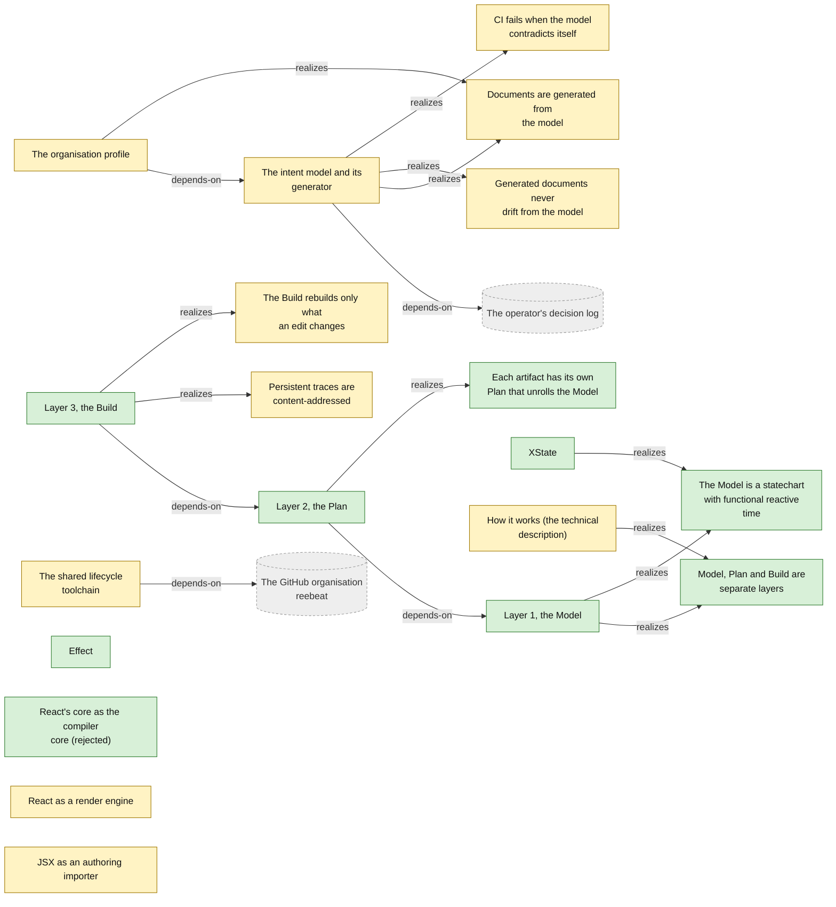

<!-- Generated by tools/intent from model/. Do not edit by hand: change the model and run `bun run generate`. -->

# Technical Components and Requirements Model

The Technical Components and Requirements Model says how: the components, the requirements they realize and the goals they serve. The first diagram of each scope shows structure; the second traces each component, requirement and IS goal to the goals it serves.

Method: 4EM (Sandkuhl, Stirna, Persson and Wißotzki, *Enterprise Modeling: Tackling Business Challenges with the 4EM Method*, Springer 2014). Every element cites its source; `decided` means a source shows that the operator decided it.

## The organisation

20 elements: 9 decided, 11 proposed, 0 open.

```mermaid
flowchart LR
    classDef decided fill:#d8f0d8,stroke:#2d7a2d,color:#111
    classDef proposed fill:#fff3c4,stroke:#a07800,color:#111
    classDef open fill:#f8d7d7,stroke:#a02020,color:#111
    classDef outside fill:#eee,stroke:#999,color:#333,stroke-dasharray:4 3
    isgoal_org_docs_generated_from_model["Documents are generated from<br/>the model"]:::proposed
    req_org_intent_checks["CI fails when the model<br/>contradicts itself"]:::proposed
    req_org_model_drift["Generated documents never<br/>drift from the model"]:::proposed
    comp_org_intent_model["The intent model and its<br/>generator"]:::proposed
    comp_org_profile["The organisation profile"]:::proposed
    comp_org_lifecycle_toolchain["The shared lifecycle<br/>toolchain"]:::proposed
    isgoal_org_three_layers["Model, Plan and Build are<br/>separate layers"]:::decided
    req_org_model_statechart_time["The Model is a statechart<br/>with functional reactive<br/>time"]:::decided
    req_org_plan_per_artifact["Each artifact has its own<br/>Plan that unrolls the Model"]:::decided
    req_org_build_incremental["The Build rebuilds only what<br/>an edit changes"]:::proposed
    req_org_build_reproducible["Persistent traces are<br/>content-addressed"]:::proposed
    comp_org_layer_model["Layer 1, the Model"]:::decided
    comp_org_layer_plan["Layer 2, the Plan"]:::decided
    comp_org_layer_build["Layer 3, the Build"]:::decided
    comp_org_effect["Effect"]:::decided
    comp_org_xstate["XState"]:::decided
    comp_org_react_core_compiler["React's core as the compiler<br/>core (rejected)"]:::decided
    comp_org_react_render_engine["React as a render engine"]:::proposed
    comp_org_jsx_importer["JSX as an authoring importer"]:::proposed
    comp_org_how_it_works["How it works (the technical<br/>description)"]:::proposed
    goal_org_written_intent("Intent written down, sourced<br/>and testable"):::outside
    goal_org_correctness_by_construction("Correctness by construction"):::outside
    goal_org_vision("Multimedia that authors<br/>declare and tools rebuild"):::outside
    goal_org_declarative_creation("Declare scenes and<br/>transitions, not build steps"):::outside
    goal_org_reproducible_builds("Reproducible builds"):::outside
    goal_org_incremental_builds("Fast, incremental, reactive<br/>builds"):::outside
    goal_org_interactive_multimedia("Interactive multimedia for<br/>learning"):::outside
    goal_org_accessible_artifacts("Accessible artifacts for<br/>every audience"):::outside
    goal_org_stay_on_supported_stack("Stay on supported Effect<br/>APIs and fix problems<br/>upstream"):::outside
    goal_org_modular_extensible("Modular and extensible by<br/>users"):::outside
    isgoal_org_docs_generated_from_model -->|supports| goal_org_written_intent
    req_org_intent_checks -->|serves| goal_org_written_intent
    req_org_model_drift -->|serves| goal_org_written_intent
    req_org_model_drift -->|serves| goal_org_correctness_by_construction
    comp_org_intent_model -->|serves| goal_org_written_intent
    comp_org_profile -->|serves| goal_org_vision
    comp_org_profile -->|serves| goal_org_written_intent
    comp_org_lifecycle_toolchain -->|serves| goal_org_correctness_by_construction
    isgoal_org_three_layers -->|supports| goal_org_declarative_creation
    isgoal_org_three_layers -->|supports| goal_org_reproducible_builds
    isgoal_org_three_layers -->|supports| goal_org_incremental_builds
    req_org_model_statechart_time -->|serves| goal_org_declarative_creation
    req_org_model_statechart_time -->|serves| goal_org_interactive_multimedia
    req_org_plan_per_artifact -->|serves| goal_org_accessible_artifacts
    req_org_plan_per_artifact -->|serves| goal_org_interactive_multimedia
    req_org_build_incremental -->|serves| goal_org_incremental_builds
    req_org_build_reproducible -->|serves| goal_org_reproducible_builds
    comp_org_layer_model -->|serves| goal_org_declarative_creation
    comp_org_layer_model -->|serves| goal_org_interactive_multimedia
    comp_org_layer_plan -->|serves| goal_org_accessible_artifacts
    comp_org_layer_plan -->|serves| goal_org_interactive_multimedia
    comp_org_layer_build -->|serves| goal_org_reproducible_builds
    comp_org_layer_build -->|serves| goal_org_incremental_builds
    comp_org_effect -->|serves| goal_org_correctness_by_construction
    comp_org_effect -->|serves| goal_org_stay_on_supported_stack
    comp_org_xstate -->|serves| goal_org_declarative_creation
    comp_org_react_render_engine -->|serves| goal_org_modular_extensible
    comp_org_jsx_importer -->|serves| goal_org_modular_extensible
    comp_org_how_it_works -->|serves| goal_org_vision
```

| Element | Statement | Status | Links | Sources |
| --- | --- | --- | --- | --- |
| <code>isgoal-org-three-layers</code> Information system goal | **Model, Plan and Build are separate layers.** The system keeps three layers apart: a Model that holds the story, a Plan that unrolls it for one artifact, and a Build that makes the artifact incrementally. | decided | supports: [Declare scenes and transitions, not build steps](goals.md#goal-org-declarative-creation), [Reproducible builds](goals.md#goal-org-reproducible-builds), [Fast, incremental, reactive builds](goals.md#goal-org-incremental-builds) | [log L62][1] |
| <code>req-org-model-statechart-time</code> Requirement | **The Model is a statechart with functional reactive time.** The Model is a statechart plus FRP and SMIL time. It may contain cycles, such as interactive loops and repeats. | decided | serves: [Declare scenes and transitions, not build steps](goals.md#goal-org-declarative-creation), [Interactive multimedia for learning](goals.md#goal-org-interactive-multimedia) | [log L62][1], [log L24][2] |
| <code>req-org-plan-per-artifact</code> Requirement | **Each artifact has its own Plan that unrolls the Model.** The Plan of a video is a linear timeline. The Plan of a deck is steps. The Plan of a website is a navigable graph. | decided | serves: [Accessible artifacts for every audience](goals.md#goal-org-accessible-artifacts), [Interactive multimedia for learning](goals.md#goal-org-interactive-multimedia) | [log L62][1], [log L37][3] |
| <code>comp-org-layer-model</code> Technical component | **Layer 1, the Model.** The story as a statechart with functional reactive time: Scenes and States as nodes, Beats as transitions. It may contain cycles. Tier: layer. | decided | serves: [Declare scenes and transitions, not build steps](goals.md#goal-org-declarative-creation), [Interactive multimedia for learning](goals.md#goal-org-interactive-multimedia); realizes: [The Model is a statechart with functional reactive time](technical-components.md#req-org-model-statechart-time), [Model, Plan and Build are separate layers](technical-components.md#isgoal-org-three-layers) | [log L62][1], [log L19][4] |
| <code>comp-org-layer-plan</code> Technical component | **Layer 2, the Plan.** The unrolling of the Model for one artifact: a timeline for video, steps for a deck, a navigable graph for a website. Tier: layer. | decided | serves: [Accessible artifacts for every audience](goals.md#goal-org-accessible-artifacts), [Interactive multimedia for learning](goals.md#goal-org-interactive-multimedia); realizes: [Each artifact has its own Plan that unrolls the Model](technical-components.md#req-org-plan-per-artifact); depends-on: [Layer 1, the Model](technical-components.md#comp-org-layer-model) | [log L62][1] |
| <code>comp-org-layer-build</code> Technical component | **Layer 3, the Build.** An incremental build graph (a DAG) with dynamic dependencies, early cutoff and content-addressed persistent traces, after Build Systems a la Carte (Mokhov, Mitchell and Peyton Jones, ICFP 2018). Only the build graph is a DAG. Tier: layer. | decided | serves: [Reproducible builds](goals.md#goal-org-reproducible-builds), [Fast, incremental, reactive builds](goals.md#goal-org-incremental-builds); realizes: [The Build rebuilds only what an edit changes](technical-components.md#req-org-build-incremental), [Persistent traces are content-addressed](technical-components.md#req-org-build-reproducible); depends-on: [Layer 2, the Plan](technical-components.md#comp-org-layer-plan) | [log L62][1] |
| <code>comp-org-effect</code> Technical component | **Effect.** reebeat is written in Effect. Packages that use unstable Effect APIs cap their version range below the next minor. Tier: external. Licence: MIT. | decided | serves: [Correctness by construction](goals.md#goal-org-correctness-by-construction), [Stay on supported Effect APIs and fix problems upstream](goals.md#goal-org-stay-on-supported-stack) | [log L60][5], [log L55][6] |
| <code>comp-org-xstate</code> Technical component | **XState.** XState v6 with its Effect integration may be a build-time dependency. The runtime is a build step. Tier: external. Licence: MIT. | decided | serves: [Declare scenes and transitions, not build steps](goals.md#goal-org-declarative-creation); realizes: [The Model is a statechart with functional reactive time](technical-components.md#req-org-model-statechart-time) | [log L26][7] |
| <code>comp-org-react-core-compiler</code> Technical component | **React's core as the compiler core (rejected).** The React reconciler and scheduler were considered as the compiler core and rejected. React stays possible as a render engine and JSX as an authoring importer. Tier: external. **Rejected alternative.** | decided |  | [log L64][8] |
| <code>isgoal-org-docs-generated-from-model</code> Information system goal | **Documents are generated from the model.** The organisation profile, the sub-model pages, the product pages, the canvas, the roadmap and the gap report are generated from the model. No one edits them by hand. *Why proposed:* Follows the operator's single-source rule (log line 54) applied to this repository. The assignment of 2026-10-29 asks for it; the decision log does not. | proposed | supports: [Intent written down, sourced and testable](goals.md#goal-org-written-intent) | [log L54][9] |
| <code>req-org-intent-checks</code> Requirement | **CI fails when the model contradicts itself.** CI fails on a goal with no support, a component that serves no goal, a rule that cites no goal, an element with no source, and a "decided" element whose source is not an operator decision. *Why proposed:* Required by the assignment of 2026-10-29. The operator should confirm it as a standing requirement. | proposed | serves: [Intent written down, sourced and testable](goals.md#goal-org-written-intent) | [log L54][9] |
| <code>req-org-model-drift</code> Requirement | **Generated documents never drift from the model.** A test fails when a committed generated document differs from what the generator makes from the model. Quality: maintainability. Scenario: Someone edits a generated page by hand. The drift test fails in CI and names the page. *Why proposed:* Applies the generate, then test, then convention ladder of the operator's single-source rule (log line 54). | proposed | serves: [Intent written down, sourced and testable](goals.md#goal-org-written-intent), [Correctness by construction](goals.md#goal-org-correctness-by-construction) | [log L54][9] |
| <code>comp-org-intent-model</code> Technical component | **The intent model and its generator.** The YAML model in `model/`, its Effect Schema, the checks and the Bun generator in `tools/intent`. It is the only hand-written source of this repository's documents. Tier: tool. Where: `tools/intent`. Licence: Apache-2.0. *Why proposed:* Built for the assignment of 2026-10-29; it waits for the operator's confirmation of the goal it serves. | proposed | serves: [Intent written down, sourced and testable](goals.md#goal-org-written-intent); realizes: [CI fails when the model contradicts itself](technical-components.md#req-org-intent-checks), [Generated documents never drift from the model](technical-components.md#req-org-model-drift), [Documents are generated from the model](technical-components.md#isgoal-org-docs-generated-from-model); depends-on: [The operator's decision log](actors-and-resources.md#resource-decision-log) | [log L3][10] |
| <code>comp-org-profile</code> Technical component | **The organisation profile.** `profile/README.md` is the page that visitors see on the reebeat organisation: vision, tagline, the product family, status and roadmap links. Tier: artifact. Where: `profile/README.md`. Licence: Apache-2.0. *Why proposed:* Generated from the model for the assignment of 2026-10-29. | proposed | serves: [Multimedia that authors declare and tools rebuild](goals.md#goal-org-vision), [Intent written down, sourced and testable](goals.md#goal-org-written-intent); realizes: [Documents are generated from the model](technical-components.md#isgoal-org-docs-generated-from-model); depends-on: [The intent model and its generator](technical-components.md#comp-org-intent-model) | [log L7][11] |
| <code>comp-org-lifecycle-toolchain</code> Technical component | **The shared lifecycle toolchain.** Git hooks, commitlint, gitleaks, the review and merge scripts and the CI workflow, copied into each repository with a provenance record. Tier: process-asset. *Why proposed:* Observed in the repositories: the operator decided the lifecycle (reebeat spec 0000) and its copy into studio, but not this inventory of parts. | proposed | serves: [Correctness by construction](goals.md#goal-org-correctness-by-construction); depends-on: [The GitHub organisation reebeat](actors-and-resources.md#resource-github-org) | [studio:PROVENANCE.md:3][12], [foldkit-flow:PROVENANCE.md:3][13] |
| <code>req-org-build-incremental</code> Requirement | **The Build rebuilds only what an edit changes.** The Build is an incremental graph with dynamic dependencies and early cutoff. Quality: performance. Scenario: An author edits one line of narration. Only the speech, the timing and the frames that depend on that line are rebuilt; the rest comes from the cache. *Why proposed:* The operator decided the incremental build graph with dynamic dependencies and early cutoff (log line 62). The narration scenario is an example drawn from issue 9 of reebeat; the operator should confirm it as the acceptance scenario. | proposed | serves: [Fast, incremental, reactive builds](goals.md#goal-org-incremental-builds) | [log L62][1], [log L10][14], [issue reebeat#9][15] |
| <code>req-org-build-reproducible</code> Requirement | **Persistent traces are content-addressed.** The Build keeps persistent traces that are addressed by content. Quality: reproducibility. Scenario: The same story is built twice, once warm and once cold. The two artifacts are byte-identical. *Why proposed:* The operator decided content-addressed persistent traces (log line 62). That a warm build equals a cold build, byte for byte, comes from the open issue 9 and falsifier F6 of reebeat spec 0001; the operator should confirm it as a quality goal. | proposed | serves: [Reproducible builds](goals.md#goal-org-reproducible-builds) | [log L62][1], [log L10][14], [issue reebeat#9][15] |
| <code>comp-org-react-render-engine</code> Technical component | **React as a render engine.** React stays possible as one render engine among others, behind the render-engine contract. Tier: integration. *Why proposed:* The operator kept React "as a possible render engine" (log line 64); nothing is built or scheduled. | proposed | serves: [Modular and extensible by users](goals.md#goal-org-modular-extensible) | [log L64][8], [log L28][16] |
| <code>comp-org-jsx-importer</code> Technical component | **JSX as an authoring importer.** JSX stays possible as an authoring importer that reads JSX and writes the IR. Tier: integration. *Why proposed:* The operator kept JSX "as a possible authoring importer" (log line 64); nothing is built or scheduled. | proposed | serves: [Modular and extensible by users](goals.md#goal-org-modular-extensible) | [log L64][8] |
| <code>comp-org-how-it-works</code> Technical component | **How it works (the technical description).** A note in the reebeat repository that explains, for technical readers, how the qualities come from the mechanisms: the Model, Plan and Build layers, Effect and XState, prior art, the novelty claim and why React's core was rejected. Tier: artifact. *Why proposed:* It is `docs/design/how-it-works.md` in open pull request 24 of reebeat, written for the operator's accepted technical framing (log lines 58 to 65). It is not merged; the link goes to the pull request until it lands on `main`. | proposed | serves: [Multimedia that authors declare and tools rebuild](goals.md#goal-org-vision); realizes: [Model, Plan and Build are separate layers](technical-components.md#isgoal-org-three-layers) | [log L58-65][17], [pr reebeat#24][18] |

## reebeat (the compiler)

65 elements: 3 decided, 61 proposed, 1 open.

```mermaid
flowchart LR
    classDef decided fill:#d8f0d8,stroke:#2d7a2d,color:#111
    classDef proposed fill:#fff3c4,stroke:#a07800,color:#111
    classDef open fill:#f8d7d7,stroke:#a02020,color:#111
    classDef outside fill:#eee,stroke:#999,color:#333,stroke-dasharray:4 3
    comp_reebeat_product["reebeat, the open compiler"]:::decided
    comp_reebeat_core["core, from screenplay to<br/>Plan and Timeline"]:::proposed
    comp_reebeat_subtitles["subtitles, WebVTT and SubRip<br/>writers"]:::proposed
    comp_reebeat_lint["lint, pure rules over a Plan"]:::proposed
    comp_reebeat_services["services, the seven<br/>contracts"]:::proposed
    comp_reebeat_pipeline["pipeline, the build program"]:::proposed
    comp_reebeat_speech_kokoro["speech-kokoro, local speech<br/>synthesis"]:::proposed
    comp_reebeat_align_whisper["align-whisper, word<br/>alignment"]:::proposed
    comp_reebeat_sounds_synth["sounds-synth, built-in sound<br/>effects"]:::proposed
    comp_reebeat_render_reveal["render-reveal, the Deck<br/>renderer"]:::proposed
    comp_reebeat_capture_chromium["capture-chromium, frame<br/>capture"]:::proposed
    comp_reebeat_encode_ffmpeg["encode-ffmpeg, mix and mux"]:::proposed
    comp_reebeat_cache_fs["cache-fs, the<br/>content-addressed cache"]:::proposed
    comp_reebeat_verify["verify, the output-side<br/>checks"]:::proposed
    comp_reebeat_cli["cli, the reebeat command"]:::proposed
    comp_reebeat_quality_gates["quality gates, the<br/>repository checks"]:::proposed
    comp_reebeat_statechart_xstate["statechart-xstate, the<br/>build-time interpreter"]:::proposed
    comp_reebeat_website_renderer["website renderer, a planned<br/>artifact renderer"]:::proposed
    comp_reebeat_plan_json["plan.json, the one input of<br/>the renderers"]:::proposed
    comp_reebeat_build_manifest["build.json, the build<br/>manifest"]:::proposed
    comp_reebeat_deck_output["deck.html, the Deck artifact"]:::proposed
    comp_reebeat_video_output["the MP4 Video artifact"]:::proposed
    comp_reebeat_grammar_doc["The generated effects<br/>grammar document"]:::proposed
    comp_reebeat_ci_workflow["The CI workflow"]:::proposed
    comp_reebeat_review_skills["The review and pull request<br/>skills"]:::proposed
    comp_reebeat_exception_registry["The suppression registry"]:::proposed
    isgoal_reebeat_one_source["One source yields every<br/>rendering"]:::proposed
    isgoal_reebeat_replaceable_pieces["Every piece can be replaced<br/>one by one"]:::proposed
    isgoal_reebeat_verifiable_output["The system can prove what it<br/>built"]:::proposed
    isgoal_reebeat_visible_provenance["The manifest records<br/>provenance"]:::decided
    isgoal_reebeat_agent_usable["An agent can write and<br/>repair a story"]:::proposed
    req_reebeat_plan["Print a reviewable Plan"]:::proposed
    req_reebeat_deck["Build a Deck from the Plan"]:::proposed
    req_reebeat_video["Build a narrated Video from<br/>the Plan"]:::proposed
    req_reebeat_check["Check a build against its<br/>source"]:::proposed
    req_reebeat_lint["Lint a story and say the fix"]:::proposed
    req_reebeat_selection["Select adapters by<br/>configuration"]:::proposed
    req_reebeat_speech_cache["Cache speech by content"]:::proposed
    req_reebeat_journey["One command runs the whole<br/>road"]:::proposed
    req_reebeat_renderer_lifecycle["A renderer declares its<br/>lifecycle timing"]:::proposed
    req_reebeat_statechart_interpreter["Interpreters pass one<br/>contract suite"]:::decided
    req_reebeat_state_machines["Explicit state machines and<br/>timing combinators"]:::proposed
    req_reebeat_accessible_variants["Generate captions, audio<br/>description and reduced<br/>motion"]:::proposed
    req_reebeat_readable_subtitles["Subtitles stay readable"]:::proposed
    req_reebeat_language_variants["Build one story in several<br/>narration languages"]:::proposed
    req_reebeat_render_segment_cache["Cache render segments"]:::proposed
    req_reebeat_website_artifact["Emit a static interactive<br/>website"]:::proposed
    req_reebeat_interaction_declaration["One interaction declaration<br/>for every surface"]:::proposed
    req_reebeat_renderer_capabilities["Renderers declare what they<br/>can realise"]:::proposed
    req_reebeat_teaching_lint["Lint temporal contiguity,<br/>signalling, redundancy and<br/>coherence"]:::proposed
    req_reebeat_npm_prerelease["Publish only built, audited<br/>packages"]:::proposed
    req_reebeat_encoder_reproducible["Any chosen encoder keeps<br/>builds byte-identical"]:::proposed
    req_reebeat_exception_directives["The exception gate counts<br/>@effect-diagnostics comments"]:::proposed
    req_reebeat_pin_bun["Pin the package manager to<br/>the devenv Bun"]:::proposed
    req_reebeat_nfr_reproducibility["Two builds are identical"]:::proposed
    req_reebeat_nfr_accessibility["Artifacts serve different<br/>audiences"]:::proposed
    req_reebeat_nfr_timing["Effects appear within one<br/>frame of their anchor"]:::proposed
    req_reebeat_nfr_tier_gate["The package direction is<br/>enforced by a gate"]:::proposed
    req_reebeat_nfr_extensibility["A new adapter needs no core<br/>change"]:::proposed
    req_reebeat_nfr_licensing["Licences are checked before<br/>a dependency lands"]:::proposed
    req_reebeat_nfr_usability["Errors say how to fix the<br/>source"]:::proposed
    req_reebeat_nfr_reliability["A failed build leaves no<br/>accepted output"]:::proposed
    req_reebeat_nfr_security["Credentials never reach<br/>outputs"]:::proposed
    req_reebeat_nfr_incremental["An edit rebuilds only what<br/>it changes"]:::proposed
    req_reebeat_nfr_portability["Release 1 runs on Linux<br/>inside devenv"]:::open
    comp_org_effect["Effect"]:::outside
    comp_org_layer_model["Layer 1, the Model"]:::outside
    comp_org_layer_plan["Layer 2, the Plan"]:::outside
    resource_reebeat_fountain_format[("The Fountain screenplay<br/>format")]:::outside
    comp_org_layer_build["Layer 3, the Build"]:::outside
    resource_reebeat_kokoro_model[("Kokoro speech model")]:::outside
    resource_reebeat_whisper_cpp[("whisper.cpp")]:::outside
    resource_reebeat_whisper_model[("Whisper base English model")]:::outside
    resource_reebeat_reveal_js[("reveal.js")]:::outside
    resource_reebeat_chromium[("Chromium")]:::outside
    resource_reebeat_ffmpeg[("ffmpeg and ffprobe")]:::outside
    comp_org_xstate["XState"]:::outside
    comp_reebeat_product -->|depends-on| comp_org_effect
    comp_reebeat_core -->|part-of| comp_reebeat_product
    comp_reebeat_core -->|part-of| comp_org_layer_model
    comp_reebeat_core -->|part-of| comp_org_layer_plan
    comp_reebeat_core -->|depends-on| comp_org_effect
    comp_reebeat_core -->|depends-on| resource_reebeat_fountain_format
    comp_reebeat_core -->|realizes| req_reebeat_plan
    comp_reebeat_core -->|realizes| req_reebeat_nfr_timing
    comp_reebeat_core -->|realizes| req_reebeat_nfr_usability
    comp_reebeat_subtitles -->|part-of| comp_reebeat_product
    comp_reebeat_subtitles -->|part-of| comp_org_layer_plan
    comp_reebeat_subtitles -->|depends-on| comp_org_effect
    comp_reebeat_subtitles -->|depends-on| comp_reebeat_core
    comp_reebeat_subtitles -->|realizes| req_reebeat_nfr_accessibility
    comp_reebeat_lint -->|part-of| comp_reebeat_product
    comp_reebeat_lint -->|part-of| comp_org_layer_plan
    comp_reebeat_lint -->|depends-on| comp_org_effect
    comp_reebeat_lint -->|depends-on| comp_reebeat_core
    comp_reebeat_lint -->|realizes| req_reebeat_lint
    comp_reebeat_lint -->|realizes| req_reebeat_nfr_usability
    comp_reebeat_services -->|part-of| comp_reebeat_product
    comp_reebeat_services -->|part-of| comp_org_layer_build
    comp_reebeat_services -->|depends-on| comp_org_effect
    comp_reebeat_services -->|depends-on| comp_reebeat_core
    comp_reebeat_services -->|realizes| req_reebeat_selection
    comp_reebeat_services -->|realizes| req_reebeat_renderer_lifecycle
    comp_reebeat_services -->|realizes| req_reebeat_nfr_extensibility
    comp_reebeat_services -->|realizes| req_reebeat_nfr_security
    comp_reebeat_pipeline -->|part-of| comp_reebeat_product
    comp_reebeat_pipeline -->|part-of| comp_org_layer_build
    comp_reebeat_pipeline -->|depends-on| comp_org_effect
    comp_reebeat_pipeline -->|depends-on| comp_reebeat_core
    comp_reebeat_pipeline -->|depends-on| comp_reebeat_services
    comp_reebeat_pipeline -->|depends-on| comp_reebeat_subtitles
    comp_reebeat_pipeline -->|realizes| req_reebeat_deck
    comp_reebeat_pipeline -->|realizes| req_reebeat_video
    comp_reebeat_pipeline -->|realizes| req_reebeat_nfr_reliability
    comp_reebeat_speech_kokoro -->|part-of| comp_reebeat_product
    comp_reebeat_speech_kokoro -->|part-of| comp_org_layer_build
    comp_reebeat_speech_kokoro -->|depends-on| comp_org_effect
    comp_reebeat_speech_kokoro -->|depends-on| comp_reebeat_services
    comp_reebeat_speech_kokoro -->|depends-on| resource_reebeat_kokoro_model
    comp_reebeat_speech_kokoro -->|realizes| req_reebeat_speech_cache
    comp_reebeat_align_whisper -->|part-of| comp_reebeat_product
    comp_reebeat_align_whisper -->|part-of| comp_org_layer_build
    comp_reebeat_align_whisper -->|depends-on| comp_org_effect
    comp_reebeat_align_whisper -->|depends-on| comp_reebeat_core
    comp_reebeat_align_whisper -->|depends-on| comp_reebeat_services
    comp_reebeat_align_whisper -->|depends-on| resource_reebeat_whisper_cpp
    comp_reebeat_align_whisper -->|depends-on| resource_reebeat_whisper_model
    comp_reebeat_align_whisper -->|realizes| req_reebeat_speech_cache
    comp_reebeat_sounds_synth -->|part-of| comp_reebeat_product
    comp_reebeat_sounds_synth -->|part-of| comp_org_layer_build
    comp_reebeat_sounds_synth -->|depends-on| comp_org_effect
    comp_reebeat_sounds_synth -->|depends-on| comp_reebeat_core
    comp_reebeat_sounds_synth -->|depends-on| comp_reebeat_services
    comp_reebeat_sounds_synth -->|realizes| req_reebeat_video
    comp_reebeat_render_reveal -->|part-of| comp_reebeat_product
    comp_reebeat_render_reveal -->|part-of| comp_org_layer_plan
    comp_reebeat_render_reveal -->|depends-on| comp_org_effect
    comp_reebeat_render_reveal -->|depends-on| comp_reebeat_core
    comp_reebeat_render_reveal -->|depends-on| comp_reebeat_lint
    comp_reebeat_render_reveal -->|depends-on| comp_reebeat_services
    comp_reebeat_render_reveal -->|depends-on| resource_reebeat_reveal_js
    comp_reebeat_render_reveal -->|realizes| req_reebeat_deck
    comp_reebeat_render_reveal -->|realizes| req_reebeat_renderer_lifecycle
    comp_reebeat_render_reveal -->|realizes| req_reebeat_nfr_accessibility
    comp_reebeat_capture_chromium -->|part-of| comp_reebeat_product
    comp_reebeat_capture_chromium -->|part-of| comp_org_layer_build
    comp_reebeat_capture_chromium -->|depends-on| comp_org_effect
    comp_reebeat_capture_chromium -->|depends-on| comp_reebeat_core
    comp_reebeat_capture_chromium -->|depends-on| comp_reebeat_services
    comp_reebeat_capture_chromium -->|depends-on| resource_reebeat_chromium
    comp_reebeat_capture_chromium -->|realizes| req_reebeat_video
    comp_reebeat_capture_chromium -->|realizes| req_reebeat_nfr_reproducibility
    comp_reebeat_encode_ffmpeg -->|part-of| comp_reebeat_product
    comp_reebeat_encode_ffmpeg -->|part-of| comp_org_layer_build
    comp_reebeat_encode_ffmpeg -->|depends-on| comp_org_effect
    comp_reebeat_encode_ffmpeg -->|depends-on| comp_reebeat_services
    comp_reebeat_encode_ffmpeg -->|depends-on| resource_reebeat_ffmpeg
    comp_reebeat_encode_ffmpeg -->|realizes| req_reebeat_video
    comp_reebeat_encode_ffmpeg -->|realizes| req_reebeat_nfr_reproducibility
    comp_reebeat_cache_fs -->|part-of| comp_reebeat_product
    comp_reebeat_cache_fs -->|part-of| comp_org_layer_build
    comp_reebeat_cache_fs -->|depends-on| comp_org_effect
    comp_reebeat_cache_fs -->|depends-on| comp_reebeat_services
    comp_reebeat_cache_fs -->|realizes| req_reebeat_speech_cache
    comp_reebeat_cache_fs -->|realizes| req_reebeat_nfr_reproducibility
    comp_reebeat_verify -->|part-of| comp_reebeat_product
    comp_reebeat_verify -->|part-of| comp_org_layer_build
    comp_reebeat_verify -->|depends-on| comp_org_effect
    comp_reebeat_verify -->|depends-on| comp_reebeat_core
    comp_reebeat_verify -->|depends-on| comp_reebeat_encode_ffmpeg
    comp_reebeat_verify -->|depends-on| comp_reebeat_lint
    comp_reebeat_verify -->|depends-on| comp_reebeat_pipeline
    comp_reebeat_verify -->|depends-on| comp_reebeat_render_reveal
    comp_reebeat_verify -->|depends-on| comp_reebeat_services
    comp_reebeat_verify -->|depends-on| comp_reebeat_sounds_synth
    comp_reebeat_verify -->|depends-on| comp_reebeat_subtitles
    comp_reebeat_verify -->|realizes| req_reebeat_check
    comp_reebeat_verify -->|realizes| req_reebeat_nfr_timing
    comp_reebeat_verify -->|realizes| req_reebeat_nfr_reproducibility
    comp_reebeat_cli -->|part-of| comp_reebeat_product
    comp_reebeat_cli -->|part-of| comp_org_layer_build
    comp_reebeat_cli -->|depends-on| comp_org_effect
    comp_reebeat_cli -->|depends-on| comp_reebeat_align_whisper
    comp_reebeat_cli -->|depends-on| comp_reebeat_cache_fs
    comp_reebeat_cli -->|depends-on| comp_reebeat_capture_chromium
    comp_reebeat_cli -->|depends-on| comp_reebeat_core
    comp_reebeat_cli -->|depends-on| comp_reebeat_encode_ffmpeg
    comp_reebeat_cli -->|depends-on| comp_reebeat_lint
    comp_reebeat_cli -->|depends-on| comp_reebeat_pipeline
    comp_reebeat_cli -->|depends-on| comp_reebeat_render_reveal
    comp_reebeat_cli -->|depends-on| comp_reebeat_services
    comp_reebeat_cli -->|depends-on| comp_reebeat_sounds_synth
    comp_reebeat_cli -->|depends-on| comp_reebeat_speech_kokoro
    comp_reebeat_cli -->|depends-on| comp_reebeat_verify
    comp_reebeat_cli -->|realizes| req_reebeat_plan
    comp_reebeat_cli -->|realizes| req_reebeat_lint
    comp_reebeat_cli -->|realizes| req_reebeat_check
    comp_reebeat_cli -->|realizes| req_reebeat_selection
    comp_reebeat_cli -->|realizes| req_reebeat_journey
    comp_reebeat_quality_gates -->|part-of| comp_reebeat_product
    comp_reebeat_quality_gates -->|depends-on| comp_org_effect
    comp_reebeat_quality_gates -->|realizes| req_reebeat_nfr_tier_gate
    comp_reebeat_quality_gates -->|realizes| req_reebeat_nfr_licensing
    comp_reebeat_statechart_xstate -->|part-of| comp_reebeat_product
    comp_reebeat_statechart_xstate -->|part-of| comp_org_layer_plan
    comp_reebeat_statechart_xstate -->|depends-on| comp_org_xstate
    comp_reebeat_statechart_xstate -->|depends-on| comp_org_effect
    comp_reebeat_statechart_xstate -->|depends-on| comp_reebeat_services
    comp_reebeat_statechart_xstate -->|realizes| req_reebeat_statechart_interpreter
    comp_reebeat_website_renderer -->|part-of| comp_reebeat_product
    comp_reebeat_website_renderer -->|part-of| comp_org_layer_plan
    comp_reebeat_website_renderer -->|depends-on| comp_org_effect
    comp_reebeat_website_renderer -->|depends-on| comp_reebeat_services
    comp_reebeat_website_renderer -->|realizes| req_reebeat_website_artifact
    comp_reebeat_website_renderer -->|realizes| req_reebeat_interaction_declaration
    comp_reebeat_plan_json -->|part-of| comp_reebeat_product
    comp_reebeat_build_manifest -->|part-of| comp_reebeat_product
    comp_reebeat_build_manifest -->|realizes| isgoal_reebeat_visible_provenance
    comp_reebeat_deck_output -->|part-of| comp_reebeat_product
    comp_reebeat_video_output -->|part-of| comp_reebeat_product
    comp_reebeat_grammar_doc -->|part-of| comp_reebeat_product
    comp_reebeat_ci_workflow -->|part-of| comp_reebeat_product
    comp_reebeat_review_skills -->|part-of| comp_reebeat_product
    comp_reebeat_exception_registry -->|part-of| comp_reebeat_quality_gates
```

```mermaid
flowchart LR
    classDef decided fill:#d8f0d8,stroke:#2d7a2d,color:#111
    classDef proposed fill:#fff3c4,stroke:#a07800,color:#111
    classDef open fill:#f8d7d7,stroke:#a02020,color:#111
    classDef outside fill:#eee,stroke:#999,color:#333,stroke-dasharray:4 3
    comp_reebeat_product["reebeat, the open compiler"]:::decided
    comp_reebeat_core["core, from screenplay to<br/>Plan and Timeline"]:::proposed
    comp_reebeat_subtitles["subtitles, WebVTT and SubRip<br/>writers"]:::proposed
    comp_reebeat_lint["lint, pure rules over a Plan"]:::proposed
    comp_reebeat_services["services, the seven<br/>contracts"]:::proposed
    comp_reebeat_pipeline["pipeline, the build program"]:::proposed
    comp_reebeat_speech_kokoro["speech-kokoro, local speech<br/>synthesis"]:::proposed
    comp_reebeat_align_whisper["align-whisper, word<br/>alignment"]:::proposed
    comp_reebeat_sounds_synth["sounds-synth, built-in sound<br/>effects"]:::proposed
    comp_reebeat_render_reveal["render-reveal, the Deck<br/>renderer"]:::proposed
    comp_reebeat_capture_chromium["capture-chromium, frame<br/>capture"]:::proposed
    comp_reebeat_encode_ffmpeg["encode-ffmpeg, mix and mux"]:::proposed
    comp_reebeat_cache_fs["cache-fs, the<br/>content-addressed cache"]:::proposed
    comp_reebeat_verify["verify, the output-side<br/>checks"]:::proposed
    comp_reebeat_cli["cli, the reebeat command"]:::proposed
    comp_reebeat_quality_gates["quality gates, the<br/>repository checks"]:::proposed
    comp_reebeat_statechart_xstate["statechart-xstate, the<br/>build-time interpreter"]:::proposed
    comp_reebeat_website_renderer["website renderer, a planned<br/>artifact renderer"]:::proposed
    comp_reebeat_plan_json["plan.json, the one input of<br/>the renderers"]:::proposed
    comp_reebeat_build_manifest["build.json, the build<br/>manifest"]:::proposed
    comp_reebeat_deck_output["deck.html, the Deck artifact"]:::proposed
    comp_reebeat_video_output["the MP4 Video artifact"]:::proposed
    comp_reebeat_grammar_doc["The generated effects<br/>grammar document"]:::proposed
    comp_reebeat_ci_workflow["The CI workflow"]:::proposed
    comp_reebeat_review_skills["The review and pull request<br/>skills"]:::proposed
    comp_reebeat_exception_registry["The suppression registry"]:::proposed
    isgoal_reebeat_one_source["One source yields every<br/>rendering"]:::proposed
    isgoal_reebeat_replaceable_pieces["Every piece can be replaced<br/>one by one"]:::proposed
    isgoal_reebeat_verifiable_output["The system can prove what it<br/>built"]:::proposed
    isgoal_reebeat_visible_provenance["The manifest records<br/>provenance"]:::decided
    isgoal_reebeat_agent_usable["An agent can write and<br/>repair a story"]:::proposed
    req_reebeat_plan["Print a reviewable Plan"]:::proposed
    req_reebeat_deck["Build a Deck from the Plan"]:::proposed
    req_reebeat_video["Build a narrated Video from<br/>the Plan"]:::proposed
    req_reebeat_check["Check a build against its<br/>source"]:::proposed
    req_reebeat_lint["Lint a story and say the fix"]:::proposed
    req_reebeat_selection["Select adapters by<br/>configuration"]:::proposed
    req_reebeat_speech_cache["Cache speech by content"]:::proposed
    req_reebeat_journey["One command runs the whole<br/>road"]:::proposed
    req_reebeat_renderer_lifecycle["A renderer declares its<br/>lifecycle timing"]:::proposed
    req_reebeat_statechart_interpreter["Interpreters pass one<br/>contract suite"]:::decided
    req_reebeat_state_machines["Explicit state machines and<br/>timing combinators"]:::proposed
    req_reebeat_accessible_variants["Generate captions, audio<br/>description and reduced<br/>motion"]:::proposed
    req_reebeat_readable_subtitles["Subtitles stay readable"]:::proposed
    req_reebeat_language_variants["Build one story in several<br/>narration languages"]:::proposed
    req_reebeat_render_segment_cache["Cache render segments"]:::proposed
    req_reebeat_website_artifact["Emit a static interactive<br/>website"]:::proposed
    req_reebeat_interaction_declaration["One interaction declaration<br/>for every surface"]:::proposed
    req_reebeat_renderer_capabilities["Renderers declare what they<br/>can realise"]:::proposed
    req_reebeat_teaching_lint["Lint temporal contiguity,<br/>signalling, redundancy and<br/>coherence"]:::proposed
    req_reebeat_npm_prerelease["Publish only built, audited<br/>packages"]:::proposed
    req_reebeat_encoder_reproducible["Any chosen encoder keeps<br/>builds byte-identical"]:::proposed
    req_reebeat_exception_directives["The exception gate counts<br/>@effect-diagnostics comments"]:::proposed
    req_reebeat_pin_bun["Pin the package manager to<br/>the devenv Bun"]:::proposed
    req_reebeat_nfr_reproducibility["Two builds are identical"]:::proposed
    req_reebeat_nfr_accessibility["Artifacts serve different<br/>audiences"]:::proposed
    req_reebeat_nfr_timing["Effects appear within one<br/>frame of their anchor"]:::proposed
    req_reebeat_nfr_tier_gate["The package direction is<br/>enforced by a gate"]:::proposed
    req_reebeat_nfr_extensibility["A new adapter needs no core<br/>change"]:::proposed
    req_reebeat_nfr_licensing["Licences are checked before<br/>a dependency lands"]:::proposed
    req_reebeat_nfr_usability["Errors say how to fix the<br/>source"]:::proposed
    req_reebeat_nfr_reliability["A failed build leaves no<br/>accepted output"]:::proposed
    req_reebeat_nfr_security["Credentials never reach<br/>outputs"]:::proposed
    req_reebeat_nfr_incremental["An edit rebuilds only what<br/>it changes"]:::proposed
    req_reebeat_nfr_portability["Release 1 runs on Linux<br/>inside devenv"]:::open
    goal_reebeat_vision("Declare the story, reebeat<br/>builds the artifacts"):::outside
    goal_reebeat_screenplay_first("One screenplay, every<br/>rendering"):::outside
    goal_reebeat_statechart_model("Declare the implicit state<br/>machine explicitly"):::outside
    goal_reebeat_accessible_artifacts("Accessible artifacts for<br/>different audiences"):::outside
    goal_reebeat_explicit_source("An explicit source nobody<br/>can misread"):::outside
    goal_reebeat_plugin_sdk("Plugins and a render-engine<br/>SDK"):::outside
    goal_reebeat_deck_and_video("A Deck and a Video from one<br/>source"):::outside
    goal_reebeat_event_timing("Effects connect to produced<br/>events"):::outside
    goal_reebeat_multi_renderer("Several render engines in<br/>one story"):::outside
    goal_reebeat_reproducible_builds("Reproducible builds"):::outside
    goal_reebeat_incremental_builds("Fast, incremental and<br/>reactive builds"):::outside
    goal_reebeat_verified_output("Check the written files, not<br/>the pipeline's memory"):::outside
    goal_reebeat_correct_by_construction("A compiler whose structure<br/>prevents bad states"):::outside
    goal_reebeat_apache_licence("License the compiler and its<br/>formats under Apache-2.0"):::outside
    goal_reebeat_interactive_website("An interactive website as an<br/>artifact type"):::outside
    goal_reebeat_visible_egress("Every build says what leaves<br/>the machine"):::outside
    goal_reebeat_localisation("One story, several narration<br/>languages"):::outside
    goal_reebeat_teaching_lint("A teaching lint for<br/>explainer stories"):::outside
    goal_reebeat_npm_publication("Publish @reebeat packages to<br/>npm"):::outside
    comp_reebeat_product -->|serves| goal_reebeat_vision
    comp_reebeat_core -->|serves| goal_reebeat_screenplay_first
    comp_reebeat_core -->|serves| goal_reebeat_statechart_model
    comp_reebeat_subtitles -->|serves| goal_reebeat_accessible_artifacts
    comp_reebeat_lint -->|serves| goal_reebeat_explicit_source
    comp_reebeat_services -->|serves| goal_reebeat_plugin_sdk
    comp_reebeat_pipeline -->|serves| goal_reebeat_deck_and_video
    comp_reebeat_speech_kokoro -->|serves| goal_reebeat_deck_and_video
    comp_reebeat_align_whisper -->|serves| goal_reebeat_event_timing
    comp_reebeat_sounds_synth -->|serves| goal_reebeat_deck_and_video
    comp_reebeat_render_reveal -->|serves| goal_reebeat_deck_and_video
    comp_reebeat_render_reveal -->|serves| goal_reebeat_multi_renderer
    comp_reebeat_capture_chromium -->|serves| goal_reebeat_reproducible_builds
    comp_reebeat_encode_ffmpeg -->|serves| goal_reebeat_deck_and_video
    comp_reebeat_cache_fs -->|serves| goal_reebeat_incremental_builds
    comp_reebeat_cache_fs -->|serves| goal_reebeat_reproducible_builds
    comp_reebeat_verify -->|serves| goal_reebeat_verified_output
    comp_reebeat_cli -->|serves| goal_reebeat_vision
    comp_reebeat_quality_gates -->|serves| goal_reebeat_correct_by_construction
    comp_reebeat_quality_gates -->|serves| goal_reebeat_apache_licence
    comp_reebeat_statechart_xstate -->|serves| goal_reebeat_statechart_model
    comp_reebeat_website_renderer -->|serves| goal_reebeat_interactive_website
    comp_reebeat_plan_json -->|serves| goal_reebeat_screenplay_first
    comp_reebeat_build_manifest -->|serves| goal_reebeat_visible_egress
    comp_reebeat_deck_output -->|serves| goal_reebeat_deck_and_video
    comp_reebeat_video_output -->|serves| goal_reebeat_deck_and_video
    comp_reebeat_video_output -->|serves| goal_reebeat_accessible_artifacts
    comp_reebeat_grammar_doc -->|serves| goal_reebeat_explicit_source
    comp_reebeat_ci_workflow -->|serves| goal_reebeat_correct_by_construction
    comp_reebeat_review_skills -->|serves| goal_reebeat_correct_by_construction
    comp_reebeat_exception_registry -->|serves| goal_reebeat_correct_by_construction
    isgoal_reebeat_one_source -->|serves| goal_reebeat_screenplay_first
    isgoal_reebeat_replaceable_pieces -->|serves| goal_reebeat_plugin_sdk
    isgoal_reebeat_verifiable_output -->|serves| goal_reebeat_verified_output
    isgoal_reebeat_visible_provenance -->|serves| goal_reebeat_visible_egress
    isgoal_reebeat_agent_usable -->|serves| goal_reebeat_explicit_source
    isgoal_reebeat_agent_usable -->|serves| goal_reebeat_plugin_sdk
    req_reebeat_plan -->|serves| goal_reebeat_deck_and_video
    req_reebeat_deck -->|serves| goal_reebeat_deck_and_video
    req_reebeat_video -->|serves| goal_reebeat_deck_and_video
    req_reebeat_check -->|serves| goal_reebeat_verified_output
    req_reebeat_lint -->|serves| goal_reebeat_explicit_source
    req_reebeat_selection -->|serves| goal_reebeat_plugin_sdk
    req_reebeat_selection -->|serves| goal_reebeat_correct_by_construction
    req_reebeat_speech_cache -->|serves| goal_reebeat_reproducible_builds
    req_reebeat_speech_cache -->|serves| goal_reebeat_incremental_builds
    req_reebeat_journey -->|serves| goal_reebeat_verified_output
    req_reebeat_journey -->|serves| goal_reebeat_reproducible_builds
    req_reebeat_renderer_lifecycle -->|serves| goal_reebeat_event_timing
    req_reebeat_renderer_lifecycle -->|serves| goal_reebeat_multi_renderer
    req_reebeat_statechart_interpreter -->|serves| goal_reebeat_statechart_model
    req_reebeat_state_machines -->|serves| goal_reebeat_statechart_model
    req_reebeat_accessible_variants -->|serves| goal_reebeat_accessible_artifacts
    req_reebeat_readable_subtitles -->|serves| goal_reebeat_accessible_artifacts
    req_reebeat_language_variants -->|serves| goal_reebeat_localisation
    req_reebeat_render_segment_cache -->|serves| goal_reebeat_incremental_builds
    req_reebeat_website_artifact -->|serves| goal_reebeat_interactive_website
    req_reebeat_interaction_declaration -->|serves| goal_reebeat_interactive_website
    req_reebeat_interaction_declaration -->|serves| goal_reebeat_multi_renderer
    req_reebeat_renderer_capabilities -->|serves| goal_reebeat_multi_renderer
    req_reebeat_renderer_capabilities -->|serves| goal_reebeat_plugin_sdk
    req_reebeat_teaching_lint -->|serves| goal_reebeat_teaching_lint
    req_reebeat_npm_prerelease -->|serves| goal_reebeat_npm_publication
    req_reebeat_encoder_reproducible -->|serves| goal_reebeat_reproducible_builds
    req_reebeat_exception_directives -->|serves| goal_reebeat_correct_by_construction
    req_reebeat_pin_bun -->|serves| goal_reebeat_reproducible_builds
    req_reebeat_nfr_reproducibility -->|serves| goal_reebeat_reproducible_builds
    req_reebeat_nfr_accessibility -->|serves| goal_reebeat_accessible_artifacts
    req_reebeat_nfr_timing -->|serves| goal_reebeat_event_timing
    req_reebeat_nfr_timing -->|serves| goal_reebeat_verified_output
    req_reebeat_nfr_tier_gate -->|serves| goal_reebeat_correct_by_construction
    req_reebeat_nfr_extensibility -->|serves| goal_reebeat_plugin_sdk
    req_reebeat_nfr_licensing -->|serves| goal_reebeat_apache_licence
    req_reebeat_nfr_usability -->|serves| goal_reebeat_explicit_source
    req_reebeat_nfr_reliability -->|serves| goal_reebeat_correct_by_construction
    req_reebeat_nfr_security -->|serves| goal_reebeat_visible_egress
    req_reebeat_nfr_incremental -->|serves| goal_reebeat_incremental_builds
    req_reebeat_nfr_portability -->|serves| goal_reebeat_reproducible_builds
```

| Element | Statement | Status | Links | Sources |
| --- | --- | --- | --- | --- |
| <code>comp-reebeat-product</code> Technical component | **reebeat, the open compiler.** Semantically declared story beats, compiled into multimedia artifacts: statecharts for structure, functional reactive time, and an incremental build graph, written in Effect. The compiler and its formats are open source, and running them locally is free. Tier: product. Licence: Apache-2.0. | decided | serves: [Declare the story, reebeat builds the artifacts](goals.md#goal-reebeat-vision); depends-on: [Effect](technical-components.md#comp-org-effect) | [log L7][11], [log L60][5], [log L44][19], [record reebeat:docs/design/open-core-boundary.md:21][20], [record reebeat:docs/design/open-core-boundary.md:39-44][21] |
| <code>isgoal-reebeat-visible-provenance</code> Information system goal | **The manifest records provenance.** The output manifest records provenance. | decided | serves: [Every build says what leaves the machine](goals.md#goal-reebeat-visible-egress) | [record reebeat:docs/specs/0001-release-1-screenplay-to-deck-and-video.md:234][22], [reebeat:docs/specs/0001-release-1-screenplay-to-deck-and-video.md:262][23] |
| <code>req-reebeat-statechart-interpreter</code> Requirement | **Interpreters pass one contract suite.** A reebeat-owned StatechartInterpreter service wraps the build-time interpreter. A hand-written interpreter must pass the same contract suite, which compares byte-equal logs across interpreters. | decided | serves: [Declare the implicit state machine explicitly](goals.md#goal-reebeat-statechart-model) | [record reebeat:docs/specs/0007-scxml-persistent-ir-spike.md:616-620][24] |
| <code>comp-reebeat-core</code> Technical component | **core, from screenplay to Plan and Timeline.** Pure code that parses a Fountain screenplay into a Story, runs the identity diff, builds the Plan, schedules the Timeline from aligned words, and prints the review text. It has no browser, ffmpeg, reveal.js or Node built-in. Tier: library. Where: `@reebeat/core`. Licence: Apache-2.0. *Why proposed:* Observed in the repository: spec 0001's package layout and the package source show this role. The operator decided the three categories (spec 0001 line 234), not this package, its free mark or its layer. The layer is inferred from log:62, so confirm them. | proposed | part-of: [reebeat, the open compiler](technical-components.md#comp-reebeat-product), [Layer 1, the Model](technical-components.md#comp-org-layer-model), [Layer 2, the Plan](technical-components.md#comp-org-layer-plan); depends-on: [Effect](technical-components.md#comp-org-effect), [The Fountain screenplay format](actors-and-resources.md#resource-reebeat-fountain-format); realizes: [Print a reviewable Plan](technical-components.md#req-reebeat-plan), [Effects appear within one frame of their anchor](technical-components.md#req-reebeat-nfr-timing), [Errors say how to fix the source](technical-components.md#req-reebeat-nfr-usability); serves: [One screenplay, every rendering](goals.md#goal-reebeat-screenplay-first), [Declare the implicit state machine explicitly](goals.md#goal-reebeat-statechart-model) | [reebeat:docs/specs/0001-release-1-screenplay-to-deck-and-video.md:238][25], [reebeat:packages/core/src/index.ts:1-2][26], [reebeat:packages/core/package.json:4][27], [reebeat:docs/design/open-core-boundary.md:39][28] |
| <code>comp-reebeat-subtitles</code> Technical component | **subtitles, WebVTT and SubRip writers.** Pure code that writes the narration of a scheduled Plan as WebVTT and SubRip, and reads WebVTT back into cues. Tier: library. Where: `@reebeat/subtitles`. Licence: Apache-2.0. *Why proposed:* Observed in the repository: spec 0001's package layout and the package source show this role. The operator decided the three categories (spec 0001 line 234), not this package, its free mark or its layer. The layer is inferred from log:62, so confirm them. | proposed | part-of: [reebeat, the open compiler](technical-components.md#comp-reebeat-product), [Layer 2, the Plan](technical-components.md#comp-org-layer-plan); depends-on: [Effect](technical-components.md#comp-org-effect), [core, from screenplay to Plan and Timeline](technical-components.md#comp-reebeat-core); realizes: [Artifacts serve different audiences](technical-components.md#req-reebeat-nfr-accessibility); serves: [Accessible artifacts for different audiences](goals.md#goal-reebeat-accessible-artifacts) | [reebeat:docs/specs/0001-release-1-screenplay-to-deck-and-video.md:239][29], [reebeat:packages/subtitles/src/index.ts:1-2][30] |
| <code>comp-reebeat-lint</code> Technical component | **lint, pure rules over a Plan.** Pure rules that return diagnostics for a Plan: every absolute time needs a reason, contrast, and agreement of fragments with effects. The cross-reference checks live in the core, not here. Tier: library. Where: `@reebeat/lint`. Licence: Apache-2.0. *Why proposed:* Observed in the repository: spec 0001's package layout and the package source show this role. The operator decided the three categories (spec 0001 line 234), not this package, its free mark or its layer. The layer is inferred from log:62, so confirm them. | proposed | part-of: [reebeat, the open compiler](technical-components.md#comp-reebeat-product), [Layer 2, the Plan](technical-components.md#comp-org-layer-plan); depends-on: [Effect](technical-components.md#comp-org-effect), [core, from screenplay to Plan and Timeline](technical-components.md#comp-reebeat-core); realizes: [Lint a story and say the fix](technical-components.md#req-reebeat-lint), [Errors say how to fix the source](technical-components.md#req-reebeat-nfr-usability); serves: [An explicit source nobody can misread](goals.md#goal-reebeat-explicit-source) | [reebeat:docs/specs/0001-release-1-screenplay-to-deck-and-video.md:240][31], [reebeat:packages/lint/src/index.ts:1-4][32] |
| <code>comp-reebeat-services</code> Technical component | **services, the seven contracts.** The seven Effect service tags with their request types, tagged errors, the one cache key and the one selection registry. It also ships the contract suites and the offline stand-ins. This is the plugin seam. Tier: service. Where: `@reebeat/services`. Licence: Apache-2.0. *Why proposed:* Observed in the repository: spec 0001's package layout and the package source show this role. The operator decided the three categories (spec 0001 line 234), not this package, its free mark or its layer. The layer is inferred from log:62, so confirm them. | proposed | part-of: [reebeat, the open compiler](technical-components.md#comp-reebeat-product), [Layer 3, the Build](technical-components.md#comp-org-layer-build); depends-on: [Effect](technical-components.md#comp-org-effect), [core, from screenplay to Plan and Timeline](technical-components.md#comp-reebeat-core); realizes: [Select adapters by configuration](technical-components.md#req-reebeat-selection), [A renderer declares its lifecycle timing](technical-components.md#req-reebeat-renderer-lifecycle), [A new adapter needs no core change](technical-components.md#req-reebeat-nfr-extensibility), [Credentials never reach outputs](technical-components.md#req-reebeat-nfr-security); serves: [Plugins and a render-engine SDK](goals.md#goal-reebeat-plugin-sdk) | [reebeat:docs/specs/0001-release-1-screenplay-to-deck-and-video.md:241][33], [reebeat:packages/services/src/index.ts:1-3][34], [reebeat:packages/services/package.json:18][35] |
| <code>comp-reebeat-pipeline</code> Technical component | **pipeline, the build program.** One Effect program over the seven services, from the story to a finished build directory, with the manifest schema. It names no model, browser, binary or directory. Tier: program. Where: `@reebeat/pipeline`. Licence: Apache-2.0. *Why proposed:* Observed in the repository: spec 0001's package layout and the package source show this role. The operator decided the three categories (spec 0001 line 234), not this package, its free mark or its layer. The layer is inferred from log:62, so confirm them. | proposed | part-of: [reebeat, the open compiler](technical-components.md#comp-reebeat-product), [Layer 3, the Build](technical-components.md#comp-org-layer-build); depends-on: [Effect](technical-components.md#comp-org-effect), [core, from screenplay to Plan and Timeline](technical-components.md#comp-reebeat-core), [services, the seven contracts](technical-components.md#comp-reebeat-services), [subtitles, WebVTT and SubRip writers](technical-components.md#comp-reebeat-subtitles); realizes: [Build a Deck from the Plan](technical-components.md#req-reebeat-deck), [Build a narrated Video from the Plan](technical-components.md#req-reebeat-video), [A failed build leaves no accepted output](technical-components.md#req-reebeat-nfr-reliability); serves: [A Deck and a Video from one source](goals.md#goal-reebeat-deck-and-video) | [reebeat:docs/specs/0001-release-1-screenplay-to-deck-and-video.md:242][36], [reebeat:packages/pipeline/src/index.ts:1-2][37] |
| <code>comp-reebeat-speech-kokoro</code> Technical component | **speech-kokoro, local speech synthesis.** The SpeechSynthesizer adapter on `kokoro-js`. It runs locally, declares no egress, and has a silent stand-in. Tier: integration. Where: `@reebeat/speech-kokoro`. Licence: Apache-2.0. *Why proposed:* Observed in the repository: spec 0001's package layout and the package source show this role. The operator decided the three categories (spec 0001 line 234), not this package, its free mark or its layer. The layer is inferred from log:62, so confirm them. | proposed | part-of: [reebeat, the open compiler](technical-components.md#comp-reebeat-product), [Layer 3, the Build](technical-components.md#comp-org-layer-build); depends-on: [Effect](technical-components.md#comp-org-effect), [services, the seven contracts](technical-components.md#comp-reebeat-services), [Kokoro speech model](actors-and-resources.md#resource-reebeat-kokoro-model); realizes: [Cache speech by content](technical-components.md#req-reebeat-speech-cache); serves: [A Deck and a Video from one source](goals.md#goal-reebeat-deck-and-video) | [reebeat:docs/specs/0001-release-1-screenplay-to-deck-and-video.md:243][38], [reebeat:packages/speech-kokoro/src/index.ts:1][39] |
| <code>comp-reebeat-align-whisper</code> Technical component | **align-whisper, word alignment.** The WordAligner adapter on whisper.cpp. It gives word times for the narration, runs locally, and has an even-spread stand-in. Tier: integration. Where: `@reebeat/align-whisper`. Licence: Apache-2.0. *Why proposed:* Observed in the repository: spec 0001's package layout and the package source show this role. The operator decided the three categories (spec 0001 line 234), not this package, its free mark or its layer. The layer is inferred from log:62, so confirm them. | proposed | part-of: [reebeat, the open compiler](technical-components.md#comp-reebeat-product), [Layer 3, the Build](technical-components.md#comp-org-layer-build); depends-on: [Effect](technical-components.md#comp-org-effect), [core, from screenplay to Plan and Timeline](technical-components.md#comp-reebeat-core), [services, the seven contracts](technical-components.md#comp-reebeat-services), [whisper.cpp](actors-and-resources.md#resource-reebeat-whisper-cpp), [Whisper base English model](actors-and-resources.md#resource-reebeat-whisper-model); realizes: [Cache speech by content](technical-components.md#req-reebeat-speech-cache); serves: [Effects connect to produced events](goals.md#goal-reebeat-event-timing) | [reebeat:docs/specs/0001-release-1-screenplay-to-deck-and-video.md:244][40], [reebeat:packages/align-whisper/src/index.ts:1][41] |
| <code>comp-reebeat-sounds-synth</code> Technical component | **sounds-synth, built-in sound effects.** The SoundLibrary adapter that synthesises `pop`, `whoosh` and `ding` in TypeScript. It uses no recorded sample, so nothing needs attribution. Tier: integration. Where: `@reebeat/sounds-synth`. Licence: Apache-2.0. *Why proposed:* Observed in the repository: spec 0001's package layout and the package source show this role. The operator decided the three categories (spec 0001 line 234), not this package, its free mark or its layer. The layer is inferred from log:62, so confirm them. | proposed | part-of: [reebeat, the open compiler](technical-components.md#comp-reebeat-product), [Layer 3, the Build](technical-components.md#comp-org-layer-build); depends-on: [Effect](technical-components.md#comp-org-effect), [core, from screenplay to Plan and Timeline](technical-components.md#comp-reebeat-core), [services, the seven contracts](technical-components.md#comp-reebeat-services); realizes: [Build a narrated Video from the Plan](technical-components.md#req-reebeat-video); serves: [A Deck and a Video from one source](goals.md#goal-reebeat-deck-and-video) | [reebeat:docs/specs/0001-release-1-screenplay-to-deck-and-video.md:245][42], [reebeat:docs/design/third-party.md:78][43] |
| <code>comp-reebeat-render-reveal</code> Technical component | **render-reveal, the Deck renderer.** The Renderer adapter that turns a scheduled Plan into a reveal.js page. It declares the renderer's lifecycle timing, reads and checks a written page, and never parses a screenplay. Tier: integration. Where: `@reebeat/render-reveal`. Licence: Apache-2.0. *Why proposed:* Observed in the repository: spec 0001's package layout and the package source show this role. The operator decided the three categories (spec 0001 line 234), not this package, its free mark or its layer. The layer is inferred from log:62, so confirm them. | proposed | part-of: [reebeat, the open compiler](technical-components.md#comp-reebeat-product), [Layer 2, the Plan](technical-components.md#comp-org-layer-plan); depends-on: [Effect](technical-components.md#comp-org-effect), [core, from screenplay to Plan and Timeline](technical-components.md#comp-reebeat-core), [lint, pure rules over a Plan](technical-components.md#comp-reebeat-lint), [services, the seven contracts](technical-components.md#comp-reebeat-services), [reveal.js](actors-and-resources.md#resource-reebeat-reveal-js); realizes: [Build a Deck from the Plan](technical-components.md#req-reebeat-deck), [A renderer declares its lifecycle timing](technical-components.md#req-reebeat-renderer-lifecycle), [Artifacts serve different audiences](technical-components.md#req-reebeat-nfr-accessibility); serves: [A Deck and a Video from one source](goals.md#goal-reebeat-deck-and-video), [Several render engines in one story](goals.md#goal-reebeat-multi-renderer) | [reebeat:docs/specs/0001-release-1-screenplay-to-deck-and-video.md:246][44], [reebeat:packages/render-reveal/src/index.ts:1-4][45] |
| <code>comp-reebeat-capture-chromium</code> Technical component | **capture-chromium, frame capture.** The FrameCapturer adapter. It opens the Deck in Chromium under a virtual clock, steps it to the scheduled frames, seeks animations and takes one screenshot per frame. Tier: integration. Where: `@reebeat/capture-chromium`. Licence: Apache-2.0. *Why proposed:* Observed in the repository: spec 0001's package layout and the package source show this role. The operator decided the three categories (spec 0001 line 234), not this package, its free mark or its layer. The layer is inferred from log:62, so confirm them. | proposed | part-of: [reebeat, the open compiler](technical-components.md#comp-reebeat-product), [Layer 3, the Build](technical-components.md#comp-org-layer-build); depends-on: [Effect](technical-components.md#comp-org-effect), [core, from screenplay to Plan and Timeline](technical-components.md#comp-reebeat-core), [services, the seven contracts](technical-components.md#comp-reebeat-services), [Chromium](actors-and-resources.md#resource-reebeat-chromium); realizes: [Build a narrated Video from the Plan](technical-components.md#req-reebeat-video), [Two builds are identical](technical-components.md#req-reebeat-nfr-reproducibility); serves: [Reproducible builds](goals.md#goal-reebeat-reproducible-builds) | [reebeat:docs/specs/0001-release-1-screenplay-to-deck-and-video.md:247][46], [reebeat:packages/capture-chromium/src/index.ts:1-2][47] |
| <code>comp-reebeat-encode-ffmpeg</code> Technical component | **encode-ffmpeg, mix and mux.** The Encoder adapter on ffmpeg: lossless audio, the mix, the mux and the media probes that verify uses. It runs ffmpeg as a separate process. Tier: integration. Where: `@reebeat/encode-ffmpeg`. Licence: Apache-2.0. *Why proposed:* Observed in the repository: spec 0001's package layout and the package source show this role. The operator decided the three categories (spec 0001 line 234), not this package, its free mark or its layer. The layer is inferred from log:62, so confirm them. | proposed | part-of: [reebeat, the open compiler](technical-components.md#comp-reebeat-product), [Layer 3, the Build](technical-components.md#comp-org-layer-build); depends-on: [Effect](technical-components.md#comp-org-effect), [services, the seven contracts](technical-components.md#comp-reebeat-services), [ffmpeg and ffprobe](actors-and-resources.md#resource-reebeat-ffmpeg); realizes: [Build a narrated Video from the Plan](technical-components.md#req-reebeat-video), [Two builds are identical](technical-components.md#req-reebeat-nfr-reproducibility); serves: [A Deck and a Video from one source](goals.md#goal-reebeat-deck-and-video) | [reebeat:docs/specs/0001-release-1-screenplay-to-deck-and-video.md:248][48], [reebeat:packages/encode-ffmpeg/src/index.ts:1-2][49] |
| <code>comp-reebeat-cache-fs</code> Technical component | **cache-fs, the content-addressed cache.** The AssetCache adapter on a directory. It stores files by content key, writes the provenance record last, and checks each file's hash when it reads. Tier: integration. Where: `@reebeat/cache-fs`. Licence: Apache-2.0. *Why proposed:* Observed in the repository: spec 0001's package layout and the package source show this role. The operator decided that the cache is content-addressed (spec 0001 line 234), not this adapter, its free mark or its layer. The layer is inferred from log:62, so confirm them. | proposed | part-of: [reebeat, the open compiler](technical-components.md#comp-reebeat-product), [Layer 3, the Build](technical-components.md#comp-org-layer-build); depends-on: [Effect](technical-components.md#comp-org-effect), [services, the seven contracts](technical-components.md#comp-reebeat-services); realizes: [Cache speech by content](technical-components.md#req-reebeat-speech-cache), [Two builds are identical](technical-components.md#req-reebeat-nfr-reproducibility); serves: [Fast, incremental and reactive builds](goals.md#goal-reebeat-incremental-builds), [Reproducible builds](goals.md#goal-reebeat-reproducible-builds) | [reebeat:docs/specs/0001-release-1-screenplay-to-deck-and-video.md:249][50], [reebeat:docs/specs/0001-release-1-screenplay-to-deck-and-video.md:260][51] |
| <code>comp-reebeat-verify</code> Technical component | **verify, the output-side checks.** The checks of the falsifiers on a build directory, the table that prints their verdicts and the exit code. It reads the written files and the source only. `compareBuilds` checks determinism. Tier: tool. Where: `@reebeat/verify`. Licence: Apache-2.0. *Why proposed:* Observed in the repository: spec 0001's package layout and the package source show this role. The operator decided the three categories (spec 0001 line 234), not this package, its free mark or its layer. The layer is inferred from log:62, so confirm them. | proposed | part-of: [reebeat, the open compiler](technical-components.md#comp-reebeat-product), [Layer 3, the Build](technical-components.md#comp-org-layer-build); depends-on: [Effect](technical-components.md#comp-org-effect), [core, from screenplay to Plan and Timeline](technical-components.md#comp-reebeat-core), [encode-ffmpeg, mix and mux](technical-components.md#comp-reebeat-encode-ffmpeg), [lint, pure rules over a Plan](technical-components.md#comp-reebeat-lint), [pipeline, the build program](technical-components.md#comp-reebeat-pipeline), [render-reveal, the Deck renderer](technical-components.md#comp-reebeat-render-reveal), [services, the seven contracts](technical-components.md#comp-reebeat-services), [sounds-synth, built-in sound effects](technical-components.md#comp-reebeat-sounds-synth), [subtitles, WebVTT and SubRip writers](technical-components.md#comp-reebeat-subtitles); realizes: [Check a build against its source](technical-components.md#req-reebeat-check), [Effects appear within one frame of their anchor](technical-components.md#req-reebeat-nfr-timing), [Two builds are identical](technical-components.md#req-reebeat-nfr-reproducibility); serves: [Check the written files, not the pipeline's memory](goals.md#goal-reebeat-verified-output) | [reebeat:docs/specs/0001-release-1-screenplay-to-deck-and-video.md:250][52], [reebeat:packages/verify/src/index.ts:1-2][53] |
| <code>comp-reebeat-cli</code> Technical component | **cli, the reebeat command.** The `reebeat` command with `plan`, `lint`, `build`, `check` and `journey`. It is the only place that chooses and composes adapters. Tier: tool. Where: `@reebeat/cli`. Licence: Apache-2.0. *Why proposed:* Observed in the repository: spec 0001's package layout and the package source show this role. The operator decided the three categories (spec 0001 line 234), not this package, its free mark or its layer. The layer is inferred from log:62, so confirm them. | proposed | part-of: [reebeat, the open compiler](technical-components.md#comp-reebeat-product), [Layer 3, the Build](technical-components.md#comp-org-layer-build); depends-on: [Effect](technical-components.md#comp-org-effect), [align-whisper, word alignment](technical-components.md#comp-reebeat-align-whisper), [cache-fs, the content-addressed cache](technical-components.md#comp-reebeat-cache-fs), [capture-chromium, frame capture](technical-components.md#comp-reebeat-capture-chromium), [core, from screenplay to Plan and Timeline](technical-components.md#comp-reebeat-core), [encode-ffmpeg, mix and mux](technical-components.md#comp-reebeat-encode-ffmpeg), [lint, pure rules over a Plan](technical-components.md#comp-reebeat-lint), [pipeline, the build program](technical-components.md#comp-reebeat-pipeline), [render-reveal, the Deck renderer](technical-components.md#comp-reebeat-render-reveal), [services, the seven contracts](technical-components.md#comp-reebeat-services), [sounds-synth, built-in sound effects](technical-components.md#comp-reebeat-sounds-synth), [speech-kokoro, local speech synthesis](technical-components.md#comp-reebeat-speech-kokoro), [verify, the output-side checks](technical-components.md#comp-reebeat-verify); realizes: [Print a reviewable Plan](technical-components.md#req-reebeat-plan), [Lint a story and say the fix](technical-components.md#req-reebeat-lint), [Check a build against its source](technical-components.md#req-reebeat-check), [Select adapters by configuration](technical-components.md#req-reebeat-selection), [One command runs the whole road](technical-components.md#req-reebeat-journey); serves: [Declare the story, reebeat builds the artifacts](goals.md#goal-reebeat-vision) | [reebeat:docs/specs/0001-release-1-screenplay-to-deck-and-video.md:251][54], [reebeat:packages/cli/src/cli.ts:70][55], [reebeat:packages/cli/package.json:17-28][56] |
| <code>comp-reebeat-quality-gates</code> Technical component | **quality gates, the repository checks.** The scripts in `tools/quality`: the tier gate, the exception registry check, the Effect family check, the licence gate and the grammar generator. Together with the format and lint rules they make up `bun run ready`. Tier: tool. *Why proposed:* Observed in the repository: spec 0000 and AGENTS.md list these tools. The operator has not decided this collection or its free mark, so confirm them. | proposed | part-of: [reebeat, the open compiler](technical-components.md#comp-reebeat-product); depends-on: [Effect](technical-components.md#comp-org-effect); realizes: [The package direction is enforced by a gate](technical-components.md#req-reebeat-nfr-tier-gate), [Licences are checked before a dependency lands](technical-components.md#req-reebeat-nfr-licensing); serves: [A compiler whose structure prevents bad states](goals.md#goal-reebeat-correct-by-construction), [License the compiler and its formats under Apache-2.0](goals.md#goal-reebeat-apache-licence) | [reebeat:docs/specs/0000-development-lifecycle.md:8][57], [reebeat:AGENTS.md:25-38][58] |
| <code>comp-reebeat-statechart-xstate</code> Technical component | **statechart-xstate, the build-time interpreter.** A planned integration package. It turns the resolved statechart into XState machine data and reads back a total order of generated events through a reebeat-owned service. XState is its only dependency. Tier: integration. *Why proposed:* Spec 0007 names this package as the recommendation, and the operator decided that XState sits in an integration package behind a service (log:26, spec 0007 line 620). The package does not exist at the pinned commit, and its spec, 0005, is not written. Its name and tier come from the spike. | proposed | part-of: [reebeat, the open compiler](technical-components.md#comp-reebeat-product), [Layer 2, the Plan](technical-components.md#comp-org-layer-plan); depends-on: [XState](technical-components.md#comp-org-xstate), [Effect](technical-components.md#comp-org-effect), [services, the seven contracts](technical-components.md#comp-reebeat-services); realizes: [Interpreters pass one contract suite](technical-components.md#req-reebeat-statechart-interpreter); serves: [Declare the implicit state machine explicitly](goals.md#goal-reebeat-statechart-model) | [log L26][7], [reebeat:docs/specs/0007-scxml-persistent-ir-spike.md:591][59], [reebeat:docs/specs/0007-scxml-persistent-ir-spike.md:620][60] |
| <code>comp-reebeat-website-renderer</code> Technical component | **website renderer, a planned artifact renderer.** A planned Renderer that emits a static website: a folder of HTML, CSS and JavaScript that any static host serves, with the viewer controlling the pace. Tier: integration. *Why proposed:* Issue #19 proposes it and says its spec follows the IR work and an extension architecture ADR. The operator decided that websites become an artifact type (log:36) but no renderer exists or is specified. | proposed | part-of: [reebeat, the open compiler](technical-components.md#comp-reebeat-product), [Layer 2, the Plan](technical-components.md#comp-org-layer-plan); depends-on: [Effect](technical-components.md#comp-org-effect), [services, the seven contracts](technical-components.md#comp-reebeat-services); realizes: [Emit a static interactive website](technical-components.md#req-reebeat-website-artifact), [One interaction declaration for every surface](technical-components.md#req-reebeat-interaction-declaration); serves: [An interactive website as an artifact type](goals.md#goal-reebeat-interactive-website) | [log L36][61], [issue reebeat#19][62] |
| <code>comp-reebeat-plan-json</code> Technical component | **plan.json, the one input of the renderers.** The Plan with the Timeline and the source hash, as canonical JSON. Two equal Plans are byte-equal. The renderers and the verifier read it, and nothing else reaches them. Tier: artifact. *Why proposed:* Spec plan: spec 0001 sets out plan.json as the one renderer input. The operator has not decided the canonical JSON form, so confirm it. | proposed | part-of: [reebeat, the open compiler](technical-components.md#comp-reebeat-product); serves: [One screenplay, every rendering](goals.md#goal-reebeat-screenplay-first) | [reebeat:docs/specs/0001-release-1-screenplay-to-deck-and-video.md:73][63], [reebeat:docs/specs/0001-release-1-screenplay-to-deck-and-video.md:89][64] |
| <code>comp-reebeat-build-manifest</code> Technical component | **build.json, the build manifest.** The record of one build: the source hash, each adapter with its egress and settings, and the provenance of every cached asset. It is written last, and `check` refuses a directory without a valid one. Tier: artifact. *Why proposed:* Spec plan: spec 0001 sets out the manifest fields and the write order. The operator decided that the output manifest records provenance (spec 0001 line 234), so confirm the rest. | proposed | part-of: [reebeat, the open compiler](technical-components.md#comp-reebeat-product); realizes: [The manifest records provenance](technical-components.md#isgoal-reebeat-visible-provenance); serves: [Every build says what leaves the machine](goals.md#goal-reebeat-visible-egress) | [reebeat:docs/specs/0001-release-1-screenplay-to-deck-and-video.md:262][23], [reebeat:docs/specs/0001-release-1-screenplay-to-deck-and-video.md:223][65] |
| <code>comp-reebeat-deck-output</code> Technical component | **deck.html, the Deck artifact.** The reveal.js presentation with its assets, the Inter font and each package's licence beside them. Narration is in the speaker notes. Tier: artifact. *Why proposed:* Spec plan: the README and spec 0001 describe the Deck output, and the third-party audit lists its assets. The operator has not decided this bundle, so confirm it. | proposed | part-of: [reebeat, the open compiler](technical-components.md#comp-reebeat-product); serves: [A Deck and a Video from one source](goals.md#goal-reebeat-deck-and-video) | [reebeat:README.md:5][66], [reebeat:docs/design/third-party.md:44][67] |
| <code>comp-reebeat-video-output</code> Technical component | **the MP4 Video artifact.** The narrated MP4 with WebVTT subtitles and chapter marks, built from the same Plan as the Deck. Tier: artifact. *Why proposed:* Spec plan: the README and spec 0001 describe the MP4 with subtitles and chapters. The operator has not decided every detail, so confirm it. | proposed | part-of: [reebeat, the open compiler](technical-components.md#comp-reebeat-product); serves: [A Deck and a Video from one source](goals.md#goal-reebeat-deck-and-video), [Accessible artifacts for different audiences](goals.md#goal-reebeat-accessible-artifacts) | [reebeat:README.md:6][68] |
| <code>comp-reebeat-grammar-doc</code> Technical component | **The generated effects grammar document.** The document of the screenplay grammar, generated from the grammar schema. A test fails when it differs from its generator and parses every example in it. Tier: artifact. *Why proposed:* Spec plan: spec 0002 sets out the generated grammar document and its test. The operator picked the effects syntax, not this arrangement, so confirm it. | proposed | part-of: [reebeat, the open compiler](technical-components.md#comp-reebeat-product); serves: [An explicit source nobody can misread](goals.md#goal-reebeat-explicit-source) | [reebeat:docs/grammar/effects.md:3][69] |
| <code>comp-reebeat-ci-workflow</code> Technical component | **The CI workflow.** The GitHub Actions workflow `checks`. It installs the pinned devenv and the locked dependencies, then runs each root gate as its own step. Tier: process-asset. *Why proposed:* Observed in the repository: the workflow file sets these steps. The operator has not decided the exact workflow, so confirm it. | proposed | part-of: [reebeat, the open compiler](technical-components.md#comp-reebeat-product); serves: [A compiler whose structure prevents bad states](goals.md#goal-reebeat-correct-by-construction) | [reebeat:.github/workflows/checks.yml:15][70], [reebeat:.github/workflows/checks.yml:30-33][71] |
| <code>comp-reebeat-review-skills</code> Technical component | **The review and pull request skills.** The `review-pr` skill with its round-recording and guarded-merge scripts, and the `pr-create` skill that fixes the eight sections of the report. Tier: process-asset. *Why proposed:* Observed in the repository: spec 0000 names these skills and scripts. The operator has not decided them, so confirm them. | proposed | part-of: [reebeat, the open compiler](technical-components.md#comp-reebeat-product); serves: [A compiler whose structure prevents bad states](goals.md#goal-reebeat-correct-by-construction) | [reebeat:docs/specs/0000-development-lifecycle.md:51][72] |
| <code>comp-reebeat-exception-registry</code> Technical component | **The suppression registry.** The JSON registry of every registered suppression, with its reason, alternatives, owner, versions and retirement trigger. Tier: process-asset. *Why proposed:* Observed in the repository: spec 0000 and AGENTS.md describe the registry. The operator has not decided its fields, so confirm it. | proposed | part-of: [quality gates, the repository checks](technical-components.md#comp-reebeat-quality-gates); serves: [A compiler whose structure prevents bad states](goals.md#goal-reebeat-correct-by-construction) | [reebeat:docs/specs/0000-development-lifecycle.md:43][73], [reebeat:AGENTS.md:42][74] |
| <code>isgoal-reebeat-one-source</code> Information system goal | **One source yields every rendering.** The system generates the Plan, the Deck and the Video from one Screenplay, and keeps no generated file except the speech cache. *Why proposed:* Spec plan: the operator decided that the source is one Fountain file (spec 0001 line 212). That the speech cache is the only generated file kept is spec 0001's plan, so confirm it. | proposed | serves: [One screenplay, every rendering](goals.md#goal-reebeat-screenplay-first) | [reebeat:docs/specs/0001-release-1-screenplay-to-deck-and-video.md:212][75], [reebeat:docs/specs/0001-release-1-screenplay-to-deck-and-video.md:149][76] |
| <code>isgoal-reebeat-replaceable-pieces</code> Information system goal | **Every piece can be replaced one by one.** Each outside runtime is reached through a service with a contract, so an adapter can be swapped without changing the core, the program or the screenplay. *Why proposed:* Spec plan: design R3 says pieces can be replaced one by one. The operator accepted R3 as a whole, so confirm this goal. | proposed | serves: [Plugins and a render-engine SDK](goals.md#goal-reebeat-plugin-sdk) | [reebeat:docs/design/keyframe-engine.md:1220][77] |
| <code>isgoal-reebeat-verifiable-output</code> Information system goal | **The system can prove what it built.** The system checks a build from its written files and records which adapters, settings and assets made it. *Why proposed:* Spec plan: spec 0001 sets out the output-side verification. The operator has not decided this goal, so confirm it. | proposed | serves: [Check the written files, not the pipeline's memory](goals.md#goal-reebeat-verified-output) | [reebeat:docs/specs/0001-release-1-screenplay-to-deck-and-video.md:141][78] |
| <code>isgoal-reebeat-agent-usable</code> Information system goal | **An agent can write and repair a story.** The system gives a text source, one documented grammar and errors that name the line and the nearest valid form, so an agent can write and repair stories without guessing. *Why proposed:* Spec 0002 says people and agents guess wrong at positional rules and rates an effects table best for agents. The operator decided that users can bring their own agents (log:43) but has not stated this as a system goal. | proposed | serves: [An explicit source nobody can misread](goals.md#goal-reebeat-explicit-source), [Plugins and a render-engine SDK](goals.md#goal-reebeat-plugin-sdk) | [reebeat:docs/specs/0002-explicit-anchors-and-syntax.md:10][79], [reebeat:docs/specs/0002-explicit-anchors-and-syntax.md:115][80], [log L43][81] |
| <code>req-reebeat-plan</code> Requirement | **Print a reviewable Plan.** `reebeat plan` prints every Scene, Element, effect and identity decision, with the written intent and the resolved frame. It needs no audio and no browser, and two runs are equal. *Why proposed:* Spec plan: spec 0001 and spec 0002 set out `reebeat plan` and its output. The compiler is free (open-core-boundary line 39), but the operator has not decided each field or this feature's mark, so confirm them. | proposed | serves: [A Deck and a Video from one source](goals.md#goal-reebeat-deck-and-video) | [reebeat:docs/specs/0001-release-1-screenplay-to-deck-and-video.md:27][82], [reebeat:docs/specs/0002-explicit-anchors-and-syntax.md:122][83], [reebeat:docs/design/open-core-boundary.md:39][28] |
| <code>req-reebeat-deck</code> Requirement | **Build a Deck from the Plan.** The Deck is a reveal.js page. Narration is in the speaker notes, show and focus effects are fragments in time order, and sounds ride with the step or slide they are anchored to. *Why proposed:* Spec plan: spec 0001 and the README set out the Deck. The operator decided only that sounds ride along (spec 0002 line 161), and has not decided this feature's free mark, so confirm them. | proposed | serves: [A Deck and a Video from one source](goals.md#goal-reebeat-deck-and-video) | [reebeat:README.md:5][66], [reebeat:docs/specs/0002-explicit-anchors-and-syntax.md:161][84], [reebeat:docs/design/open-core-boundary.md:39][28] |
| <code>req-reebeat-video</code> Requirement | **Build a narrated Video from the Plan.** The Video is the same page captured frame by frame on a controlled clock, muxed with narration, sound effects, WebVTT subtitles and chapter marks. *Why proposed:* Spec plan: spec 0001 and the README set out the Video. The operator has not decided every detail or this feature's free mark, so confirm them. | proposed | serves: [A Deck and a Video from one source](goals.md#goal-reebeat-deck-and-video) | [reebeat:README.md:6][68], [reebeat:docs/design/open-core-boundary.md:39][28] |
| <code>req-reebeat-check</code> Requirement | **Check a build against its source.** `reebeat check` reads a written build and the source, gives one verdict per falsifier, and reports for every effect where it was resolved and where the video and audio show it. *Why proposed:* Spec plan: spec 0001 and the README set out `reebeat check` and its output. The operator has not decided each detail or this feature's free mark, so confirm them. | proposed | serves: [Check the written files, not the pipeline's memory](goals.md#goal-reebeat-verified-output) | [reebeat:README.md:8][85], [reebeat:README.md:18][86], [reebeat:docs/design/open-core-boundary.md:39][28] |
| <code>req-reebeat-lint</code> Requirement | **Lint a story and say the fix.** `reebeat lint` prints every problem with its line and the fix, and lists every absolute time. *Why proposed:* Spec plan: spec 0002 sets out `reebeat lint`. The operator has not decided each diagnostic or this feature's free mark, so confirm them. | proposed | serves: [An explicit source nobody can misread](goals.md#goal-reebeat-explicit-source) | [reebeat:docs/specs/0002-explicit-anchors-and-syntax.md:122][83], [reebeat:packages/cli/src/cli.ts:118][87] |
| <code>req-reebeat-selection</code> Requirement | **Select adapters by configuration.** A config file beside the story or a flag names one adapter per service. A flag wins over the file, local adapters are the default, and no choice is part of the screenplay. *Why proposed:* Observed in the repository: the README and the selection registry describe this behaviour. The operator decided that selection is explicit configuration at the composition root (spec 0001 line 234), not these details, so confirm them. | proposed | serves: [Plugins and a render-engine SDK](goals.md#goal-reebeat-plugin-sdk), [A compiler whose structure prevents bad states](goals.md#goal-reebeat-correct-by-construction) | [reebeat:README.md:23][88], [reebeat:packages/services/src/selection.ts:18-26][89] |
| <code>req-reebeat-speech-cache</code> Requirement | **Cache speech by content.** Each Line's audio and word times are cached under a key made from its narration text and the adapter settings. A cache hit loads no model. A miss fails and names the Line unless the build is refreshing, or the narrator is the silent stand-in, which fills a miss without the flag. *Why proposed:* Spec plan and observed in the repository: spec 0001 sets out the speech cache and its key, and packages/cli/src/build.ts:26-31 at the pinned commit adds the silent stand-in exception. The operator has not decided those details or this feature's free mark, so confirm them. | proposed | serves: [Reproducible builds](goals.md#goal-reebeat-reproducible-builds), [Fast, incremental and reactive builds](goals.md#goal-reebeat-incremental-builds) | [reebeat:docs/specs/0001-release-1-screenplay-to-deck-and-video.md:77][90], [reebeat:docs/specs/0001-release-1-screenplay-to-deck-and-video.md:260][51], [reebeat:packages/cli/src/build.ts:26-31][91] |
| <code>req-reebeat-journey</code> Requirement | **One command runs the whole road.** `reebeat journey` builds a story, checks it, builds it again and compares the two builds. *Why proposed:* Observed in the repository: the `journey` command and AGENTS.md describe it. The operator has not decided the command or its free mark, so confirm them. | proposed | serves: [Check the written files, not the pipeline's memory](goals.md#goal-reebeat-verified-output), [Reproducible builds](goals.md#goal-reebeat-reproducible-builds) | [reebeat:AGENTS.md:38][92], [reebeat:packages/cli/src/journey.ts:1-3][93] |
| <code>req-reebeat-renderer-lifecycle</code> Requirement | **A renderer declares its lifecycle timing.** Each Renderer declares, as plain data, when an Element's motion starts and ends and its easing. The schedule reads it to place frames, and the check observes it in the output. *Why proposed:* Spec plan: design R4 and spec 0002 set out the lifecycle declaration. The operator has not decided each field or this feature's free mark, so confirm them. | proposed | serves: [Effects connect to produced events](goals.md#goal-reebeat-event-timing), [Several render engines in one story](goals.md#goal-reebeat-multi-renderer) | [reebeat:docs/design/keyframe-engine.md:1259][94], [reebeat:docs/specs/0002-explicit-anchors-and-syntax.md:33][95] |
| <code>req-reebeat-state-machines</code> Requirement | **Explicit state machines and timing combinators.** The compiler declares presence, position, style, effect, slide and Beat lifecycles as machines. It stores exact time as flicks, generates the JSON Schema from the Effect Schema, and rejects cycles and nonsense. *Why proposed:* Read from the body of PR #17 (spec 0004), which is open and unmerged. The PR records two review rounds, both with verdict "changes", so it has not passed review. Its body still says no review rounds yet, which is out of date. Parts of it, such as the nearest-frame rule, are marked as operator decisions there, so confirm them. | proposed | serves: [Declare the implicit state machine explicitly](goals.md#goal-reebeat-statechart-model) | [pr reebeat#17][96], [log L24][2] |
| <code>req-reebeat-accessible-variants</code> Requirement | **Generate captions, audio description and reduced motion.** The compiler generates SDH captions from narration and sound metadata, audio description from Element tags and state changes, a transcript, an accessible Deck, and a reduced-motion variant that uses cuts or crossfades. It checks rendered frames for flashes and for contrast. *Why proposed:* Issue #12 proposes it. The operator decided the audiences (log:32), but every threshold in the issue is noted from memory and must be checked against its source in the spec. | proposed | serves: [Accessible artifacts for different audiences](goals.md#goal-reebeat-accessible-artifacts) | [issue reebeat#12][97], [log L32][98] |
| <code>req-reebeat-readable-subtitles</code> Requirement | **Subtitles stay readable.** The compiler checks subtitle speed, duration, line length and line count against one cited guideline. The default repair extends the State hold, and splitting or condensing are alternatives. *Why proposed:* Issue | proposed | serves: [Accessible artifacts for different audiences](goals.md#goal-reebeat-accessible-artifacts) | [issue reebeat#12][97], [log L27][99] |
| <code>req-reebeat-language-variants</code> Requirement | **Build one story in several narration languages.** A story builds with a narration in each language, and anchors tied to words and events retime on their own. Open choices, not settled: whether subtitles and Deck notes are per language, whether the speech cache is keyed by language and voice, and how word anchors map across translations. *Why proposed:* Issue #10 proposes the goal and lists those choices under "Open questions". The operator named language variants (log:32). The operator must decide each open choice. | proposed | serves: [One story, several narration languages](goals.md#goal-reebeat-localisation) | [issue reebeat#10][100], [log L32][98] |
| <code>req-reebeat-render-segment-cache</code> Requirement | **Cache render segments.** The build caches render segments by state pair, transition program and time window. After a narration change it retimes and reuses the later segments instead of rendering them again. *Why proposed:* Issue #9 proposes it, and it requires a timeline dependency model. The operator named incremental builds (log:10) but not this design. | proposed | serves: [Fast, incremental and reactive builds](goals.md#goal-reebeat-incremental-builds) | [issue reebeat#9][15], [log L62][1] |
| <code>req-reebeat-website-artifact</code> Requirement | **Emit a static interactive website.** The compiler emits a folder of static HTML, CSS and JavaScript from the same IR as the Video and the Deck. The viewer steps by Beat or scrubs the timeline, and narration, captions and sounds follow. It is keyboard accessible and supports reduced motion and transcripts. *Why proposed:* Issue #19 proposes it. The operator decided that websites become an artifact type (log:36), but the relation to the Deck and the reproducibility definition remain open in the issue. | proposed | serves: [An interactive website as an artifact type](goals.md#goal-reebeat-interactive-website) | [issue reebeat#19][62], [log L36][61], [log L65][101] |
| <code>req-reebeat-interaction-declaration</code> Requirement | **One interaction declaration for every surface.** An interaction is a declared event-raising element with a payload schema and a label. Static artifacts realise it at build time, for example with a visible cursor in a Video. Dynamic artifacts realise it at view time. *Why proposed:* Proposed in comments on issue #19. The operator said an interaction is just another element that raises events (log:38, log:65), but the declaration format is not decided. | proposed | serves: [An interactive website as an artifact type](goals.md#goal-reebeat-interactive-website), [Several render engines in one story](goals.md#goal-reebeat-multi-renderer) | [issue reebeat#19][102], [log L38][103], [log L65][101] |
| <code>req-reebeat-renderer-capabilities</code> Requirement | **Renderers declare what they can realise.** A renderer declares whether its artifact is static or dynamic, which interaction kinds it can realise and which surfaces it exposes. Beats between Scenes of different renderers follow declared transition rules. *Why proposed:* Proposed in comments on issue #19, and the operator asked for transition rules between renderers (log:28). No extension ADR exists yet. | proposed | serves: [Several render engines in one story](goals.md#goal-reebeat-multi-renderer), [Plugins and a render-engine SDK](goals.md#goal-reebeat-plugin-sdk) | [issue reebeat#19][104], [log L28][16] |
| <code>req-reebeat-teaching-lint</code> Requirement | **Lint temporal contiguity, signalling, redundancy and coherence.** Lint rules read the semantic tags on Elements and check the four principles. Each threshold is set from its primary source before the rule is built. *Why proposed:* Issue | proposed | serves: [A teaching lint for explainer stories](goals.md#goal-reebeat-teaching-lint) | [issue reebeat#8][105] |
| <code>req-reebeat-npm-prerelease</code> Requirement | **Publish only built, audited packages.** A release stages only built JavaScript, types, docs and the licence, enforces peer ranges for unstable Effect APIs, requires clean checks, and publishes by trusted publishing with provenance. *Why proposed:* Read from the body of PR #18, which was open at the pinned commit and has since merged (see the tracker). The operator decided to publish pre-releases (log:49), so confirm the release details. | proposed | serves: [Publish @reebeat packages to npm](goals.md#goal-reebeat-npm-publication) | [pr reebeat#18][106], [log L49][107] |
| <code>req-reebeat-encoder-reproducible</code> Requirement | **Any chosen encoder keeps builds byte-identical.** Whichever encoder replaces or complements ffmpeg with libx264 must keep two builds byte-identical, and the determinism check must be measured again. *Why proposed:* Issue | proposed | serves: [Reproducible builds](goals.md#goal-reebeat-reproducible-builds) | [issue reebeat#7][108] |
| <code>req-reebeat-exception-directives</code> Requirement | **The exception gate counts @effect-diagnostics comments.** The exception gate recognises both `@effect-diagnostics` and `@effect-diagnostics-next-line`, has a negative control, and every existing directive is registered. *Why proposed:* Issue | proposed | serves: [A compiler whose structure prevents bad states](goals.md#goal-reebeat-correct-by-construction) | [issue reebeat#14][109] |
| <code>req-reebeat-pin-bun</code> Requirement | **Pin the package manager to the devenv Bun.** `devEngines.packageManager` names the exact Bun version of devenv, and a check shows that both report the same revision. Both are bumped together. *Why proposed:* Issue | proposed | serves: [Reproducible builds](goals.md#goal-reebeat-reproducible-builds) | [issue reebeat#15][110] |
| <code>req-reebeat-nfr-reproducibility</code> Requirement | **Two builds are identical.** The same source and cache, built twice on the same machine, give identical decoded video frames and identical decoded audio samples. Container bytes are compared and the result is recorded. Quality: reproducibility. Scenario: A developer builds `stories/same-id` twice with the same speech cache. `reebeat journey` compares every decoded frame hash and the decoded audio hash. The check passes when all agree. Adding random jitter to the clock makes it fail and name the first differing frame. *Why proposed:* Spec plan: spec 0001 falsifier F6 sets out the same-machine frame and audio check. The operator decided that builds are reproducible (log:10), not this scenario, so confirm it. | proposed | serves: [Reproducible builds](goals.md#goal-reebeat-reproducible-builds) | [log L10][14], [reebeat:docs/specs/0001-release-1-screenplay-to-deck-and-video.md:150][111], [reebeat:docs/specs/0001-release-1-screenplay-to-deck-and-video.md:224][112] |
| <code>req-reebeat-nfr-accessibility</code> Requirement | **Artifacts serve different audiences.** Subtitles and speaker notes carry the narration text exactly. Captions, audio description and reduced-motion variants for the other audiences follow in issue #12. Quality: accessibility. Scenario: A viewer who cannot hear opens the Video and reads the WebVTT subtitles. The check confirms one cue per Line with text equal to the narration. A viewer who prefers reduced motion gets a variant with cuts or crossfades, which is planned and not built. *Why proposed:* Spec plan: spec 0001 sets out the subtitle and notes check. The operator decided the audiences (log:32), not this acceptance scenario, and the variants are tracked in issue #12, so confirm it. | proposed | serves: [Accessible artifacts for different audiences](goals.md#goal-reebeat-accessible-artifacts) | [log L32][98], [reebeat:docs/specs/0001-release-1-screenplay-to-deck-and-video.md:145-147][113] |
| <code>req-reebeat-nfr-timing</code> Requirement | **Effects appear within one frame of their anchor.** Every effect shows in the written video, and sounds in the written audio, within one frame of the frame its anchor resolves to. Quality: correctness. Scenario: A story has a sound anchored to the start of a transition. After a build, the check measures the first changed frame and the sound onset in the files. The check passes when both are within one frame. Shifting one effect by three frames makes it fail and name the effect. *Why proposed:* Spec plan: spec 0001 and spec 0002 set out the one-frame tolerance. The operator has not decided the threshold, so confirm it. | proposed | serves: [Effects connect to produced events](goals.md#goal-reebeat-event-timing), [Check the written files, not the pipeline's memory](goals.md#goal-reebeat-verified-output) | [reebeat:docs/specs/0001-release-1-screenplay-to-deck-and-video.md:145][114], [reebeat:docs/specs/0002-explicit-anchors-and-syntax.md:128][115] |
| <code>req-reebeat-nfr-tier-gate</code> Requirement | **The package direction is enforced by a gate.** A package cannot depend on a tier it may not use, in its manifest or in an import, and no package directory can exist outside a tier. Quality: correctness. Scenario: A contributor makes the core import the services package. `bun run check:tiers` fails and names the edge. Adding a directory under `packages/` that is in no tier also fails. *Why proposed:* Observed in the repository: the tier gate and AGENTS.md describe this check. The operator decided the direction of dependency (spec 0001 line 234), not the gate, so confirm it. | proposed | serves: [A compiler whose structure prevents bad states](goals.md#goal-reebeat-correct-by-construction) | [reebeat:AGENTS.md:33][116], [reebeat:tools/quality/tiers.ts:41-48][117] |
| <code>req-reebeat-nfr-extensibility</code> Requirement | **A new adapter needs no core change.** A plugin author adds an adapter by implementing a service's Layer and passing its contract suite. The name is then selectable, and the core, the program and the screenplay do not change. Quality: extensibility. Scenario: A plugin author writes a hosted speech adapter. It must pass the speech contract suite. Selecting it by name builds the story, and the manifest lists the adapter and what it sends out. Without its credential the build fails and falls back to nothing. *Why proposed:* Observed in the repository: AGENTS.md describes adding an adapter. The operator decided plugins are supported and every adapter passes a contract suite, but the adapter shape is marked proposed, so confirm this scenario. | proposed | serves: [Plugins and a render-engine SDK](goals.md#goal-reebeat-plugin-sdk) | [reebeat:docs/design/open-core-boundary.md:24][118], [reebeat:AGENTS.md:61][119] |
| <code>req-reebeat-nfr-licensing</code> Requirement | **Licences are checked before a dependency lands.** Every manifest declares Apache-2.0, and every locked package has a recorded licence on the allowlist. GPL, AGPL, SSPL and unknown licences are rejected. Quality: licensing. Scenario: A contributor adds a package to `bun.lock` without recording its licence. `bun run test` fails and names the package. Adding a GPL package fails too. *Why proposed:* Spec plan: spec 0008 sets out the licence gate and its allowlist. The operator decided Apache-2.0 (log:44), not the gate, so confirm it. | proposed | serves: [License the compiler and its formats under Apache-2.0](goals.md#goal-reebeat-apache-licence) | [reebeat:docs/specs/0008-apache-2-licence.md:42][120], [reebeat:AGENTS.md:30][121] |
| <code>req-reebeat-nfr-usability</code> Requirement | **Errors say how to fix the source.** Each error names the file and line, what was found, what was expected and the nearest valid form. Old forms are rejected with the replacement in the message. Quality: usability. Scenario: An author writes the old `[[next]]` cue. The parser stops, names the line and shows the form to use instead. A person who rewrote a story from the messages alone built and checked it. *Why proposed:* Spec plan: spec 0002 sets out the error format. The operator has not decided it, so confirm it. | proposed | serves: [An explicit source nobody can misread](goals.md#goal-reebeat-explicit-source) | [reebeat:docs/specs/0002-explicit-anchors-and-syntax.md:17][122], [reebeat:docs/specs/0002-explicit-anchors-and-syntax.md:190][123] |
| <code>req-reebeat-nfr-reliability</code> Requirement | **A failed build leaves no accepted output.** A speech cache miss with models absent, an alignment below the threshold, and a capture timeout each stop the build with a typed error. No directory remains that `check` would accept. Quality: reliability. Scenario: A developer deletes one speech cache entry and builds without refreshing. The build stops with a cache-miss error that names the Line. The output directory holds no partial build. *Why proposed:* Spec plan: spec 0001 falsifier F12 sets out the three failure cases. The operator has not decided them, so confirm it. | proposed | serves: [A compiler whose structure prevents bad states](goals.md#goal-reebeat-correct-by-construction) | [reebeat:docs/specs/0001-release-1-screenplay-to-deck-and-video.md:156][124], [reebeat:packages/pipeline/src/buildProgram.ts:9-11][125] |
| <code>req-reebeat-nfr-security</code> Requirement | **Credentials never reach outputs.** Credentials are read from the environment inside the adapter. They never appear in a cache key, the Plan, the manifest or an output. Quality: security. Scenario: A test adapter needs a credential from the environment. Without it the build fails and names the requirement and writes nothing. With it, a canary value never appears in any written file. *Why proposed:* Spec plan: design R3 rule 3 and spec 0001 set out the credential handling. The operator has not decided it, so confirm it. | proposed | serves: [Every build says what leaves the machine](goals.md#goal-reebeat-visible-egress) | [reebeat:docs/design/keyframe-engine.md:1242][126], [reebeat:docs/specs/0001-release-1-screenplay-to-deck-and-video.md:262][23] |
| <code>req-reebeat-nfr-incremental</code> Requirement | **An edit rebuilds only what it changes.** After an edit, the build redoes only the work that depends on it, and the result is byte-identical to a cold build. Quality: performance. Scenario: An author changes one narration line in a story. Only that Line's speech and the render segments that depend on its length are rebuilt. The output equals a cold build of the new story. This is planned and not built. *Why proposed:* The operator asked for fast incremental builds (log:10, log:62). The measure and the design come from issue #9, which the operator has not decided. | proposed | serves: [Fast, incremental and reactive builds](goals.md#goal-reebeat-incremental-builds) | [log L10][14], [log L62][1], [issue reebeat#9][15] |
| <code>req-reebeat-nfr-portability</code> Requirement | **Release 1 runs on Linux inside devenv.** A build runs on Linux with the pinned devenv tools. Other systems need their own Chromium, and Windows and macOS are not supported. Quality: portability. Scenario: A contributor clones the repository on Linux and runs the journey inside `devenv shell`. It builds and checks the story. On another system the contributor sets the Chromium path and installs the other tools by hand. *Why open:* Spec 0001 lists Windows and macOS as not in scope for release 1. Whether the supported platforms grow is the operator's choice, and published packages may widen it. | open | serves: [Reproducible builds](goals.md#goal-reebeat-reproducible-builds) | [reebeat:README.md:12][127], [reebeat:docs/specs/0001-release-1-screenplay-to-deck-and-video.md:189][128], [reebeat:devenv.nix:3][129] |

## reebeat studio

58 elements: 10 decided, 46 proposed, 2 open.

```mermaid
flowchart LR
    classDef decided fill:#d8f0d8,stroke:#2d7a2d,color:#111
    classDef proposed fill:#fff3c4,stroke:#a07800,color:#111
    classDef open fill:#f8d7d7,stroke:#a02020,color:#111
    classDef outside fill:#eee,stroke:#999,color:#333,stroke-dasharray:4 3
    comp_studio_product["reebeat studio"]:::decided
    comp_studio_editor["The editor app (apps/editor)"]:::proposed
    comp_studio_preview["In-browser Deck preview"]:::proposed
    comp_studio_edit_path["The validated edit path"]:::proposed
    comp_studio_lens_manuscript["Manuscript lens"]:::proposed
    comp_studio_lens_record["Deck and Record lens"]:::proposed
    comp_studio_lens_story_graph["Story graph lens"]:::proposed
    comp_studio_lens_timeline["Timeline lens"]:::proposed
    comp_studio_lens_wiring["Wiring lens"]:::proposed
    comp_studio_lens_review["Review lens"]:::proposed
    comp_studio_lens_coach["Coach lens"]:::proposed
    comp_studio_lens_languages["Languages lens"]:::proposed
    comp_studio_lens_deliver["Deliver lens"]:::proposed
    comp_studio_lens_agent_panel["Agent panel"]:::proposed
    comp_studio_tool_protocol["The agent tool protocol"]:::proposed
    comp_studio_reference_server["Reference tool server over a<br/>local story file"]:::proposed
    comp_studio_hosted_agent["Hosted agents"]:::decided
    comp_studio_hosted_speech["Hosted alignment, speech and<br/>translation"]:::proposed
    comp_studio_cloud_render["Cloud rendering"]:::proposed
    comp_studio_sync_server["The sync server (planned)"]:::decided
    comp_studio_document_port["The document port over Loro"]:::decided
    comp_studio_validation_gate["The validation gate"]:::decided
    comp_studio_repair["The repair function"]:::decided
    comp_studio_launcher["The single-binary launcher"]:::proposed
    comp_studio_web_deploy["The web deploy (inert)"]:::proposed
    comp_studio_quality_tools["Quality tools<br/>(tools/quality)"]:::proposed
    comp_studio_ci["CI checks workflow"]:::proposed
    comp_studio_review_skills["Review and PR creation<br/>skills"]:::proposed
    comp_studio_verify_skill["The verify-studio skill and<br/>feature map"]:::proposed
    req_studio_graph_matches_plan["The graph is the engine's<br/>graph"]:::proposed
    req_studio_scrub_frame["The playhead seeks the<br/>preview to any frame"]:::proposed
    req_studio_edit_one_property["One property edit is one<br/>change"]:::proposed
    req_studio_undo_restores["Undo restores the old story<br/>exactly"]:::proposed
    req_studio_record_takes["Record several takes with a<br/>teleprompter"]:::proposed
    req_studio_cut_narration_by_word["Tie cut narration pieces to<br/>beat events"]:::decided
    req_studio_gate_refuses_invalid["The sync server refuses an<br/>invalid merge with a reason"]:::proposed
    req_studio_repair_proposal["Offer a repair as a proposal"]:::decided
    req_studio_sync_persistence["The sync room stores an<br/>update log and a snapshot"]:::proposed
    req_studio_agent_tools["Agents get tools to read and<br/>edit a story"]:::proposed
    req_studio_bring_your_own_agent["A user can bring their own<br/>agent"]:::decided
    req_studio_agent_scopes["Set an agent's scope per<br/>lens"]:::proposed
    req_studio_serve_local["The binary opens the editor<br/>in the user's browser"]:::proposed
    req_studio_preview_equals_video["A preview frame equals the<br/>Video frame"]:::proposed
    req_studio_offline_free_tier["The free journey works<br/>offline"]:::proposed
    req_studio_accessible_regions["Every editor region has an<br/>accessible name"]:::proposed
    req_studio_validity_under_merge["A merged story is valid or<br/>refused"]:::proposed
    req_studio_deterministic_merge["The same updates give the<br/>same story on every peer"]:::proposed
    req_studio_performance_unmeasured["Edit latency and edge cost<br/>are not yet measured"]:::open
    req_studio_binary_loopback_readonly["The binary serves only on<br/>loopback and only reads"]:::proposed
    req_studio_binary_portable["The binary runs on five<br/>targets"]:::proposed
    req_studio_licence_clear["Every distributed artifact<br/>has a known licence"]:::open
    req_studio_maintainable_gates["One command runs every gate"]:::proposed
    req_studio_extensible_agents["Users extend studio with<br/>their own agents and plugins"]:::proposed
    isgoal_studio_one_edit_path["Every change enters through<br/>one validated path"]:::proposed
    isgoal_studio_story_always_valid["A validation gate guards the<br/>shared document"]:::decided
    isgoal_studio_attribution["The system knows who made<br/>each change"]:::proposed
    isgoal_studio_agents_as_peers["An agent is a named peer<br/>with its own replica"]:::proposed
    isgoal_studio_free_runs_locally["Free features run with no<br/>server of ours"]:::proposed
    resource_studio_reebeat_compiler[("The reebeat compiler and its<br/>IR")]:::outside
    resource_studio_foldkit[("Foldkit, the UI framework")]:::outside
    resource_studio_effect[("Effect 4.1.0")]:::outside
    resource_studio_cloudflare[("Cloudflare Workers and<br/>Durable Objects")]:::outside
    resource_studio_loro[("Loro, the CRDT library")]:::outside
    resource_studio_bun[("Bun, the runtime and<br/>compiler")]:::outside
    resource_studio_alchemy[("Alchemy v2")]:::outside
    resource_studio_ci[("GitHub Actions checks")]:::outside
    resource_studio_host_chromium[("The host Chromium for<br/>browser runs")]:::outside
    comp_studio_product -->|depends-on| resource_studio_reebeat_compiler
    comp_studio_editor -->|part-of| comp_studio_product
    comp_studio_editor -->|depends-on| resource_studio_foldkit
    comp_studio_editor -->|depends-on| resource_studio_effect
    comp_studio_editor -->|depends-on| resource_studio_reebeat_compiler
    comp_studio_editor -->|realizes| req_studio_accessible_regions
    comp_studio_editor -->|realizes| req_studio_offline_free_tier
    comp_studio_preview -->|part-of| comp_studio_editor
    comp_studio_preview -->|depends-on| resource_studio_reebeat_compiler
    comp_studio_preview -->|realizes| req_studio_preview_equals_video
    comp_studio_preview -->|realizes| req_studio_scrub_frame
    comp_studio_edit_path -->|part-of| comp_studio_editor
    comp_studio_edit_path -->|realizes| isgoal_studio_one_edit_path
    comp_studio_edit_path -->|realizes| req_studio_edit_one_property
    comp_studio_edit_path -->|realizes| req_studio_undo_restores
    comp_studio_lens_manuscript -->|part-of| comp_studio_editor
    comp_studio_lens_record -->|part-of| comp_studio_editor
    comp_studio_lens_record -->|realizes| req_studio_record_takes
    comp_studio_lens_record -->|realizes| req_studio_cut_narration_by_word
    comp_studio_lens_story_graph -->|part-of| comp_studio_editor
    comp_studio_lens_story_graph -->|realizes| req_studio_graph_matches_plan
    comp_studio_lens_timeline -->|part-of| comp_studio_editor
    comp_studio_lens_wiring -->|part-of| comp_studio_editor
    comp_studio_lens_review -->|part-of| comp_studio_editor
    comp_studio_lens_review -->|realizes| isgoal_studio_attribution
    comp_studio_lens_coach -->|part-of| comp_studio_editor
    comp_studio_lens_languages -->|part-of| comp_studio_editor
    comp_studio_lens_deliver -->|part-of| comp_studio_editor
    comp_studio_lens_agent_panel -->|part-of| comp_studio_editor
    comp_studio_lens_agent_panel -->|realizes| req_studio_agent_scopes
    comp_studio_tool_protocol -->|realizes| req_studio_agent_tools
    comp_studio_tool_protocol -->|realizes| req_studio_bring_your_own_agent
    comp_studio_tool_protocol -->|realizes| req_studio_extensible_agents
    comp_studio_reference_server -->|depends-on| comp_studio_tool_protocol
    comp_studio_hosted_agent -->|depends-on| comp_studio_tool_protocol
    comp_studio_sync_server -->|depends-on| comp_studio_document_port
    comp_studio_sync_server -->|depends-on| comp_studio_validation_gate
    comp_studio_sync_server -->|depends-on| resource_studio_cloudflare
    comp_studio_sync_server -->|depends-on| resource_studio_loro
    comp_studio_sync_server -->|realizes| req_studio_gate_refuses_invalid
    comp_studio_sync_server -->|realizes| req_studio_sync_persistence
    comp_studio_sync_server -->|realizes| req_studio_validity_under_merge
    comp_studio_document_port -->|depends-on| resource_studio_loro
    comp_studio_document_port -->|realizes| isgoal_studio_agents_as_peers
    comp_studio_validation_gate -->|depends-on| resource_studio_reebeat_compiler
    comp_studio_validation_gate -->|realizes| req_studio_gate_refuses_invalid
    comp_studio_validation_gate -->|realizes| isgoal_studio_story_always_valid
    comp_studio_repair -->|realizes| req_studio_repair_proposal
    comp_studio_launcher -->|part-of| comp_studio_product
    comp_studio_launcher -->|depends-on| comp_studio_editor
    comp_studio_launcher -->|depends-on| resource_studio_bun
    comp_studio_launcher -->|realizes| req_studio_binary_loopback_readonly
    comp_studio_launcher -->|realizes| req_studio_binary_portable
    comp_studio_web_deploy -->|part-of| comp_studio_product
    comp_studio_web_deploy -->|depends-on| resource_studio_alchemy
    comp_studio_web_deploy -->|depends-on| resource_studio_cloudflare
    comp_studio_quality_tools -->|realizes| req_studio_maintainable_gates
    comp_studio_ci -->|depends-on| resource_studio_ci
    comp_studio_verify_skill -->|depends-on| resource_studio_host_chromium
```

```mermaid
flowchart LR
    classDef decided fill:#d8f0d8,stroke:#2d7a2d,color:#111
    classDef proposed fill:#fff3c4,stroke:#a07800,color:#111
    classDef open fill:#f8d7d7,stroke:#a02020,color:#111
    classDef outside fill:#eee,stroke:#999,color:#333,stroke-dasharray:4 3
    comp_studio_product["reebeat studio"]:::decided
    comp_studio_editor["The editor app (apps/editor)"]:::proposed
    comp_studio_preview["In-browser Deck preview"]:::proposed
    comp_studio_edit_path["The validated edit path"]:::proposed
    comp_studio_lens_manuscript["Manuscript lens"]:::proposed
    comp_studio_lens_record["Deck and Record lens"]:::proposed
    comp_studio_lens_story_graph["Story graph lens"]:::proposed
    comp_studio_lens_timeline["Timeline lens"]:::proposed
    comp_studio_lens_wiring["Wiring lens"]:::proposed
    comp_studio_lens_review["Review lens"]:::proposed
    comp_studio_lens_coach["Coach lens"]:::proposed
    comp_studio_lens_languages["Languages lens"]:::proposed
    comp_studio_lens_deliver["Deliver lens"]:::proposed
    comp_studio_lens_agent_panel["Agent panel"]:::proposed
    comp_studio_tool_protocol["The agent tool protocol"]:::proposed
    comp_studio_reference_server["Reference tool server over a<br/>local story file"]:::proposed
    comp_studio_hosted_agent["Hosted agents"]:::decided
    comp_studio_hosted_speech["Hosted alignment, speech and<br/>translation"]:::proposed
    comp_studio_cloud_render["Cloud rendering"]:::proposed
    comp_studio_sync_server["The sync server (planned)"]:::decided
    comp_studio_document_port["The document port over Loro"]:::decided
    comp_studio_validation_gate["The validation gate"]:::decided
    comp_studio_repair["The repair function"]:::decided
    comp_studio_launcher["The single-binary launcher"]:::proposed
    comp_studio_web_deploy["The web deploy (inert)"]:::proposed
    comp_studio_quality_tools["Quality tools<br/>(tools/quality)"]:::proposed
    comp_studio_ci["CI checks workflow"]:::proposed
    comp_studio_review_skills["Review and PR creation<br/>skills"]:::proposed
    comp_studio_verify_skill["The verify-studio skill and<br/>feature map"]:::proposed
    req_studio_graph_matches_plan["The graph is the engine's<br/>graph"]:::proposed
    req_studio_scrub_frame["The playhead seeks the<br/>preview to any frame"]:::proposed
    req_studio_edit_one_property["One property edit is one<br/>change"]:::proposed
    req_studio_undo_restores["Undo restores the old story<br/>exactly"]:::proposed
    req_studio_record_takes["Record several takes with a<br/>teleprompter"]:::proposed
    req_studio_cut_narration_by_word["Tie cut narration pieces to<br/>beat events"]:::decided
    req_studio_gate_refuses_invalid["The sync server refuses an<br/>invalid merge with a reason"]:::proposed
    req_studio_repair_proposal["Offer a repair as a proposal"]:::decided
    req_studio_sync_persistence["The sync room stores an<br/>update log and a snapshot"]:::proposed
    req_studio_agent_tools["Agents get tools to read and<br/>edit a story"]:::proposed
    req_studio_bring_your_own_agent["A user can bring their own<br/>agent"]:::decided
    req_studio_agent_scopes["Set an agent's scope per<br/>lens"]:::proposed
    req_studio_serve_local["The binary opens the editor<br/>in the user's browser"]:::proposed
    req_studio_preview_equals_video["A preview frame equals the<br/>Video frame"]:::proposed
    req_studio_offline_free_tier["The free journey works<br/>offline"]:::proposed
    req_studio_accessible_regions["Every editor region has an<br/>accessible name"]:::proposed
    req_studio_validity_under_merge["A merged story is valid or<br/>refused"]:::proposed
    req_studio_deterministic_merge["The same updates give the<br/>same story on every peer"]:::proposed
    req_studio_performance_unmeasured["Edit latency and edge cost<br/>are not yet measured"]:::open
    req_studio_binary_loopback_readonly["The binary serves only on<br/>loopback and only reads"]:::proposed
    req_studio_binary_portable["The binary runs on five<br/>targets"]:::proposed
    req_studio_licence_clear["Every distributed artifact<br/>has a known licence"]:::open
    req_studio_maintainable_gates["One command runs every gate"]:::proposed
    req_studio_extensible_agents["Users extend studio with<br/>their own agents and plugins"]:::proposed
    isgoal_studio_one_edit_path["Every change enters through<br/>one validated path"]:::proposed
    isgoal_studio_story_always_valid["A validation gate guards the<br/>shared document"]:::decided
    isgoal_studio_attribution["The system knows who made<br/>each change"]:::proposed
    isgoal_studio_agents_as_peers["An agent is a named peer<br/>with its own replica"]:::proposed
    isgoal_studio_free_runs_locally["Free features run with no<br/>server of ours"]:::proposed
    goal_studio_vision("A collaborative editor for<br/>reebeat stories"):::outside
    goal_studio_first_felt_journey("Edit one thing and see it at<br/>once"):::outside
    goal_studio_lenses("Organise the editor by<br/>lenses"):::outside
    goal_studio_preview_fidelity("The preview shows what the<br/>Video will show"):::outside
    goal_studio_lens_manuscript("Manuscript lens, read the<br/>story as text"):::outside
    goal_studio_deck_view_narration("Record narration in a deck<br/>view"):::outside
    goal_studio_lens_story_graph("Story graph lens, lay out<br/>scenes, States and Beats"):::outside
    goal_studio_lens_timeline("Timeline lens, time the<br/>story"):::outside
    goal_studio_lens_wiring("Wiring lens, explain why<br/>something happens when it<br/>does"):::outside
    goal_studio_lens_review("Review lens, compare<br/>versions and accept<br/>suggestions"):::outside
    goal_studio_lens_coach("Coach lens, lint for<br/>teaching quality"):::outside
    goal_studio_lens_languages("Languages lens, one story in<br/>several narrations"):::outside
    goal_studio_lens_deliver("Deliver lens, render and<br/>present"):::outside
    goal_studio_lens_agent_panel("Agent panel in every lens"):::outside
    goal_studio_people_and_agents("People and agents edit<br/>stories together"):::outside
    goal_studio_free_paid_split("Free tier for basic<br/>features, paid premium<br/>features"):::outside
    goal_studio_collaboration("Many people and agents edit<br/>one story"):::outside
    goal_studio_valid_shared_story("Check merged changes with a<br/>validation gate"):::outside
    goal_studio_human_control("People decide on what agents<br/>and others suggest"):::outside
    goal_studio_web_and_binary("Ship web first and a single<br/>binary"):::outside
    goal_studio_checked_change("Every change passes the same<br/>gates"):::outside
    goal_studio_offline_free_journey("The free journey needs no<br/>server or account"):::outside
    comp_studio_product -->|serves| goal_studio_vision
    comp_studio_editor -->|serves| goal_studio_first_felt_journey
    comp_studio_editor -->|serves| goal_studio_lenses
    comp_studio_preview -->|serves| goal_studio_preview_fidelity
    comp_studio_edit_path -->|serves| goal_studio_first_felt_journey
    comp_studio_lens_manuscript -->|serves| goal_studio_lens_manuscript
    comp_studio_lens_record -->|serves| goal_studio_deck_view_narration
    comp_studio_lens_story_graph -->|serves| goal_studio_lens_story_graph
    comp_studio_lens_timeline -->|serves| goal_studio_lens_timeline
    comp_studio_lens_wiring -->|serves| goal_studio_lens_wiring
    comp_studio_lens_review -->|serves| goal_studio_lens_review
    comp_studio_lens_coach -->|serves| goal_studio_lens_coach
    comp_studio_lens_languages -->|serves| goal_studio_lens_languages
    comp_studio_lens_deliver -->|serves| goal_studio_lens_deliver
    comp_studio_lens_agent_panel -->|serves| goal_studio_lens_agent_panel
    comp_studio_tool_protocol -->|serves| goal_studio_people_and_agents
    comp_studio_reference_server -->|serves| goal_studio_people_and_agents
    comp_studio_hosted_agent -->|serves| goal_studio_people_and_agents
    comp_studio_hosted_agent -->|serves| goal_studio_free_paid_split
    comp_studio_hosted_speech -->|serves| goal_studio_deck_view_narration
    comp_studio_hosted_speech -->|serves| goal_studio_free_paid_split
    comp_studio_cloud_render -->|serves| goal_studio_lens_deliver
    comp_studio_cloud_render -->|serves| goal_studio_free_paid_split
    comp_studio_sync_server -->|serves| goal_studio_collaboration
    comp_studio_sync_server -->|serves| goal_studio_free_paid_split
    comp_studio_document_port -->|serves| goal_studio_collaboration
    comp_studio_validation_gate -->|serves| goal_studio_valid_shared_story
    comp_studio_repair -->|serves| goal_studio_human_control
    comp_studio_launcher -->|serves| goal_studio_web_and_binary
    comp_studio_web_deploy -->|serves| goal_studio_web_and_binary
    comp_studio_quality_tools -->|serves| goal_studio_checked_change
    comp_studio_ci -->|serves| goal_studio_checked_change
    comp_studio_review_skills -->|serves| goal_studio_checked_change
    comp_studio_verify_skill -->|serves| goal_studio_checked_change
    req_studio_graph_matches_plan -->|serves| goal_studio_first_felt_journey
    req_studio_scrub_frame -->|serves| goal_studio_first_felt_journey
    req_studio_edit_one_property -->|serves| goal_studio_first_felt_journey
    req_studio_undo_restores -->|serves| goal_studio_first_felt_journey
    req_studio_record_takes -->|serves| goal_studio_deck_view_narration
    req_studio_cut_narration_by_word -->|serves| goal_studio_deck_view_narration
    req_studio_gate_refuses_invalid -->|serves| goal_studio_valid_shared_story
    req_studio_repair_proposal -->|serves| goal_studio_human_control
    req_studio_sync_persistence -->|serves| goal_studio_collaboration
    req_studio_agent_tools -->|serves| goal_studio_people_and_agents
    req_studio_bring_your_own_agent -->|serves| goal_studio_people_and_agents
    req_studio_agent_scopes -->|serves| goal_studio_lens_agent_panel
    req_studio_serve_local -->|serves| goal_studio_web_and_binary
    req_studio_preview_equals_video -->|serves| goal_studio_preview_fidelity
    req_studio_offline_free_tier -->|serves| goal_studio_offline_free_journey
    req_studio_accessible_regions -->|serves| goal_studio_vision
    req_studio_validity_under_merge -->|serves| goal_studio_valid_shared_story
    req_studio_deterministic_merge -->|serves| goal_studio_collaboration
    req_studio_performance_unmeasured -->|serves| goal_studio_first_felt_journey
    req_studio_performance_unmeasured -->|serves| goal_studio_collaboration
    req_studio_binary_loopback_readonly -->|serves| goal_studio_web_and_binary
    req_studio_binary_portable -->|serves| goal_studio_web_and_binary
    req_studio_licence_clear -->|serves| goal_studio_web_and_binary
    req_studio_maintainable_gates -->|serves| goal_studio_checked_change
    req_studio_extensible_agents -->|serves| goal_studio_people_and_agents
    isgoal_studio_one_edit_path -->|supports| goal_studio_first_felt_journey
    isgoal_studio_story_always_valid -->|supports| goal_studio_valid_shared_story
    isgoal_studio_attribution -->|supports| goal_studio_human_control
    isgoal_studio_agents_as_peers -->|supports| goal_studio_people_and_agents
    isgoal_studio_free_runs_locally -->|supports| goal_studio_offline_free_journey
```

| Element | Statement | Status | Links | Sources |
| --- | --- | --- | --- | --- |
| <code>comp-studio-product</code> Technical component | **reebeat studio.** Studio is a collaborative editor for reebeat stories, a product built on the open compiler. It ships web first and as one binary built with Bun. Its licence is not decided. Tier: product. Licence: none; all rights reserved, undecided. | decided | serves: [A collaborative editor for reebeat stories](goals.md#goal-studio-vision); depends-on: [The reebeat compiler and its IR](actors-and-resources.md#resource-studio-reebeat-compiler) | [log L43][81], [log L45][130], [log L46][131] |
| <code>comp-studio-hosted-agent</code> Technical component | **Hosted agents.** Heavily integrated AI agents that we offer are a premium feature behind the paywall. Tier: service. | decided | serves: [People and agents edit stories together](goals.md#goal-studio-people-and-agents), [Free tier for basic features, paid premium features](goals.md#goal-studio-free-paid-split); depends-on: [The agent tool protocol](technical-components.md#comp-studio-tool-protocol) | [log L43][81] |
| <code>comp-studio-sync-server</code> Technical component | **The sync server (planned).** Multiplayer collaboration runs through a sync server that holds a validation gate on the merge-based keyed document. It is a paid feature, and the server is a Durable Object. Tier: service. | decided | serves: [Many people and agents edit one story](goals.md#goal-studio-collaboration), [Free tier for basic features, paid premium features](goals.md#goal-studio-free-paid-split); depends-on: [The document port over Loro](technical-components.md#comp-studio-document-port), [The validation gate](technical-components.md#comp-studio-validation-gate), [Cloudflare Workers and Durable Objects](actors-and-resources.md#resource-studio-cloudflare), [Loro, the CRDT library](actors-and-resources.md#resource-studio-loro); realizes: [The sync server refuses an invalid merge with a reason](technical-components.md#req-studio-gate-refuses-invalid), [The sync room stores an update log and a snapshot](technical-components.md#req-studio-sync-persistence), [A merged story is valid or refused](technical-components.md#req-studio-validity-under-merge) | [log L43][81], [log L47][132], [record studio:docs/specs/0002-collaboration-spike.md:198][133] |
| <code>comp-studio-document-port</code> Technical component | **The document port over Loro.** Loro sits behind a ten-method document port. Tier: library. | decided | serves: [Many people and agents edit one story](goals.md#goal-studio-collaboration); depends-on: [Loro, the CRDT library](actors-and-resources.md#resource-studio-loro); realizes: [An agent is a named peer with its own replica](technical-components.md#isgoal-studio-agents-as-peers) | [record studio:docs/specs/0002-collaboration-spike.md:198][133] |
| <code>comp-studio-validation-gate</code> Technical component | **The validation gate.** The sync server has a validation gate that checks merged changes. Tier: library. | decided | serves: [Check merged changes with a validation gate](goals.md#goal-studio-valid-shared-story); depends-on: [The reebeat compiler and its IR](actors-and-resources.md#resource-studio-reebeat-compiler); realizes: [The sync server refuses an invalid merge with a reason](technical-components.md#req-studio-gate-refuses-invalid), [A validation gate guards the shared document](technical-components.md#isgoal-studio-story-always-valid) | [log L47][132], [record studio:docs/specs/0002-collaboration-spike.md:198][133] |
| <code>comp-studio-repair</code> Technical component | **The repair function.** A repair for an invalid merge is offered as a proposal and is never applied without a person. A function makes the repair. Tier: library. | decided | serves: [People decide on what agents and others suggest](goals.md#goal-studio-human-control); realizes: [Offer a repair as a proposal](technical-components.md#req-studio-repair-proposal) | [record studio:docs/specs/0002-collaboration-spike.md:198][133] |
| <code>req-studio-cut-narration-by-word</code> Requirement | **Tie cut narration pieces to beat events.** Cut narration pieces are tied to beat lifecycle events. | decided | serves: [Record narration in a deck view](goals.md#goal-studio-deck-view-narration) | [log L45][130] |
| <code>req-studio-repair-proposal</code> Requirement | **Offer a repair as a proposal.** When a repair is offered for an invalid merge, it applies only after a person accepts. | decided | serves: [People decide on what agents and others suggest](goals.md#goal-studio-human-control) | [record studio:docs/specs/0002-collaboration-spike.md:198][133] |
| <code>req-studio-bring-your-own-agent</code> Requirement | **A user can bring their own agent.** A user connects an agent of their choice and gives it access to the editing tools. | decided | serves: [People and agents edit stories together](goals.md#goal-studio-people-and-agents) | [log L43][81] |
| <code>isgoal-studio-story-always-valid</code> Information system goal | **A validation gate guards the shared document.** The sync server's validation gate checks merged changes to the shared document. | decided | supports: [Check merged changes with a validation gate](goals.md#goal-studio-valid-shared-story) | [log L47][132], [record studio:docs/specs/0002-collaboration-spike.md:198][133] |
| <code>comp-studio-editor</code> Technical component | **The editor app (apps/editor).** A Foldkit single-page app. Today it is a placeholder shell with four named regions and an inspector toggle, and it edits nothing. Tier: app. Where: `@reebeat-studio/editor`. *Why proposed:* Observed in the repository: the README and spec 0000 describe the shell. The spec header says the operator assigned a scaffolded Foldkit app as a whole. The operator must confirm the app as stated. | proposed | part-of: [reebeat studio](technical-components.md#comp-studio-product); serves: [Edit one thing and see it at once](goals.md#goal-studio-first-felt-journey), [Organise the editor by lenses](goals.md#goal-studio-lenses); depends-on: [Foldkit, the UI framework](actors-and-resources.md#resource-studio-foldkit), [Effect 4.1.0](actors-and-resources.md#resource-studio-effect), [The reebeat compiler and its IR](actors-and-resources.md#resource-studio-reebeat-compiler); realizes: [Every editor region has an accessible name](technical-components.md#req-studio-accessible-regions), [The free journey works offline](technical-components.md#req-studio-offline-free-tier) | [studio:README.md:5][134], [studio:README.md:23][135], [studio:docs/specs/0000-development-lifecycle.md:53][136] |
| <code>comp-studio-preview</code> Technical component | **In-browser Deck preview.** The preview renders the compiled timeline with reebeat's Deck renderer in an iframe and seeks it to the playhead. The Preview region owns the iframe as a Mount. Tier: app. *Why proposed:* Spec 0001 proposes this option (C) and its lifetimes. It needs reebeat's browser compile and seek, which spec 0001 lists as new reebeat work. The operator should confirm Deck-as-preview, the open question 1 of spec 0001. | proposed | part-of: [The editor app (apps/editor)](technical-components.md#comp-studio-editor); serves: [The preview shows what the Video will show](goals.md#goal-studio-preview-fidelity); depends-on: [The reebeat compiler and its IR](actors-and-resources.md#resource-studio-reebeat-compiler); realizes: [A preview frame equals the Video frame](technical-components.md#req-studio-preview-equals-video), [The playhead seeks the preview to any frame](technical-components.md#req-studio-scrub-frame) | [studio:docs/specs/0001-first-felt-journey.md:59-72][137] |
| <code>comp-studio-edit-path</code> Technical component | **The validated edit path.** The edit path applies an edit, decodes the result with the story schema, computes the revision and keeps the inverse for undo. A bad edit returns a tagged error and changes nothing. Tier: library. *Why proposed:* Spec 0001 plans it, and its later revision changes only what peers replicate. It has no code at the pinned commit. The operator should confirm the validated edit path. | proposed | part-of: [The editor app (apps/editor)](technical-components.md#comp-studio-editor); serves: [Edit one thing and see it at once](goals.md#goal-studio-first-felt-journey); realizes: [Every change enters through one validated path](technical-components.md#isgoal-studio-one-edit-path), [One property edit is one change](technical-components.md#req-studio-edit-one-property), [Undo restores the old story exactly](technical-components.md#req-studio-undo-restores) | [studio:docs/specs/0001-first-felt-journey.md:76-93][138], [studio:docs/specs/0001-first-felt-journey.md:172][139] |
| <code>comp-studio-lens-manuscript</code> Technical component | **Manuscript lens.** A read-only reading view of the screenplay, drawn from the IR as a Fountain document. It needs a Fountain writer from reebeat. Tier: app. *Why proposed:* The operator named a manuscript view (log line 45). The read-only Fountain output, the writer dependency and the tier are the lenses note's proposal. The operator should confirm the view behaviour and the tier. | proposed | part-of: [The editor app (apps/editor)](technical-components.md#comp-studio-editor); serves: [Manuscript lens, read the story as text](goals.md#goal-studio-lens-manuscript) | [log L45][130], [studio:docs/design/lenses.md:21][140], [studio:docs/design/lenses.md:34][141] |
| <code>comp-studio-lens-record</code> Technical component | **Deck and Record lens.** The deck view with a teleprompter, several takes for each Line and word-aligned cuts tied to beat lifecycle events. Recording and alignment on the user's machine are free. Hosted alignment is a separate paid service. Tier: app. *Why proposed:* The operator decided the deck view (log line 45). The teleprompter, the takes, the word alignment and the free tier of local recording are the lenses note's proposal. The operator should confirm those details and the tier split. | proposed | part-of: [The editor app (apps/editor)](technical-components.md#comp-studio-editor); serves: [Record narration in a deck view](goals.md#goal-studio-deck-view-narration); realizes: [Record several takes with a teleprompter](technical-components.md#req-studio-record-takes), [Tie cut narration pieces to beat events](technical-components.md#req-studio-cut-narration-by-word) | [log L45][130], [studio:docs/design/lenses.md:22][142], [studio:docs/design/lenses.md:36-48][143] |
| <code>comp-studio-lens-story-graph</code> Technical component | **Story graph lens.** A statechart map of Scenes, States and the Beats the engine generates. The first journey builds a read-only version with one property edit. Tier: app. *Why proposed:* The operator named a scene, state and beat view (log line 45). Generated Beats, the read-only first version and the tier are the lenses note's proposal. The operator should confirm those behaviours and the tier. | proposed | part-of: [The editor app (apps/editor)](technical-components.md#comp-studio-editor); serves: [Story graph lens, lay out scenes, States and Beats](goals.md#goal-studio-lens-story-graph); realizes: [The graph is the engine's graph](technical-components.md#req-studio-graph-matches-plan) | [log L45][130], [studio:docs/design/lenses.md:23][144], [studio:docs/design/lenses.md:50-52][145] |
| <code>comp-studio-lens-timeline</code> Technical component | **Timeline lens.** Lanes for Elements and Lines with effects at resolved times, and a scrub-linked preview. Retiming writes a new offset from the anchor. The first journey builds it read-only. Tier: app. *Why proposed:* The operator named a timeline view (log line 45). Retiming by anchored offset and the tier are the lenses note's proposal. The operator should confirm the retiming behaviour and the tier. | proposed | part-of: [The editor app (apps/editor)](technical-components.md#comp-studio-editor); serves: [Timeline lens, time the story](goals.md#goal-studio-lens-timeline) | [log L45][130], [studio:docs/design/lenses.md:24][146], [studio:docs/design/lenses.md:54-56][147] |
| <code>comp-studio-lens-wiring</code> Technical component | **Wiring lens.** For each effect, the event it follows and a trace to the frame. It reads what reebeat's timing plan prints and adds the chain. Tier: app. *Why proposed:* Design only. The lens, its tier and its reebeat needs (event resolution, cycle lint, clocks) are the lenses note's proposal. The operator should confirm this lens and its tier. | proposed | part-of: [The editor app (apps/editor)](technical-components.md#comp-studio-editor); serves: [Wiring lens, explain why something happens when it does](goals.md#goal-studio-lens-wiring) | [studio:docs/design/lenses.md:25][148], [studio:docs/design/lenses.md:58-60][149] |
| <code>comp-studio-lens-review</code> Technical component | **Review lens.** A meaning-level diff of two versions with renders side by side, and suggestion mode. It is free for one person and local agents. Suggestions from others need the paid sync server, and suggestions from hosted agents need the paid hosted agents. Tier: app. *Why proposed:* Design only. The semantic diff, the suggestion workflow and the tier split are the lenses note's proposal. The operator should confirm the review behaviour and the tier. | proposed | part-of: [The editor app (apps/editor)](technical-components.md#comp-studio-editor); serves: [Review lens, compare versions and accept suggestions](goals.md#goal-studio-lens-review); realizes: [The system knows who made each change](technical-components.md#isgoal-studio-attribution) | [studio:docs/design/lenses.md:26][150], [studio:docs/design/lenses.md:62-69][151] |
| <code>comp-studio-lens-coach</code> Technical component | **Coach lens.** Shows the findings of reebeat's teaching lint on the timeline. The lint is free. The lenses note says guided fixes may be a paid tier. Tier: app. *Why proposed:* Design only. It depends on reebeat issue 8, and the lens, its findings view and the tier are the lenses note's proposal. The operator should confirm the lens and its tier. | proposed | part-of: [The editor app (apps/editor)](technical-components.md#comp-studio-editor); serves: [Coach lens, lint for teaching quality](goals.md#goal-studio-lens-coach) | [studio:docs/design/lenses.md:27][152], [studio:docs/design/lenses.md:71-73][153] |
| <code>comp-studio-lens-languages</code> Technical component | **Languages lens.** Compares narration versions and shows timing drift for each language. The drift report is free. Hosted translation or speech is a separate paid service. Tier: app. *Why proposed:* Design only. It depends on reebeat issue 10, and the drift view and the tier are the lenses note's proposal. The operator should confirm those functions and the tier. | proposed | part-of: [The editor app (apps/editor)](technical-components.md#comp-studio-editor); serves: [Languages lens, one story in several narrations](goals.md#goal-studio-lens-languages) | [studio:docs/design/lenses.md:28][154], [studio:docs/design/lenses.md:75-77][155] |
| <code>comp-studio-lens-deliver</code> Technical component | **Deliver lens.** Video with aspect variants, the Deck in present mode and build receipts. A render on the user's machine is free. A render in our cloud is a separate paid service. Tier: app. *Why proposed:* The operator named a render view (log line 45). The outputs and the tier split are the lenses note's proposal, and aspect variants are new reebeat work. The operator should confirm the delivery scope and the tiers. | proposed | part-of: [The editor app (apps/editor)](technical-components.md#comp-studio-editor); serves: [Deliver lens, render and present](goals.md#goal-studio-lens-deliver) | [log L45][130], [studio:docs/design/lenses.md:29][156], [studio:docs/design/lenses.md:79-87][157] |
| <code>comp-studio-lens-agent-panel</code> Technical component | **Agent panel.** A panel in every lens where a person adds an agent and sets its scope. Bringing your own agent is free. A hosted agent is a separate paid service. Tier: app. *Why proposed:* Design only. The scopes and the tier are the lenses note's proposal. The operator should confirm the scopes and the tier. | proposed | part-of: [The editor app (apps/editor)](technical-components.md#comp-studio-editor); serves: [Agent panel in every lens](goals.md#goal-studio-lens-agent-panel); realizes: [Set an agent's scope per lens](technical-components.md#req-studio-agent-scopes) | [studio:docs/design/lenses.md:30][158], [studio:docs/design/lenses.md:89-99][159] |
| <code>comp-studio-tool-protocol</code> Technical component | **The agent tool protocol.** Editing tools for agents: read the story, describe the schema, plan timing, apply a patch, set a property by Element id and render a frame. The transport is likely MCP but is not chosen. Tier: integration. *Why proposed:* Spec 0001 lists the tools as open. The operator wants agents to get the editing tools (log line 43) but has not confirmed MCP or the tool set. The operator should confirm the tool set, the error contract and the transport. | proposed | serves: [People and agents edit stories together](goals.md#goal-studio-people-and-agents); realizes: [Agents get tools to read and edit a story](technical-components.md#req-studio-agent-tools), [A user can bring their own agent](technical-components.md#req-studio-bring-your-own-agent), [Users extend studio with their own agents and plugins](technical-components.md#req-studio-extensible-agents) | [log L43][81], [studio:docs/specs/0001-first-felt-journey.md:95-108][160], [studio:docs/specs/0001-first-felt-journey.md:164][161] |
| <code>comp-studio-reference-server</code> Technical component | **Reference tool server over a local story file.** A small server that offers the tool protocol over one story file on the user's machine. It is part of the open core. Tier: program. *Why proposed:* Spec 0001 plans it (milestone M3), and it has no code at the pinned commit. The operator should confirm the reference server and its place in the open core. | proposed | serves: [People and agents edit stories together](goals.md#goal-studio-people-and-agents); depends-on: [The agent tool protocol](technical-components.md#comp-studio-tool-protocol) | [studio:docs/specs/0001-first-felt-journey.md:108][162], [studio:docs/specs/0001-first-felt-journey.md:118][163], [studio:docs/specs/0001-first-felt-journey.md:151][164] |
| <code>comp-studio-hosted-speech</code> Technical component | **Hosted alignment, speech and translation.** Services that align narration, make speech and translate it on our servers. They cost compute, so the lenses note marks them paid. Tier: service. *Why proposed:* The lenses note and spec 0001 propose it. Spec 0001 lists hosted speech as an ambiguous row that the operator must settle. | proposed | serves: [Record narration in a deck view](goals.md#goal-studio-deck-view-narration), [Free tier for basic features, paid premium features](goals.md#goal-studio-free-paid-split) | [studio:docs/design/lenses.md:22][142], [studio:docs/design/lenses.md:28][154], [studio:docs/specs/0001-first-felt-journey.md:123][165], [studio:docs/specs/0001-first-felt-journey.md:163][166] |
| <code>comp-studio-cloud-render</code> Technical component | **Cloud rendering.** A service that renders the Video in our cloud with Chromium and ffmpeg. It costs CPU minutes, so it is paid. Tier: service. *Why proposed:* The lenses note and spec 0001 propose it as paid. The ffmpeg licence question must be settled first. The operator should confirm cloud rendering and its price tier. | proposed | serves: [Deliver lens, render and present](goals.md#goal-studio-lens-deliver), [Free tier for basic features, paid premium features](goals.md#goal-studio-free-paid-split) | [studio:docs/design/lenses.md:29][156], [studio:docs/design/lenses.md:87][167], [studio:docs/specs/0001-first-felt-journey.md:122][168] |
| <code>comp-studio-launcher</code> Technical component | **The single-binary launcher.** A small Bun server compiled with the editor embedded. It serves the editor on a loopback address, answers GET and HEAD only, and builds for five targets. Tier: app. *Why proposed:* The operator decided the single binary (log line 46). The launcher is in PR 6, a draft that was not on main at the pinned commit, so the design is the PR's. The operator should confirm the launcher behaviour and the targets. | proposed | part-of: [reebeat studio](technical-components.md#comp-studio-product); serves: [Ship web first and a single binary](goals.md#goal-studio-web-and-binary); depends-on: [The editor app (apps/editor)](technical-components.md#comp-studio-editor), [Bun, the runtime and compiler](actors-and-resources.md#resource-studio-bun); realizes: [The binary serves only on loopback and only reads](technical-components.md#req-studio-binary-loopback-readonly), [The binary runs on five targets](technical-components.md#req-studio-binary-portable) | [log L46][131], [pr studio#6][169] |
| <code>comp-studio-web-deploy</code> Technical component | **The web deploy (inert).** An Alchemy file deploys the editor as a Cloudflare Worker, one stage for each pull request and one for main. At the pinned commit it had type-checked but had not run. Tier: integration. *Why proposed:* The operator decided web first (log line 46). The deploy design is in PR 6 and was blocked on an Alchemy release and on credentials. The operator should confirm the per-pull-request Worker stages (an open question in PR 6). | proposed | part-of: [reebeat studio](technical-components.md#comp-studio-product); serves: [Ship web first and a single binary](goals.md#goal-studio-web-and-binary); depends-on: [Alchemy v2](actors-and-resources.md#resource-studio-alchemy), [Cloudflare Workers and Durable Objects](actors-and-resources.md#resource-studio-cloudflare) | [log L46][131], [pr studio#6][169] |
| <code>comp-studio-quality-tools</code> Technical component | **Quality tools (tools/quality).** The exception registry check, the Effect family check, the feature-map test, the review-record test, the headroom test and the Foldkit lint adapter. Tier: tool. Where: `@reebeat-studio/quality`. *Why proposed:* Observed in the repository: the README and AGENTS.md list the tools. The spec header says the operator assigned the lifecycle as a whole, which does not decide this inventory. The operator must confirm it. | proposed | serves: [Every change passes the same gates](goals.md#goal-studio-checked-change); realizes: [One command runs every gate](technical-components.md#req-studio-maintainable-gates) | [studio:README.md:23][135], [studio:AGENTS.md:33-37][170] |
| <code>comp-studio-ci</code> Technical component | **CI checks workflow.** Runs each gate as its own step on every pull request and on main. Its status check, named checks, must pass to merge. Tier: tool. *Why proposed:* Observed in the repository: the workflow file and AGENTS.md describe it. The operator decided the lifecycle only as a whole. The operator must confirm the workflow. | proposed | serves: [Every change passes the same gates](goals.md#goal-studio-checked-change); depends-on: [GitHub Actions checks](actors-and-resources.md#resource-studio-ci) | [studio:.github/workflows/checks.yml:16-18][171], [studio:AGENTS.md:20][172] |
| <code>comp-studio-review-skills</code> Technical component | **Review and PR creation skills.** The review-pr skill with its record and merge scripts, and the pr-create skill. A pass cannot be recorded by the author, and a merge needs a passing record on the head. Tier: process-asset. *Why proposed:* Spec plan: spec 0003 designs the author check and the merge script. The operator assigned adopting review and PR procedures, not these details. The operator must confirm them. | proposed | serves: [Every change passes the same gates](goals.md#goal-studio-checked-change) | [studio:docs/specs/0003-review-and-verify-skills.md:13][173], [studio:docs/specs/0003-review-and-verify-skills.md:46][174] |
| <code>comp-studio-verify-skill</code> Technical component | **The verify-studio skill and feature map.** Launches a disposable editor, drives it in a real browser, keeps evidence outside the worktree and cleans up. Its feature map lists what a person can see or do and what counts as broken. Tier: process-asset. *Why proposed:* Spec plan: the operator assigned a verification skill for each repository. The disposable instance, the browser drive and the feature map are spec 0003's design. The operator must confirm them. | proposed | serves: [Every change passes the same gates](goals.md#goal-studio-checked-change); depends-on: [The host Chromium for browser runs](actors-and-resources.md#resource-studio-host-chromium) | [studio:docs/specs/0003-review-and-verify-skills.md:14][175], [studio:docs/specs/0003-review-and-verify-skills.md:52-58][176] |
| <code>req-studio-graph-matches-plan</code> Requirement | **The graph is the engine's graph.** The States and Beats the editor draws equal the ones reebeat's timing plan lists, with the same ids, count and order. *Why proposed:* Falsifier F1 of spec 0001. It has no code at the pinned commit. The operator should confirm the graph equality requirement. | proposed | serves: [Edit one thing and see it at once](goals.md#goal-studio-first-felt-journey) | [studio:docs/specs/0001-first-felt-journey.md:17][177], [studio:docs/specs/0001-first-felt-journey.md:131][178] |
| <code>req-studio-scrub-frame</code> Requirement | **The playhead seeks the preview to any frame.** Dragging the playhead shows that frame and its narration word in the preview. *Why proposed:* Step 3 of spec 0001. It needs a seekable Deck page from reebeat. The operator should confirm the scrub and preview requirement. | proposed | serves: [Edit one thing and see it at once](goals.md#goal-studio-first-felt-journey) | [studio:docs/specs/0001-first-felt-journey.md:18][179], [studio:docs/specs/0001-first-felt-journey.md:39][180] |
| <code>req-studio-edit-one-property</code> Requirement | **One property edit is one change.** Setting an Element property changes the story by exactly one replace. An invalid result is refused with a reason and leaves the story unchanged. *Why proposed:* Falsifiers F3 and F4 of spec 0001. They have no code at the pinned commit. The operator should confirm these edit semantics. | proposed | serves: [Edit one thing and see it at once](goals.md#goal-studio-first-felt-journey) | [studio:docs/specs/0001-first-felt-journey.md:19-21][181], [studio:docs/specs/0001-first-felt-journey.md:133-134][182] |
| <code>req-studio-undo-restores</code> Requirement | **Undo restores the old story exactly.** Undo gives back the story byte for byte, using the computed inverse of the edit. *Why proposed:* Spec 0001 plans it and falsifier F6 tests the patch laws. The operator should confirm exact restoration and the inverse behaviour. | proposed | serves: [Edit one thing and see it at once](goals.md#goal-studio-first-felt-journey) | [studio:docs/specs/0001-first-felt-journey.md:20-21][183], [studio:docs/specs/0001-first-felt-journey.md:93][184], [studio:docs/specs/0001-first-felt-journey.md:136][185] |
| <code>req-studio-record-takes</code> Requirement | **Record several takes with a teleprompter.** The presenter reads a Line from a teleprompter, keeps several takes and picks the best one. *Why proposed:* The lenses note describes the deck view. The operator named the view but not these details. The operator should confirm the teleprompter and take model. | proposed | serves: [Record narration in a deck view](goals.md#goal-studio-deck-view-narration) | [log L45][130], [studio:docs/design/lenses.md:38][186] |
| <code>req-studio-gate-refuses-invalid</code> Requirement | **The sync server refuses an invalid merge with a reason.** The server applies a change set to a copy and keeps it only when the result decodes as a valid story. It returns the reason so the author can rebase. *Why proposed:* Spec plan: the operator decided a validation gate in the sync server (log:47). Applying to a copy and returning a reason for a rebase are the spike's recommendation. The operator must confirm the protocol. | proposed | serves: [Check merged changes with a validation gate](goals.md#goal-studio-valid-shared-story) | [log L47][132], [studio:docs/specs/0002-collaboration-spike.md:25][187], [studio:docs/specs/0002-collaboration-spike.md:111-112][188] |
| <code>req-studio-sync-persistence</code> Requirement | **The sync room stores an update log and a snapshot.** The room appends each update to storage, compacts the log to a snapshot and chunks a snapshot over 2 MB. A new object started from storage returns the same document. *Why proposed:* The spike ran this on local workerd for three libraries and the operator decided the sync server. The Durable Object design is a recommendation. The operator should confirm the persistence protocol. | proposed | serves: [Many people and agents edit one story](goals.md#goal-studio-collaboration) | [studio:docs/specs/0002-collaboration-spike.md:28][189], [studio:docs/specs/0002-collaboration-spike.md:56][190], [studio:docs/specs/0002-collaboration-spike.md:66][191] |
| <code>req-studio-agent-tools</code> Requirement | **Agents get tools to read and edit a story.** Tools let an agent read the story, read the schema, plan timing, apply a patch, set a property by Element id and render a frame. They return the same typed errors the editor shows. *Why proposed:* Spec 0001 lists the tools and leaves the transport open. The operator should confirm the tool set and the error contract. | proposed | serves: [People and agents edit stories together](goals.md#goal-studio-people-and-agents) | [studio:docs/specs/0001-first-felt-journey.md:95-108][160] |
| <code>req-studio-agent-scopes</code> Requirement | **Set an agent's scope per lens.** A person sets read, suggest or apply for each agent, and the scope can differ for each lens. *Why proposed:* The lenses note designs it and calls a permission spec still to write. The operator should confirm the scope model. | proposed | serves: [Agent panel in every lens](goals.md#goal-studio-lens-agent-panel) | [studio:docs/design/lenses.md:91-99][192] |
| <code>req-studio-serve-local</code> Requirement | **The binary opens the editor in the user's browser.** Running the binary starts a local server and opens the browser on a loopback address and port. *Why proposed:* PR 6 describes it, and it was a draft at the pinned commit. The operator should confirm the local server and the browser-opening behaviour. | proposed | serves: [Ship web first and a single binary](goals.md#goal-studio-web-and-binary) | [pr studio#6][169], [log L46][131] |
| <code>req-studio-preview-equals-video</code> Requirement | **A preview frame equals the Video frame.** The in-browser preview at a frame equals the Video's frame at the same time. Quality: correctness. Scenario: For the first frame, a mid-transition frame, a frame inside a focus ring and the last frame of the same-id story, the preview at seek(frame) and the Video frame are byte for byte equal after PNG decode, on the same Chromium build. *Why proposed:* Falsifier F2 of spec 0001. It needs reebeat's seek and browser compile, and it has not been run. The operator should confirm the fidelity criterion and the preview choice. | proposed | serves: [The preview shows what the Video will show](goals.md#goal-studio-preview-fidelity) | [studio:docs/specs/0001-first-felt-journey.md:59][193], [studio:docs/specs/0001-first-felt-journey.md:132][194] |
| <code>req-studio-offline-free-tier</code> Requirement | **The free journey works offline.** With the network off, the free journey still works and the page requests nothing but its own static files. Quality: reliability. Scenario: With the network off and the static assets served, a person opens a story, sees the graph and timeline, scrubs, edits one property and undoes it. The page makes no request except for its own files. *Why proposed:* Falsifier F8 of spec 0001, and the shell's feature map already checks that the page requests only its own files. The operator should confirm offline behaviour and its free tier. | proposed | serves: [The free journey needs no server or account](goals.md#goal-studio-offline-free-journey) | [studio:docs/specs/0001-first-felt-journey.md:138][195], [studio:.agents/skills/verify-studio/features/README.md:26][196] |
| <code>req-studio-accessible-regions</code> Requirement | **Every editor region has an accessible name.** The editor has one h1, and each region and the inspector has an accessible name. The inspector button exposes its state with aria-expanded. Quality: accessibility. Scenario: A screen reader user lists the landmarks and finds Story graph, Preview, Timeline and Inspector by name. The Hide inspector button reports aria-expanded true while the inspector shows, and false when it is hidden. *Why proposed:* The shell builds it and the feature map checks it. The operator names accessibility as a quality of the artifacts (log line 10), not of the editor itself. The operator must confirm it for the editor. | proposed | serves: [A collaborative editor for reebeat stories](goals.md#goal-studio-vision) | [studio:apps/editor/src/main.ts:62-63][197], [studio:apps/editor/src/main.ts:89][198], [studio:docs/specs/0000-development-lifecycle.md:63][199], [log L10][14] |
| <code>req-studio-validity-under-merge</code> Requirement | **A merged story is valid or refused.** After any merge, the shared story is a valid story. No merge stores an invalid one. Quality: correctness. Scenario: Two peers edit a story at the same time and then merge. If the merged document does not decode as a valid story, the server refuses it and names the reason. Over the 66 valid spike outcomes, it refused none. *Why proposed:* Spec plan: the operator decided a validation gate in the sync server (log:47). The refusal behaviour and the zero-false-refusal measurement over 66 valid spike outcomes are the spike's evidence. The operator must confirm the requirement as stated. | proposed | serves: [Check merged changes with a validation gate](goals.md#goal-studio-valid-shared-story) | [log L47][132], [studio:docs/specs/0002-collaboration-spike.md:25][187], [studio:docs/specs/0002-collaboration-spike.md:208][200] |
| <code>req-studio-deterministic-merge</code> Requirement | **The same updates give the same story on every peer.** Updates replayed in any order give the same projected story text on every peer. Quality: reproducibility. Scenario: Replay the same updates in 200 random orders into fresh replicas. Every replica gives the same story text, with 0 differing texts, on Bun and on Node. *Why proposed:* The spike measured this for three libraries. The operator chose Loro but did not set this requirement. The operator should confirm the convergence requirement and its test scope. | proposed | serves: [Many people and agents edit one story](goals.md#goal-studio-collaboration) | [studio:docs/specs/0002-collaboration-spike.md:26][201], [studio:docs/specs/0002-collaboration-spike.md:122-128][202] |
| <code>req-studio-binary-loopback-readonly</code> Requirement | **The binary serves only on loopback and only reads.** The binary binds a loopback address, answers GET and HEAD only and refuses a path outside its embedded files. Quality: security. Scenario: A client on a non-loopback address of the same machine cannot connect. A POST returns 405. A request path with dot-dot segments reaches no file outside the embedded set, although a normalised path can answer with an embedded file. *Why proposed:* PR 6 reports these as falsifiers F3 to F5 that passed in CI, and the PR was a draft at the pinned commit. The operator should confirm this security requirement. | proposed | serves: [Ship web first and a single binary](goals.md#goal-studio-web-and-binary) | [pr studio#6][169] |
| <code>req-studio-binary-portable</code> Requirement | **The binary runs on five targets.** The release builds binaries for Linux x64 and arm64, macOS arm64 and x64, and Windows x64. No Linux binary names a path in the Nix store. Quality: portability. Scenario: On the runners that run the full smoke (Linux x64 and arm64, macOS arm64 and x64), the binary starts, serves and exits cleanly on a stop signal. On Windows only the start-and-check step runs. A file-type check fails any Linux binary that names /nix/store. *Why proposed:* PR 6 reports all five runners passing, and the PR was a draft at the pinned commit. The operator should confirm the platform matrix and the required checks. | proposed | serves: [Ship web first and a single binary](goals.md#goal-studio-web-and-binary) | [pr studio#6][169] |
| <code>req-studio-maintainable-gates</code> Requirement | **One command runs every gate.** The ready command runs format, lint, types, the exception check, tests, build, dead code, duplication and secret scans. CI runs the same gates. Quality: maintainability. Scenario: On a clean tree, the ready command exits 0. Adding a lint suppression with no registry entry makes the exception check fail and name the file and line. *Why proposed:* Observed in the repository: spec 0000 and AGENTS.md describe the gates. The spec header says the operator assigned the lifecycle as a whole. The exception check does not yet see effect-diagnostics comments (issue 7). The operator must confirm the requirement. | proposed | serves: [Every change passes the same gates](goals.md#goal-studio-checked-change) | [studio:docs/specs/0000-development-lifecycle.md:71-75][203], [studio:AGENTS.md:22-24][204] |
| <code>req-studio-extensible-agents</code> Requirement | **Users extend studio with their own agents and plugins.** Studio stays modular so users add agents and plugins without changing studio's code. Quality: extensibility. Scenario: A user connects an agent that studio did not ship, through the published tool protocol, and the agent edits a story with the same tools the editor uses. *Why proposed:* Spec plan: the operator wants studio modular and extensible for bring-your-own agents and plugins (log:43). The published tool protocol and the no-code-change guarantee are this model's reading. The operator must confirm them. | proposed | serves: [People and agents edit stories together](goals.md#goal-studio-people-and-agents) | [log L43][81] |
| <code>isgoal-studio-one-edit-path</code> Information system goal | **Every change enters through one validated path.** The system accepts changes from the UI, the tools and sync through one path that validates the result. *Why proposed:* Spec 0001 plans one edit path, one validation and one undo. The merge model changed what peers exchange but not this aim. The operator should confirm one validated path across the UI, the tools and sync. | proposed | supports: [Edit one thing and see it at once](goals.md#goal-studio-first-felt-journey) | [studio:docs/specs/0001-first-felt-journey.md:76][205], [studio:docs/specs/0001-first-felt-journey.md:172][139] |
| <code>isgoal-studio-attribution</code> Information system goal | **The system knows who made each change.** The system records the author of each change and of each accepted suggestion, whether a person, an agent or the system. *Why proposed:* The lenses note asks for attribution and the spike tested it. The operator has not confirmed it. The operator should confirm attribution as an information system goal. | proposed | supports: [People decide on what agents and others suggest](goals.md#goal-studio-human-control) | [studio:docs/design/lenses.md:67][206], [studio:docs/specs/0002-collaboration-spike.md:150-152][207] |
| <code>isgoal-studio-agents-as-peers</code> Information system goal | **An agent is a named peer with its own replica.** An agent edits through its own replica under a peer id registered to its name. The system keeps the agent's changes separate from a person's. *Why proposed:* Spec 0002 tested it for three libraries. The operator decided the library but not the peer scheme. The operator should confirm the peer and attribution scheme. | proposed | supports: [People and agents edit stories together](goals.md#goal-studio-people-and-agents) | [studio:docs/specs/0002-collaboration-spike.md:27][208], [studio:docs/specs/0002-collaboration-spike.md:138][209], [studio:docs/specs/0002-collaboration-spike.md:154][210] |
| <code>isgoal-studio-free-runs-locally</code> Information system goal | **Free features run with no server of ours.** The free features run in the user's browser or on their machine. The free-tier document lives in a file. *Why proposed:* The spike and spec 0001 describe the free tier this way. The operator log says only that basic non-cost features are free (line 43). The operator should choose between local file access and hosted storage and confirm a local-only free tier. | proposed | supports: [The free journey needs no server or account](goals.md#goal-studio-offline-free-journey) | [studio:docs/specs/0001-first-felt-journey.md:112-118][211], [studio:docs/specs/0002-collaboration-spike.md:192][212], [log L43][81] |
| <code>req-studio-performance-unmeasured</code> Requirement | **Edit latency and edge cost are not yet measured.** An edit must show in the preview within a latency budget, and the sync gate must start and run within a measured size. At the pinned commit neither number exists. Quality: performance. Scenario: Milestone M0 measures the compile and render time of the same-id story in a browser and sets the budget for one edit. A Cloudflare edge run measures the gate's bundle size, cold start and load with many sockets. *Why open:* Spec 0001 says a number written before M0 would be a guess, and spec 0002 lists the gate's size and cold start as not measured. No performance target is set. The operator should confirm the latency and edge targets after they are measured. | open | serves: [Edit one thing and see it at once](goals.md#goal-studio-first-felt-journey), [Many people and agents edit one story](goals.md#goal-studio-collaboration) | [studio:docs/specs/0001-first-felt-journey.md:142][213], [studio:docs/specs/0001-first-felt-journey.md:148][214], [studio:docs/specs/0002-collaboration-spike.md:215][215] |
| <code>req-studio-licence-clear</code> Requirement | **Every distributed artifact has a known licence.** Before studio distributes a binary, the licence of studio and of any bundled third-party code is known. At the pinned commit studio's licence is undecided, and its binary does not bundle ffmpeg. Quality: licensing. Scenario: Before a release, the operator has chosen a licence and added a LICENSE file. A binary that bundles ffmpeg with libx264 has had its GPL terms reviewed. *Why open:* The operator flagged GPL review before distribution (log line 50) and has not decided studio's licence. The requirement states what must be true before release. The operator should choose the studio licence and confirm the distribution licensing policy. | open | serves: [Ship web first and a single binary](goals.md#goal-studio-web-and-binary) | [log L50][216], [log L45][130], [studio:README.md:27][217] |

## foldkit-flow

36 elements: 1 decided, 33 proposed, 2 open.

```mermaid
flowchart LR
    classDef decided fill:#d8f0d8,stroke:#2d7a2d,color:#111
    classDef proposed fill:#fff3c4,stroke:#a07800,color:#111
    classDef open fill:#f8d7d7,stroke:#a02020,color:#111
    classDef outside fill:#eee,stroke:#999,color:#333,stroke-dasharray:4 3
    comp_flow_product["foldkit-flow"]:::decided
    comp_flow_library["packages/flow (the library)"]:::proposed
    comp_flow_example_app["apps/example (the example<br/>app)"]:::proposed
    comp_flow_quality_tools["tools/quality (repository<br/>checks)"]:::proposed
    comp_flow_oxlint_rules["tools/oxlint (vendored lint<br/>rules)"]:::proposed
    comp_flow_journey_tool["tools/journey (browser gate)"]:::proposed
    comp_flow_ci["CI workflow (checks)"]:::proposed
    comp_flow_agent_skills["Review and PR skills"]:::proposed
    comp_flow_attribution["Attribution option and view"]:::proposed
    comp_flow_flow_submodel["Flow Submodel (Model,<br/>update, view)"]:::proposed
    comp_flow_mounts["Mounts that own the xyflow<br/>controllers"]:::proposed
    isgoal_flow_elm_boundary["The graph lives in the app's<br/>Model"]:::proposed
    isgoal_flow_reuse_controllers["Reuse xyflow's controllers"]:::proposed
    isgoal_flow_structural_gates["Gates make bad changes<br/>impossible to merge"]:::proposed
    isgoal_flow_measured_budget["Measure the performance<br/>budget"]:::proposed
    req_flow_pan_zoom["Pan and zoom by wheel and<br/>drag"]:::proposed
    req_flow_drag_node["Drag a node, edges follow"]:::proposed
    req_flow_connect["Connect handles with<br/>validation"]:::proposed
    req_flow_reconnect["Reconnect an edge end"]:::proposed
    req_flow_box_select["Select with a box"]:::proposed
    req_flow_controls_minimap["Controls, fit view and<br/>minimap"]:::proposed
    req_flow_compound_nodes["Compound nodes with relative<br/>positions"]:::proposed
    req_flow_delete_closure["Delete a parent with its<br/>descendants and edges"]:::proposed
    req_flow_keyboard_edit["Edit the graph by keyboard"]:::proposed
    req_flow_custom_nodes["The app draws node content"]:::proposed
    req_flow_attribution_toggle["Show the xyflow credit by<br/>default, allow hiding"]:::proposed
    req_flow_browser_gate["A browser journey gate"]:::proposed
    req_flow_perf_drag["Dragging stays fast at 500<br/>nodes and 700 edges"]:::proposed
    req_flow_a11y_keyboard["Keyboard-only use with<br/>announcements"]:::proposed
    req_flow_correct_lifetimes["Controllers never leak after<br/>unmount"]:::proposed
    req_flow_maintain_gates["Gates catch drift, dead code<br/>and copies"]:::proposed
    req_flow_maintain_tiers["Tools, packages and apps<br/>stay separate"]:::proposed
    req_flow_reproducible_toolchain["The same Bun runs everywhere"]:::open
    req_flow_licence_hygiene["MIT library, xyflow<br/>credited, no copyleft<br/>dependency"]:::proposed
    req_flow_effect_range_gated["A new Effect minor cannot<br/>break the library"]:::proposed
    req_flow_portability_browsers["Supported browsers and input<br/>types"]:::open
    resource_flow_xyflow_system[("@xyflow/system")]:::outside
    resource_flow_foldkit[("Foldkit")]:::outside
    resource_flow_effect[("Effect 4.1.0")]:::outside
    resource_flow_chromium[("Chromium for the journey<br/>gate")]:::outside
    resource_flow_repo[("The project's own repository")]:::outside
    resource_flow_toolchain[("Devenv, Bun, Vite+ and<br/>Oxlint toolchain")]:::outside
    comp_flow_library -->|part-of| comp_flow_product
    comp_flow_library -->|depends-on| resource_flow_xyflow_system
    comp_flow_library -->|depends-on| resource_flow_foldkit
    comp_flow_library -->|depends-on| resource_flow_effect
    comp_flow_example_app -->|part-of| comp_flow_product
    comp_flow_example_app -->|depends-on| comp_flow_library
    comp_flow_example_app -->|depends-on| resource_flow_foldkit
    comp_flow_quality_tools -->|part-of| comp_flow_product
    comp_flow_quality_tools -->|realizes| req_flow_maintain_gates
    comp_flow_quality_tools -->|realizes| req_flow_effect_range_gated
    comp_flow_oxlint_rules -->|part-of| comp_flow_product
    comp_flow_oxlint_rules -->|realizes| req_flow_maintain_gates
    comp_flow_journey_tool -->|part-of| comp_flow_product
    comp_flow_journey_tool -->|realizes| req_flow_browser_gate
    comp_flow_journey_tool -->|realizes| req_flow_perf_drag
    comp_flow_journey_tool -->|depends-on| resource_flow_chromium
    comp_flow_ci -->|part-of| comp_flow_product
    comp_flow_ci -->|depends-on| resource_flow_repo
    comp_flow_ci -->|depends-on| resource_flow_toolchain
    comp_flow_agent_skills -->|part-of| comp_flow_product
    comp_flow_attribution -->|part-of| comp_flow_library
    comp_flow_attribution -->|realizes| req_flow_attribution_toggle
    comp_flow_flow_submodel -->|part-of| comp_flow_library
    comp_flow_flow_submodel -->|realizes| req_flow_pan_zoom
    comp_flow_flow_submodel -->|realizes| req_flow_drag_node
    comp_flow_flow_submodel -->|realizes| req_flow_connect
    comp_flow_flow_submodel -->|realizes| req_flow_box_select
    comp_flow_flow_submodel -->|realizes| req_flow_compound_nodes
    comp_flow_flow_submodel -->|realizes| req_flow_keyboard_edit
    comp_flow_flow_submodel -->|realizes| req_flow_delete_closure
    comp_flow_flow_submodel -->|realizes| req_flow_custom_nodes
    comp_flow_flow_submodel -->|realizes| req_flow_controls_minimap
    comp_flow_flow_submodel -->|realizes| isgoal_flow_elm_boundary
    comp_flow_mounts -->|part-of| comp_flow_library
    comp_flow_mounts -->|realizes| req_flow_reconnect
    comp_flow_mounts -->|realizes| req_flow_correct_lifetimes
    comp_flow_mounts -->|realizes| isgoal_flow_reuse_controllers
    comp_flow_mounts -->|depends-on| resource_flow_xyflow_system
```

```mermaid
flowchart LR
    classDef decided fill:#d8f0d8,stroke:#2d7a2d,color:#111
    classDef proposed fill:#fff3c4,stroke:#a07800,color:#111
    classDef open fill:#f8d7d7,stroke:#a02020,color:#111
    classDef outside fill:#eee,stroke:#999,color:#333,stroke-dasharray:4 3
    comp_flow_product["foldkit-flow"]:::decided
    comp_flow_library["packages/flow (the library)"]:::proposed
    comp_flow_example_app["apps/example (the example<br/>app)"]:::proposed
    comp_flow_quality_tools["tools/quality (repository<br/>checks)"]:::proposed
    comp_flow_oxlint_rules["tools/oxlint (vendored lint<br/>rules)"]:::proposed
    comp_flow_journey_tool["tools/journey (browser gate)"]:::proposed
    comp_flow_ci["CI workflow (checks)"]:::proposed
    comp_flow_agent_skills["Review and PR skills"]:::proposed
    comp_flow_attribution["Attribution option and view"]:::proposed
    comp_flow_flow_submodel["Flow Submodel (Model,<br/>update, view)"]:::proposed
    comp_flow_mounts["Mounts that own the xyflow<br/>controllers"]:::proposed
    isgoal_flow_elm_boundary["The graph lives in the app's<br/>Model"]:::proposed
    isgoal_flow_reuse_controllers["Reuse xyflow's controllers"]:::proposed
    isgoal_flow_structural_gates["Gates make bad changes<br/>impossible to merge"]:::proposed
    isgoal_flow_measured_budget["Measure the performance<br/>budget"]:::proposed
    req_flow_pan_zoom["Pan and zoom by wheel and<br/>drag"]:::proposed
    req_flow_drag_node["Drag a node, edges follow"]:::proposed
    req_flow_connect["Connect handles with<br/>validation"]:::proposed
    req_flow_reconnect["Reconnect an edge end"]:::proposed
    req_flow_box_select["Select with a box"]:::proposed
    req_flow_controls_minimap["Controls, fit view and<br/>minimap"]:::proposed
    req_flow_compound_nodes["Compound nodes with relative<br/>positions"]:::proposed
    req_flow_delete_closure["Delete a parent with its<br/>descendants and edges"]:::proposed
    req_flow_keyboard_edit["Edit the graph by keyboard"]:::proposed
    req_flow_custom_nodes["The app draws node content"]:::proposed
    req_flow_attribution_toggle["Show the xyflow credit by<br/>default, allow hiding"]:::proposed
    req_flow_browser_gate["A browser journey gate"]:::proposed
    req_flow_perf_drag["Dragging stays fast at 500<br/>nodes and 700 edges"]:::proposed
    req_flow_a11y_keyboard["Keyboard-only use with<br/>announcements"]:::proposed
    req_flow_correct_lifetimes["Controllers never leak after<br/>unmount"]:::proposed
    req_flow_maintain_gates["Gates catch drift, dead code<br/>and copies"]:::proposed
    req_flow_maintain_tiers["Tools, packages and apps<br/>stay separate"]:::proposed
    req_flow_reproducible_toolchain["The same Bun runs everywhere"]:::open
    req_flow_licence_hygiene["MIT library, xyflow<br/>credited, no copyleft<br/>dependency"]:::proposed
    req_flow_effect_range_gated["A new Effect minor cannot<br/>break the library"]:::proposed
    req_flow_portability_browsers["Supported browsers and input<br/>types"]:::open
    goal_flow_vision("A graph canvas for Foldkit<br/>applications"):::outside
    goal_flow_generic_library("A generic library with no<br/>product logic"):::outside
    goal_flow_first_journey("One felt journey works end<br/>to end"):::outside
    goal_flow_lifecycle("Every change travels spec,<br/>code, PR"):::outside
    goal_flow_performance("Stay smooth at 500 nodes and<br/>700 edges"):::outside
    goal_flow_studio_story_graph("Carry reebeat studio's story<br/>graph"):::outside
    goal_flow_keyboard_access("Keyboard-accessible graph<br/>editing"):::outside
    goal_flow_respect_xyflow("Credit and respect xyflow"):::outside
    goal_flow_browser_proof("Prove interaction in a real<br/>browser"):::outside
    goal_org_reproducible_builds("Reproducible builds"):::outside
    goal_org_stay_on_supported_stack("Stay on supported Effect<br/>APIs and fix problems<br/>upstream"):::outside
    comp_flow_product -->|serves| goal_flow_vision
    comp_flow_library -->|serves| goal_flow_generic_library
    comp_flow_example_app -->|serves| goal_flow_first_journey
    comp_flow_ci -->|serves| goal_flow_lifecycle
    comp_flow_agent_skills -->|serves| goal_flow_lifecycle
    isgoal_flow_elm_boundary -->|supports| goal_flow_generic_library
    isgoal_flow_elm_boundary -->|supports| goal_flow_first_journey
    isgoal_flow_reuse_controllers -->|supports| goal_flow_first_journey
    isgoal_flow_structural_gates -->|supports| goal_flow_lifecycle
    isgoal_flow_measured_budget -->|supports| goal_flow_performance
    req_flow_pan_zoom -->|serves| goal_flow_first_journey
    req_flow_drag_node -->|serves| goal_flow_first_journey
    req_flow_connect -->|serves| goal_flow_first_journey
    req_flow_reconnect -->|serves| goal_flow_first_journey
    req_flow_box_select -->|serves| goal_flow_first_journey
    req_flow_controls_minimap -->|serves| goal_flow_first_journey
    req_flow_compound_nodes -->|serves| goal_flow_studio_story_graph
    req_flow_delete_closure -->|serves| goal_flow_studio_story_graph
    req_flow_keyboard_edit -->|serves| goal_flow_keyboard_access
    req_flow_custom_nodes -->|serves| goal_flow_generic_library
    req_flow_attribution_toggle -->|serves| goal_flow_respect_xyflow
    req_flow_browser_gate -->|serves| goal_flow_browser_proof
    req_flow_perf_drag -->|serves| goal_flow_performance
    req_flow_a11y_keyboard -->|serves| goal_flow_keyboard_access
    req_flow_correct_lifetimes -->|serves| goal_flow_first_journey
    req_flow_maintain_gates -->|serves| goal_flow_lifecycle
    req_flow_maintain_tiers -->|serves| goal_flow_generic_library
    req_flow_reproducible_toolchain -->|serves| goal_org_reproducible_builds
    req_flow_licence_hygiene -->|serves| goal_flow_respect_xyflow
    req_flow_effect_range_gated -->|serves| goal_org_stay_on_supported_stack
    req_flow_portability_browsers -->|serves| goal_flow_browser_proof
```

| Element | Statement | Status | Links | Sources |
| --- | --- | --- | --- | --- |
| <code>comp-flow-product</code> Technical component | **foldkit-flow.** A node-based graph UI for Foldkit, like React Flow or Svelte Flow, in its own repository under the MIT licence. Tier: product. Licence: MIT. | decided | serves: [A graph canvas for Foldkit applications](goals.md#goal-flow-vision) | [log L48][218], [foldkit-flow:README.md:3][219], [foldkit-flow:README.md:31][220] |
| <code>comp-flow-library</code> Technical component | **packages/flow (the library).** The reusable library, named `foldkit-flow`. Planned content: the graph Model, update, view and Mounts, with peers on Effect and Foldkit. Tier: library. Where: `foldkit-flow`. Licence: MIT. *Why proposed:* Observed in the repository: the pinned scaffold holds only the attribution; the canvas, nodes, edges and selection arrive with spec 0001 (README line 5, PR #4 plan). The free price mark is inferred from the MIT licence (log line 48); no pricing decision is recorded. The operator must confirm the content and the free mark. | proposed | part-of: [foldkit-flow](technical-components.md#comp-flow-product); serves: [A generic library with no product logic](goals.md#goal-flow-generic-library); depends-on: [@xyflow/system](actors-and-resources.md#resource-flow-xyflow-system), [Foldkit](actors-and-resources.md#resource-flow-foldkit), [Effect 4.1.0](actors-and-resources.md#resource-flow-effect) | [foldkit-flow:AGENTS.md:3][221], [foldkit-flow:AGENTS.md:25][222], [foldkit-flow:README.md:5][223], [foldkit-flow:packages/flow/package.json:2-6][224], [pr foldkit-flow#4][225] |
| <code>comp-flow-example-app</code> Technical component | **apps/example (the example app).** A Foldkit app that is the library's first user. It exercises every feature and shows how an application applies outcomes. Tier: app. *Why proposed:* At the pin the app is only a shell; PR #4 fills it with three graphs. No operator line decides its role. The operator must confirm that it stays an example and ships nothing else. | proposed | part-of: [foldkit-flow](technical-components.md#comp-flow-product); serves: [One felt journey works end to end](goals.md#goal-flow-first-journey); depends-on: [packages/flow (the library)](technical-components.md#comp-flow-library), [Foldkit](actors-and-resources.md#resource-flow-foldkit) | [foldkit-flow:AGENTS.md:3][221], [foldkit-flow:AGENTS.md:24][226], [foldkit-flow:apps/example/package.json:17][227] |
| <code>comp-flow-quality-tools</code> Technical component | **tools/quality (repository checks).** Checks for the exception registry, the Effect family, the published Effect range and the Foldkit lint adapter. Tier: tool. *Why proposed:* Observed in the repository: AGENTS.md and spec 0000 list these checks. No operator line decides this inventory. The operator must confirm. | proposed | part-of: [foldkit-flow](technical-components.md#comp-flow-product); realizes: [Gates catch drift, dead code and copies](technical-components.md#req-flow-maintain-gates), [A new Effect minor cannot break the library](technical-components.md#req-flow-effect-range-gated) | [foldkit-flow:AGENTS.md:26][228], [foldkit-flow:docs/specs/0000-development-lifecycle.md:45-47][229] |
| <code>comp-flow-oxlint-rules</code> Technical component | **tools/oxlint (vendored lint rules).** The anti-slop Oxlint rules, copied from studio with their provenance. Tier: tool. *Why proposed:* Observed in the repository: AGENTS.md and spec 0000 list this tool as copied from studio. No operator line decides it. The operator must confirm. | proposed | part-of: [foldkit-flow](technical-components.md#comp-flow-product); realizes: [Gates catch drift, dead code and copies](technical-components.md#req-flow-maintain-gates) | [foldkit-flow:AGENTS.md:27][230], [foldkit-flow:docs/specs/0000-development-lifecycle.md:48][231] |
| <code>comp-flow-journey-tool</code> Technical component | **tools/journey (browser gate).** A tool that drives the built example in headless Chromium through the journey and measures the performance budget. Tier: tool. *Why proposed:* The tool is in PR #4 and is absent at the pinned commit 5dd44a9 (PR #4 has since merged; see the tracker). It runs only locally. The operator must confirm it as a standing tool. | proposed | part-of: [foldkit-flow](technical-components.md#comp-flow-product); realizes: [A browser journey gate](technical-components.md#req-flow-browser-gate), [Dragging stays fast at 500 nodes and 700 edges](technical-components.md#req-flow-perf-drag); depends-on: [Chromium for the journey gate](actors-and-resources.md#resource-flow-chromium) | [pr foldkit-flow#4][225] |
| <code>comp-flow-ci</code> Technical component | **CI workflow (checks).** The GitHub Actions workflow that runs every gate script on each PR and on pushes to main. It has no browser. Tier: process-asset. *Why proposed:* Observed in the repository: the workflow is as described. The operator's assignment of spec 0000 asked for branch protection like reebeat's, not this workflow. The operator must confirm. | proposed | part-of: [foldkit-flow](technical-components.md#comp-flow-product); serves: [Every change travels spec, code, PR](goals.md#goal-flow-lifecycle); depends-on: [The project's own repository](actors-and-resources.md#resource-flow-repo), [Devenv, Bun, Vite+ and Oxlint toolchain](actors-and-resources.md#resource-flow-toolchain) | [foldkit-flow:.github/workflows/checks.yml:3-10][232], [foldkit-flow:docs/specs/0000-development-lifecycle.md:50][233] |
| <code>comp-flow-agent-skills</code> Technical component | **Review and PR skills.** The agent skills `review-pr` and `pr-create`, with scripts that record a review round and refuse to merge without a passing one. Tier: process-asset. *Why proposed:* Observed in the repository: spec 0000 lists these skills and scripts. Its header only says to copy the lifecycle from studio. The operator must confirm. | proposed | part-of: [foldkit-flow](technical-components.md#comp-flow-product); serves: [Every change travels spec, code, PR](goals.md#goal-flow-lifecycle) | [foldkit-flow:docs/specs/0000-development-lifecycle.md:51][234] |
| <code>comp-flow-attribution</code> Technical component | **Attribution option and view.** The Attribution type (Visible or Hidden, Visible by default) and the view that draws the "Built with xyflow" link. Tier: library. *Why proposed:* The scaffold at the pin implements it, but no operator line decides the behaviour. The operator must confirm it. | proposed | part-of: [packages/flow (the library)](technical-components.md#comp-flow-library); realizes: [Show the xyflow credit by default, allow hiding](technical-components.md#req-flow-attribution-toggle) | [foldkit-flow:docs/specs/0000-development-lifecycle.md:53][235], [foldkit-flow:packages/flow/src/attribution.ts:15-38][236] |
| <code>comp-flow-flow-submodel</code> Technical component | **Flow Submodel (Model, update, view).** The pure part of the library: the graph Model, Messages, update, and view, exposed through `defineFlow`, `init`, `update` and `view`. Tier: library. *Why proposed:* The API is in PR #4 and is absent at the pinned commit 5dd44a9 (PR #4 has since merged; see the tracker). The operator must confirm the API (defineFlow, init, update, view); it may still change before the offer to Foldkit. | proposed | part-of: [packages/flow (the library)](technical-components.md#comp-flow-library); realizes: [Pan and zoom by wheel and drag](technical-components.md#req-flow-pan-zoom), [Drag a node, edges follow](technical-components.md#req-flow-drag-node), [Connect handles with validation](technical-components.md#req-flow-connect), [Select with a box](technical-components.md#req-flow-box-select), [Compound nodes with relative positions](technical-components.md#req-flow-compound-nodes), [Edit the graph by keyboard](technical-components.md#req-flow-keyboard-edit), [Delete a parent with its descendants and edges](technical-components.md#req-flow-delete-closure), [The app draws node content](technical-components.md#req-flow-custom-nodes), [Controls, fit view and minimap](technical-components.md#req-flow-controls-minimap), [The graph lives in the app's Model](technical-components.md#isgoal-flow-elm-boundary) | [pr foldkit-flow#4][225] |
| <code>comp-flow-mounts</code> Technical component | **Mounts that own the xyflow controllers.** Foldkit Mounts for the pane (pan, zoom, box), nodes (drag), handles and reconnection (connect), and the minimap. Each acquires a controller and destroys it on unmount. Tier: library. *Why proposed:* The Mounts are in PR #4 and are absent at the pinned commit 5dd44a9 (PR #4 has since merged; see the tracker). The rule that controllers live in Mounts is in AGENTS.md at the pin. The operator must confirm the Mount design and controller lifetimes. | proposed | part-of: [packages/flow (the library)](technical-components.md#comp-flow-library); realizes: [Reconnect an edge end](technical-components.md#req-flow-reconnect), [Controllers never leak after unmount](technical-components.md#req-flow-correct-lifetimes), [Reuse xyflow's controllers](technical-components.md#isgoal-flow-reuse-controllers); depends-on: [@xyflow/system](actors-and-resources.md#resource-flow-xyflow-system) | [pr foldkit-flow#4][225], [foldkit-flow:AGENTS.md:61][237] |
| <code>isgoal-flow-elm-boundary</code> Information system goal | **The graph lives in the app's Model.** The graph state sits in the application's Model and changes only in update. Controllers report through Messages. *Why proposed:* Spec 0001 names the Elm architecture as the boundary. The operator must confirm it. | proposed | supports: [A generic library with no product logic](goals.md#goal-flow-generic-library), [One felt journey works end to end](goals.md#goal-flow-first-journey) | [pr foldkit-flow#4][225], [foldkit-flow:AGENTS.md:61][237] |
| <code>isgoal-flow-reuse-controllers</code> Information system goal | **Reuse xyflow's controllers.** Pan and zoom, drag, handle connection and the minimap come from xyflow's controllers, not from new code. *Why proposed:* The README names the dependency and PR #4 uses four controllers. No operator line chooses it. The operator must confirm. | proposed | supports: [One felt journey works end to end](goals.md#goal-flow-first-journey) | [foldkit-flow:README.md:21][238], [pr foldkit-flow#4][225] |
| <code>isgoal-flow-structural-gates</code> Information system goal | **Gates make bad changes impossible to merge.** A gate that can be made structural is structural. One command, `bun run ready`, runs them all, and CI runs the same scripts. *Why proposed:* Observed in the repository: spec 0000 states the value and the single command. The log has "correctness by construction" as a value (line 54) but not this goal. The operator must confirm. | proposed | supports: [Every change travels spec, code, PR](goals.md#goal-flow-lifecycle) | [foldkit-flow:docs/specs/0000-development-lifecycle.md:30-31][239], [foldkit-flow:docs/specs/0000-development-lifecycle.md:55][240] |
| <code>isgoal-flow-measured-budget</code> Information system goal | **Measure the performance budget.** The performance target is measured in a real browser on every journey run, not assumed from design. *Why proposed:* Spec 0001 sets measurement as the gate and reports numbers. The operator must confirm. | proposed | supports: [Stay smooth at 500 nodes and 700 edges](goals.md#goal-flow-performance) | [pr foldkit-flow#4][225] |
| <code>req-flow-pan-zoom</code> Requirement | **Pan and zoom by wheel and drag.** A wheel or a drag on the empty canvas changes the viewport. No node is re-rendered. *Why proposed:* Spec 0001, falsifier J1; absent at the pinned commit 5dd44a9 (PR #4 has since merged; see the tracker). The operator must confirm the requirement. | proposed | serves: [One felt journey works end to end](goals.md#goal-flow-first-journey); requires: [Viewport](concepts.md#concept-flow-viewport) | [pr foldkit-flow#4][225] |
| <code>req-flow-drag-node</code> Requirement | **Drag a node, edges follow.** Dragging a node changes its position in the Model, and the edges attached to it follow. *Why proposed:* Spec 0001, falsifier J2; absent at the pinned commit 5dd44a9 (PR #4 has since merged; see the tracker). The operator must confirm the requirement. | proposed | serves: [One felt journey works end to end](goals.md#goal-flow-first-journey); requires: [Node](concepts.md#concept-flow-node) | [pr foldkit-flow#4][225] |
| <code>req-flow-connect</code> Requirement | **Connect handles with validation.** Dragging from a source handle to a target handle makes a Connected outcome. A target the application refuses makes none. *Why proposed:* Spec 0001, falsifier J3; absent at the pinned commit 5dd44a9 (PR #4 has since merged; see the tracker). The operator must confirm the requirement. | proposed | serves: [One felt journey works end to end](goals.md#goal-flow-first-journey); requires: [Connection](concepts.md#concept-flow-connection) | [pr foldkit-flow#4][225] |
| <code>req-flow-reconnect</code> Requirement | **Reconnect an edge end.** Dragging one end of a selected edge to another handle makes a Reconnected outcome. *Why proposed:* Spec 0001, falsifier J3; absent at the pinned commit 5dd44a9 (PR #4 has since merged; see the tracker). The operator must confirm the requirement. | proposed | serves: [One felt journey works end to end](goals.md#goal-flow-first-journey); requires: [Edge](concepts.md#concept-flow-edge) | [pr foldkit-flow#4][225] |
| <code>req-flow-box-select</code> Requirement | **Select with a box.** Shift and drag on the empty canvas selects the nodes inside the box and no others. A plain drag pans. *Why proposed:* Spec 0001, falsifier J4; absent at the pinned commit 5dd44a9 (PR #4 has since merged; see the tracker). The operator must confirm the requirement. | proposed | serves: [One felt journey works end to end](goals.md#goal-flow-first-journey); requires: [Selection](concepts.md#concept-flow-selection) | [pr foldkit-flow#4][225] |
| <code>req-flow-controls-minimap</code> Requirement | **Controls, fit view and minimap.** Buttons zoom in, zoom out and fit the view. A minimap shows the nodes and pans when dragged. *Why proposed:* Spec 0001, falsifier J6; absent at the pinned commit 5dd44a9 (PR #4 has since merged; see the tracker). The operator must confirm the requirement. | proposed | serves: [One felt journey works end to end](goals.md#goal-flow-first-journey); requires: [Minimap and controls](concepts.md#concept-flow-minimap) | [pr foldkit-flow#4][225] |
| <code>req-flow-compound-nodes</code> Requirement | **Compound nodes with relative positions.** A child node has a position relative to its parent. Dragging the parent moves the child, and a clamped child stays inside the parent. *Why proposed:* Spec 0001, falsifier J7, built so Scenes can hold States; absent at the pinned commit 5dd44a9 (PR #4 has since merged; see the tracker). The operator must confirm the requirement. | proposed | serves: [Carry reebeat studio's story graph](goals.md#goal-flow-studio-story-graph); requires: [Compound (parent) node](concepts.md#concept-flow-parent-node) | [pr foldkit-flow#4][225], [log L19][4] |
| <code>req-flow-delete-closure</code> Requirement | **Delete a parent with its descendants and edges.** Deleting a parent removes all its descendants and every edge attached to any of them, and reports the full sets. *Why proposed:* Round-1 review fix in PR #4. Absent at the pinned commit 5dd44a9 (PR #4 has since merged; see the tracker). The operator must confirm the behaviour. | proposed | serves: [Carry reebeat studio's story graph](goals.md#goal-flow-studio-story-graph) | [pr foldkit-flow#4][225] |
| <code>req-flow-keyboard-edit</code> Requirement | **Edit the graph by keyboard.** Nodes take focus. Enter or Space selects, arrow keys move (Shift makes a larger step), Delete removes, Escape clears, and a live region announces each result. *Why proposed:* Spec 0001, falsifier J5. Creating a connection by keyboard is not included (see problem-flow-keyboard-connect-missing). The operator must confirm these keyboard requirements. | proposed | serves: [Keyboard-accessible graph editing](goals.md#goal-flow-keyboard-access); requires: [Live region](concepts.md#concept-flow-live-region) | [pr foldkit-flow#4][225] |
| <code>req-flow-custom-nodes</code> Requirement | **The app draws node content.** Nodes render through one callback that the application supplies. Handles are declared on the node. Edges come in three kinds with an optional arrow. *Why proposed:* Part of the public API in spec 0001; absent at the pinned commit 5dd44a9 (PR #4 has since merged; see the tracker). The operator must confirm the API. | proposed | serves: [A generic library with no product logic](goals.md#goal-flow-generic-library) | [pr foldkit-flow#4][225] |
| <code>req-flow-attribution-toggle</code> Requirement | **Show the xyflow credit by default, allow hiding.** The "Built with xyflow" link shows unless the application sets Attribution to Hidden. *Why proposed:* Spec 0000 builds and tests it (falsifier F14). No operator line decides it. The operator must confirm. | proposed | serves: [Credit and respect xyflow](goals.md#goal-flow-respect-xyflow) | [foldkit-flow:docs/specs/0000-development-lifecycle.md:53][235], [foldkit-flow:docs/specs/0000-development-lifecycle.md:90][241], [foldkit-flow:README.md:21][238] |
| <code>req-flow-browser-gate</code> Requirement | **A browser journey gate.** One command drives the built example in headless Chromium with real pointer and keyboard input and fails if a journey step fails. *Why proposed:* PR #4 plan: spec 0001 specifies the gate. The PR body reports three passing runs (12 of 12 checks) on an earlier head, and later states that a measurement on an overloaded host is inconclusive, not pass or fail. The gate runs locally only. The operator must confirm it as the standing gate. | proposed | serves: [Prove interaction in a real browser](goals.md#goal-flow-browser-proof) | [pr foldkit-flow#4][225] |
| <code>req-flow-perf-drag</code> Requirement | **Dragging stays fast at 500 nodes and 700 edges.** Dragging one node of 500 nodes and 700 edges has a median p95 scripting time per pointer move under 8 ms. At least 95 percent of frame intervals are within 33.5 ms. Quality: performance. Scenario: A person drags one node of the Large graph (500 nodes, 700 edges) for 150 pointer moves, three times, in headless Chromium on the production build. The median of the three p95 scripting times per move is under 8 ms, and 95 percent of frame intervals are within 33.5 ms. Ten wheel steps change no node or edge. *Why proposed:* The numbers are the gate in spec 0001 (J9). The PR reports a median of 4.31 to 5.76 ms over three runs on a loaded host. They are the author's report. The operator must confirm the budget. | proposed | serves: [Stay smooth at 500 nodes and 700 edges](goals.md#goal-flow-performance) | [pr foldkit-flow#4][225] |
| <code>req-flow-a11y-keyboard</code> Requirement | **Keyboard-only use with announcements.** Selecting, moving, deleting and clearing nodes works with the keyboard alone, and results are announced to assistive technology. Creating or reconnecting a connection, and using the minimap, are not specified. Quality: accessibility. Scenario: A keyboard-only user presses Tab to reach a node, Enter to select it, an arrow key to move it by 10, Shift and an arrow to move it by 40, Escape to clear, Enter again and Delete to remove it. The canvas has role application, each node has role group and a name, and a polite live region says what happened. *Why proposed:* PR #4 plan: the steps are the PR's keyboard journey and README accessibility section. Creating a connection by keyboard is not built. The PR does not say that reconnecting an edge or using the minimap works by keyboard, so those stay open. The operator must confirm the target. | proposed | serves: [Keyboard-accessible graph editing](goals.md#goal-flow-keyboard-access) | [pr foldkit-flow#4][225] |
| <code>req-flow-correct-lifetimes</code> Requirement | **Controllers never leak after unmount.** Every controller is destroyed when its Mount is released, and no listener it added remains. Quality: correctness. Scenario: A test mounts the Flow, presses a handle before the drag threshold, then disposes the runtime. Every created controller is destroyed once, and no document or window listener from the library remains. *Why proposed:* Spec 0001 sets falsifier J8 and its round-1 fix; absent at the pinned commit 5dd44a9 (PR #4 has since merged; see the tracker). The operator must confirm. | proposed | serves: [One felt journey works end to end](goals.md#goal-flow-first-journey) | [pr foldkit-flow#4][225], [foldkit-flow:AGENTS.md:61][237] |
| <code>req-flow-maintain-gates</code> Requirement | **Gates catch drift, dead code and copies.** Gates catch suppressions without a registry entry, unused code and copy-paste, and every gate runs locally and in CI. Quality: maintainability. Scenario: A contributor pastes a 40-token block twice and `bun run cpd` fails. A contributor adds a suppression directive with no registry entry and `bun run check:exceptions` fails. *Why proposed:* Observed in the repository: AGENTS.md describes these gates. No operator line decides them. The operator must confirm. | proposed | serves: [Every change travels spec, code, PR](goals.md#goal-flow-lifecycle) | [foldkit-flow:AGENTS.md:43][242], [foldkit-flow:AGENTS.md:47-48][243] |
| <code>req-flow-maintain-tiers</code> Requirement | **Tools, packages and apps stay separate.** Apps, packages and tools are separate workspaces. The app depends on the library and tools depend on neither. Quality: maintainability. Scenario: A reader lists the workspaces and finds apps, packages and tools apart. The example app declares the library as a workspace dependency, and the library does not depend on the app. *Why proposed:* The layout is the same at the pin. No gate enforces the direction, so the scenario is a reading check. The operator must confirm and may add a gate. | proposed | serves: [A generic library with no product logic](goals.md#goal-flow-generic-library) | [foldkit-flow:AGENTS.md:21-30][244], [foldkit-flow:package.json:5-9][245], [foldkit-flow:apps/example/package.json:17][227] |
| <code>req-flow-licence-hygiene</code> Requirement | **MIT library, xyflow credited, no copyleft dependency.** The library is MIT licensed with xyflow's notice kept. It does not depend on ELK.js or another copyleft package. Quality: licensing. Scenario: A reader opens LICENSE, NOTICE and packages/flow/package.json. They find MIT, the xyflow copyright and licence, and no EPL or GPL dependency. *Why proposed:* The files show the state at the pin. No gate scans licences. The operator must confirm and may add a licence check before publishing. | proposed | serves: [Credit and respect xyflow](goals.md#goal-flow-respect-xyflow) | [foldkit-flow:LICENSE:1-3][246], [foldkit-flow:NOTICE:4-14][247], [foldkit-flow:AGENTS.md:30][248] |
| <code>req-flow-effect-range-gated</code> Requirement | **A new Effect minor cannot break the library.** A published package that uses an unstable or experimental Effect API cannot accept the next Effect minor, and a test fails if it does. Quality: reliability. Scenario: A contributor changes the library's Effect peer range to `^4.1.0` and imports an unstable API from the `effect` root. `bun run test` fails in the published-range test. *Why proposed:* Observed in the repository: the operator's cap rule (log line 55, AGENTS.md line 63) is decided, but the test that enforces it is spec 0000's design (falsifier F13). The operator must confirm it as a requirement. | proposed | serves: [Stay on supported Effect APIs and fix problems upstream](goals.md#goal-org-stay-on-supported-stack) | [foldkit-flow:AGENTS.md:63][249], [foldkit-flow:docs/specs/0000-development-lifecycle.md:89][250], [log L55][6] |
| <code>req-flow-reproducible-toolchain</code> Requirement | **The same Bun runs everywhere.** `vp run` and devenv use the same Bun version. Quality: reproducibility. Scenario: A contributor runs `vp exec -- bun --revision` and `bun --revision` in devenv. Both print the same version. The check does not show that every gate gives the same result in both. *Why open:* Issue #3 proposes this check and pinning Bun exactly. It is not fixed yet. | open | serves: [Reproducible builds](goals.md#goal-org-reproducible-builds) | [issue foldkit-flow#3][251], [foldkit-flow:package.json:43-47][252] |
| <code>req-flow-portability-browsers</code> Requirement | **Supported browsers and input types.** The library states which browsers and input types it supports, and the journey covers them. Quality: portability. Scenario: The journey runs in each supported browser and input type and passes. Today it runs in one Chromium with mouse and keyboard. *Why open:* No source sets a support target. PR #4 lists Firefox, WebKit and touch as not run. The operator must set the target. | open | serves: [Prove interaction in a real browser](goals.md#goal-flow-browser-proof) | [pr foldkit-flow#4][225] |

## Rejected alternatives

Components that were considered and rejected. They serve no goal; the problems that hinder them say why.

| Alternative | Why rejected | Status | Sources |
| --- | --- | --- | --- |
| React's core as the compiler core (rejected) | React has no whole-timeline planning. The scheduler follows the wall clock. A reproducible build needs time that the compiler controls. Keys only identify siblings, but a story needs identity across Scenes. One host tree does not fit several artifacts and render engines. React keeps incremental state inside one process, not in persistent traces. It has no notion of audio. | decided | [log L64][8] |

## Quality goals

The non-functional requirements with a stated quality and scenario (arc42 section 10, quality scenarios).

| Scope | Quality | Requirement | Scenario | Status |
| --- | --- | --- | --- | --- |
| org | maintainability | Generated documents never drift from the model. A test fails when a committed generated document differs from what the generator makes from the model. | Someone edits a generated page by hand. The drift test fails in CI and names the page. | proposed |
| org | performance | The Build rebuilds only what an edit changes. The Build is an incremental graph with dynamic dependencies and early cutoff. | An author edits one line of narration. Only the speech, the timing and the frames that depend on that line are rebuilt; the rest comes from the cache. | proposed |
| org | reproducibility | Persistent traces are content-addressed. The Build keeps persistent traces that are addressed by content. | The same story is built twice, once warm and once cold. The two artifacts are byte-identical. | proposed |
| reebeat | reproducibility | Two builds are identical. The same source and cache, built twice on the same machine, give identical decoded video frames and identical decoded audio samples. Container bytes are compared and the result is recorded. | A developer builds `stories/same-id` twice with the same speech cache. `reebeat journey` compares every decoded frame hash and the decoded audio hash. The check passes when all agree. Adding random jitter to the clock makes it fail and name the first differing frame. | proposed |
| reebeat | accessibility | Artifacts serve different audiences. Subtitles and speaker notes carry the narration text exactly. Captions, audio description and reduced-motion variants for the other audiences follow in issue #12. | A viewer who cannot hear opens the Video and reads the WebVTT subtitles. The check confirms one cue per Line with text equal to the narration. A viewer who prefers reduced motion gets a variant with cuts or crossfades, which is planned and not built. | proposed |
| reebeat | correctness | Effects appear within one frame of their anchor. Every effect shows in the written video, and sounds in the written audio, within one frame of the frame its anchor resolves to. | A story has a sound anchored to the start of a transition. After a build, the check measures the first changed frame and the sound onset in the files. The check passes when both are within one frame. Shifting one effect by three frames makes it fail and name the effect. | proposed |
| reebeat | correctness | The package direction is enforced by a gate. A package cannot depend on a tier it may not use, in its manifest or in an import, and no package directory can exist outside a tier. | A contributor makes the core import the services package. `bun run check:tiers` fails and names the edge. Adding a directory under `packages/` that is in no tier also fails. | proposed |
| reebeat | extensibility | A new adapter needs no core change. A plugin author adds an adapter by implementing a service's Layer and passing its contract suite. The name is then selectable, and the core, the program and the screenplay do not change. | A plugin author writes a hosted speech adapter. It must pass the speech contract suite. Selecting it by name builds the story, and the manifest lists the adapter and what it sends out. Without its credential the build fails and falls back to nothing. | proposed |
| reebeat | licensing | Licences are checked before a dependency lands. Every manifest declares Apache-2.0, and every locked package has a recorded licence on the allowlist. GPL, AGPL, SSPL and unknown licences are rejected. | A contributor adds a package to `bun.lock` without recording its licence. `bun run test` fails and names the package. Adding a GPL package fails too. | proposed |
| reebeat | usability | Errors say how to fix the source. Each error names the file and line, what was found, what was expected and the nearest valid form. Old forms are rejected with the replacement in the message. | An author writes the old `[[next]]` cue. The parser stops, names the line and shows the form to use instead. A person who rewrote a story from the messages alone built and checked it. | proposed |
| reebeat | reliability | A failed build leaves no accepted output. A speech cache miss with models absent, an alignment below the threshold, and a capture timeout each stop the build with a typed error. No directory remains that `check` would accept. | A developer deletes one speech cache entry and builds without refreshing. The build stops with a cache-miss error that names the Line. The output directory holds no partial build. | proposed |
| reebeat | security | Credentials never reach outputs. Credentials are read from the environment inside the adapter. They never appear in a cache key, the Plan, the manifest or an output. | A test adapter needs a credential from the environment. Without it the build fails and names the requirement and writes nothing. With it, a canary value never appears in any written file. | proposed |
| reebeat | performance | An edit rebuilds only what it changes. After an edit, the build redoes only the work that depends on it, and the result is byte-identical to a cold build. | An author changes one narration line in a story. Only that Line's speech and the render segments that depend on its length are rebuilt. The output equals a cold build of the new story. This is planned and not built. | proposed |
| reebeat | portability | Release 1 runs on Linux inside devenv. A build runs on Linux with the pinned devenv tools. Other systems need their own Chromium, and Windows and macOS are not supported. | A contributor clones the repository on Linux and runs the journey inside `devenv shell`. It builds and checks the story. On another system the contributor sets the Chromium path and installs the other tools by hand. | open |
| studio | correctness | A preview frame equals the Video frame. The in-browser preview at a frame equals the Video's frame at the same time. | For the first frame, a mid-transition frame, a frame inside a focus ring and the last frame of the same-id story, the preview at seek(frame) and the Video frame are byte for byte equal after PNG decode, on the same Chromium build. | proposed |
| studio | reliability | The free journey works offline. With the network off, the free journey still works and the page requests nothing but its own static files. | With the network off and the static assets served, a person opens a story, sees the graph and timeline, scrubs, edits one property and undoes it. The page makes no request except for its own files. | proposed |
| studio | accessibility | Every editor region has an accessible name. The editor has one h1, and each region and the inspector has an accessible name. The inspector button exposes its state with aria-expanded. | A screen reader user lists the landmarks and finds Story graph, Preview, Timeline and Inspector by name. The Hide inspector button reports aria-expanded true while the inspector shows, and false when it is hidden. | proposed |
| studio | correctness | A merged story is valid or refused. After any merge, the shared story is a valid story. No merge stores an invalid one. | Two peers edit a story at the same time and then merge. If the merged document does not decode as a valid story, the server refuses it and names the reason. Over the 66 valid spike outcomes, it refused none. | proposed |
| studio | reproducibility | The same updates give the same story on every peer. Updates replayed in any order give the same projected story text on every peer. | Replay the same updates in 200 random orders into fresh replicas. Every replica gives the same story text, with 0 differing texts, on Bun and on Node. | proposed |
| studio | performance | Edit latency and edge cost are not yet measured. An edit must show in the preview within a latency budget, and the sync gate must start and run within a measured size. At the pinned commit neither number exists. | Milestone M0 measures the compile and render time of the same-id story in a browser and sets the budget for one edit. A Cloudflare edge run measures the gate's bundle size, cold start and load with many sockets. | open |
| studio | security | The binary serves only on loopback and only reads. The binary binds a loopback address, answers GET and HEAD only and refuses a path outside its embedded files. | A client on a non-loopback address of the same machine cannot connect. A POST returns 405. A request path with dot-dot segments reaches no file outside the embedded set, although a normalised path can answer with an embedded file. | proposed |
| studio | portability | The binary runs on five targets. The release builds binaries for Linux x64 and arm64, macOS arm64 and x64, and Windows x64. No Linux binary names a path in the Nix store. | On the runners that run the full smoke (Linux x64 and arm64, macOS arm64 and x64), the binary starts, serves and exits cleanly on a stop signal. On Windows only the start-and-check step runs. A file-type check fails any Linux binary that names /nix/store. | proposed |
| studio | licensing | Every distributed artifact has a known licence. Before studio distributes a binary, the licence of studio and of any bundled third-party code is known. At the pinned commit studio's licence is undecided, and its binary does not bundle ffmpeg. | Before a release, the operator has chosen a licence and added a LICENSE file. A binary that bundles ffmpeg with libx264 has had its GPL terms reviewed. | open |
| studio | maintainability | One command runs every gate. The ready command runs format, lint, types, the exception check, tests, build, dead code, duplication and secret scans. CI runs the same gates. | On a clean tree, the ready command exits 0. Adding a lint suppression with no registry entry makes the exception check fail and name the file and line. | proposed |
| studio | extensibility | Users extend studio with their own agents and plugins. Studio stays modular so users add agents and plugins without changing studio's code. | A user connects an agent that studio did not ship, through the published tool protocol, and the agent edits a story with the same tools the editor uses. | proposed |
| foldkit-flow | performance | Dragging stays fast at 500 nodes and 700 edges. Dragging one node of 500 nodes and 700 edges has a median p95 scripting time per pointer move under 8 ms. At least 95 percent of frame intervals are within 33.5 ms. | A person drags one node of the Large graph (500 nodes, 700 edges) for 150 pointer moves, three times, in headless Chromium on the production build. The median of the three p95 scripting times per move is under 8 ms, and 95 percent of frame intervals are within 33.5 ms. Ten wheel steps change no node or edge. | proposed |
| foldkit-flow | accessibility | Keyboard-only use with announcements. Selecting, moving, deleting and clearing nodes works with the keyboard alone, and results are announced to assistive technology. Creating or reconnecting a connection, and using the minimap, are not specified. | A keyboard-only user presses Tab to reach a node, Enter to select it, an arrow key to move it by 10, Shift and an arrow to move it by 40, Escape to clear, Enter again and Delete to remove it. The canvas has role application, each node has role group and a name, and a polite live region says what happened. | proposed |
| foldkit-flow | correctness | Controllers never leak after unmount. Every controller is destroyed when its Mount is released, and no listener it added remains. | A test mounts the Flow, presses a handle before the drag threshold, then disposes the runtime. Every created controller is destroyed once, and no document or window listener from the library remains. | proposed |
| foldkit-flow | maintainability | Gates catch drift, dead code and copies. Gates catch suppressions without a registry entry, unused code and copy-paste, and every gate runs locally and in CI. | A contributor pastes a 40-token block twice and `bun run cpd` fails. A contributor adds a suppression directive with no registry entry and `bun run check:exceptions` fails. | proposed |
| foldkit-flow | maintainability | Tools, packages and apps stay separate. Apps, packages and tools are separate workspaces. The app depends on the library and tools depend on neither. | A reader lists the workspaces and finds apps, packages and tools apart. The example app declares the library as a workspace dependency, and the library does not depend on the app. | proposed |
| foldkit-flow | reproducibility | The same Bun runs everywhere. `vp run` and devenv use the same Bun version. | A contributor runs `vp exec -- bun --revision` and `bun --revision` in devenv. Both print the same version. The check does not show that every gate gives the same result in both. | open |
| foldkit-flow | licensing | MIT library, xyflow credited, no copyleft dependency. The library is MIT licensed with xyflow's notice kept. It does not depend on ELK.js or another copyleft package. | A reader opens LICENSE, NOTICE and packages/flow/package.json. They find MIT, the xyflow copyright and licence, and no EPL or GPL dependency. | proposed |
| foldkit-flow | reliability | A new Effect minor cannot break the library. A published package that uses an unstable or experimental Effect API cannot accept the next Effect minor, and a test fails if it does. | A contributor changes the library's Effect peer range to `^4.1.0` and imports an unstable API from the `effect` root. `bun run test` fails in the published-range test. | proposed |
| foldkit-flow | portability | Supported browsers and input types. The library states which browsers and input types it supports, and the journey covers them. | The journey runs in each supported browser and input type and passes. Today it runs in one Chromium with mouse and keyboard. | open |

[1]: ../sources/operator-decisions-2026-10.md#L62
[2]: ../sources/operator-decisions-2026-10.md#L24
[3]: ../sources/operator-decisions-2026-10.md#L37
[4]: ../sources/operator-decisions-2026-10.md#L19
[5]: ../sources/operator-decisions-2026-10.md#L60
[6]: ../sources/operator-decisions-2026-10.md#L55
[7]: ../sources/operator-decisions-2026-10.md#L26
[8]: ../sources/operator-decisions-2026-10.md#L64
[9]: ../sources/operator-decisions-2026-10.md#L54
[10]: ../sources/operator-decisions-2026-10.md#L3
[11]: ../sources/operator-decisions-2026-10.md#L7
[12]: https://github.com/reebeat/studio/blob/d4fd75eaca83b9e8a98f073d5b1d957da5d6b8b8/PROVENANCE.md#L3
[13]: https://github.com/reebeat/foldkit-flow/blob/5dd44a9fe34f1adabca41d9757eefe410f03f60b/PROVENANCE.md#L3
[14]: ../sources/operator-decisions-2026-10.md#L10
[15]: https://github.com/reebeat/reebeat/issues/9
[16]: ../sources/operator-decisions-2026-10.md#L28
[17]: ../sources/operator-decisions-2026-10.md#L58
[18]: https://github.com/reebeat/reebeat/pull/24
[19]: ../sources/operator-decisions-2026-10.md#L44
[20]: https://github.com/reebeat/reebeat/blob/0bccf4294e0d3fe29111812738dc74cd29a30c38/docs/design/open-core-boundary.md#L21
[21]: https://github.com/reebeat/reebeat/blob/0bccf4294e0d3fe29111812738dc74cd29a30c38/docs/design/open-core-boundary.md#L39-L44
[22]: https://github.com/reebeat/reebeat/blob/0bccf4294e0d3fe29111812738dc74cd29a30c38/docs/specs/0001-release-1-screenplay-to-deck-and-video.md#L234
[23]: https://github.com/reebeat/reebeat/blob/0bccf4294e0d3fe29111812738dc74cd29a30c38/docs/specs/0001-release-1-screenplay-to-deck-and-video.md#L262
[24]: https://github.com/reebeat/reebeat/blob/0bccf4294e0d3fe29111812738dc74cd29a30c38/docs/specs/0007-scxml-persistent-ir-spike.md#L616-L620
[25]: https://github.com/reebeat/reebeat/blob/0bccf4294e0d3fe29111812738dc74cd29a30c38/docs/specs/0001-release-1-screenplay-to-deck-and-video.md#L238
[26]: https://github.com/reebeat/reebeat/blob/0bccf4294e0d3fe29111812738dc74cd29a30c38/packages/core/src/index.ts#L1-L2
[27]: https://github.com/reebeat/reebeat/blob/0bccf4294e0d3fe29111812738dc74cd29a30c38/packages/core/package.json#L4
[28]: https://github.com/reebeat/reebeat/blob/0bccf4294e0d3fe29111812738dc74cd29a30c38/docs/design/open-core-boundary.md#L39
[29]: https://github.com/reebeat/reebeat/blob/0bccf4294e0d3fe29111812738dc74cd29a30c38/docs/specs/0001-release-1-screenplay-to-deck-and-video.md#L239
[30]: https://github.com/reebeat/reebeat/blob/0bccf4294e0d3fe29111812738dc74cd29a30c38/packages/subtitles/src/index.ts#L1-L2
[31]: https://github.com/reebeat/reebeat/blob/0bccf4294e0d3fe29111812738dc74cd29a30c38/docs/specs/0001-release-1-screenplay-to-deck-and-video.md#L240
[32]: https://github.com/reebeat/reebeat/blob/0bccf4294e0d3fe29111812738dc74cd29a30c38/packages/lint/src/index.ts#L1-L4
[33]: https://github.com/reebeat/reebeat/blob/0bccf4294e0d3fe29111812738dc74cd29a30c38/docs/specs/0001-release-1-screenplay-to-deck-and-video.md#L241
[34]: https://github.com/reebeat/reebeat/blob/0bccf4294e0d3fe29111812738dc74cd29a30c38/packages/services/src/index.ts#L1-L3
[35]: https://github.com/reebeat/reebeat/blob/0bccf4294e0d3fe29111812738dc74cd29a30c38/packages/services/package.json#L18
[36]: https://github.com/reebeat/reebeat/blob/0bccf4294e0d3fe29111812738dc74cd29a30c38/docs/specs/0001-release-1-screenplay-to-deck-and-video.md#L242
[37]: https://github.com/reebeat/reebeat/blob/0bccf4294e0d3fe29111812738dc74cd29a30c38/packages/pipeline/src/index.ts#L1-L2
[38]: https://github.com/reebeat/reebeat/blob/0bccf4294e0d3fe29111812738dc74cd29a30c38/docs/specs/0001-release-1-screenplay-to-deck-and-video.md#L243
[39]: https://github.com/reebeat/reebeat/blob/0bccf4294e0d3fe29111812738dc74cd29a30c38/packages/speech-kokoro/src/index.ts#L1
[40]: https://github.com/reebeat/reebeat/blob/0bccf4294e0d3fe29111812738dc74cd29a30c38/docs/specs/0001-release-1-screenplay-to-deck-and-video.md#L244
[41]: https://github.com/reebeat/reebeat/blob/0bccf4294e0d3fe29111812738dc74cd29a30c38/packages/align-whisper/src/index.ts#L1
[42]: https://github.com/reebeat/reebeat/blob/0bccf4294e0d3fe29111812738dc74cd29a30c38/docs/specs/0001-release-1-screenplay-to-deck-and-video.md#L245
[43]: https://github.com/reebeat/reebeat/blob/0bccf4294e0d3fe29111812738dc74cd29a30c38/docs/design/third-party.md#L78
[44]: https://github.com/reebeat/reebeat/blob/0bccf4294e0d3fe29111812738dc74cd29a30c38/docs/specs/0001-release-1-screenplay-to-deck-and-video.md#L246
[45]: https://github.com/reebeat/reebeat/blob/0bccf4294e0d3fe29111812738dc74cd29a30c38/packages/render-reveal/src/index.ts#L1-L4
[46]: https://github.com/reebeat/reebeat/blob/0bccf4294e0d3fe29111812738dc74cd29a30c38/docs/specs/0001-release-1-screenplay-to-deck-and-video.md#L247
[47]: https://github.com/reebeat/reebeat/blob/0bccf4294e0d3fe29111812738dc74cd29a30c38/packages/capture-chromium/src/index.ts#L1-L2
[48]: https://github.com/reebeat/reebeat/blob/0bccf4294e0d3fe29111812738dc74cd29a30c38/docs/specs/0001-release-1-screenplay-to-deck-and-video.md#L248
[49]: https://github.com/reebeat/reebeat/blob/0bccf4294e0d3fe29111812738dc74cd29a30c38/packages/encode-ffmpeg/src/index.ts#L1-L2
[50]: https://github.com/reebeat/reebeat/blob/0bccf4294e0d3fe29111812738dc74cd29a30c38/docs/specs/0001-release-1-screenplay-to-deck-and-video.md#L249
[51]: https://github.com/reebeat/reebeat/blob/0bccf4294e0d3fe29111812738dc74cd29a30c38/docs/specs/0001-release-1-screenplay-to-deck-and-video.md#L260
[52]: https://github.com/reebeat/reebeat/blob/0bccf4294e0d3fe29111812738dc74cd29a30c38/docs/specs/0001-release-1-screenplay-to-deck-and-video.md#L250
[53]: https://github.com/reebeat/reebeat/blob/0bccf4294e0d3fe29111812738dc74cd29a30c38/packages/verify/src/index.ts#L1-L2
[54]: https://github.com/reebeat/reebeat/blob/0bccf4294e0d3fe29111812738dc74cd29a30c38/docs/specs/0001-release-1-screenplay-to-deck-and-video.md#L251
[55]: https://github.com/reebeat/reebeat/blob/0bccf4294e0d3fe29111812738dc74cd29a30c38/packages/cli/src/cli.ts#L70
[56]: https://github.com/reebeat/reebeat/blob/0bccf4294e0d3fe29111812738dc74cd29a30c38/packages/cli/package.json#L17-L28
[57]: https://github.com/reebeat/reebeat/blob/0bccf4294e0d3fe29111812738dc74cd29a30c38/docs/specs/0000-development-lifecycle.md#L8
[58]: https://github.com/reebeat/reebeat/blob/0bccf4294e0d3fe29111812738dc74cd29a30c38/AGENTS.md#L25-L38
[59]: https://github.com/reebeat/reebeat/blob/0bccf4294e0d3fe29111812738dc74cd29a30c38/docs/specs/0007-scxml-persistent-ir-spike.md#L591
[60]: https://github.com/reebeat/reebeat/blob/0bccf4294e0d3fe29111812738dc74cd29a30c38/docs/specs/0007-scxml-persistent-ir-spike.md#L620
[61]: ../sources/operator-decisions-2026-10.md#L36
[62]: https://github.com/reebeat/reebeat/issues/19
[63]: https://github.com/reebeat/reebeat/blob/0bccf4294e0d3fe29111812738dc74cd29a30c38/docs/specs/0001-release-1-screenplay-to-deck-and-video.md#L73
[64]: https://github.com/reebeat/reebeat/blob/0bccf4294e0d3fe29111812738dc74cd29a30c38/docs/specs/0001-release-1-screenplay-to-deck-and-video.md#L89
[65]: https://github.com/reebeat/reebeat/blob/0bccf4294e0d3fe29111812738dc74cd29a30c38/docs/specs/0001-release-1-screenplay-to-deck-and-video.md#L223
[66]: https://github.com/reebeat/reebeat/blob/0bccf4294e0d3fe29111812738dc74cd29a30c38/README.md#L5
[67]: https://github.com/reebeat/reebeat/blob/0bccf4294e0d3fe29111812738dc74cd29a30c38/docs/design/third-party.md#L44
[68]: https://github.com/reebeat/reebeat/blob/0bccf4294e0d3fe29111812738dc74cd29a30c38/README.md#L6
[69]: https://github.com/reebeat/reebeat/blob/0bccf4294e0d3fe29111812738dc74cd29a30c38/docs/grammar/effects.md#L3
[70]: https://github.com/reebeat/reebeat/blob/0bccf4294e0d3fe29111812738dc74cd29a30c38/.github/workflows/checks.yml#L15
[71]: https://github.com/reebeat/reebeat/blob/0bccf4294e0d3fe29111812738dc74cd29a30c38/.github/workflows/checks.yml#L30-L33
[72]: https://github.com/reebeat/reebeat/blob/0bccf4294e0d3fe29111812738dc74cd29a30c38/docs/specs/0000-development-lifecycle.md#L51
[73]: https://github.com/reebeat/reebeat/blob/0bccf4294e0d3fe29111812738dc74cd29a30c38/docs/specs/0000-development-lifecycle.md#L43
[74]: https://github.com/reebeat/reebeat/blob/0bccf4294e0d3fe29111812738dc74cd29a30c38/AGENTS.md#L42
[75]: https://github.com/reebeat/reebeat/blob/0bccf4294e0d3fe29111812738dc74cd29a30c38/docs/specs/0001-release-1-screenplay-to-deck-and-video.md#L212
[76]: https://github.com/reebeat/reebeat/blob/0bccf4294e0d3fe29111812738dc74cd29a30c38/docs/specs/0001-release-1-screenplay-to-deck-and-video.md#L149
[77]: https://github.com/reebeat/reebeat/blob/0bccf4294e0d3fe29111812738dc74cd29a30c38/docs/design/keyframe-engine.md#L1220
[78]: https://github.com/reebeat/reebeat/blob/0bccf4294e0d3fe29111812738dc74cd29a30c38/docs/specs/0001-release-1-screenplay-to-deck-and-video.md#L141
[79]: https://github.com/reebeat/reebeat/blob/0bccf4294e0d3fe29111812738dc74cd29a30c38/docs/specs/0002-explicit-anchors-and-syntax.md#L10
[80]: https://github.com/reebeat/reebeat/blob/0bccf4294e0d3fe29111812738dc74cd29a30c38/docs/specs/0002-explicit-anchors-and-syntax.md#L115
[81]: ../sources/operator-decisions-2026-10.md#L43
[82]: https://github.com/reebeat/reebeat/blob/0bccf4294e0d3fe29111812738dc74cd29a30c38/docs/specs/0001-release-1-screenplay-to-deck-and-video.md#L27
[83]: https://github.com/reebeat/reebeat/blob/0bccf4294e0d3fe29111812738dc74cd29a30c38/docs/specs/0002-explicit-anchors-and-syntax.md#L122
[84]: https://github.com/reebeat/reebeat/blob/0bccf4294e0d3fe29111812738dc74cd29a30c38/docs/specs/0002-explicit-anchors-and-syntax.md#L161
[85]: https://github.com/reebeat/reebeat/blob/0bccf4294e0d3fe29111812738dc74cd29a30c38/README.md#L8
[86]: https://github.com/reebeat/reebeat/blob/0bccf4294e0d3fe29111812738dc74cd29a30c38/README.md#L18
[87]: https://github.com/reebeat/reebeat/blob/0bccf4294e0d3fe29111812738dc74cd29a30c38/packages/cli/src/cli.ts#L118
[88]: https://github.com/reebeat/reebeat/blob/0bccf4294e0d3fe29111812738dc74cd29a30c38/README.md#L23
[89]: https://github.com/reebeat/reebeat/blob/0bccf4294e0d3fe29111812738dc74cd29a30c38/packages/services/src/selection.ts#L18-L26
[90]: https://github.com/reebeat/reebeat/blob/0bccf4294e0d3fe29111812738dc74cd29a30c38/docs/specs/0001-release-1-screenplay-to-deck-and-video.md#L77
[91]: https://github.com/reebeat/reebeat/blob/0bccf4294e0d3fe29111812738dc74cd29a30c38/packages/cli/src/build.ts#L26-L31
[92]: https://github.com/reebeat/reebeat/blob/0bccf4294e0d3fe29111812738dc74cd29a30c38/AGENTS.md#L38
[93]: https://github.com/reebeat/reebeat/blob/0bccf4294e0d3fe29111812738dc74cd29a30c38/packages/cli/src/journey.ts#L1-L3
[94]: https://github.com/reebeat/reebeat/blob/0bccf4294e0d3fe29111812738dc74cd29a30c38/docs/design/keyframe-engine.md#L1259
[95]: https://github.com/reebeat/reebeat/blob/0bccf4294e0d3fe29111812738dc74cd29a30c38/docs/specs/0002-explicit-anchors-and-syntax.md#L33
[96]: https://github.com/reebeat/reebeat/pull/17
[97]: https://github.com/reebeat/reebeat/issues/12
[98]: ../sources/operator-decisions-2026-10.md#L32
[99]: ../sources/operator-decisions-2026-10.md#L27
[100]: https://github.com/reebeat/reebeat/issues/10
[101]: ../sources/operator-decisions-2026-10.md#L65
[102]: https://github.com/reebeat/reebeat/issues/19#issuecomment-6503203735
[103]: ../sources/operator-decisions-2026-10.md#L38
[104]: https://github.com/reebeat/reebeat/issues/19#issuecomment-6503256239
[105]: https://github.com/reebeat/reebeat/issues/8
[106]: https://github.com/reebeat/reebeat/pull/18
[107]: ../sources/operator-decisions-2026-10.md#L49
[108]: https://github.com/reebeat/reebeat/issues/7
[109]: https://github.com/reebeat/reebeat/issues/14
[110]: https://github.com/reebeat/reebeat/issues/15
[111]: https://github.com/reebeat/reebeat/blob/0bccf4294e0d3fe29111812738dc74cd29a30c38/docs/specs/0001-release-1-screenplay-to-deck-and-video.md#L150
[112]: https://github.com/reebeat/reebeat/blob/0bccf4294e0d3fe29111812738dc74cd29a30c38/docs/specs/0001-release-1-screenplay-to-deck-and-video.md#L224
[113]: https://github.com/reebeat/reebeat/blob/0bccf4294e0d3fe29111812738dc74cd29a30c38/docs/specs/0001-release-1-screenplay-to-deck-and-video.md#L145-L147
[114]: https://github.com/reebeat/reebeat/blob/0bccf4294e0d3fe29111812738dc74cd29a30c38/docs/specs/0001-release-1-screenplay-to-deck-and-video.md#L145
[115]: https://github.com/reebeat/reebeat/blob/0bccf4294e0d3fe29111812738dc74cd29a30c38/docs/specs/0002-explicit-anchors-and-syntax.md#L128
[116]: https://github.com/reebeat/reebeat/blob/0bccf4294e0d3fe29111812738dc74cd29a30c38/AGENTS.md#L33
[117]: https://github.com/reebeat/reebeat/blob/0bccf4294e0d3fe29111812738dc74cd29a30c38/tools/quality/tiers.ts#L41-L48
[118]: https://github.com/reebeat/reebeat/blob/0bccf4294e0d3fe29111812738dc74cd29a30c38/docs/design/open-core-boundary.md#L24
[119]: https://github.com/reebeat/reebeat/blob/0bccf4294e0d3fe29111812738dc74cd29a30c38/AGENTS.md#L61
[120]: https://github.com/reebeat/reebeat/blob/0bccf4294e0d3fe29111812738dc74cd29a30c38/docs/specs/0008-apache-2-licence.md#L42
[121]: https://github.com/reebeat/reebeat/blob/0bccf4294e0d3fe29111812738dc74cd29a30c38/AGENTS.md#L30
[122]: https://github.com/reebeat/reebeat/blob/0bccf4294e0d3fe29111812738dc74cd29a30c38/docs/specs/0002-explicit-anchors-and-syntax.md#L17
[123]: https://github.com/reebeat/reebeat/blob/0bccf4294e0d3fe29111812738dc74cd29a30c38/docs/specs/0002-explicit-anchors-and-syntax.md#L190
[124]: https://github.com/reebeat/reebeat/blob/0bccf4294e0d3fe29111812738dc74cd29a30c38/docs/specs/0001-release-1-screenplay-to-deck-and-video.md#L156
[125]: https://github.com/reebeat/reebeat/blob/0bccf4294e0d3fe29111812738dc74cd29a30c38/packages/pipeline/src/buildProgram.ts#L9-L11
[126]: https://github.com/reebeat/reebeat/blob/0bccf4294e0d3fe29111812738dc74cd29a30c38/docs/design/keyframe-engine.md#L1242
[127]: https://github.com/reebeat/reebeat/blob/0bccf4294e0d3fe29111812738dc74cd29a30c38/README.md#L12
[128]: https://github.com/reebeat/reebeat/blob/0bccf4294e0d3fe29111812738dc74cd29a30c38/docs/specs/0001-release-1-screenplay-to-deck-and-video.md#L189
[129]: https://github.com/reebeat/reebeat/blob/0bccf4294e0d3fe29111812738dc74cd29a30c38/devenv.nix#L3
[130]: ../sources/operator-decisions-2026-10.md#L45
[131]: ../sources/operator-decisions-2026-10.md#L46
[132]: ../sources/operator-decisions-2026-10.md#L47
[133]: https://github.com/reebeat/studio/blob/d4fd75eaca83b9e8a98f073d5b1d957da5d6b8b8/docs/specs/0002-collaboration-spike.md#L198
[134]: https://github.com/reebeat/studio/blob/d4fd75eaca83b9e8a98f073d5b1d957da5d6b8b8/README.md#L5
[135]: https://github.com/reebeat/studio/blob/d4fd75eaca83b9e8a98f073d5b1d957da5d6b8b8/README.md#L23
[136]: https://github.com/reebeat/studio/blob/d4fd75eaca83b9e8a98f073d5b1d957da5d6b8b8/docs/specs/0000-development-lifecycle.md#L53
[137]: https://github.com/reebeat/studio/blob/d4fd75eaca83b9e8a98f073d5b1d957da5d6b8b8/docs/specs/0001-first-felt-journey.md#L59-L72
[138]: https://github.com/reebeat/studio/blob/d4fd75eaca83b9e8a98f073d5b1d957da5d6b8b8/docs/specs/0001-first-felt-journey.md#L76-L93
[139]: https://github.com/reebeat/studio/blob/d4fd75eaca83b9e8a98f073d5b1d957da5d6b8b8/docs/specs/0001-first-felt-journey.md#L172
[140]: https://github.com/reebeat/studio/blob/d4fd75eaca83b9e8a98f073d5b1d957da5d6b8b8/docs/design/lenses.md#L21
[141]: https://github.com/reebeat/studio/blob/d4fd75eaca83b9e8a98f073d5b1d957da5d6b8b8/docs/design/lenses.md#L34
[142]: https://github.com/reebeat/studio/blob/d4fd75eaca83b9e8a98f073d5b1d957da5d6b8b8/docs/design/lenses.md#L22
[143]: https://github.com/reebeat/studio/blob/d4fd75eaca83b9e8a98f073d5b1d957da5d6b8b8/docs/design/lenses.md#L36-L48
[144]: https://github.com/reebeat/studio/blob/d4fd75eaca83b9e8a98f073d5b1d957da5d6b8b8/docs/design/lenses.md#L23
[145]: https://github.com/reebeat/studio/blob/d4fd75eaca83b9e8a98f073d5b1d957da5d6b8b8/docs/design/lenses.md#L50-L52
[146]: https://github.com/reebeat/studio/blob/d4fd75eaca83b9e8a98f073d5b1d957da5d6b8b8/docs/design/lenses.md#L24
[147]: https://github.com/reebeat/studio/blob/d4fd75eaca83b9e8a98f073d5b1d957da5d6b8b8/docs/design/lenses.md#L54-L56
[148]: https://github.com/reebeat/studio/blob/d4fd75eaca83b9e8a98f073d5b1d957da5d6b8b8/docs/design/lenses.md#L25
[149]: https://github.com/reebeat/studio/blob/d4fd75eaca83b9e8a98f073d5b1d957da5d6b8b8/docs/design/lenses.md#L58-L60
[150]: https://github.com/reebeat/studio/blob/d4fd75eaca83b9e8a98f073d5b1d957da5d6b8b8/docs/design/lenses.md#L26
[151]: https://github.com/reebeat/studio/blob/d4fd75eaca83b9e8a98f073d5b1d957da5d6b8b8/docs/design/lenses.md#L62-L69
[152]: https://github.com/reebeat/studio/blob/d4fd75eaca83b9e8a98f073d5b1d957da5d6b8b8/docs/design/lenses.md#L27
[153]: https://github.com/reebeat/studio/blob/d4fd75eaca83b9e8a98f073d5b1d957da5d6b8b8/docs/design/lenses.md#L71-L73
[154]: https://github.com/reebeat/studio/blob/d4fd75eaca83b9e8a98f073d5b1d957da5d6b8b8/docs/design/lenses.md#L28
[155]: https://github.com/reebeat/studio/blob/d4fd75eaca83b9e8a98f073d5b1d957da5d6b8b8/docs/design/lenses.md#L75-L77
[156]: https://github.com/reebeat/studio/blob/d4fd75eaca83b9e8a98f073d5b1d957da5d6b8b8/docs/design/lenses.md#L29
[157]: https://github.com/reebeat/studio/blob/d4fd75eaca83b9e8a98f073d5b1d957da5d6b8b8/docs/design/lenses.md#L79-L87
[158]: https://github.com/reebeat/studio/blob/d4fd75eaca83b9e8a98f073d5b1d957da5d6b8b8/docs/design/lenses.md#L30
[159]: https://github.com/reebeat/studio/blob/d4fd75eaca83b9e8a98f073d5b1d957da5d6b8b8/docs/design/lenses.md#L89-L99
[160]: https://github.com/reebeat/studio/blob/d4fd75eaca83b9e8a98f073d5b1d957da5d6b8b8/docs/specs/0001-first-felt-journey.md#L95-L108
[161]: https://github.com/reebeat/studio/blob/d4fd75eaca83b9e8a98f073d5b1d957da5d6b8b8/docs/specs/0001-first-felt-journey.md#L164
[162]: https://github.com/reebeat/studio/blob/d4fd75eaca83b9e8a98f073d5b1d957da5d6b8b8/docs/specs/0001-first-felt-journey.md#L108
[163]: https://github.com/reebeat/studio/blob/d4fd75eaca83b9e8a98f073d5b1d957da5d6b8b8/docs/specs/0001-first-felt-journey.md#L118
[164]: https://github.com/reebeat/studio/blob/d4fd75eaca83b9e8a98f073d5b1d957da5d6b8b8/docs/specs/0001-first-felt-journey.md#L151
[165]: https://github.com/reebeat/studio/blob/d4fd75eaca83b9e8a98f073d5b1d957da5d6b8b8/docs/specs/0001-first-felt-journey.md#L123
[166]: https://github.com/reebeat/studio/blob/d4fd75eaca83b9e8a98f073d5b1d957da5d6b8b8/docs/specs/0001-first-felt-journey.md#L163
[167]: https://github.com/reebeat/studio/blob/d4fd75eaca83b9e8a98f073d5b1d957da5d6b8b8/docs/design/lenses.md#L87
[168]: https://github.com/reebeat/studio/blob/d4fd75eaca83b9e8a98f073d5b1d957da5d6b8b8/docs/specs/0001-first-felt-journey.md#L122
[169]: https://github.com/reebeat/studio/pull/6
[170]: https://github.com/reebeat/studio/blob/d4fd75eaca83b9e8a98f073d5b1d957da5d6b8b8/AGENTS.md#L33-L37
[171]: https://github.com/reebeat/studio/blob/d4fd75eaca83b9e8a98f073d5b1d957da5d6b8b8/.github/workflows/checks.yml#L16-L18
[172]: https://github.com/reebeat/studio/blob/d4fd75eaca83b9e8a98f073d5b1d957da5d6b8b8/AGENTS.md#L20
[173]: https://github.com/reebeat/studio/blob/d4fd75eaca83b9e8a98f073d5b1d957da5d6b8b8/docs/specs/0003-review-and-verify-skills.md#L13
[174]: https://github.com/reebeat/studio/blob/d4fd75eaca83b9e8a98f073d5b1d957da5d6b8b8/docs/specs/0003-review-and-verify-skills.md#L46
[175]: https://github.com/reebeat/studio/blob/d4fd75eaca83b9e8a98f073d5b1d957da5d6b8b8/docs/specs/0003-review-and-verify-skills.md#L14
[176]: https://github.com/reebeat/studio/blob/d4fd75eaca83b9e8a98f073d5b1d957da5d6b8b8/docs/specs/0003-review-and-verify-skills.md#L52-L58
[177]: https://github.com/reebeat/studio/blob/d4fd75eaca83b9e8a98f073d5b1d957da5d6b8b8/docs/specs/0001-first-felt-journey.md#L17
[178]: https://github.com/reebeat/studio/blob/d4fd75eaca83b9e8a98f073d5b1d957da5d6b8b8/docs/specs/0001-first-felt-journey.md#L131
[179]: https://github.com/reebeat/studio/blob/d4fd75eaca83b9e8a98f073d5b1d957da5d6b8b8/docs/specs/0001-first-felt-journey.md#L18
[180]: https://github.com/reebeat/studio/blob/d4fd75eaca83b9e8a98f073d5b1d957da5d6b8b8/docs/specs/0001-first-felt-journey.md#L39
[181]: https://github.com/reebeat/studio/blob/d4fd75eaca83b9e8a98f073d5b1d957da5d6b8b8/docs/specs/0001-first-felt-journey.md#L19-L21
[182]: https://github.com/reebeat/studio/blob/d4fd75eaca83b9e8a98f073d5b1d957da5d6b8b8/docs/specs/0001-first-felt-journey.md#L133-L134
[183]: https://github.com/reebeat/studio/blob/d4fd75eaca83b9e8a98f073d5b1d957da5d6b8b8/docs/specs/0001-first-felt-journey.md#L20-L21
[184]: https://github.com/reebeat/studio/blob/d4fd75eaca83b9e8a98f073d5b1d957da5d6b8b8/docs/specs/0001-first-felt-journey.md#L93
[185]: https://github.com/reebeat/studio/blob/d4fd75eaca83b9e8a98f073d5b1d957da5d6b8b8/docs/specs/0001-first-felt-journey.md#L136
[186]: https://github.com/reebeat/studio/blob/d4fd75eaca83b9e8a98f073d5b1d957da5d6b8b8/docs/design/lenses.md#L38
[187]: https://github.com/reebeat/studio/blob/d4fd75eaca83b9e8a98f073d5b1d957da5d6b8b8/docs/specs/0002-collaboration-spike.md#L25
[188]: https://github.com/reebeat/studio/blob/d4fd75eaca83b9e8a98f073d5b1d957da5d6b8b8/docs/specs/0002-collaboration-spike.md#L111-L112
[189]: https://github.com/reebeat/studio/blob/d4fd75eaca83b9e8a98f073d5b1d957da5d6b8b8/docs/specs/0002-collaboration-spike.md#L28
[190]: https://github.com/reebeat/studio/blob/d4fd75eaca83b9e8a98f073d5b1d957da5d6b8b8/docs/specs/0002-collaboration-spike.md#L56
[191]: https://github.com/reebeat/studio/blob/d4fd75eaca83b9e8a98f073d5b1d957da5d6b8b8/docs/specs/0002-collaboration-spike.md#L66
[192]: https://github.com/reebeat/studio/blob/d4fd75eaca83b9e8a98f073d5b1d957da5d6b8b8/docs/design/lenses.md#L91-L99
[193]: https://github.com/reebeat/studio/blob/d4fd75eaca83b9e8a98f073d5b1d957da5d6b8b8/docs/specs/0001-first-felt-journey.md#L59
[194]: https://github.com/reebeat/studio/blob/d4fd75eaca83b9e8a98f073d5b1d957da5d6b8b8/docs/specs/0001-first-felt-journey.md#L132
[195]: https://github.com/reebeat/studio/blob/d4fd75eaca83b9e8a98f073d5b1d957da5d6b8b8/docs/specs/0001-first-felt-journey.md#L138
[196]: https://github.com/reebeat/studio/blob/d4fd75eaca83b9e8a98f073d5b1d957da5d6b8b8/.agents/skills/verify-studio/features/README.md#L26
[197]: https://github.com/reebeat/studio/blob/d4fd75eaca83b9e8a98f073d5b1d957da5d6b8b8/apps/editor/src/main.ts#L62-L63
[198]: https://github.com/reebeat/studio/blob/d4fd75eaca83b9e8a98f073d5b1d957da5d6b8b8/apps/editor/src/main.ts#L89
[199]: https://github.com/reebeat/studio/blob/d4fd75eaca83b9e8a98f073d5b1d957da5d6b8b8/docs/specs/0000-development-lifecycle.md#L63
[200]: https://github.com/reebeat/studio/blob/d4fd75eaca83b9e8a98f073d5b1d957da5d6b8b8/docs/specs/0002-collaboration-spike.md#L208
[201]: https://github.com/reebeat/studio/blob/d4fd75eaca83b9e8a98f073d5b1d957da5d6b8b8/docs/specs/0002-collaboration-spike.md#L26
[202]: https://github.com/reebeat/studio/blob/d4fd75eaca83b9e8a98f073d5b1d957da5d6b8b8/docs/specs/0002-collaboration-spike.md#L122-L128
[203]: https://github.com/reebeat/studio/blob/d4fd75eaca83b9e8a98f073d5b1d957da5d6b8b8/docs/specs/0000-development-lifecycle.md#L71-L75
[204]: https://github.com/reebeat/studio/blob/d4fd75eaca83b9e8a98f073d5b1d957da5d6b8b8/AGENTS.md#L22-L24
[205]: https://github.com/reebeat/studio/blob/d4fd75eaca83b9e8a98f073d5b1d957da5d6b8b8/docs/specs/0001-first-felt-journey.md#L76
[206]: https://github.com/reebeat/studio/blob/d4fd75eaca83b9e8a98f073d5b1d957da5d6b8b8/docs/design/lenses.md#L67
[207]: https://github.com/reebeat/studio/blob/d4fd75eaca83b9e8a98f073d5b1d957da5d6b8b8/docs/specs/0002-collaboration-spike.md#L150-L152
[208]: https://github.com/reebeat/studio/blob/d4fd75eaca83b9e8a98f073d5b1d957da5d6b8b8/docs/specs/0002-collaboration-spike.md#L27
[209]: https://github.com/reebeat/studio/blob/d4fd75eaca83b9e8a98f073d5b1d957da5d6b8b8/docs/specs/0002-collaboration-spike.md#L138
[210]: https://github.com/reebeat/studio/blob/d4fd75eaca83b9e8a98f073d5b1d957da5d6b8b8/docs/specs/0002-collaboration-spike.md#L154
[211]: https://github.com/reebeat/studio/blob/d4fd75eaca83b9e8a98f073d5b1d957da5d6b8b8/docs/specs/0001-first-felt-journey.md#L112-L118
[212]: https://github.com/reebeat/studio/blob/d4fd75eaca83b9e8a98f073d5b1d957da5d6b8b8/docs/specs/0002-collaboration-spike.md#L192
[213]: https://github.com/reebeat/studio/blob/d4fd75eaca83b9e8a98f073d5b1d957da5d6b8b8/docs/specs/0001-first-felt-journey.md#L142
[214]: https://github.com/reebeat/studio/blob/d4fd75eaca83b9e8a98f073d5b1d957da5d6b8b8/docs/specs/0001-first-felt-journey.md#L148
[215]: https://github.com/reebeat/studio/blob/d4fd75eaca83b9e8a98f073d5b1d957da5d6b8b8/docs/specs/0002-collaboration-spike.md#L215
[216]: ../sources/operator-decisions-2026-10.md#L50
[217]: https://github.com/reebeat/studio/blob/d4fd75eaca83b9e8a98f073d5b1d957da5d6b8b8/README.md#L27
[218]: ../sources/operator-decisions-2026-10.md#L48
[219]: https://github.com/reebeat/foldkit-flow/blob/5dd44a9fe34f1adabca41d9757eefe410f03f60b/README.md#L3
[220]: https://github.com/reebeat/foldkit-flow/blob/5dd44a9fe34f1adabca41d9757eefe410f03f60b/README.md#L31
[221]: https://github.com/reebeat/foldkit-flow/blob/5dd44a9fe34f1adabca41d9757eefe410f03f60b/AGENTS.md#L3
[222]: https://github.com/reebeat/foldkit-flow/blob/5dd44a9fe34f1adabca41d9757eefe410f03f60b/AGENTS.md#L25
[223]: https://github.com/reebeat/foldkit-flow/blob/5dd44a9fe34f1adabca41d9757eefe410f03f60b/README.md#L5
[224]: https://github.com/reebeat/foldkit-flow/blob/5dd44a9fe34f1adabca41d9757eefe410f03f60b/packages/flow/package.json#L2-L6
[225]: https://github.com/reebeat/foldkit-flow/pull/4
[226]: https://github.com/reebeat/foldkit-flow/blob/5dd44a9fe34f1adabca41d9757eefe410f03f60b/AGENTS.md#L24
[227]: https://github.com/reebeat/foldkit-flow/blob/5dd44a9fe34f1adabca41d9757eefe410f03f60b/apps/example/package.json#L17
[228]: https://github.com/reebeat/foldkit-flow/blob/5dd44a9fe34f1adabca41d9757eefe410f03f60b/AGENTS.md#L26
[229]: https://github.com/reebeat/foldkit-flow/blob/5dd44a9fe34f1adabca41d9757eefe410f03f60b/docs/specs/0000-development-lifecycle.md#L45-L47
[230]: https://github.com/reebeat/foldkit-flow/blob/5dd44a9fe34f1adabca41d9757eefe410f03f60b/AGENTS.md#L27
[231]: https://github.com/reebeat/foldkit-flow/blob/5dd44a9fe34f1adabca41d9757eefe410f03f60b/docs/specs/0000-development-lifecycle.md#L48
[232]: https://github.com/reebeat/foldkit-flow/blob/5dd44a9fe34f1adabca41d9757eefe410f03f60b/.github/workflows/checks.yml#L3-L10
[233]: https://github.com/reebeat/foldkit-flow/blob/5dd44a9fe34f1adabca41d9757eefe410f03f60b/docs/specs/0000-development-lifecycle.md#L50
[234]: https://github.com/reebeat/foldkit-flow/blob/5dd44a9fe34f1adabca41d9757eefe410f03f60b/docs/specs/0000-development-lifecycle.md#L51
[235]: https://github.com/reebeat/foldkit-flow/blob/5dd44a9fe34f1adabca41d9757eefe410f03f60b/docs/specs/0000-development-lifecycle.md#L53
[236]: https://github.com/reebeat/foldkit-flow/blob/5dd44a9fe34f1adabca41d9757eefe410f03f60b/packages/flow/src/attribution.ts#L15-L38
[237]: https://github.com/reebeat/foldkit-flow/blob/5dd44a9fe34f1adabca41d9757eefe410f03f60b/AGENTS.md#L61
[238]: https://github.com/reebeat/foldkit-flow/blob/5dd44a9fe34f1adabca41d9757eefe410f03f60b/README.md#L21
[239]: https://github.com/reebeat/foldkit-flow/blob/5dd44a9fe34f1adabca41d9757eefe410f03f60b/docs/specs/0000-development-lifecycle.md#L30-L31
[240]: https://github.com/reebeat/foldkit-flow/blob/5dd44a9fe34f1adabca41d9757eefe410f03f60b/docs/specs/0000-development-lifecycle.md#L55
[241]: https://github.com/reebeat/foldkit-flow/blob/5dd44a9fe34f1adabca41d9757eefe410f03f60b/docs/specs/0000-development-lifecycle.md#L90
[242]: https://github.com/reebeat/foldkit-flow/blob/5dd44a9fe34f1adabca41d9757eefe410f03f60b/AGENTS.md#L43
[243]: https://github.com/reebeat/foldkit-flow/blob/5dd44a9fe34f1adabca41d9757eefe410f03f60b/AGENTS.md#L47-L48
[244]: https://github.com/reebeat/foldkit-flow/blob/5dd44a9fe34f1adabca41d9757eefe410f03f60b/AGENTS.md#L21-L30
[245]: https://github.com/reebeat/foldkit-flow/blob/5dd44a9fe34f1adabca41d9757eefe410f03f60b/package.json#L5-L9
[246]: https://github.com/reebeat/foldkit-flow/blob/5dd44a9fe34f1adabca41d9757eefe410f03f60b/LICENSE#L1-L3
[247]: https://github.com/reebeat/foldkit-flow/blob/5dd44a9fe34f1adabca41d9757eefe410f03f60b/NOTICE#L4-L14
[248]: https://github.com/reebeat/foldkit-flow/blob/5dd44a9fe34f1adabca41d9757eefe410f03f60b/AGENTS.md#L30
[249]: https://github.com/reebeat/foldkit-flow/blob/5dd44a9fe34f1adabca41d9757eefe410f03f60b/AGENTS.md#L63
[250]: https://github.com/reebeat/foldkit-flow/blob/5dd44a9fe34f1adabca41d9757eefe410f03f60b/docs/specs/0000-development-lifecycle.md#L89
[251]: https://github.com/reebeat/foldkit-flow/issues/3
[252]: https://github.com/reebeat/foldkit-flow/blob/5dd44a9fe34f1adabca41d9757eefe410f03f60b/package.json#L43-L47
